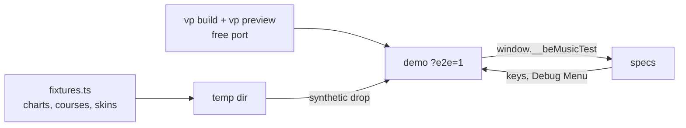

[日本語版](./course-checklist.ja.md)

# Course browser checklist

A check of the course features in the web demo, on each skin family, for what unit tests cannot reach: the scenes, the screen transitions and the audio. Most of it runs automatically, on minimal fixture skins ([Automated run](#automated-run)): run that after any change to the course flow, the scenes or the demo host. Run the whole list by hand on real skins at the end of each phase of the [migration](./architecture.md#migration), or when a change touches what the suite cannot see, and record the result at the end of this page. The rules themselves are in [course.md](./course.md); the scenes are in [player-web.md](./player-web.md).

## Automated run

`pnpm run test:e2e` builds the demo, serves it on a free port and runs the Playwright specs in [`packages/player-web-demo/e2e`](../packages/player-web-demo/e2e) against it in headless Chromium, 46 tests in all. Its global setup writes the fixtures below to a temp dir; the specs drop them as a person would (the synthetic drop of [Setup](#setup)), press keys with a `code`, set the Debug Menu's controls, and assert on the [test hook](#test-hook), never on pixels. It is not part of `pnpm test`: the plays run in real time, about five minutes with three workers.



- **Before the first run**, install Playwright's Chromium once: `pnpm exec playwright install chromium`. The suite runs the full Chromium in its new headless mode (`channel: 'chromium'`), which draws on the GPU where there is one.
- **Options.** `E2E_WORKERS` sets the parallelism (default 4), `E2E_PORT` pins the port, and the rest goes to Playwright: `pnpm run test:e2e -g NONSTOP`, `pnpm run test:e2e --headed`. A failed spec leaves a trace in `packages/player-web-demo/e2e-results/` (`pnpm exec playwright show-trace <trace.zip>`).
- **Fixture skins.** `scripts/course-checklist/skins/` holds an LR2 theme (select, decide, 7-key play, result and course-result skins, a sound set with `course_clear` / `course_fail`) and a beatoraja JSON skin (select, decide, 7-key play, result and course result), made for the checklist and free of third-party assets. They draw solid colours and the course texts behind the course ops, and have PLAY (15) and AUTO (16) buttons (the LR2 select skin also its filter and sort buttons, 10-12 and 91-96, and the beatoraja one its MODE and SORT buttons, 11 and 12); `fixtures.ts` adds their images and sounds. They exercise the flow, not the look.

| Spec                                                                                | Families                 | Tests                                  | Items                                                                                                                                                                                                                                                                                                                                                                                                                                                                      |
| ----------------------------------------------------------------------------------- | ------------------------ | -------------------------------------- | -------------------------------------------------------------------------------------------------------------------------------------------------------------------------------------------------------------------------------------------------------------------------------------------------------------------------------------------------------------------------------------------------------------------------------------------------------------------------- |
| `course-flow.ts`, through `built-in.spec.ts`, `lr2.spec.ts` and `beatoraja.spec.ts` | built-in, LR2, beatoraja | 27 (9 per family)                      | 1 (folders, bars, the lamp a manual run leaves on its course bar, the missing-stage reason by Enter and AUTO), 2 (GRADE with AUTO and with no input; stage results skipped, gauge carried, LR2 grade resets undone; the course jingle), 3, 4 (both placements, R, the locked tempo controls), 5, 6, 7, 8, 10, 11                                                                                                                                                           |
| `course-maker.spec.ts`                                                              | built-in                 | 1                                      | 9 (five-song cap, key-mode rule, constraint editor, Save, Cancel, rename, delete, `.lr2crs` and `.json` exports)                                                                                                                                                                                                                                                                                                                                                           |
| `playlog.spec.ts`                                                                   | built-in                 | 2                                      | 12 (status line, live tempo, view changes, replay with Replay / ghost on and off)                                                                                                                                                                                                                                                                                                                                                                                          |
| `select.spec.ts`                                                                    | built-in, LR2, beatoraja | 10 (3 per family, 1 more on beatoraja) | The select list: a sort or filter change keeps the bar under the cursor (the Debug Menu on the built-in family, the skin's buttons on LR2 and beatoraja, which has no difficulty filter), the key filter lists a chart under its own key mode, the search narrows the list and lists the matching charts at the root; on beatoraja, a click on the focused bar takes it (opening its folder), and a click on another bar moves the cursor there without starting the chart |
| `lane-options.spec.ts`                                                              | built-in, LR2, beatoraja | 3 (1 per family)                       | The lane options: an AUTO play with the Debug Menu's Random 1P on MIRROR plays Fixture A's keys mirrored, the scratch where it was, every note PGREAT, and its play log records `randomLane.p1` and the lanes played                                                                                                                                                                                                                                                       |
| `restart.spec.ts`                                                                   | built-in                 | 2                                      | F5 plays a single chart again as it was played: an AUTO play started from the Synesthesia skin's AUTO button, with the Debug Menu's Auto play off, stays AUTO, and a replay stays a replay                                                                                                                                                                                                                                                                                 |
| `transitions.spec.ts`                                                               | built-in                 | 1                                      | A navigation from outside ends the run: a skin dropped during a GRADE stage ends the course, the cursor back on its bar, and the next chart plays as a single play; the Debug Menu's skin controls are disabled during the play                                                                                                                                                                                                                                            |
| every spec                                                                          | all                      | —                                      | 11: a spec fails on an uncaught error or a `console.error` (the browser's own line for a 502 from a Leaderboard API that is not running is allowed)                                                                                                                                                                                                                                                                                                                        |

**Still by hand, on real skins** (the stock LR2 theme and its sound set, ModernChic or another beatoraja skin): how the scenes look, sound actually heard (the fade-out of item 5, the jingles: the suite checks which jingle the result is handed, not that it plays), PLAY / AUTO buttons and course texts as real skins lay them out, a real drag and drop, the LR2 grade's other resets (HIDDEN / SUDDEN, auto scratch, FLIP, tempo), HS-FIX, touch devices, and PLAY TIME on a beatoraja course result (not reported to the hook).

## Test hook

With `?e2e=1` in the URL, or in a development build, the demo installs `window.__beMusicTest` ([`test-hook.ts`](../packages/player-web-demo/src/test-hook.ts)), a read-only view of what it shows: a read starts nothing (it hashes no chart, for one), and a bar's best lamp and trophy are the current judge ruleset's, as the select screen shows them. It reads the state the host already keeps and the facts of each result screen and play log the host hands it; it never drives the demo. Files load through the page's drop handler.

It is a contract: the scene router and the host rewrite (P5, [ADR 0006](./adr/0006-scene-router.md)) keep every field meaning what it means here, and bump `version` when one changes.

| Member                              | What it gives                                                                                                                                                                                                                                                                                                                                                                                            |
| ----------------------------------- | -------------------------------------------------------------------------------------------------------------------------------------------------------------------------------------------------------------------------------------------------------------------------------------------------------------------------------------------------------------------------------------------------------- |
| `version`                           | The contract's revision (1).                                                                                                                                                                                                                                                                                                                                                                             |
| `state().scene`                     | `{ kind, family }`: `select`, `decide`, `play`, `result` or `none` (between screens), drawn by `built-in`, `lr2` or `beatoraja`.                                                                                                                                                                                                                                                                         |
| `state().status`, `statusLog`       | The status line, and every status line shown so far.                                                                                                                                                                                                                                                                                                                                                     |
| `state().loading`, `loads`          | Whether dropped files are being read, and how many drops (or file picks) have finished.                                                                                                                                                                                                                                                                                                                  |
| `state().library`                   | The number of charts and the course folders' labels.                                                                                                                                                                                                                                                                                                                                                     |
| `state().cursor`                    | On the select screen: the open folders and the bar under the cursor (kind, title; a course's kind, stage titles, missing stages, whether it is playable or LR2's NEW COURSE; the best lamp and trophy kept for it). On the built-in and LR2 screens, also how the list is shaped (`list`: its sort, key filter and difficulty filter, by the names of `@be-music/scene-model`, and the search as typed). |
| `state().play`                      | The play on screen: title, AUTO, replay, tempo, hi-speed (LR2 and built-in), chart seconds, judgments and gauge so far, and the course stage (name, stage, stage count).                                                                                                                                                                                                                                 |
| `state().courseDraft`               | The course being made: its kind and songs.                                                                                                                                                                                                                                                                                                                                                               |
| `state().results`                   | Every result screen shown, oldest first: the run (`single`, `stage`, `course`, `nonstop`), family, title, lamp, cleared, EX score, judgments, gauge, PLAY TIME, where the outcome's jingle came from (`lr2:courseClear`, `beatoraja:fail`, …) and, for a course, each stage's judgments, carried and final gauge, whether it was given up, and the stages reached.                                       |
| `state().playlogs`, `lastPlaylog()` | How many play logs finished plays recorded, and the last one (a single play, a course stage or a NONSTOP run).                                                                                                                                                                                                                                                                                           |

## Setup

1. **Fixtures.** `node scripts/course-checklist/fixtures.ts <dir>` writes a small BMS library to `<dir>/songs` (Fixture A–G, a dense Fixture D that empties the gauge of a no-input run, and a 5-key chart) with `songs/courses/fixture-courses.lr2crs` (FIX GRADE, FIX EXPERT, FIX NONSTOP, FIX GRADE FAIL, and FIX MISSING STAGE, whose second stage is not in the library), `<dir>/seven-stages.lr2crs` for the five-stage warning, and the fixture skins in `<dir>/skins/lr2` and `<dir>/skins/beatoraja`.
2. **Skins.** The built-in family needs nothing. For LR2 use the stock LR2 theme and its sound set (`LR2files/Theme/LR2` and `LR2files/Sound`); for beatoraja any skin (the last run used ModernChic). The fixture skins do for a quick look at the flow. Dropping a theme applies it; the Debug Menu's Skin system switches between the families.
3. **Dev server.** Run the demo on a port of its own (`pnpm --filter @be-music/player-web-demo run dev --port 5199 --strictPort`), so a session already playing on the default port is left alone.
4. **Dropping files.** A person can drag the folders onto the page. Browser automation cannot, so serve them with `node scripts/course-checklist/serve.ts fixtures=<dir>/songs extra=<dir> lr2theme=<LR2files parent> beatoraja=<skin dir>` (port 5299) and dispatch a synthetic drop from the page console:

   ```js
   window.fakeDrop = async (root, prefix = '', keep = () => true) => {
     const list = (await (await fetch(`http://127.0.0.1:5299/__list?root=${root}`)).json()).filter(keep);
     const files = await Promise.all(
       list.map(async (rel) => {
         const url = `http://127.0.0.1:5299/__file?root=${root}&path=${encodeURIComponent(rel)}`;
         const path = prefix ? `${prefix}/${rel}` : rel;
         const file = new File([await (await fetch(url)).arrayBuffer()], path.split('/').pop());
         Object.defineProperty(file, 'webkitRelativePath', { value: path });
         return file;
       }),
     );
     const event = new Event('drop', { cancelable: true });
     Object.defineProperty(event, 'dataTransfer', { value: { items: [], files, types: ['Files'] } });
     window.dispatchEvent(event);
     return files.length;
   };
   // await fakeDrop('fixtures', 'fixtures'); await fakeDrop('lr2theme');
   // await fakeDrop('extra', '', (path) => path === 'seven-stages.lr2crs');
   ```

5. **Keys.** The browser pane's key action does not reach the lanes; dispatch `KeyboardEvent`s with a `code` (e.g. `Escape`, `Enter`) on `window`. A no-input manual run is enough for the failing cases; AUTO covers the rest.

## Checklist

Run each item on the built-in, LR2 and beatoraja families.

| #   | Item                               | What to see                                                                                                                                                                                                                                                                                                                                                                                                |
| --- | ---------------------------------- | ---------------------------------------------------------------------------------------------------------------------------------------------------------------------------------------------------------------------------------------------------------------------------------------------------------------------------------------------------------------------------------------------------------- |
| 1   | Course folders and bars            | MY COURSES / MY NONSTOP / MY DAN and the dropped `.lr2crs` folder list the courses; a course bar shows its stages, and its best lamp and trophy after a run. A course with a missing stage says so when started.                                                                                                                                                                                           |
| 2   | GRADE course (AUTO and manual)     | Stages advance on the course gauge, which carries over; an AUTO run skips the stage results before the last, as LR2 does; the course result shows with the course jingle. An LR2 grade turns the lane option off and EASY into GROOVE, and the player's settings come back afterwards.                                                                                                                     |
| 3   | EXPERT course                      | The same flow on the expert gauge.                                                                                                                                                                                                                                                                                                                                                                         |
| 4   | NONSTOP course, both placements    | One stitched chart; the normal result with the clear / fail jingle; R stitches and plays it again; the pitch mode and stretcher are locked during the play, and the tempo slider too unless the pitch follows the tempo (then it changes the tempo live). beatoraja plays it and shows its result on the theme's own play and result skins.                                                                |
| 5   | Gauge emptied mid-stage            | Sound and picture fade out, then the result shows.                                                                                                                                                                                                                                                                                                                                                         |
| 6   | ESC during a course stage          | The course ends as a failed run on its course result, on the first stage too, and the stage given up counts its judgments (FIX GRADE FAIL, no input, ESC after a few POORs; and AUTO, ESC in stage 2).                                                                                                                                                                                                     |
| 7   | Clicking the canvas during a stage | The stage does not start over.                                                                                                                                                                                                                                                                                                                                                                             |
| 8   | Back to the select screen          | The cursor is on the course bar after GRADE, EXPERT and NONSTOP runs.                                                                                                                                                                                                                                                                                                                                      |
| 9   | Course maker                       | NONSTOP / EXPERT / GRADE, the five-song cap, the same-key-mode rule, the constraint editor, rename, delete, `.lr2crs` and beatoraja `.json` export; Save and Cancel say what they did.                                                                                                                                                                                                                     |
| 10  | Five-stage warning                 | Dropping `seven-stages.lr2crs` says the course is read as its first five stages.                                                                                                                                                                                                                                                                                                                           |
| 11  | Console                            | No errors from the course flow (a Leaderboard API that is not running locally answers 502; that is expected).                                                                                                                                                                                                                                                                                              |
| 12  | Play logs and replays              | The status line says what is playing and, back on the select screen, describes the library again. In pitch mode the tempo slider changes a play's tempo live, recorded in `play.tempoChanges`; hi-speed changes are recorded in `play.view` / `viewChanges`. A replay of the log follows its tempo and hi-speed with the Debug Menu's Replay / ghost options on, and keeps the viewer's own with them off. |

Known and not be-music's: the stock LR2 course-result skin (`courseresult_normal.csv`) draws its POOR row from number 113 (BAD), so POOR reads 0 there.

## Runs

| Date       | Commit     | Result                                                                                                                                                                                                                                                                                                                                                                                                                                                                                                                                                                                                                                                                                                                                                                                                                                                                                                                                                                    |
| ---------- | ---------- | ------------------------------------------------------------------------------------------------------------------------------------------------------------------------------------------------------------------------------------------------------------------------------------------------------------------------------------------------------------------------------------------------------------------------------------------------------------------------------------------------------------------------------------------------------------------------------------------------------------------------------------------------------------------------------------------------------------------------------------------------------------------------------------------------------------------------------------------------------------------------------------------------------------------------------------------------------------------------- |
| 2026-10-16 | `e1bdc6bb` | Items 1-5, 7, 9-11 passed. Failed and since fixed: ESC on the first stage of a manual run returned to the select screen with no result and no record, and the stage given up lost its judgments (built-in and LR2: the scene did not interrupt the engine); the LR2 course result played `clear` / `fail` instead of `course_clear` / `course_fail`; the cursor did not come back to the course bar after a NONSTOP run (built-in and LR2) or after any course (beatoraja).                                                                                                                                                                                                                                                                                                                                                                                                                                                                                               |
| 2026-10-16 | `097d44c5` | Fixed since the first run: ESC on stage 1 (all families), LR2 course jingles, the cursor after NONSTOP (built-in, LR2), the course gauge from READY, the built-in course result fields, ModernChic's clear jingle; LR2 / beatoraja themes load from a drop. Live tempo, view recording and replay passed. Failed and since fixed: an auto-recorded log's replay ignored its tempo changes; PLAY TIME counted 0 for a stage given up after its chart settled or in AUTO; the five-stage warning was overwritten on beatoraja, and a re-dropped course file added a duplicate folder. Failed and being fixed: the cursor after a course on beatoraja; no reason shown for a course with a missing stage; LR2 / beatoraja PLAY and AUTO buttons on a course bar; a click on a beatoraja bar's title text.                                                                                                                                                                    |
| 2026-10-16 | `7991f14b` | Re-check of the fixes since `097d44c5`: all passed. A course with missing stages says how many (built-in, LR2, beatoraja; Enter and the skins' buttons); the skins' AUTO buttons and the built-in PLAY start a focused course; beatoraja puts the cursor back on the course bar played and on the song inside a folder; a click on a beatoraja bar's title selects it or opens its folder; beatoraja course stages show a class gauge; a NONSTOP result on a beatoraja theme plays its clear jingle; the LR2 HI-SPEED readout follows the Debug Menu and ArrowUp / Down; play-log views are rounded; an AUTO log's tempo change is replayed; PLAY TIME counts a stage given up after its chart settled and an AUTO stage up to ESC; the five-stage warning stays and a re-drop adds no folder; the status line describes the library after a play. Not checked: PLAY buttons on the stock LR2 skin and ModernChic (they have none), HS-FIX on, the beatoraja fail jingle. |
| 2026-10-16 | `c8bcbce5` | First automated run (`pnpm run test:e2e`, P0b): 30 specs, items 1-12 on the built-in family and the course flow on the LR2 and beatoraja fixture skins, passed three times in a row (about 4.5 minutes each with 3-4 workers).                                                                                                                                                                                                                                                                                                                                                                                                                                                                                                                                                                                                                                                                                                                                            |
