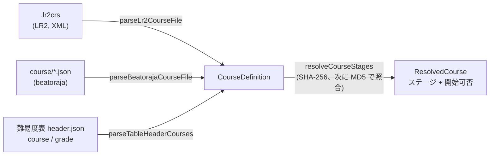
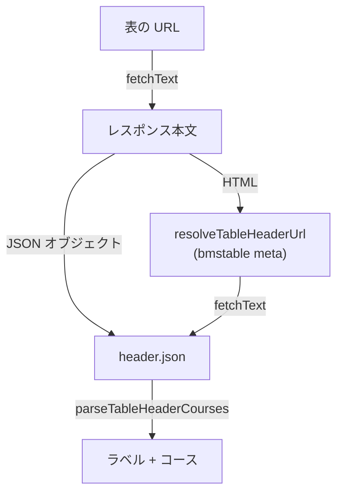
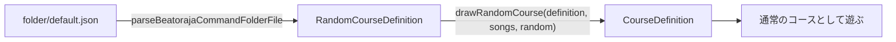
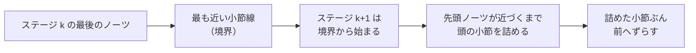
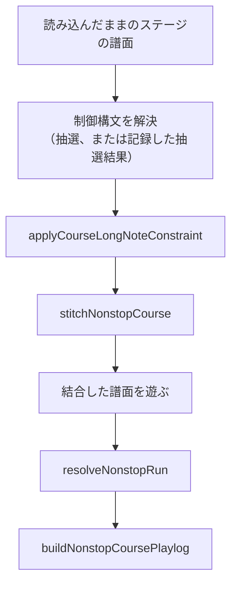
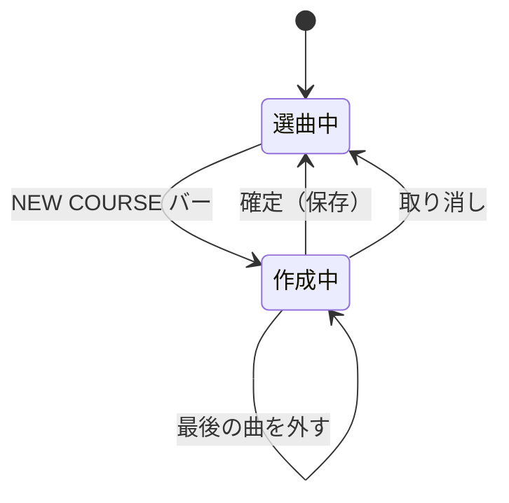
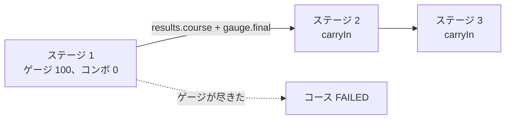
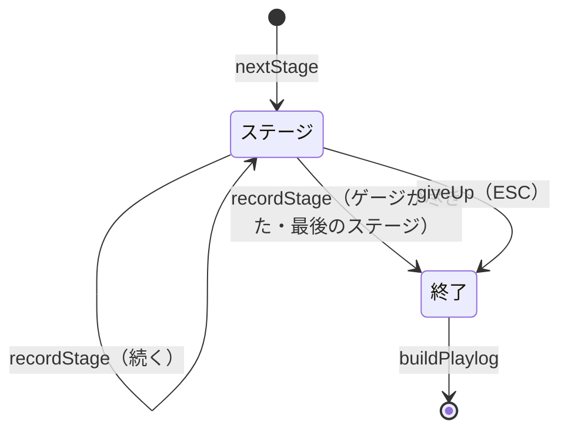

[English version](./course.md)

# コースと段位認定

**コース**は、複数の譜面を 1 回のプレイにつなげたものです。代表的なのが**段位認定**で、共通の段位ゲージのまま各ステージを続けて遊び、全体に 1 つの結果が付きます。LR2 と beatoraja はそれぞれ独自の形式でコースを定義し、難易度表は表のヘッダーにコースを載せています。be-music はこの 3 つを `@be-music/player/course` の `CourseDefinition` という 1 つのモデルに読み込むので、後段はコースの出どころを気にする必要がありません。

この文書では、コースのモデルと、各形式がそれにどう対応するかを説明します。プレイの規則（段位ゲージ、引き継ぐ状態、コースの結果）とプレイログは、実装に合わせてそれぞれの節に追加します。

## コースのモデル

| フィールド    | 意味                                                                                                                                                                      |
| ------------- | ------------------------------------------------------------------------------------------------------------------------------------------------------------------------- |
| `name`        | コース名。                                                                                                                                                                |
| `kind`        | `grade`（段位認定）、`expert`（プレイヤーが選んだゲージでステージをつなぐ）、`nonstop`（ステージを 1 本の連続したプレイにつなぐ）。                                       |
| `stages`      | 譜面を順番に並べたもの。それぞれ譜面ファイルの `md5` と `sha256`（小文字の 16 進）のどちらか、または両方で指し、手元にない譜面の表示用に `title` と `artist` を持てます。 |
| `constraints` | beatoraja のコース制約を表ヘッダーの名前で持ちます（下表）。未知の名前は捨て、グループごとに最初の 1 つだけを残します。beatoraja の `CourseData.validate` と同じです。    |
| `trophies`    | beatoraja のトロフィー（易しい順）：`{ name, missRate, scoreRate }`。BP 率が `missRate` % 以下かつスコア率が `scoreRate` % 以上を満たす最後のトロフィーを獲得します。     |
| `release`     | beatoraja の `release`。`false` ならそのコースのスコアはランキングに載せません。                                                                                          |
| `keyMode`     | 想定するキーモード（LR2 の `line`、表の `mode`）。元の形式に書かれているときだけ持ちます。                                                                                |
| `source`      | コースの出どころ。`.lr2crs` なら LR2 の hash の生の値も持ちます。                                                                                                         |

### 制約

| 名前                                                             | beatoraja の列挙子           | グループ | 意味                                                 |
| ---------------------------------------------------------------- | ---------------------------- | -------- | ---------------------------------------------------- |
| `grade`                                                          | `CLASS`                      | option   | 段位コース。レーンオプションなし。                   |
| `grade_mirror`                                                   | `MIRROR`                     | option   | 段位コース。MIRROR は可。                            |
| `grade_random`                                                   | `RANDOM`                     | option   | 段位コース。ランダム系オプションも可。               |
| `no_speed`                                                       | `NO_SPEED`                   | speed    | プレイ中のハイスピード・カバー類の変更を禁止。       |
| `no_good`                                                        | `NO_GOOD`                    | judge    | GOOD 判定なし。                                      |
| `no_great`                                                       | `NO_GREAT`                   | judge    | GREAT と GOOD の判定なし。                           |
| `gauge_lr2` / `gauge_5k` / `gauge_7k` / `gauge_9k` / `gauge_24k` | `GAUGE_LR2` … `GAUGE_24KEYS` | gauge    | 使う段位ゲージの表の組。                             |
| `ln` / `cn` / `hcn`                                              | `LN` / `CN` / `HCN`          | longNote | ロングノートのモードを定めていない譜面に使うモード。 |

難易度表のヘッダーは左列の名前で、beatoraja 自身のコースファイルは列挙子の名前で書きます。どちらも受け付けます。option グループの制約を持つコースは段位コース（`kind: 'grade'`）です。beatoraja の `CourseData.isClassCourse` と同じ判定です。

## 形式

### LR2 の `.lr2crs`

XML の `<courselist>` に、`title`、`line`（キーモード）、`type`、`hash` を持つ `<course>` 要素を並べたものです。LR2 はフィールド名の大文字小文字を区別して読み、be-music も同じです。

- **文字コード**：BOM、XML 宣言の `encoding`、厳密な UTF-8、Shift_JIS の順に判定します（`decodeCourseText`）。
- **`hash`**：32 文字のヘッダーに続き、ステージごとに 32 文字の譜面 MD5 が並びます。コースのバーには 10 ステージまで並びますが、LR2 は EXPERT・GRADE も含めどのコースも先頭の 5 ステージだけを遊びます（譜面の読み込み処理がプレイのたびにステージ数を 1〜5 に収める。`LR2body.exe` 0x4b0b0f）。そのためコースはその 5 ステージとして読みます。読まなかったステージの数は `countLr2UnplayedStages(course)` で数えられ、Web デモはファイルを読み込んだときに知らせます。ヘッダーの 10 文字目がコースの種類です。
- **`type`**：OpenLR2 にならい（`expert` / `nonstop` / `grade` テーブルとスキンの op 291-293）、`0` が EXPERT、`1` が NONSTOP、`2` が GRADE です。`type` 要素がなければヘッダーの 10 文字目を使います。
- **制約**：この形式には制約の欄がありません。GRADE のコースには `grade` と `gauge_lr2` を付けます。LR2 は GRADE コースの開始時に両サイドのレーンオプションをオフにする（[Main.cpp M1124-M1170](https://github.com/GOMazk/OpenLR2/blob/583a38503555e59c4bafa49d60b9d0714c9007c2/Main.cpp#L1124-L1170)）ので、正規しか使えません。表の旧形式 `grade` リストは jbmstable-parser の読み方どおり `grade_mirror` のままです。
- **LR2 のその他のリセット**：同じ処理で、EASY と G-ATTACK のゲージは GROOVE になり、HIDDEN / SUDDEN、アシスト（オートスクラッチなど）、BATTLE、DP の FLIP、プレイテンポ（ピッチ）、追加の変化オプションがオフになります。LR2 はこれを設定に書き込みますが、ホストはコースのステージにだけ適用するので、プレイヤーの設定はコースの後に戻ります（`@be-music/player/course` の `isLr2GradeCourse`、`resolveLr2GradeCoursePlaySettings`）。対象は `.lr2crs` から読んだ GRADE コースとコース作成で作った GRADE コースで、表や beatoraja の段位は対象外です。
- ステージがない、ステージの hash が不正、種類が未知のコースは読み飛ばします。

### beatoraja の `course/*.json`

`CourseData` オブジェクトの配列、または単一のオブジェクト（beatoraja の代替読み込み）です。各コースは `name`、`hash`（`md5` と `sha256` のどちらか、または両方と `title` を持つステージ）、`constraint`、`trophy`、`release` を持ちます。

- 名前がなければ `No Course Title`、タイトルのないステージは `course N` になります。
- ステージがない、またはどちらの hash もないステージを含むコースは読み飛ばします。`CourseData.validate` と同じです。
- option グループの制約があれば `kind` は `grade`、なければ `expert` です。

beatoraja の**ランダムコース**（`RandomCourseData`）は、曲データベースに対する SQL の `WHERE` 句で選んだ譜面から各ステージを抽選します。`parseBeatorajaRandomCourseData` は `name`、`stage[].sql`（`filter` として保持）、`constraint`、`rconstraint`（`distinct`）、`trophy` を読みます。譜面の抽選はホスト側の役割です。

### 難易度表のヘッダー

表のヘッダー（`header.json`）は、jbmstable-parser の読み方どおりにコースを持ちます。

- `course` がグループの配列（`Course[][]`）。グループ 1 つがコースのフォルダ 1 つになります。
- `course` が 1 グループ（`Course[]`）。
- どちらでもなければ旧形式の `grade` リスト。そのコースにはすべて `grade_mirror` と `gauge_lr2` を付けます。

コースはステージを `charts`（`sha256` を持ちうる表の要素そのもの）または `md5` から取ります。`charts` に hash のない譜面があるコースは読み飛ばします。タイトルのないステージは、beatoraja の `CourseData.validate` と同じく `course N` になります。ヘッダーの `mode`（`beat-7k`、`popn-9k` など）が `keyMode` になります。

#### URL から表を読む

難易度表はふつう HTML ページの URL で共有され、そのページが `<meta name="bmstable" content="header.json">` でヘッダーを指しています。`fetchTableHeaderCourses(url, fetchText)` は、このページの URL か、ヘッダー JSON の URL そのものからコースを読み込みます。

- `resolveTableHeaderUrl(pageUrl, html)` は `bmstable` の meta を探し（属性の順序、引用符、大文字小文字は問いません）、`content` をページの URL から解決します。なければ `undefined` を返します。
- ラベルはヘッダーの `name`、なければ `symbol`、それもなければ URL のホストです。コースのグループは 1 つのリストに平らにします。
- 取得するのはヘッダーだけです。`data_url` の曲リストは読みません。
- `fetchText` は呼び出し側が渡すので、モジュールはランタイム非依存のままです。ブラウザのホストは `fetch` を包み、CLI はディスクやネットワークから読めます。取得のエラーはそのまま投げ、ヘッダーのないページや JSON オブジェクトでないヘッダーは例外になります。

### beatoraja のランダムコース

beatoraja のコマンドフォルダのファイル（`folder/default.json`、`BarManager.CommandFolder`）には、**ランダムコース**（`rcourse`、[`RandomCourseData`](https://github.com/exch-bms2/beatoraja/blob/8320241d8481e0826c703878c3eba01cd81ca3e4/src/bms/player/beatoraja/select/RandomCourseData.java)）を入れられます。各ステージは譜面ではなく、楽曲データベースに対する SQL の `WHERE` 句です。ステージはコースを始めたときに抽選します。`parseBeatorajaCommandFolderFile` は、ランダムコースを持つフォルダごとに 1 グループとして `RandomCourseDefinition` に読み込みます。

- **フィルタ。** be-music には楽曲データベースがないので、`parseCourseSongFilter` / `evaluateCourseSongFilter` が句を読み、各譜面（`CourseSongRecord`）を SQLite の比較規則で判定します。対応するのは、比較、`AND` / `OR` / `NOT`、`IN`、`LIKE`、`BETWEEN`、`IS NULL`、四則演算です。列は be-music が埋められる `song` の列に限ります：`md5`、`sha256`、`title`、`subtitle`、`artist`、`subartist`、`genre`、`tag`、`path`、`level`、`difficulty`、`mode`、`notes`、`minbpm`、`maxbpm`、`length`、`judge`、`feature`、`content`。それ以外（未知の列、関数、サブクエリ）は解析エラーとし、そのステージはどの譜面も選びません。beatoraja でも失敗したクエリは何も返しません。
- **抽選。** `drawRandomCourse(definition, candidates, random)` は `RandomCourseData.lotterySongDatas` に従います。各ステージは、フィルタが選んだ譜面から一様に 1 曲引きます。フィルタのないステージは、前のステージの候補から引きます（最初のステージなら全譜面から）。`distinct` があれば、引き済みの譜面は引き直します。ただし候補がすべて引き済みなら重複を許します。結果は固定のコースで、レーンオプションの制約があれば `grade`、なければ `expert` です。`random` は外から渡すので、抽選を再現できます。
- **失敗。** フィルタを解析できないステージ、または何も選ばないステージで抽選は止まり、その旨を返します（`RandomCourseDrawFailure`）。

## NONSTOP コース

LR2 の NONSTOP コース（`.lr2crs` の type 1）は、ステージごとには遊びません。LR2 の譜面読み込みが全ステージ（最大 5）を 1 本の譜面につなぎ、1 回のプレイとして遊びます（[`ParseBmsFile`](https://github.com/GOMazk/OpenLR2/blob/583a38503555e59c4bafa49d60b9d0714c9007c2/LR2f.cpp#L25680)、`LR2body.exe` 0x4b0690）。NONSTOP は LR2 だけの機能で、BMS だけが対象です。この節はステージの配置と結合を扱います。結合した譜面はブラウザのプレイヤーで遊べます（[player-web.ja.md](player-web.ja.md)）。

**つなぎ方。** 最後以外の各ステージは、次のステージへのつなぎ方を持ちます。コースのハッシュの先頭 10 文字（`courseKeys`、`0`〜`5`）に保存されており、`parseLr2NonstopConnections` が `CourseDefinition.connections` に読み込みます。

| 数字 | つなぎ方   | その後の配置                                                       | 音                                        |
| ---- | ---------- | ------------------------------------------------------------------ | ----------------------------------------- |
| 0    | `fade`     | 次の先頭ノーツを 0.5 小節以内に詰める                              | 10 秒でフェードアウト、5 秒でフェードイン |
| 1    | `fade-fit` | `fade` と同じ。次のステージをこのステージの最終 BPM に合わせて変速 | 5 秒でフェードイン                        |
| 2    | `cut`      | `fade` と同じ                                                      | 0.2 秒で切り替え                          |
| 3    | `cut-fit`  | `cut` と同じ。変速あり                                             | 0.2 秒で切り替え                          |
| 4    | `blank1`   | 1.5 小節以内に詰める                                               | 5 秒でフェードイン                        |
| 5    | `blank2`   | 詰めず、5 秒を超える間を空ける                                     | なし                                      |

**配置**（`planNonstopCourse`。ステージの譜面は `createNonstopStageTiming` で読みます）：

- ステージは、最後の可視ノーツに最も近い小節線で次へ渡します。等距離なら前の小節線です（[L26432-L26458](https://github.com/GOMazk/OpenLR2/blob/583a38503555e59c4bafa49d60b9d0714c9007c2/LR2f.cpp#L26432-L26458)）。`blank2` の後は、そこから 5 秒を超えた最初の小節線で渡します。
- 次のステージはその小節線から始まります。先頭ノーツが小節線から 0.5 小節以上離れている間、頭の小節を詰めます（バイナリの比較は `>=` で、OpenLR2 は `>` と読んでいます）。`blank1` の後は 1.5 小節を超える間、`blank2` の後は詰めません（[L26888-L26960](https://github.com/GOMazk/OpenLR2/blob/583a38503555e59c4bafa49d60b9d0714c9007c2/LR2f.cpp#L26888-L26960)）。その後、詰めた小節の時間ぶんステージを前へずらします。
- `-fit` のつなぎ方の後は、前のステージの最終 BPM をこのステージの `#BPM` で割った比でステージを変速します。LR2 はキー音のピッチもこの比で変えます。
- LR2 が 32 ビットの float で持つ位置は、同じように丸めます。OpenLR2 は前のステージの最終小節の時刻を整数に切り捨てていますが、バイナリは float のままです。

**LR2 の配置。** `planNonstopCourse(..., { placement: 'lr2' })` は、不具合と思われる挙動も含めてバイナリのとおりに配置します。LR2 はステージを詰めた後で `lastMeasure` を更新しません。そのため 3 ステージ目以降は、前のステージを詰める**前**の小節線から始まります。時間の起点は、前のステージの詰め量だけ、このステージの BPM と第 0 小節の長さで先へ延び、その後に両方の詰め量で詰められます。テンポと小節長が一定なら意図どおりの配置と一致し、先頭の小節が違うときは（前の詰め量 × その差）だけずれます。この配置では先頭ノーツも LR2 の読み込みどおりに取ります。ファイル順で最初の可視ノーツを取り、それより後の行にあるオブジェクトでさらに下げます。既定の `'intended'` は、各ステージを前のステージが置かれた位置から始め、最初の可視ノーツを使います。

**結合**（`stitchNonstopCourse`）。配置したステージを 1 本の BMS 譜面にまとめ、エンジンは 1 本の譜面として遊びます。

- **時間基準のスクロール。** LR2 は NONSTOP のプレイを時間に比例してスクロールさせます（BPM 150 で一定、[L26529](https://github.com/GOMazk/OpenLR2/blob/583a38503555e59c4bafa49d60b9d0714c9007c2/LR2f.cpp#L26529)、[L27067](https://github.com/GOMazk/OpenLR2/blob/583a38503555e59c4bafa49d60b9d0714c9007c2/LR2f.cpp#L27067)）。そこで結合後の譜面は BPM 150 で進めます。各オブジェクトは、自分のステージのタイミング（と FIT）が示す時刻に、1 小節の 1/9600（約 0.17 ms）単位で置きます。
- **担当区間。** 各ステージは、前の境界から自分の境界までの時間を受け持ちます。その区間にある小節線（先頭ノーツに最も近いものから）が結合後の小節になり、区間内の STOP がスクロールを止めます。ノーツ、不可視ノーツ、地雷、BGM、BGA は、どこに落ちてもその位置に置きます。
- **つなぎ目。** 後のステージのノーツが、前のステージの最後のノーツの頭より 0.1 秒を超えて前に来る場合、または 0.1 秒以内で前のステージも同じ時間帯に同じレーンを使っている場合、そのノーツは BGM にします。こうして BGM にしたロングノーツは、頭の音だけを残します（[L26988-L27010](https://github.com/GOMazk/OpenLR2/blob/583a38503555e59c4bafa49d60b9d0714c9007c2/LR2f.cpp#L26988-L27010)）。
- **キー。** 全ステージのキー音、BGA、STOP のキーを、1 つの base-62 の空間（`#BASE 62`）に振り直します。1 種類で 3843 を超えるコースは拒否します（`id-space`）。地雷の値はダメージなので、そのまま残します。
- **判定ランクと TOTAL。** 結合後の譜面は最初のステージの `#RANK` で始まり、最後のステージの `#TOTAL` を使います。LR2 は TOTAL をステージごとに上書きします。後のステージではそのステージの `#RANK` に切り替わります（`map.stageRanks`、次項）。
- **後のステージの判定ランク**（`resolveNonstopStageRanks`）。LR2 のローダーは、後のステージの `#RANK` をそのステージの始まりにオブジェクトとして置きます（[L26301-L26313](https://github.com/GOMazk/OpenLR2/blob/583a38503555e59c4bafa49d60b9d0714c9007c2/LR2f.cpp#L26301-L26313)）。このオブジェクトはステージを切り詰めるときにほかのオブジェクトと一緒に前へずれ、プレイのループがそこに来ると判定幅を設定します（[L12831-L12877](https://github.com/GOMazk/OpenLR2/blob/583a38503555e59c4bafa49d60b9d0714c9007c2/LR2f.cpp#L12831-L12877)、`LR2body.exe` 0x42be2f）。`placement: 'lr2'` ではそのとおり、ステージ自身の時刻 0 で切り替えます。この時刻は前のステージの最後のノーツより何小節も前になることがあります。`#RANK` のないステージでは、それまでのランクのままです。判定幅は LR2 の NONSTOP 専用の表（`resolveLr2NonstopRankWindowsMs`）から取ります。この表は譜面の開始時の表（0x4b5835）と VERY HARD（PGREAT ±12 / GREAT ±24 / GOOD ±60 ms。開始時は ±8 / ±24 / ±40）と HARD（GOOD ±80 ms。開始時は ±60）で違います。既定の `'intended'` の配置では、前のステージの最後のノーツとそのステージの最初のノーツの中間で、その `#RANK` で始まる譜面と同じ判定幅に切り替えます。`#RANK` のないステージは NORMAL として扱います。
- **BPM 表示**（`resolveNonstopTempo`、`nonstopBpmAt`）。結合後の譜面は 150 BPM で進みますが、LR2 は各ステージ自身の BPM を表示します。ローダーは後のステージの `#BPM` を（FIT の倍率を掛けて）ステージの始まりに BPM オブジェクトとして置き（[L26257-L26273](https://github.com/GOMazk/OpenLR2/blob/583a38503555e59c4bafa49d60b9d0714c9007c2/LR2f.cpp#L26257-L26273)）、プレイのループの BPM オブジェクトが表示を変えます（[L12717-L12724](https://github.com/GOMazk/OpenLR2/blob/583a38503555e59c4bafa49d60b9d0714c9007c2/LR2f.cpp#L12717-L12724)）。`map.tempo` がこの表示を持ちます。既定では各ステージの BPM をそのステージの担当区間で出します。`placement: 'lr2'` では LR2 のイベント順どおりです（後のステージの `#BPM` はステージの時刻 0 から。最後のステージ以外では、最終小節線から後の BPM 変化を捨てます。[L26970-L26976](https://github.com/GOMazk/OpenLR2/blob/583a38503555e59c4bafa49d60b9d0714c9007c2/LR2f.cpp#L26970-L26976)）。
- **ホスト向けの情報。** 結果のマップは各ステージについて次を返します：キー（ステージ別の音のバスと BGA レイヤー用）、担当区間、つなぎ方に応じた音のフェードと 3 秒の BGA クロスフェード、LR2 がステージの切り替わりを知らせるか（BLANK でつないだときだけ）。さらに BPM 表示（`tempo`）と判定ランクの切り替え（`stageRanks`）を返します。`stageRanks` はエンジンの `stageRanks` オプションに渡します。プレイログは `chart.judgeRank.stageRanks` として記録するので、リプレイと再シミュレーションでも同じ判定幅で判定します。`assetPath` で、ホストは各ステージのファイルパスに接頭辞を付けられます。
- **未対応。** あるステージのオブジェクトが別のステージの STOP 中に鳴るときのスクロール。結合できるのは BMS のステージだけです。

**処理の流れ**（`prepareNonstopCourse`、`resolveNonstopRun`、`buildNonstopCoursePlaylog`）。ホストが遊ぶためにコースを結合するときも、Leaderboard が確かめるためにプレイの結合譜面を作り直すときも、同じ手順を使います。そのため、遊んだ譜面について両者の結果が一致します。

- `prepareNonstopCourse(stages, options)` は、各ステージの譜面の `#RANDOM` / `#SWITCH` を解決し（ステージに `randomDraws` があればそれで、なければ `random` で抽選）、コースのロングノート制約を適用し、つなぎ方・配置・結合規則の版でステージを結合します。ホストのアセットの扱いは `assetPath` で渡します。`assetPath` は遊ぶ形のステージの譜面を受け取ります。解決できないステージの譜面は `stage-chart` として断ります。
- `resolveNonstopRun(course, playlog)` はプレイの `nonstop` の記録を返します。譜面のつなぎ方、各ステージがプレイのどこにあったか（とその抽選結果）、各ノーツのステージです。
- `buildNonstopCoursePlaylog(definition, course, playlog)` はコースのプレイログを作ります。結合したプレイ、そこから切り出した到達済みの各ステージ（譜面で名前を付けます。ホストが渡す題名とファイルのハッシュ、読み込んだままの譜面のフィンガープリント）、たどり着かなかった各ステージ（遊ぶ形の譜面の情報付き）です。

## ステージを探す

`resolveCourseStages(course, lookup)` は各ステージを手元の譜面に対応させます。ステージが SHA-256 を持てば SHA-256 で、なければ MD5 で照合します。beatoraja の `TableBar` と同じです。両方を持つステージは、SHA-256 に一致する譜面がなければ MD5 で探し直します。ステージが欠けたコースも一覧には出しますが `playable` にはなりません。LR2 はそのステージを「この曲を所持していません」と表示し、beatoraja はコースを開始しません。

## コースを作る

LR2 では、選曲画面で自分の EXPERT・NONSTOP・GRADE コースを作れます（[L12148-L12269](https://github.com/GOMazk/OpenLR2/blob/583a38503555e59c4bafa49d60b9d0714c9007c2/LR2f.cpp#L12148-L12269)、[L11063-L11137](https://github.com/GOMazk/OpenLR2/blob/583a38503555e59c4bafa49d60b9d0714c9007c2/LR2f.cpp#L11063-L11137)）。作ったコースは `.lr2crs` ではなく LR2 のデータベースに保存されます。`@be-music/player/course` は、その規則を純粋関数として持ちます。

- **曲の追加。** `appendCourseDraftStage` は `CourseDraft` の末尾に曲を足します。曲は 5 曲まで（`LR2_COURSE_MAKER_MAX_STAGES`）で、すべて 1 曲目と同じキーモードである必要があり、譜面の MD5 で記録します。同じ曲を 2 回入れても構いません。`removeLastCourseDraftStage` は、LR2 の右クリックと同じく最後の曲を外します。
- **保存。** `finishCourseDraft` は、作成中のコースを `parseLr2CourseFile` が読み戻すのと同じ形の `CourseDefinition` にします。NONSTOP コースには、ステージ 1-5 の後ろに既定のつなぎ方（LR2 のボタン 268）が入ります。GRADE コースは LR2 の段位として読みます（`grade`、`gauge_lr2`）。作ったコースはランキング対象外（`release: false`）で始まります。LR2 は `ir = 0` で登録し（[L17588-L17603](https://github.com/GOMazk/OpenLR2/blob/583a38503555e59c4bafa49d60b9d0714c9007c2/LR2f.cpp#L17588-L17603)）、beatoraja のコースエディタも新しいコースを `release = false` で始めるため、プレイヤーが有効にするまでそのプレイは Leaderboard に載りません（LR2 の IR フラグ、ボタン 253 はまだ作っていません）。
- **ハッシュ。** `buildLr2CourseHash` は、LR2 の 32 文字のヘッダー（ステージ 1-10 それぞれの後のつなぎ方を `0`-`5` で、10 文字目に種類、残りは 0）と各ステージの MD5 を書きます。LR2 は 28-31 文字目にプレイヤーのパスワードの MD5 の先頭 4 文字を入れますが、ブラウザにはパスワードがないので `0` のままです。
- **編集。** `withNonstopConnection` は、あるステージの後のつなぎ方を変えます（LR2 のボタン 240-248。`stepLr2NonstopConnection` の順に、右半分で +1、左半分で -1 進みます）。LR2 はコースの長さにかかわらず、ステージ 1-9 のつなぎ方を持ちます。
- **縛り。** LR2 のコース作成には縛りを設定する手段がありません（オプション禁止のボタンは実装されませんでした）。そのため、作ったコースは `defaultCourseMakerConstraints` の縛りになります（GRADE は LR2 の段位としてレーンオプションなし・LR2 ゲージ、ほかは縛りなし）。ホストが beatoraja のコースエディタのように縛りを設定することもできます。作成中は `CourseDraft.constraints`、作った後は `withCourseConstraints` で、グループごとに 1 つに正規化します。
- **共有。** `serializeLr2CourseFile` は、コースを UTF-8 の `.lr2crs` に書きます。`parseLr2CourseFile` で読み戻すと同じコースになりますが、この形式には縛りと `release` を書く場所がありません（どのコースもランキング対象として読み戻されます）。`serializeBeatorajaCourseFile` は両方を残したまま beatoraja の `course/*.json` を書きます（beatoraja にない NONSTOP コースは含めません）。

`CourseMaker`（`@be-music/player-web/collection`）は、ホストのためにプレイヤーのコースと作成中のコースを持ちます。`resolveCourseMakerFolders` は、LR2 と同じくそれらを並べます。種類ごとにコースフォルダが 1 つあり、その中にコースが並んで、最後に NEW COURSE バーが来ます。

## コースのステージを遊ぶ

ホストはコースを 1 ステージずつ遊び、それぞれに `PlayerOptions.course` を渡します。中身は、コースの `kind`、コースの `gaugeSet`（`gauge_*` 制約）と `judge` 制約（`no-good` / `no-great`）、前のステージが残した状態を表す `carryIn`（最初のステージにはなし）です。ステージはこのオブジェクトをそのままプレイログの `play.course` に記録するので、ログは単体で再生・再シミュレーションできます。

各ステージの遊び方はコースの制約で決まります。この規則は `@be-music/player/course` にあります。

- `resolveCourseStageSettings` はコースから `PlayerOptions.course`（種類、ゲージの組、判定の制約）を読みます。
- `resolveCourseLaneOptions` は beatoraja の `MusicSelector` と同じくレーンオプションを制限します。`grade` は両サイドと DP の FLIP をオフにし、`grade_mirror` は 1P の MIRROR を残してそのとき 2P も MIRROR、FLIP をオンにします（ほかの選択ではすべてオフ）。`grade_random` は各サイドのランダム系を残します。
- `isCourseHiSpeedLocked` は `no_speed` を読みます。
- `applyCourseLongNoteConstraint` は、ロングノートのモードを決めていないステージの譜面にコースの `ln` / `cn` / `hcn` を与えます。
- LR2 の GRADE コースでは LR2 のリセットも加わります（`resolveLr2GradeCoursePlaySettings`。[LR2 の `.lr2crs`](#lr2-の-lr2crs) を参照）。

### コース用のゲージ

コースのステージは、単曲用のゲージではなく、ルールセットのコース用ゲージで遊びます。プレイヤーが選ぶのは引き続き GROOVE / EASY / HARD / DEATH で、各ルールセットがそれを自分のコース用ゲージに対応付けます。

**`lr2`**（OpenLR2 `LR2f.cpp` L27707-L27790）は、コースの種類でゲージの系統を選びます。どのコース用ゲージも 100 から始まり、2% の下限がなく、2 を下回ると 0 に固定され、32% 未満では BAD / POOR / 空 POOR のダメージが ×0.6 になります。

| 種類                   | 選択         | ゲージ                        | PG / GR / GD           | BD / POOR / 空 POOR                        |
| ---------------------- | ------------ | ----------------------------- | ---------------------- | ------------------------------------------ |
| grade                  | GROOVE、EASY | `GRADE`                       | +0.1 / +0.1 / +0.04    | −2 / −3 / −2                               |
| grade                  | HARD         | `GRADE-HARD`                  | +0.1 / +0.1 / +0.04    | −6 / −10 / −2、HARD のダメージ倍率を掛ける |
| grade、expert、nonstop | DEATH        | `GRADE-DEATH`、`COURSE-DEATH` | 0 / 0 / 0              | −100 / −100 / 0                            |
| expert、nonstop        | GROOVE       | `COURSE`                      | +0.1 / +0.1 / +0.04    | −1.5 / −2 / −1.5                           |
| expert、nonstop        | EASY         | `COURSE-EASY`                 | +0.12 / +0.12 / +0.048 | −1.2 / −1.6 / −1.2                         |
| expert、nonstop        | HARD         | `COURSE-HARD`                 | +0.1 / +0.1 / +0.05    | −6 / −10 / −2、HARD のダメージ倍率を掛ける |

**`beatoraja`** は、どのコースも段位ゲージで遊びます（`GrooveGauge.create`）。GROOVE と EASY は `CLASS`、HARD は `EXCLASS`、DEATH は `EXHARDCLASS` に対応します。ゲージの表の組はコースの `gauge_*` 制約で決まり、なければプレイモードで決まります（5 / 10 鍵は `5k`、PMS は `9k`、24 / 48 鍵は `24k`、それ以外は `7k`）。どれも 100 から始まり、TOTAL による補正はありません。**`iidx`** には公表された段位ゲージがないので、beatoraja のものを使います。

### 判定の制約

`no_good` は GOOD の判定幅を GREAT と同じにし、`no_great` は GREAT と GOOD の判定幅を PGREAT と同じにします。すべての判定幅の表に適用します（beatoraja の `JudgeManager` L175-L184 が判定幅の倍率を 0 にし、`JudgeWindowRule.create` が内側の判定幅より狭くなった判定幅を内側に合わせて広げるため）。この制約の下では、残った判定幅のすぐ外側の押下は BAD になります。どのルールセットでも適用します。

### 引き継ぐ状態

- **ゲージ**：次のステージは、前のステージが終わったときのゲージ値（`results.native.gauge.final`）から始まります。`resolveCourseStageStartGauge`（`@be-music/player/playlog`）は、エンジンが動く前にステージのコース用ゲージと開始値を返すので、ホストはステージの READY の段階からそのゲージを表示し、結果のグラフもそこから始められます。
- **コースのコンボ**：各ステージは LR2 や beatoraja と同じく自分のコンボと最大コンボを持ち、それとは別に、ステージをまたいで続き、ステージのコンボと同じところで切れるコース全体のコンボを持ちます（`PlayerSummary.course`、`results.*.course`）。次のステージはそのコンボとコースの最大コンボを引き継ぎます。

### ゲージが尽きたら終わる

サバイバル系のゲージが尽きるとその場でプレイを終える（`PlayerOptions.endOnFailure`、既定は `true`）ので、コースのステージもゲージが尽きた時点で終わり、コースは不合格になります。ゲージを尽きさせた判定が、最後に数える判定です。

ESC で投げたステージも、コースを落ちたプレイとして終えます。これは意図的に LR2 と変えています。`LR2body.exe` は、投げたステージの結果を FAILED として表示し、ゲージが 2 % 以上残っていて次のステージがあれば次へ進みます（遊ばなかったステージがあるので、コースのランプは最後に FAILED になります）。GOOD 以上の判定が 1 つもなければ、保存せずに選曲画面へ戻ります。be-music では、ESC はコースを投げる操作として扱います。

コースのステージは単曲のプレイとしてランキングに載せられません。`checkPlaylogEligibility` は `course-stage` として拒否します。

### コースのプレイ

`CourseRun`（`@be-music/player/course`）は EXPERT や GRADE のコースの 1 回のプレイです。NONSTOP コースは代わりに 1 本につないだ譜面として遊びます（[NONSTOP コース](#nonstop-コース)）。ホストはコースの定義と各ステージの譜面を渡します。ステージはホスト自身のエントリ（曲のエントリや譜面ファイルなど、`chart` と `chartPath` を持つもの）で、コースが遊ぶ形の譜面にして返します。ランタイムに依存しないので、どのホストも同じ規則でコースを遊べます。

- `nextStage` は次のステージを決めます。コースのロングノート制約を適用した譜面、引き継ぎ状態を入れた `PlayerOptions.course`、ハイスピードを固定するかどうかです。`playSettings` は、プレイヤーの選択の代わりにそのステージで使う設定を返します（`resolveCourseStagePlaySettings`。コースが許すレーンオプション、次に LR2 の GRADE コースのリセット）。
- `recordStage` はステージのプレイログを記録し、コースが続くかどうかを返します（`goesOnAfter` で先に確かめられます）。`giveUp` は ESC で投げたステージを記録し、コースを落ちたプレイとして終えます。
- `playSeconds` はステージのプレイ時間を合計します。投げたステージは投げたところまでです（`resolveGivenUpPlaySeconds`）。`stageExtras` は、ホストが各ステージについて残したもの（結果のグラフなど）を持ちます。
- `buildPlaylog` はコースのプレイログを書きます。遊んだステージに続けて、たどり着かなかった各ステージを、譜面の情報、ファイルのハッシュ、譜面のフィンガープリントとともに並べます。

### コースの結果

コースの結果はステージを合計し（[プレイログ — コースのプレイログ](./playlog.ja.md#コースのプレイログ) を参照）、そのうえで次を決めます。

- **ランプ**：ゲージが尽きて終わったステージがあるか、到達しなかったステージがあれば FAILED。コースの最大コンボがコースの全ノートに届いていれば（LR2 と beatoraja と同じく Σ ノート数 == コースの最大コンボ）FULL COMBO、GOOD がなければ PERFECT、PGREAT だけなら MAX（LR2 と IIDX は FULL COMBO が上限）。それ以外はゲージのランプです。LR2 はプレイヤーの選んだゲージに従い（EASY → EASY、HARD → HARD、それ以外は NORMAL。LR2 が HARD を出すのは HARD 系のゲージだけなので、DEATH でのクリアは NORMAL です。LR2body.exe の `CheckCourseClear`）、beatoraja と IIDX は段位ゲージに従います（`CLASS` は NORMAL、`EXCLASS` は HARD、`EXHARDCLASS` は EX-HARD）。
- **BP**（`missCount`）：BAD・POOR・空 POOR（LR2 も空 POOR を POOR の数に足すので BP に含まれます）に、未到達のステージを含め判定されなかったノートをすべて加えます（LR2 の `CheckCourseClear`、beatoraja の `MusicResult`）。
- **トロフィー**（beatoraja の `GradeBar.getTrophy`）：`missRate` ≥ BP × 100 / ノート数、かつ `scoreRate` ≤ EX スコア × 100 / (2 × ノート数) を満たす最後のトロフィー。

ランプと BP は、どのプレイのランプも決める語彙のうちコースの規則と BP です（`@be-music/player/ruleset` の `resolveCourseClearLamp`、`resolveMissCount`）。ホストはプレイの自己ベストを、そのプレイを判定したルールセットで保ちます（`resolveCoursePlayedRuleset`。ステージごとに違うプレイは記録しません）。規則は `@be-music/player/records` にあります。`courseRunRecordPlay` はプレイが記録に残すものを読み、`courseRunKeepsRecord` はオートプレイとテンポを変えたプレイを除き、`mergeCourseStageRecord` は LR2 と同じく EXPERT / GRADE のステージをその譜面の記録に反映します（最高の EX スコア・最大コンボ・最少の BP と、FULL COMBO 以上のランプ。クリアランプとプレイ回数は更新しません）。
