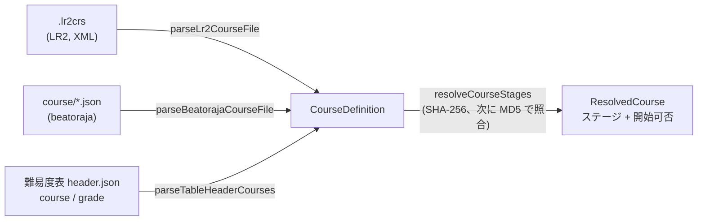
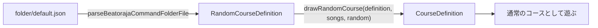
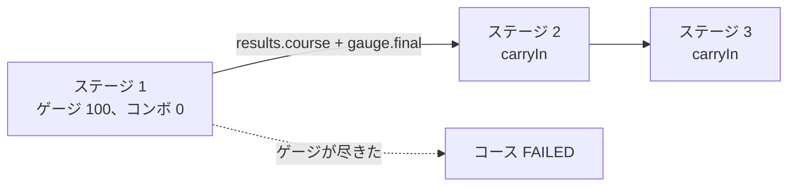

[English version](./course.md)

# コースと段位認定

**コース**は、複数の譜面を 1 回のプレイにつなげたものです。代表的なのが**段位認定**で、共通の段位ゲージのまま各ステージを続けて遊び、全体に 1 つの結果が付きます。LR2 と beatoraja はそれぞれ独自の形式でコースを定義し、難易度表は表のヘッダーにコースを載せています。be-music はこの 3 つを `@be-music/player/course` の `CourseDefinition` という 1 つのモデルに読み込むので、後段はコースの出どころを気にする必要がありません。

この文書では、コースのモデルと、各形式がそれにどう対応するかを説明します。プレイの規則（段位ゲージ、引き継ぐ状態、コースの結果）とプレイログは、実装に合わせてそれぞれの節に追加します。

## コースのモデル

| フィールド    | 意味                                                                                                                                                                      |
| ------------- | ------------------------------------------------------------------------------------------------------------------------------------------------------------------------- |
| `name`        | コース名。                                                                                                                                                                |
| `kind`        | `grade`（段位認定）、`expert`（プレイヤーが選んだゲージでステージをつなぐ）、`nonstop`（ステージを 1 本の連続したプレイにつなぐ）。                                       |
| `stages`      | 譜面を順番に並べたもの。それぞれ譜面ファイルの `md5` と `sha256`（小文字の 16 進）のどちらか、または両方で指し、手元にない譜面の表示用に `title` と `artist` を持てます。 |
| `constraints` | beatoraja のコース制約を表ヘッダーの名前で持ちます（下表）。未知の名前は捨て、グループごとに最初の 1 つだけを残します。beatoraja の `CourseData.validate` と同じです。    |
| `trophies`    | beatoraja のトロフィー（易しい順）：`{ name, missRate, scoreRate }`。BP 率が `missRate` % 以下かつスコア率が `scoreRate` % 以上を満たす最後のトロフィーを獲得します。     |
| `release`     | beatoraja の `release`。`false` ならそのコースのスコアはランキングに載せません。                                                                                          |
| `keyMode`     | 想定するキーモード（LR2 の `line`、表の `mode`）。元の形式に書かれているときだけ持ちます。                                                                                |
| `source`      | コースの出どころ。`.lr2crs` なら LR2 の hash の生の値も持ちます。                                                                                                         |

### 制約

| 名前                                                             | beatoraja の列挙子           | グループ | 意味                                                 |
| ---------------------------------------------------------------- | ---------------------------- | -------- | ---------------------------------------------------- |
| `grade`                                                          | `CLASS`                      | option   | 段位コース。レーンオプションなし。                   |
| `grade_mirror`                                                   | `MIRROR`                     | option   | 段位コース。MIRROR は可。                            |
| `grade_random`                                                   | `RANDOM`                     | option   | 段位コース。ランダム系オプションも可。               |
| `no_speed`                                                       | `NO_SPEED`                   | speed    | プレイ中のハイスピード変更を禁止。                   |
| `no_good`                                                        | `NO_GOOD`                    | judge    | GOOD 判定なし。                                      |
| `no_great`                                                       | `NO_GREAT`                   | judge    | GREAT と GOOD の判定なし。                           |
| `gauge_lr2` / `gauge_5k` / `gauge_7k` / `gauge_9k` / `gauge_24k` | `GAUGE_LR2` … `GAUGE_24KEYS` | gauge    | 使う段位ゲージの表の組。                             |
| `ln` / `cn` / `hcn`                                              | `LN` / `CN` / `HCN`          | longNote | ロングノートのモードを定めていない譜面に使うモード。 |

難易度表のヘッダーは左列の名前で、beatoraja 自身のコースファイルは列挙子の名前で書きます。どちらも受け付けます。option グループの制約を持つコースは段位コース（`kind: 'grade'`）です。beatoraja の `CourseData.isClassCourse` と同じ判定です。

## 形式

### LR2 の `.lr2crs`

XML の `<courselist>` に、`title`、`line`（キーモード）、`type`、`hash` を持つ `<course>` 要素を並べたものです。LR2 はフィールド名の大文字小文字を区別して読み、be-music も同じです。

- **文字コード**：BOM、XML 宣言の `encoding`、厳密な UTF-8、Shift_JIS の順に判定します（`decodeCourseText`）。
- **`hash`**：32 文字のヘッダーに続き、ステージごとに 32 文字の譜面 MD5 が並びます。LR2 が読むのは最大 10 ステージです（OpenLR2 `LR2f.cpp` L18078-L18081）。ヘッダーの 10 文字目がコースの種類です。
- **`type`**：OpenLR2 にならい（`expert` / `nonstop` / `grade` テーブルとスキンの op 291-293）、`0` が EXPERT、`1` が NONSTOP、`2` が GRADE です。`type` 要素がなければヘッダーの 10 文字目を使います。
- **制約**：この形式には制約の欄がありません。GRADE のコースには `grade_mirror` と `gauge_lr2` を付けます。jbmstable-parser が表の旧形式 `grade` リストに付けるのと同じ読み方で、LR2 の段位は MIRROR を許すというコミュニティでの理解に基づきます。LR2 自身のオプション制限は逆コンパイル結果からは確認できません。
- ステージがない、ステージの hash が不正、種類が未知のコースは読み飛ばします。

### beatoraja の `course/*.json`

`CourseData` オブジェクトの配列、または単一のオブジェクト（beatoraja の代替読み込み）です。各コースは `name`、`hash`（`md5` と `sha256` のどちらか、または両方と `title` を持つステージ）、`constraint`、`trophy`、`release` を持ちます。

- 名前がなければ `No Course Title`、タイトルのないステージは `course N` になります。
- ステージがない、またはどちらの hash もないステージを含むコースは読み飛ばします。`CourseData.validate` と同じです。
- option グループの制約があれば `kind` は `grade`、なければ `expert` です。

beatoraja の**ランダムコース**（`RandomCourseData`）は、曲データベースに対する SQL の `WHERE` 句で選んだ譜面から各ステージを抽選します。`parseBeatorajaRandomCourseData` は `name`、`stage[].sql`（`filter` として保持）、`constraint`、`rconstraint`（`distinct`）、`trophy` を読みます。譜面の抽選はホスト側の役割です。

### 難易度表のヘッダー

表のヘッダー（`header.json`）は、jbmstable-parser の読み方どおりにコースを持ちます。

- `course` がグループの配列（`Course[][]`）。グループ 1 つがコースのフォルダ 1 つになります。
- `course` が 1 グループ（`Course[]`）。
- どちらでもなければ旧形式の `grade` リスト。そのコースにはすべて `grade_mirror` と `gauge_lr2` を付けます。

コースはステージを `charts`（`sha256` を持ちうる表の要素そのもの）または `md5` から取ります。`charts` に hash のない譜面があるコースは読み飛ばします。ヘッダーの `mode`（`beat-7k`、`popn-9k` など）が `keyMode` になります。

### beatoraja のランダムコース

beatoraja のコマンドフォルダのファイル（`folder/default.json`、`BarManager.CommandFolder`）には、**ランダムコース**（`rcourse`、[`RandomCourseData`](https://github.com/exch-bms2/beatoraja/blob/8320241d8481e0826c703878c3eba01cd81ca3e4/src/bms/player/beatoraja/RandomCourseData.java)）を入れられます。各ステージは譜面ではなく、楽曲データベースに対する SQL の `WHERE` 句です。ステージはコースを始めたときに抽選します。`parseBeatorajaCommandFolderFile` は、ランダムコースを持つフォルダごとに 1 グループとして `RandomCourseDefinition` に読み込みます。

- **フィルタ。** be-music には楽曲データベースがないので、`parseCourseSongFilter` / `evaluateCourseSongFilter` が句を読み、各譜面（`CourseSongRecord`）を SQLite の比較規則で判定します。対応するのは、比較、`AND` / `OR` / `NOT`、`IN`、`LIKE`、`BETWEEN`、`IS NULL`、四則演算です。列は be-music が埋められる `song` の列に限ります：`md5`、`sha256`、`title`、`subtitle`、`artist`、`subartist`、`genre`、`tag`、`path`、`level`、`difficulty`、`mode`、`notes`、`minbpm`、`maxbpm`、`length`、`judge`、`feature`、`content`。それ以外（未知の列、関数、サブクエリ）は解析エラーとし、そのステージはどの譜面も選びません。beatoraja でも失敗したクエリは何も返しません。
- **抽選。** `drawRandomCourse(definition, candidates, random)` は `RandomCourseData.lotterySongDatas` に従います。各ステージは、フィルタが選んだ譜面から一様に 1 曲引きます。フィルタのないステージは、前のステージの候補から引きます（最初のステージなら全譜面から）。`distinct` があれば、引き済みの譜面は引き直します。ただし候補がすべて引き済みなら重複を許します。結果は固定のコースで、レーンオプションの制約があれば `grade`、なければ `expert` です。`random` は外から渡すので、抽選を再現できます。
- **失敗。** フィルタを解析できないステージ、または何も選ばないステージで抽選は止まり、その旨を返します（`RandomCourseDrawFailure`）。

## ステージを探す

`resolveCourseStages(course, lookup)` は各ステージを手元の譜面に対応させます。ステージが SHA-256 を持てば SHA-256 で、なければ MD5 で照合します。beatoraja の `TableBar` と同じです。両方を持つステージは、SHA-256 に一致する譜面がなければ MD5 で探し直します。ステージが欠けたコースも一覧には出しますが `playable` にはなりません。LR2 はそのステージを「この曲を所持していません」と表示し、beatoraja はコースを開始しません。

## コースのステージを遊ぶ

ホストはコースを 1 ステージずつ遊び、それぞれに `PlayerOptions.course` を渡します。中身は、コースの `kind`、コースの `gaugeSet`（`gauge_*` 制約）と `judge` 制約（`no-good` / `no-great`）、前のステージが残した状態を表す `carryIn`（最初のステージにはなし）です。ステージはこのオブジェクトをそのままプレイログの `play.course` に記録するので、ログは単体で再生・再シミュレーションできます。

### コース用のゲージ

コースのステージは、単曲用のゲージではなく、ルールセットのコース用ゲージで遊びます。プレイヤーが選ぶのは引き続き GROOVE / EASY / HARD / DEATH で、各ルールセットがそれを自分のコース用ゲージに対応付けます。

**`lr2`**（OpenLR2 `LR2f.cpp` L27707-L27790）は、コースの種類でゲージの系統を選びます。どのコース用ゲージも 100 から始まり、2% の下限がなく、2 を下回ると 0 に固定され、32% 未満では BAD / POOR / 空 POOR のダメージが ×0.6 になります。

| 種類                   | 選択         | ゲージ                        | PG / GR / GD           | BD / POOR / 空 POOR                        |
| ---------------------- | ------------ | ----------------------------- | ---------------------- | ------------------------------------------ |
| grade                  | GROOVE、EASY | `GRADE`                       | +0.1 / +0.1 / +0.04    | −2 / −3 / −2                               |
| grade                  | HARD         | `GRADE-HARD`                  | +0.1 / +0.1 / +0.04    | −6 / −10 / −2、HARD のダメージ倍率を掛ける |
| grade、expert、nonstop | DEATH        | `GRADE-DEATH`、`COURSE-DEATH` | 0 / 0 / 0              | −100 / −100 / 0                            |
| expert、nonstop        | GROOVE       | `COURSE`                      | +0.1 / +0.1 / +0.04    | −1.5 / −2 / −1.5                           |
| expert、nonstop        | EASY         | `COURSE-EASY`                 | +0.12 / +0.12 / +0.048 | −1.2 / −1.6 / −1.2                         |
| expert、nonstop        | HARD         | `COURSE-HARD`                 | +0.1 / +0.1 / +0.05    | −6 / −10 / −2、HARD のダメージ倍率を掛ける |

**`beatoraja`** は、どのコースも段位ゲージで遊びます（`GrooveGauge.create`）。GROOVE と EASY は `CLASS`、HARD は `EXCLASS`、DEATH は `EXHARDCLASS` に対応します。ゲージの表の組はコースの `gauge_*` 制約で決まり、なければプレイモードで決まります（5 / 10 鍵は `5k`、PMS は `9k`、24 / 48 鍵は `24k`、それ以外は `7k`）。どれも 100 から始まり、TOTAL による補正はありません。**`iidx`** には公表された段位ゲージがないので、beatoraja のものを使います。

### 判定の制約

`no_good` は GOOD の判定幅を GREAT と同じにし、`no_great` は GREAT と GOOD の判定幅を PGREAT と同じにします。すべての判定幅の表に適用します（beatoraja の `JudgeManager` L175-L184 が判定幅の倍率を 0 にし、`JudgeWindowRule.create` が内側の判定幅より狭くなった判定幅を内側に合わせて広げるため）。この制約の下では、残った判定幅のすぐ外側の押下は BAD になります。どのルールセットでも適用します。

### 引き継ぐ状態

- **ゲージ**：次のステージは、前のステージが終わったときのゲージ値（`results.native.gauge.final`）から始まります。
- **コースのコンボ**：各ステージは LR2 や beatoraja と同じく自分のコンボと最大コンボを持ち、それとは別に、ステージをまたいで続き、ステージのコンボと同じところで切れるコース全体のコンボを持ちます（`PlayerSummary.course`、`results.*.course`）。次のステージはそのコンボとコースの最大コンボを引き継ぎます。

### ゲージが尽きたら終わる

サバイバル系のゲージが尽きるとその場でプレイを終える（`PlayerOptions.endOnFailure`、既定は `true`）ので、コースのステージもゲージが尽きた時点で終わり、コースは不合格になります。ゲージを尽きさせた判定が、最後に数える判定です。

コースのステージは単曲のプレイとしてランキングに載せられません。`checkPlaylogEligibility` は `course-stage` として拒否します。

### コースの結果

コースの結果はステージを合計し（[プレイログ — コースのプレイログ](./playlog.ja.md#コースのプレイログ) を参照）、そのうえで次を決めます。

- **ランプ**：ゲージが尽きて終わったステージがあるか、到達しなかったステージがあれば FAILED。コースの最大コンボがコースの全ノートに届いていれば（LR2 と beatoraja と同じく Σ ノート数 == コースの最大コンボ）FULL COMBO、GOOD がなければ PERFECT、PGREAT だけなら MAX（LR2 と IIDX は FULL COMBO が上限）。それ以外はゲージのランプです。LR2 はプレイヤーの選んだゲージに従い（EASY → EASY、HARD と DEATH → HARD、それ以外は NORMAL）、beatoraja と IIDX は段位ゲージに従います（`CLASS` は NORMAL、`EXCLASS` は HARD、`EXHARDCLASS` は EX-HARD）。
- **BP**（`missCount`）：BAD・POOR・空 POOR に、未到達のステージを含め判定されなかったノートをすべて加えます（LR2 の `CheckCourseClear`、beatoraja の `MusicResult`）。
- **トロフィー**（beatoraja の `GradeBar.getTrophy`）：`missRate` ≥ BP × 100 / ノート数、かつ `scoreRate` ≤ EX スコア × 100 / (2 × ノート数) を満たす最後のトロフィー。
