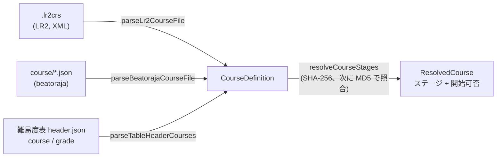

[English version](./course.md)

# コースと段位認定

**コース**は、複数の譜面を 1 回のプレイにつなげたものです。代表的なのが**段位認定**で、共通の段位ゲージのまま各ステージを続けて遊び、全体に 1 つの結果が付きます。LR2 と beatoraja はそれぞれ独自の形式でコースを定義し、難易度表は表のヘッダーにコースを載せています。be-music はこの 3 つを `@be-music/player/course` の `CourseDefinition` という 1 つのモデルに読み込むので、後段はコースの出どころを気にする必要がありません。

この文書では、コースのモデルと、各形式がそれにどう対応するかを説明します。プレイの規則（段位ゲージ、引き継ぐ状態、コースの結果）とプレイログは、実装に合わせてそれぞれの節に追加します。

## コースのモデル

| フィールド    | 意味                                                                                                                                                                      |
| ------------- | ------------------------------------------------------------------------------------------------------------------------------------------------------------------------- |
| `name`        | コース名。                                                                                                                                                                |
| `kind`        | `grade`（段位認定）、`expert`（プレイヤーが選んだゲージでステージをつなぐ）、`nonstop`（ステージを 1 本の連続したプレイにつなぐ）。                                       |
| `stages`      | 譜面を順番に並べたもの。それぞれ譜面ファイルの `md5` と `sha256`（小文字の 16 進）のどちらか、または両方で指し、手元にない譜面の表示用に `title` と `artist` を持てます。 |
| `constraints` | beatoraja のコース制約を表ヘッダーの名前で持ちます（下表）。未知の名前は捨て、グループごとに最初の 1 つだけを残します。beatoraja の `CourseData.validate` と同じです。    |
| `trophies`    | beatoraja のトロフィー（易しい順）：`{ name, missRate, scoreRate }`。BP 率が `missRate` % 以下かつスコア率が `scoreRate` % 以上を満たす最後のトロフィーを獲得します。     |
| `release`     | beatoraja の `release`。`false` ならそのコースのスコアはランキングに載せません。                                                                                          |
| `keyMode`     | 想定するキーモード（LR2 の `line`、表の `mode`）。元の形式に書かれているときだけ持ちます。                                                                                |
| `source`      | コースの出どころ。`.lr2crs` なら LR2 の hash の生の値も持ちます。                                                                                                         |

### 制約

| 名前                                                             | beatoraja の列挙子           | グループ | 意味                                                 |
| ---------------------------------------------------------------- | ---------------------------- | -------- | ---------------------------------------------------- |
| `grade`                                                          | `CLASS`                      | option   | 段位コース。レーンオプションなし。                   |
| `grade_mirror`                                                   | `MIRROR`                     | option   | 段位コース。MIRROR は可。                            |
| `grade_random`                                                   | `RANDOM`                     | option   | 段位コース。ランダム系オプションも可。               |
| `no_speed`                                                       | `NO_SPEED`                   | speed    | プレイ中のハイスピード変更を禁止。                   |
| `no_good`                                                        | `NO_GOOD`                    | judge    | GOOD 判定なし。                                      |
| `no_great`                                                       | `NO_GREAT`                   | judge    | GREAT と GOOD の判定なし。                           |
| `gauge_lr2` / `gauge_5k` / `gauge_7k` / `gauge_9k` / `gauge_24k` | `GAUGE_LR2` … `GAUGE_24KEYS` | gauge    | 使う段位ゲージの表の組。                             |
| `ln` / `cn` / `hcn`                                              | `LN` / `CN` / `HCN`          | longNote | ロングノートのモードを定めていない譜面に使うモード。 |

難易度表のヘッダーは左列の名前で、beatoraja 自身のコースファイルは列挙子の名前で書きます。どちらも受け付けます。option グループの制約を持つコースは段位コース（`kind: 'grade'`）です。beatoraja の `CourseData.isClassCourse` と同じ判定です。

## 形式

### LR2 の `.lr2crs`

XML の `<courselist>` に、`title`、`line`（キーモード）、`type`、`hash` を持つ `<course>` 要素を並べたものです。LR2 はフィールド名の大文字小文字を区別して読み、be-music も同じです。

- **文字コード**：BOM、XML 宣言の `encoding`、厳密な UTF-8、Shift_JIS の順に判定します（`decodeCourseText`）。
- **`hash`**：32 文字のヘッダーに続き、ステージごとに 32 文字の譜面 MD5 が並びます。LR2 が読むのは最大 10 ステージです（OpenLR2 `LR2f.cpp` L18078-L18081）。ヘッダーの 10 文字目がコースの種類です。
- **`type`**：OpenLR2 にならい（`expert` / `nonstop` / `grade` テーブルとスキンの op 291-293）、`0` が EXPERT、`1` が NONSTOP、`2` が GRADE です。`type` 要素がなければヘッダーの 10 文字目を使います。
- **制約**：この形式には制約の欄がありません。GRADE のコースには `grade_mirror` と `gauge_lr2` を付けます。jbmstable-parser が表の旧形式 `grade` リストに付けるのと同じ読み方で、LR2 の段位は MIRROR を許すというコミュニティでの理解に基づきます。LR2 自身のオプション制限は逆コンパイル結果からは確認できません。
- ステージがない、ステージの hash が不正、種類が未知のコースは読み飛ばします。

### beatoraja の `course/*.json`

`CourseData` オブジェクトの配列、または単一のオブジェクト（beatoraja の代替読み込み）です。各コースは `name`、`hash`（`md5` と `sha256` のどちらか、または両方と `title` を持つステージ）、`constraint`、`trophy`、`release` を持ちます。

- 名前がなければ `No Course Title`、タイトルのないステージは `course N` になります。
- ステージがない、またはどちらの hash もないステージを含むコースは読み飛ばします。`CourseData.validate` と同じです。
- option グループの制約があれば `kind` は `grade`、なければ `expert` です。

beatoraja の**ランダムコース**（`RandomCourseData`）は、曲データベースに対する SQL の `WHERE` 句で選んだ譜面から各ステージを抽選します。`parseBeatorajaRandomCourseData` は `name`、`stage[].sql`（`filter` として保持）、`constraint`、`rconstraint`（`distinct`）、`trophy` を読みます。譜面の抽選はホスト側の役割です。

### 難易度表のヘッダー

表のヘッダー（`header.json`）は、jbmstable-parser の読み方どおりにコースを持ちます。

- `course` がグループの配列（`Course[][]`）。グループ 1 つがコースのフォルダ 1 つになります。
- `course` が 1 グループ（`Course[]`）。
- どちらでもなければ旧形式の `grade` リスト。そのコースにはすべて `grade_mirror` と `gauge_lr2` を付けます。

コースはステージを `charts`（`sha256` を持ちうる表の要素そのもの）または `md5` から取ります。`charts` に hash のない譜面があるコースは読み飛ばします。ヘッダーの `mode`（`beat-7k`、`popn-9k` など）が `keyMode` になります。

## ステージを探す

`resolveCourseStages(course, lookup)` は各ステージを手元の譜面に対応させます。ステージが SHA-256 を持てば SHA-256 で、なければ MD5 で照合します。beatoraja の `TableBar` と同じです。両方を持つステージは、SHA-256 に一致する譜面がなければ MD5 で探し直します。ステージが欠けたコースも一覧には出しますが `playable` にはなりません。LR2 はそのステージを「この曲を所持していません」と表示し、beatoraja はコースを開始しません。
