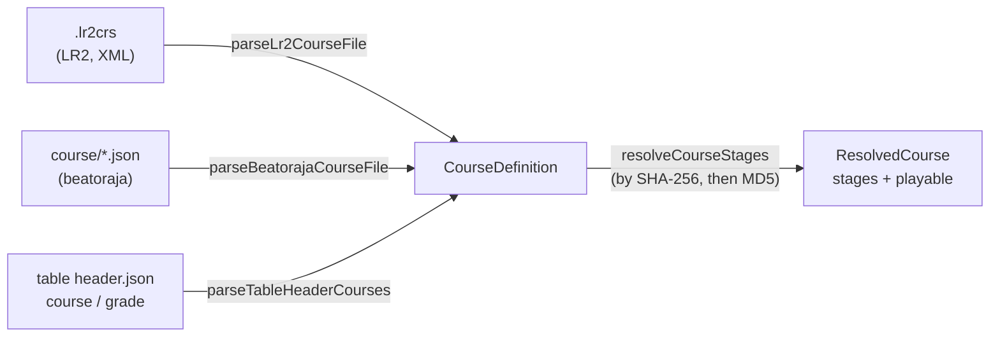
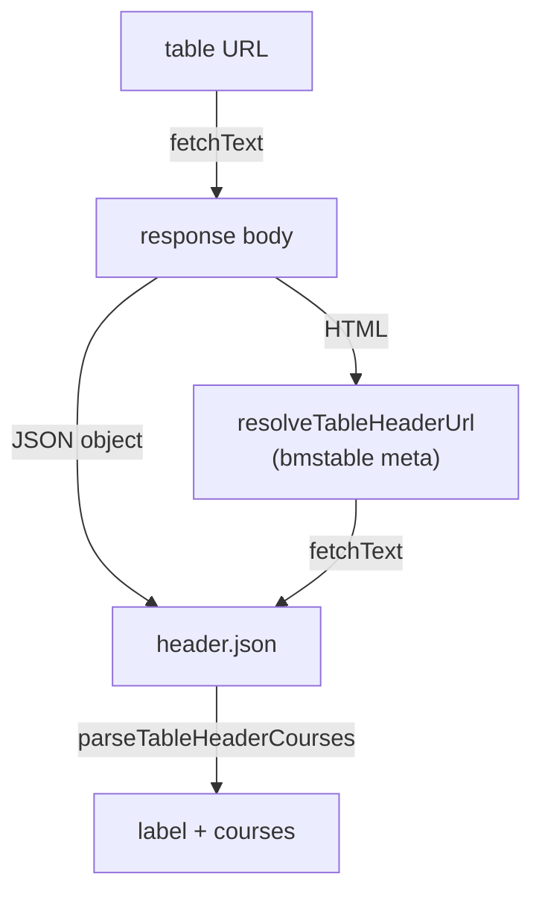
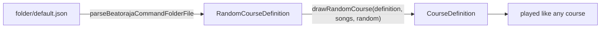
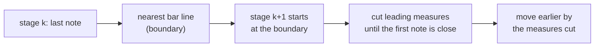
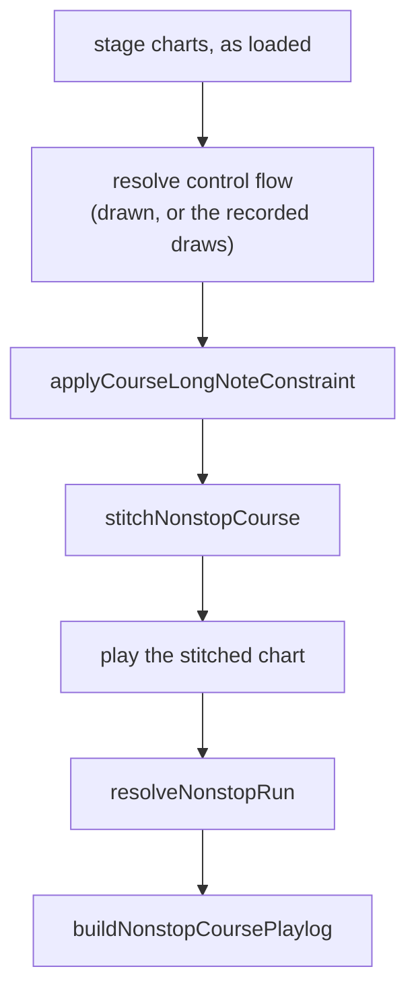
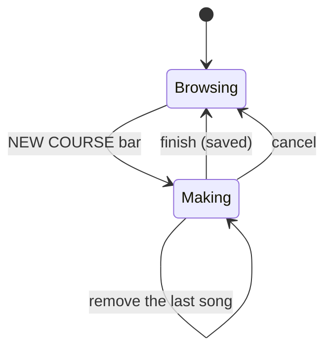
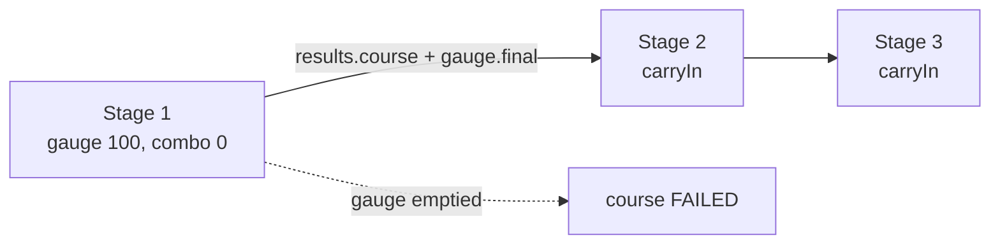
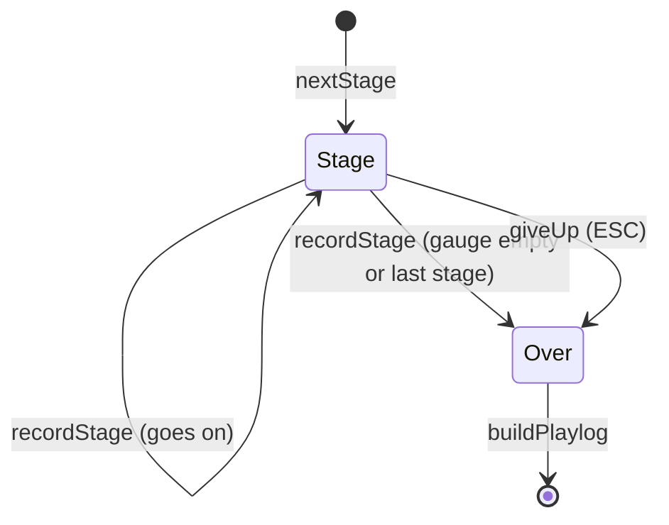

[Japanese version](./course.ja.md)

# Courses and dan certification

A **course** chains several charts into one run. The best-known kind is **dan certification (段位認定)**: the stages are played back to back on one shared class gauge, and the whole run gets a single result. LR2 and beatoraja each define courses in their own formats, and difficulty tables publish theirs inside the table header. be-music reads all three into one model, `CourseDefinition` in `@be-music/player/course`, so nothing downstream needs to know where a course came from.

This document covers the course model and how each format maps onto it. The play rules (class gauges, carried state, the course result) and the play log are covered in their own sections as they land.

## The course model

| Field         | Meaning                                                                                                                                                                                      |
| ------------- | -------------------------------------------------------------------------------------------------------------------------------------------------------------------------------------------- |
| `name`        | Course title.                                                                                                                                                                                |
| `kind`        | `grade` (dan certification), `expert` (chained stages on the player's gauge) or `nonstop` (stages stitched into one continuous play).                                                        |
| `stages`      | The charts in order, each by chart-file `md5` and / or `sha256` (lower-case hex), with an optional `title` and `artist` to show for a chart that is not found locally.                       |
| `constraints` | beatoraja's course constraints by their table-header name (below). Unknown names are dropped and only the first constraint of each group is kept, as beatoraja's `CourseData.validate` does. |
| `trophies`    | beatoraja trophies, easiest first: `{ name, missRate, scoreRate }`. A result earns the last trophy whose BP rate is at most `missRate` % and whose score rate is at least `scoreRate` %.     |
| `release`     | beatoraja's `release`. `false` keeps the course's scores off any ranking.                                                                                                                    |
| `keyMode`     | The key mode the course is meant for, when the source says (LR2 `line`, table `mode`).                                                                                                       |
| `source`      | Which format the course came from, with the raw LR2 hash for `.lr2crs`.                                                                                                                      |

### Constraints

| Name                                                             | beatoraja enum               | Group    | Meaning                                            |
| ---------------------------------------------------------------- | ---------------------------- | -------- | -------------------------------------------------- |
| `grade`                                                          | `CLASS`                      | option   | Dan course; no lane option.                        |
| `grade_mirror`                                                   | `MIRROR`                     | option   | Dan course; MIRROR allowed.                        |
| `grade_random`                                                   | `RANDOM`                     | option   | Dan course; random options allowed.                |
| `no_speed`                                                       | `NO_SPEED`                   | speed    | No hi-speed (or lane cover, lift, HIDDEN) change.  |
| `no_good`                                                        | `NO_GOOD`                    | judge    | No GOOD window.                                    |
| `no_great`                                                       | `NO_GREAT`                   | judge    | No GREAT or GOOD window.                           |
| `gauge_lr2` / `gauge_5k` / `gauge_7k` / `gauge_9k` / `gauge_24k` | `GAUGE_LR2` … `GAUGE_24KEYS` | gauge    | Which class-gauge table set the course uses.       |
| `ln` / `cn` / `hcn`                                              | `LN` / `CN` / `HCN`          | longNote | Long-note mode for charts that leave it undefined. |

Table headers write the left-hand names; beatoraja's own course files write the enum names. Both are accepted. A course with an option-group constraint is a dan course (`kind: 'grade'`), as beatoraja's `CourseData.isClassCourse` decides.

## Formats

### LR2 `.lr2crs`

An XML `<courselist>` of `<course>` elements with `title`, `line` (key mode), `type` and `hash`. LR2 reads the field names case-sensitively, and so does be-music.

- **Encoding.** A byte-order mark wins, then the XML declaration's `encoding`, then strict UTF-8, then Shift_JIS (`decodeCourseText`).
- **`hash`.** A 32-character header followed by one 32-character chart MD5 per stage. A course bar lists up to ten stages, but LR2 plays only the first five of any course, EXPERT and GRADE included (its chart loader clamps the stage count to 1-5 on every play, `LR2body.exe` 0x4b0b0f), so a course is read as those five. `countLr2UnplayedStages(course)` counts the stages left out, which the web demo reports when a file is loaded. Character 10 of the header is the course type.
- **`type`.** `0` EXPERT, `1` NONSTOP, `2` GRADE, following OpenLR2 (its `expert` / `nonstop` / `grade` tables and skin ops 291-293). Without a `type` element the header's character 10 is used.
- **Constraints.** The format has none. A grade course gets `grade` and `gauge_lr2`: when a GRADE course starts, LR2 turns both sides' lane options off ([Main.cpp M1124-M1170](https://github.com/GOMazk/OpenLR2/blob/583a38503555e59c4bafa49d60b9d0714c9007c2/Main.cpp#L1124-L1170)), so only OFF is allowed. A table's legacy `grade` list keeps jbmstable-parser's `grade_mirror`.
- **LR2's other resets.** The same code also moves an EASY or G-ATTACK gauge pick to GROOVE and turns off HIDDEN / SUDDEN, the assists (auto scratch and the rest), BATTLE, DP FLIP, the play tempo (pitch) and the extra modifiers. LR2 writes them into its config; a host applies them to the course's stages only, so the player's settings come back afterwards (`isLr2GradeCourse`, `resolveLr2GradeCoursePlaySettings` in `@be-music/player/course`). They apply to a GRADE course read from `.lr2crs` or made with the course maker, not to a table's or beatoraja's grade.
- A course with no stage, a malformed stage hash or an unknown type is skipped.

### beatoraja `course/*.json`

An array of `CourseData` objects, or a single object (beatoraja's fallback read). Each has `name`, `hash` (stages with `md5` and / or `sha256` and a `title`), `constraint`, `trophy` and `release`.

- A missing name becomes `No Course Title`, and a stage without a title becomes `course N`.
- A course with no stage, or with a stage that has neither hash, is skipped, as `CourseData.validate` does.
- `kind` is `grade` with an option-group constraint and `expert` otherwise.

beatoraja's **random courses** (`RandomCourseData`) draw each stage from the charts an SQL `WHERE` clause selects in its song database. `parseBeatorajaRandomCourseData` reads `name`, `stage[].sql` (kept as `filter`), `constraint`, `rconstraint` (`distinct`) and `trophy`; drawing the charts is the host's job.

### Difficulty-table headers

The table header (`header.json`) carries courses the way jbmstable-parser reads them:

- `course` as an array of groups (`Course[][]`), each group a folder of courses;
- `course` as one group (`Course[]`);
- otherwise the legacy `grade` list. Its courses all get `grade_mirror` and `gauge_lr2`.

A course takes its stages from `charts` (full table elements, which may carry `sha256`) or from `md5`. One whose charts lack a hash is skipped, and a stage without a title becomes `course N`, as beatoraja's `CourseData.validate` names it. The header's `mode` (`beat-7k`, `popn-9k`, …) sets `keyMode`.

#### Loading a table from its URL

A difficulty table is usually shared as the URL of its HTML page, which names the header in `<meta name="bmstable" content="header.json">`. `fetchTableHeaderCourses(url, fetchText)` loads the courses from that page URL or from the header JSON URL itself:

- `resolveTableHeaderUrl(pageUrl, html)` finds the `bmstable` meta (attribute order, quoting and case do not matter) and resolves its `content` against the page URL. It gives `undefined` when the page has none.
- The label is the header's `name`, else its `symbol`, else the host of the URL. The course groups are flattened into one list.
- Only the header is fetched. The song list behind `data_url` is not read.
- The caller passes `fetchText`, so the module stays runtime-neutral: a browser host wraps `fetch`, a CLI can read from disk or the network. Fetch errors propagate; a page without a header, or a header that is not a JSON object, throws.

### beatoraja random courses

beatoraja's command-folder file (`folder/default.json`, `BarManager.CommandFolder`) can hold **random courses** (`rcourse`, [`RandomCourseData`](https://github.com/exch-bms2/beatoraja/blob/8320241d8481e0826c703878c3eba01cd81ca3e4/src/bms/player/beatoraja/select/RandomCourseData.java)). Each stage is an SQL `WHERE` clause over the song database instead of a chart, and the stages are drawn when the course starts. `parseBeatorajaCommandFolderFile` reads them into `RandomCourseDefinition`s, one group per folder that has any.

- **Filters.** be-music has no song database, so `parseCourseSongFilter` / `evaluateCourseSongFilter` read the clause and test each chart (`CourseSongRecord`) with SQLite's comparison rules. The subset covers comparisons, `AND` / `OR` / `NOT`, `IN`, `LIKE`, `BETWEEN`, `IS NULL` and arithmetic over the `song` columns be-music can supply: `md5`, `sha256`, `title`, `subtitle`, `artist`, `subartist`, `genre`, `tag`, `path`, `level`, `difficulty`, `mode`, `notes`, `minbpm`, `maxbpm`, `length`, `judge`, `feature` and `content`. Anything else (an unknown column, a function, a sub-query) is a parse error, and the stage selects no chart, as beatoraja's failing query returns none.
- **Drawing.** `drawRandomCourse(definition, candidates, random)` follows `RandomCourseData.lotterySongDatas`. Each stage draws uniformly from what its filter selects; a stage without a filter draws from the previous stage's selection (every chart for the first). With `distinct`, a chart already drawn is drawn again, unless every candidate is taken. The result is a fixed course: `grade` when the definition has a lane-option constraint, else `expert`. `random` is injected, so a draw is reproducible.
- **Failure.** A stage whose filter does not parse, or selects nothing, stops the draw and is reported (`RandomCourseDrawFailure`).

## NONSTOP courses

An LR2 NONSTOP course (`.lr2crs` type 1) is not played stage by stage: LR2's chart loader stitches its stages (at most five) into one chart and plays it as a single run ([`ParseBmsFile`](https://github.com/GOMazk/OpenLR2/blob/583a38503555e59c4bafa49d60b9d0714c9007c2/LR2f.cpp#L25680), `LR2body.exe` 0x4b0690). NONSTOP is LR2-only and BMS-only. This section covers how the stages are placed and stitched; the browser player plays the stitched chart ([player-web.md](player-web.md)).

**Connections.** Each stage but the last has a connection to the next, stored in the first ten characters of the course hash (`courseKeys`, `0`-`5`) and read by `parseLr2NonstopConnections` into `CourseDefinition.connections`:

| Digit | Connection | Placement after it                                             | Sound                      |
| ----- | ---------- | -------------------------------------------------------------- | -------------------------- |
| 0     | `fade`     | next first note within 0.5 measure                             | 10 s fade-out, 5 s fade-in |
| 1     | `fade-fit` | as `fade`, next stage time-stretched to this stage's final BPM | 5 s fade-in                |
| 2     | `cut`      | as `fade`                                                      | 0.2 s cross-cut            |
| 3     | `cut-fit`  | as `cut`, time-stretched                                       | 0.2 s cross-cut            |
| 4     | `blank1`   | within 1.5 measures                                            | 5 s fade-in                |
| 5     | `blank2`   | no cut, after a gap of more than 5 s                           | none                       |

**Placement** (`planNonstopCourse`, with `createNonstopStageTiming` reading a stage chart):

- A stage hands over at the bar line nearest its last visible note, the earlier one on a tie ([L26432-L26458](https://github.com/GOMazk/OpenLR2/blob/583a38503555e59c4bafa49d60b9d0714c9007c2/LR2f.cpp#L26432-L26458)). After `blank2`, at the first bar line more than 5 s later.
- The next stage starts at that line. Its leading measures are cut while its first note is 0.5 measure or more past the line (the binary compares `>=`; OpenLR2 reads `>`), more than 1.5 after `blank1`, and not at all after `blank2` ([L26888-L26960](https://github.com/GOMazk/OpenLR2/blob/583a38503555e59c4bafa49d60b9d0714c9007c2/LR2f.cpp#L26888-L26960)). The stage is then moved earlier by the time of the measures cut.
- After a `-fit` connection the stage is time-stretched by the previous stage's final BPM over its `#BPM`; LR2 also changes the keysounds' pitch by that factor.
- The positions LR2 keeps as 32-bit floats are rounded the same way. OpenLR2 truncates the previous stage's last-measure time to an integer; the binary keeps it a float.

**LR2 placement.** `planNonstopCourse(..., { placement: 'lr2' })` follows the binary exactly, including what looks like a bug. LR2 never updates its `lastMeasure` after cutting a stage, so from the third stage on a stage starts at the previous stage's line _before_ that stage was cut: its time origin runs on by the previous cut at its own BPM and measure-0 length, and it is then cut by both. The result matches the intended placement while the tempo and measure lengths stay the same, and moves the stage when its first measures differ (by the previous cut × the difference). This placement also takes the first note as LR2's loader reads it: the first visible note in file order, lowered by any object on a later line. The default `'intended'` placement starts each stage where the previous one was placed and takes the first visible note.

**Stitching** (`stitchNonstopCourse`). The placed stages become one BMS chart that the engine plays as a single chart:

- **Time-based scroll.** LR2 scrolls a NONSTOP play by time, a constant 150-BPM scroll ([L26529](https://github.com/GOMazk/OpenLR2/blob/583a38503555e59c4bafa49d60b9d0714c9007c2/LR2f.cpp#L26529), [L27067](https://github.com/GOMazk/OpenLR2/blob/583a38503555e59c4bafa49d60b9d0714c9007c2/LR2f.cpp#L27067)). The stitched chart therefore runs at 150 BPM, and each object sits where its own stage's timing (and FIT) puts it, to 1/9600 of a measure (about 0.17 ms).
- **Windows.** Each stage owns the time from the previous boundary to its own. Its bar lines there (from the one nearest its first note) become the stitched measures, and its STOPs there freeze the scroll. Notes, invisible notes, mines, BGM and BGA keep their place wherever they fall.
- **The seam.** A later stage's note that lands more than 0.1 s before the previous stage's last note head, or within 0.1 s of it on a lane an earlier stage also used then, becomes background sound. A long note converted this way keeps only its head's sound ([L26988-L27010](https://github.com/GOMazk/OpenLR2/blob/583a38503555e59c4bafa49d60b9d0714c9007c2/LR2f.cpp#L26988-L27010)).
- **Keys.** Every stage's keysound, BGA and STOP keys are renumbered into one base-62 space (`#BASE 62`). A course that needs more than 3843 of one kind is refused (`id-space`). Mines keep their value, which is their damage.
- **Rank and TOTAL.** The stitched chart opens with the first stage's `#RANK` and uses the last stage's `#TOTAL`; LR2 overwrites TOTAL stage by stage. Each later stage's `#RANK` then takes over (`map.stageRanks`, below).
- **Judge rank of later stages** (`resolveNonstopStageRanks`). LR2's loader turns a later stage's `#RANK` into an object at the stage's start ([L26301-L26313](https://github.com/GOMazk/OpenLR2/blob/583a38503555e59c4bafa49d60b9d0714c9007c2/LR2f.cpp#L26301-L26313)), which moves earlier with the rest of the stage when it is cut, and the play loop sets the judge windows when it gets there ([L12831-L12877](https://github.com/GOMazk/OpenLR2/blob/583a38503555e59c4bafa49d60b9d0714c9007c2/LR2f.cpp#L12831-L12877), `LR2body.exe` 0x42be2f). With `placement: 'lr2'` the change comes there, at the stage's own time zero, which can be several measures before the previous stage's last notes; a stage without `#RANK` keeps the rank in force; and the windows come from LR2's own NONSTOP table (`resolveLr2NonstopRankWindowsMs`), which differs from the one a chart opens with (0x4b5835) for VERY HARD (PGREAT ±12 / GREAT ±24 / GOOD ±60 ms instead of ±8 / ±24 / ±40) and HARD (GOOD ±80 ms instead of ±60). The default `'intended'` placement switches halfway between the previous stage's last note and the stage's first one, to the windows a chart opening with that `#RANK` gets, and reads a stage without `#RANK` as NORMAL.
- **BPM readout** (`resolveNonstopTempo`, `nonstopBpmAt`). The stitched chart runs at 150 BPM, but LR2 shows each stage's own BPM: its loader inserts a later stage's `#BPM` as a BPM object (× the FIT rate) at the stage's start ([L26257-L26273](https://github.com/GOMazk/OpenLR2/blob/583a38503555e59c4bafa49d60b9d0714c9007c2/LR2f.cpp#L26257-L26273)), and the play loop's BPM object sets the readout ([L12717-L12724](https://github.com/GOMazk/OpenLR2/blob/583a38503555e59c4bafa49d60b9d0714c9007c2/LR2f.cpp#L12717-L12724)). `map.tempo` holds that readout: by default each stage's BPM over its own window; with `placement: 'lr2'` in LR2's event order (a later stage's `#BPM` from its time zero, and a stage's BPM changes from its last-measure line on dropped, except the last stage's, [L26970-L26976](https://github.com/GOMazk/OpenLR2/blob/583a38503555e59c4bafa49d60b9d0714c9007c2/LR2f.cpp#L26970-L26976)).
- **For the host.** The result's map gives each stage its keys (for its sound bus and BGA layer), its window, the sound fades and the 3 s BGA crossfade the connection calls for, and whether LR2 announces the stage (only after a BLANK connection), plus the BPM readout (`tempo`) and the judge rank changes (`stageRanks`, for the engine's `stageRanks` option, which the play log records as `chart.judgeRank.stageRanks` so a replay and a re-simulation judge with them). `assetPath` lets the host prefix each stage's file paths.
- **Not covered yet.** The scroll of an object of one stage that sounds during another stage's STOP. Only BMS stages can be stitched.

**The pipeline** (`prepareNonstopCourse`, `resolveNonstopRun`, `buildNonstopCoursePlaylog`). A host stitches a course to play it, and the Leaderboard rebuilds a run's stitched chart to verify it, with the same steps, so the two agree on the chart that was played:

- `prepareNonstopCourse(stages, options)` resolves each stage chart's `#RANDOM` / `#SWITCH` (with the stage's `randomDraws` when given, else drawn with `random`), applies the course's long-note constraint, and stitches the stages with the connections, placement and stitching rules. The host's asset plumbing comes in through `assetPath`, which gets the stage charts as played. A stage chart that does not resolve is refused as `stage-chart`.
- `resolveNonstopRun(course, playlog)` gives a play's `nonstop` record: how the chart was stitched, where each stage sat in the play with its draws, and the stage of every note.
- `buildNonstopCoursePlaylog(definition, course, playlog)` builds the course play log: the stitched play, each reached stage cut out of it and named by its chart (the host's title and file hashes, and the chart fingerprint of the chart as loaded), and every stage never reached with the facts of its chart as played.

## Finding the stages

`resolveCourseStages(course, lookup)` matches each stage to a local chart: by SHA-256 when the stage has one, else by MD5, as beatoraja's `TableBar` does. A stage carrying both falls back to its MD5 when no chart has the SHA-256. A course with a missing stage is still listed, but it is not `playable`; LR2 shows such a stage as a song you do not own, and beatoraja refuses to start the course.

## Making a course

LR2 lets the player make their own EXPERT, NONSTOP and GRADE courses on the select screen ([L12148-L12269](https://github.com/GOMazk/OpenLR2/blob/583a38503555e59c4bafa49d60b9d0714c9007c2/LR2f.cpp#L12148-L12269), [L11063-L11137](https://github.com/GOMazk/OpenLR2/blob/583a38503555e59c4bafa49d60b9d0714c9007c2/LR2f.cpp#L11063-L11137)), and keeps them in its database rather than in `.lr2crs` files. `@be-music/player/course` has the rules as pure functions:

- **Adding songs.** `appendCourseDraftStage` adds a song to the end of a `CourseDraft`: at most five songs (`LR2_COURSE_MAKER_MAX_STAGES`), all in the first song's key mode, keyed by the chart's MD5. The same song may appear twice. `removeLastCourseDraftStage` drops the last one, as LR2's right click does.
- **Saving.** `finishCourseDraft` turns the draft into a `CourseDefinition` shaped as `parseLr2CourseFile` would read it back. A NONSTOP course gets the default connection (LR2's button 268) after each of stages 1-5. A GRADE course reads as an LR2 grade (`grade`, `gauge_lr2`). A made course starts unranked (`release: false`): LR2 inserts it with `ir = 0` ([L17588-L17603](https://github.com/GOMazk/OpenLR2/blob/583a38503555e59c4bafa49d60b9d0714c9007c2/LR2f.cpp#L17588-L17603)) and beatoraja's course editor starts a new course with `release = false`, so its runs stay off the Leaderboard until the player opts in (LR2's IR flag, button 253, is not built yet).
- **The hash.** `buildLr2CourseHash` writes LR2's 32-character header (the connection after each of stages 1-10, `0`-`5`; the type at character 10; zeros elsewhere) and each stage's MD5. LR2 puts the first four characters of the player's password MD5 at characters 28-31; a browser has no password, so they stay `0`.
- **Editing.** `withNonstopConnection` changes the connection after one stage (LR2's buttons 240-248, which step through `stepLr2NonstopConnection`'s order: +1 on the right half, -1 on the left half). LR2 keeps a connection for each of stages 1-9 whatever the course's length.
- **Constraints.** LR2's maker has none to set (its option-ban buttons were never built), so a made course takes `defaultCourseMakerConstraints` (a GRADE course reads as an LR2 grade, no lane option with the LR2 gauge; the others have none) unless the host sets them, as beatoraja's course editor does: `CourseDraft.constraints` while making, `withCourseConstraints` afterwards (one per group, normalized).
- **Sharing.** `serializeLr2CourseFile` writes courses as a UTF-8 `.lr2crs` that `parseLr2CourseFile` reads back into the same courses, but the format has no room for constraints or `release` (every course reads back released). `serializeBeatorajaCourseFile` writes a beatoraja `course/*.json` that keeps both (NONSTOP courses, which beatoraja lacks, are left out).

`CourseMaker` (`@be-music/player-web/collection`) holds the player's courses and the course being made for a host, and `resolveCourseMakerFolders` lists them as LR2 does: one course folder per kind, each with its courses and a NEW COURSE bar last.

## Playing a course stage

A host plays a course one stage at a time, passing `PlayerOptions.course` for each: the course `kind`, the course's `gaugeSet` (its `gauge_*` constraint) and `judge` constraint (`no-good` / `no-great`), and `carryIn`, the state the previous stage left (absent for the first stage). The stage records the same object as `play.course` in its play log, so the log replays and re-simulates on its own.

The course's constraints decide how each stage plays. These rules are in `@be-music/player/course`:

- `resolveCourseStageSettings` reads `PlayerOptions.course` (kind, gauge set, judge constraint) from the course;
- `resolveCourseLaneOptions` limits the lane options as beatoraja's `MusicSelector` does: `grade` turns both sides and DP FLIP off, `grade_mirror` keeps a 1P MIRROR and then plays 2P on MIRROR with FLIP on (any other pick turns them all off), and `grade_random` keeps the random family on each side;
- `isCourseHiSpeedLocked` reads `no_speed`;
- `applyCourseLongNoteConstraint` gives a stage chart that leaves its long-note mode undefined the course's `ln` / `cn` / `hcn`;
- an LR2 GRADE course also plays with LR2's resets (`resolveLr2GradeCoursePlaySettings`, see [LR2 `.lr2crs`](#lr2-lr2crs)).

### Course gauges

A course stage runs on the ruleset's course gauge, not on the single-chart gauge. The player still picks GROOVE / EASY / HARD / DEATH; each ruleset maps the pick onto its course line-up.

**`lr2`** (OpenLR2 `LR2f.cpp` L27707-L27790) picks the line by course kind. Every course gauge starts at 100, has no 2 % floor, is pinned at 0 once it falls below 2, and softens BAD / POOR / empty POOR damage ×0.6 below 32 %.

| Kind                   | Pick         | Gauge                         | PG / GR / GD           | BD / POOR / empty POOR                      |
| ---------------------- | ------------ | ----------------------------- | ---------------------- | ------------------------------------------- |
| grade                  | GROOVE, EASY | `GRADE`                       | +0.1 / +0.1 / +0.04    | −2 / −3 / −2                                |
| grade                  | HARD         | `GRADE-HARD`                  | +0.1 / +0.1 / +0.04    | −6 / −10 / −2, × the HARD damage multiplier |
| grade, expert, nonstop | DEATH        | `GRADE-DEATH`, `COURSE-DEATH` | 0 / 0 / 0              | −100 / −100 / 0                             |
| expert, nonstop        | GROOVE       | `COURSE`                      | +0.1 / +0.1 / +0.04    | −1.5 / −2 / −1.5                            |
| expert, nonstop        | EASY         | `COURSE-EASY`                 | +0.12 / +0.12 / +0.048 | −1.2 / −1.6 / −1.2                          |
| expert, nonstop        | HARD         | `COURSE-HARD`                 | +0.1 / +0.1 / +0.05    | −6 / −10 / −2, × the HARD damage multiplier |

**`beatoraja`** plays every course on its class gauges (`GrooveGauge.create`): GROOVE and EASY map to `CLASS`, HARD to `EXCLASS`, DEATH to `EXHARDCLASS`. The table set comes from the course's `gauge_*` constraint, or from the play mode when it names none (5 / 10 keys → `5k`, PMS → `9k`, 24 / 48 keys → `24k`, otherwise `7k`). They start at 100 with no TOTAL modifier. **`iidx`** has no published class gauge, so it uses beatoraja's.

### Judge constraints

`no_good` gives GOOD the GREAT window, and `no_great` gives GREAT and GOOD the PGREAT window, on every window table (beatoraja `JudgeManager` L175-L184 sets the window rates to 0, and `JudgeWindowRule.create` widens a window narrower than the one inside it). Under these constraints a press just outside the remaining windows is a BAD. They apply under every ruleset.

### Carried state

- **Gauge**: the next stage starts at the gauge value the previous stage ended on (`results.native.gauge.final`). `resolveCourseStageStartGauge` (`@be-music/player/playlog`) names the course gauge and the value a stage starts on before the engine runs, so a host shows that gauge from the stage's READY phase and starts its result graph there.
- **Course combo**: each stage keeps its own combo and max combo, as LR2 and beatoraja do, plus a course-wide combo that runs across stages and breaks where the stage combo breaks (`PlayerSummary.course`, `results.*.course`). The next stage carries in that combo and the course max combo.

### Ending on failure

A survival gauge that empties ends the play there (`PlayerOptions.endOnFailure`, default `true`), so a course stage ends the moment its gauge empties, and the course is failed. The judgment that emptied the gauge is the last one counted.

A stage given up with ESC also ends the course as a failed run. This departs from LR2 on purpose: `LR2body.exe` shows the given-up stage's result as FAILED and, when the gauge is still at 2 % or more and stages remain, goes on to the next stage (the course lamp is FAILED in the end, since a stage was left unplayed); with no GOOD or better judged it returns to the select screen without saving. be-music treats ESC as giving up the course.

A course stage cannot be ranked as a single-chart play: `checkPlaylogEligibility` rejects it as `course-stage`.

### The course run

`CourseRun` (`@be-music/player/course`) is one run of an EXPERT or GRADE course; a NONSTOP course is played as one stitched chart instead ([NONSTOP courses](#nonstop-courses)). A host gives it the course definition and each stage's chart: its own entries (a song entry, a chart file), anything with a `chart` and a `chartPath`, which it hands back with the chart as the course plays it. The run is runtime-neutral, so every host plays courses by the same rules.

- `nextStage` plans the next stage: its chart with the course's long-note constraint applied, `PlayerOptions.course` with the carry-in, and whether the hi-speed is locked. `playSettings` gives the settings it plays with in place of the player's picks (`resolveCourseStagePlaySettings`: the lane options the course allows, then an LR2 GRADE course's resets).
- `recordStage` records a stage's play log and says whether the run goes on (`goesOnAfter` asks first); `giveUp` records a stage given up with ESC and ends the run as a failed one.
- `playSeconds` adds up the stages' play time, a stage given up up to where it was left (`resolveGivenUpPlaySeconds`). `stageExtras` keeps what the host kept of each stage, such as its result graphs.
- `buildPlaylog` writes the course play log: the stages played, then every stage never reached with its chart facts, its file hashes and its chart fingerprint.

### The course result

The course result sums the stages (see [Play log — Course play logs](./playlog.md#course-play-logs)), then:

- **Lamp**: FAILED when a stage ended with its gauge empty or a stage was never reached. A FULL COMBO when the course max combo covers every note of the course (Σ notes == course max combo, as LR2 and beatoraja check), a PERFECT without a GOOD and a MAX with only PGREATs, capped at LR2's and IIDX's FULL COMBO. Otherwise the gauge's lamp: LR2 follows the player's pick (EASY → EASY, HARD → HARD, else NORMAL: LR2 awards HARD only for its HARD-family gauges, so a DEATH clear is NORMAL, LR2body.exe `CheckCourseClear`); beatoraja and IIDX follow the class gauge (`CLASS` NORMAL, `EXCLASS` HARD, `EXHARDCLASS` EX-HARD).
- **BP** (`missCount`): BADs, POORs and empty POORs (LR2 adds an empty POOR to its POOR count, so its BP includes them too), plus every note the run never judged, the unreached stages included (LR2 `CheckCourseClear`, beatoraja `MusicResult`).
- **Trophy** (beatoraja `GradeBar.getTrophy`): the last trophy with `missRate` ≥ BP × 100 / notes and `scoreRate` ≤ EX-SCORE × 100 / (2 × notes).

The lamp and BP are the course rule and BP of the vocabulary every play is lamped with (`resolveCourseClearLamp`, `resolveMissCount` in `@be-music/player/ruleset`). A host keeps a run's best record under the judge ruleset it was played on (`resolveCoursePlayedRuleset`; a run whose stages differ keeps none), by the rules of `@be-music/player/records`: `courseRunRecordPlay` reads what the run contributes, `courseRunKeepsRecord` refuses auto-played runs and runs at another tempo, and `mergeCourseStageRecord` folds an EXPERT / GRADE stage into its chart's record as LR2 does (the best EX score, max combo and BP, and a FULL COMBO or better lamp, but no clear lamp or play count).
