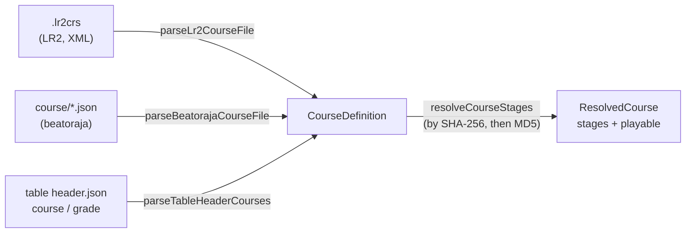

[Japanese version](./course.ja.md)

# Courses and dan certification

A **course** chains several charts into one run. The best-known kind is **dan certification (段位認定)**: the stages are played back to back on one shared class gauge, and the whole run gets a single result. LR2 and beatoraja each define courses in their own formats, and difficulty tables publish theirs inside the table header. be-music reads all three into one model, `CourseDefinition` in `@be-music/player/course`, so nothing downstream needs to know where a course came from.

This document covers the course model and how each format maps onto it. The play rules (class gauges, carried state, the course result) and the play log are covered in their own sections as they land.

## The course model

| Field         | Meaning                                                                                                                                                                                      |
| ------------- | -------------------------------------------------------------------------------------------------------------------------------------------------------------------------------------------- |
| `name`        | Course title.                                                                                                                                                                                |
| `kind`        | `grade` (dan certification), `expert` (chained stages on the player's gauge) or `nonstop` (stages stitched into one continuous play).                                                        |
| `stages`      | The charts in order, each by chart-file `md5` and / or `sha256` (lower-case hex), with an optional `title` and `artist` to show for a chart that is not found locally.                       |
| `constraints` | beatoraja's course constraints by their table-header name (below). Unknown names are dropped and only the first constraint of each group is kept, as beatoraja's `CourseData.validate` does. |
| `trophies`    | beatoraja trophies, easiest first: `{ name, missRate, scoreRate }`. A result earns the last trophy whose BP rate is at most `missRate` % and whose score rate is at least `scoreRate` %.     |
| `release`     | beatoraja's `release`. `false` keeps the course's scores off any ranking.                                                                                                                    |
| `keyMode`     | The key mode the course is meant for, when the source says (LR2 `line`, table `mode`).                                                                                                       |
| `source`      | Which format the course came from, with the raw LR2 hash for `.lr2crs`.                                                                                                                      |

### Constraints

| Name                                                             | beatoraja enum               | Group    | Meaning                                            |
| ---------------------------------------------------------------- | ---------------------------- | -------- | -------------------------------------------------- |
| `grade`                                                          | `CLASS`                      | option   | Dan course; no lane option.                        |
| `grade_mirror`                                                   | `MIRROR`                     | option   | Dan course; MIRROR allowed.                        |
| `grade_random`                                                   | `RANDOM`                     | option   | Dan course; random options allowed.                |
| `no_speed`                                                       | `NO_SPEED`                   | speed    | No hi-speed change during play.                    |
| `no_good`                                                        | `NO_GOOD`                    | judge    | No GOOD window.                                    |
| `no_great`                                                       | `NO_GREAT`                   | judge    | No GREAT or GOOD window.                           |
| `gauge_lr2` / `gauge_5k` / `gauge_7k` / `gauge_9k` / `gauge_24k` | `GAUGE_LR2` … `GAUGE_24KEYS` | gauge    | Which class-gauge table set the course uses.       |
| `ln` / `cn` / `hcn`                                              | `LN` / `CN` / `HCN`          | longNote | Long-note mode for charts that leave it undefined. |

Table headers write the left-hand names; beatoraja's own course files write the enum names. Both are accepted. A course with an option-group constraint is a dan course (`kind: 'grade'`), as beatoraja's `CourseData.isClassCourse` decides.

## Formats

### LR2 `.lr2crs`

An XML `<courselist>` of `<course>` elements with `title`, `line` (key mode), `type` and `hash`. LR2 reads the field names case-sensitively, and so does be-music.

- **Encoding.** A byte-order mark wins, then the XML declaration's `encoding`, then strict UTF-8, then Shift_JIS (`decodeCourseText`).
- **`hash`.** A 32-character header followed by one 32-character chart MD5 per stage. LR2 keeps at most ten stages (OpenLR2 `LR2f.cpp` L18078-L18081). Character 10 of the header is the course type.
- **`type`.** `0` EXPERT, `1` NONSTOP, `2` GRADE, following OpenLR2 (its `expert` / `nonstop` / `grade` tables and skin ops 291-293). Without a `type` element the header's character 10 is used.
- **Constraints.** The format has none. A grade course gets `grade_mirror` and `gauge_lr2`, the same reading jbmstable-parser gives a table's legacy `grade` list. It reflects the community understanding that LR2's dan allows MIRROR; LR2's own option lock is not visible in the decompile.
- A course with no stage, a malformed stage hash or an unknown type is skipped.

### beatoraja `course/*.json`

An array of `CourseData` objects, or a single object (beatoraja's fallback read). Each has `name`, `hash` (stages with `md5` and / or `sha256` and a `title`), `constraint`, `trophy` and `release`.

- A missing name becomes `No Course Title`, and a stage without a title becomes `course N`.
- A course with no stage, or with a stage that has neither hash, is skipped, as `CourseData.validate` does.
- `kind` is `grade` with an option-group constraint and `expert` otherwise.

beatoraja's **random courses** (`RandomCourseData`) draw each stage from the charts an SQL `WHERE` clause selects in its song database. `parseBeatorajaRandomCourseData` reads `name`, `stage[].sql` (kept as `filter`), `constraint`, `rconstraint` (`distinct`) and `trophy`; drawing the charts is the host's job.

### Difficulty-table headers

The table header (`header.json`) carries courses the way jbmstable-parser reads them:

- `course` as an array of groups (`Course[][]`), each group a folder of courses;
- `course` as one group (`Course[]`);
- otherwise the legacy `grade` list. Its courses all get `grade_mirror` and `gauge_lr2`.

A course takes its stages from `charts` (full table elements, which may carry `sha256`) or from `md5`. One whose charts lack a hash is skipped. The header's `mode` (`beat-7k`, `popn-9k`, …) sets `keyMode`.

## Finding the stages

`resolveCourseStages(course, lookup)` matches each stage to a local chart: by SHA-256 when the stage has one, else by MD5, as beatoraja's `TableBar` does. A stage carrying both falls back to its MD5 when no chart has the SHA-256. A course with a missing stage is still listed, but it is not `playable`; LR2 shows such a stage as a song you do not own, and beatoraja refuses to start the course.
