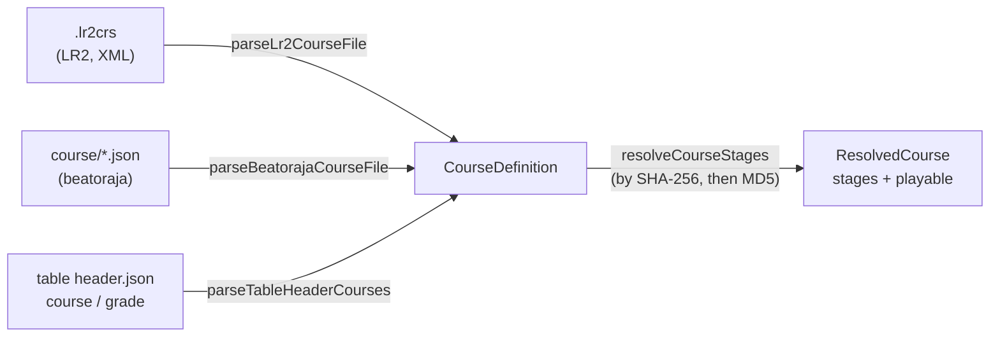
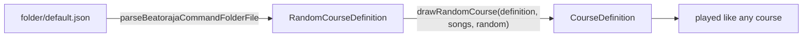
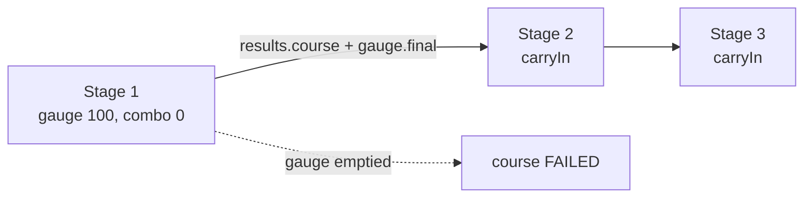

[Japanese version](./course.ja.md)

# Courses and dan certification

A **course** chains several charts into one run. The best-known kind is **dan certification (段位認定)**: the stages are played back to back on one shared class gauge, and the whole run gets a single result. LR2 and beatoraja each define courses in their own formats, and difficulty tables publish theirs inside the table header. be-music reads all three into one model, `CourseDefinition` in `@be-music/player/course`, so nothing downstream needs to know where a course came from.

This document covers the course model and how each format maps onto it. The play rules (class gauges, carried state, the course result) and the play log are covered in their own sections as they land.

## The course model

| Field         | Meaning                                                                                                                                                                                      |
| ------------- | -------------------------------------------------------------------------------------------------------------------------------------------------------------------------------------------- |
| `name`        | Course title.                                                                                                                                                                                |
| `kind`        | `grade` (dan certification), `expert` (chained stages on the player's gauge) or `nonstop` (stages stitched into one continuous play).                                                        |
| `stages`      | The charts in order, each by chart-file `md5` and / or `sha256` (lower-case hex), with an optional `title` and `artist` to show for a chart that is not found locally.                       |
| `constraints` | beatoraja's course constraints by their table-header name (below). Unknown names are dropped and only the first constraint of each group is kept, as beatoraja's `CourseData.validate` does. |
| `trophies`    | beatoraja trophies, easiest first: `{ name, missRate, scoreRate }`. A result earns the last trophy whose BP rate is at most `missRate` % and whose score rate is at least `scoreRate` %.     |
| `release`     | beatoraja's `release`. `false` keeps the course's scores off any ranking.                                                                                                                    |
| `keyMode`     | The key mode the course is meant for, when the source says (LR2 `line`, table `mode`).                                                                                                       |
| `source`      | Which format the course came from, with the raw LR2 hash for `.lr2crs`.                                                                                                                      |

### Constraints

| Name                                                             | beatoraja enum               | Group    | Meaning                                            |
| ---------------------------------------------------------------- | ---------------------------- | -------- | -------------------------------------------------- |
| `grade`                                                          | `CLASS`                      | option   | Dan course; no lane option.                        |
| `grade_mirror`                                                   | `MIRROR`                     | option   | Dan course; MIRROR allowed.                        |
| `grade_random`                                                   | `RANDOM`                     | option   | Dan course; random options allowed.                |
| `no_speed`                                                       | `NO_SPEED`                   | speed    | No hi-speed change during play.                    |
| `no_good`                                                        | `NO_GOOD`                    | judge    | No GOOD window.                                    |
| `no_great`                                                       | `NO_GREAT`                   | judge    | No GREAT or GOOD window.                           |
| `gauge_lr2` / `gauge_5k` / `gauge_7k` / `gauge_9k` / `gauge_24k` | `GAUGE_LR2` … `GAUGE_24KEYS` | gauge    | Which class-gauge table set the course uses.       |
| `ln` / `cn` / `hcn`                                              | `LN` / `CN` / `HCN`          | longNote | Long-note mode for charts that leave it undefined. |

Table headers write the left-hand names; beatoraja's own course files write the enum names. Both are accepted. A course with an option-group constraint is a dan course (`kind: 'grade'`), as beatoraja's `CourseData.isClassCourse` decides.

## Formats

### LR2 `.lr2crs`

An XML `<courselist>` of `<course>` elements with `title`, `line` (key mode), `type` and `hash`. LR2 reads the field names case-sensitively, and so does be-music.

- **Encoding.** A byte-order mark wins, then the XML declaration's `encoding`, then strict UTF-8, then Shift_JIS (`decodeCourseText`).
- **`hash`.** A 32-character header followed by one 32-character chart MD5 per stage. LR2 keeps at most ten stages (OpenLR2 `LR2f.cpp` L18078-L18081). Character 10 of the header is the course type.
- **`type`.** `0` EXPERT, `1` NONSTOP, `2` GRADE, following OpenLR2 (its `expert` / `nonstop` / `grade` tables and skin ops 291-293). Without a `type` element the header's character 10 is used.
- **Constraints.** The format has none. A grade course gets `grade_mirror` and `gauge_lr2`, the same reading jbmstable-parser gives a table's legacy `grade` list. It reflects the community understanding that LR2's dan allows MIRROR; LR2's own option lock is not visible in the decompile.
- A course with no stage, a malformed stage hash or an unknown type is skipped.

### beatoraja `course/*.json`

An array of `CourseData` objects, or a single object (beatoraja's fallback read). Each has `name`, `hash` (stages with `md5` and / or `sha256` and a `title`), `constraint`, `trophy` and `release`.

- A missing name becomes `No Course Title`, and a stage without a title becomes `course N`.
- A course with no stage, or with a stage that has neither hash, is skipped, as `CourseData.validate` does.
- `kind` is `grade` with an option-group constraint and `expert` otherwise.

beatoraja's **random courses** (`RandomCourseData`) draw each stage from the charts an SQL `WHERE` clause selects in its song database. `parseBeatorajaRandomCourseData` reads `name`, `stage[].sql` (kept as `filter`), `constraint`, `rconstraint` (`distinct`) and `trophy`; drawing the charts is the host's job.

### Difficulty-table headers

The table header (`header.json`) carries courses the way jbmstable-parser reads them:

- `course` as an array of groups (`Course[][]`), each group a folder of courses;
- `course` as one group (`Course[]`);
- otherwise the legacy `grade` list. Its courses all get `grade_mirror` and `gauge_lr2`.

A course takes its stages from `charts` (full table elements, which may carry `sha256`) or from `md5`. One whose charts lack a hash is skipped. The header's `mode` (`beat-7k`, `popn-9k`, …) sets `keyMode`.

### beatoraja random courses

beatoraja's command-folder file (`folder/default.json`, `BarManager.CommandFolder`) can hold **random courses** (`rcourse`, [`RandomCourseData`](https://github.com/exch-bms2/beatoraja/blob/8320241d8481e0826c703878c3eba01cd81ca3e4/src/bms/player/beatoraja/RandomCourseData.java)). Each stage is an SQL `WHERE` clause over the song database instead of a chart, and the stages are drawn when the course starts. `parseBeatorajaCommandFolderFile` reads them into `RandomCourseDefinition`s, one group per folder that has any.

- **Filters.** be-music has no song database, so `parseCourseSongFilter` / `evaluateCourseSongFilter` read the clause and test each chart (`CourseSongRecord`) with SQLite's comparison rules. The subset covers comparisons, `AND` / `OR` / `NOT`, `IN`, `LIKE`, `BETWEEN`, `IS NULL` and arithmetic over the `song` columns be-music can supply: `md5`, `sha256`, `title`, `subtitle`, `artist`, `subartist`, `genre`, `tag`, `path`, `level`, `difficulty`, `mode`, `notes`, `minbpm`, `maxbpm`, `length`, `judge`, `feature` and `content`. Anything else (an unknown column, a function, a sub-query) is a parse error, and the stage selects no chart, as beatoraja's failing query returns none.
- **Drawing.** `drawRandomCourse(definition, candidates, random)` follows `RandomCourseData.lotterySongDatas`. Each stage draws uniformly from what its filter selects; a stage without a filter draws from the previous stage's selection (every chart for the first). With `distinct`, a chart already drawn is drawn again, unless every candidate is taken. The result is a fixed course: `grade` when the definition has a lane-option constraint, else `expert`. `random` is injected, so a draw is reproducible.
- **Failure.** A stage whose filter does not parse, or selects nothing, stops the draw and is reported (`RandomCourseDrawFailure`).

## Finding the stages

`resolveCourseStages(course, lookup)` matches each stage to a local chart: by SHA-256 when the stage has one, else by MD5, as beatoraja's `TableBar` does. A stage carrying both falls back to its MD5 when no chart has the SHA-256. A course with a missing stage is still listed, but it is not `playable`; LR2 shows such a stage as a song you do not own, and beatoraja refuses to start the course.

## Playing a course stage

A host plays a course one stage at a time, passing `PlayerOptions.course` for each: the course `kind`, the course's `gaugeSet` (its `gauge_*` constraint) and `judge` constraint (`no-good` / `no-great`), and `carryIn`, the state the previous stage left (absent for the first stage). The stage records the same object as `play.course` in its play log, so the log replays and re-simulates on its own.

### Course gauges

A course stage runs on the ruleset's course gauge, not on the single-chart gauge. The player still picks GROOVE / EASY / HARD / DEATH; each ruleset maps the pick onto its course line-up.

**`lr2`** (OpenLR2 `LR2f.cpp` L27707-L27790) picks the line by course kind. Every course gauge starts at 100, has no 2 % floor, is pinned at 0 once it falls below 2, and softens BAD / POOR / empty POOR damage ×0.6 below 32 %.

| Kind                   | Pick         | Gauge                         | PG / GR / GD           | BD / POOR / empty POOR                      |
| ---------------------- | ------------ | ----------------------------- | ---------------------- | ------------------------------------------- |
| grade                  | GROOVE, EASY | `GRADE`                       | +0.1 / +0.1 / +0.04    | −2 / −3 / −2                                |
| grade                  | HARD         | `GRADE-HARD`                  | +0.1 / +0.1 / +0.04    | −6 / −10 / −2, × the HARD damage multiplier |
| grade, expert, nonstop | DEATH        | `GRADE-DEATH`, `COURSE-DEATH` | 0 / 0 / 0              | −100 / −100 / 0                             |
| expert, nonstop        | GROOVE       | `COURSE`                      | +0.1 / +0.1 / +0.04    | −1.5 / −2 / −1.5                            |
| expert, nonstop        | EASY         | `COURSE-EASY`                 | +0.12 / +0.12 / +0.048 | −1.2 / −1.6 / −1.2                          |
| expert, nonstop        | HARD         | `COURSE-HARD`                 | +0.1 / +0.1 / +0.05    | −6 / −10 / −2, × the HARD damage multiplier |

**`beatoraja`** plays every course on its class gauges (`GrooveGauge.create`): GROOVE and EASY map to `CLASS`, HARD to `EXCLASS`, DEATH to `EXHARDCLASS`. The table set comes from the course's `gauge_*` constraint, or from the play mode when it names none (5 / 10 keys → `5k`, PMS → `9k`, 24 / 48 keys → `24k`, otherwise `7k`). They start at 100 with no TOTAL modifier. **`iidx`** has no published class gauge, so it uses beatoraja's.

### Judge constraints

`no_good` gives GOOD the GREAT window, and `no_great` gives GREAT and GOOD the PGREAT window, on every window table (beatoraja `JudgeManager` L175-L184 sets the window rates to 0, and `JudgeWindowRule.create` widens a window narrower than the one inside it). Under these constraints a press just outside the remaining windows is a BAD. They apply under every ruleset.

### Carried state

- **Gauge**: the next stage starts at the gauge value the previous stage ended on (`results.native.gauge.final`).
- **Course combo**: each stage keeps its own combo and max combo, as LR2 and beatoraja do, plus a course-wide combo that runs across stages and breaks where the stage combo breaks (`PlayerSummary.course`, `results.*.course`). The next stage carries in that combo and the course max combo.

### Ending on failure

A survival gauge that empties ends the play there (`PlayerOptions.endOnFailure`, default `true`), so a course stage ends the moment its gauge empties, and the course is failed. The judgment that emptied the gauge is the last one counted.

A course stage cannot be ranked as a single-chart play: `checkPlaylogEligibility` rejects it as `course-stage`.

### The course result

The course result sums the stages (see [Play log — Course play logs](./playlog.md#course-play-logs)), then:

- **Lamp**: FAILED when a stage ended with its gauge empty or a stage was never reached. A FULL COMBO when the course max combo covers every note of the course (Σ notes == course max combo, as LR2 and beatoraja check), a PERFECT without a GOOD and a MAX with only PGREATs, capped at LR2's and IIDX's FULL COMBO. Otherwise the gauge's lamp: LR2 follows the player's pick (EASY → EASY, HARD and DEATH → HARD, else NORMAL); beatoraja and IIDX follow the class gauge (`CLASS` NORMAL, `EXCLASS` HARD, `EXHARDCLASS` EX-HARD).
- **BP** (`missCount`): BADs, POORs and empty POORs, plus every note the run never judged, the unreached stages included (LR2 `CheckCourseClear`, beatoraja `MusicResult`).
- **Trophy** (beatoraja `GradeBar.getTrophy`): the last trophy with `missRate` ≥ BP × 100 / notes and `scoreRate` ≤ EX-SCORE × 100 / (2 × notes).
