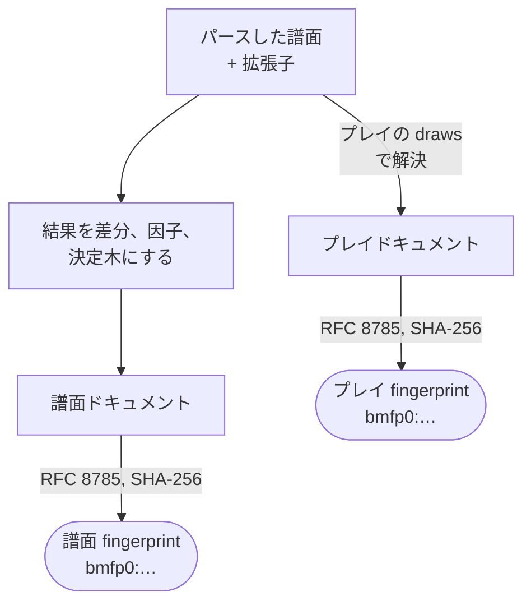
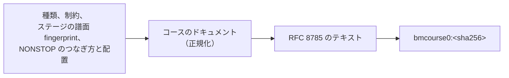

[English version](./fingerprint-spec.md)

# Be-Music Fingerprint 仕様

> ステータス: `@be-music/chart` に実装済みで、プレイログにも記録します（7 章）。アルゴリズムのバージョン: `bmfp0`。

Be-Music Fingerprint は、譜面をファイルのバイト列ではなく **プレイヤーが遊ぶもの、レーン上に見えるもの** で識別します。次のような違いがあっても、遊んだ内容が同じなら 2 つの譜面ファイルは同じ fingerprint になります。

- 片方に BGA がない、BGM やキー音、メタデータが違う
- エディタ A で保存したものをエディタ B で保存し直した（行の順序、`#WAV` の番号、小節内の分解能、小数の桁数が違う）
- 片方が BMS で、もう片方が bmson（3.3 節の範囲で）

判定、ゲージ、タイミング、ノーツが降ってくる見え方を変えるものが変われば、fingerprint も変わります。

## 1. 2 種類の fingerprint

| 名前                   | 入力                                               | 用途                                                               |
| ---------------------- | -------------------------------------------------- | ------------------------------------------------------------------ |
| **譜面 fingerprint**   | `#RANDOM` / `#SWITCH` の構造を解決しないままの譜面 | 譜面ファイルの識別（曲リスト、難易度表、スコアデータベース）       |
| **プレイ fingerprint** | 制御構文の分岐をすべて決めた後の譜面               | 1 回のプレイで実際に遊んだ内容の識別（プレイログ、リプレイの照合） |

どちらも次の 2 つを入力にします。

1. be-music がパースした譜面（レーン構成の入力として、レーン、`#PLAYER 3`、bmson のキーボード `mode_hint` を含みます。3.5 節）
2. 譜面の **拡張子**。レーン構成の入力です（`.pms` なら 9 KEY。3.5 節）。実装はこれを明示的な入力として受け取らなければなりません。ほかの拡張子や不明な拡張子は、ないものとして扱います。

それぞれの fingerprint の作り方です（3〜5 節）。



どの結果でも同じように遊べる譜面（とくに制御構文のない譜面）では、譜面 fingerprint とプレイ fingerprint は同じ値になります。

MIRROR / RANDOM / DP フリップなどのレーンオプションは譜面ではなくプレイオプションなので、どちらの fingerprint にも含めません。プレイログでは別に記録します。

## 2. 含めるもの

| 含める（プレイやレーンの見え方に影響する）                                               | 含めない                                                                                                     |
| ---------------------------------------------------------------------------------------- | ------------------------------------------------------------------------------------------------------------ |
| レーン構成（5 / 7 / 9 / 10 / 14 / 24 / 48 KEY）                                          | タイトル、サブタイトル、アーティスト、ジャンル、`#PLAYLEVEL`、`#DIFFICULTY`、`#COMMENT`、`#TEXT`、`#PREVIEW` |
| 見えるノーツ: 位置とレーン                                                               | ノーツが鳴らす音（キー音の割り当て）                                                                         |
| ロングノーツ: 始点、終点、モード（LN / CN / HCN）、FREE ZONE ノーツ                      | BGM（チャンネル `01`）、`#WAV`、`#EXWAV`、`#VOLWAV`、`#WAVCMD`、音量変更チャンネル                           |
| 地雷（`Dx` / `Ex`、bmson の `mine_channels`）: 位置、レーン、ダメージ                    | BGA、レイヤー、POOR 画像、`#BMP`、`#BGA`、`#SWBGA`、`#ARGB`、`#STAGEFILE`、`#BANNER`、`#BACKBMP`、動画       |
| 小節線（小節の長さ、小節線を描くかどうか）                                               | 不可視ノーツ（`3x` / `4x`、bmson の `key_channels`。判定されない）                                           |
| 初期 BPM、BPM 変化、STOP、`#STP`                                                         | 表記としての `#LNTYPE`、`#LNOBJ`、`5x` / `6x`（解決後のロングノーツを含める）                                |
| SCROLL（`SC`）と SPEED（`SP`）                                                           | `#OPTION`、`#MIDIFILE`、`#PATH_WAV`、`#MATERIALS`、`#BASE`、`#CHARSET`                                       |
| `#BASEBPM`（ハイスピードの基準 BPM を決めるので、ノーツの見かけの速さが変わる）          | `#CHANGEOPTION`（下記）                                                                                      |
| 判定ランク: `#RANK`、`#DEFEXRANK`、bmson の `judge_rank`、`#EXRANKxx` による変化（`A0`） | レーンの中や上に描かれないもの                                                                               |
| `#TOTAL` / bmson の `total`                                                              |                                                                                                              |

`#CHANGEOPTION` は譜面の途中でレーンオプションを強制でき、プレイを変えうるものです。be-music はこれをパースしますが適用しないので、含めません。`#CHANGEOPTION` だけが違う 2 つの譜面は、be-music では同じように遊べます。be-music が適用するようになったら、バージョンを上げて fingerprint に含めます（5 章）。

## 3. 正規化

fingerprint は **be-music による譜面の解釈** の上で定義します。どのオブジェクトが存在し、それぞれがどのレーンにあるか（bmson の `x` はプレイモード表の `mode_hint` のレーンで対応づけます）はパーサーが決め、何を遊ぶか（判定されるノーツとロングノーツの対、地雷とそのダメージ、BPM / STOP / `#STP` / SCROLL / SPEED、判定ランクと TOTAL の値）は Resolved 層（`resolveChart`。[アーキテクチャ](./architecture.ja.md) を参照）のリゾルバが決めます。fingerprint は同じリゾルバを通して項目を読み、この章ではその結果を正規形にする方法、つまり拍や秒の代わりの正確な座標（3.3 節）、スナップ（3.2 節）、3.4 節と 4 章の削除と並び順を定めます。be-music のエンジンが既定値にフォールバックするところ（3.4 節と 3.5 節）では fingerprint も同じフォールバックを使うので、エンジンが同じように遊ぶ 2 つの譜面は同じ fingerprint になります。

### 3.1 正確な数値

数値はすべて正確な有理数として扱います。ファイル中の小数表記（`#xxx02`、`#BPM`、`#BPMxx`、`#STP`、`#TOTAL`、bmson の数値）は、2 進浮動小数点数を経由せず、その数字の並びから有理数にします。IEEE 754 の double しか手元にない場合は、その最短往復表現の小数テキストを使います。差は 3.2 節のスナップが吸収します。

### 3.2 スナップ（小数で書かれた値だけ）

エディタは同じつもりの値を違う桁数で出力します（`0.333333`、`0.3333`、`133.333`）。**スナップするのは小数で書かれる数値だけ**、つまり小節の長さと値です。位置はスナップしません（3.3 節）。

規則は、数値 `x`、分母の上限 `Q`、許容幅 `t` に対して次のとおりです。`1 ≤ q ≤ Q` の有理数 `a/q` のうち `x` に最も近いものを取り、それが `x` から `t` 以内なら結果は `a/q`、そうでなければ `x` そのもの（正確な値）です。同じ距離なら `q` の小さいほう、次に値の小さいほうを取ります。すでに分母が `Q` 以下の値は、そのままが結果です。

| 対象                                                                                                                                      | `Q`                  | 許容幅 `t`                                  |
| ----------------------------------------------------------------------------------------------------------------------------------------- | -------------------- | ------------------------------------------- |
| 小節の長さ `L`（4/4 小節単位。`#xxx02`、bmson の長さも）                                                                                  | 48。拍数 `4L` に適用 | `1/4608` 拍（絶対値）                       |
| 値: BPM、`#BASEBPM`、STOP の長さ、bmson の stop `duration`、`#STP` の長さ、SCROLL、SPEED、`#EXRANK`、地雷のダメージ、`#TOTAL`、判定ランク | 12                   | `10⁻⁵ · \|x\|`（相対値）。`0` は `0` のまま |

小節の長さは **拍数** に対して、拍単位の絶対的な許容幅でスナップするので、長い小節で許容幅が広がることはありません。候補は正の数に限ります。

この数値にした理由:

- **小節の長さ。** 拍の分母 48 までで、4/4 小節の 1/192（BMS の STOP 単位）で書ける長さすべてと、1 拍の 3 分の 1、5 分の 1、7 分の 1、9 分の 1 を覆います。異なる 2 つの候補は少なくとも `1/(48·47) = 1/2256` 拍離れていて、許容幅 `1/4608 = 1/(2·48²)` はその半分より小さいので、ある数値が 2 つの候補の許容幅に同時に入ることはありません。結果は出力が候補のどちら側にずれたかに左右されず、許容幅より小さいずれに対して安定です。小数 5 桁以上（四捨五入でも切り捨てでも）、または小数 4 桁の四捨五入で出力された長さは、意図した小さい分母の値に戻ります。
- **値。** 分母 12 までで 2 分の 1、3 分の 1、4 分の 1、…、12 分の 1 を覆うので、`133.333`、`133.3333`、`400/3` は同じ値になり、`166.667` と `500/3`、`142.857` と `1000/7` も同じです。候補どうしは少なくとも `1/132` 離れているので、`|x| < 379` では許容幅に入る候補は高々 1 つです。それより大きい値では最も近い候補を取り、意図した小さい分母の値 `r` は、`r` から `min(10⁻⁵·|x|, 1/264)` 以内のどの出力からも復元されます。小数 6 桁の出力は `|x| ≥ 0.05` で、4 桁は `|x| ≥ 5` で、3 桁は `|x| ≥ 50` で元に戻ります。

例:

| 入力                                    | 結果                                                    |
| --------------------------------------- | ------------------------------------------------------- |
| 小節 `0.333333`、`0.3333`               | `1/3`                                                   |
| 小節 `0.333`                            | `333/1000`（小数 3 桁は 0.0013 拍ずれていて対象外）     |
| 小節 `0.005208`                         | `1/192`                                                 |
| 小節 `0.142857`                         | `1/7`                                                   |
| 小節 `0.0001`                           | `1/10000`（近くに候補がない。ごく短い小節も正確なまま） |
| BPM `133.333`、`133.3333`、`133.333333` | `400/3`                                                 |
| BPM `142.857`                           | `1000/7`                                                |
| BPM `149.99999999`                      | `150`                                                   |
| SCROLL `0.01`                           | `1/100`                                                 |

既知の限界: 意図した分母が上限を超える小節の長さや値（137/960 の小節、1000/13 の BPM）は書かれたとおりの正確な値のままなので、桁数の違う 2 つの出力は別の値になります。小さい分母の有理数との差が許容幅未満の値は、その差が意図したものであってもその有理数として扱います。

### 3.3 座標

- **時刻** は、小節番号とその中の正確な位置（`0 ≤ p < 1`、既約分数）の組です。位置はスナップしません。
  - BMS で `n` 個のセルからなる小節行の `i` 番目のセルにあるオブジェクトは `i/n` にあります。
  - bmson の位置 `y`（パルス）は `lines` を通して整数演算で対応づけます。小節 `m` は `lines[m]` から `lines[m+1]` までで、`p = (y − lines[m]) / (lines[m+1] − lines[m])` です。`lines` がないとき、および最後の line より後では、小節は `4 × resolution` パルスです。
  - `#STP xxx.yyy` は小節 `xxx` の位置 `yyy/1000` にあります。
- 位置が正確なので、時刻の異なる 2 つのイベントが併合されることはありません。1 セル離れた STOP とノーツの前後関係は必ず保たれます。
- **BMS と bmson。** BMS 譜面とその bmson 変換が同じ fingerprint になるのは、すべての位置（とロングノーツの終点）が bmson の分解能で正確に表せるとき、つまりすべてのオブジェクトで `i/n ×（小節の長さ）× 4 × resolution` が整数になるときです。resolution 240（4/4 小節が 960 パルス）では小節の `1/16`、`1/3`、`1/192` は表せますが、`1/7` は表せません。7 連符を含む譜面を resolution 240 で変換すると、元の譜面とは別の fingerprint になります。異なる位置を併合せずにこうした譜面を等しくするスナップはありません。
- **レーン** は、be-music 自身の対応づけの後に割り当てられたプレイ可能チャンネル（`11`–`19`、`21`–`29`、24 / 48 KEY の拡張チャンネル `1A`–`1Z` / `2A`–`2Z`）です。BMS の `16` と、be-music が `16` に対応づける bmson の `x` は同じレーンです。bmson の `x` はプレイモード表で対応づけます。`beat-5k` / `beat-10k` はスクラッチを x 8 / 16 に置き、未知の `mode_hint` の譜面は使うレーンが `beat-7k` に収まれば `beat-7k` として読みます。24 / 48 KEY のホイール上 / 下（`1P` / `1Q`、`2P` / `2Q`。bmson `keyboard-24k` では各サイドの x = 25 / 26）も、ほかの鍵と同じ普通のレーンです。

### 3.4 イベント

- **ノーツ**: 判定されるノーツを、be-music と同じくレーンと位置ごとに 1 つ含めます。同じレーン・同じ位置に複数のノーツがあれば、ロングノーツが通常ノーツに勝ち、それ以外ではイベント順で最初のもの（オブジェクト値が最小のもの。bmson では最初のサウンドチャンネル）を残します。ロングノーツは終点の時刻とモードを持ち、どちらも正確な値です。
  - `#LNOBJ`: 終点は終端オブジェクト自身の時刻です。be-music と同じく、その `1x` / `2x` チャンネルの直前のオブジェクトと対になります（`5x` / `6x` のオブジェクトがあるティックのオブジェクトで対応づけはリセットされます）。
  - `5x` / `6x`: `#LNTYPE 1` はチャンネル内の連続する 2 つのオブジェクトを対にし、終点は 2 つ目の時刻です。`#LNTYPE 2` の連続は、最後のオブジェクトの直後のセルで終わります。`#LNTYPE` がないとき、be-music はある `5x` / `6x` チャンネルが連続 3 セルで同じ値を繰り返していれば 2、そうでなければ 1 と推定します。
  - bmson: 終点はパルス `y + l` で、他の位置と同じように対応づけます。
  - モード: bmson のノーツごとの `t`、なければ `info.ln_type`、なければ 1（LN）。BMS は `#LNMODE` の 2 か 3、なければ 1。終点が始点より後でなければ通常ノーツです。
- **FREE ZONE**: 9 / 24 / 48 KEY 以外のすべてのレーン構成で、be-music はレーン `17` / `27` のオブジェクト（`1x` / `2x` または bmson のもの。`57` / `67` のものは除く）を 1 拍の FREE ZONE ノーツとして扱い、`#LNOBJ` の終点や bmson の `l` は無視します。このノーツは `end` を持たない `{"m", "p", "lane", "fz": true, "ln": モード}` で、モードは bmson の `t`、なければ `info.ln_type`、なければ 1 です。
- **地雷**（`Dx` / `Ex`、bmson の `mine_channels`）: レーン、位置、ダメージ。ダメージは bmson の `damage` があればその値、bmson でなければ `4`。BMS ではオブジェクトの値を 36 進数として読んだ値、それが 0 でない有効な 36 進 2 桁でなければ `4` です。
- **BPM**: 初期 BPM はヘッダの値です。チャンネル `03`、`#BPMxx` を使うチャンネル `08`、bmson の `bpm_events` はどれも `bpm` イベントになります。be-music と同じく、0 の BPM と定義されていない `#BPMxx` は無視します。負の `#BPMxx` は符号付きのまま含めます。be-music はこれを LR2 の逆スクロールとして演奏するからです。逆スクロールの起点になるのは最初の負の変化だけですが、すべての負の変化の符号を残すので、後の負の変化の符号だけが違う 2 つの譜面は、同じように演奏されても別の fingerprint になります。fingerprint は譜面をまとめるより区別する側に倒しています。
- **STOP**: 拍単位です。BMS の `#STOPxx` は 4/4 小節の 1/192 単位（拍 = 値 / 48）、bmson の `duration` はパルス単位（拍 = duration / resolution）です。同じ時刻に BMS の `#STOPxx` が複数あれば、LR2、beatoraja、エンジンと同じくイベント順で最後のものだけが効きます。bmson の同じ時刻の stop は **足し合わせて** 1 つの `stop` イベントにします。
- **`#STP`**: ミリ秒単位の `stp` イベントです。同じ時刻の `#STP` は足し合わせます。
- **SCROLL / SPEED / EXRANK**: 値を持つ `scroll`、`speed`、`exrank` イベントです。負の SPEED は無視します。`exrank` イベントは BMS 譜面の正の `#EXRANKxx` からだけ作ります。
- 同じ時刻に BPM、SCROLL、SPEED、`#EXRANK` の変化が複数あるときは、be-music が適用するものだけを残します。be-music のイベント順（同じ時刻ではチャンネル順、次にオブジェクト値の順）で最後のものです（`08` は `03` に、同じチャンネルなら `#BPM02` は `#BPM01` に勝ちます）。

何も変えないイベントは捨てます。これらはその時点の状態に依存するので、譜面ドキュメントでは 3.6 節が適用範囲を制限します。

- その時点の BPM と同じ BPM への変化（最初は初期 BPM）
- その時点の SCROLL と同じ SCROLL への変化（最初は 1）
- 直前の `#EXRANK` 変化と同じ値への `#EXRANK` 変化（最初のものは常に残します。ルールセットは `#DEFEXRANK` とは違う扱いをするためです）
- 長さ 0 の STOP と `#STP`（そもそも作りません）
- 取り除いても速度曲線が変わらないことが確かな SPEED のキーフレーム。be-music は SPEED をキーフレーム間で **拍について線形に** 補間し、最後のキーフレームより後はその値を保ちます。最初のキーフレームより前は、beatoraja が時刻 0 の 1.0 から変化させるのと同じく、小節 0・位置 0 の 1 から最初のキーフレームまで変化します。小節 0・位置 0 のキーフレームは、変化させずにすぐ効きます。つまり曲線は、小節 0・位置 0 にある値 1 の先頭キーフレーム（その位置のキーフレームがあればそれに置き換わります）を通ります。同じ値が続くキーフレームの極大な並び（先頭キーフレームを含む）ごとに、その並びの最初と最後だけを残し、末尾の並びは最初だけを残します。先頭キーフレーム自体は、小節 0・位置 0 のキーフレームが 1 以外の値を設定するときだけ書くので、ずっと 1 の曲線はキーフレームを持ちません。直線的に変化する途中のキーフレームは残します。

小節線: 小節数は、含めるイベントがある最後の小節に 1 を足したものです。長さが `1` でない小節だけを列挙します。含めるイベントのうち最後のものより後の小節は fingerprint に含めません。`lines: []` を明示した bmson 譜面は小節線を描かないので、`measures` に `"barLines": false` を記録します。

### 3.5 ヘッダの値と既定値

| フィールド | 規則                                                                                                                                                                                                                                                                                                                                                                                                                                                                                                                                                                                    |
| ---------- | --------------------------------------------------------------------------------------------------------------------------------------------------------------------------------------------------------------------------------------------------------------------------------------------------------------------------------------------------------------------------------------------------------------------------------------------------------------------------------------------------------------------------------------------------------------------------------------- |
| `laneMode` | 解決後の譜面でノーツのあるレーン（`5x` / `6x` のロングノーツを含む）、拡張子（`.pms`）、`#PLAYER 3`、bmson のキーボード `mode_hint`（`keyboard-24k` ならどのレーンを使っていても 24 KEY、`keyboard-24k-double` なら 48 KEY。そのため x ≤ 9 だけのキーボード譜面も 24 KEY です。`resolveChartPlayVariant` と同じく、ほかのヒントは無視します）に対する `resolveChartPlayVariant`（エンジンのレーン構成の規則）。IIDX のモードは拡張子にかかわらず使うレーンで決まるので、6 / 7 鍵の列がない `.bme` 譜面は 5 / 10 KEY です。プレイドキュメントごとに決まります。譜面ドキュメントは 3.6 節 |
| `bpm`      | 初期 BPM（`#BPM` の最後の正の値。なければ 130。bmson は `init_bpm`）                                                                                                                                                                                                                                                                                                                                                                                                                                                                                                                    |
| `baseBpm`  | `#BASEBPM`、なければ `null`。`bpm` と等しい `#BASEBPM` は `null` です。`#BASEBPM` がないとき be-music は初期 BPM を基準にするからです                                                                                                                                                                                                                                                                                                                                                                                                                                                   |
| `judge`    | `#DEFEXRANK`（BMS、正の値のとき）または `judge_rank`（bmson。ないときや正でないときは `100`）があれば `{"exRank": v}`、そうでなければ `#RANK` による `{"rank": n}`（ないときは `2` = NORMAL）                                                                                                                                                                                                                                                                                                                                                                                           |
| `total`    | 正の `#TOTAL` なら `{"bms": v}`。100 以外の正の bmson `total` なら `{"bmson": v}`。それ以外は `null` で、ルールセットはそれぞれの既定の TOTAL を使います（正の `#TOTAL` がない BMS 譜面と、`total` がない、0 以下、または 100（既定値の 100 %）の bmson 譜面）                                                                                                                                                                                                                                                                                                                          |

すべてのルールセットが NORMAL と読む `#RANK` の値は `2` にします。0–4 以外の整数と、`−1` 以下、2 より大きく 3 より小さい、4 より大きい非整数です（LR2 は切り捨てて 0–3 以外を NORMAL と読み、beatoraja は 0–4 の整数以外を NORMAL と読みます）。ルールセットの読み方が食い違う値（`4`、`3.5`、`−0.5`）は書かれたとおりに残します。

`#RANK` と `exRank` の軸を分けたままにするのは、ルールセットがそれぞれ別の表で読むためで、`#RANK 2` と `#DEFEXRANK 100` は一般には置き換えられません。BMS の `#TOTAL` と bmson の `total` を分けたままにするのは、ルールセットが bmson の `total` を計算した既定値に対する割合として読むためです。既定値そのものを意味する bmson の値だけが、`null` として BMS 側と一致します。

### 3.6 制御構文（`#RANDOM` / `#SWITCH`）

プレイ fingerprint では、プレイで使った draws で制御構文を解決し（7 章）、ドキュメントはプレイドキュメントになります。

譜面 fingerprint では、譜面を **結果** からプレイドキュメントへの関数として扱います。結果とは、`n ≥ 2` のすべての `#RANDOM n` / `#SWITCH n` 行（**変数**。`1..n` 上の一様分布）の値の組です。`#SETRANDOM`、`#SETSWITCH`、`#RANDOM 1`、`#SWITCH 1` は値が 1 つしかありません。

#### 3.6.1 評価

行は be-music の制御構文の唯一の評価器（`@be-music/chart` の `evaluateControlFlow`。パーサーは `resolveBmsControlFlowWithDraws` でその結果を適用します）で評価します。ファイル全体でフレームのスタックは 1 つです。`#RANDOM` / `#SWITCH` 行は、有効な分岐の中にあるかどうかに関係なく値を引きます。`#IF` / `#ELSEIF` はスタック上で最も内側の random フレームと比べます。`#ELSEIF` / `#ELSE` / `#ENDIF` は、スタック上のどこにあっても最も内側の `#IF` フレームに作用します。`#CASE` / `#DEF` / `#SKIP` は最も内側の switch フレームに作用します。`#ENDIF` / `#ENDRANDOM` / `#ENDSW` はその種類の最も内側のフレームを取り除きます（パーサーと同じく、`#ENDIF` が抜けているとそのフレームは `#ENDRANDOM` の後も残ります）。ヘッダ行やオブジェクト行は、スタック上のすべての `#IF` フレームと switch フレームが有効なときに適用します。ある結果の譜面は、制御構文の外の内容に、適用した行をファイル順に加えたものです。したがってパーサーと同じく、分岐の中で行った定義（`#BPMxx`、`#STOPxx`、`#LNOBJ`、`#BPM` など）は分岐の外のオブジェクトにも効きます。ただし、後のトップレベルの行が同じヘッダを定義し直す分岐内のヘッダ行（`overriddenByLaterHeader`）は適用しません。LR2 や beatoraja と同じく、ヘッダ行はファイル順に効くためです。

変数の値は **値クラス** に分かれます。ある `#IF` / `#ELSEIF`（`#RANDOM` の場合）または `#CASE`（`#SWITCH` の場合）の行が比べる `1..n` のラベルごとに 1 つと、どの行も名指ししない値すべてで 1 つです。同じクラスの値は同じように振る舞います。

**セグメント** は、スタックが空の状態から再び空になるまで（またはファイルの終わりまで）の制御構文の行の区間です。異なるセグメントの変数は互いに独立です。

#### 3.6.2 差分

制御構文の外の内容はどの結果でも遊ばれます。いくつかのセグメントのある結果に対する **差分** とは、その結果が外の内容に加える変更です。追加するノーツ、地雷、タイムラインイベント、`1` でない小節の長さ、取り除くそれら、変更するヘッダの値（`bpm`、`baseBpm`、`judge`、`total`、`player3`）からなります。差分はその結果の譜面全体から計算するので、`#BPM01` を定義し直す分岐は、古い値を使っていた外の `bpm` イベントを取り除いて新しい値のものを加えます。分岐の中のロングノーツの片割れは、どこにあるもう一方とも対になります。差分はイベントをすべて残します。3.4 節のうちその時点の状態に依存する削除は、結果のプレイドキュメントを組み立てるときにだけ適用します。

#### 3.6.3 因子

結果が互いに影響しうるセグメントは、1 つの **因子** としてまとめて（すべての変数を合わせて）評価します。2 つのセグメントは、次のどれかが成り立つとき影響し合います（結果によらずセグメントのすべての行と、すべての結果の差分について調べます）。

- 一方が設定する定義やヘッダの値を、もう一方が設定または使用する。`#BPMxx`、`#STOPxx`、`#SCROLLxx`、`#SPEEDxx`、`#EXRANKxx`（その値を持つ `08`、`09`、`SC`、`SP`、`A0` のオブジェクトが使用）、`#BPM`、`#BASEBPM`、`#RANK` / `#DEFEXRANK`、`#TOTAL`、`#PLAYER`、ある小節の長さ、`#LNOBJ` / `#LNTYPE` / `#LNMODE`（レーンのオブジェクトすべてが使用）、`#LNTYPE` を推定する場合は `5x` / `6x` のオブジェクトすべて
- 同じ種類・同じ時刻のタイムラインオブジェクトか差分のタイムラインイベントを持つ（同じ時刻の変化は 1 つにまとまり、BMS の STOP は置き換わり、bmson の stop と `#STP` は足し合わされるため）
- 同じレーンの同じ位置にオブジェクトを置くか、差分のノーツがそこから始まる（レーンは位置ごとに判定されるノーツを 1 つしか持たないため）
- **対応づけの列**（`#LNOBJ` があるときのレーンの `1x` / `2x` オブジェクトの列 `obj:<lane>`、またはレーンに `5x` / `6x` があるときのその列 `ln:<lane>`）で **到達範囲** が重なる。セグメントのある列での到達範囲は、そのセグメントがその列で触れる最も早い時刻（そこにある自分のオブジェクトと、そのレーンの差分ノーツの始点と終点）より厳密に前にある、制御構文の外の列の最後のオブジェクトから、最も遅い時刻より厳密に後にある最初のオブジェクトまで（なければ −∞ / +∞）の閉区間です。

影響関係は推移的にまとめます（union–find）。影響し合わない因子どうしでは、ある結果のプレイドキュメントは、制御構文の外の内容に各因子の差分を適用したものになり、適用の順序に依存しません。差分は加法的です。

#### 3.6.4 決定木

因子はそれぞれ、変数をファイル順に並べた既約な決定木になります。節点は 1 つの変数を調べ、その枝は変数の値を分割し、葉は差分です。部分木の等しい枝は併合し、すべての枝が同じ部分木に行く節点はその部分木そのものにします。結果が依存しない変数の節点はありません。ドキュメントでは節点を `{"random": "n", "branches": [...]}`（`#RANDOM` でも `#SWITCH` でも同じ）、枝を `{"values": [...], ...}` で表し、枝は葉の差分（`"add"`、`"remove"`、`"header"`。空なら省略）か、後の変数の節点 `"next"` を持ちます。`values` は値を `"v"` または両端を含む範囲 `"low-high"` で昇順に並べます。枝は最初の値の順に並べます。ドキュメントが等しくなる枝はドキュメント上でも併合します。

結果として、`#RANDOM 2` の下の `#IF 1 A #ELSE B` と `#IF 1 A #IF 2 B` は同じドキュメントになり、`#SWITCH` とそれと同等な `#RANDOM` + `#IF` も同じになります。同じように遊べる枝の値はラベルによらず併合されます。ある結果の確率は、経路に沿った `|values| / n` の積です。値そのものはドキュメントに含まれるので、どの値でどの枝を遊ぶかを入れ替える（`#IF 1 A` と `#IF 2 A`）と、分布としては同じように遊べても譜面 fingerprint は変わります。節点はどの `#RANDOM` 行を調べるかを記録せず、範囲だけを持ちます。ドキュメントは結果の分布を表し、1 回のプレイの結果はプレイログの `randomDraws` が特定します（7 章）。

#### 3.6.5 括り出し

因子のすべての葉に共通するもの（すべての葉で追加または削除される同じ項目（多重集合として数えます）、同じヘッダの変更）は、制御構文の外の内容に移します。葉がすべて空になった因子は消えます。そのため、`#RANDOM` のどの `#IF` にも入っていない内容（結果によらず遊ばれる）、すべての分岐で繰り返される内容、効果のない定義を入れ替えるだけの分岐は、どれも単純な書き方と同じドキュメントになります。

#### 3.6.6 譜面ドキュメント

因子が 1 つも残らなければ、譜面ドキュメントはプレイドキュメントです。そうでなければ、譜面ドキュメントは制御構文の外の内容に、因子の節点を正規 JSON テキスト（4 章）の順に並べた `random` を加えたもので、プレイドキュメントとは次の点が違います。

- レーン構成は結果によって変わるので、`laneMode` の代わりにレーン構成の入力 `"lanes": {"extension": ".pms" | null, "player3": bool}` を持ちます（それ以外の拡張子は `null`）。キーボードの `mode_hint` を持つ譜面ではここに `"modeHint": "keyboard-24k" | "keyboard-24k-double"` も入り、それ以外ではこのキーはありません。
- `1x` / `2x` からのレーン `17` / `27` のノーツはロングノーツの終点を保ち、結果のレーン構成が FREE ZONE を使う場合のモード `"fz": "<モード>"` を持ちます。
- 3.4 節の削除は、どの因子も変更しない種類のイベントにだけ適用します（因子がヘッダの `bpm` を変えるときも `bpm` は変更されるものとして扱います）。
- `baseBpm` が `null` になるのは、ないとき、または `bpm` と等しくどちらもどの因子も変えないときだけです。
- `measures.count` は、どれかの結果で含めるイベントがありうる最後の小節に 1 を足したものです。制御構文の外のイベント、制御構文の行にある含めるチャンネルのオブジェクトと `#STP` すべて、`5x` / `6x` のオブジェクトの次の小節（`#LNTYPE 2` の連続が終わりうる）を数えます。`measures.lengths` と差分は、それより前の長さだけを列挙します。

譜面ドキュメントから 1 つの結果のプレイドキュメントを組み立てるには、そのリストから始めて、各節点のその結果の葉の差分を適用し（削除してから追加。ヘッダのフィールドは上書き）、プレイドキュメントとして正規化します（結果のレーンからのレーン構成、FREE ZONE、3.4 節の削除、小節数）。

### 3.7 評価の予算

セグメントの評価（3.6.1 節）は値クラスごとに結果をたどり、`#ENDIF`、`#ENDRANDOM`、`#ENDSW`、変数の行に同じスタックで到達した状態を併合します（random / switch フレームの値は、後の行がまだその値と比べる場合にだけ区別します）。コストは、状態ごとに処理した 1 行につき 1 ステップとその行でのスタック上のフレーム数、変数が状態を分けるときにコピーするフレーム 1 つにつき 1 ステップです。2²⁰（1,048,576）ステップを超えるセグメント、結果の木の経路が 1024 を超えるセグメント、セグメントの経路数の積が 1024 を超える因子は **不透明** になります。その因子は `{"opaque": "<hex>"}` と書き、値は因子の制御構文の行（各セグメントのパーサーの `bms.controlFlow` の要素をファイル順に並べたもの）の RFC 8785 JSON 配列の SHA-256 を小文字 16 進で表したものです。3.6.6 節の削除については、不透明な因子はすべての種類のイベントを変更するものとして扱います。

結果は決定的なので、どの譜面にも譜面 fingerprint が定まり、時間もかかりません（予算には 1 秒よりずっと短い時間で達します）。不透明な因子は、同等な書き方（行の並べ替え、`#WAV` の番号の付け替え）でも別の fingerprint になります。実際の譜面は予算をはるかに下回ります。予算は、深い入れ子やとても長いフォールスルーの `#SWITCH` のような敵対的な入力のためのものです。

## 4. 正規化ドキュメント

プレイドキュメント（どの結果でも同じように遊べる譜面の譜面ドキュメントでもあります）:

```json
{
  "v": "bmfp0",
  "laneMode": "7",
  "bpm": "150",
  "baseBpm": null,
  "judge": { "rank": "2" },
  "total": { "bms": "300" },
  "measures": { "count": "64", "lengths": [["12", "3/4"]] },
  "notes": [
    { "m": "1", "p": "0", "lane": "11" },
    { "m": "1", "p": "1/2", "lane": "16", "end": { "m": "2", "p": "0" }, "ln": "2" }
  ],
  "mines": [{ "m": "3", "p": "1/4", "lane": "13", "damage": "10" }],
  "timeline": [
    { "m": "8", "p": "0", "type": "bpm", "v": "400/3" },
    { "m": "9", "p": "0", "type": "stop", "v": "1" },
    { "m": "16", "p": "1/2", "type": "scroll", "v": "1/2" }
  ]
}
```

制御構文のある譜面の譜面ドキュメント:

```json
{
  "v": "bmfp0",
  "lanes": { "extension": null, "player3": false },
  "bpm": "150",
  "baseBpm": null,
  "judge": { "rank": "2" },
  "total": null,
  "measures": { "count": "3", "lengths": [] },
  "notes": [{ "m": "1", "p": "0", "lane": "11" }],
  "mines": [],
  "timeline": [{ "m": "2", "p": "0", "type": "bpm", "v": "300" }],
  "random": [
    {
      "random": "2",
      "branches": [
        {
          "values": ["1"],
          "add": { "timeline": [{ "m": "2", "p": "0", "type": "bpm", "v": "200" }] },
          "remove": { "timeline": [{ "m": "2", "p": "0", "type": "bpm", "v": "300" }] }
        },
        { "values": ["2"], "add": { "notes": [{ "m": "1", "p": "0", "lane": "13" }] } }
      ]
    }
  ]
}
```

- 個数や番号も含め、数値はすべて文字列です。整数は `"n"`、それ以外の有理数は分母が正の既約分数 `"p/q"` で、符号は分子に付けます（`"-3/4"`）。浮動小数点、指数表記、`+` 記号は使いません。フラグ（プレイドキュメントの `fz`、`player3`、`barLines`）は JSON の真偽値です。
- `notes` は `(m, p, lane)`、次に `end`（ないものが先）、`ln`、`fz` の順、`mines` は `(m, p, lane, damage)` の順、`timeline` は `(m, p, type, v)` の順、`lengths` は小節の順に並べます。`lane` と `type` は文字列として比較し、数値のフィールドはテキストではなく値で並べます。差分のリストも同じように並べます。
- 値のないフィールドは省略します（通常ノーツの `end` / `ln`、空の差分リスト）。ただし `baseBpm` と `total` は常に存在し、`null` になることがあります。
- ドキュメントは JSON Canonicalization Scheme（[RFC 8785](https://www.rfc-editor.org/rfc/rfc8785)）でシリアライズします。オブジェクトのキーはソートし、空白は入れず、UTF-8 です。

## 5. 出力とバージョン

```
bmfp0:<正規 JSON のバイト列の SHA-256 を小文字 16 進で表したもの>
```

`bmfp0` の接頭辞はアルゴリズムのバージョンを表します。fingerprint を比べられるのは同じバージョンどうしだけです。

**`bmfp0` は開発用のバージョンです。** まだ定義中で、バージョンを上げずに変わることがあるので、`bmfp0` の fingerprint が同じ値になると保証されるのは `@be-music/chart` の同じリリースの中だけです。これをキーにする保存先（Leaderboard など）は、定義が変わったときにデータを捨てる前提で扱います。最初の安定版の定義は `bmfp1` になります。

**`bmfp1` 以降、既存の譜面のドキュメントを変える変更には、新しいバージョン（`bmfp2` など）が必要です。** 含めるものの変更、正規化の変更、ドキュメントのスキーマの変更、そして fingerprint が読む **パーサーや Resolved 層の振る舞い** の変更（イベントの生成、`#LNOBJ` / `#LNTYPE` の対応づけ、レーンと位置ごとに 1 つの判定ノーツ、STOP と SPEED の規則、レーンの対応づけとレーン構成の判定、制御構文の意味、エンジンのフォールバック）がこれにあたります。`@be-music/chart` のゴールデンコーパスのテスト（`packages/chart/src/fingerprint-golden.test.ts`）は代表的な譜面の fingerprint を固定していて、こうした変更が気づかれずに入るのを防ぎます。安定版のバージョンでは、ゴールデン値を更新することはバージョンを上げることを意味します。

## 6. 実装メモ

- `@be-music/chart` がこの仕様を実装しています（`packages/chart/src/fingerprint*.ts`）。
  - `computeChartFingerprint(json, { chartPath })` / `computePlayFingerprint(json, { chartPath })` は同期的に `string`（`bmfp0:…`）を返します。`chartPath`（パス、ファイル名、拡張子だけでもよい）は 1 章のレーン構成の入力で、必須のオプションです（不明なら `undefined` を渡します）。小さな組み込みの SHA-256（`packages/chart/src/sha256.ts`）でハッシュするので、Node でもブラウザでも動き、同期的な呼び出し元からも使えます。
  - `createChartFingerprintDocument` / `createPlayFingerprintDocument` は正規化ドキュメントを作り、`canonicalizeFingerprintDocument(document)` はその RFC 8785 テキストを返します。
  - `computePlayFingerprint` は、`resolveBmsControlFlowWithDraws`（または `@be-music/player` の `resolvePlayChart`）が返すような制御構文のない譜面を受け取ります。`computeChartFingerprint` はパーサーの未解決の出力を受け取ります。その `events` には制御構文の外の内容だけが、`bms.controlFlow` には残りが入っています。解決済みの譜面は制御構文を持たないので、そのプレイドキュメントになります。
  - 項目は Resolved 層のリゾルバ（`resolved-notes.ts`、`note-rules.ts`、`timing.ts`、`timelines.ts`、`resolved-chart.ts`）、つまり `resolveChart` が使うものと同じリゾルバで読みます。`fingerprint-items.ts` が加えるのは、正確な座標、スナップ、譜面ドキュメントでの FREE ZONE の先送り、譜面モデルが必要とするバケットごとの再計算だけです。
  - 結果は、`evaluateControlFlow`（`control-flow.ts`）のフレーム操作を 1 組の draws ではなくすべての値クラスについてまとめて動かして列挙し（`fingerprint-control-flow.ts`）、差分、因子、決定木にします（`fingerprint-delta.ts`、`fingerprint-chart-model.ts`）。差分テストは、入れ子や不正な制御構文を含む数千のランダムな譜面について、譜面モデルから組み立てたすべての結果が、同じ draws で `resolveBmsControlFlowWithDraws` が解決した譜面のプレイドキュメントと一致すること、そしてすべての譜面ドキュメントの結果の分布がパーサーのものと一致することを確かめます。
- パーサーは BMS の値を数値として保持するので、保持された double の最短往復表現のテキストを小数表記の代わりにします（3.1 節）。パーサーが生の文字列で保持するもの（`#EXRANKxx`、`#STP`）は数字の並びから読みます。

## 7. プレイログ

プレイログは、譜面の譜面 fingerprint を `chart.chartFingerprint` に、遊んだ内容のプレイ fingerprint を `chart.playFingerprint` に、このプレイの `#RANDOM` / `#SWITCH` の結果を `RandomDraws` として `play.randomDraws` に記録します（[playlog.ja.md](./playlog.ja.md) を参照）。プレイを譜面ごとにまとめるには譜面 fingerprint を使います。`#RANDOM` 行が何を引いても、同じ譜面のプレイはすべて同じ値を持ちます。譜面ファイルを持つ検証者は、その draws で譜面を解決し直し（`resolveBmsControlFlowWithDraws(json, randomDraws)`。その譜面のために引かれていない draws は拒否します）、譜面の拡張子でプレイ fingerprint を計算し直せます。`@be-music/player` の `createPlaylogRecorder` は、どちらも元の譜面（読み込んだままの譜面。`#RANDOM` を自分で解決したりレーンを書き換えたりするホストは `recordPlaylog.sourceChart` で渡し、渡さなければエンジンが受け取った譜面です）から計算し、プレイ fingerprint はプレイの draws で解決した譜面から求めるので、レーンオプション（RANDOM / MIRROR / DP FLIP）はどちらも変えません。draws がその譜面のために引かれたものでない、または元の譜面が無いときは、プレイ fingerprint はエンジンが遊んだ譜面から求め、譜面 fingerprint はプレイが draws を持たない場合を除いて省きます。レーン構成の入力にはエンジンの `laneModeExtension` を使い、それがなければ 9 KEY のプレイを `.pms` の代わりとします。draws はエンジンの `PlayerOptions.randomDraws` です。どのホストもプレイごとに 1 回だけ引き（`resolvePlayChart`）、同じ draws をエンジンに渡してエンジンが記録し、リプレイはログの draws を同じように渡し直します。

## 8. コース fingerprint

コース（段位、EXPERT、NONSTOP、beatoraja のコース、難易度表のコース）は **コース fingerprint** で識別します。各ステージの譜面 fingerprint を材料にし、`bmfp` と同じ規則に従います。同じに遊ぶものは同じに書き、ドキュメントは正規化した JSON にして、バージョンをドキュメントと出力の両方に含めます。



### 8.1 ドキュメント

```json
{
  "v": "bmcourse0",
  "kind": "nonstop",
  "constraints": [],
  "stages": ["bmfp0:…", "bmfp0:…", "bmfp0:…"],
  "nonstop": { "connections": ["cut-fit", "fade"], "placement": "intended" }
}
```

| フィールド    | 規則                                                                                                                                                                                                                                                                      |
| ------------- | ------------------------------------------------------------------------------------------------------------------------------------------------------------------------------------------------------------------------------------------------------------------------- |
| `v`           | バージョン。`"bmcourse0"`。                                                                                                                                                                                                                                               |
| `kind`        | `grade`、`expert`、`nonstop` のいずれか（`RulesetCourseKind`）。                                                                                                                                                                                                          |
| `constraints` | `normalizeCourseConstraints` の読み方で正規化した制約。beatoraja の enum 名（`MIRROR`）は表ヘッダーの名前（`grade_mirror`）に読み替え、未知の名前は捨て、同じグループは beatoraja と同じく 1 つだけ残します。そのうえで重複を除いて並べ替えます。                         |
| `stages`      | 各ステージの譜面 fingerprint（1 章）をステージ順に並べたもの。ランダムコースは抽選したステージで表します。                                                                                                                                                                |
| `nonstop`     | NONSTOP コースだけ。`connections` はつなぎ目ごとにちょうど 1 つ（ステージ数 − 1 個）です。最後のステージの後に書かれたつなぎ方は何もつながないので捨て、コースが書いていないつなぎ目は、結合処理の読み方どおり `fade` にします。`placement` は `intended` か `lr2` です。 |

遊ぶ内容を変えないので、次は含めません。コース名、トロフィー、`release` フラグ、NONSTOP のプレイログが記録する結合規則の版（`nonstop.stitch`。結合処理を直してもそのコースのランキングが分かれないようにするため。[playlog.ja.md](./playlog.ja.md#コースのプレイログ)）。

### 8.2 出力とバージョン

```
bmcourse0:<ドキュメントの RFC 8785 テキストの SHA-256（小文字 16 進）>
```

値はすべて文字列か文字列のリストなので、RFC 8785 のテキストは、キーを並べ替えて空白をなくしたドキュメントになります。`bmfp0` と同じく `bmcourse0` は開発版で、バージョンを上げずに変わることがあります。ステージの譜面 fingerprint が変われば、コース fingerprint も変わります。最初の安定版からは、既存のコースのドキュメントを変える変更には新しいバージョンが必要です。`packages/player/src/playlog/course-fingerprint.test.ts` で golden の値を固定しています。

この章は `@be-music/player/playlog` の `createCourseFingerprintDocument(input)` と `computeCourseFingerprint(input)` が実装し、`@be-music/chart` の `canonicalizeJsonValue` と `sha256Hex` を使います。`computeCoursePlaylogFingerprint(log)` はコースのプレイログから入力を読みます。
