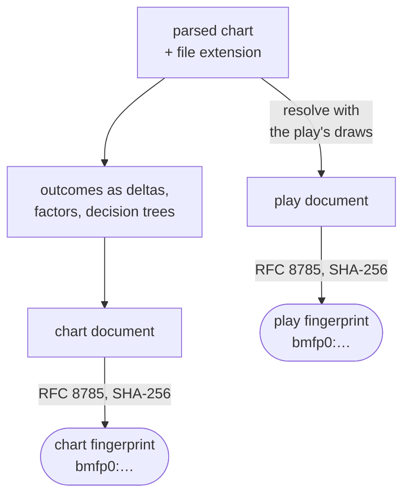
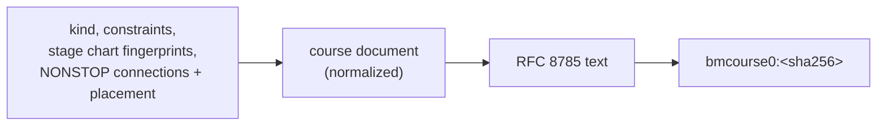

[Japanese version](./fingerprint-spec.ja.md)

# Be-Music Fingerprint specification

> Status: implemented in `@be-music/chart-model` and recorded in replays (section 7). Algorithm version: `bmfp0`.

The abbreviation naming migration changes the canonical document key `baseBpm` to `baseBPM`, including header deltas. This changes existing `bmfp0` values even when the chart plays identically; course fingerprints containing those values also change. Recompute fingerprints and regenerate canonical documents from the chart when migrating stored data. The development version remains `bmfp0`.

The Be-Music Fingerprint identifies a chart by **what the player plays and sees in the lanes**, not by the bytes of the file. Two chart files get the same fingerprint when they play the same, even if:

- one has no BGA, a different BGM, other keysounds, or other metadata;
- one was saved by editor A and re-saved by editor B (different line order, `#WAV` numbering, measure-position resolution, decimal precision);
- one is BMS and the other bmson (within the limits of section 3.3).

Anything that changes judging, the gauge, timing, or how the notes look on their way down changes the fingerprint.

## 1. Two fingerprints

| Name                  | Input                                                         | Use                                                                      |
| --------------------- | ------------------------------------------------------------- | ------------------------------------------------------------------------ |
| **Chart fingerprint** | The chart with its `#RANDOM` / `#SWITCH` structure unresolved | Identifying a chart file (song lists, tables, score databases)           |
| **Play fingerprint**  | The chart after every control-flow branch is chosen           | Identifying what one play actually played (replays, replay verification) |

Both are computed from two inputs:

1. the chart as be-music parses it (whose lane-mode inputs are its lanes, `#PLAYER 3`, and the bmson keyboard `mode_hint`; section 3.5), and
2. the chart's **file extension**, which is a lane-mode input (`.pms` makes a chart 9 KEY; section 3.5). An implementation must take it as an explicit input; any other or unknown extension counts as none.

How each fingerprint is made (sections 3 to 5):



A chart whose every outcome plays the same — in particular a chart without control flow — has equal chart and play fingerprints.

Lane options such as MIRROR / RANDOM / DP flip are play options, not part of the chart, and are in neither fingerprint. A replay records them separately.

## 2. What is included

| Included (affects play or what the lanes show)                                           | Excluded                                                                                               |
| ---------------------------------------------------------------------------------------- | ------------------------------------------------------------------------------------------------------ |
| Lane mode (5 / 7 / 9 / 10 / 14 / 24 / 48 KEY)                                            | Title, subtitle, artist, genre, `#PLAYLEVEL`, `#DIFFICULTY`, `#COMMENT`, `#TEXT`, `#PREVIEW`           |
| Visible notes: position and lane                                                         | The sample a note plays (keysound assignment)                                                          |
| Long notes: start, end, and mode (LN / CN / HCN); FREE ZONE notes                        | BGM (channel `01`), `#WAV`, `#EXWAV`, `#VOLWAV`, `#WAVCMD`, volume-change channels                     |
| Mines (`Dx` / `Ex`, bmson `mine_channels`): position, lane, and damage                   | BGA, layers, POOR image, `#BMP`, `#BGA`, `#SWBGA`, `#ARGB`, `#STAGEFILE`, `#BANNER`, `#BACKBMP`, video |
| Bar lines (measure lengths, and whether bar lines are drawn at all)                      | Invisible notes (`3x` / `4x`, bmson `key_channels`; not judged)                                        |
| Initial BPM, BPM changes, STOP, `#STP`                                                   | `#LNTYPE`, `#LNOBJ`, and `5x` / `6x` as notations (the resolved long notes are included instead)       |
| SCROLL (`SC`) and SPEED (`SP`)                                                           | `#OPTION`, `#MIDIFILE`, `#PATH_WAV`, `#MATERIALS`, `#BASE`, `#CHARSET`                                 |
| `#BASEBPM` (sets the reference BPM for hi-speed, so it changes how fast notes look)      | `#CHANGEOPTION` (see below)                                                                            |
| Judgment rank: `#RANK`, `#DEFEXRANK`, bmson `judge_rank`, and `#EXRANKxx` changes (`A0`) | Anything a player does not draw in or over the lanes                                                   |
| `#TOTAL` / bmson `total`                                                                 |                                                                                                        |

`#CHANGEOPTION` can force lane options mid-chart, which would change play. be-music parses it but never applies it, so it is excluded: two charts that differ only in `#CHANGEOPTION` play the same in be-music. If be-music ever applies it, it joins the fingerprint with a version bump (section 5).

## 3. Normalization

The fingerprint is defined over **be-music's interpretation** of the chart. The parser decides which objects exist and which lane each sits on (bmson `x` through the play-mode table's `mode_hint` lanes), and the resolvers of the Resolved layer (`resolveChart`, see [Architecture](./architecture.md)) decide what is played: judged notes and long-note pairs, mines and their damage, BPM / STOP / `#STP` / SCROLL / SPEED, and the judge-rank and TOTAL facts. The fingerprint reads its items through those same resolvers, and this section describes how the result is turned into a canonical form: exact coordinates instead of beats and seconds (section 3.3), snapping (section 3.2), and the drops and ordering of sections 3.4 and 4. Where be-music's engine falls back to a default (sections 3.4 and 3.5), the fingerprint uses the same fallback, so two charts the engine plays alike get one fingerprint.

### 3.1 Exact numbers

Every number is handled as an exact rational. Decimal text from the file (`#xxx02`, `#BPM`, `#BPMxx`, `#STP`, `#TOTAL`, bmson numbers) is converted to a rational from its digits, never through a binary float. When only an IEEE 754 double is available, its shortest round-trip decimal text is used; the snapping of section 3.2 absorbs the difference.

### 3.2 Snapping (decimal values only)

Editors print the same intended value with different precision (`0.333333`, `0.3333`, `133.333`). **Only numbers written as decimals are snapped**: measure lengths and values. Positions are never snapped (section 3.3).

The rule, for a number `x`, a denominator limit `Q`, and a tolerance `t`: take the rational `a/q` with `1 ≤ q ≤ Q` nearest to `x`; if it is within `t` of `x`, the result is `a/q`, otherwise it is `x` itself, exactly. Ties go to the smaller `q`, then the smaller value. A value that already has a denominator of at most `Q` is its own result.

| What                                                                                                                                    | `Q`                                | Tolerance `t`                            |
| --------------------------------------------------------------------------------------------------------------------------------------- | ---------------------------------- | ---------------------------------------- |
| Measure length `L`, in 4/4 measures (`#xxx02`; bmson lengths too)                                                                       | 48, applied to the beat count `4L` | `1/4608` beat, absolute                  |
| Values: BPM, `#BASEBPM`, STOP length, bmson stop `duration`, `#STP` length, SCROLL, SPEED, `#EXRANK`, mine damage, `#TOTAL`, judge rank | 12                                 | `10⁻⁵ · \|x\|` (relative); `0` stays `0` |

A measure length is snapped on its **beat count**, with an absolute tolerance in beats, so a long measure does not widen the tolerance; the candidate must be positive.

Why these numbers:

- **Measure lengths.** Denominators up to 48 in beats cover every length written in 1/192 of a 4/4 measure (the BMS STOP unit) and thirds, fifths, sevenths and ninths of a beat. Two different candidates are at least `1/(48·47) = 1/2256` beat apart, and the tolerance `1/4608 = 1/(2·48²)` is less than half that, so a number is never within the tolerance of two candidates: the result does not depend on which side of a candidate a printing falls, and it is stable under any perturbation smaller than the tolerance. A length printed with at least 5 decimals (rounded or truncated), or 4 decimals rounded, snaps back to its intended small-denominator value.
- **Values.** Denominators up to 12 cover halves, thirds, quarters, … twelfths, so `133.333`, `133.3333` and `400/3` are one value, as are `166.667` and `500/3`, and `142.857` and `1000/7`. Candidates are at least `1/132` apart, so for `|x| < 379` at most one candidate is within the tolerance; above that, the nearest one wins, and an intended small-denominator value `r` is still recovered from any printing within `min(10⁻⁵·|x|, 1/264)` of it. A value printed with 6 decimals snaps back when `|x| ≥ 0.05`, with 4 decimals when `|x| ≥ 5`, and with 3 decimals when `|x| ≥ 50`.

Examples:

| Input                                   | Result                                                    |
| --------------------------------------- | --------------------------------------------------------- |
| measure `0.333333`, `0.3333`            | `1/3`                                                     |
| measure `0.333`                         | `333/1000` (3 decimals are 0.0013 beat off; not covered)  |
| measure `0.005208`                      | `1/192`                                                   |
| measure `0.142857`                      | `1/7`                                                     |
| measure `0.0001`                        | `1/10000` (no candidate near it; tiny lengths stay exact) |
| BPM `133.333`, `133.3333`, `133.333333` | `400/3`                                                   |
| BPM `142.857`                           | `1000/7`                                                  |
| BPM `149.99999999`                      | `150`                                                     |
| SCROLL `0.01`                           | `1/100`                                                   |

Known limits: a measure length or value whose intended denominator is above the limit (a measure of 137/960, a BPM of 1000/13) is kept exactly as written, so two printings of it with different precision differ. Values that differ by less than the tolerance from one small-denominator rational are treated as that rational even when the difference was intended.

### 3.3 Coordinates

- **Time** is a pair: the measure index and the exact position inside it (`0 ≤ p < 1`, in lowest terms). A position is never snapped:
  - a BMS object at cell `i` of a measure line with `n` cells is at `i/n`;
  - a bmson position `y` (in pulses) is mapped through `lines` with integer arithmetic: measure `m` spans `lines[m]` to `lines[m+1]`, and `p = (y − lines[m]) / (lines[m+1] − lines[m])`. Without `lines`, and past the last line, measures are `4 × resolution` pulses long;
  - an `#STP xxx.yyy` is at measure `xxx`, position `yyy/1000`.
- Because positions are exact, two events of different times are never merged, so the order of a STOP and a note one cell apart is always kept.
- **BMS against bmson.** A BMS chart and its bmson conversion get the same fingerprint when every position (and long-note end) is exactly representable at the bmson resolution, i.e. when `i/n × (measure length) × 4 × resolution` is an integer for every object. At resolution 240 (960 pulses per 4/4 measure) `1/16`, `1/3` and `1/192` of a measure are representable; `1/7` is not, so a chart with septuplets converted at resolution 240 gets a different fingerprint from the original. There is no snapping that would make such charts equal without merging distinct positions.
- **Lanes** are the playable channels be-music assigns after its own mapping (`11`–`19`, `21`–`29`, and the extended 24 / 48 KEY channels `1A`–`1Z` / `2A`–`2Z`). A BMS `16` and the bmson `x` that be-music maps to `16` are the same lane. bmson `x` is mapped with the play-mode table: `beat-5k` / `beat-10k` put the scratch on x 8 / 16, and a chart with an unknown `mode_hint` whose lanes fit `beat-7k` is read as `beat-7k`. The 24 / 48 KEY wheel up / down (`1P` / `1Q`, `2P` / `2Q`; bmson `keyboard-24k` x = 25 / 26 per side) are ordinary lanes like any key.

### 3.4 Events

- **Notes**: the judged notes, one per lane and position as be-music keeps them: of several notes at one lane and position a long note wins over a tap, and otherwise the first in event order (the lowest object value; for bmson, the first sound channel). A long note carries its end time and mode, both exact:
  - `#LNOBJ`: the end is the end object's own time; it pairs with the previous object of that `1x` / `2x` channel, as in be-music (an object at a tick that holds a `5x` / `6x` object resets the pairing);
  - `5x` / `6x`: `#LNTYPE 1` pairs consecutive objects of a channel and the end is the second object's time; `#LNTYPE 2` runs end at the cell right after the run's last object. Without `#LNTYPE`, be-music infers 2 when some `5x` / `6x` channel repeats one value over three consecutive cells, else 1;
  - bmson: the end is pulse `y + l`, mapped like any position.
  - Mode: bmson per-note `t`, else `info.ln_type`, else 1 (LN); BMS `#LNMODE` 2 or 3, else 1. An end that does not come after its start leaves a normal note.
- **FREE ZONE**: in every lane mode but 9 / 24 / 48 KEY, be-music plays an object of lane `17` / `27` (from `1x` / `2x` or bmson, not from `57` / `67`) as a one-beat FREE ZONE note, ignoring any `#LNOBJ` end or bmson `l` it has. Such a note is `{"m", "p", "lane", "fz": true, "ln": mode}` without `end`, where the mode is bmson `t`, else `info.ln_type`, else 1.
- **Mines** (`Dx` / `Ex`, bmson `mine_channels`): lane, position, and damage. Damage is bmson `damage` when present, else `4` for bmson; for BMS, the object value read in base 36, or `4` when that is not a valid non-zero base-36 pair.
- **BPM**: the initial BPM is a header value. Channel `03`, channel `08` with `#BPMxx`, and bmson `bpm_events` all become `bpm` events. A zero BPM and a `#BPMxx` that is not defined are ignored, as in be-music. A negative `#BPMxx` is kept with its sign: be-music plays it as LR2's reverse scroll. The sign of every negative change is kept, although only the first one anchors the reversal, so two charts that differ only in the sign of a later negative change get different fingerprints even though they play alike; the fingerprint errs toward telling charts apart rather than merging them.
- **STOP**: in beats. BMS `#STOPxx` is in 1/192 of a 4/4 measure (beats = value / 48); bmson `duration` is in pulses (beats = duration / resolution). Of several BMS `#STOPxx` at one time only the last in event order counts, as in LR2, beatoraja and the engine; bmson stops of one time **add up** into one `stop` event.
- **`#STP`**: an `stp` event in milliseconds; several `#STP`s of one time add up.
- **SCROLL / SPEED / EXRANK**: `scroll`, `speed`, and `exrank` events with their values. Negative SPEED values are ignored; `exrank` events come only from BMS charts and only for a positive `#EXRANKxx` value.
- When several BPM, SCROLL, SPEED, or `#EXRANK` changes share a time, only the one be-music applies is kept: the last in be-music's event order, which sorts events of one time by channel and then by object value (so `08` wins over `03`, and `#BPM02` over `#BPM01` on one channel).

Events that change nothing are dropped. These drops depend on the state in effect, so section 3.6 limits them in chart documents:

- a BPM change to the BPM already in effect (the initial BPM at first);
- a SCROLL change to the SCROLL already in effect (1 at first);
- an `#EXRANK` change to the value of the previous `#EXRANK` change (the first one is always kept: the rulesets treat it differently from `#DEFEXRANK`);
- STOP and `#STP` of length 0 (never created);
- SPEED keyframes whose removal provably leaves the speed curve unchanged. be-music interpolates SPEED **linearly in beats** between keyframes and holds the last keyframe's value after it. Before the first keyframe the speed ramps from 1 at measure 0, position 0, as beatoraja ramps from 1.0 at time 0; a keyframe at measure 0, position 0 applies at once instead. So the curve runs through a head keyframe of value 1 at measure 0, position 0, which a keyframe at that position replaces. Within each maximal run of consecutive keyframes with equal values (the head included), only the run's first and last keyframe are kept, and the run at the end keeps only its first. The head itself is written only when a keyframe at measure 0, position 0 sets a value other than 1, so a curve that is 1 throughout has no keyframes. Keyframes in the middle of a straight ramp are kept.

Bar lines: the measure count is the last measure that holds an included event, plus one, and only lengths that are not `1` are listed. Measures after the last included event are not part of the fingerprint. A bmson chart with an explicit `lines: []` draws no bar lines, recorded as `"barLines": false` in `measures`.

### 3.5 Header values and defaults

| Field      | Rule                                                                                                                                                                                                                                                                                                                                                                                                                                                                                                                                                                                                                                               |
| ---------- | -------------------------------------------------------------------------------------------------------------------------------------------------------------------------------------------------------------------------------------------------------------------------------------------------------------------------------------------------------------------------------------------------------------------------------------------------------------------------------------------------------------------------------------------------------------------------------------------------------------------------------------------------- |
| `laneMode` | `resolveChartPlayVariant` (the engine's lane-mode rule) over the lanes that hold notes in the resolved chart (including long notes from `5x` / `6x`), the file extension (`.pms`), `#PLAYER 3`, and the bmson keyboard `mode_hint` (`keyboard-24k` makes the chart 24 KEY and `keyboard-24k-double` 48 KEY whatever lanes it uses, so a keyboard chart on x ≤ 9 only is still 24 KEY; any other hint is ignored, as in `resolveChartPlayVariant`). The lanes in use decide the IIDX modes whatever the extension, so a `.bme` chart without a 6 / 7 key column is 5 / 10 KEY. Each play document has its own; see section 3.6 for chart documents. |
| `bpm`      | Initial BPM (`#BPM`, the last positive one; 130 without one; bmson `init_bpm`)                                                                                                                                                                                                                                                                                                                                                                                                                                                                                                                                                                     |
| `baseBPM`  | `#BASEBPM`, or `null`. A `#BASEBPM` equal to `bpm` is `null`: be-music uses the initial BPM as the reference when `#BASEBPM` is absent                                                                                                                                                                                                                                                                                                                                                                                                                                                                                                             |
| `judge`    | `{"exRank": v}` from `#DEFEXRANK` (BMS, when positive) or `judge_rank` (bmson; `100` when absent or not positive); otherwise `{"rank": n}` from `#RANK`, `2` (NORMAL) when absent                                                                                                                                                                                                                                                                                                                                                                                                                                                                  |
| `total`    | `{"bms": v}` from a positive `#TOTAL`; `{"bmson": v}` from a positive bmson `total` other than 100; otherwise `null`, where the rulesets use their default TOTAL: a BMS chart without a positive `#TOTAL`, and a bmson chart whose `total` is absent, 0 or below, or 100 (100 % of the default)                                                                                                                                                                                                                                                                                                                                                    |

`#RANK` values every ruleset reads as NORMAL become `2`: integers outside 0–4, and non-integers that are `≤ −1`, between 2 and 3, or above 4 (LR2 truncates and reads anything outside 0–3 as NORMAL; beatoraja reads anything but the integers 0–4 as NORMAL). Other values, where the rulesets disagree, stay as written (`4`, `3.5`, `−0.5`).

`#RANK` and the `exRank` axis stay apart because the rulesets read them through different tables, so `#RANK 2` and `#DEFEXRANK 100` are not interchangeable in general. BMS `#TOTAL` and bmson `total` stay apart because the rulesets read bmson `total` as a percentage of a computed default; only the bmson value that means the default itself meets the BMS side, as `null`.

### 3.6 Control flow (`#RANDOM` / `#SWITCH`)

For the play fingerprint, control flow is resolved with the draws the play used (section 7), and the document is a play document.

For the chart fingerprint, the chart is treated as a function from **outcomes** to play documents. An outcome is the value of every `#RANDOM n` / `#SWITCH n` line with `n ≥ 2` (a **variable**, uniform on `1..n`); `#SETRANDOM`, `#SETSWITCH`, `#RANDOM 1`, and `#SWITCH 1` have one value.

#### 3.6.1 Evaluation

Lines are evaluated by be-music's one evaluator of the branch semantics (`evaluateControlFlow` in `@be-music/chart-model`, whose result the parser applies in `resolveBMSControlFlowWithDraws`): one stack of frames for the whole file; every `#RANDOM` / `#SWITCH` line draws its value whether or not it sits in an active branch; `#IF` / `#ELSEIF` compare with the innermost random frame on the stack; `#ELSEIF` / `#ELSE` / `#ENDIF` act on the innermost `#IF` frame anywhere on the stack; `#CASE` / `#DEF` / `#SKIP` act on the innermost switch frame; `#ENDIF` / `#ENDRANDOM` / `#ENDSW` remove the innermost frame of their kind (so a missing `#ENDIF` keeps its frame alive past `#ENDRANDOM`, as in the parser); and a header or object line is applied when every `#IF` and switch frame on the stack is active. The chart of one outcome is the content outside control flow, then the applied lines in file order: definitions (`#BPMxx`, `#STOPxx`, `#LNOBJ`, `#BPM`, …) made in a branch therefore also apply to objects outside it, as in the parser. A header line in a branch that a later top-level line defines again (`overriddenByLaterHeader`) is never applied: header lines take effect in file order, as in LR2 and beatoraja.

The values of a variable fall into **value classes**: one per label in `1..n` that some `#IF` / `#ELSEIF` (for a `#RANDOM`) or `#CASE` (for a `#SWITCH`) line compares it with, plus one class for every value no line names. Values of one class behave identically.

A **segment** is a stretch of control-flow lines from an empty stack back to an empty stack (or to the end of the file). Variables of different segments are independent.

#### 3.6.2 Deltas

The content outside control flow plays in every outcome. For one outcome of a set of segments, the **delta** is what the outcome changes in it: the notes, mines, timeline events, and non-`1` measure lengths it adds, those it removes, and the header values (`bpm`, `baseBPM`, `judge`, `total`, `player3`) it changes. Deltas are computed from the full chart of the outcome, so a branch that redefines `#BPM01` removes the outside `bpm` event that used the old value and adds one with the new value, and a long-note half in a branch pairs with the other half wherever it is. Deltas keep every event; the drops of section 3.4 that depend on the state in effect are applied only when an outcome's play document is composed.

#### 3.6.3 Factors

Segments whose outcomes can interact are evaluated together as one **factor** (over all their variables jointly). Two segments interact when any of these holds (computed over every line of the segments, whatever the outcome, and over the deltas of every outcome):

- one sets a definition or header value the other sets or uses: `#BPMxx`, `#STOPxx`, `#SCROLLxx`, `#SPEEDxx`, `#EXRANKxx` (used by objects of `08`, `09`, `SC`, `SP`, `A0` with that value), `#BPM`, `#BASEBPM`, `#RANK` / `#DEFEXRANK`, `#TOTAL`, `#PLAYER`, the length of one measure, `#LNOBJ` / `#LNTYPE` / `#LNMODE` (used by every lane object), or, when `#LNTYPE` is inferred, any `5x` / `6x` object;
- they have a timeline object or delta timeline event of one type at one time (same-time changes collapse, a BMS STOP replaces another, and bmson stops and `#STP`s add up);
- they place an object on one lane at one position, or a delta note starts there (a lane keeps one judged note per position);
- in a **pairing stream** — `obj:<lane>`, the `1x` / `2x` objects of a lane when some `#LNOBJ` exists, or `ln:<lane>`, the `5x` / `6x` objects of a lane when it has any — their **reach** overlaps. A segment's reach in a stream runs from the last object of the stream outside control flow strictly before the earliest time the segment touches in it (its own objects there, and the starts and ends of its delta notes on that lane) to the first such object strictly after the latest one, or to −∞ / +∞ when there is none; reaches are closed intervals.

Interaction is transitive (union–find). For non-interacting factors, the play document of an outcome is the content outside control flow with every factor's delta applied, and the result does not depend on the order: the deltas are additive.

#### 3.6.4 Decision trees

Each factor becomes a reduced decision tree over its variables in file order: a node tests one variable, its branches partition the variable's values, and a leaf is a delta. Branches whose subtrees are equal merge, and a node whose branches all lead to the same subtree is that subtree; a variable the outcome does not depend on has no node. In the document a node is `{"random": "n", "branches": [...]}` — for `#RANDOM` and `#SWITCH` alike — and a branch is `{"values": [...], ...}` with either the leaf's delta (`"add"`, `"remove"`, `"header"`, each omitted when empty) or `"next"`, the node of a later variable. `values` lists the values as `"v"` or inclusive ranges `"low-high"`, ascending. Branches are sorted by their first value. Branches whose documents are equal are merged in the document as well.

Consequences: `#IF 1 A #ELSE B` and `#IF 1 A #IF 2 B` under `#RANDOM 2` give one document, as do a `#SWITCH` and the `#RANDOM` + `#IF` it is equivalent to; values whose branches play alike are merged whatever their labels; an outcome's probability is the product of `|values| / n` along its path. The values themselves are part of the document, so swapping which value plays which branch (`#IF 1 A` against `#IF 2 A`) changes the chart fingerprint, although it plays alike in distribution. Nodes do not record which `#RANDOM` line they test, only its range: the document describes the distribution of outcomes, and a replay's `randomDraws` identify the outcome of one play (section 7).

#### 3.6.5 Hoisting

Whatever every leaf of a factor has in common — the same added or removed item in every leaf (counted as a multiset), or the same header change — moves into the content outside control flow. A factor left with only empty leaves disappears. So content outside every `#IF` of a `#RANDOM` (which plays whatever the outcome), content repeated in every branch, and branches that only shuffle definitions without effect all reduce to the same document as their plain equivalents.

#### 3.6.6 The chart document

When no factor remains, the chart document is the play document. Otherwise the chart document is the content outside control flow plus `random`, the factor nodes sorted by their canonical JSON text (section 4), with these differences from a play document:

- `laneMode` is replaced by `"lanes": {"extension": ".pms" | null, "player3": bool}`, the lane-mode inputs, because the lane mode depends on the outcome (any other extension is `null`); a chart with a keyboard `mode_hint` also has `"modeHint": "keyboard-24k" | "keyboard-24k-double"` there, and the key is absent otherwise;
- notes of lane `17` / `27` from `1x` / `2x` keep their long-note end and carry `"fz": "<mode>"`, the mode they get if the outcome's lane mode uses FREE ZONE;
- the drops of section 3.4 apply only to event types no factor changes (`bpm` also counts as changed when a factor changes the header `bpm`);
- `baseBPM` is `null` only when it is absent, or equal to `bpm` and no factor changes either;
- `measures.count` is one more than the last measure any outcome can hold an included event in: the events outside control flow, every object of an included channel and every `#STP` in control-flow lines, and the measure after a `5x` / `6x` object (where an `#LNTYPE 2` run can end). `measures.lengths` and the deltas list only lengths below it.

To compose the play document of one outcome from a chart document, start from its lists, apply the delta of the outcome's leaf of every node (remove, then add; header fields override), and normalize as a play document: lane mode from the resulting lanes, FREE ZONE, the drops of section 3.4, the measure count.

### 3.7 Evaluation budget

The evaluation of a segment (section 3.6.1) explores outcomes value class by value class and merges the states that reach an `#ENDIF`, `#ENDRANDOM`, `#ENDSW`, or a variable's line with equal stacks (each random / switch frame's value counted only when a later line still compares it with that value). It costs one step per line processed per state plus the number of frames on the stack at that line, and one step per frame copied when a variable splits a state. A segment that needs more than 2²⁰ (1,048,576) steps, or whose outcome tree has more than 1024 paths, and a factor whose segments' path counts multiply to more than 1024, are **opaque**: the factor is written as `{"opaque": "<hex>"}`, the lowercase hex SHA-256 of the RFC 8785 JSON array of the factor's control-flow lines (the parser's `bms.controlFlow` entries of its segments, in file order). An opaque factor counts as changing every event type for the drops of section 3.6.6.

The result is deterministic, so the chart fingerprint of a chart is always defined, and never takes long: the budget is reached in well under a second. Equivalent writings of an opaque factor (reordered lines, renumbered `#WAV`s) do get different fingerprints. Real charts are far below the budget; it exists for adversarial input such as deeply nested or very long fall-through `#SWITCH` blocks.

## 4. Canonical document

Play document (also the chart document when every outcome plays the same):

```json
{
  "v": "bmfp0",
  "laneMode": "7",
  "bpm": "150",
  "baseBPM": null,
  "judge": { "rank": "2" },
  "total": { "bms": "300" },
  "measures": { "count": "64", "lengths": [["12", "3/4"]] },
  "notes": [
    { "m": "1", "p": "0", "lane": "11" },
    { "m": "1", "p": "1/2", "lane": "16", "end": { "m": "2", "p": "0" }, "ln": "2" }
  ],
  "mines": [{ "m": "3", "p": "1/4", "lane": "13", "damage": "10" }],
  "timeline": [
    { "m": "8", "p": "0", "type": "bpm", "v": "400/3" },
    { "m": "9", "p": "0", "type": "stop", "v": "1" },
    { "m": "16", "p": "1/2", "type": "scroll", "v": "1/2" }
  ]
}
```

Chart document of a chart with control flow:

```json
{
  "v": "bmfp0",
  "lanes": { "extension": null, "player3": false },
  "bpm": "150",
  "baseBPM": null,
  "judge": { "rank": "2" },
  "total": null,
  "measures": { "count": "3", "lengths": [] },
  "notes": [{ "m": "1", "p": "0", "lane": "11" }],
  "mines": [],
  "timeline": [{ "m": "2", "p": "0", "type": "bpm", "v": "300" }],
  "random": [
    {
      "random": "2",
      "branches": [
        {
          "values": ["1"],
          "add": { "timeline": [{ "m": "2", "p": "0", "type": "bpm", "v": "200" }] },
          "remove": { "timeline": [{ "m": "2", "p": "0", "type": "bpm", "v": "300" }] }
        },
        { "values": ["2"], "add": { "notes": [{ "m": "1", "p": "0", "lane": "13" }] } }
      ]
    }
  ]
}
```

- Every number, including counts and indexes, is a string: an integer as `"n"`, any other rational as `"p/q"` in lowest terms with a positive denominator and the sign on the numerator (`"-3/4"`). No floats, exponents, or `+` signs. Flags (`fz` in play documents, `player3`, `barLines`) are JSON booleans.
- `notes` are sorted by `(m, p, lane)`, then by `end` (a note without one first), `ln`, and `fz`; `mines` by `(m, p, lane, damage)`; `timeline` by `(m, p, type, v)`; `lengths` by measure. `lane` and `type` compare as strings; numeric fields sort by value, not as text. Delta lists are sorted the same way.
- A field with no value is omitted (`end` / `ln` on a normal note, an empty delta list), except `baseBPM` and `total`, which are always present and may be `null`.
- The document is serialized with the JSON Canonicalization Scheme ([RFC 8785](https://www.rfc-editor.org/rfc/rfc8785)): object keys sorted, no whitespace, UTF-8.

## 5. Output and versioning

```
bmfp0:<lowercase hex SHA-256 of the canonical JSON bytes>
```

The `bmfp0` prefix names the algorithm version. Fingerprints are only comparable within one version.

**`bmfp0` is the development version.** It is still being defined and may change without a version bump, so a `bmfp0` fingerprint is only guaranteed stable within one release of `@be-music/chart-model`: a store keyed by it (such as a leaderboard) must expect to discard its data when the definition changes. The first stable definition will be `bmfp1`.

**From `bmfp1` on, any change that alters the document of an existing chart requires a new version** (`bmfp2`, ...): a change to what is included, to normalization, to the document schema, or to the **parser or Resolved-layer behaviour the fingerprint reads** (event creation, `#LNOBJ` / `#LNTYPE` pairing, one judged note per lane and position, the STOP and SPEED rules, lane mapping and lane-mode detection, control-flow semantics, engine fallbacks). The golden corpus test in `@be-music/chart-model` (`packages/chart-model/src/fingerprint-golden.test.ts`) pins exact fingerprints of representative charts so such changes cannot slip in unnoticed; under a stable version, updating a golden value means bumping the version.

## 6. Implementation notes

- `@be-music/chart-model` implements this specification (`packages/chart-model/src/fingerprint*.ts`):
  - `computeChartFingerprint(json, { chartPath })` / `computePlayFingerprint(json, { chartPath })` return `string` (`bmfp0:…`) synchronously. `chartPath` (a path, file name, or bare extension) is the lane-mode input of section 1 and is a required option (pass `undefined` when unknown). They hash with a small built-in SHA-256 (`packages/chart-model/src/sha256.ts`), so they run in Node and browsers alike and synchronous callers can use them.
  - `createChartFingerprintDocument` / `createPlayFingerprintDocument` build the canonical document, and `canonicalizeFingerprintDocument(document)` returns its RFC 8785 text.
  - `computePlayFingerprint` takes a chart without control flow, as `resolveBMSControlFlowWithDraws` (or `resolvePlayChart` in `@be-music/player-engine`) returns it. `computeChartFingerprint` takes the parser's unresolved output, whose `events` hold only the content outside control flow and whose `bms.controlFlow` holds the rest; a resolved chart carries no control flow, so it gets its play document.
  - The items are read with the Resolved layer's resolvers (`resolved-notes.ts`, `note-rules.ts`, `timing.ts`, `timelines.ts`, `resolved-chart.ts`), the same ones `resolveChart` is built from; `fingerprint-items.ts` adds only exact coordinates, snapping, FREE ZONE deferral for chart documents, and the per-bucket recomputation the chart model needs.
  - Outcomes are enumerated (`fingerprint-control-flow.ts`) with the frame operations of `evaluateControlFlow` (`control-flow.ts`), driven for every value class at once instead of for one set of draws, and turned into deltas, factors and decision trees (`fingerprint-delta.ts`, `fingerprint-chart-model.ts`). Differential tests check, for thousands of random charts with nested and malformed control flow, that every outcome composed from the chart model equals the play document of the chart `resolveBMSControlFlowWithDraws` resolves with the same draws, and that the outcome distribution of every chart document equals the parser's.
- The parser stores BMS values as numbers, so the shortest round-trip text of the stored double stands in for the decimal text (section 3.1). Raw strings the parser keeps (`#EXRANKxx`, `#STP`) are read from their digits.

## 7. Replays

The replay records the chart fingerprint of the chart as `chart.chartFingerprint`, the play fingerprint of what was played as `chart.playFingerprint`, and the play's `#RANDOM` / `#SWITCH` outcomes as `play.randomDraws`, its `RandomDraws` (see [replay.md](./replay.md)). The chart fingerprint is the one to group plays by: every play of a chart shares it, whatever its `#RANDOM` lines rolled. A verifier with the chart file re-resolves it with those draws (`resolveBMSControlFlowWithDraws(json, randomDraws)`, which rejects draws that were not drawn for the chart) and recomputes the play fingerprint with the chart's extension. `createReplayRecorder` in `@be-music/player-engine` computes both from the source chart — the chart as loaded, which a host that resolves `#RANDOM` or rewrites lanes itself passes as `recordReplay.sourceChart`, otherwise the chart the engine was handed — resolved with the play's draws for the play fingerprint, so lane options (RANDOM / MIRROR / DP FLIP) do not change either. Without a source chart the draws were drawn for, the play fingerprint comes from the chart the engine played and the chart fingerprint is omitted unless the play has no draws. Its lane-mode input is the engine's `laneModeExtension`; without one, a 9 KEY play stands in for `.pms`. The draws are the engine's `PlayerOptions.randomDraws`: every host draws once per play (`resolvePlayChart`) and hands the same draws to the engine, which records them, and a replay passes the log's draws back the same way.

## 8. Course fingerprint

A course (a dan course, an expert or NONSTOP course, a beatoraja course or a table's course) is identified by its **course fingerprint**, built on the chart fingerprints of its stages with the same rules as `bmfp`: what plays alike is written alike, the document is canonical JSON, and the version is part of both the document and the output.



### 8.1 Document

```json
{
  "v": "bmcourse0",
  "kind": "nonstop",
  "constraints": [],
  "stages": ["bmfp0:…", "bmfp0:…", "bmfp0:…"],
  "nonstop": { "connections": ["cut-fit", "fade"], "placement": "intended" }
}
```

| Field         | Rule                                                                                                                                                                                                                                                                 |
| ------------- | -------------------------------------------------------------------------------------------------------------------------------------------------------------------------------------------------------------------------------------------------------------------- |
| `v`           | The version, `"bmcourse0"`.                                                                                                                                                                                                                                          |
| `kind`        | `grade`, `expert` or `nonstop` (`RulesetCourseKind`).                                                                                                                                                                                                                |
| `constraints` | The constraints as `normalizeCourseConstraints` reads them: beatoraja enum names (`MIRROR`) become table-header names (`grade_mirror`), unknown names are dropped, one per group is kept as beatoraja keeps it; then deduplicated and sorted.                        |
| `stages`      | Each stage's chart fingerprint (section 1), in stage order. A random course is keyed by the stages it drew.                                                                                                                                                          |
| `nonstop`     | NONSTOP courses only. `connections` has exactly one entry per seam (stages − 1): a connection listed after the last stage joins nothing and is dropped, and a seam the course does not name is `fade`, as the stitcher reads it. `placement` is `intended` or `lr2`. |

Left out, because they do not change what is played: the course name, the trophies, the `release` flag, and the stitching rule version a NONSTOP replay records (`nonstop.stitch`, so a fix to the stitching keeps the course's board; [replay.md](./replay.md#course-replays)).

### 8.2 Output and versioning

```
bmcourse0:<lowercase hex SHA-256 of the RFC 8785 text of the document>
```

Every value is a string or a list of strings, so the RFC 8785 text is the document with its keys sorted and no whitespace. Like `bmfp0`, `bmcourse0` is the development version and may change without a version bump; a course fingerprint also changes whenever a stage's chart fingerprint does. From the first stable version on, any change to the document of an existing course needs a new version. `packages/player-engine/src/replay/course-fingerprint.test.ts` pins golden values for this.

`createCourseFingerprintDocument(input)` and `computeCourseFingerprint(input)` in `@be-music/player-engine/replay` implement this section, with `canonicalizeJSONValue` and `sha256Hex` from `@be-music/chart-model`; `computeCourseReplayFingerprint(log)` reads the input from a course replay.
