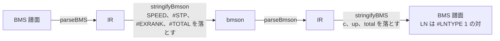

[English version](./format-compat.md)

# BMS / bmson 互換性ノート

この文書は、BMS と bmson の仕様が定めていること（de jure）と既存のプレイヤーが実際にしていること（de facto）を比べ、どの仕様も定めていない挙動を洗い出し、be-music がどうしているか・なぜそうしたかを記録します。
実装をまたいだ比較のための資料です。be-music 自身が各フォーマットをどう扱うかは [BMS 実装仕様](./bms-spec.ja.md)、[bmson 実装仕様](./bmson-spec.ja.md)、[Player 実装仕様](./player-spec.ja.md)、[`@be-music/chart-source`](./json-spec.ja.md) に定めてあり、ここでは繰り返さずにリンクします。

## 1. この文書の読み方

### 1.1 de jure の情報源

BMS には唯一の規範的な仕様がありません。それに最も近いのは次の資料です。

| 略称           | 情報源                                                                                                                                                              | 補足                                                                                                                                                                                                                                      |
| -------------- | ------------------------------------------------------------------------------------------------------------------------------------------------------------------- | ----------------------------------------------------------------------------------------------------------------------------------------------------------------------------------------------------------------------------------------- |
| BM98           | [BMS Format Specification](http://bm98.yaneu.com/bm98/bmsformat.html)（やねうらお / NBK、1998）                                                                     | 原典。短く、ヘッダ、チャンネル `01`〜`09` / `11`〜`17` / `21`〜`27`、`#RANDOM` / `#IF` / `#ENDIF` を定める。NBK 単独の文書は見つからなかった                                                                                              |
| cmds           | hitkey の [BMS command memo](https://hitkey.nekokan.dyndns.info/cmdsJP.htm)（[英語版](https://hitkey.nekokan.dyndns.info/cmds.htm)）                                | 拡張コマンドの事実上の台帳。各コマンドの出自・意味・プレイヤーごとの対応を記す。草稿で最終更新は 2014-07-11。beatoraja より前の資料で、検証した LR2 は beta3 100201。以下ではセクションのアンカー（`cmdsJP.htm#RANDOM` など）でリンクする |
| exbpm / exstop | hitkey の [拡張 BPM](https://hitkey.nekokan.dyndns.info/exbpm-object.htm) と [STOP](https://hitkey.nekokan.dyndns.info/exstop.htm) の比較ページ                     | BPM / STOP の境界値をプレイヤーごとにまとめた表                                                                                                                                                                                           |
| wiki           | [Bms:Spec](https://web.archive.org/web/20090213050609/http://wiki.bms.ms/Bms:Spec)（wiki.bms.ms、2009 年のアーカイブ）                                              | コミュニティによる要約。おおむね cmds と一致する                                                                                                                                                                                          |
| bmson          | [bmson 仕様 `doc/index.rst`](https://github.com/bemusic/bmson-spec/blob/668c4338cd7c64da2d2ec0f848c4ad58a3a881d9/doc/index.rst)（`668c4338`。現在の master と同一） | bmson 唯一の規範的な文書。以下の行番号はこのファイルの行                                                                                                                                                                                  |

### 1.2 比較した実装

| 実装      | 読んだもの                                                                                                                                                                                                                                                                                                                                                                                                                    |
| --------- | ----------------------------------------------------------------------------------------------------------------------------------------------------------------------------------------------------------------------------------------------------------------------------------------------------------------------------------------------------------------------------------------------------------------------------- |
| LR2       | ソース非公開（LunaticRave2 beta3 100201）。根拠は (a) cmds など hitkey のページ、(b) LR2 をコミュニティが書き起こした [OpenLR2](https://github.com/GOMazk/OpenLR2) の `LR2Beta3-v100201` ブランチ（元のプログラムを再現したもの。コミット `583a3850` を引用。新コマンドを加えた `main` ブランチは使わない）、(c) LR2 の判定とゲージを再現する beatoraja フォーク [LR2oraja](https://github.com/wcko87/lr2oraja)（`3db78adf`） |
| beatoraja | [beatoraja](https://github.com/exch-bms2/beatoraja) の `8320241d` と、そのパーサ [jbms-parser](https://github.com/exch-bms2/jbms-parser) の `8108cd54`                                                                                                                                                                                                                                                                        |
| その他    | [Bemuse](https://github.com/bemusic/bemuse) `4bf3e7d9`、[Qwilight](https://github.com/thenist/Qwilight) `6d3887f6`、[raindrop](https://github.com/zardoru/raindrop) `662dd11f`。大きく異なる点だけを挙げる                                                                                                                                                                                                                    |
| be-music  | このリポジトリ。be-music の挙動には実装しているコードへのリンクを付ける                                                                                                                                                                                                                                                                                                                                                       |

### 1.3 根拠のラベル

de facto の記述には次のラベルを 1 つ付けます。

- **[V]** 上記コミットのソースコードで確認した。
- **[R]** OpenLR2 による LR2 beta3 100201 の再現コードで確認した。LR2 について得られる最良の根拠だが、書き起こしであって LR2 自身のソースではない。
- **[C]** コミュニティの知見。hitkey や LR2oraja の作者が記録しているが、コードでは確認していない。
- **[D]** LR2 beta3 自身の `LR2body.exe` を逆アセンブルして確認した。アドレスで示す。OpenLR2 がプログラムから外れている箇所（ノートの描画、[§2.18](#218-ノートの描画)）で使う。
- **[I]** 根拠がないことからの推定（どの対応表にも載っていないコマンドなど）。

「未定義」は、どの de jure の資料にも記述がないことを表します。

## 2. BMS

### 2.1 行の解釈とヘッダ

| 項目                                         | de jure                                                                                                                                                                      | LR2                                                                                                                                                 | beatoraja                                                                                                                                                            | be-music                                                                                                                                                                                                                                                                                                                                                                                    |
| -------------------------------------------- | ---------------------------------------------------------------------------------------------------------------------------------------------------------------------------- | --------------------------------------------------------------------------------------------------------------------------------------------------- | -------------------------------------------------------------------------------------------------------------------------------------------------------------------- | ------------------------------------------------------------------------------------------------------------------------------------------------------------------------------------------------------------------------------------------------------------------------------------------------------------------------------------------------------------------------------------------- |
| コマンドの大文字小文字                       | 区別しない（BM98）。cmds は、一部のプレイヤーが場所によって区別する（`#LNOBJ` の値など）と注記している                                                                       | 解析前に行全体を大文字化する。ID も含む [R]（[OpenLR2 L25950][olr2-upper]）                                                                         | コマンドとチャンネルは区別しない [V]（[BMSDecoder L487-500][j-reserve]）                                                                                             | コマンドとチャンネルは区別しない。ID は [§2.3](#23-オブジェクト-id-と-base-62) のとおり（[`parser.ts`][bm-parser]）                                                                                                                                                                                                                                                                         |
| 行頭の空白                                   | 未定義。cmds（[`#INDENT-STYLE`][cmds-indent]）にプレイヤーごとの表がある                                                                                                     | タブと半角スペースは可、全角スペース（U+3000）は不可 [C]。解析前に行をトリムする [R]                                                                | 除去しない。字下げした行は無視される [V]（[BMSDecoder L189-194][j-lines]）                                                                                           | トリムするので、字下げしたコマンドも受け付ける（[`parser.ts`][bm-parser] `parseBMS`）                                                                                                                                                                                                                                                                                                       |
| ヘッダの区切り                               | 慣習として半角スペース 1 つ（cmds）                                                                                                                                          | 多くのヘッダを末尾のスペース込み（`"#TOTAL "`）で照合する [R]                                                                                       | コマンド名の 1 文字後から引数とみなし、その文字が何かは問わない [V]（[BMSDecoder L366-375][j-arg]）                                                                  | 空白が 1 文字以上必要。`#TITLE:abc` はヘッダにならない（[`parser.ts`][bm-parser] `parseHeaderDirectiveLine`）                                                                                                                                                                                                                                                                               |
| `#` で始まらない行                           | 無視する。これがコメントの仕組み（BM98）。`;` や `//` のコメントは IIDXv / HDX の拡張（[`#COMMENT-SYNTAX`][cmds-comment]）                                                   | 無視する [R]                                                                                                                                        | 無視する。ただし `%key value` / `@key value` は追加の値として保持する [V]（[BMSDecoder L378-388][j-values]）                                                         | 無視する                                                                                                                                                                                                                                                                                                                                                                                    |
| ヘッダの重複定義                             | BM98 では未定義。cmds（[`#BEHAVIOR-IN-GENERAL-IMPLEMENTATION`][cmds-general]）：EOF に近い行が勝つ。繰り返せるコマンド（`#STP`、`#WAVCMD`、制御構文）は例外                  | 後勝ち [C]                                                                                                                                          | 後勝ち [V]（[BMSDecoder L282-315][j-dup]）                                                                                                                           | 制御構文をまたいでもファイル順で後勝ち。選ばれた `#RANDOM` / `#SWITCH` の分岐内の定義は、前にあるトップレベルの定義に勝ち、後にあるものに負ける（[§2.14](#214-制御構文)）                                                                                                                                                                                                                   |
| オブジェクト行の重複（同じ小節・チャンネル） | cmds：行は統合され、同じ位置では後の非 `00` オブジェクトが前のものを上書きし、`00` は上書きしない。BGM（`01`）の行は積み重なる。検証したプレイヤーの約半数はこれを満たさない | すべてのオブジェクトを集める。1 つの位置に 2 つのノートがあるとき LR2 がどう扱うかは確認できなかった。cmds は地雷行の重複で不具合を報告している [C] | 演奏チャンネルは後のオブジェクトが前のものを置き換え、警告を出す。`01` は積み重なる。`03` / `08` / `09` は位置ごとに 1 つ [V]（[Section L353-403][j-section-notes]） | 判定するノートはレーンと位置ごとに 1 つ。ロングノートが通常ノートに勝ち、それ以外はオブジェクト ID の最も小さいものを残す（beatoraja は後の行を残すが、IR は行の順序を記録しない）。残らなかったノートは判定も描画もしないが、キー音が異なるものはその時刻に鳴らす。地雷と不可視オブジェクトはまとめない。BGM は積み重なる（[`resolved-notes.ts`][bm-resolved-notes] `resolveJudgedNotes`） |
| 壊れたオブジェクトデータ                     | 未定義（cmds）                                                                                                                                                               | 確認できなかった                                                                                                                                    | 確認できなかった                                                                                                                                                     | 最初の空白でデータを打ち切る。ID に使えない文字はスロットを消費せずに読み飛ばす。末尾の余った 1 文字は捨てる（[`event-utils.ts`][bm-event-utils] `collectNonZeroObjectTokens`）                                                                                                                                                                                                             |
| 小節番号                                     | `000`〜`999`（BM98）                                                                                                                                                         | `#000` の先頭にノートがあると、LR2 はその前に空の小節を挿入する [C]                                                                                 | 特別な処理は見当たらない                                                                                                                                             | `000`〜`999`。特別な処理はない                                                                                                                                                                                                                                                                                                                                                              |

### 2.2 文字コード

| 情報源 / プレイヤー | 挙動                                                                                                                                                                                                                                                                                                                                                                                                                                                                                                                                                                                   |
| ------------------- | -------------------------------------------------------------------------------------------------------------------------------------------------------------------------------------------------------------------------------------------------------------------------------------------------------------------------------------------------------------------------------------------------------------------------------------------------------------------------------------------------------------------------------------------------------------------------------------- |
| de jure             | 未定義。cmds（[`#CHARSET`][cmds-charset]）：ほとんどのファイルは Shift_JIS で、安全なのは ASCII だけ。`#CHARSET` は ruv-it! のコマンドで、2.0b5p2 から廃止                                                                                                                                                                                                                                                                                                                                                                                                                             |
| LR2                 | Shift_JIS のみ。ISO-2022-JP や EUC-KR のファイルは化ける [C]                                                                                                                                                                                                                                                                                                                                                                                                                                                                                                                           |
| beatoraja           | まず BOM、次に先頭 64 KiB を EUC-KR、MS932、UTF-8、UTF-16、UTF-32 の順に往復変換で試し、どれも合わなければ MS932。`#CHARSET` は読まない [V]（[BMSDecoder L535-654][j-charset]）                                                                                                                                                                                                                                                                                                                                                                                                        |
| Bemuse              | `bemuse-chardet`（UTF-8、UTF-16、Shift_JIS、EUC-KR）。ファイル名（`.sjis.`、`.euc_kr.`、`.utf8.`）で指定もできる [V]                                                                                                                                                                                                                                                                                                                                                                                                                                                                   |
| be-music            | BOM、`#CHARSET` 宣言、ASCII のみなら UTF-8、厳密な UTF-8 検証、韓国語の EUC-KR（beatoraja の判定と同じく非 ASCII のバイトがすべて KS X 1001 の 2 バイトの組になり、かつ文字の 90 % 以上がハングル音節）、Shift_JIS / UTF-8 / EUC-JP / Latin-1 のスコアリングの順（[`bms-text-decode.ts`][bm-decode]、[`bms-charset.ts`][bm-charset]。[BMS 実装仕様 — 文字コード](./bms-spec.ja.md#文字コード) も参照）。`#CHARSET EUC-KR` / `CP949` も読む。ハングルの割合の条件は、バイトが KS X 1001 にも当てはまる Shift_JIS の半角カナを韓国語と読まないためのもので、beatoraja にはこの区別がない |

### 2.3 オブジェクト ID と `#BASE 62`

| 項目       | de jure                                                                  | LR2                                                                       | beatoraja                                                                                                                           | be-music                                                                                                                                                                                                                                                                                        |
| ---------- | ------------------------------------------------------------------------ | ------------------------------------------------------------------------- | ----------------------------------------------------------------------------------------------------------------------------------- | ----------------------------------------------------------------------------------------------------------------------------------------------------------------------------------------------------------------------------------------------------------------------------------------------- |
| ID の文字  | BM98：16 進数 `01`〜`FF`。cmds：のちに 36 進数。大文字小文字の規定はない | 36 進数。行の大文字化によって大文字小文字は同一視される [R]               | 36 進数。大文字小文字を区別しない [V]（[ChartDecoder L93-149][j-chart]）                                                            | 36 進数。小文字は大文字に畳み込む（[`event-utils.ts`][bm-event-utils]）                                                                                                                                                                                                                         |
| `#BASE 62` | 未定義（cmds にも wiki にもない）                                        | LR2 beta3 100201 にはない [R]（OpenLR2 の `main` ブランチが追加している） | ファイル全体を別パスで読み、`#IF` も無視するので、書く位置は問わない。36 / 62 以外は 36 になる [V]（[BMSDecoder L126-162][j-base]） | ファイル全体を制御構文を無視して事前に走査するので、書く位置は問わない。beatoraja と同じく最後の `#BASE 36` / `#BASE 62` 行が勝ち、それ以外の値は無視する（[`parser.ts`][bm-parser] `detectBMSBase`）。62 進では ID の大文字小文字を区別する（[BMS 実装仕様 — `#BASE`](./bms-spec.ja.md#base)） |

### 2.4 レーンモードとチャンネル配置

| 項目                                   | de jure                                                                                                                                                                      | LR2                                                                                         | beatoraja                                                                                                                                                                                    | be-music                                                                                                                                                                                                                                                                                                                                   |
| -------------------------------------- | ---------------------------------------------------------------------------------------------------------------------------------------------------------------------------- | ------------------------------------------------------------------------------------------- | -------------------------------------------------------------------------------------------------------------------------------------------------------------------------------------------- | ------------------------------------------------------------------------------------------------------------------------------------------------------------------------------------------------------------------------------------------------------------------------------------------------------------------------------------------ |
| `#PLAYER`                              | BM98：1 シングル、2 二人、3 ダブル。cmds（[`#PLAYER`][cmds-player]）：4 バトル（BM98 のみ）。既定値 1                                                                        | 無視し、使われているチャンネルからモードを推定する [C]                                      | 1 か 2 だけを受け付け、整合性の警告に使うのみで、モードの決定には使わない [V]（[BMSDecoder L664-677][j-player]）                                                                             | メタ情報として保持する。`#PLAYER 3` かつチャンネル `17` があり 名前を言ってはいけないあのゲームの 2P 側がなければ 9 KEY を選ぶ。それ以外ではモード決定に使わない                                                                                                                                                                           |
| 拡張子                                 | BM98 は `.bms` を挙げる。cmds（[`#OUTLINE`][cmds-outline]）：`.bme` / `.bml` は後方互換のため。9 鍵とダブルプレイを区別するには `.pms` が必要。厳密な BML は `#LNOBJ` の譜面 | `.pms` で 9 鍵を選ぶ [R]（[OpenLR2 L25923-25925][olr2-pms]）                                | `.pms` なら POPN 9K に固定 [V]（[BMSDecoder L169][j-mode]）                                                                                                                                  | `.pms` なら 9 KEY に固定。`.bme` / `.bml` に特別な意味はなく、6・7 鍵目の列がない `.bme` 譜面は beatoraja と同じく 5 / 10 KEY                                                                                                                                                                                                              |
| モードの判定                           | 未定義                                                                                                                                                                       | 使われているチャンネルから判定 [C]                                                          | 5K から始め、いずれかのノート系統（可視・不可視・LN・地雷）のレーン位置 8 / 9 にデータがあれば 7K / 14K へ、2P 側の系統があれば 10K / 14K へ上げる [V]（[Section L175-202][j-section-mode]） | すべてのホストが共有する `resolveChartPlayVariant`（[`chart/src/play-variant.ts`][bm-play-variant]）を、`#RANDOM` 解決後の譜面に適用する。数えるのは可視レーン（`1x` / `2x`）と `#LNTYPE` のレーン（`5x` / `6x`）だけで、地雷と不可視ノートはモードを決めない。判定順は [BMS 実装仕様 — player 固有挙動](./bms-spec.ja.md#player-固有挙動) |
| PMS の配置                             | cmds（[`#PMS`][cmds-pms]）：標準の 9 鍵は `11`〜`15` + `22`〜`25`。BME 型の配置は `11`〜`15`、`18`、`19`、`16`、`17`                                                         | どちらも対応。BME 型は beta3 090916 から [C]                                                | `.pms` ファイルで `11`〜`15` + `22`〜`25` [V]（[Section L323-351][j-section-lanes]）                                                                                                         | どちらも対応。`.pms` でなくてもチャンネルから判定する（PMS-STD / PMS-COMPAT）                                                                                                                                                                                                                                                              |
| FREE ZONE（`17` / `27`）               | BM98 はチャンネル 17 を挙げるが説明しない。cmds（[`#FREE-ZONE`][cmds-freezone]）：4 分音符 1 つ分の区間で 1 ノートと数える。対応するのは BM98 時代のプレイヤーだけ           | `17` は FREE ZONE ではなく 9 鍵のボタン [C]                                                 | 捨てる [V]（[Section L255-257][j-section-lanes]）                                                                                                                                            | 名前を言ってはいけないあのゲーム 系では FREE ZONE：スクラッチレーンに 1 拍の終端付きで描き、判定も計数もしない（[`resolved-notes.ts`][bm-resolved-notes]）。9 KEY と 24 / 48 KEY では普通のレーン                                                                                                                                          |
| 拡張チャンネル `1A`〜`1Z` / `2A`〜`2Z` | cmds（[`#CHANNEL-MAPPING-TABLE`][cmds-channels]）：可視の拡張チャンネル。`1A`〜`1F` は MGQ、`1G`〜`1Z` は pomu 由来。ホイールのチャンネルはどこにもない                      | 非対応。チャンネルの 2 文字目が数字でなければ読まない [R]（[OpenLR2 L25970][olr2-channel]） | BMS では無視する。BMS 譜面が 24K になることはない [V]（[Section L323-351][j-section-lanes]）                                                                                                 | `1A`〜`1O` / `2A`〜`2O` は 24 KEY / 48 KEY モードの鍵 10〜24。1 つでもあればそのモードを選ぶ（[Player 実装仕様 — レーンモードと入力](./player-spec.ja.md#レーンモードと入力)）                                                                                                                                                             |
| 24 / 48 KEY のホイール                 | 未定義                                                                                                                                                                       | —                                                                                           | bmson の `keyboard-24k`（`x` 25 / 26）でのみ。ホイールのレーンは鍵と同じく判定され、RANDOM / MIRROR では動かない [V]（[§3.2](#32-mode_hint-と-x) を参照）                                    | `1P` / `1Q`（`2P` / `2Q`）がホイールの上 / 下。bmson のホイールレーンを BMS で書くための be-music 独自の表記で、ほかの BMS プレイヤーは読まない                                                                                                                                                                                            |

### 2.5 ロングノート

| 項目                         | de jure                                                                                                                                                        | LR2                                                                                                                            | beatoraja                                                                                                                                                                      | be-music                                                                                                                                                                                                                                           |
| ---------------------------- | -------------------------------------------------------------------------------------------------------------------------------------------------------------- | ------------------------------------------------------------------------------------------------------------------------------ | ------------------------------------------------------------------------------------------------------------------------------------------------------------------------------ | -------------------------------------------------------------------------------------------------------------------------------------------------------------------------------------------------------------------------------------------------- |
| `#LNTYPE 1`（`5x` / `6x`）   | cmds（[`#LNTYPE-1`][cmds-lntype1]）：RDM 方式。オブジェクトが始点と終点を交互に表す。RDM 1.7 から既定なのでヘッダは省略できる                                  | 対応。`#LNTYPE` 自体は読まず、`5x` / `6x` は常に交互 [R]（[OpenLR2 L26562-26572][olr2-ln]）                                    | `#LNTYPE` は読まず、`5x` / `6x` は常に type 1 として扱う [V]（[Section L410-493][j-section-ln]）                                                                               | 既定は type 1（[`chart/src/long-notes.ts`][bm-long-notes] `resolveBMSLongNotes`）                                                                                                                                                                  |
| `#LNTYPE 2`（MGQ）           | cmds（[`#LNTYPE-2`][cmds-lntype2]）：連続するセルが非 `00` の間 LN が続き、小節線もまたげる。廃止扱い                                                          | 非対応 [C]                                                                                                                     | 非対応 [V]                                                                                                                                                                     | 対応。`#LNTYPE` がなく、あるレーンで同じ値が連続セルに 2 回以上続く場合に type 2 と推定することもできる（ホストの選択。web プレイヤーは推定する）                                                                                                  |
| `#LNOBJ`                     | cmds（[`#LNOBJ`][cmds-lnobj]）：指定したオブジェクトが、そのレーンの直前のノートから始まる LN を閉じる。大文字で書くこと。`5x` / `6x` との優先順位は規定がない | 値は 1 つ。後勝ち [R]（[OpenLR2 L26295-26297][olr2-headers]）                                                                  | 値は 1 つ。後勝ち [V]（[BMSDecoder L764-775][j-lnobj]）                                                                                                                        | すべての `#LNOBJ` 値が有効。同じレーン位置に `5x` / `6x` の LN もあれば `5x` / `6x` が勝つ。終点オブジェクトは鳴らさない                                                                                                                           |
| 直前にノートのない `#LNOBJ`  | 未定義                                                                                                                                                         | 普通のノートになる [R]（[OpenLR2 L26573-26583][olr2-ln]）                                                                      | 捨てる [V]（[Section L353-403][j-section-notes]）                                                                                                                              | 普通の単押しノートになる（LR2 と同じ）                                                                                                                                                                                                             |
| 終点のない `5x` / `6x` の LN | 未定義                                                                                                                                                         | 普通のノートとして遊ぶ。始点は終点のないレーンのノートになる [R]（[OpenLR2 L26562-26572][olr2-ln]、[L2349-2362][olr2-ln-tap]） | 始点を削除して警告を出す [V]（[BMSDecoder L429-439][j-ln-end]）                                                                                                                | 普通の単押しノートとして残る（LR2 と同じ）                                                                                                                                                                                                         |
| 小節線上で終わる LN          | 未定義（小節線をまたぐことを定めているのは MGQ の type 2 だけ）                                                                                                | 特別な処理は見当たらない [R]                                                                                                   | 特別な処理は見当たらない                                                                                                                                                       | 特別な処理はない。終点オブジェクトの位置が終点                                                                                                                                                                                                     |
| `#LNMODE`                    | 未定義（cmds にもない）                                                                                                                                        | 読まない [R]。LR2 はすべての LN を LN として遊ぶ（CN / HCN はない）[C]                                                         | 譜面単位で 1 LN / 2 CN / 3 HCN。プレイヤー側の LN モード設定は、譜面が何も指定しない LN にだけ効く [V]（[BMSDecoder L776-787][j-lnmode]、[JudgeManager L233-275][b-judge-ln]） | ルールセットが決める（[Player 実装仕様 — ロングノートのスタイル](./player-spec.ja.md#ロングノートのスタイル)）。`lr2` はすべて LN、`beatoraja` は `#LNMODE` に従い未指定なら LN、`____` は CN / HCN。Qwilight は 2 と 3 をどちらも CN 風に扱う [V] |

### 2.6 地雷

| 項目                             | de jure                                                                                         | LR2                                                                                                                                                                                                                                | beatoraja                                                                                                        | be-music                                                                                                                                                                                                                                                          |
| -------------------------------- | ----------------------------------------------------------------------------------------------- | ---------------------------------------------------------------------------------------------------------------------------------------------------------------------------------------------------------------------------------- | ---------------------------------------------------------------------------------------------------------------- | ----------------------------------------------------------------------------------------------------------------------------------------------------------------------------------------------------------------------------------------------------------------- |
| チャンネルと音                   | cmds（[`#LANDMINE`][cmds-landmine]）：`D1`〜`D9` / `E1`〜`E9` の nanasi 拡張。`#WAV00` が爆発音 | `#WAV00` があればそれ、なければ内蔵の音 [C] [R]（[OpenLR2 L7437-7456][olr2-mine-hit]）                                                                                                                                             | `#WAV00`、なければ既定の音 [V]（[PlayerResource L217-229][b-resource]）                                          | `D` / `E` + レーン。拡張の `DA`〜`DO` / `EA`〜`EO` も含む。爆発時に `#WAV00` を鳴らす                                                                                                                                                                             |
| ダメージ                         | cmds：36 進の値を **2 で割った** ゲージの % 。`ZZ` は即閉店（nanasi）                           | 36 進の値をそのままゲージから引き、半分にしない [R]（[OpenLR2 L2041-2055][olr2-mine]）。be-music の [BMS 実装仕様](./bms-spec.ja.md#地雷ダメージの根拠) も、この読み方の根拠として LR2 の更新履歴と losak 氏の実測を挙げている [C] | 36 進の値そのもの。半分にしない [V]（[Section L494-520][j-mine]）                                                | 36 進の値をそのままゲージの % とする。2 文字の大文字 36 進でない値と `00` は既定の `4` %（be-music の選択）（[`note-rules.ts`][bm-note-rules]）                                                                                                                   |
| 爆発する条件                     | 未定義                                                                                          | 地雷の少し前に押したとき、または通過時にキーを押していたとき [R]（[OpenLR2 L7437-7456][olr2-mine-hit]）。更新履歴では PGREAT の範囲 [C]                                                                                            | 地雷が通過するときにキーを押していたとき [V]（[JudgeManager L244-249][b-judge-mine]）                            | ruleset ごと。`lr2`（と地雷のない `____`）は LR2 のモデルで、PGREAT の窓内での打鍵か、判定ラインを横切るときにキーを押していること。`beatoraja` は beatoraja のモデルで、横切る瞬間にキーが押されていること（[Player 実装仕様 — 地雷](./player-spec.ja.md#地雷)） |
| 判定とコンボ                     | 未定義                                                                                          | ゲージへのダメージ [R]                                                                                                                                                                                                             | ゲージのみ（すべてのゲージに）。判定もコンボも変わらない [V]（[GrooveGauge L63-67][b-gauge]）                    | ゲージのみ。判定・コンボ・スコアは変わらない。ダメージは HARD ゲージの低ゲージ時の軽減と TOTAL 補正を受けない                                                                                                                                                     |
| ノートと同じ位置や LN の中の地雷 | 未定義                                                                                          | 残る。地雷はレーン上のオブジェクトの 1 つで、重なりを確かめない [R]（[OpenLR2 L26585-26589][olr2-mine-load]）                                                                                                                      | BMS でも bmson でも、警告を出して捨てる [V]（[Section L494-520][j-mine]、[BMSONDecoder L317-366][j-bmson-mine]） | LR2 と同じく、BMS でも bmson でも残す。置いた作者には意図がある（[`resolved-notes.ts`][bm-resolved-notes]）                                                                                                                                                       |
| ほかのプレイヤー                 | —                                                                                               | —                                                                                                                                                                                                                                  | —                                                                                                                | Qwilight は値を無視し、踏んだ地雷をミス判定にする [V]。Bemuse はプレビューでしか地雷を使わない [V]。raindrop は読むが演奏しない [V]                                                                                                                               |

### 2.7 不可視ノート（`3x` / `4x`）

cmds（[`#BMS`][cmds-bms]）は、不可視オブジェクトは表示も判定も計数もしないとしています。
beatoraja は隠しノートとして保持し、ノートのない打鍵でその音を鳴らします [V]（[JudgeManager L460-486][b-judge-hidden]）。
be-music も同じで、不可視オブジェクトは早い側の窓が開いた時点でそのレーンの代替キー音になり、判定も計数もしません（[Player 実装仕様 — 不可視ノート](./player-spec.ja.md#不可視ノート)）。bmson の `key_channels` も不可視ノートとして読みます（[§3.5](#35-地雷と隠しノート)）。
Bemuse は無視します [V]。

### 2.8 BPM

| 項目                       | de jure                                                                            | LR2                                                                                                                                                                                                                                                    | beatoraja                                                                      | be-music                                                                                                                                                                              |
| -------------------------- | ---------------------------------------------------------------------------------- | ------------------------------------------------------------------------------------------------------------------------------------------------------------------------------------------------------------------------------------------------------ | ------------------------------------------------------------------------------ | ------------------------------------------------------------------------------------------------------------------------------------------------------------------------------------- |
| `#BPM` がない              | BM98：既定値 130。ほかのプレイヤーは 120、150、0 など（[`#BPM`][cmds-bpm]）        | 何もスクロールしない [C]                                                                                                                                                                                                                               | 開始 BPM が 0 のままなら読み込みに失敗する [V]（[BMSDecoder L252-281][j-bpm]） | 130（[`parser.ts`][bm-parser]）                                                                                                                                                       |
| チャンネル `03`            | cmds（[`#CHANGING-BPM-BASIC-FORMAT`][cmds-bpm03]）：16 進 `01`〜`FF` で BPM 1〜255 | 16 進。0 より大きい値だけ適用する [R]（[OpenLR2 L26623][olr2-bpm03]）                                                                                                                                                                                  | 16 進 [V]（[Section L103-110][j-section-bpm]）                                 | 16 進。不正なトークンは無視する（[`chart/src/channels.ts`][bm-channels] `parseBPMFrom03Token`）                                                                                       |
| チャンネル `08` + `#BPMxx` | cmds（[`#BPMXX`][cmds-bpmxx]）：実数（bemaniaDX）。`#EXBPMxx` は nanasi の別名     | 対応。`#EXBPM` は非対応 [C]                                                                                                                                                                                                                            | 対応。`#EXBPM` は非対応 [V]                                                    | 対応。`#EXBPMxx` は `#BPMxx` の別名（同じスロット、ファイル順の規則、`#BPMxx` として書き戻す）                                                                                        |
| 同じ位置の `03` と `08`    | 実装依存（cmds）                                                                   | `08` が勝つ [C]（exbpm）                                                                                                                                                                                                                               | 確認できなかった                                                               | `08` が勝つ（[`timing.ts`][bm-timing] `createTempoPoints`）                                                                                                                           |
| 0 や負の BPM               | 未定義。cmds（[`#BPMXX`][cmds-bpmxx]）にプレイヤーごとの違いがある                 | 負の `#BPMxx`: タイミングは絶対値で進む。`trunc(BPM) < 0` となる最初の値でイベントポンプが凍結し、スクロールと判定クロックが以後ずっと鏡映される [R]（[スクロール][olr2-reverse-draw]、[判定][olr2-reverse-judge]）。0 は退化する（スクロール停止）[C] | `#BPM` / `#BPMxx` が 0 以下なら警告を出して無視する [V]                        | 負の `#BPMxx` は LR2 の逆スクロールに従う（[§5](#5-be-music-の判断のまとめ)、[BMS 仕様](./bms-spec.ja.md)「負の BPM」）。0 と負の `#BPM` ヘッダは無視する（[`timing.ts`][bm-timing]） |

### 2.9 STOP と `#STP`

| 項目                    | de jure                                                                                           | LR2                                                                                               | beatoraja                                                                                                                                                                                                                              | be-music                                                                                                                                           |
| ----------------------- | ------------------------------------------------------------------------------------------------- | ------------------------------------------------------------------------------------------------- | -------------------------------------------------------------------------------------------------------------------------------------------------------------------------------------------------------------------------------------- | -------------------------------------------------------------------------------------------------------------------------------------------------- |
| `#STOPxx` の単位        | cmds（[`#STOPXX`][cmds-stop]）：全音符（4/4 の 1 小節）の 1/192。チャンネル `02` の影響を受けない | 同じ。値を整数として読むので小数は切り捨て [R]（[OpenLR2 L26324-26331][olr2-headers]）            | 1 小節の 1/192 を、その位置の BPM で換算 [V]（[Section L299-318][j-section-stop]）                                                                                                                                                     | 同じ単位。小数も保つ。同じ位置の BPM 変化も含め、その位置で有効な BPM で換算する（[`timing.ts`][bm-timing] `createStopPoints`）                    |
| 負や 0 の STOP          | 未定義。cmds にプレイヤーごとの違いがある                                                         | 0 以下は無視する [R]。cmds は少しスキップするとも報告している [C]                                 | 絶対値を使い、警告を出す [V]（[BMSDecoder L316-334][j-stop]）                                                                                                                                                                          | 無視する（Qwilight は譜面をエラーにし、Bemuse は時間を差し引く [V]）                                                                               |
| 同じ位置の複数の STOP   | BMS では未定義。bmson では加算（L498-503）                                                        | 最後のものが勝つ [R]（[OpenLR2 L26666-26670][olr2-stop-case]）                                    | 位置ごとに 1 つ。後勝ち [V]                                                                                                                                                                                                            | BMS では LR2 や beatoraja と同じく最後のものが勝つ（[`timing.ts`][bm-timing] `createStopPoints`）。bmson の `stop_events` と `#STP` の行は加算する |
| STOP と同じ位置のノート | cmds：音、BPM 変化、停止の順。bmson（L505-542）：停止の始まりで叩く                               | 停止の前に叩く。停止はその位置のオブジェクトの後に加わる [R]（[OpenLR2 L26494-26527][olr2-stop]） | 停止の始まりで叩く [V]（[Section L542-562][j-section-time]）                                                                                                                                                                           | 停止の始まりで叩く。停止は厳密に後にあるものだけを遅らせる（[`timing.ts`][bm-timing]）                                                             |
| `#STP xxx.yyy ms`       | cmds（[`#STP`][cmds-stp]）：bemaniaDX。繰り返すと加算                                             | 非対応 [C]                                                                                        | 非対応 [V]                                                                                                                                                                                                                             | 対応。同じ位置の停止は加算する（[Player 実装仕様 — 実行フロー](./player-spec.ja.md#実行フロー)）                                                   |
| STOP の長さの精度       | 未定義                                                                                            | 未確認                                                                                            | 停止ごとに整数マイクロ秒へ切り捨てる（`(long)` キャスト）[V]（[Section L315][j-section-stop-cast]）。停止が多い譜面ではノートの時刻が早くずれる：Labyrinth で 0.151 ms、safe_state で 0.863 ms、"the life" の 5,704 個の停止で 3.36 ms | 意図して正確な値（倍精度）を保つ。譜面の数値が表す時刻そのものであり、ずれも判定幅よりはるかに小さい（[`timing.ts`][bm-timing]）                   |

### 2.10 SCROLL と SPEED

`#SCROLLxx`（チャンネル `SC`）も `#SPEEDxx`（チャンネル `SP`）も、どの de jure の資料にもありません。beatoraja と Bemuse に由来します。

| プレイヤー | SCROLL                                                                                                                                                                                                                                                                                                                                                                                                                                                                                                                                                                                                                        | SPEED                                                                                                                                                                                                                                                                                                                                                                                       |
| ---------- | ----------------------------------------------------------------------------------------------------------------------------------------------------------------------------------------------------------------------------------------------------------------------------------------------------------------------------------------------------------------------------------------------------------------------------------------------------------------------------------------------------------------------------------------------------------------------------------------------------------------------------- | ------------------------------------------------------------------------------------------------------------------------------------------------------------------------------------------------------------------------------------------------------------------------------------------------------------------------------------------------------------------------------------------- |
| LR2        | 非対応 [I]                                                                                                                                                                                                                                                                                                                                                                                                                                                                                                                                                                                                                    | 非対応 [I]                                                                                                                                                                                                                                                                                                                                                                                  |
| beatoraja  | 区間ごとの段階的な倍率。0 や負の値も受け付ける [V]（[LaneRenderer L314-321][b-lane]）                                                                                                                                                                                                                                                                                                                                                                                                                                                                                                                                         | オブジェクト間を時間について線形補間する。最初のオブジェクトより前は時刻 0 の 1.0 から変化する [V]（[LaneRenderer L259-286][b-lane-speed]）                                                                                                                                                                                                                                                 |
| その他     | Qwilight と raindrop は SCROLL に対応 [V]                                                                                                                                                                                                                                                                                                                                                                                                                                                                                                                                                                                     | Bemuse は間隔の係数として対応し（be-music が従うモデル）、最初のオブジェクトより前は最初の値を保つ。Qwilight と raindrop は非対応 [V]                                                                                                                                                                                                                                                       |
| be-music   | 段階的な倍率。ノート・地雷・小節線は beatoraja の `LaneRenderer` と同じく、判定ラインの位置から譜面を順にたどり、最初にレーン上端を越えた位置で打ち切って描く。その先は、後の負の値でレーン内に戻ってくるノートも描かない（[`note-draw-window.ts`][bm-note-draw]）。負の値はノートを逆向きに動かす。Web プレイヤー では、時刻がまだ先のノートが判定ラインより下に来ればそこに描く（beatoraja も切り取らずに描く）。terminal player は距離の絶対値で動かす（逆走はしない）。`SCROLL 0` で 1 つのセルに重なったノートは順序を保つ（[BMS 実装仕様 — SCROLL/BPM/STOP 互換ポリシー](./bms-spec.ja.md#scrollbpmstop-互換ポリシー)） | キーフレーム間を拍について線形補間する。最初のキーフレームより前は、beatoraja が時刻 0 の 1.0 から変化させるのと同じく、拍 0 の 1.0 からそのキーフレームの値まで変化させる（位置 0 のキーフレームはすぐに効く）。最後の値はそのまま保つ。beatoraja は時間について補間し、その時点の値をレーン全体に掛ける。be-music はレーンに沿って拍について補間する（[`scroll-distance.ts`][bm-scroll]） |

### 2.11 小節長と `#BASEBPM`

チャンネル `02`（cmds [`#BMS`][cmds-bms]）：1 が 4/4、小数も可、その小節だけに効く。
LR2 は 4999 小節までで 0 より大きい値を受け付けます [R]（[OpenLR2 L26189-26193][olr2-measure]）。beatoraja は 0 より大きい有限の値なら上限なく受け付けます [V]（[Section L87-101][j-section-len]）。
be-music は beatoraja と同じく、0 より大きい有限の値ならどれだけ小さくても受け付け、後の定義が勝ちます（[`event-utils.ts`][bm-event-utils]）。

`#BASEBPM` は LR のコマンドで、LR2 では対応が外された可能性があります（[`#BASEBPM`][cmds-basebpm]）[C]。beatoraja は読みません [V]。
be-music は web プレイヤーのハイスピード固定の基準 BPM にだけ使い、タイミングには使いません（[`chart/src/reference-bpm.ts`][bm-reference-bpm] `resolveChartReferenceBPM`）。

### 2.12 判定ランク

| 項目                          | de jure                                                                                                                     | LR2                                                                                                                                    | beatoraja                                                                                                      | be-music                                                                                                                                                  |
| ----------------------------- | --------------------------------------------------------------------------------------------------------------------------- | -------------------------------------------------------------------------------------------------------------------------------------- | -------------------------------------------------------------------------------------------------------------- | --------------------------------------------------------------------------------------------------------------------------------------------------------- |
| `#RANK 0`〜`3`                | BM98：VERY HARD、HARD、NORMAL、EASY。BM98 に既定値はない。cmds は 3 とするが、同じ表では LR2 を含むほとんどのプレイヤーが 2 | PG 8 / 15 / 18 / 21 ms、BAD は 200 ms 固定。既定値 2 [C]（[hitkey 日記 2015-01-19](https://hitkey.nekokan.dyndns.info/diary1501.php)） | 基準の判定幅に対する judgerank 25 / 50 / 75 / 100 %（100 % で PG ±20 ms）[V]（[BMSPlayerRule L57-66][b-rule]） | `lr2` ルールセットは LR2 の実測表、`beatoraja` と `____` はそれぞれの表を使う（[Player 実装仕様 — 判定幅](./player-spec.ja.md#判定幅)）                   |
| `#RANK 4`（VERY EASY）        | nanasi の拡張（[`#RANK-4`][cmds-rank4]）                                                                                    | 非対応で NORMAL として遊ぶ [C]（LR2oraja の README）                                                                                   | judgerank 125 [V]                                                                                              | `lr2` では NORMAL、`beatoraja` では 125                                                                                                                   |
| 範囲外や小数の `#RANK`        | 未定義                                                                                                                      | 整数として読む [R]                                                                                                                     | 範囲外は警告を出して NORMAL [V]（[BMSDecoder L702-715][j-rank]）                                               | 整数に切り捨て、範囲外は NORMAL（[`judge-window.ts`][bm-judge-window]）                                                                                   |
| `#DEFEXRANK n`                | nanasi。100 が `#RANK 2` に当たる百分率（[`#DEFEXRANK`][cmds-defexrank]）                                                   | 非対応 [C] [R]（再現コードにこのコマンドはない）                                                                                       | judgerank は `n` × 75 / 100（0.7.3 から）。1 未満は受け付けない [V]（[BMSDecoder L716-729][j-defexrank]）      | 0 より大きい値はどのルールセットでも効く。`lr2` は lr2oraja と同じく LR2 の実測表を補間する。本物の LR2 にはない、意図的な拡張                            |
| `#EXRANKxx` + チャンネル `A0` | nanasi。単位は `#DEFEXRANK` と同じ（[`#EXRANKXX`][cmds-exrank]）                                                            | 非対応 [C]                                                                                                                             | 非対応 [V]                                                                                                     | 演奏中の変更を反映するのは `lr2` ルールセットだけ。`beatoraja` と `____` は判定幅を固定する（[`definitions.ts`][bm-ruleset]）                             |
| ほかのプレイヤー              | —                                                                                                                           | —                                                                                                                                      | —                                                                                                              | Bemuse は演奏で `#RANK` を使わない。Qwilight は `#RANK 0`〜`4` を独自の判定段階に対応付け、`#DEFEXRANK` は無視する。raindrop は両方ないと EASY になる [V] |

### 2.13 `#TOTAL`

de jure の立場（[`#TOTAL`][cmds-total]）：最良判定 1 回ごとにゲージが `TOTAL / ノート数` 増える。`#TOTAL` がないときの既定値は「仕様で規定されていない」。BM98 は `200 + ノート数` を使っていました。

| プレイヤー | `#TOTAL` がない                                                                                                                                                                                                               | `#TOTAL` が 0 以下 |
| ---------- | ----------------------------------------------------------------------------------------------------------------------------------------------------------------------------------------------------------------------------- | ------------------ |
| LR2        | cmds は「160?」とする [C]。LR2oraja は `160 + (N + clamp(N - 400, 0, 200)) × 0.16` を使う [C]（[LR2oraja BMSPlayerRule L88-89][l-rule]）。be-music が引用する OpenLR2 の `LR2_bmsload.cpp` と同じ曲線。値は整数として読む [R] | 確認できなかった   |
| beatoraja  | `max(260, 7.605 N / (0.01 N + 6.5))`。24K は `max(300, 7.605 (N + 100) / (0.01 N + 6.5))` [V]（[BMSPlayerRule L68-88][b-rule]）                                                                                               | ない場合と同じ [V] |
| be-music   | ルールセットごとの既定値：`lr2` は上の LR2 の曲線、`beatoraja` は beatoraja の式（[`definitions.ts`][bm-ruleset] `resolveEffectiveTotal`）                                                                                    | ない場合と同じ     |

表は既定動作を示す。明示的な `bmsonTotalMode: 'spec'` は固定回復・コースゲージを含め TOTAL 0 の回復を止める。ダメージ・開始 HP・引継ぎは保ち、影響するプレイは保存のみとする。replay の省略値は常に互換動作を維持する。[ADR 0030](./adr/0030-bmson-zero-total.ja.md) を参照。

### 2.14 制御構文

| 項目                              | de jure                                                                                                                                                                             | LR2                                                                        | beatoraja                                                                                                                                              | be-music                                                                                                                                                                                                                                                                                            |
| --------------------------------- | ----------------------------------------------------------------------------------------------------------------------------------------------------------------------------------- | -------------------------------------------------------------------------- | ------------------------------------------------------------------------------------------------------------------------------------------------------ | --------------------------------------------------------------------------------------------------------------------------------------------------------------------------------------------------------------------------------------------------------------------------------------------------- |
| コマンド                          | BM98：`#RANDOM`、`#IF`、`#ENDIF`。後から加わったもの（[`#CONTROL-FLOW`][cmds-control]）：`#ELSEIF`（IIDXv）、`#ELSE` / `#ENDRANDOM` / `#SWITCH` 系（nanasi）、`#SETRANDOM`（pomu2） | `#RANDOM`、`#IF`、`#ENDIF` のみ [R]（[OpenLR2 L25952-25966][olr2-random]） | `#RANDOM`、`#IF`、`#ENDIF`、`#ENDRANDOM`。ほかは黙って無視されるので、`#ELSE` の中身は直前の `#IF` の一部になる [V]（[BMSDecoder L197-233][j-random]） | すべて対応し、`#SETSWITCH` も含む。表記ゆれの `#END IF`、単独の `#END`、`#ELSE IF n` も受け付ける（[`control-flow.ts`][bm-control-flow]）                                                                                                                                                           |
| 入れ子                            | BM98 では言及なし。cmds：1 段だけのプレイヤーと入れ子にできるプレイヤーに分かれる。nanasi は入れ子に `#ENDRANDOM` を要求する                                                        | 1 段のみ。乱数値は 1 つ [R] [C]                                            | 入れ子の `#RANDOM` はスタック。入れ子の `#IF` は最も内側だけを見る [V]                                                                                 | `#RANDOM` / `#IF` / `#SWITCH` のフレームを 1 本のスタックで管理する。`#IF` は最も内側の乱数値を読む                                                                                                                                                                                                 |
| `#RANDOM` 内で `#IF` の外にある行 | 読まれる保証はない（cmds）                                                                                                                                                          | 捨てる [R] [C]                                                             | 読む [V]                                                                                                                                               | 読む                                                                                                                                                                                                                                                                                                |
| `#RANDOM` のない `#IF`            | 未定義                                                                                                                                                                              | 捨てる [C]                                                                 | 警告を出し、ブロックは読む [V]                                                                                                                         | 一致しないので、ブロックは読み飛ばす                                                                                                                                                                                                                                                                |
| `#ENDIF` / `#ENDRANDOM` の欠落    | 未定義。nanasi は `#ENDRANDOM` を要求する                                                                                                                                           | 読み飛ばし状態が EOF まで続く [R]                                          | 読み飛ばし状態が EOF まで続く [V]                                                                                                                      | 閉じていない `#IF` は `#ENDRANDOM` の後も残り、EOF まで後続の行を制限する。`#ENDIF` / `#ELSE` は開いている最も内側の `#IF` に作用する                                                                                                                                                               |
| `#RANDOM 0`、負の値、値なし       | cmds：IIDXv、HDX などは `n` がないか不正なら 1 を使う                                                                                                                               | 確認できなかった                                                           | `(int)(random × n) + 1`：0 なら 1、負の `n` なら `n + 2`〜1 の値になる [V]                                                                             | 1                                                                                                                                                                                                                                                                                                   |
| `n` を超える `#IF` の値           | 未定義                                                                                                                                                                              | 一致しない [R]                                                             | 一致しない [V]                                                                                                                                         | 一致しない                                                                                                                                                                                                                                                                                          |
| 分岐内の定義                      | 未定義                                                                                                                                                                              | ファイル順に適用 [R]                                                       | ファイル順に適用 [V]                                                                                                                                   | ファイル順に適用。選ばれた分岐内のヘッダ（`#BPMxx`、`#WAVxx` など）は、ファイルの後のほうに同じキーのトップレベル行があれば適用しない（パーサが `overriddenByLaterHeader` を付ける）。繰り返せるヘッダ（`#STP`、`#WAVCMD`、`#LNOBJ`）は加算する（[`parser.ts`][bm-parser] `resolveBMSControlFlow`） |
| 抽選のタイミング                  | —                                                                                                                                                                                   | 読み込みのたび [I]                                                         | 読み込みのたび [V]                                                                                                                                     | プレイのたび。パーサはすべての分岐を保持し、プレイヤーが演奏時に抽選する（[BMS 実装仕様 — 制御構文の評価ルール](./bms-spec.ja.md#制御構文の評価ルール)）                                                                                                                                            |

Bemuse が扱うのは `#RANDOM` / `#IF` / `#ENDIF` だけです（ドキュメントは入れ子に対応するとしていますが、`#ENDRANDOM` でスタックを戻しません）。Qwilight は 1 段のみ、raindrop は 16 段までの入れ子と `#SETRANDOM` に対応します [V]。

### 2.15 音声系コマンドとキー音

| 項目                   | de jure                                                     | LR2                    | beatoraja                                                                                               | be-music                                                                                                                                                                                                              |
| ---------------------- | ----------------------------------------------------------- | ---------------------- | ------------------------------------------------------------------------------------------------------- | --------------------------------------------------------------------------------------------------------------------------------------------------------------------------------------------------------------------- |
| `#VOLWAV n`            | BM98：百分率の相対音量。cmds：既定値 100、非推奨            | 非対応 [C]             | `0 < n < 200` なら `n / 100`、それ以外は 100 % で鳴らす [V]（[AbstractAudioDriver L355-359][b-volwav]） | beatoraja と同じ。`0 < n < 200` なら線形のゲイン `n / 100`、それ以外は 100 % で鳴らす（[`chart/src/wav-directives.ts`][bm-wav-directives] `volWAVToLinearGain`、[BMS 実装仕様 — `#VOLWAV`](./bms-spec.ja.md#volwav)） |
| `#WAVCMD`              | MacBeat。`.mbm` ファイルのみ（[`#WAVCMD`][cmds-wavcmd]）    | 非対応 [I]             | 非対応 [V]                                                                                              | 保持する。ピッチ・百分率音量・発音時間上限を browser・Node・オフライン再生で反映する                                                                                                                                  |
| `#EXWAVxx`             | nanasi（[`#EXWAVXX`][cmds-exwav]）                          | 非対応 [C]             | 非対応 [V]                                                                                              | 保持する。ファイル名と `p`・`v`・`f` を browser・Node・オフライン再生で反映する                                                                                                                                       |
| `#PATH_WAV`            | GDAC2 / BMEV。テストプレイ用（[`#PATH-WAV`][cmds-pathwav]） | 非対応 [I]             | 非対応 [V]                                                                                              | web プレイヤー、オフラインレンダラー、選曲画面のプレビューでディレクトリの接頭辞として試す。ターミナルプレイヤーは使わない                                                                                            |
| `#MIDIFILE`            | BM98：MIDI の BGM。非推奨                                   | 非対応 [C]             | 非対応 [V]                                                                                              | 保持するが鳴らさない                                                                                                                                                                                                  |
| 同じ `#WAVxx` の再発音 | 未定義                                                      | スロットごとに単音 [C] | 確認できなかった                                                                                        | BMS はスロットごとに 1 声で、再発音すると頭から鳴らし直す（LR2 互換）。bmson のスライスは複数同時に鳴る（[`chart/src/wav-directives.ts`][bm-wav-directives] `usesMonophonicWAVPlayback`）                             |

### 2.16 `#OPTION`、`#CHANGEOPTION`、`#PREVIEW`

`#OPTION` と `#CHANGEOPTIONxx`（チャンネル `A6`）は、ベンダー接頭辞付きの値をとる nanasi のコマンドです（[`#OPTION`][cmds-option]）。
beatoraja は読みません [V]。be-music は IR に保持しますが適用しません。レーンオプションを強制する譜面は、遊ぶ内容そのものを変えてしまうためです。
`#PREVIEW` には de jure の資料がありません。beatoraja [V] も be-music も選曲画面のプレビューに使います。

### 2.17 BGA

| 項目                                  | de jure                                                                                                                                                                          | LR2                                                                  | beatoraja                                                                                                                                                                                                                                        | be-music                                                                                                                                                                                                                                                            |
| ------------------------------------- | -------------------------------------------------------------------------------------------------------------------------------------------------------------------------------- | -------------------------------------------------------------------- | ------------------------------------------------------------------------------------------------------------------------------------------------------------------------------------------------------------------------------------------------ | ------------------------------------------------------------------------------------------------------------------------------------------------------------------------------------------------------------------------------------------------------------------- |
| `04` / `07` / `0A`                    | BM98：`04` が BGA（256 × 256）。`07` は黒を透過色とするレイヤー（BM98k）。`0A` はレイヤー 2（nanasi）                                                                            | `04` と `07` [C]                                                     | `04` と `07`。`0A` は無視する [V]（[Section L74-85][j-section-bga]）                                                                                                                                                                             | `04` < `07` < `0A`。どちらのレイヤーも黒を透過する（[BMS 実装仕様](./bms-spec.ja.md#対応-意味解釈)）                                                                                                                                                                |
| `06` POOR                             | BM98：ミス時の画像。ミス時には `#BMP00` を表示する                                                                                                                               | 対応 [C]                                                             | 既定で 500 ms 表示する MISS レイヤー [V]（[BGAProcessor L135-209][b-bga]）                                                                                                                                                                       | `06` のキュー。最初のキューより前は、`#POORBGA` が `2` でなければ `#BMP00` を POOR 画像にする（[`play-bga.ts`][bm-play-bga]）                                                                                                                                       |
| 画像サイズと配置                      | 規定なし。多くのプレイヤーはキャンバスを 256 × 256 とする。cmds（[`#BMPXX-ADJUSTMENT`][cmds-bmp-adjust]）：通常は X 軸中央・Y 軸上詰めで表示し、256 を超える画像の扱いは実装依存 | 小さい画像は X 軸中央・上詰め。大きい画像は 256 × 256 に拡縮する [C] | 長辺が 256 以下の画像は 256 × 256 のキャンバスに `x = (256 - w) / 2`、`y = 0` で貼り付ける。それより大きい画像はそのまま BGA 枠に描く [V]（[BGImageProcessor L46-57][b-bgimage]）。ベースのキャンバスは黒（[BGAProcessor L333-371][b-bga-draw]） | beatoraja と同じ。256 px 以下の静止画は 256 × 256 キャンバスに等倍で黒地の上に置く（レイヤーのキャンバスは透過）。それより大きい画像と動画は BGA 枠いっぱいに描く。`#BGAxx` の切り抜きは `dx dy` に置く（[`bga-timeline.ts`][bm-web-bga] の `resolveBGAImageRect`） |
| `0B`〜`0E` の不透明度                 | nanasi（[`#BMPXX-LAYER`][cmds-bmp-layer]）                                                                                                                                       | 非対応 [I]                                                           | 無視する [V]                                                                                                                                                                                                                                     | Browser（Native/Canvas/LR2/beatoraja）と terminal は base/layer/layer2/POOR の16進バイト透明度を反映する。NONSTOP はステージ別の履歴を使う                                                                                                                          |
| `#BGA`、`#SWBGA`、`#ARGB`、`#POORBGA` | `#BGA`：BM98de。互換性の問題が知られている（[`#ABOUT-THE-COMPATIBILITY-OF-BGAXX`][cmds-bga-compat]）。`#SWBGA` / `#ARGB` / `#POORBGA`：nanasi                                    | 非対応 [C]                                                           | 非対応 [V]                                                                                                                                                                                                                                       | Browser と terminal は BGA 部分領域、EXBMP 静止画・不透明動画の透過色、A1〜A4 の面ごとの色指定、キー入力連動 A5 SWBGA を描画する。NONSTOP は SWBGA のフレームを変換し、表示をステージ内に制限する。nanasigroove との厳密な一致は未検証                              |
| 動画                                  | `#BMPxx` に動画ファイルを書くのは LR の拡張で、チャンネル `04` のみ（[`#BMPXX-VIDEO-FILE-DEFINING-TO-BMP`][cmds-video]）。`#VIDEOFILE` は bemaniaDX                              | `#BMPxx` の動画を DirectShow で再生 [C]                              | `#BMPxx` の動画を拡張子（`mp4`、`wmv`、`webm`、`mpg` など）で判別 [V]（[VideoFormat L7-13][b-video]）                                                                                                                                            | `#BMPxx` の動画（`mpeg1video`、`h264`、`mjpeg`。音声は無視）。`#VIDEOFILE` は保持するが再生しない                                                                                                                                                                   |

### 2.18 ノートの描画

ノートの描き方を定める de jure の資料はありません。LR2 の `DrawNotes`（0x406710）はバイナリから読みました [D]。OpenLR2 の新しい書き直しは小節線のクランプ、LN を薄くする処理、たどる処理の打ち切り条件の一部を落としており、古い再現コードはバイナリと一致します。

| 項目                   | LR2                                                                                                                                                                                                        | beatoraja                                                                                                                            | be-music                                                                                                                                                        |
| ---------------------- | ---------------------------------------------------------------------------------------------------------------------------------------------------------------------------------------------------------- | ------------------------------------------------------------------------------------------------------------------------------------ | --------------------------------------------------------------------------------------------------------------------------------------------------------------- |
| 判定ラインを過ぎた位置 | ノート・地雷・LN の始点と終点はラインで止める（`if (note_y > 0) note_y = 0`）[D]（0x40746c-0x40748e）。小節線も同じ [D]（0x406f18-0x406f34）                                                               | 切り取らない。過ぎたオブジェクトは時刻で消え（下記）、時刻を過ぎた LN の始点はライン上に置く [V]（[LaneRenderer L552][b-lane-ln]）   | SCROLL / SPEED のない譜面では LR2 と同じくラインで止める。SCROLL / SPEED のある譜面では beatoraja と同じく切り取らない（[`note-draw-window.ts`][bm-note-draw]） |
| ノート・地雷が消える時 | 処理済み（判定済み）で、**かつ** 判定位置が拍と LN 終端に達したとき。レーンの `draw_count` を進めるのはこれだけ [D]（0x407af0-0x407b4c）。打っていない遅れたノートは見逃しと判定されるまでライン上に留まる | 判定の有無にかかわらず時刻を過ぎたとき [V]（[LaneRenderer L546-550][b-lane-note]、[L587][b-lane-mine]）                              | SCROLL / SPEED のない譜面では LR2 と同じ（見逃しは選んだ ruleset の遅い側の窓で決まる）。ある譜面では beatoraja と同じ                                          |
| 早く打ったノート       | ラインまでスクロールを続け、拍で消える（打鍵は処理済みにするだけ）[D]（0x407a9e-0x407ae8）                                                                                                                 | 時刻までスクロールを続ける。処理済みの画像は `markprocessednote`（既定で無効）のときだけ [V]（[LaneRenderer L546-550][b-lane-note]） | どちらの規則でも時刻までスクロールを続ける。web プレイヤーの `judgedNoteDisplay: 'HIDE'` ではすぐ消す                                                           |
| オートのレーン         | 判定に関係なく、判定位置が拍と LN 終端に達したら消える [D]（0x407cd1-0x407d45）                                                                                                                            | 他のノートと同じく時刻で消える                                                                                                       | SCROLL / SPEED のない譜面では LR2 と同じ                                                                                                                        |
| 見逃した・離した LN    | 終端を過ぎるまでアルファ `0x80` で描く [D]（0x407a25、0x407a8d）                                                                                                                                           | 薄くしない。押している間は本体の画像が変わる [V]（[LaneRenderer L717-724][b-lane-ln-body]）                                          | 譜面にかかわらず、消えるまで半透明で描く。beatoraja のプレイスキンは代わりに自身の本体画像を使う                                                                |
| 小節線                 | 判定位置が通過したら消える（厳密な `>`）。そのため、その位置で始まる STOP の間はライン上に留まる [D]（0x40703d-0x40705b）                                                                                  | 時刻になったら消える。その位置の STOP も含む [V]（[LaneRenderer L357-364][b-lane-bar]）                                              | SCROLL / SPEED のない譜面では LR2 と同じ。ある譜面では beatoraja と同じ                                                                                         |

### 2.19 アセットファイルの探し方

譜面はキー音や画像をファイル名で指定するが、パッケージは別の拡張子で同梱していることが多い（`.wav` と書かれた `#WAV` に `.ogg`、`.bmp` や `.mpg` と書かれた `#BMP` に `.png` や `.mp4`）。また差分は、使うファイルのあるフォルダの下のサブフォルダに置かれていることが多い。
探し方を決めた仕様はない。cmds（[`#WAVXX-ALTERNATIVE-SEARCH`][cmds-wav-alt]）は、書かれた名前を最初に探し、次に同じ名前で種類の違うファイルを探す（順番は各プレイヤー次第）とだけ述べている。狙いは、譜面の MD5 を変えずにパッケージの WAV を OGG に差し替えられるようにすることである。

| 項目                                | de jure                                                                                                                                                                                                                     | LR2                                                                                                                                                                                  | beatoraja                                                                                                                                                                                                                                              | be-music                                                                                                                                                                                                                                                                                                                                                                                                                                                                                                              |
| ----------------------------------- | --------------------------------------------------------------------------------------------------------------------------------------------------------------------------------------------------------------------------- | ------------------------------------------------------------------------------------------------------------------------------------------------------------------------------------ | ------------------------------------------------------------------------------------------------------------------------------------------------------------------------------------------------------------------------------------------------------ | --------------------------------------------------------------------------------------------------------------------------------------------------------------------------------------------------------------------------------------------------------------------------------------------------------------------------------------------------------------------------------------------------------------------------------------------------------------------------------------------------------------------- |
| 探すフォルダ                        | 未定義。cmds は、LR2 が相対パスで見つからないとき別のディレクトリも探すと記す                                                                                                                                               | 譜面のフォルダ、次にその親（`..\`）を同じ規則で [R]（[LR2f.cpp L14607-L14726][olr2-find-alt]）                                                                                       | 譜面のフォルダのみ。名前自体に書かれた `..\` は効く [V]（[SongResources L107-L108][b-song-resources]）                                                                                                                                                 | LR2 と同じ：譜面のフォルダ（とドロップしたものの最上位）、次にその親を同じ規則で。譜面のフォルダですべての拡張子を試してから親へ進む。サブフォルダにある差分も、親フォルダのファイルを見つけられる（[`collection.ts`][bm-collection] `resolveChartAsset`、[`sample-path.ts`][bm-sample-path] `resolveSamplePath`）                                                                                                                                                                                                    |
| キー音（`#WAV`、bmson の音声名）    | cmds：書かれた名前を最初に、次に同じ名前で種類の違うファイル（[`#WAVXX-ALTERNATIVE-SEARCH`][cmds-wav-alt]）。bmson：拡張子は省略してよく、指定したファイルがない・再生できないときは拡張子がないものとして扱う（L576-L581） | 書かれた名前、`.ogg`、`.wav`。親フォルダでは書かれた名前、`.wav`、`.ogg`。末尾 3 文字を置き換えるので、3 文字の拡張子が付いている前提 [R]（[LR2f.cpp L14676-L14726][olr2-find-wav]） | 書かれた名前、次に `.wav`、`.flac`、`.ogg`、`.mp3`（書かれた拡張子は飛ばす）。デコードに失敗したら次へ進む [V]（[AudioDriver L207-L229][b-audio-ext]、[AbstractAudioDriver L691-L750][b-audio-load]）                                                  | Web プレイヤー：`.opus`、`.ogg`、`.mp3`、`.wav`、`.m4a`、最後に書かれた名前。同梱の `.ogg` が、譜面の書く `.wav` より優先される。ブラウザではすべてのバイトをダウンロードしてメモリに持つので、いちばん小さい形式を意図して先にしている（[`collection.ts`][bm-collection] `resolveChartAudioAsset`）。ローカルのファイルを読むターミナル版プレイヤーとオフラインレンダラー：書かれた名前を最初に、次に書かれた拡張子に応じて（例：`.wav` → `.mp3` → `.ogg` → `.opus` → `.m4a`）（[`sample-path.ts`][bm-sample-path]） |
| `#BMP` の画像                       | cmds：LR2 は同じ名前の PNG と JPG も探す（[`#BMPXX-IMAGE-FILE-FORMATS`][cmds-bmp-image]）                                                                                                                                   | 書かれた名前、`.png`、`.jpg`、`.bmp`、次に親フォルダで同じ [R]（[LR2f.cpp L14607-L14673][olr2-find-image]）                                                                          | 書かれた名前を最初には試さない：`.jpg`、`.jpeg`、`.gif`、`.bmp`、`.png`、`.tga` の順で最初に見つかったもの。見つからない画像は、まず動画として、次に画像として探す [V]（[BGAProcessor L135-L192][b-bga-lookup]）                                       | `.webp`、`.png`、`.jpg`、`.jpeg`、`.gif`、`.bmp`、最後に書かれた名前。動画にはしない（[`collection.ts`][bm-collection] `resolveChartBGAAsset`）                                                                                                                                                                                                                                                                                                                                                                       |
| `#BMP` の動画                       | cmds はプレイヤーごとに再生できるコンテナを挙げる（[`#BMPXX-VIDEO-FILE-DEFINING-TO-BMP`][cmds-video]）。差し替えについては記述なし                                                                                          | ほかの動画の拡張子は試さない。見つからない動画は `.png` / `.jpg` / `.bmp` として探す [R]（[LR2f.cpp L14607-L14673][olr2-find-image]）                                                | 書かれた名前を最初には試さない：`.mp4`、`.m4v`、`.wmv`、`.webm`、`.mpg`、`.mpeg`、`.m1v`、`.m2v`、`.avi` の順で最初に見つかったもの。見つからない動画は画像にも置き換わる [V]（[BGAProcessor L135-L192][b-bga-lookup]、[VideoFormat L7-L13][b-video]） | 書かれた名前、次に `.mp4`、`.webm`、`.m4v`、`.mov`、`.mpg`、`.mpeg`、`.wmv`、`.avi`、`.mkv`（ブラウザがそのまま再生できるコンテナが先）。画像にはしない。動画の横にある静止画は、たいていその表紙だから（[`collection.ts`][bm-collection] `resolveChartBGAAsset`）                                                                                                                                                                                                                                                    |
| `#STAGEFILE`、`#BANNER`、`#BACKBMP` | 未定義                                                                                                                                                                                                                      | `#BMP` の画像と同じ探し方 [R]（[Main.cpp L752-L773][olr2-header-images]）                                                                                                            | 書かれた名前のみ [V]（[BMSResource L72-L87][b-bms-resource]、[BarManager L712-L725][b-bar-banner]）                                                                                                                                                    | `#BMP` の画像と同じ探し方                                                                                                                                                                                                                                                                                                                                                                                                                                                                                             |
| 拡張子のない名前                    | bmson：互換のあるファイルを探す（L576-L578）                                                                                                                                                                                | それでも末尾 3 文字を置き換えるので、名前が壊れる [R]                                                                                                                                | キー音：`名前.wav`、`名前.flac`、…。画像と動画は「見つからない」場合の探し方へ [V]                                                                                                                                                                     | キー音：上の拡張子を補う。画像と動画：書かれた名前のみ                                                                                                                                                                                                                                                                                                                                                                                                                                                                |
| 大文字・小文字                      | 未定義                                                                                                                                                                                                                      | 区別しない（Windows の `FindFirstFileA`）[R]（[LR2f.cpp L14345-L14372][olr2-exists]）                                                                                                | ファイルシステム次第 [V]                                                                                                                                                                                                                               | システムによらず常に区別しない（[`file-lookup.ts`][bm-file-lookup]）                                                                                                                                                                                                                                                                                                                                                                                                                                                  |
| `#PATH_WAV`                         | [§2.15](#215-音声系コマンドとキー音) 参照                                                                                                                                                                                   | 非対応 [I]                                                                                                                                                                           | 非対応 [V]                                                                                                                                                                                                                                             | 付加したパスを、付加しないパスより先に試す                                                                                                                                                                                                                                                                                                                                                                                                                                                                            |

## 3. bmson

各節で、根拠にした bmson 仕様の行を示します。

### 3.1 `version`

仕様（L238-249）が定める値は `"1.0.0"` だけです。`version` がなければ 1.0 より前の旧形式で、プレイヤーは拒否するか v0.21 として読みます。`null` はエラーです。
jbms-parser はこのフィールドを読みません [V]（[Bmson.java L8][j-bmson-model]）。
be-music は譜面フィールドを読む前に SemVer 表記を検証し、安定版 `1.0.0` と任意のビルドメタデータに対応します。null・不正な表記・プレリリース・その他の版を拒否し、バージョン省略の v0.21 にはフィールド・時間単位の形式変換を案内します（[bmson 実装仕様のチェックリスト](./bmson-spec.ja.md#parser-bmson---be-musicchart-source)）。

### 3.2 `mode_hint` と `x`

| 項目                             | de jure                                                                                                                                                                                                | beatoraja                                                                                                                                         | be-music                                                                                                                                                                                                                                                                                                                                                                    |
| -------------------------------- | ------------------------------------------------------------------------------------------------------------------------------------------------------------------------------------------------------ | ------------------------------------------------------------------------------------------------------------------------------------------------- | --------------------------------------------------------------------------------------------------------------------------------------------------------------------------------------------------------------------------------------------------------------------------------------------------------------------------------------------------------------------------- |
| 正式な hint                      | `beat-5k`、`beat-7k`、`beat-10k`、`beat-14k`、`popn-5k`、`popn-9k`（L815-838）。既定値は `beat-7k`（L298-300）。`generic-nkeys` は本文にのみある（L304）。新しい配置には新しい hint を使う（L306-308） | 正式な 6 つと `keyboard-24k` / `keyboard-24k-double` [V]（[Mode L10-17][j-mode-enum]）                                                            | 同じ 8 つ（それぞれ固定のレーン表）と `generic-Nkeys`（[bmson 実装仕様 — 変換](./bmson-spec.ja.md#bmson---bmsbmson-中間表現-be-musicchart-source-変換)）。表は仕様（L825、L827）と beatoraja（[BMSONDecoder L117-127][j-bmson-x]）に従い、`beat-5k` / `beat-10k` もスクラッチを `x` 8 に置き（2P の鍵は `x` 9〜13、2P のスクラッチは `x` 16）、`x` 6 / 7 / 14 / 15 は空ける |
| `keyboard-24k(-double)`          | 仕様にはない。BmsONE 由来の事実上の hint                                                                                                                                                               | `x` 1〜24 が鍵、25 / 26 がホイールの上 / 下。ダブルは `x` 27 から繰り返す。ホイールのレーンは鍵と同じく判定され、RANDOM / MIRROR でも動かない [V] | 同じレーン（チャンネル `11`〜`19`、`1A`〜`1O`、ホイール `1P` / `1Q`。2P は `x` 27 から）。hint だけで 24 / 48 KEY を選ぶ                                                                                                                                                                                                                                                    |
| BmsONE の `keyboard-36k/48k/60k` | 仕様にはない                                                                                                                                                                                           | 未知の hint [V]                                                                                                                                   | 未知の hint。`keyboard-48k` は 1 人用の配置なので `keyboard-24k-double` とはみなさない                                                                                                                                                                                                                                                                                      |
| 未知の hint                      | 遊べるかどうかはプレイヤーが判断する（L306-308）                                                                                                                                                       | 警告を出し、`beat-7k` として遊ぶ [V]（[BMSONDecoder L107-113][j-bmson-mode]）                                                                     | 使われている正の `x`（`key_channels` と `mine_channels` を含む）がすべて表に収まれば、beatoraja と同じく `beat-7k`。`x` 8 より先のレーンがある譜面（BmsONE のキーボード系 hint）はそれを残し、使われている `x` の値を昇順に `11`、`12`、… へ割り当てる。beatoraja ではそれらは BGM になる                                                                                   |
| `x` = 0 や `null`                | BGM ノート（L622-625）                                                                                                                                                                                 | 1〜鍵数の範囲外の `x` はすべて BGM。たとえば `beat-5k` の `x` 6 / 7 [V]（[BMSONDecoder L118-127][j-bmson-x]）                                     | `x ≤ 0`、未指定、hint の表にない `x` は beatoraja と同じく BGM（[`bmson-document.ts`][bm-bmson-document]）。整数でない `x` は切り捨てる                                                                                                                                                                                                                                     |
| ほかのプレイヤー                 | —                                                                                                                                                                                                      | —                                                                                                                                                 | Bemuse は `mode_hint` を無視し、`x` 1〜7 を鍵、8 をスクラッチとする固定の表を使う。Qwilight は `generic-*`、`popn-*`、`beat-*` とキーボード系の hint を読み、それ以外（`beat-7k` を含む）は 7 + 1 [V]                                                                                                                                                                       |

同じサウンドチャンネルで演奏ノートと同じ `y` にある BGM ノート（`x` = 0 または hint の表にない `x`）を、be-music は読み込み時に捨てます（[`bmson-document.ts`][bm-bmson-document]）。

Be-Music は `generic-Nkeys`（1〜70）を、N 個の通常キーを持つ明示的な `generic-N` として保持する。疎な譜面でも格納チャンネルの `16` / `17` や第 2 バンクから scratch・FREE ZONE・DP を選ばない。Browser／Terminal の描画、入力、AUTO／replay、fingerprint で配置を保持し、beatoraja テーマでは等幅のフォールバックのノート領域を使う。範囲・判定・出力／コースの方針は [ADR 0023](./adr/0023-generic-bmson-keyboards.ja.md) を参照。

### 3.3 `lines` と `resolution` と `y`

| 項目                  | de jure                                                                             | beatoraja                                                                         | be-music                                                                                                                                                                                                           |
| --------------------- | ----------------------------------------------------------------------------------- | --------------------------------------------------------------------------------- | ------------------------------------------------------------------------------------------------------------------------------------------------------------------------------------------------------------------ |
| `lines` がない        | 4/4 とみなし、4 拍ごとに小節線（L440-454）                                          | 小節線なし [V]（[BMSONDecoder L456-458][j-bmson-lines]）                          | 4/4 の小節線                                                                                                                                                                                                       |
| `lines: []`           | 小節線をまったく引かない                                                            | 小節線なし [V]                                                                    | 小節線なし（`bmson.barlinesSuppressed`）                                                                                                                                                                           |
| `y: 0` のない `lines` | 0 の小節線は省略してよい                                                            | —                                                                                 | 0 の小節線を補う                                                                                                                                                                                                   |
| `lines` がある        | 各 `y` に小節線                                                                     | その小節線だけ [V]（[BMSONDecoder L177-185][j-bmson-lines-draw]）                 | その小節線だけを引き、最後の後には足さない（[`timelines.ts`][bm-timelines] `createMeasureBoundariesBeats`）。BMS も beatoraja のセクション `0..maxsec` と同じく各小節の頭に 1 本ずつで、最後の小節の後には引かない |
| `resolution`          | 既定値は 4 分音符あたり 240 パルス。0 / `null` は既定値、負の値は絶対値（L419-427） | 0 以下なら 240 [V]（[BMSONDecoder L139][j-bmson-res]）                            | `info.resolution`、ルート直下の `resolution`、240 の順。負の値は仕様どおり絶対値として読む（[`bmson.ts`][bm-bmson] `resolveBmsonResolution`）                                                                      |
| 整数でない `y`        | `y` は符号なし整数（L72、L83）                                                      | `int` のフィールド。Jackson の型変換は確認していない。負の `y` は譜面ごと無効 [V] | 最も近いパルスに丸める                                                                                                                                                                                             |

### 3.4 ロングノート：`l`、`c`、`ln_type`、`t`、`up`

仕様が定めるのは `l`（L630-631：`l > 0` は `y + l` で終わるロングノート）と `c`（L633-636：`true` はサウンドスライスを続ける。L721：同じパルスのノートで食い違えば `false` とみなす）です。
`ln_type`、ノートごとの `t`、`up` は beatoraja の拡張で、仕様のフィールドではありません。

- beatoraja：`ln_type` 1〜3 で譜面の LN / CN / HCN を決め、`t` がノートごとに上書きし、`up` は LN の終点に専用の音を与える [V]（[BMSONDecoder L114-116, L213-296][j-bmson-ln]）。
- be-music：`t` > `ln_type` > LN の順で決め、その要求を BMS の `#LNMODE` と同じくルールセットが解釈する（[§2.5](#25-ロングノート)、[`resolved-notes.ts`][bm-resolved-notes]）。`up` は読まない。`c` は仕様どおりで、「同じパルスに 1 つでも `false` があれば鳴らし直す」も含む（[`sample-triggers.ts`][bm-sample-triggers] `createBmsonSamplePlaybackMap`）。
- Bemuse は `ln_type` を無視し、Qwilight は 2 と 3 を CN 風に遊ぶ [V]。

### 3.5 地雷と隠しノート

仕様に地雷はありません。beatoraja は拡張の配列を 2 つ定めています [V]（[Bmson.java][j-bmson-model]、[BMSONDecoder L317-366][j-bmson-mine]）。

- `mine_channels`：地雷。ノートごとの `damage` をゲージの % として使う。LN の中や、ほかのノートがある位置の地雷は捨てる。
- `key_channels`：隠し（不可視）ノートで、地雷ではない。

be-music も beatoraja と同じく読みます。`mine_channels` は `damage` を保持した地雷（`D` / `E` チャンネル、`damage` がなければ既定の 4 %）に、`key_channels` は不可視ノート（`3x` / `4x`）になります（[`bmson-document.ts`][bm-bmson-document]、[`note-rules.ts`][bm-note-rules]）。beatoraja と異なり、LR2 が BMS のそうした地雷を残すのと同じく、LN の中や、ほかのノートがある位置の地雷も残します（[§2.6](#26-地雷)、[`resolved-notes.ts`][bm-resolved-notes]）。Qwilight は `mine_channels` を罠として読みます [V]。

### 3.6 `judge_rank`

仕様（L331-347）は判定幅をプレイヤーに委ねています。既定値 `100` はプレイヤー自身の既定の判定幅で、百分率としての解釈は非規範とされています。例には LR2 の `#RANK 2` の判定幅が使われています。プレイヤーの解釈は 2 つに割れており、どのプレイヤーでも同じ判定幅になる値はありません。

| `judge_rank: 100` の解釈          | プレイヤー                                                                                                                                                                                                                                                                                                                                                                                                                                                                                        |
| --------------------------------- | ------------------------------------------------------------------------------------------------------------------------------------------------------------------------------------------------------------------------------------------------------------------------------------------------------------------------------------------------------------------------------------------------------------------------------------------------------------------------------------------------- |
| NORMAL（`#RANK 2`）               | [Bemuse](https://github.com/bemusic/bemuse/blob/4bf3e7d98a44841b323741cc403ecb7b41618ade/packages/bemuse-notechart/src/loader/BmsonNotechartLoader.ts#L35-L43)（表示用の判定幅）、[Qwilight](https://github.com/thenist/Qwilight/blob/6d3887f6688a1f97c1fbe2bffd28feaedc9920b6/Qwilight/Compiler/BMSONCompiler.cs#L375)、[raindrop](https://github.com/zardoru/raindrop/blob/662dd11f05994f6f36493575b04ecb64b04dcd7b/src/NoteLoaderBMSON.cpp#L200-L215)、be-music の `lr2` / `____` ルールセット |
| EASY（`#RANK 3`。NORMAL は `75`） | [beatoraja](https://github.com/exch-bms2/beatoraja/blob/8320241d8481e0826c703878c3eba01cd81ca3e4/src/bms/player/beatoraja/play/BMSPlayerRule.java#L57-L66)（値を judgerank そのものとして使う。一方 `#DEFEXRANK` は `100` が NORMAL になるよう換算する）、LR2oraja、be-music の `beatoraja` ルールセット                                                                                                                                                                                          |

境界値：

- jbms-parser は `judge_rank` 0〜4 を警告付きで BMS の `#RANK` として読み、負の値は `#RANK 2` にする [V]（[BMSONDecoder L87-96][j-bmson-rank]）。beatoraja のルールは 0 以下を 100 にする。
- be-music は 0 以下の値を捨てて `100` を使う。0〜4 の特別扱いはない（[`bmson.ts`][bm-bmson]、[`judge-window.ts`][bm-judge-window]）。`beatoraja` ルールセットでは、`judge_rank` のない譜面は `100` として判定し、BMS の `#RANK 2` にはしない（[`definitions.ts`][bm-ruleset]）。
- 配布されている bmson 譜面は、ほぼすべて既定値の `100` を持つ。
- BMS から bmson への変換では、be-music は `#DEFEXRANK` をそのまま書き、`#RANK 0`〜`4` を `33` / `67` / `100` / `133` / `167` へ変換し、逆向きの変換では `judge_rank` を `#DEFEXRANK` として書く。BmsONE は `40` / `60` / `80` / `100` / `120` を書き、bms2bmson-python は何も書かない。変換ツールの比較は [bmson 実装仕様 — プレイヤーと変換ツールでの `judge_rank` の扱い](./bmson-spec.ja.md#プレイヤーと変換ツールでの-judge_rank-の扱い) にある。

### 3.7 `total`

仕様（L366-386）：既定値は `100` で、プレイヤーの既定のゲージ増加率に対する割合。0 以上でなければならず、`0` ならゲージは増えない。負の値は絶対値とみなす。

| プレイヤー | 挙動                                                                                                                                                                                                                                                                                                                                                                                     |
| ---------- | ---------------------------------------------------------------------------------------------------------------------------------------------------------------------------------------------------------------------------------------------------------------------------------------------------------------------------------------------------------------------------------------- |
| beatoraja  | 既定の TOTAL の `total / 100` 倍。0 以下は 100 % [V]（[BMSONDecoder L98-103][j-bmson-total]、[BMSPlayerRule L77-80][b-rule]）                                                                                                                                                                                                                                                            |
| その他     | Qwilight は `total` から独自の HP 増加率を求め、raindrop は既定の式に掛ける。Bemuse にはゲージがない [V]                                                                                                                                                                                                                                                                                 |
| be-music   | パーサは絶対値をとり、`0` は残す（[`bmson.ts`][bm-bmson]）。どのルールセットも `total` を自身の既定の TOTAL に対する百分率として読み（`lr2` は LR2 の曲線、`beatoraja` は beatoraja の式。`____` のゲージは TOTAL を使わない）、0 以下は既定値なので、仕様と異なり `0` でもゲージは止まらない。これは beatoraja に合わせたもの（[`definitions.ts`][bm-ruleset] `resolveEffectiveTotal`） |

### 3.8 `bpm_events` と `stop_events`

| 項目               | de jure                                                     | beatoraja                                                                                                                                                                                                       | be-music                                                                                                                                                      |
| ------------------ | ----------------------------------------------------------- | --------------------------------------------------------------------------------------------------------------------------------------------------------------------------------------------------------------- | ------------------------------------------------------------------------------------------------------------------------------------------------------------- |
| `init_bpm`         | 必須。ないのは致命的なエラー（L326-329）                    | 検証しない [V]                                                                                                                                                                                                  | ない、0、負の値はパースエラー（[`bmson-document.ts`][bm-bmson-document]）                                                                                     |
| `bpm_events`       | 同じパルスでは最後のイベントが勝つ（L490-496）              | 0 以下は警告を出して読み飛ばす [V]（[BMSONDecoder L146-176][j-bmson-events]）                                                                                                                                   | 0 以下は読み飛ばす。同じパルスでは後のイベントが勝つ                                                                                                          |
| `stop_events`      | `duration` はパルス単位。同じパルスの停止は加算（L498-503） | パルス単位。負の長さは読み飛ばす [V]                                                                                                                                                                            | パルス単位で、`#STOP` の単位へ換算する（`× 48 / resolution`）。同じパルスの停止は加算、0 以下は読み飛ばす                                                     |
| 同じパルスでの順序 | ノートと BGA、BPM、STOP の順（L505-542）                    | スクロール、BPM、停止の順 [V]                                                                                                                                                                                   | 同じパルスの STOP より BPM 変化を先に適用する。STOP と同じパルスのノートは停止の始まりで叩く                                                                  |
| `scroll_events`    | 仕様にはない                                                | beatoraja の拡張。`{ y, rate }` を `y` のタイムラインに設定する。ほかのオブジェクトのために後から作るタイムラインは 1.0 から始まる [V]（[BMSONDecoder L146-176][j-bmson-events]、[L588-606][j-bmson-timeline]） | `#SCROLL`（チャンネル `SC`、異なる速度ごとに 1 キー）として読む。BMS と同じく次のスクロールイベントまで速度を保つ（[`bmson-document.ts`][bm-bmson-document]） |
| イベント数         | 上限なし                                                    | 上限なし。イベントごとにタイムラインへ設定する [V]                                                                                                                                                              | 上限なし。BPM / STOP は異なる値ごとに IR のキーを 1 つ割り当て、1,295 を超えると base 62 のキーにする（[`bmson-keys.ts`][bm-bmson-keys]）                     |

### 3.9 BGA と画像

仕様の `bga`（L765-806）は `bga_header`、`bga_events`、`layer_events`、`poor_events` を持ちます。ヘッダの `id` が重複すれば後のものが勝ち、レイヤーで黒は透過しません。

- beatoraja：`bga_events` で BGA を設定し、`layer_events` は条件付きのイベントレイヤーになるが描かれるのは MISS レイヤーだけ。`poor_events` は MISS レイヤーになる [V]（[BMSONDecoder L369-438][j-bmson-bga]、[BGAProcessor][b-bga]）。
- be-music：通常の `bga_events` をベース、`layer_events` をレイヤー、`poor_events` を POOR とし、`y` で時刻を決める（[`bga.ts`][bm-bga]）。Browser・Terminal とも bmson ヘッダーのファイル名を読み込む。シーケンス定義と条件のメタデータは往復保存できる。決定的な engine は [ADR 0022](./adr/0022-bmson-bga-events.ja.md) に従って判定連動のシーケンスを Terminal の ANSI／Kitty と Browser の 4 種類のスキンへ渡す。NONSTOP はシーケンスの参照先をステージごとに変換し、FIT でアニメーションと動画の時間を伸縮する。途中開始した ALWAYS の位相を保ち、ステージ境界で状態を解除する。
- BGA、画像、音声の名前からのファイルの探し方は [§2.19](#219-アセットファイルの探し方) に従う。
- 画像：どちらも `back_image`、`eyecatch_image`、`banner_image`、`preview_music` を読む。be-music はそれぞれ `#BACKBMP`、`#STAGEFILE`（未設定のとき）、`#BANNER` に相当する欄へ入れ、さらに Browser の演奏前画面用に `title_image` を保持する。画像がない場合はテキスト表示へ戻る。
- テキスト：beatoraja は `chart_name` を `[name]` としてサブタイトルに付け加え、`subartists` をカンマでつなぐ [V]。be-music はどちらも構造を保ったまま持つ（[bmson 実装仕様](./bmson-spec.ja.md#実装が読み込むフィールド-parser)）。

## 4. BMS と bmson の相互変換

be-music の [`@be-music/chart-writer`](../packages/chart-writer/src/index.ts) は 1 つの IR から両方のフォーマットを書き出します。2 つのフォーマットは単位が食い違うため、そのままでは引き継げない値がいくつかあります。下の表は現在の chart-writer の挙動です。詳細は [bmson 実装仕様 — BMS と bmson の相互変換](./bmson-spec.ja.md#bms-と-bmson-の相互変換) にあります。

往復の変換はどちら向きも IR を通ります（読み込みと書き出しの関数は [JSON 仕様 — 変換規則](./json-spec.ja.md#変換規則) にあります）。それぞれの書き出しが落とすものです。

| 値                         | BMS → bmson                                                                                                                                                                                                                                                                                                                                                                                                                                                                                     | bmson → BMS                                                                                                                                                                                                    |
| -------------------------- | ----------------------------------------------------------------------------------------------------------------------------------------------------------------------------------------------------------------------------------------------------------------------------------------------------------------------------------------------------------------------------------------------------------------------------------------------------------------------------------------------- | -------------------------------------------------------------------------------------------------------------------------------------------------------------------------------------------------------------- |
| 判定ランク                 | 正の `#DEFEXRANK` はそのまま書く（単位は同じ `100` = NORMAL）。なければ `#RANK 0`〜`4` を、そのランクと同じ判定幅になる `#DEFEXRANK` 値 `33` / `67` / `100` / `133` / `167` へ変換する。それ以外の `#RANK` では `judge_rank` を書かない（既定値 `100`）。NORMAL の解釈に従うため、変換後の譜面は beatoraja では約 4/3 倍広く判定される（[§3.6](#36-judge_rank)）                                                                                                                                | 正の `judge_rank` を `#DEFEXRANK`（同じ単位）として書く。譜面がすでに `#DEFEXRANK` を持つならそれを残す。`#RANK` は書かない                                                                                    |
| TOTAL                      | 書かない。絶対値の `#TOTAL` には正確な百分率がないため、bmson の既定値 `100` に委ねる                                                                                                                                                                                                                                                                                                                                                                                                           | 書かない。プレイヤーの既定値に対する百分率には正確な絶対値の `#TOTAL` がないため、BMS の既定値に委ねる。これが bmson の既定値 `100` の意味でもある                                                             |
| STOP                       | `#STOP` の単位をパルスへ換算する（`× resolution / 48`）                                                                                                                                                                                                                                                                                                                                                                                                                                         | パルスを `#STOP` の単位へ換算する                                                                                                                                                                              |
| レーンと `mode_hint`       | 譜面自身の hint があればそれ、24 / 48 KEY なら `keyboard-24k(-double)`。それ以外は、使っているレーン（地雷と不可視ノートを含む）がすべて表にあれば譜面のプレイ種別の正式な hint（`beat-5k`、`beat-7k`、`beat-10k`、`beat-14k`、`popn-9k`）を使い、`x` はパーサの表に従うので読み直しても同じレーンに載る。それ以外は仕様の `generic-<レーン数>keys` で、`x` は使っているレーンに左から振り直す。`beat-5k` / `beat-10k` も仕様どおりスクラッチを `x` 8 / 16 に置く（[§3.2](#32-mode_hint-と-x)） | hint の表に従ってレーンを決める                                                                                                                                                                                |
| ロングノート               | `#LNOBJ` の組と `5x` / `6x` の LN（`#LNTYPE 1` / `2`、`#LNTYPE` がなければ推定する）を `l` を持つ 1 つのノートとして書く。`#LNMODE` は `ln_type` になる                                                                                                                                                                                                                                                                                                                                         | `l > 0` のノートは `5x` / `6x` 上の `#LNTYPE 1` の始点・終点の組になる。`#LNMODE` はノートの `t`（なければ `ln_type`）が一致すればそれ、一致しなければ `ln_type` から決め、食い違うノートごとの `t` は失われる |
| 地雷                       | `mine_channels` に書き、`damage` は 36 進の値（半分にしない）。`#WAV00` の名前を持つ 1 つのチャンネルにまとめる                                                                                                                                                                                                                                                                                                                                                                                 | 地雷の値はダメージの 36 進表記になる。四捨五入し、`0` は `01`、`1295` を超えれば `ZZ`、`damage` がなければ `04`。譜面に `#WAV00` がなければ最初の地雷の音を `#WAV00` にする                                    |
| 不可視ノート               | `3x` / `4x` を `key_channels` に書く                                                                                                                                                                                                                                                                                                                                                                                                                                                            | `key_channels` は `3x` / `4x` になる                                                                                                                                                                           |
| SCROLL                     | `SC` オブジェクトを `#SCROLLxx` の速度とともに `scroll_events` へ書く                                                                                                                                                                                                                                                                                                                                                                                                                           | `scroll_events` を `#SCROLLxx`（異なる速度ごとに 1 つ）と `SC` オブジェクトへ書く                                                                                                                              |
| SPEED / `#STP` / `#EXRANK` | bmson に対応する欄がないので捨てる                                                                                                                                                                                                                                                                                                                                                                                                                                                              | —                                                                                                                                                                                                              |
| `c`、`up`                  | —                                                                                                                                                                                                                                                                                                                                                                                                                                                                                               | 失われる。BMS には音のスライスも LN 終端の音もない                                                                                                                                                             |

## 5. be-music の判断のまとめ

判定とゲージは[プレイヤー仕様](./player-spec.ja.md)、オプションは[プレイオプション](./play-options.ja.md)、スキン固有の状態は [LR2](./lr2-skin.ja.md) と [beatoraja](./beatoraja-skin.ja.md) の仕様に定義します。

- 字下げ、`#END IF`、小文字のコマンドなどは寛容に読むが、ヘッダ名の後には空白を要求する（[§2.1](#21-行の解釈とヘッダ)）。
- 判定するノートはレーンと位置ごとに 1 つ。ロングノートが通常ノートに勝ち、それ以外はオブジェクト ID の最も小さいものが勝つ。残らなかったノートもキー音が異なれば鳴らす（[§2.1](#21-行の解釈とヘッダ)）。
- 文字コードは `#CHARSET` だけを信用せずに判別し、日本語の文字コード、韓国語の EUC-KR（beatoraja や Bemuse と同じ）、UTF-8 を候補にする（[§2.2](#22-文字コード)）。
- `#BASE 62` はファイルのどこにあっても読み、beatoraja と同じく最後の `#BASE` 行が勝つ（[§2.3](#23-オブジェクト-id-と-base-62)）。
- レーンモードはすべてのホストで 1 つの規則を使い、数えるのは可視レーンと `#LNTYPE` のレーンだけ。拡張子より使われているレーンを優先し、6・7 鍵目の列がない `.bme` 譜面は beatoraja と同じく 5 / 10 KEY（モードを表す拡張子は `.pms` だけ）（[§2.4](#24-レーンモードとチャンネル配置)）。
- FREE ZONE、`#LNTYPE 2`、複数の `#LNOBJ`、24 / 48 KEY の拡張チャンネル、BMS でのホイール表記を実装する。いずれも LR2 や beatoraja では遊べない（[§2.4](#24-レーンモードとチャンネル配置)、[§2.5](#25-ロングノート)）。
- LR2 も beatoraja も読まないものも使う：`#STP`、`#WAVCMD` / `#EXWAVxx` の音量、`#PATH_WAV`、`0A` の第 2 レイヤー、browser と terminal の `#BGA` の切り出し。EXBMP 静止画・不透明動画の透過色指定、各面への ARGB、キー連動 SWBGA も描画する。NONSTOP は SWBGA のリソースも変換し、開始と表示を各ステージ内に制限する。`lr2` ルールセットは、実際の LR2 が無視する `#DEFEXRANK` と `#EXRANKxx` も適用する（[§2.9](#29-stop-と-stp)、[§2.12](#212-判定ランク)、[§2.15](#215-音声系コマンドとキー音)、[§2.17](#217-bga)）。
- 前にノートのない `#LNOBJ` の終点と、終点のない `5x` / `6x` の始点は、LR2 と同じく単押しとして遊ぶ。beatoraja は捨てる（[§2.5](#25-ロングノート)）。
- ロングノートのスタイル、判定幅、TOTAL の既定値、ゲージの曲線は、譜面のパーサではなく選んだルールセット（`lr2`、`beatoraja`、`____`）が決める（[§2.5](#25-ロングノート)、[§2.12](#212-判定ランク)、[§2.13](#213-total)）。
- 地雷：ダメージは 36 進の値そのもの（LR2 / beatoraja と同じで、nanasi の半分にする規則ではない）、爆発は判定 ruleset のモデル（`lr2` と `____` は LR2、`beatoraja` は beatoraja）、既定値は 4 %。ノートと同じ位置や LN の中の地雷は、beatoraja は捨てるが LR2 と同じく残す（BMS でも bmson でも）（[§2.6](#26-地雷)、[§3.5](#35-地雷と隠しノート)）。
- HS-FIX の `AVERAGE` は、BPM × N + STOP のギミックで偏る時間平均ではなく、beatoraja の `MAINBPM` と同じメイン BPM（最も多くのノートが置かれた BPM）に合わせる。同数のときは先に現れる BPM を選ぶ（beatoraja はハッシュマップの順序）（[ブラウザプレイヤー — HS-FIX](./player-web.ja.md#hs-fix)）。
- 小節線は beatoraja と同じく最後の小節まで各小節の頭に引き、その後には足さない。bmson の `lines` はそのまま引く（[§3.3](#33-lines-と-resolution-と-y)）。
- `#BPM` のない譜面は BM98 の 130 で遊ぶ。LR2 はスクロールせず、beatoraja は譜面を読まない（[§2.8](#28-bpm)）。
- 負の `#BPMxx` はどのルールセットでも LR2 の逆スクロール・ギミックとして再生する。タイミングは絶対値、反転は `trunc(BPM) < 0` のときだけ起動し、スクロールは譜面位置空間で鏡映し、押下は鏡映クロックで判定して見逃し判定は行わず、反転ティックの BGM と BGA は発火し、ノートを未判定のまま残したプレイは FAILED で終わる。LR2 と違い、曲は ESC 待ちで止まらず事前計算した末尾で終わり、鏡映は譜面の先頭で止まる（[§2.8](#28-bpm)）。
- 0 の BPM、負の `#BPM` ヘッダ、0 以下の STOP は無視する。同じ位置に BMS の `#STOP` が複数あれば最後のものが勝ち（LR2、beatoraja と同じ）、bmson の停止と `#STP` の行は加算する。STOP と同じ位置のノートは停止の前に叩く。STOP の長さは正確な値を保つ（beatoraja は停止ごとに整数マイクロ秒へ切り捨てるため、停止が数千ある譜面ではノートの時刻が数 ms 早くずれる）（[§2.8](#28-bpm)、[§2.9](#29-stop-と-stp)）。
- 描画は判定 ruleset に含まれない。ruleset やスキンにかかわらず、すべての譜面を LR2 の規則で描く。過ぎたオブジェクトは判定ライン上に留まり、ノートは判定済みで拍を過ぎたときに消え（打っていないノートは ruleset の見逃し判定までライン上で待ち、早く打ったノートはスクロールを続ける）、LN の始点はライン上に留まり、見逃した・離した LN は薄く描き、STOP の下の小節線はライン上に留まる（[§2.18](#218-ノートの描画)、[ブラウザプレイヤー — ノートの表示範囲](./player-web.ja.md#ノートの表示範囲)）。
- LR2 が扱えない SCROLL / SPEED を含む譜面だけを beatoraja の `LaneRenderer` の規則で描く。判定ラインの位置からレーンをたどり、最初に上端を越えた位置より先は描かず、ノート・地雷・小節線は判定の有無にかかわらず時刻になったら消える（[§2.10](#210-scroll-と-speed)）。
- SPEED は Bemuse の間隔モデルに従う。ただし最初のキーフレームより前は、最初の値を保つ Bemuse ではなく beatoraja と同じく 1.0 から変化させる（[§2.10](#210-scroll-と-speed)）。
- 制御構文はすべて対応し、`#RANDOM` はプレイごとに抽選する。分岐内の定義は LR2 や beatoraja と同じくファイル順に適用する（[§2.14](#214-制御構文)）。
- `#VOLWAV` は beatoraja と同じ `0 < n < 200` の範囲でだけ適用する（[§2.15](#215-音声系コマンドとキー音)）。
- 見つからないアセットは、cmds の言うとおり別の拡張子でも探す。キー音と画像は決まった一覧で、動画は動画の拡張子の中だけで探し、画像にはしない。そのあと LR2 と同じく譜面の親フォルダも探すので、サブフォルダの差分もその場所のまま遊べる。Web プレイヤーは、譜面が書く `.wav` より先に `.opus` / `.ogg` を読む。ブラウザはすべてのバイトをダウンロードしてメモリに持つためで、ローカルのホストは書かれた名前を先にする（[§2.19](#219-アセットファイルの探し方)）。
- bmson：仕様の既定値（`beat-7k`、`lines` がない場合と `[]` の区別、`total` 100、`judge_rank` 100、負の `resolution` は絶対値）と、beatoraja の拡張と解釈（`ln_type` / `t`、キーボード系の hint、`mine_channels` / `key_channels`、表にない `x` は BGM、未知の `mode_hint` は `beat-7k`（ただし `x` 8 より先のレーンがある譜面は BGM にせず残す）、`total` は既定値に対する百分率で `0` は既定値）に従う（[§3](#3-bmson)）。
- bmson の `scroll_events`（beatoraja 拡張）は `#SCROLL` として再生し、BMS と同じく次のスクロールイベントまで速度を保つ。beatoraja の bmson デコーダーは後のオブジェクトのために作るタイムラインを速度 1.0 から始めるが、確認したギミック譜面では見た目の違いはなかった（[§3.8](#38-bpm_events-と-stop_events)）。
- bmson の BPM / STOP の変化は、異なる値ごとに IR のキーを 1 つ共有し、1,295 を超えると base 62 のキーに切り替える。変化が数千ある譜面でもすべての値を保つ。異なる値が 3,843 を超える場合（既知の譜面にはない）は最も近い値に寄せる（[§3.8](#38-bpm_events-と-stop_events)）。
- BMS と bmson の相互変換では、ロングノート、地雷のダメージ、不可視ノート、判定ランクを引き継ぎ、正式な `mode_hint` を書き、TOTAL は変換先の既定値に委ねる（[§4](#4-bms-と-bmson-の相互変換)）。

## 6. 未解決の論点

be-music が de facto の実装と理由を記録しないまま食い違っている点と、根拠が不十分な点です。

1. **地雷と不可視ノートによるレーンモード**：beatoraja は 5K / 7K / 10K / 14K の判定にこれらも数え、be-music は数えない（[§2.4](#24-レーンモードとチャンネル配置)）。beatoraja の規則は確かめたが、LR2 の規則は確かめられていない。OpenLR2 の再現コードには、キーモードを記録する曲の走査処理がない。beatoraja に合わせると、2P 側に不可視のキー音しかない SP 譜面（`test/fixtures/invisible-notes.bms`）が 2P 側の空いた DP 譜面になり、作者の意図と違う。LR2 の規則が分かるまで未解決とする。
2. **LR2 の根拠の不足**：負の STOP、0 の BPM、重複したオブジェクト行、`#TOTAL ≤ 0`、地雷の正確な爆発窓は、コミュニティの報告か再現コードに頼っており、情報源どうしも一部食い違う。ソースコードだけでは決められず、LR2 そのもので確かめる必要がある（負の `#BPMxx` は OpenLR2 に加えて LR2body.exe でも確認済み。[§2.8](#28-bpm) 参照）。

[bm-parser]: ../packages/chart-parser/src/core/parser.ts
[bm-bmson-document]: ../packages/chart-parser/src/core/bmson-document.ts
[bm-event-utils]: ../packages/chart-parser/src/core/event-utils.ts
[bm-control-flow]: ../packages/chart-parser/src/core/control-flow.ts
[bm-decode]: ../packages/chart-parser/src/core/bms-text-decode.ts
[bm-charset]: ../packages/chart-parser/src/core/bms-charset.ts
[bm-bmson]: ../packages/chart-parser/src/core/bmson.ts
[bm-bmson-keys]: ../packages/chart-parser/src/core/bmson-keys.ts
[bm-play-variant]: ../packages/chart-model/src/play-variant.ts
[bm-channels]: ../packages/chart-model/src/channels.ts
[bm-reference-bpm]: ../packages/chart-model/src/reference-bpm.ts
[bm-wav-directives]: ../packages/chart-model/src/wav-directives.ts
[bm-long-notes]: ../packages/chart-model/src/long-notes.ts
[bm-timing]: ../packages/chart-model/src/timing.ts
[bm-timelines]: ../packages/chart-model/src/timelines.ts
[bm-sample-triggers]: ../packages/chart-model/src/sample-triggers.ts
[bm-resolved-notes]: ../packages/chart-model/src/resolved-notes.ts
[bm-note-rules]: ../packages/chart-model/src/note-rules.ts
[bm-judge-window]: ../packages/player-engine/src/core/judge-window.ts
[bm-ruleset]: ../packages/player-engine/src/ruleset/definitions.ts
[bm-scroll]: ../packages/player-engine/src/core/scroll-distance.ts
[bm-note-draw]: ../packages/player-browser/src/chart/note-draw-window.ts
[bm-bga]: ../packages/chart-model/src/bga.ts
[bm-web-bga]: ../packages/player-browser/src/chart/bga-timeline.ts
[bm-play-bga]: ../packages/player-browser/src/chart/play-bga.ts
[cmds-indent]: https://hitkey.nekokan.dyndns.info/cmdsJP.htm#INDENT-STYLE
[cmds-comment]: https://hitkey.nekokan.dyndns.info/cmdsJP.htm#COMMENT-SYNTAX
[cmds-general]: https://hitkey.nekokan.dyndns.info/cmdsJP.htm#BEHAVIOR-IN-GENERAL-IMPLEMENTATION
[cmds-charset]: https://hitkey.nekokan.dyndns.info/cmdsJP.htm#CHARSET
[cmds-player]: https://hitkey.nekokan.dyndns.info/cmdsJP.htm#PLAYER
[cmds-outline]: https://hitkey.nekokan.dyndns.info/cmdsJP.htm#OUTLINE
[cmds-pms]: https://hitkey.nekokan.dyndns.info/cmdsJP.htm#PMS
[cmds-freezone]: https://hitkey.nekokan.dyndns.info/cmdsJP.htm#FREE-ZONE
[cmds-channels]: https://hitkey.nekokan.dyndns.info/cmdsJP.htm#CHANNEL-MAPPING-TABLE
[cmds-lntype1]: https://hitkey.nekokan.dyndns.info/cmdsJP.htm#LNTYPE-1
[cmds-lntype2]: https://hitkey.nekokan.dyndns.info/cmdsJP.htm#LNTYPE-2
[cmds-lnobj]: https://hitkey.nekokan.dyndns.info/cmdsJP.htm#LNOBJ
[cmds-landmine]: https://hitkey.nekokan.dyndns.info/cmdsJP.htm#LANDMINE
[cmds-bms]: https://hitkey.nekokan.dyndns.info/cmdsJP.htm#BMS
[cmds-bpm]: https://hitkey.nekokan.dyndns.info/cmdsJP.htm#BPM
[cmds-bpm03]: https://hitkey.nekokan.dyndns.info/cmdsJP.htm#CHANGING-BPM-BASIC-FORMAT
[cmds-bpmxx]: https://hitkey.nekokan.dyndns.info/cmdsJP.htm#BPMXX
[cmds-stop]: https://hitkey.nekokan.dyndns.info/cmdsJP.htm#STOPXX
[cmds-stp]: https://hitkey.nekokan.dyndns.info/cmdsJP.htm#STP
[cmds-basebpm]: https://hitkey.nekokan.dyndns.info/cmdsJP.htm#BASEBPM
[cmds-rank4]: https://hitkey.nekokan.dyndns.info/cmdsJP.htm#RANK-4
[cmds-defexrank]: https://hitkey.nekokan.dyndns.info/cmdsJP.htm#DEFEXRANK
[cmds-exrank]: https://hitkey.nekokan.dyndns.info/cmdsJP.htm#EXRANKXX
[cmds-total]: https://hitkey.nekokan.dyndns.info/cmdsJP.htm#TOTAL
[cmds-control]: https://hitkey.nekokan.dyndns.info/cmdsJP.htm#CONTROL-FLOW
[cmds-wavcmd]: https://hitkey.nekokan.dyndns.info/cmdsJP.htm#WAVCMD
[cmds-exwav]: https://hitkey.nekokan.dyndns.info/cmdsJP.htm#EXWAVXX
[cmds-pathwav]: https://hitkey.nekokan.dyndns.info/cmdsJP.htm#PATH-WAV
[cmds-option]: https://hitkey.nekokan.dyndns.info/cmdsJP.htm#OPTION
[cmds-bmp-layer]: https://hitkey.nekokan.dyndns.info/cmdsJP.htm#BMPXX-LAYER
[cmds-bmp-adjust]: https://hitkey.nekokan.dyndns.info/cmdsJP.htm#BMPXX-ADJUSTMENT
[cmds-bga-compat]: https://hitkey.nekokan.dyndns.info/cmdsJP.htm#ABOUT-THE-COMPATIBILITY-OF-BGAXX
[cmds-video]: https://hitkey.nekokan.dyndns.info/cmdsJP.htm#BMPXX-VIDEO-FILE-DEFINING-TO-BMP
[olr2-upper]: https://github.com/GOMazk/OpenLR2/blob/583a38503555e59c4bafa49d60b9d0714c9007c2/LR2f.cpp#L25943-L25950
[olr2-pms]: https://github.com/GOMazk/OpenLR2/blob/583a38503555e59c4bafa49d60b9d0714c9007c2/LR2f.cpp#L25923-L25925
[olr2-random]: https://github.com/GOMazk/OpenLR2/blob/583a38503555e59c4bafa49d60b9d0714c9007c2/LR2f.cpp#L25952-L25966
[olr2-channel]: https://github.com/GOMazk/OpenLR2/blob/583a38503555e59c4bafa49d60b9d0714c9007c2/LR2f.cpp#L25970
[olr2-headers]: https://github.com/GOMazk/OpenLR2/blob/583a38503555e59c4bafa49d60b9d0714c9007c2/LR2f.cpp#L26295-L26331
[olr2-measure]: https://github.com/GOMazk/OpenLR2/blob/583a38503555e59c4bafa49d60b9d0714c9007c2/LR2f.cpp#L26189-L26193
[olr2-bpm03]: https://github.com/GOMazk/OpenLR2/blob/583a38503555e59c4bafa49d60b9d0714c9007c2/LR2f.cpp#L26623-L26626
[olr2-reverse-draw]: https://github.com/GOMazk/OpenLR2/blob/583a38503555e59c4bafa49d60b9d0714c9007c2/LR2f.cpp#L2185-L2188
[olr2-reverse-judge]: https://github.com/GOMazk/OpenLR2/blob/583a38503555e59c4bafa49d60b9d0714c9007c2/LR2f.cpp#L12619-L12636
[olr2-stop]: https://github.com/GOMazk/OpenLR2/blob/583a38503555e59c4bafa49d60b9d0714c9007c2/LR2f.cpp#L26494-L26527
[olr2-stop-case]: https://github.com/GOMazk/OpenLR2/blob/583a38503555e59c4bafa49d60b9d0714c9007c2/LR2f.cpp#L26666-L26670
[olr2-ln]: https://github.com/GOMazk/OpenLR2/blob/583a38503555e59c4bafa49d60b9d0714c9007c2/LR2f.cpp#L26562-L26583
[olr2-mine]: https://github.com/GOMazk/OpenLR2/blob/583a38503555e59c4bafa49d60b9d0714c9007c2/LR2f.cpp#L2041-L2055
[olr2-mine-load]: https://github.com/GOMazk/OpenLR2/blob/583a38503555e59c4bafa49d60b9d0714c9007c2/LR2f.cpp#L26585-L26589
[olr2-ln-tap]: https://github.com/GOMazk/OpenLR2/blob/583a38503555e59c4bafa49d60b9d0714c9007c2/LR2f.cpp#L2349-L2362
[olr2-mine-hit]: https://github.com/GOMazk/OpenLR2/blob/583a38503555e59c4bafa49d60b9d0714c9007c2/LR2f.cpp#L7437-L7456
[j-reserve]: https://github.com/exch-bms2/jbms-parser/blob/8108cd54a19275810e1f5d2c9586f008eb6db95e/src/bms/model/BMSDecoder.java#L487-L500
[j-lines]: https://github.com/exch-bms2/jbms-parser/blob/8108cd54a19275810e1f5d2c9586f008eb6db95e/src/bms/model/BMSDecoder.java#L189-L194
[j-arg]: https://github.com/exch-bms2/jbms-parser/blob/8108cd54a19275810e1f5d2c9586f008eb6db95e/src/bms/model/BMSDecoder.java#L366-L375
[j-values]: https://github.com/exch-bms2/jbms-parser/blob/8108cd54a19275810e1f5d2c9586f008eb6db95e/src/bms/model/BMSDecoder.java#L378-L388
[j-dup]: https://github.com/exch-bms2/jbms-parser/blob/8108cd54a19275810e1f5d2c9586f008eb6db95e/src/bms/model/BMSDecoder.java#L282-L315
[j-charset]: https://github.com/exch-bms2/jbms-parser/blob/8108cd54a19275810e1f5d2c9586f008eb6db95e/src/bms/model/BMSDecoder.java#L535-L654
[j-base]: https://github.com/exch-bms2/jbms-parser/blob/8108cd54a19275810e1f5d2c9586f008eb6db95e/src/bms/model/BMSDecoder.java#L126-L162
[j-chart]: https://github.com/exch-bms2/jbms-parser/blob/8108cd54a19275810e1f5d2c9586f008eb6db95e/src/bms/model/ChartDecoder.java#L93-L149
[j-player]: https://github.com/exch-bms2/jbms-parser/blob/8108cd54a19275810e1f5d2c9586f008eb6db95e/src/bms/model/BMSDecoder.java#L664-L677
[j-mode]: https://github.com/exch-bms2/jbms-parser/blob/8108cd54a19275810e1f5d2c9586f008eb6db95e/src/bms/model/BMSDecoder.java#L169
[j-random]: https://github.com/exch-bms2/jbms-parser/blob/8108cd54a19275810e1f5d2c9586f008eb6db95e/src/bms/model/BMSDecoder.java#L197-L233
[j-bpm]: https://github.com/exch-bms2/jbms-parser/blob/8108cd54a19275810e1f5d2c9586f008eb6db95e/src/bms/model/BMSDecoder.java#L252-L281
[j-stop]: https://github.com/exch-bms2/jbms-parser/blob/8108cd54a19275810e1f5d2c9586f008eb6db95e/src/bms/model/BMSDecoder.java#L316-L334
[j-ln-end]: https://github.com/exch-bms2/jbms-parser/blob/8108cd54a19275810e1f5d2c9586f008eb6db95e/src/bms/model/BMSDecoder.java#L429-L439
[j-rank]: https://github.com/exch-bms2/jbms-parser/blob/8108cd54a19275810e1f5d2c9586f008eb6db95e/src/bms/model/BMSDecoder.java#L702-L715
[j-defexrank]: https://github.com/exch-bms2/jbms-parser/blob/8108cd54a19275810e1f5d2c9586f008eb6db95e/src/bms/model/BMSDecoder.java#L716-L729
[j-lnobj]: https://github.com/exch-bms2/jbms-parser/blob/8108cd54a19275810e1f5d2c9586f008eb6db95e/src/bms/model/BMSDecoder.java#L764-L775
[j-lnmode]: https://github.com/exch-bms2/jbms-parser/blob/8108cd54a19275810e1f5d2c9586f008eb6db95e/src/bms/model/BMSDecoder.java#L776-L787
[j-section-len]: https://github.com/exch-bms2/jbms-parser/blob/8108cd54a19275810e1f5d2c9586f008eb6db95e/src/bms/model/Section.java#L87-L101
[j-section-bpm]: https://github.com/exch-bms2/jbms-parser/blob/8108cd54a19275810e1f5d2c9586f008eb6db95e/src/bms/model/Section.java#L103-L110
[j-section-bga]: https://github.com/exch-bms2/jbms-parser/blob/8108cd54a19275810e1f5d2c9586f008eb6db95e/src/bms/model/Section.java#L74-L85
[j-section-mode]: https://github.com/exch-bms2/jbms-parser/blob/8108cd54a19275810e1f5d2c9586f008eb6db95e/src/bms/model/Section.java#L175-L202
[j-section-lanes]: https://github.com/exch-bms2/jbms-parser/blob/8108cd54a19275810e1f5d2c9586f008eb6db95e/src/bms/model/Section.java#L255-L351
[j-section-stop]: https://github.com/exch-bms2/jbms-parser/blob/8108cd54a19275810e1f5d2c9586f008eb6db95e/src/bms/model/Section.java#L299-L318
[j-section-stop-cast]: https://github.com/exch-bms2/jbms-parser/blob/8108cd54a19275810e1f5d2c9586f008eb6db95e/src/bms/model/Section.java#L315
[j-section-notes]: https://github.com/exch-bms2/jbms-parser/blob/8108cd54a19275810e1f5d2c9586f008eb6db95e/src/bms/model/Section.java#L353-L403
[j-section-ln]: https://github.com/exch-bms2/jbms-parser/blob/8108cd54a19275810e1f5d2c9586f008eb6db95e/src/bms/model/Section.java#L410-L493
[j-mine]: https://github.com/exch-bms2/jbms-parser/blob/8108cd54a19275810e1f5d2c9586f008eb6db95e/src/bms/model/Section.java#L494-L520
[j-section-time]: https://github.com/exch-bms2/jbms-parser/blob/8108cd54a19275810e1f5d2c9586f008eb6db95e/src/bms/model/Section.java#L542-L562
[j-mode-enum]: https://github.com/exch-bms2/jbms-parser/blob/8108cd54a19275810e1f5d2c9586f008eb6db95e/src/bms/model/Mode.java#L10-L17
[j-bmson-model]: https://github.com/exch-bms2/jbms-parser/blob/8108cd54a19275810e1f5d2c9586f008eb6db95e/src/bms/model/bmson/Bmson.java
[j-bmson-rank]: https://github.com/exch-bms2/jbms-parser/blob/8108cd54a19275810e1f5d2c9586f008eb6db95e/src/bms/model/BMSONDecoder.java#L87-L96
[j-bmson-total]: https://github.com/exch-bms2/jbms-parser/blob/8108cd54a19275810e1f5d2c9586f008eb6db95e/src/bms/model/BMSONDecoder.java#L98-L103
[j-bmson-mode]: https://github.com/exch-bms2/jbms-parser/blob/8108cd54a19275810e1f5d2c9586f008eb6db95e/src/bms/model/BMSONDecoder.java#L107-L113
[j-bmson-x]: https://github.com/exch-bms2/jbms-parser/blob/8108cd54a19275810e1f5d2c9586f008eb6db95e/src/bms/model/BMSONDecoder.java#L117-L127
[j-bmson-res]: https://github.com/exch-bms2/jbms-parser/blob/8108cd54a19275810e1f5d2c9586f008eb6db95e/src/bms/model/BMSONDecoder.java#L139
[j-bmson-events]: https://github.com/exch-bms2/jbms-parser/blob/8108cd54a19275810e1f5d2c9586f008eb6db95e/src/bms/model/BMSONDecoder.java#L146-L176
[j-bmson-ln]: https://github.com/exch-bms2/jbms-parser/blob/8108cd54a19275810e1f5d2c9586f008eb6db95e/src/bms/model/BMSONDecoder.java#L213-L296
[j-bmson-mine]: https://github.com/exch-bms2/jbms-parser/blob/8108cd54a19275810e1f5d2c9586f008eb6db95e/src/bms/model/BMSONDecoder.java#L317-L366
[j-bmson-bga]: https://github.com/exch-bms2/jbms-parser/blob/8108cd54a19275810e1f5d2c9586f008eb6db95e/src/bms/model/BMSONDecoder.java#L369-L438
[j-bmson-lines]: https://github.com/exch-bms2/jbms-parser/blob/8108cd54a19275810e1f5d2c9586f008eb6db95e/src/bms/model/BMSONDecoder.java#L456-L458
[j-bmson-timeline]: https://github.com/exch-bms2/jbms-parser/blob/8108cd54a19275810e1f5d2c9586f008eb6db95e/src/bms/model/BMSONDecoder.java#L588-L606
[j-bmson-lines-draw]: https://github.com/exch-bms2/jbms-parser/blob/8108cd54a19275810e1f5d2c9586f008eb6db95e/src/bms/model/BMSONDecoder.java#L177-L185
[b-rule]: https://github.com/exch-bms2/beatoraja/blob/8320241d8481e0826c703878c3eba01cd81ca3e4/src/bms/player/beatoraja/play/BMSPlayerRule.java#L57-L88
[b-judge-ln]: https://github.com/exch-bms2/beatoraja/blob/8320241d8481e0826c703878c3eba01cd81ca3e4/src/bms/player/beatoraja/play/JudgeManager.java#L233-L275
[b-judge-mine]: https://github.com/exch-bms2/beatoraja/blob/8320241d8481e0826c703878c3eba01cd81ca3e4/src/bms/player/beatoraja/play/JudgeManager.java#L244-L249
[b-judge-hidden]: https://github.com/exch-bms2/beatoraja/blob/8320241d8481e0826c703878c3eba01cd81ca3e4/src/bms/player/beatoraja/play/JudgeManager.java#L460-L486
[b-gauge]: https://github.com/exch-bms2/beatoraja/blob/8320241d8481e0826c703878c3eba01cd81ca3e4/src/bms/player/beatoraja/play/GrooveGauge.java#L63-L67
[b-resource]: https://github.com/exch-bms2/beatoraja/blob/8320241d8481e0826c703878c3eba01cd81ca3e4/src/bms/player/beatoraja/PlayerResource.java#L217-L229
[b-lane]: https://github.com/exch-bms2/beatoraja/blob/8320241d8481e0826c703878c3eba01cd81ca3e4/src/bms/player/beatoraja/play/LaneRenderer.java#L314-L321
[b-lane-speed]: https://github.com/exch-bms2/beatoraja/blob/8320241d8481e0826c703878c3eba01cd81ca3e4/src/bms/player/beatoraja/play/LaneRenderer.java#L259-L286
[b-lane-bar]: https://github.com/exch-bms2/beatoraja/blob/8320241d8481e0826c703878c3eba01cd81ca3e4/src/bms/player/beatoraja/play/LaneRenderer.java#L357-L364
[b-lane-note]: https://github.com/exch-bms2/beatoraja/blob/8320241d8481e0826c703878c3eba01cd81ca3e4/src/bms/player/beatoraja/play/LaneRenderer.java#L546-L550
[b-lane-ln]: https://github.com/exch-bms2/beatoraja/blob/8320241d8481e0826c703878c3eba01cd81ca3e4/src/bms/player/beatoraja/play/LaneRenderer.java#L552
[b-lane-mine]: https://github.com/exch-bms2/beatoraja/blob/8320241d8481e0826c703878c3eba01cd81ca3e4/src/bms/player/beatoraja/play/LaneRenderer.java#L587
[b-lane-ln-body]: https://github.com/exch-bms2/beatoraja/blob/8320241d8481e0826c703878c3eba01cd81ca3e4/src/bms/player/beatoraja/play/LaneRenderer.java#L717-L724
[b-bga]: https://github.com/exch-bms2/beatoraja/blob/8320241d8481e0826c703878c3eba01cd81ca3e4/src/bms/player/beatoraja/play/bga/BGAProcessor.java#L135-L209
[b-bga-draw]: https://github.com/exch-bms2/beatoraja/blob/8320241d8481e0826c703878c3eba01cd81ca3e4/src/bms/player/beatoraja/play/bga/BGAProcessor.java#L333-L371
[b-bgimage]: https://github.com/exch-bms2/beatoraja/blob/8320241d8481e0826c703878c3eba01cd81ca3e4/src/bms/player/beatoraja/play/bga/BGImageProcessor.java#L46-L57
[b-video]: https://github.com/exch-bms2/beatoraja/blob/8320241d8481e0826c703878c3eba01cd81ca3e4/src/bms/player/beatoraja/video/VideoFormat.java#L7-L13
[b-volwav]: https://github.com/exch-bms2/beatoraja/blob/8320241d8481e0826c703878c3eba01cd81ca3e4/src/bms/player/beatoraja/audio/AbstractAudioDriver.java#L355-L359
[l-rule]: https://github.com/wcko87/lr2oraja/blob/3db78adff969b854fb3bcc68966449bd36cf7a5b/src/bms/player/beatoraja/play/BMSPlayerRule.java#L73-L89
[cmds-wav-alt]: https://hitkey.nekokan.dyndns.info/cmds.htm#WAVXX-ALTERNATIVE-SEARCH
[cmds-bmp-image]: https://hitkey.nekokan.dyndns.info/cmds.htm#BMPXX-IMAGE-FILE-FORMATS
[olr2-find-alt]: https://github.com/GOMazk/OpenLR2/blob/583a38503555e59c4bafa49d60b9d0714c9007c2/LR2f.cpp#L14607-L14726
[olr2-find-image]: https://github.com/GOMazk/OpenLR2/blob/583a38503555e59c4bafa49d60b9d0714c9007c2/LR2f.cpp#L14607-L14673
[olr2-find-wav]: https://github.com/GOMazk/OpenLR2/blob/583a38503555e59c4bafa49d60b9d0714c9007c2/LR2f.cpp#L14676-L14726
[olr2-exists]: https://github.com/GOMazk/OpenLR2/blob/583a38503555e59c4bafa49d60b9d0714c9007c2/LR2f.cpp#L14345-L14372
[olr2-header-images]: https://github.com/GOMazk/OpenLR2/blob/583a38503555e59c4bafa49d60b9d0714c9007c2/Main.cpp#L752-L773
[b-audio-ext]: https://github.com/exch-bms2/beatoraja/blob/8320241d8481e0826c703878c3eba01cd81ca3e4/src/bms/player/beatoraja/audio/AudioDriver.java#L207-L229
[b-audio-load]: https://github.com/exch-bms2/beatoraja/blob/8320241d8481e0826c703878c3eba01cd81ca3e4/src/bms/player/beatoraja/audio/AbstractAudioDriver.java#L691-L750
[b-bga-lookup]: https://github.com/exch-bms2/beatoraja/blob/8320241d8481e0826c703878c3eba01cd81ca3e4/src/bms/player/beatoraja/play/bga/BGAProcessor.java#L135-L192
[b-bms-resource]: https://github.com/exch-bms2/beatoraja/blob/8320241d8481e0826c703878c3eba01cd81ca3e4/src/bms/player/beatoraja/BMSResource.java#L72-L87
[b-bar-banner]: https://github.com/exch-bms2/beatoraja/blob/8320241d8481e0826c703878c3eba01cd81ca3e4/src/bms/player/beatoraja/select/BarManager.java#L712-L725
[b-song-resources]: https://github.com/exch-bms2/beatoraja/blob/8320241d8481e0826c703878c3eba01cd81ca3e4/src/bms/player/beatoraja/song/SongResources.java#L107-L108
[bm-collection]: ../packages/player-browser/src/collection/collection.ts
[bm-file-lookup]: ../packages/player-browser/src/collection/file-lookup.ts
[bm-sample-path]: ../packages/chart-audio-renderer/src/core/sample-path.ts
