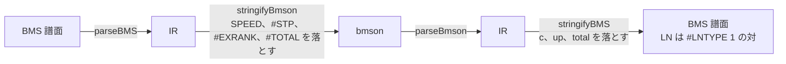

[English version](./format-compat.md)

# BMS / bmson 互換性ノート

BMS・bmson の仕様書と、既存プレイヤーの実際の挙動を比較します。Be-Music が採用した挙動とその根拠を示し、確認できていない箇所には印を付けます。利用時の挙動は各実装仕様を参照してください。[BMS](./bms-spec.ja.md)・[bmson](./bmson-spec.ja.md)・[プレイヤー](./player-spec.ja.md)・[JSON](./json-spec.ja.md)

目次

- [1. この文書の読み方](#1-この文書の読み方)
  - [1.1 de jure の情報源](#11-de-jure-の情報源)
  - [1.2 比較した実装](#12-比較した実装)
  - [1.3 根拠のラベル](#13-根拠のラベル)
- [フォーマット別の比較](#フォーマット別の比較)
- [4. BMS と bmson の相互変換](#4-bms-と-bmson-の相互変換)
  - [4.1 ゲームプレイが変わる損失](#41-ゲームプレイが変わる損失)
- [5. Be-Music の判断のまとめ](#5-be-music-の判断のまとめ)
- [6. 未解決の論点](#6-未解決の論点)
- [7. LRX](#7-lrx)
  - [7.1 plugout と異なる点](#71-plugout-と異なる点)

## 1. この文書の読み方

### 1.1 de jure の情報源

BMS には唯一の規範的な仕様がありません。それに最も近いのは次の資料です。

| 略称           | 情報源                                                                                                                                                              | 補足                                                                                                                                                                                                                                      |
| -------------- | ------------------------------------------------------------------------------------------------------------------------------------------------------------------- | ----------------------------------------------------------------------------------------------------------------------------------------------------------------------------------------------------------------------------------------- |
| BM98           | [BMS Format Specification](http://bm98.yaneu.com/bm98/bmsformat.html)（やねうらお / NBK、1998）                                                                     | 原典。短く、ヘッダ、チャンネル `01`〜`09` / `11`〜`17` / `21`〜`27`、`#RANDOM` / `#IF` / `#ENDIF` を定める。NBK 単独の文書は見つからなかった                                                                                              |
| cmds           | hitkey の [BMS command memo](https://hitkey.nekokan.dyndns.info/cmdsJP.htm)（[英語版](https://hitkey.nekokan.dyndns.info/cmds.htm)）                                | 拡張コマンドの事実上の台帳。各コマンドの出自・意味・プレイヤーごとの対応を記す。草稿で最終更新は 2014-07-11。beatoraja より前の資料で、検証した LR2 は beta3 100201。以下ではセクションのアンカー（`cmdsJP.htm#RANDOM` など）でリンクする |
| exbpm / exstop | hitkey の [拡張 BPM](https://hitkey.nekokan.dyndns.info/exbpm-object.htm) と [STOP](https://hitkey.nekokan.dyndns.info/exstop.htm) の比較ページ                     | BPM / STOP の境界値をプレイヤーごとにまとめた表                                                                                                                                                                                           |
| wiki           | [Bms:Spec](https://web.archive.org/web/20090213050609/http://wiki.bms.ms/Bms:Spec)（wiki.bms.ms、2009 年のアーカイブ）                                              | コミュニティによる要約。おおむね cmds と一致する                                                                                                                                                                                          |
| bmson          | [bmson 仕様 `doc/index.rst`](https://github.com/bemusic/bmson-spec/blob/668c4338cd7c64da2d2ec0f848c4ad58a3a881d9/doc/index.rst)（`668c4338`。現在の master と同一） | bmson 唯一の規範的な文書。以下の行番号はこのファイルの行                                                                                                                                                                                  |

### 1.2 比較した実装

| 実装            | 読んだもの                                                                                                                                                                                                                                                                                                                                                                                                                    |
| --------------- | ----------------------------------------------------------------------------------------------------------------------------------------------------------------------------------------------------------------------------------------------------------------------------------------------------------------------------------------------------------------------------------------------------------------------------- |
| LR2             | ソース非公開（LunaticRave2 beta3 100201）。根拠は (a) cmds など hitkey のページ、(b) LR2 をコミュニティが書き起こした [OpenLR2](https://github.com/GOMazk/OpenLR2) の `LR2Beta3-v100201` ブランチ（元のプログラムを再現したもの。コミット `583a3850` を引用。新コマンドを加えた `main` ブランチは使わない）、(c) LR2 の判定とゲージを再現する beatoraja フォーク [LR2oraja](https://github.com/wcko87/lr2oraja)（`3db78adf`） |
| beatoraja       | [beatoraja](https://github.com/exch-bms2/beatoraja) の `8320241d` と、そのパーサ [jbms-parser](https://github.com/exch-bms2/jbms-parser) の `8108cd54`                                                                                                                                                                                                                                                                        |
| ナナシグルーヴ2 | ソース非公開。Toy Musical 3（ver 2.96）に同梱の `nanasi2.exe` を逆アセンブルして確認した（[D]）。対象は譜面コンテナ `.n2s` だけ（[§2.20](./format-compat-bms.ja.md#220-ナナシグルーヴ2-の-n2s-コンテナ)）                                                                                                                                                                                                                     |
| plugout4 AE     | ソース非公開。plugout4 -ARCADE EDITION-（2012 年）の `plugout4.exe` を逆アセンブルして確認した（[D]）。対象は LRX の譜面形式だけ（[§7](#7-lrx)）                                                                                                                                                                                                                                                                              |
| その他          | [Bemuse](https://github.com/bemusic/bemuse) `4bf3e7d9`、[Qwilight](https://github.com/thenist/Qwilight) `6d3887f6`、[raindrop](https://github.com/zardoru/raindrop) `662dd11f`。大きく異なる点だけを挙げる                                                                                                                                                                                                                    |
| Be-Music        | このリポジトリ。Be-Music の挙動には実装しているコードへのリンクを付ける                                                                                                                                                                                                                                                                                                                                                       |

### 1.3 根拠のラベル

実装の挙動には、確認方法や推定の根拠が分かるように、次のラベルを一つ付けます。

- **[V]** 上記コミットのソースコードで確認した。
- **[R]** OpenLR2 による LR2 beta3 100201 の再現コードで確認した。LR2 について得られる最良の根拠だが、書き起こしであって LR2 自身のソースではない。
- **[C]** コミュニティの知見。hitkey や LR2oraja の作者が記録しているが、コードでは確認していない。
- **[D]** プログラム自身の実行ファイルを逆アセンブルして確認した。アドレスで示す。OpenLR2 がプログラムから外れている箇所（ノートの描画、[§2.18](./format-compat-bms.ja.md#218-ノートの描画)）での LR2 beta3 の `LR2body.exe`、nanasigroove 1.552 の `nanasi.exe`（`#EXWAVxx`）、ナナシグルーヴ2 の `nanasi2.exe`（`.n2s` コンテナ）、plugout4 の `plugout4.exe`（LRX）で使う。
- **[I]** 根拠がないことからの推定（どの対応表にも載っていないコマンドなど）。

「未定義」は、どの de jure の資料にも記述がないことを表します。

## フォーマット別の比較

- [BMS 互換性](./format-compat-bms.ja.md)
- [bmson 互換性](./format-compat-bmson.ja.md)

## 4. BMS と bmson の相互変換

Be-Music の [`@be-music/chart-writer`](../packages/chart-writer/src/index.ts) は 1 つの IR から両方のフォーマットを書き出します。2 つのフォーマットは単位が食い違うため、そのままでは引き継げない値がいくつかあります。下の表は現在の chart-writer の挙動です。詳細は [bmson 実装仕様 — BMS と bmson の相互変換](./bmson-spec.ja.md#bms-と-bmson-の相互変換) にあります。

往復の変換はどちら向きも IR を通ります（読み込みと書き出しの関数は [JSON 仕様 — 変換規則](./json-spec.ja.md#変換規則) にあります）。それぞれの書き出しが落とすものです。

**判定ランク**

- **BMS → bmson** 正の `#DEFEXRANK` はそのまま書く（単位は同じ `100` = NORMAL）。なければ `#RANK 0`〜`4` を、そのランクと同じ判定幅になる `judge_rank` 値 `33` / `67` / `100` / `133` / `167` へ変換する。それ以外の `#RANK` では `judge_rank` を書かない（既定値 `100`）。NORMAL の解釈に従うため、変換後の譜面は beatoraja では約 4/3 倍広く判定される（[§3.6](./format-compat-bmson.ja.md#36-judge_rank)）
- **bmson → BMS** 正の `judge_rank` を `#DEFEXRANK`（同じ単位）として書く。譜面がすでに `#DEFEXRANK` を持つならそれを残す。`#RANK` は書かない

**TOTAL**

- **BMS → bmson** 書かない。絶対値の `#TOTAL` には正確な百分率がないため、bmson の既定値 `100` に委ねる
- **bmson → BMS** 書かない。プレイヤーの既定値に対する百分率には正確な絶対値の `#TOTAL` がないため、BMS の既定値に委ねる。これが bmson の既定値 `100` の意味でもある

**STOP**

- **BMS → bmson** `#STOP` の単位をパルスへ換算する（`× resolution / 48`）
- **bmson → BMS** パルスを `#STOP` の単位へ換算する

**レーンと `mode_hint`**

- **BMS → bmson** 譜面自身の hint があればそれ、24 / 48 KEY なら `keyboard-24k(-double)`。それ以外は、使っているレーン（地雷と不可視ノートを含む）がすべて表にあれば譜面のプレイ種別の正式な hint（`beat-5k`、`beat-7k`、`beat-10k`、`beat-14k`、`popn-9k`）を使い、`x` はパーサの表に従うので読み直しても同じレーンに載る。それ以外は仕様の `generic-<レーン数>keys` で、`x` は使っているレーンに左から振り直す。`beat-5k` / `beat-10k` も仕様どおりスクラッチを `x` 8 / 16 に置く（[§3.2](./format-compat-bmson.ja.md#32-mode_hint-と-x)）
- **bmson → BMS** hint の表に従ってレーンを決める

**ロングノート**

- **BMS → bmson** `#LNOBJ` の組と `5x` / `6x` の LN（`#LNTYPE 1` / `2`、`#LNTYPE` 省略時は Type 1）を `l` を持つ 1 つのノートとして書く。`#LNMODE` は `ln_type` になる
- **bmson → BMS** `l > 0` のノートは `5x` / `6x` 上の `#LNTYPE 1` の始点・終点の組になる。`#LNMODE` はノートの `t`（なければ `ln_type`）が一致すればそれ、一致しなければ `ln_type` から決め、食い違うノートごとの `t` は失われる

**地雷**

- **BMS → bmson** `mine_channels` に書き、`damage` は 36 進の値（半分にしない）。`#WAV00` の名前を持つ 1 つのチャンネルにまとめる
- **bmson → BMS** 地雷の値はダメージの 36 進表記になる。四捨五入し、`0` は `01`、`1295` を超えれば `ZZ`、`damage` がなければ（bmson では 0）`01`。譜面に `#WAV00` がなければ最初の地雷の音を `#WAV00` にする

**不可視ノート**

- **BMS → bmson** `3x` / `4x` を `key_channels` に書く
- **bmson → BMS** `key_channels` は `3x` / `4x` になる

**SCROLL**

- **BMS → bmson** `SC` オブジェクトを `#SCROLLxx` の速度とともに `scroll_events` へ書く
- **bmson → BMS** `scroll_events` を `#SCROLLxx`（異なる速度ごとに 1 つ）と `SC` オブジェクトへ書く

**SPEED / `#STP` / `#EXRANK`**

- **BMS → bmson** bmson に対応する欄がないので捨てる
- **bmson → BMS** —

**`c`、`up`**

- **BMS → bmson** —
- **bmson → BMS** 失われる。BMS には音のスライスも LN 終端の音もない

### 4.1 ゲームプレイが変わる損失

上の違いの一部は、保存の形だけでなく譜面の遊び方を変えます。ライターはそれぞれを `onDiagnostic`（`ChartExportDiagnostic`）で報告するので、変換した譜面を損失のないものと取り違えずに済みます（[#1198](https://github.com/nulltask/be-music/issues/1198)）。

| コード               | 方向        | 報告する条件                                                                                   | 出力した譜面での挙動                                              |
| -------------------- | ----------- | ---------------------------------------------------------------------------------------------- | ----------------------------------------------------------------- |
| `mine-damage`        | bmson → BMS | 地雷の `damage` が 1〜1295 の整数でない（小数、`0`、それより大きい値）、または `damage` がない | 丸めた値や上限・下限に収めた値（`0` は `01`）、または既定値       |
| `total`              | bmson → BMS | `total` があり、`100` でない                                                                   | `#TOTAL` なし：その譜面でのプレイヤーの既定 TOTAL                 |
| `total`              | BMS → bmson | 譜面に正の `#TOTAL` がある                                                                     | `total` なし：プレイヤーの既定値の 100 %                          |
| `long-note-mode`     | bmson → BMS | ロングノートの種類（`ln_type` / `t`）が混ざっていて、譜面に `#LNMODE` がない                   | すべてのロングノートを譜面全体のモードで扱う                      |
| `stp`                | BMS → bmson | 譜面に `#STP` の停止がある                                                                     | 停止がなくなり、それより後のノートはすべて早く来る                |
| `exrank`             | BMS → bmson | 譜面に `#EXRANKxx` の変更（チャンネル `A0`）がある                                             | 判定ランクは譜面全体で `judge_rank` のまま                        |
| `bpm`                | BMS → bmson | BPM の変更（チャンネル `08`）が負または未定義の `#BPMxx` を指す                                | 直前の BPM のまま進み、逆転しない（LR2 の逆スクロールがなくなる） |
| `stop`               | BMS → bmson | STOP（チャンネル `09`）に正の `#STOPxx` がない（0、負、未定義）                                | 以降のノートが 1/192 小節前にずれず、そのままの位置になる         |
| `speed`              | BMS → bmson | 譜面に `SPEED` の変更（チャンネル `SP`）がある                                                 | スクロール速度は変わらない。判定には影響しない                    |
| `ln-end-sound`       | bmson → BMS | ロングノートに終端のキー音（beatoraja の `up`）がある                                          | ロングノートは音なしで終わる。判定には影響しない                  |
| `sound-continuation` | bmson → BMS | ノートが音のスライスを続けて鳴らす（`c` が `true`）                                            | 各ノートはサンプルを頭から鳴らす。判定には影響しない              |

- どのメッセージにも、該当する地雷・オブジェクト・ノートの数が入ります。値をそのまま保てる場合（1〜1295 の整数の `damage`、`100` または未指定の `total`、種類が 1 つだけのロングノート）は何も報告しません。
- 変換はこれまでどおり、できる範囲で譜面を書き出します。こうした損失を許さない呼び出し側は、ハンドラーから例外を投げて変換を止められます。
- リプレイは変換に依存しません。プレイした実際の譜面を、地雷ごとのダメージ、譜面の TOTAL とその単位、ロングノートごとのモードとともに記録するので、どのルールセットでもその内容で再判定します。
- `speed`、`ln-end-sound`、`sound-continuation` と `bga-*` のコードは、見た目や音の違いを報告するもので、判定は変わりません。それ以外のコードは判定が変わります。

## 5. Be-Music の判断のまとめ

判定とゲージは[プレイヤー仕様](./player-spec.ja.md)、オプションは[プレイオプション](./play-options.ja.md)、スキン固有の状態は [LR2](./lr2-skin.ja.md) と [beatoraja](./beatoraja-skin.ja.md) の仕様に定義します。

- 字下げ、`#END IF`、小文字のコマンドなどは寛容に読むが、ヘッダ名の後には空白を要求する（[§2.1](./format-compat-bms.ja.md#21-行の解釈とヘッダ)）。
- 通常ノートチャンネルでは、選択された制御構文の分岐も含め、同じ位置の後の非 `00` オブジェクトが前の定義を置き換える。置き換えられたキー音は鳴らない。専用ロングノートの開始位置に残った通常ノートは、キー音が異なる場合に BGM として鳴る。行順のない旧 JSON には従来の解決規則を適用する。
- 文字コードは `#CHARSET` だけを信用せずに判別し、日本語の文字コード、韓国語の EUC-KR（beatoraja や Bemuse と同じ）、UTF-8 を候補にする（[§2.2](./format-compat-bms.ja.md#22-文字コード)）。
- `#BASE 62` はファイルのどこにあっても読み、beatoraja と同じく最後の `#BASE` 行が勝つ（[§2.3](./format-compat-bms.ja.md#23-オブジェクト-id-と-base-62)）。
- レーンモードはすべてのホストで 1 つの規則を使い、数えるのは可視レーンと `#LNTYPE` のレーンだけ。拡張子より使われているレーンを優先し、6・7 鍵目の列がない `.bme` 譜面は beatoraja と同じく 5 / 10 KEY（モードを表す拡張子は `.pms` だけ）（[§2.4](./format-compat-bms.ja.md#24-レーンモードとチャンネル配置)）。
- FREE ZONE、`#LNTYPE 2`、24 / 48 KEY の拡張チャンネル、BMS でのホイール表記を実装する。いずれも LR2 や beatoraja では遊べない（[§2.4](./format-compat-bms.ja.md#24-レーンモードとチャンネル配置)、[§2.5](./format-compat-bms.ja.md#25-ロングノート)）。
- LR2 も beatoraja も読まないものも使う：`#STP`、`#WAVCMD` / `#EXWAVxx` の音量、`#PATH_WAV`、`0A` の第 2 レイヤー、browser と terminal の `#BGA` の切り出し。EXBMP 静止画・不透明動画の透過色指定、各面への ARGB、キー連動 SWBGA も描画する。NONSTOP は SWBGA のリソースも変換し、開始と表示を各ステージ内に制限する。`lr2` ルールセットは、実際の LR2 が無視する `#DEFEXRANK` と `#EXRANKxx` も適用する（[§2.9](./format-compat-bms.ja.md#29-stop-と-stp)、[§2.12](./format-compat-bms.ja.md#212-判定ランク)、[§2.15](./format-compat-bms.ja.md#215-音声系コマンドとキー音)、[§2.17](./format-compat-bms.ja.md#217-bga)）。
- 前にノートのない `#LNOBJ` の終点と、終点のない `5x` / `6x` の始点は、LR2 と同じく単押しとして遊ぶ。beatoraja は捨てる（[§2.5](./format-compat-bms.ja.md#25-ロングノート)）。
- ロングノートのスタイル、判定幅、TOTAL の既定値、ゲージの曲線は、譜面のパーサではなく選んだルールセット（`lr2`、`beatoraja`、`____`）が決める（[§2.5](./format-compat-bms.ja.md#25-ロングノート)、[§2.12](./format-compat-bms.ja.md#212-判定ランク)、[§2.13](./format-compat-bms.ja.md#213-total)）。
- 地雷：ダメージは 36 進の値そのもの（LR2 / beatoraja と同じで、nanasi の半分にする規則ではない）、爆発は判定 ruleset のモデル（`lr2` と `____` は LR2、`beatoraja` は beatoraja）、既定値は 4 %。ノートと同じ位置や LN の中の地雷は、beatoraja は捨てるが LR2 と同じく残す（BMS でも bmson でも）（[§2.6](./format-compat-bms.ja.md#26-地雷)、[§3.5](./format-compat-bmson.ja.md#35-地雷と隠しノート)）。
- HS-FIX の `AVERAGE` は、BPM × N + STOP のギミックで偏る時間平均ではなく、beatoraja の `MAINBPM` と同じメイン BPM（最も多くのノートが置かれた BPM）に合わせる。同数のときは先に現れる BPM を選ぶ（beatoraja はハッシュマップの順序）（[ブラウザプレイヤー — HS-FIX](./player-web.ja.md#hs-fix)）。
- 小節線は beatoraja と同じく最後の小節まで各小節の頭に引き、その後には足さない。bmson の `lines` はそのまま引く（[§3.3](./format-compat-bmson.ja.md#33-lines-と-resolution-と-y)）。
- `#BPM` のない譜面は BM98 の 130 で遊ぶ。LR2 はスクロールせず、beatoraja は譜面を読まない（[§2.8](./format-compat-bms.ja.md#28-bpm)）。
- 負の `#BPMxx` はどのルールセットでも LR2 の逆スクロール・ギミックとして再生する。タイミングは絶対値、反転は `trunc(BPM) < 0` のときだけ起動し、スクロールは譜面位置空間で鏡映し、押下は鏡映クロックで判定して見逃し判定は行わず、反転ティックの BGM と BGA は発火し、ノートを未判定のまま残したプレイは FAILED で終わる。未定義の `#BPMxx` スロットは LR2 の `-1` 番兵と同じく 1 BPM で反転し、鏡映は譜面の先頭を越えて戻り続ける。イベントを最初に超えた更新で反転し、離脱操作を待つ（[§2.8](./format-compat-bms.ja.md#28-bpm)、[BMS 仕様](./bms-spec.ja.md)「負の BPM」）。
- 負の初期 BPM は符号付きで積算する。初期 BPM が 0 の場合は 130 を使う。`#STOPxx` が 0・負・未定義の STOP は LR2 と同じく、その後のものを `1/192` 小節早める。同じ位置に BMS の `#STOP` が複数あれば最後のものが勝ち（LR2、beatoraja と同じ）、bmson の停止と `#STP` の行は加算する。STOP と同じ位置のノートは停止の前に叩く。STOP の長さは正確な値を保つ（beatoraja は停止ごとに整数マイクロ秒へ切り捨てるため、停止が数千ある譜面ではノートの時刻が数 ms 早くずれる）（[§2.8](./format-compat-bms.ja.md#28-bpm)、[§2.9](./format-compat-bms.ja.md#29-stop-と-stp)）。
- 描画は判定 ruleset に含まれない。ruleset やスキンにかかわらず、すべての譜面を LR2 の規則で描く。過ぎたオブジェクトは判定ライン上に留まり、ノートは判定済みで拍を過ぎたときに消え（打っていないノートは ruleset の見逃し判定までライン上で待ち、早く打ったノートはスクロールを続ける）、LN の始点はライン上に留まり、見逃した・離した LN は薄く描き、STOP の下の小節線はライン上に留まる（[§2.18](./format-compat-bms.ja.md#218-ノートの描画)、[ブラウザプレイヤー — ノートの表示範囲](./player-web.ja.md#ノートの表示範囲)）。
- LR2 が扱えない SCROLL / SPEED を含む譜面だけを beatoraja の `LaneRenderer` の規則で描く。判定ラインの位置からレーンをたどり、最初に上端を越えた位置より先は描かず、ノート・地雷・小節線は判定の有無にかかわらず時刻になったら消える（[§2.10](./format-compat-bms.ja.md#210-scroll-と-speed)）。
- SPEED は Bemuse の間隔モデルに従う。ただし最初のキーフレームより前は、最初の値を保つ Bemuse ではなく beatoraja と同じく 1.0 から変化させる（[§2.10](./format-compat-bms.ja.md#210-scroll-と-speed)）。
- 制御構文はすべて対応し、`#RANDOM` はプレイごとに抽選する。分岐内の定義は LR2 や beatoraja と同じくファイル順に適用する（[§2.14](./format-compat-bms.ja.md#214-制御構文)）。
- `#VOLWAV` は beatoraja と同じ `0 < n < 200` の範囲でだけ適用する（[§2.15](./format-compat-bms.ja.md#215-音声系コマンドとキー音)）。
- 見つからないアセットは、cmds の言うとおり別の拡張子でも探す。キー音と画像は決まった一覧で、動画はまず動画の拡張子で探し、最後に静止画として探す。そのあと LR2 と同じく譜面の親フォルダも探すので、サブフォルダの差分もその場所のまま遊べる。どのホストも、LR2 と同じく書かれた名前を最初に試す。同じ名前で種類の違うファイルが同じ内容とは限らないため。Be-Music が独自に決めているのは代わりの候補の順番だけで、Web プレイヤーは容量を減らすために再エンコードしたパック向けに `.opus` と `.webp` を先に試す（[§2.19](./format-compat-bms.ja.md#219-アセットファイルの探し方)）。
- bmson：仕様の既定値（`beat-7k`、`lines` がない場合と `[]` の区別、`total` 100、`judge_rank` 100、負の `resolution` は絶対値）と、beatoraja の拡張と解釈（`ln_type` / `t`、キーボード系の hint、`mine_channels` / `key_channels`、表にない `x` は BGM、未知の `mode_hint` は `beat-7k`（ただし `x` 8 より先のレーンがある譜面は BGM にせず残す）、`total` は既定値に対する百分率で `0` は既定値）に従う（[§3](./format-compat-bmson.ja.md#3-bmson)）。
- bmson の `scroll_events`（beatoraja 拡張）は `#SCROLL` として再生し、BMS と同じく次のスクロールイベントまで速度を保つ。beatoraja の bmson デコーダーは後のオブジェクトのために作るタイムラインを速度 1.0 から始めるが、確認したギミック譜面では見た目の違いはなかった（[§3.8](./format-compat-bmson.ja.md#38-bpm_events-と-stop_events)）。
- bmson の BPM / STOP の変化は、異なる値ごとに IR のキーを 1 つ共有し、1,295 を超えると base 62 のキーに切り替える。変化が数千ある譜面でもすべての値を保つ。異なる値が 3,843 を超える場合（既知の譜面にはない）はキーを 3 文字に伸ばし、値は近似しない。ただしその譜面は BMS に書き出せない（[§3.8](./format-compat-bmson.ja.md#38-bpm_events-と-stop_events)）。
- BMS と bmson の相互変換では、ロングノート、地雷のダメージ、不可視ノート、判定ランクを引き継ぎ、正式な `mode_hint` を書き、TOTAL は変換先の既定値に委ねる（[§4](#4-bms-と-bmson-の相互変換)）。

## 6. 未解決の論点

Be-Music が de facto の実装と理由を記録しないまま食い違っている点と、根拠が不十分な点です。

1. **地雷と不可視ノートによるレーンモード**：beatoraja は 5K / 7K / 10K / 14K の判定にこれらも数え、Be-Music は数えない（[§2.4](./format-compat-bms.ja.md#24-レーンモードとチャンネル配置)）。beatoraja の規則は確かめたが、LR2 の規則は確かめられていない。OpenLR2 の再現コードには、キーモードを記録する曲の走査処理がない。beatoraja に合わせると、2P 側に不可視のキー音しかない SP 譜面（`test/fixtures/invisible-notes.bms`）が 2P 側の空いた DP 譜面になり、作者の意図と違う。LR2 の規則が分かるまで未解決とする。
2. **LR2 の根拠の不足**：0 の BPM、重複したオブジェクト行、`#TOTAL ≤ 0`、地雷の正確な爆発窓は、コミュニティの報告か再現コードに頼っており、情報源どうしも一部食い違う。ソースコードだけでは決められず、LR2 そのもので確かめる必要がある（負の `#BPMxx` は OpenLR2 に加えて LR2body.exe でも確認済み。[§2.8](./format-compat-bms.ja.md#28-bpm) 参照）。

## 7. LRX

LRX は plugout4 -ARCADE EDITION-（2012 年）の譜面形式で、プレイヤーは lavalse が書いた。BMS の後継として作られた。1 譜面は、同じフォルダにある UTF-16 の XML ファイル 3 つからなる。`NN.lrs`（音とノーツ）、ヘッダの `NN.lrh`、ヘッダが指す BGA ファイル（既定は `_movie.lrm`）。仕様書は公開されておらず、以下はすべて `plugout4.exe` で確認し [D]、収録の 198 譜面で照合した。Be-Music は LRX を独自の `sourceFormat`（`lrx`）として読み、BMS のチャンネルに変換する（[ADR 0043](./adr/0043-lrx-charts.ja.md)、[`lrx.ts`][bm-lrx]）。 [LRX 実装仕様](./lrx-spec.ja.md)

**ファイル**

- **plugout4 -ARCADE EDITION-** 曲の走査で `.lrs` を拾い、読み込み時に `NN.lrh` があれば読み、BGA ファイルは `.lrh` の `moviepath`、なければ `.lrs` のもの、なければ `_movie.lrm` を読む（0x4652d0）
- **Be-Music** 同じ。`.lrs` を譜面とし、その `.lrh` と BGA ファイルを隣から読む。`.lrs___` と `.lr_` は譜面ではない

**文字コード**

- **plugout4 -ARCADE EDITION-** BOM 付き UTF-16LE（irrXML）
- **Be-Music** BOM、または先頭の `<` と 0 バイトで UTF-16 と判断し、それ以外は UTF-8。irrXML の使い方と同じく、要素を名前だけで平らに読む

**タイミング**

- **plugout4 -ARCADE EDITION-** 4/4 の 1 小節が 1,920 tick（1 拍 480）で、小節線に関係しない。`c="301"` が BPM（最初のものが開始 BPM。`.lrh` の `startbpm` は表示用）、`c="302"` が `p` ミリ秒の停止、`c="309"` が曲の終わり（0x4422f0）。プレイはそのノーツで、なければ最後の音のノーツ（`c` 0〜199）の開始から 3 秒後に、ミリ秒単位で終わる（0x44268c、0x442790）。鳴っている音があっても終える（0x43f085）
- **Be-Music** tick を小節内の位置にする。`c="301"` はチャンネル `08`、`c="302"` はその tick で有効な BPM で BMS の単位に直してチャンネル `09`。プレイは plugout と同じところで終える（`resolveLRXPlayEndSeconds`）。`c="309"`（`lrx.endTick`）があればそこ、なければ最後の音のノーツの開始から 3 秒後で、ミリ秒単位に切り捨てる。鳴っている音や表示中の BGA があっても終えるが、まだ判定するノーツがあれば続ける

**小節線**

- **plugout4 -ARCADE EDITION-** `c="300"`。どこにでも置ける
- **Be-Music** 小節は小節線に従う（最初の小節線より前は tick 0 から始まる小節）。最後の小節線より後は 4/4

**レーン**

- **plugout4 -ARCADE EDITION-** `c` 0〜19。0 / 10 がスクラッチ、1〜9 / 11〜19 が鍵盤。`.lrh` の `lanetype` が種類を決める。0 は 7 鍵、1 は 5 鍵、2 は 14 鍵、3 は 10 鍵、4 は 9 鍵、5 / 6 は両スクラッチ付きの 5 / 7 鍵
- **Be-Music** 0 → `16`、1〜7 → `11`〜`15`・`18`・`19`、2P 側も同様。9 鍵は 1〜9 を PMS-STD のレーンに置く。`lanetype` はそのままモードを決める（`resolveChartPlayVariant`）。5 / 6 は警告を出して 10 / 14 KEY

**ロングノーツ**

- **plugout4 -ARCADE EDITION-** レーン上で `e > s`。終点も判定し、数える
- **Be-Music** `e − s` tick の CN（`lrx.length`）

**見えないノーツ**

- **plugout4 -ARCADE EDITION-** `dmg="0"` のレーンのノーツは判定せず、自分の時刻に鳴る。鳴った後は、次に判定される押下までそのレーンのキー音になる（0x43f430、0x43bd1b）。plugout は BMS の不可視オブジェクトをこのノーツとして読む（0x44b00c）
- **Be-Music** BGM（チャンネル `01`）とし、レーンを `lrx.lane` に持つ。そのレーンの不可視ノーツにもする（[プレイヤー仕様 — 不可視ノート](./player-spec.ja.md#不可視ノート)）

**空押しの音**

- **plugout4 -ARCADE EDITION-** 判定するもののない押下は、レーンの音カーソルのノーツを鳴らす（0x43bcd0）。判定される押下はカーソルをそのノーツへ動かす（0x43bd44）。ロングノーツを離すと、カーソルはレーンの次のノーツへ移る（0x43be96）。鳴った見えないノーツは、次に判定される押下まで優先される。見逃したノーツはカーソルを動かさない。それより前のカーソルは初期化されていないメモリ（`operator new`、0x4077d8）
- **Be-Music** `plugout` ruleset は同じ規則で選び（`core/plugout-lane-sound.ts`）、カーソルはレーンの最初のノーツから始める。ほかの ruleset は LR2 の規則のまま

**チェインノーツ**

- **plugout4 -ARCADE EDITION-** `cn="1"`。判定も計数もしない。レーンのノーツは順にリンクされ、チェインノーツはその前にある最後のチェインでないノーツにつながる（0x43bbb0）。そのノーツを鳴らす押下のたびに（空押しも含む）、チェインノーツも鳴る。押下からの遅れは、譜面上でそのノーツから離れている分と同じ（0x43bcd0）。押さなければ鳴らない
- **Be-Music** チャンネル `01` に置き、`lrx.chain` と、レーンを `lrx.lane` に持つ。chart-model がレーンの直前の判定ノーツに結び付け（`ResolvedNote.chainSounds`）、判定するプレイではそのノーツを鳴らす押下のたびに予約する。AUTO プレイとオフラインの書き出しでは自分の時刻に鳴らす。リプレイで押下より後へシークしたときは、押下のキー音と同じく途中から鳴らす。隠しチェインノーツは BGM のまま。判定するレーンで前にノーツのないチェインノーツは、それ自体を判定する（端の場合を参照）

**BGM**

- **plugout4 -ARCADE EDITION-** `c` 20〜199 はその時刻に鳴る。100〜199 が BGM の列
- **Be-Music** チャンネル `01`

**音のパラメータ**

- **plugout4 -ARCADE EDITION-** `vol`（音量 `vol/127`）、`pan`（`(pan − 64)/64`）、`frq`（再生速度 `frq/44100`）、`atk` / `rls`（フェードイン・フェードアウトのミリ秒）、`ost` / `len`（開始位置・長さのミリ秒）（0x4dc880）。`rev`（エディタの「Reverse」）は何も変えない。持つのはチェインノーツの再生予約だけで（0x4dc7f0）、予約を鳴らすときには渡さない（0x4dd5b6）
- **Be-Music** どのプレイヤーとオフライン描画でも、ノーツごとに音量、バランス（遠い側を絞る）、再生速度、再生範囲、直線のフェードを掛ける。`len` / `atk` / `rls` は plugout と同じく `44100 / frq` の整数部で伸ばす（44100 Hz を超えるときは 1 とする）。曲選択のプレビューは音量と速さだけ。`rev` は鳴らし分けない（plugout はチェインノーツにだけ渡す）。`rev` は `lrx.reverse` として持ち、plugout と同じく逆再生はしない

**ミキサーグループ**

- **plugout4 -ARCADE EDITION-** 音は、`song_master` の下にある 2 つの FMOD チャンネルグループ `song_key` と `song_bgm` のどちらかで鳴る（0x4de371）。`song_bgm` に入るのは、BGM 列（`c` 100〜199）のうち `dmg` が 0 でないノーツだけ。それ以外はすべて `song_key` で、レーンのノーツ、隠しノーツ、チェインノーツ、`c` 20〜99、`dmg="0"` の BGM 列のノーツが入る（0x43b455、0x43b640）。グループの音量を変えるのは譜面エディターの Song Mixer ウィンドウだけで、そのスクロールバー（0〜100、既定 100）の値 / 100 を音量にする（0x4de830、0x4ddc90、0x4dfba0）。プレイ中はこのウィンドウがないので、`song_key` と `song_bgm` は 1.0、`song_master` は作成時の 0.9 のまま（0x4de4f1）。音ごとの音量は `v` / 127（0x4dca44）。`vol_master`、`vol_play_key`、`vol_play_bgm`、`vol_other_se`、`vol_other_bgm` はスキンの数値の参照先で（0x41a000）、これらから FMOD の音量へ届く経路は見つからなかった
- **Be-Music** plugout が `song_key` に入れる背景音には `lrx.keyVolume` を付け、どのプレイヤーとオフラインの書き出しでもキー音の音量で鳴らす（`playsAtKeysoundVolume`）。Be-Music のキー音と BGM の音量の既定はどちらも 100 % で、plugout が 2 つのグループを鳴らす等しい音量と同じ

**`dmg`、`rcv`**

- **plugout4 -ARCADE EDITION-** 読むが、`dmg="0"` 以外の効果は見つからない
- **Be-Music** イベントに残す

**音の ID**

- **plugout4 -ARCADE EDITION-** `id` は 0 から。ファイルがなければ拡張子を `.ogg` にして読み直す（0x4dc42d）
- **Be-Music** スロットは `id + 1`（1,294 を超えると base 62）。BMS と同じく `.ogg` などを試す（[§2.19](./format-compat-bms.ja.md#219-アセットファイルの探し方)）

**BGA**

- **plugout4 -ARCADE EDITION-** `.lrm` の `image` と `movie` は 1 つの ID 表を共有する。プレイでは `c` 200（ベース）とレイヤー 201〜204 を、それぞれ最後に始まったノーツで描き、ミスから 500 ms はミス画像（`299`）だけを描く（0x443c95、0x4439b7）。205〜298 は描かない。`sx`〜`sh` で画像を切り出し、`dx`〜`dh` で 1280×720 の画面に置く。`a` `r` `g` `b`、`bld`（アルファ・加算・減算・乗算）、`rot`（度）、`ctr`（回転の中心。テンキーの位置）は `dx` があるときだけ読む（0x4656c2）。`cn` のノーツはキーフレームで、前のノーツの開始から次のノーツの `e` まで、前のノーツの `acc`（線形、u²、1 − (1 − u)²）で補間し、画像番号を数え上げ、値はすべて切り捨てる（0x444453、0x401b30）。`dx` がなければ、静止のノーツは画像の大きさで左上に、キーフレームは画面全体に描く。`dvx`・`dvy`・`cyc`・`lp` は読むがプレイでは使わない。同梱譜面が使うのは素の `200` と `299` だけ
- **Be-Music** `200` → `04`、`201` → `07`、`202` → `0A`、`299` → `06`。切り出し・移動・色・合成・回転・キーフレーム・レイヤー 203/204 のどれかを使う譜面は、全キューを `lrx.bga` にも持ち（`resolveLRXBGAProgram`、`sampleLRXBGA`）、Web プレイヤーは BMS の面の代わりに 1280×720 の画面へ合成する（`media/lrx-bga-compositor.ts`）。WebGL で描き、`bld` ごとの合成は plugout の Direct3D 9 ドライバーと同じにする（0x592c5c）。0 は `src × α + dst × (1 − α)`、1 は `src + dst × (1 − src)`（アルファは使わない）、2 は `dst × (1 − src) − src × α`（0 で止まる）、3 は `src × α + dst × src`、4 は `src × dst + dst × (1 − α)`。`src` は画像にノーツの色を掛けたもの。205〜298 は警告を出して捨てる

**チェインの再生モード**

- **plugout4 -ARCADE EDITION-** チェインノーツは、キー音と同じくノーツ自身の音量・パン・速さ・再生範囲で鳴る（0x43b7d4。ゲーム中のモード −1 は 0x444f5c で設定）。モード 0〜3 はエディタのプレビュー用
- **Be-Music** 同じ値を、チェインノーツ自身のトリガーから使う

**ミキサーの子グループ**

- **plugout4 -ARCADE EDITION-** `song_key` と `song_bgm` にはそれぞれ 8 個の子グループがあり、エディタでトラックを割り当てたときだけ使う（0x45cb7c）。プレイではどの音も親のグループで鳴る
- **Be-Music** プレイと同じく、キー音と BGM の 2 つの音量

**端の場合**

- **plugout4 -ARCADE EDITION-** レーンの最初のノーツがチェインノーツなら、ノーツ数には入らないが判定する（カーソルのリセット 0x43c000、計数 0x43c071）。ノーツは時刻、STOP と小節線、チャンネルの順をキーとする安定でないヒープソートで並ぶ（0x448160）ので、同じ tick・同じチャンネルのノーツの順序は決まらない。`c="309"` は曲の終わりを立てるだけで（0x43f6b9）、`p` は読まない。曲の `hash` は譜面ファイルのバイト列の MD5 で（0x46b580、0x5672d0）、plugout 自身のスコアデータベースのキー
- **Be-Music** 先頭のチェインノーツは判定するレーンのノーツにし、`plugout` ではノーツ数から除く（`ReplayNote.uncounted`）。同じ tick ではファイル順を保つ。終了は tick だけを読む。リプレイが記録する譜面ファイルの MD5（`chart.md5`）が、`.lrs` ではこの `hash` に当たる

**ランクと TOTAL**

- **plugout4 -ARCADE EDITION-** `.lrs` の `information` からだけ読む（`.lrh` の値は読まない）。ランク 0〜3 で判定幅が決まり（0x43e0a7）、TOTAL が 0 以下ならノーツ数から計算する
- **Be-Music** `.lrs` から `metadata.rank` / `metadata.total`。`plugout` ruleset は plugout と同じくランクを読み、ほかの ruleset は LR2 の `#RANK` として読む（[ADR 0044](./adr/0044-plugout-ruleset.ja.md)）

**ヘッダ**

- **plugout4 -ARCADE EDITION-** `title`、`subtitle`、`genre`、`artist_song`、`artist_sequence`、`lrslevel` / `bmslevel`、`category`、表示用 BPM、画像、`phase` / `unlock` / `songid`
- **Be-Music** 曲名・アーティスト・ジャンル・画像は BMS と同じ欄へ。`lrslevel` をプレイレベル、`category` 0〜4 を難易度 1〜5、`artist_sequence` をサブアーティストにし、残りは `lrx` に残す

### 7.1 plugout と異なる点

`plugout` ruleset で遊ぶ LRX 譜面が plugout4 -ARCADE EDITION- と同じにならないのは、次の点です。上の表のそれ以外の項目は、plugout と一致するか、意図して plugout に従っています。

**終わりより後のノーツ**

- **plugout4 -ARCADE EDITION-** プレイが先に終わるので届かない
- **Be-Music** 流して判定し、判定し終えてからプレイを終える
- **理由** 同梱譜面にはなく、終えると当たりでも見逃しでもないノーツが残る

**レーンタイプ 5 と 6**

- **plugout4 -ARCADE EDITION-** 両側にスクラッチのある 5 鍵と 7 鍵
- **Be-Music** 警告を出して 10 KEY と 14 KEY で遊ぶ
- **理由** Be-Music には、スクラッチが 2 つで 5 鍵・7 鍵のレーンモードがない

**レーンで最初の空押し**

- **plugout4 -ARCADE EDITION-** レーンのサウンドカーソルにある音を鳴らす。`operator new` が初期化しないままにする（0x4077d8）
- **Be-Music** レーンの最初のノーツを鳴らす
- **理由** plugout の挙動が決まっていない

**同じ tick・同じチャンネルのノーツ**

- **plugout4 -ARCADE EDITION-** 安定でないヒープソート（0x448160）で並ぶので、順序が決まらない
- **Be-Music** ファイル順
- **理由** plugout の挙動が決まっていない。ファイル順はその結果の 1 つ

**曲とシステム音の音量**

- **plugout4 -ARCADE EDITION-** 曲の音は 0.9 の `song_master`、システム音は 1.0 の `others_master` を通る（0x4de4f1）
- **Be-Music** 曲の音は Be-Music のマスター・キー音・BGM の音量に従い、システム音は別の音量を持つ
- **理由** Be-Music の画面とその音は plugout のものではない

**音声エンジン**

- **plugout4 -ARCADE EDITION-** FMOD Ex がミックス、リサンプル、フェードを行う
- **Be-Music** Web Audio（ターミナルでは `node-web-audio-api`）
- **理由** 同じパラメーターを使うが、リサンプル、補間、クリップはわずかに違いうる。比べていない

**BGA を描く場所**

- **plugout4 -ARCADE EDITION-** plugout 自身のプレイ画面の後ろの 1280×720 の画面
- **Be-Music** 選んだ LR2 / beatoraja スキンの BGA 領域。Canvas のスキンには合成した画面を 256×256 に縮めて渡す
- **理由** Be-Music は自分のスキンで遊ぶ

**Web プレイヤー以外での BGA の変形**

- **plugout4 -ARCADE EDITION-** すべての変形を描く
- **Be-Music** `lrx.bga` を合成するのは Web プレイヤーだけ。ほかの環境は、キューを変換した BMS の面を、切り出し・配置・色・合成・回転・キーフレームなしで表示する
- **理由** 合成に WebGL が要る

**選曲画面のプレビュー**

- **plugout4 -ARCADE EDITION-** 調べていない
- **Be-Music** 音ごとのゲインとレートだけを使う
- **理由** プレビューは短いループで、プレイではない

**プレイ以外の画面とデータ**

- **plugout4 -ARCADE EDITION-** 選曲・リザルト・オペレーター画面、解禁（`phase`、`unlock`、`songid`）、コースの一覧、スコアデータベース
- **Be-Music** Be-Music 自身の画面、NONSTOP コース、Leaderboard。ヘッダの値は `lrx` に残すが使わない
- **理由** 対象外

**コース**

- **plugout4 -ARCADE EDITION-** コースのステージは LRX 譜面
- **Be-Music** LRX と BMS / bmson のステージを混ぜた NONSTOP コース（`lrx-mixed`）と、レーンの種類を混ぜたもの（`lrx-layout-mismatch`）は断る。1 本に結合した NONSTOP 譜面は最後の音から 3 秒後に終わる。ステージの終わりのノーツは残さない
- **理由** 1 本に結合した譜面には、1 つの形式と 1 つのレーン配置が要る

**検証**

- **plugout4 -ARCADE EDITION-** —
- **Be-Music** 判定、ゲージ、チェインノーツ、音、BGA は `plugout4.exe` で読んだ内容に従い、テストで確かめている。動いている plugout と同じプレイを並べて比べてはいない
- **理由** plugout の入力と結果を記録したものがない

`plugout` ruleset では、BMS と bmson の譜面に plugout にはなかった規則も当てはめます。ランクのない譜面は最も近い plugout のランクに、地雷は LR2 に従います（[ADR 0044](./adr/0044-plugout-ruleset.ja.md)）。`lr2`、`beatoraja`、`____` では、LRX 譜面はその ruleset で判定し、plugout のようには判定しません。

[bm-lrx]: ../packages/chart-parser/src/core/lrx.ts
