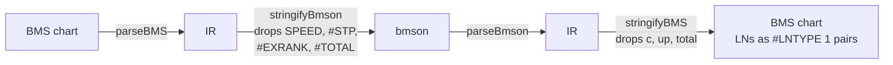

[Japanese version](./format-compat.ja.md)

# BMS / bmson compatibility notes

These notes compare the written BMS and bmson specifications with observed player behavior. The comparisons explain which behavior Be-Music follows and mark cases where the evidence is incomplete. For the behavior applications can rely on, see the implementation specs. [BMS](./bms-spec.md) · [bmson](./bmson-spec.md) · [Player](./player-spec.md) · [JSON](./json-spec.md)

Table of contents

- [1. How to read this document](#1-how-to-read-this-document)
  - [1.1 De jure sources](#11-de-jure-sources)
  - [1.2 Implementations compared](#12-implementations-compared)
  - [1.3 Evidence labels](#13-evidence-labels)
- [Comparisons by format](#comparisons-by-format)
- [4. Converting between BMS and bmson](#4-converting-between-bms-and-bmson)
  - [4.1 Losses that change gameplay](#41-losses-that-change-gameplay)
- [5. Be-Music decisions in short](#5-be-music-decisions-in-short)
- [6. Known open questions](#6-known-open-questions)
- [7. LRX](#7-lrx)
  - [7.1 Where Be-Music still differs from plugout](#71-where-be-music-still-differs-from-plugout)

## 1. How to read this document

### 1.1 De jure sources

BMS has no single normative specification. These are the closest things to one:

| Short name     | Source                                                                                                                                                                      | Notes                                                                                                                                                                                                                                                           |
| -------------- | --------------------------------------------------------------------------------------------------------------------------------------------------------------------------- | --------------------------------------------------------------------------------------------------------------------------------------------------------------------------------------------------------------------------------------------------------------- |
| BM98           | [BMS Format Specification](http://bm98.yaneu.com/bm98/bmsformat.html) (Urao Yane / NBK, 1998)                                                                               | The original format. Short; defines headers, channels `01`–`09` / `11`–`17` / `21`–`27`, `#RANDOM` / `#IF` / `#ENDIF`. No separate NBK document was found.                                                                                                      |
| cmds           | [BMS command memo](https://hitkey.nekokan.dyndns.info/cmds.htm) by hitkey ([Japanese](https://hitkey.nekokan.dyndns.info/cmdsJP.htm))                                       | The de facto registry of extensions: origin, meaning and per-player support of each command. A draft, last updated 2014-07-11; it predates beatoraja, and the LR2 it tested is beta3 100201. Links below use its section anchors (`cmds.htm#RANDOM` and so on). |
| exbpm / exstop | hitkey's [extended BPM](https://hitkey.nekokan.dyndns.info/exbpm-object.htm) and [STOP](https://hitkey.nekokan.dyndns.info/exstop.htm) comparison pages                     | Per-player tables for edge-case BPM / STOP values.                                                                                                                                                                                                              |
| wiki           | [Bms:Spec](https://web.archive.org/web/20090213050609/http://wiki.bms.ms/Bms:Spec) (wiki.bms.ms, 2009 archive)                                                              | Community summary; mostly agrees with cmds.                                                                                                                                                                                                                     |
| bmson          | [bmson spec `doc/index.rst`](https://github.com/bemusic/bmson-spec/blob/668c4338cd7c64da2d2ec0f848c4ad58a3a881d9/doc/index.rst) at `668c4338` (identical to current master) | The only normative text for bmson. Line numbers below refer to this file.                                                                                                                                                                                       |

### 1.2 Implementations compared

| Implementation  | What was read                                                                                                                                                                                                                                                                                                                                                                                                                                                       |
| --------------- | ------------------------------------------------------------------------------------------------------------------------------------------------------------------------------------------------------------------------------------------------------------------------------------------------------------------------------------------------------------------------------------------------------------------------------------------------------------------- |
| LR2             | Closed source (LunaticRave2 beta3 100201). Evidence comes from (a) cmds and hitkey's other pages, (b) [OpenLR2](https://github.com/GOMazk/OpenLR2), a community rewrite of LR2 whose `LR2Beta3-v100201` branch reconstructs the original program (cited at commit `583a3850`; the `main` branch adds new commands and is not used here), and (c) [LR2oraja](https://github.com/wcko87/lr2oraja), a beatoraja fork that emulates LR2's judge and gauge (`3db78adf`). |
| beatoraja       | [beatoraja](https://github.com/exch-bms2/beatoraja) at `8320241d` and its parser [jbms-parser](https://github.com/exch-bms2/jbms-parser) at `8108cd54`.                                                                                                                                                                                                                                                                                                             |
| Nanasi Groove 2 | Closed source. `nanasi2.exe` as bundled with Toy Musical 3 (ver 2.96), read in disassembly ([D]); only its `.n2s` chart container is covered ([§2.20](./format-compat-bms.md#220-nanasi-groove-2-n2s-containers)).                                                                                                                                                                                                                                                  |
| plugout4 AE     | Closed source. `plugout4.exe` of plugout4 -ARCADE EDITION- (2012), read in disassembly ([D]); only its LRX chart format is covered ([§7](#7-lrx)).                                                                                                                                                                                                                                                                                                                  |
| Others          | [Bemuse](https://github.com/bemusic/bemuse) `4bf3e7d9`, [Qwilight](https://github.com/thenist/Qwilight) `6d3887f6`, [raindrop](https://github.com/zardoru/raindrop) `662dd11f`. They are mentioned only where they differ materially.                                                                                                                                                                                                                               |
| Be-Music        | This repository. Be-Music claims link to the code that implements them.                                                                                                                                                                                                                                                                                                                                                                                             |

### 1.3 Evidence labels

Evidence labels identify how each observed behavior was verified or inferred.

- **[V]** verified in the implementation's source code at the commit above.
- **[R]** read in OpenLR2's reconstruction of LR2 beta3 100201. It is the best available evidence for LR2, but it is a rewrite, not LR2's own source.
- **[C]** community knowledge: documented by hitkey or LR2oraja's author, not checked in code.
- **[D]** read in the disassembly of a program's own executable, cited by address: LR2 beta3's `LR2body.exe` where OpenLR2 strays from the program (note drawing, [§2.18](./format-compat-bms.md#218-note-drawing)), nanasigroove 1.552's `nanasi.exe` (`#EXWAVxx`), Nanasi Groove 2's `nanasi2.exe` (its `.n2s` containers) and plugout4's `plugout4.exe` (LRX).
- **[I]** inferred from the absence of evidence (for example, a command that no support list mentions).

"Undefined" means no de jure source says anything.

## Comparisons by format

- [BMS compatibility](./format-compat-bms.md)
- [bmson compatibility](./format-compat-bmson.md)

## 4. Converting between BMS and bmson

Be-Music's [`@be-music/chart-writer`](../packages/chart-writer/src/index.ts) writes both formats from one IR. The two formats disagree on units, so several values do not carry over as they are. The table states what the chart-writer does today; [bmson spec — Converting between BMS and bmson](./bmson-spec.md#converting-between-bms-and-bmson) has the details.

A round trip goes through the IR both ways (the readers and writers are drawn in [JSON spec — Conversion rules](./json-spec.md#conversion-rules)). What each writer leaves out:

**Judgment rank**

- **BMS → bmson** A positive `#DEFEXRANK` is written as is (the same `100` = NORMAL unit); otherwise `#RANK 0`–`4` becomes `33` / `67` / `100` / `133` / `167`, the `judge_rank` value that judges like that rank; any other `#RANK` leaves `judge_rank` out (default `100`). This follows the NORMAL reading, so the converted chart judges about 4/3 wider in beatoraja ([§3.6](./format-compat-bmson.md#36-judge_rank))
- **bmson → BMS** A positive `judge_rank` is written as `#DEFEXRANK` (same unit) unless the chart already has one; no `#RANK` is written

**TOTAL**

- **BMS → bmson** Not written: an absolute `#TOTAL` has no exact percentage, so the bmson default `100` applies
- **bmson → BMS** Not written: a percentage of the player's default has no exact absolute `#TOTAL`, so the BMS default applies, which is what bmson's default `100` means

**STOP**

- **BMS → bmson** `#STOP` units become pulses (`× resolution / 48`)
- **bmson → BMS** Pulses become `#STOP` units

**Lanes and `mode_hint`**

- **BMS → bmson** The chart's own hint if it has one; `keyboard-24k(-double)` for 24 / 48 KEY; otherwise the canonical hint of the chart's play variant (`beat-5k`, `beat-7k`, `beat-10k`, `beat-14k`, `popn-9k`) when every lane in use, mines and invisible notes included, is in its table, with `x` from the parser's table so the chart reads back onto the same lanes; else the spec's `generic-<lanes>keys` with `x` numbered over the lanes in use, left to right. `beat-5k` / `beat-10k` put the scratch on `x` 8 / 16 as the spec does ([§3.2](./format-compat-bmson.md#32-mode_hint-and-x))
- **bmson → BMS** Lanes come from the hint's table

**Long notes**

- **BMS → bmson** `#LNOBJ` pairs and `5x` / `6x` LNs (`#LNTYPE 1` / `2`, Type 1 when `#LNTYPE` is omitted) become one note with `l`; `#LNMODE` becomes `ln_type`
- **bmson → BMS** A note with `l > 0` becomes a `#LNTYPE 1` start / end pair on `5x` / `6x`. `#LNMODE` comes from the notes' `t` (else `ln_type`) when they agree, else from `ln_type`; per-note `t` values that disagree with it are lost

**Mines**

- **BMS → bmson** Written to `mine_channels` with `damage` from the base-36 value (no halving), in one channel named after `#WAV00`
- **bmson → BMS** A mine's value becomes its damage in base 36: rounded, `0` becomes `01`, above `1295` becomes `ZZ`, a missing `damage` (0 in bmson) becomes `01`. The first mine's sample becomes `#WAV00` when the chart has none

**Invisible notes**

- **BMS → bmson** `3x` / `4x` are written to `key_channels`
- **bmson → BMS** `key_channels` become `3x` / `4x`

**SCROLL**

- **BMS → bmson** `SC` objects become `scroll_events` with their `#SCROLLxx` rate
- **bmson → BMS** `scroll_events` become `#SCROLLxx` (one per distinct rate) and `SC` objects

**SPEED / `#STP` / `#EXRANK`**

- **BMS → bmson** Dropped: bmson has no field for them
- **bmson → BMS** —

**`c`, `up`**

- **BMS → bmson** —
- **bmson → BMS** Lost: BMS has no sample slicing or LN end sound

### 4.1 Losses that change gameplay

Some of these differences change how the chart plays, not only how it is stored. The writers report each one through `onDiagnostic` (`ChartExportDiagnostic`), so a converted chart does not pass for a lossless one ([#1198](https://github.com/nulltask/be-music/issues/1198)):

| Code                 | Direction   | Reported when                                                                                                       | What the output plays                                                       |
| -------------------- | ----------- | ------------------------------------------------------------------------------------------------------------------- | --------------------------------------------------------------------------- |
| `mine-damage`        | bmson → BMS | A mine's `damage` is not a whole number from 1 to 1295 (fractions, `0`, larger values), or the mine has no `damage` | The rounded or clamped value (`0` becomes `01`), or the default damage      |
| `total`              | bmson → BMS | `total` is set and is not `100`                                                                                     | No `#TOTAL`: the player's default TOTAL for the chart                       |
| `total`              | BMS → bmson | The chart has a positive `#TOTAL`                                                                                   | No `total`: 100 % of the player's default                                   |
| `long-note-mode`     | bmson → BMS | Long notes have different types (`ln_type` / `t`), and the chart has no `#LNMODE`                                   | Every long note under the chart-wide mode                                   |
| `stp`                | BMS → bmson | The chart has `#STP` stops                                                                                          | No stops: every note after one comes earlier                                |
| `exrank`             | BMS → bmson | The chart has `#EXRANKxx` changes (channel `A0`)                                                                    | The judgment rank stays at `judge_rank` for the whole chart                 |
| `bpm`                | BMS → bmson | A BPM change (channel `08`) names a negative or undefined `#BPMxx`                                                  | The chart keeps its previous BPM and never reverses (no LR2 reverse scroll) |
| `stop`               | BMS → bmson | A STOP (channel `09`) has no positive `#STOPxx` (zero, negative or undefined)                                       | The notes after it stay put instead of coming 1/192 of a measure earlier    |
| `speed`              | BMS → bmson | The chart has `SPEED` changes (channel `SP`)                                                                        | The scroll speed does not change; judging is not affected                   |
| `ln-end-sound`       | bmson → BMS | Long notes have an end keysound (beatoraja's `up`)                                                                  | The long note ends silently; judging is not affected                        |
| `sound-continuation` | bmson → BMS | Notes continue their sound slice (`c` is `true`)                                                                    | Each note plays its sample from the start; judging is not affected          |

- Each message carries the number of mines, objects or notes affected. Exact values round-trip: a whole `damage` from 1 to 1295, `total` 100 or unset, and long notes of one type report nothing.
- The conversion stays best-effort and still writes the chart. A caller that must not convert with such a loss throws from the handler, which stops the conversion.
- A replay does not depend on the conversion: it records the effective chart it was played on, with each mine's damage, the chart's TOTAL and its unit, and each long note's mode, so every ruleset re-judges the play on those facts.
- `speed`, `ln-end-sound`, `sound-continuation` and the `bga-*` codes report what is drawn or heard differently; they do not change judging. The other codes do.

## 5. Be-Music decisions in short

Judgment and gauges are defined in the [player specification](./player-spec.md), options in [play options](./play-options.md), and family-specific state in the [LR2](./lr2-skin.md) and [beatoraja](./beatoraja-skin.md) specifications.

- Parse leniently (indentation, `#END IF`, lower-case commands) but require whitespace after a header name ([§2.1](./format-compat-bms.md#21-lines-headers-and-object-data)).
- On normal note channels the later nonzero object replaces the earlier one, including across active control-flow branches. Replaced keysounds are discarded. When a dedicated long note starts at the same position, the surviving tap plays as BGM if its keysound differs. Legacy JSON without line order keeps the previous resolution rule.
- Detect encodings without trusting `#CHARSET` alone, with Japanese encodings, Korean EUC-KR (as beatoraja and Bemuse) and UTF-8 as candidates ([§2.2](./format-compat-bms.md#22-character-encoding)).
- `#BASE 62` is read anywhere in the file and the last `#BASE` line wins, as in beatoraja ([§2.3](./format-compat-bms.md#23-object-ids-and-base-62)).
- One lane-mode rule for every host; only visible and `#LNTYPE` lanes count; the lanes in use win over the extension, so a `.bme` chart without 6th / 7th key columns is 5 / 10 KEY as in beatoraja (only `.pms` names a mode) ([§2.4](./format-compat-bms.md#24-lane-modes-and-channel-layouts)).
- Implement FREE ZONE, `#LNTYPE 2`, the 24 / 48 KEY extended channels and a BMS wheel spelling, none of which LR2 or beatoraja play ([§2.4](./format-compat-bms.md#24-lane-modes-and-channel-layouts), [§2.5](./format-compat-bms.md#25-long-notes)).
- Also play what neither LR2 nor beatoraja reads: `#STP`, the `#WAVCMD` / `#EXWAVxx` volume, `#PATH_WAV`, the `0A` second layer and `#BGA` sub-regions in browser and terminal. EXBMP still-image/opaque-video color keys, channel-scoped ARGB and input-bound SWBGA also render; NONSTOP also remaps SWBGA resources and bounds activation to each stage. The `lr2` ruleset also applies `#DEFEXRANK` and `#EXRANKxx`, which real LR2 ignores ([§2.9](./format-compat-bms.md#29-stop-and-stp), [§2.12](./format-compat-bms.md#212-judgment-rank), [§2.15](./format-compat-bms.md#215-audio-commands-and-keysounds), [§2.17](./format-compat-bms.md#217-bga)).
- A `#LNOBJ` end with no note before it and a `5x` / `6x` start with no end play as taps, as in LR2; beatoraja drops them ([§2.5](./format-compat-bms.md#25-long-notes)).
- Long-note style, judge windows, TOTAL defaults and gauge curves belong to the selected ruleset (`lr2`, `beatoraja`, `____`), not to the chart parser ([§2.5](./format-compat-bms.md#25-long-notes), [§2.12](./format-compat-bms.md#212-judgment-rank), [§2.13](./format-compat-bms.md#213-total)).
- Mines: raw base-36 damage (LR2 / beatoraja, not nanasi's halving), detonation by the judge ruleset (LR2's model under `lr2` and `____`, beatoraja's under `beatoraja`), default 4 %; a mine on a note or inside a long note is kept, as in LR2, where beatoraja drops it (BMS and bmson alike) ([§2.6](./format-compat-bms.md#26-mines), [§3.5](./format-compat-bmson.md#35-mines-and-hidden-notes)).
- HS-FIX `AVERAGE` pegs the hi-speed to the main BPM (the BPM the most notes sit at), beatoraja's `MAINBPM`, rather than a time average that BPM × N + STOP gimmicks skew; ties go to the BPM reached first, where beatoraja follows its hash-map order ([Browser player — HS-FIX](./player-web.md#hs-fix)).
- Bar lines start each measure up to the last one, with no extra line after it (as beatoraja); a bmson chart's authored `lines` are drawn as they are ([§3.3](./format-compat-bmson.md#33-lines-resolution-and-y)).
- A chart without `#BPM` plays at BM98's 130, where LR2 does not scroll and beatoraja refuses the chart ([§2.8](./format-compat-bms.md#28-bpm)).
- A negative `#BPMxx` plays LR2's reverse-scroll gimmick under every ruleset: timing at the absolute value, the reversal armed only when `trunc(BPM) < 0`, the scroll mirrored in chart-position space, presses judged on the mirrored clock with no miss sweep, BGM and BGA on the reversal tick still firing, and a run that leaves notes unjudged ending FAILED. An undefined `#BPMxx` slot reverses at 1 BPM, as LR2's `-1` sentinel does, and the mirror keeps receding past the chart head. The first update strictly past the event activates reversal and checks once whether the internal event queue or the song has ended ([§2.8](./format-compat-bms.md#28-bpm), [BMS spec](./bms-spec.md#negative-bpm-bpmxx-via-channel-08-basis)).
- A negative initial BPM integrates signed time. A zero header defaults to 130; a STOP whose `#STOPxx` is zero, negative or undefined moves what follows it `1/192` of a measure earlier, as in LR2; of several BMS `#STOP`s at one position the last wins (LR2, beatoraja), while bmson stops and `#STP` lines add up; notes at a STOP are hit before it; STOP lengths stay exact where beatoraja truncates each to whole microseconds (its note times drift up to a few ms early on charts with thousands of stops) ([§2.8](./format-compat-bms.md#28-bpm), [§2.9](./format-compat-bms.md#29-stop-and-stp)).
- Drawing is not part of a judge ruleset: every chart draws by LR2's rules, whatever the ruleset and the skin. A passed object sits on the judgement line, a note goes once it is judged and its beat has passed (so an unhit note waits on the line for the ruleset's miss, and an early hit keeps scrolling), an LN head stays on the line and a missed or dropped LN is dimmed, and a bar line under a STOP stays on the line ([§2.18](./format-compat-bms.md#218-note-drawing), [Browser player — Note visibility](./player-web.md#note-visibility)).
- Only charts with SCROLL or SPEED, which LR2 cannot play, are drawn by beatoraja's `LaneRenderer` rules: the lane is walked from the playhead and nothing past the first point beyond its top is drawn, and a note, mine or bar line disappears once its time has come, judged or not ([§2.10](./format-compat-bms.md#210-scroll-and-speed)).
- SPEED follows Bemuse's spacing model, but ramps from 1.0 before the first keyframe as beatoraja does, where Bemuse holds the first value ([§2.10](./format-compat-bms.md#210-scroll-and-speed)).
- Every control-flow command is supported, `#RANDOM` is drawn per play, and branch definitions apply in file order as in LR2 and beatoraja ([§2.14](./format-compat-bms.md#214-control-flow)).
- `#VOLWAV` applies only in beatoraja's `0 < n < 200` range ([§2.15](./format-compat-bms.md#215-audio-commands-and-keysounds)).
- A missing asset is looked up under other extensions, as cmds asks: keysounds and images by a fixed list, videos among the video extensions first and as a still image last; then, as LR2 does, in the chart's parent folder, so 差分 charts in sub-folders play in place. Every host tries the written name first, as LR2 does, because a same-named file of another type is not guaranteed to hold the same content. Only the order of the alternatives is Be-Music's own: the web player tries `.opus` and `.webp` first, for packs re-encoded to save space ([§2.19](./format-compat-bms.md#219-asset-file-lookup)).
- bmson: the spec's defaults (`beat-7k`, `lines` absent vs `[]`, `total` 100, `judge_rank` 100, a negative `resolution` as its absolute value) and beatoraja's extensions and readings: `ln_type` / `t`, the keyboard hints, `mine_channels` / `key_channels`, an out-of-table `x` as BGM, an unknown `mode_hint` as `beat-7k` (but a chart with lanes past `x` 8 keeps them instead of losing them to BGM), and `total` as a percentage of the default with `0` meaning the default ([§3](./format-compat-bmson.md#3-bmson)).
- bmson `scroll_events` (beatoraja extension) play as `#SCROLL`, holding each rate until the next scroll event as BMS does; beatoraja's bmson decoder starts the timelines it creates for later objects at rate 1.0, which made no visible difference on the gimmick chart checked ([§3.8](./format-compat-bmson.md#38-bpm_events-and-stop_events)).
- bmson BPM / STOP changes share one IR key per distinct value, moving to base-62 keys past 1,295, so charts with thousands of changes keep every value; past 3,843 distinct values (no known chart) the keys grow to three characters and no value is approximated, but such a chart cannot be written as BMS ([§3.8](./format-compat-bmson.md#38-bpm_events-and-stop_events)).
- BMS ↔ bmson conversion keeps long notes, mine damage, invisible notes and judge rank, writes canonical `mode_hint`s, and leaves TOTAL to the target format's default ([§4](#4-converting-between-bms-and-bmson)).

## 6. Known open questions

These are points where Be-Music disagrees with a de facto implementation without a recorded reason, or where the evidence is incomplete.

1. **Lane mode from mines and invisible notes** — beatoraja counts them when choosing 5K / 7K / 10K / 14K, Be-Music does not ([§2.4](./format-compat-bms.md#24-lane-modes-and-channel-layouts)). beatoraja's rule is verified, LR2's is not: the OpenLR2 reconstruction lacks the song scanner that stores the key mode. Following beatoraja would turn an SP chart whose only 2P objects are invisible keysounds (`test/fixtures/invisible-notes.bms`) into a DP chart with an empty 2P side, which is not what its author meant, so this stays open until LR2's rule is known.
2. **LR2 evidence gaps** — zero BPM, duplicate object lines, `#TOTAL ≤ 0`, and the exact mine detonation window rest on community reports or on a reconstruction, and the sources partly disagree. They need checking against LR2 itself; source code alone cannot settle them. (Negative `#BPMxx` was checked against LR2body.exe as well as OpenLR2; see [§2.8](./format-compat-bms.md#28-bpm).)

## 7. LRX

LRX is the chart format of plugout4 -ARCADE EDITION- (2012), whose player lavalse wrote; it was meant as a successor to BMS. A chart is three UTF-16 XML files in one folder: `NN.lrs` (sounds and notes), the header `NN.lrh`, and the BGA file the header names (`_movie.lrm` by default). No specification was published; everything below was read in `plugout4.exe` [D] and checked against all 198 shipped charts. Be-Music reads LRX as its own `sourceFormat` (`lrx`) and converts it onto BMS channels ([ADR 0043](./adr/0043-lrx-charts.md), [`lrx.ts`][bm-lrx]). [LRX implementation specification](./lrx-spec.md)

**Files**

- **plugout4 -ARCADE EDITION-** The song scan lists `.lrs` files; the loader then reads `NN.lrh` if present and the BGA file named by the `.lrh` `moviepath`, else the `.lrs` one, else `_movie.lrm` (0x4652d0)
- **Be-Music** The same: an `.lrs` is a chart, its `.lrh` and BGA file are read beside it. `.lrs___` and `.lr_` files are not charts

**Encoding**

- **plugout4 -ARCADE EDITION-** UTF-16LE with a byte-order mark (irrXML)
- **Be-Music** UTF-16 by mark or by a leading `<` and zero byte, else UTF-8. Elements are read flat by name, as irrXML is used

**Timing**

- **plugout4 -ARCADE EDITION-** 1,920 ticks per 4/4 measure (480 per beat), whatever the bar lines; `c="301"` sets the BPM (the first one is the starting BPM; the `.lrh` `startbpm` is display only); `c="302"` stops for `p` ms; `c="309"` ends the song (0x4422f0). The play ends at that note, or 3 s after the last sound note (`c` 0–199) starts when there is none, in whole milliseconds (0x44268c, 0x442790), whatever still sounds (0x43f085)
- **Be-Music** Ticks become measure positions. `c="301"` → channel `08`, `c="302"` → channel `09` in BMS units at the BPM in force on its tick. The play ends where plugout ends it (`resolveLRXPlayEndSeconds`): at `c="309"` (`lrx.endTick`), else 3 s after the last sound note starts, in whole milliseconds, whatever still sounds or shows; a note still to be judged keeps it going

**Bar lines**

- **plugout4 -ARCADE EDITION-** `c="300"`, anywhere
- **Be-Music** The measures follow the bar lines (a measure before the first starts at tick 0); past the last one measures are 4/4

**Lanes**

- **plugout4 -ARCADE EDITION-** `c` 0–19: 0 / 10 the scratches, 1–9 / 11–19 the keys. The `.lrh` `lanetype` picks the style: 0 7 keys, 1 5 keys, 2 14 keys, 3 10 keys, 4 9 keys, 5 / 6 5 / 7 keys with both scratches
- **Be-Music** 0 → `16`, 1–7 → `11`–`15`, `18`, `19`, and the same on the 2P side; 9 keys puts 1–9 on the PMS-STD lanes. `lanetype` names the mode outright (`resolveChartPlayVariant`); 5 / 6 play as 10 / 14 KEY with a warning

**Long notes**

- **plugout4 -ARCADE EDITION-** `e > s` on a lane: the end is judged and counted
- **Be-Music** A CN lasting `e − s` ticks (`lrx.length`)

**Hidden notes**

- **plugout4 -ARCADE EDITION-** A lane note with `dmg="0"` is not judged and plays at its time. Once it plays, it becomes its lane's keysound until the next judged press (0x43f430, 0x43bd1b). plugout reads BMS invisible objects as such notes (0x44b00c)
- **Be-Music** Background (channel `01`) with its lane in `lrx.lane`, and an invisible note on that lane ([player spec — invisible notes](./player-spec.md#invisible-note))

**Empty-press sound**

- **plugout4 -ARCADE EDITION-** A press with nothing to judge plays the lane's sound cursor (0x43bcd0). A judged press moves the cursor to the note it judges (0x43bd44). Letting go of a long note moves it to the lane's next note (0x43be96). A hidden note that played takes over until the next judged press. A missed note moves nothing. Before any of this the cursor is uninitialized memory (`operator new`, 0x4077d8)
- **Be-Music** The `plugout` ruleset does the same (`core/plugout-lane-sound.ts`), starting the cursor at the lane's first note. The other rulesets keep LR2's lane sound hold

**Chain notes**

- **plugout4 -ARCADE EDITION-** `cn="1"`: not judged or counted. A lane's notes are linked in order, each chain note to the last other note before it (0x43bbb0). Every press that sounds that note, an empty press included, also plays its chain notes, each as long after the press as it is after the note in the chart (0x43bcd0); without a press they stay silent
- **Be-Music** Channel `01`, flagged `lrx.chain` with its lane in `lrx.lane`. chart-model ties it to the lane's judged note before it (`ResolvedNote.chainSounds`), and a judged play queues it after each press that sounds that note. AUTO play and the offline renderer sound it at its own time. A replay sought past the press starts it partway, like the press's keysound. A hidden chain note stays background audio; one with no note before it on a judged lane is judged itself (see Edge cases).

**Background sounds**

- **plugout4 -ARCADE EDITION-** `c` 20–199 play at their time; 100–199 are the BGM columns
- **Be-Music** Channel `01`

**Sound parameters**

- **plugout4 -ARCADE EDITION-** `vol` (gain `vol/127`), `pan` (`(pan − 64)/64`), `frq` (rate `frq/44100`), `atk` / `rls` (fade-in / fade-out ms), `ost` / `len` (start / length ms) (0x4dc880). `rev` (the editor's "Reverse") changes nothing: only a chain note's queued playback keeps it (0x4dc7f0), and the queue never passes it on when it plays the note (0x4dd5b6)
- **Be-Music** Each note plays with its own gain, balance (the far channel attenuated), rate, window and linear ramps, in every player and the offline renderer; `len` / `atk` / `rls` stretch by plugout's integer `44100 / frq` factor, kept at 1 above 44100 Hz. The select-screen preview applies gain and rate only. `rev` is not played: plugout passes it only to chain notes. `rev` is kept as `lrx.reverse` and, as in plugout, plays nothing reversed

**Mixer groups**

- **plugout4 -ARCADE EDITION-** Sounds play in one of two FMOD channel groups, `song_key` and `song_bgm`, both under `song_master` (0x4de371). Only notes on the BGM columns (`c` 100–199) whose `dmg` is not 0 go to `song_bgm`. Everything else goes to `song_key`: lane notes, hidden notes, chain notes, `c` 20–99 and BGM-column notes with `dmg="0"` (0x43b455, 0x43b640). Only the chart editor's Song Mixer window changes the group volumes (its scroll bars, 0–100 and 100 by default, set the volume to value / 100; 0x4de830, 0x4ddc90, 0x4dfba0). In play that window does not exist, so `song_key` and `song_bgm` stay at 1.0 and `song_master` at the 0.9 it is created with (0x4de4f1); each sound's own volume is `v` / 127 (0x4dca44). `vol_master`, `vol_play_key`, `vol_play_bgm`, `vol_other_se` and `vol_other_bgm` are skin number sources (0x41a000), and no path from them to an FMOD volume was found
- **Be-Music** Background sounds that plugout puts in `song_key` are flagged `lrx.keyVolume` and play at the keysound volume in every player and the offline renderer (`playsAtKeysoundVolume`). Be-Music's keysound and BGM volumes both default to 100 %, the equal levels plugout plays the two groups at

**`dmg`, `rcv`**

- **plugout4 -ARCADE EDITION-** Read; no effect found other than `dmg="0"`
- **Be-Music** Kept on the event

**Sound ids**

- **plugout4 -ARCADE EDITION-** `id` from 0; a missing file is retried with `.ogg` (0x4dc42d)
- **Be-Music** Slot `id + 1` (base 62 past 1,294 ids); the asset lookup tries `.ogg` and others as for BMS ([§2.19](./format-compat-bms.md#219-asset-file-lookup))

**BGA**

- **plugout4 -ARCADE EDITION-** `.lrm` `image` and `movie` share one id table. Play draws `c` 200 (the base) and the layers 201–204, each showing its latest note, or the POOR image (`299`) alone for 500 ms after a miss (0x443c95, 0x4439b7); layers 205–298 are never shown. A note's `sx`…`sh` crops the image and `dx`…`dh` places it on the 1280×720 screen, with `a` `r` `g` `b`, `bld` (alpha, add, subtract, multiply), `rot` in degrees and `ctr` (the keypad point it turns about), all read only when `dx` is there (0x4656c2). A `cn` note is a keyframe: the slot eases from the previous note's start to the next note's `e` by the previous note's `acc` (linear, u², 1 − (1 − u)²), counting the image id up, every value truncated (0x444453, 0x401b30). Without `dx` a still note draws at the image's own size from the top left, a keyframe over the whole screen. `dvx`, `dvy`, `cyc` and `lp` are read but never used in play. The shipped charts use only plain `200` and `299`
- **Be-Music** `200` → `04`, `201` → `07`, `202` → `0A`, `299` → `06`. A chart that crops, moves, tints, blends, rotates or chains its BGA, or uses layers 203 / 204, also keeps every cue in `lrx.bga` (`resolveLRXBGAProgram`, `sampleLRXBGA`), and the web player composites it on a 1280×720 screen in place of the BMS planes (`media/lrx-bga-compositor.ts`). It draws with WebGL and blends each `bld` as plugout's Direct3D 9 driver does (0x592c5c): 0 `src × α + dst × (1 − α)`, 1 `src + dst × (1 − src)` with alpha unused, 2 `dst × (1 − src) − src × α` clamped at 0, 3 `src × α + dst × src`, 4 `src × dst + dst × (1 − α)`, where `src` is the picture times the note's colour. Layers 205–298 are dropped with a warning

**Chain playback mode**

- **plugout4 -ARCADE EDITION-** A chain note plays with the note's own volume, pan, rate and window, as a keysound does (0x43b7d4, the gameplay mode −1 set at 0x444f5c); modes 0–3 are the editor's preview
- **Be-Music** The same values, from the chain note's own trigger

**Mixer sub-groups**

- **plugout4 -ARCADE EDITION-** `song_key` and `song_bgm` each have eight child groups; a sound joins one only when the editor assigns it a track (0x45cb7c), so in play every sound is in its parent group
- **Be-Music** One key and one BGM volume, as in play

**Edge cases**

- **plugout4 -ARCADE EDITION-** A lane whose first note is a chain note judges it, though the note count leaves it out (the cursor reset 0x43c000, the count 0x43c071). The notes are sorted by an unstable heap sort keyed by time, then STOP and bar lines, then channel (0x448160), so notes of one channel at one tick have no defined order. `c="309"` only sets the song's end (0x43f6b9); its `p` is not read. The song `hash` is the MD5 of the chart file's bytes (0x46b580, 0x5672d0), the key of plugout's own score database
- **Be-Music** A leading chain note is a judged lane note; under `plugout` it is left out of the note count (`ReplayNote.uncounted`). File order is kept at one tick. The end tick alone is read. The chart file's MD5, which replays record (`chart.md5`), is that `hash` for an `.lrs`

**Rank and TOTAL**

- **plugout4 -ARCADE EDITION-** Read from the `.lrs` `information` only (the `.lrh` copies are not read). Rank 0–3 picks the judge windows (0x43e0a7); TOTAL ≤ 0 is computed from the note count
- **Be-Music** `metadata.rank` / `metadata.total` from the `.lrs`. The `plugout` ruleset reads the rank as plugout does; the others read it as LR2 `#RANK` ([ADR 0044](./adr/0044-plugout-ruleset.md))

**Header**

- **plugout4 -ARCADE EDITION-** `title`, `subtitle`, `genre`, `artist_song`, `artist_sequence`, `lrslevel` / `bmslevel`, `category`, display BPMs, images, `phase` / `unlock` / `songid`
- **Be-Music** Title, artist, genre, images as for BMS; `lrslevel` is the play level, `category` 0–4 the difficulty 1–5; `artist_sequence` the subartist; the rest kept in `lrx`

### 7.1 Where Be-Music still differs from plugout

These are the places where an LRX chart under the `plugout` ruleset does not play exactly as in plugout4 -ARCADE EDITION-. Everything else in the table above either matches plugout or follows it by design.

**Notes after the end**

- **plugout4 -ARCADE EDITION-** Never reached: the play ends first
- **Be-Music** Still played and judged; the play ends once they are
- **Why** No shipped chart has one, and ending would leave them neither hit nor missed

**Lane types 5 and 6**

- **plugout4 -ARCADE EDITION-** 5 and 7 keys with a scratch on both sides
- **Be-Music** Played as 10 and 14 KEY, with a warning
- **Why** Be-Music has no lane mode with two scratches and 5 or 7 keys

**First empty press on a lane**

- **plugout4 -ARCADE EDITION-** Plays whatever the lane's sound cursor holds: `operator new` leaves it uninitialized (0x4077d8)
- **Be-Music** Plays the lane's first note
- **Why** plugout's choice is undefined

**Notes of one channel at one tick**

- **plugout4 -ARCADE EDITION-** Sorted by an unstable heap sort (0x448160), so their order is undefined
- **Be-Music** File order
- **Why** plugout's choice is undefined; file order is one of its outcomes

**Song and system sound levels**

- **plugout4 -ARCADE EDITION-** Song sounds go through `song_master` at 0.9, system sounds through `others_master` at 1.0 (0x4de4f1)
- **Be-Music** Song sounds follow Be-Music's master, keysound and BGM volumes; system sounds have their own
- **Why** Be-Music's screens and their sounds are not plugout's

**Audio engine**

- **plugout4 -ARCADE EDITION-** FMOD Ex mixes, resamples and fades
- **Be-Music** Web Audio (and `node-web-audio-api` in the terminal)
- **Why** The same parameters are applied, but resampling, interpolation and clipping may differ slightly; not compared

**Where the BGA is drawn**

- **plugout4 -ARCADE EDITION-** A 1280×720 screen behind plugout's own play screen
- **Be-Music** The BGA area of the selected LR2 or beatoraja skin. A Canvas-based skin gets the composited screen downscaled to 256×256
- **Why** Be-Music plays through its own skins

**BGA transforms outside the web player**

- **plugout4 -ARCADE EDITION-** Every transform is drawn
- **Be-Music** Only the web player composites `lrx.bga`. Other hosts show the BMS planes the cues were converted to, without crop, placement, tint, blend, rotation or keyframes
- **Why** The compositor needs WebGL

**Select-screen preview**

- **plugout4 -ARCADE EDITION-** Not traced
- **Be-Music** Plays each sound with its gain and rate only
- **Why** The preview is a short loop, not a play

**Screens and data outside play**

- **plugout4 -ARCADE EDITION-** Its select, result and operator screens, unlocks (`phase`, `unlock`, `songid`), course lists and score database
- **Be-Music** Be-Music's own screens, NONSTOP courses and the Leaderboard. The header values are kept in `lrx` but unused
- **Why** Out of scope

**Courses**

- **plugout4 -ARCADE EDITION-** Course stages are LRX charts
- **Be-Music** A NONSTOP course that mixes LRX with BMS or bmson stages (`lrx-mixed`), or mixes lane types (`lrx-layout-mismatch`), is refused. A stitched NONSTOP chart ends 3 s after its last sound; its stages' end notes are not kept
- **Why** One stitched chart needs one format and one lane layout

**Verification**

- **plugout4 -ARCADE EDITION-** —
- **Be-Music** Judging, gauges, chain notes, sounds and BGA follow what was read in `plugout4.exe` and are checked by tests; no play was compared side by side with a running plugout
- **Why** No recording of plugout's inputs and results is available

Under the `plugout` ruleset, a BMS or bmson chart also gets rules plugout never had: a chart without a rank falls back to the nearest plugout rank, and mines follow LR2 ([ADR 0044](./adr/0044-plugout-ruleset.md)). Under `lr2`, `beatoraja` and `____`, an LRX chart is judged by that ruleset, not as plugout judges it.

[bm-lrx]: ../packages/chart-parser/src/core/lrx.ts
