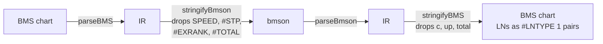

[Japanese version](./format-compat.ja.md)

# BMS / bmson compatibility notes

This document compares what the BMS and bmson specifications say (de jure) with what existing players do (de facto), lists the behaviours no specification defines, and records what be-music does and why.
It is a cross-implementation reference. How be-music itself handles each format is specified in [BMS implementation specification](./bms-spec.md), [bmson implementation specification](./bmson-spec.md), [Player implementation specification](./player-spec.md), and [`@be-music/chart-source`](./json-spec.md); this document links there instead of repeating them.

## 1. How to read this document

### 1.1 De jure sources

BMS has no single normative specification. These are the closest things to one:

| Short name     | Source                                                                                                                                                                      | Notes                                                                                                                                                                                                                                                           |
| -------------- | --------------------------------------------------------------------------------------------------------------------------------------------------------------------------- | --------------------------------------------------------------------------------------------------------------------------------------------------------------------------------------------------------------------------------------------------------------- |
| BM98           | [BMS Format Specification](http://bm98.yaneu.com/bm98/bmsformat.html) (Urao Yane / NBK, 1998)                                                                               | The original format. Short; defines headers, channels `01`–`09` / `11`–`17` / `21`–`27`, `#RANDOM` / `#IF` / `#ENDIF`. No separate NBK document was found.                                                                                                      |
| cmds           | [BMS command memo](https://hitkey.nekokan.dyndns.info/cmds.htm) by hitkey ([Japanese](https://hitkey.nekokan.dyndns.info/cmdsJP.htm))                                       | The de facto registry of extensions: origin, meaning and per-player support of each command. A draft, last updated 2014-07-11; it predates beatoraja, and the LR2 it tested is beta3 100201. Links below use its section anchors (`cmds.htm#RANDOM` and so on). |
| exbpm / exstop | hitkey's [extended BPM](https://hitkey.nekokan.dyndns.info/exbpm-object.htm) and [STOP](https://hitkey.nekokan.dyndns.info/exstop.htm) comparison pages                     | Per-player tables for edge-case BPM / STOP values.                                                                                                                                                                                                              |
| wiki           | [Bms:Spec](https://web.archive.org/web/20090213050609/http://wiki.bms.ms/Bms:Spec) (wiki.bms.ms, 2009 archive)                                                              | Community summary; mostly agrees with cmds.                                                                                                                                                                                                                     |
| bmson          | [bmson spec `doc/index.rst`](https://github.com/bemusic/bmson-spec/blob/668c4338cd7c64da2d2ec0f848c4ad58a3a881d9/doc/index.rst) at `668c4338` (identical to current master) | The only normative text for bmson. Line numbers below refer to this file.                                                                                                                                                                                       |

### 1.2 Implementations compared

| Implementation | What was read                                                                                                                                                                                                                                                                                                                                                                                                                                                       |
| -------------- | ------------------------------------------------------------------------------------------------------------------------------------------------------------------------------------------------------------------------------------------------------------------------------------------------------------------------------------------------------------------------------------------------------------------------------------------------------------------- |
| LR2            | Closed source (LunaticRave2 beta3 100201). Evidence comes from (a) cmds and hitkey's other pages, (b) [OpenLR2](https://github.com/GOMazk/OpenLR2), a community rewrite of LR2 whose `LR2Beta3-v100201` branch reconstructs the original program (cited at commit `583a3850`; the `main` branch adds new commands and is not used here), and (c) [LR2oraja](https://github.com/wcko87/lr2oraja), a beatoraja fork that emulates LR2's judge and gauge (`3db78adf`). |
| beatoraja      | [beatoraja](https://github.com/exch-bms2/beatoraja) at `8320241d` and its parser [jbms-parser](https://github.com/exch-bms2/jbms-parser) at `8108cd54`.                                                                                                                                                                                                                                                                                                             |
| Others         | [Bemuse](https://github.com/bemusic/bemuse) `4bf3e7d9`, [Qwilight](https://github.com/thenist/Qwilight) `6d3887f6`, [raindrop](https://github.com/zardoru/raindrop) `662dd11f`. They are mentioned only where they differ materially.                                                                                                                                                                                                                               |
| be-music       | This repository. be-music claims link to the code that implements them.                                                                                                                                                                                                                                                                                                                                                                                             |

### 1.3 Evidence labels

Each de facto claim carries one label:

- **[V]** verified in the implementation's source code at the commit above.
- **[R]** read in OpenLR2's reconstruction of LR2 beta3 100201. It is the best available evidence for LR2, but it is a rewrite, not LR2's own source.
- **[C]** community knowledge: documented by hitkey or LR2oraja's author, not checked in code.
- **[D]** read in the disassembly of LR2 beta3's own `LR2body.exe`, cited by address. Used where OpenLR2 strays from the program (note drawing, [§2.18](#218-note-drawing)).
- **[I]** inferred from the absence of evidence (for example, a command that no support list mentions).

"Undefined" means no de jure source says anything.

## 2. BMS

### 2.1 Lines, headers and object data

| Topic                                          | De jure                                                                                                                                                                                      | LR2                                                                                                                                           | beatoraja                                                                                                                                                                | be-music                                                                                                                                                                                                                                                                                                                                                                                                   |
| ---------------------------------------------- | -------------------------------------------------------------------------------------------------------------------------------------------------------------------------------------------- | --------------------------------------------------------------------------------------------------------------------------------------------- | ------------------------------------------------------------------------------------------------------------------------------------------------------------------------ | ---------------------------------------------------------------------------------------------------------------------------------------------------------------------------------------------------------------------------------------------------------------------------------------------------------------------------------------------------------------------------------------------------------- |
| Command case                                   | Case-insensitive (BM98). cmds notes that some players are case-sensitive in places (for example `#LNOBJ` values).                                                                            | The whole line is upper-cased before parsing, IDs included [R] ([OpenLR2 L25950][olr2-upper])                                                 | Commands and channels are case-insensitive [V] ([BMSDecoder L487-500][j-reserve])                                                                                        | Commands and channels are case-insensitive; IDs follow [§2.3](#23-object-ids-and-base-62) ([`parser.ts`][bm-parser])                                                                                                                                                                                                                                                                                       |
| Leading whitespace                             | Undefined. cmds ([`#INDENT-STYLE`][cmds-indent]) tabulates per player.                                                                                                                       | Tab and space are accepted, U+3000 is not [C]; the line is trimmed before parsing [R]                                                         | Not stripped: an indented line is ignored [V] ([BMSDecoder L189-194][j-lines])                                                                                           | Trimmed, so indented commands are accepted ([`parser.ts`][bm-parser] `parseBMS`)                                                                                                                                                                                                                                                                                                                           |
| Header separator                               | One space by convention (cmds).                                                                                                                                                              | Most headers are matched with a trailing space (`"#TOTAL "`) [R]                                                                              | The argument starts one character after the command name, whatever that character is [V] ([BMSDecoder L366-375][j-arg])                                                  | At least one whitespace character is required: `#TITLE:abc` is not a header ([`parser.ts`][bm-parser] `parseHeaderDirectiveLine`)                                                                                                                                                                                                                                                                          |
| Lines not starting with `#`                    | Ignored; this is the comment mechanism (BM98). `;` / `//` comments are IIDXv / HDX extensions ([`#COMMENT-SYNTAX`][cmds-comment]).                                                           | Ignored [R]                                                                                                                                   | Ignored, except `%key value` / `@key value`, which are stored as extra values [V] ([BMSDecoder L378-388][j-values])                                                      | Ignored                                                                                                                                                                                                                                                                                                                                                                                                    |
| Duplicate header definitions                   | Undefined in BM98. cmds ([`#BEHAVIOR-IN-GENERAL-IMPLEMENTATION`][cmds-general]): the line nearest EOF wins, except repeatable commands (`#STP`, `#WAVCMD`, control flow).                    | Last wins [C]                                                                                                                                 | Last wins [V] ([BMSDecoder L282-315][j-dup])                                                                                                                             | Last wins, in file order, also across control flow: a definition inside a taken `#RANDOM` / `#SWITCH` branch beats an earlier top-level one and loses to a later one ([§2.14](#214-control-flow))                                                                                                                                                                                                          |
| Duplicate object lines (same measure, channel) | cmds: lines merge, a later non-`00` object overrides an earlier one at the same position, `00` never overwrites; BGM (`01`) lines stack. About half of the players tested did not meet this. | Every object is collected; how LR2 resolves two notes at one position was not determined. cmds reports trouble with duplicated mine lines [C] | Playable channels: the later object replaces the earlier one with a warning. `01` stacks. `03` / `08` / `09`: one per position [V] ([Section L353-403][j-section-notes]) | One judged note per lane and position: a long note beats a tap, otherwise the lowest object ID is kept (beatoraja keeps the later line, but the IR does not record line order). The others are neither judged nor drawn; one with a different keysound still sounds at its time. Mines and invisible objects are not collapsed; BGM stacks ([`resolved-notes.ts`][bm-resolved-notes] `resolveJudgedNotes`) |
| Malformed object data                          | Undefined (cmds).                                                                                                                                                                            | Not determined                                                                                                                                | Not determined                                                                                                                                                           | The data ends at the first whitespace; characters outside the ID alphabet are skipped without taking a slot; a trailing odd character is dropped ([`event-utils.ts`][bm-event-utils] `collectNonZeroObjectTokens`)                                                                                                                                                                                         |
| Measure numbers                                | `000`–`999` (BM98).                                                                                                                                                                          | Notes at the very start of `#000` make LR2 insert an empty measure first [C]                                                                  | No special handling found                                                                                                                                                | `000`–`999`, no special handling                                                                                                                                                                                                                                                                                                                                                                           |

### 2.2 Character encoding

| Source / player | Behaviour                                                                                                                                                                                                                                                                                                                                                                                                                                                                                                                                                                                                              |
| --------------- | ---------------------------------------------------------------------------------------------------------------------------------------------------------------------------------------------------------------------------------------------------------------------------------------------------------------------------------------------------------------------------------------------------------------------------------------------------------------------------------------------------------------------------------------------------------------------------------------------------------------------- |
| De jure         | Undefined. cmds ([`#CHARSET`][cmds-charset]): most files are Shift_JIS and only ASCII is safe; `#CHARSET` was a ruv-it! command, obsolete since 2.0b5p2.                                                                                                                                                                                                                                                                                                                                                                                                                                                               |
| LR2             | Shift_JIS only; ISO-2022-JP and EUC-KR files break [C].                                                                                                                                                                                                                                                                                                                                                                                                                                                                                                                                                                |
| beatoraja       | BOM first, then a round-trip probe of the first 64 KiB in the order EUC-KR, MS932, UTF-8, UTF-16, UTF-32; fallback MS932. `#CHARSET` is not read [V] ([BMSDecoder L535-654][j-charset]).                                                                                                                                                                                                                                                                                                                                                                                                                               |
| Bemuse          | `bemuse-chardet` (UTF-8, UTF-16, Shift_JIS, EUC-KR), overridable by file name (`.sjis.`, `.euc_kr.`, `.utf8.`) [V].                                                                                                                                                                                                                                                                                                                                                                                                                                                                                                    |
| be-music        | BOM, then a `#CHARSET` declaration, then ASCII → UTF-8, then strict UTF-8, then Korean EUC-KR (every non-ASCII byte pairs up as KS X 1001, as in beatoraja's probe, and the text is at least 90 % Hangul syllables), then a score over Shift_JIS / UTF-8 / EUC-JP / Latin-1 ([`bms-text-decode.ts`][bm-decode], [`bms-charset.ts`][bm-charset]; see [BMS spec — Character Encoding](./bms-spec.md#character-encoding)). `#CHARSET EUC-KR` / `CP949` is honoured. The Hangul share keeps Shift_JIS half-width katakana, whose bytes also fit KS X 1001, from reading as Korean, which beatoraja does not guard against. |

### 2.3 Object IDs and `#BASE 62`

| Topic       | De jure                                                                   | LR2                                                           | beatoraja                                                                                                                                                               | be-music                                                                                                                                                                                                                                                                                                       |
| ----------- | ------------------------------------------------------------------------- | ------------------------------------------------------------- | ----------------------------------------------------------------------------------------------------------------------------------------------------------------------- | -------------------------------------------------------------------------------------------------------------------------------------------------------------------------------------------------------------------------------------------------------------------------------------------------------------- |
| ID alphabet | BM98: hexadecimal `01`–`FF`. cmds: later base 36. No rule on letter case. | Base 36, case folded by the upper-cased line [R]              | Base 36, case-insensitive [V] ([ChartDecoder L93-149][j-chart])                                                                                                         | Base 36; lower case folds to upper case ([`event-utils.ts`][bm-event-utils])                                                                                                                                                                                                                                   |
| `#BASE 62`  | Undefined (not in cmds or the wiki).                                      | Not in LR2 beta3 100201 [R] (OpenLR2's `main` branch adds it) | Read in a separate pass over the whole file, ignoring `#IF`, so its position does not matter; anything but 36 / 62 falls back to 36 [V] ([BMSDecoder L126-162][j-base]) | Pre-scanned over the whole file, ignoring control flow, so its position does not matter; the last `#BASE 36` / `#BASE 62` line wins and other values are ignored, as in beatoraja ([`parser.ts`][bm-parser] `detectBMSBase`). Under base 62, IDs are case-sensitive ([BMS spec — `#BASE`](./bms-spec.md#base)) |

### 2.4 Lane modes and channel layouts

| Topic                                   | De jure                                                                                                                                                                                  | LR2                                                                                                          | beatoraja                                                                                                                                                                                    | be-music                                                                                                                                                                                                                                                                                                                                       |
| --------------------------------------- | ---------------------------------------------------------------------------------------------------------------------------------------------------------------------------------------- | ------------------------------------------------------------------------------------------------------------ | -------------------------------------------------------------------------------------------------------------------------------------------------------------------------------------------- | ---------------------------------------------------------------------------------------------------------------------------------------------------------------------------------------------------------------------------------------------------------------------------------------------------------------------------------------------- |
| `#PLAYER`                               | BM98: 1 single, 2 two players, 3 double. cmds ([`#PLAYER`][cmds-player]): 4 battle (BM98 only); default 1.                                                                               | Ignored; the mode is inferred from the channels [C]                                                          | Only 1 or 2 accepted, used for consistency warnings, never for the mode [V] ([BMSDecoder L664-677][j-player])                                                                                | Kept as metadata. `#PLAYER 3` with channel `17` and no IIDX 2P side selects 9 KEY; otherwise unused for the mode                                                                                                                                                                                                                               |
| File extension                          | BM98 names `.bms`. cmds ([`#OUTLINE`][cmds-outline]): `.bme` / `.bml` are for backward compatibility; `.pms` is needed to tell 9-key from double play; strict BML means `#LNOBJ` charts. | `.pms` selects 9-key [R] ([OpenLR2 L25923-25925][olr2-pms])                                                  | `.pms` forces POPN 9K [V] ([BMSDecoder L169][j-mode])                                                                                                                                        | `.pms` forces 9 KEY. `.bme` / `.bml` have no special meaning: a `.bme` chart without 6th / 7th key columns is 5 / 10 KEY, as in beatoraja                                                                                                                                                                                                      |
| Mode detection                          | Undefined.                                                                                                                                                                               | From the channels used [C]                                                                                   | Starts at 5K; data on lane offset 8 / 9 of any note family (visible, invisible, LN, mine) upgrades to 7K / 14K; any 2P family upgrades to 10K / 14K [V] ([Section L175-202][j-section-mode]) | One shared rule, `resolveChartPlayVariant` ([`chart/src/play-variant.ts`][bm-play-variant]), run on the chart after `#RANDOM`. Only visible lanes (`1x` / `2x`) and `#LNTYPE` lanes (`5x` / `6x`) count; mines and invisible notes never decide the mode. Order: [BMS spec — Player-Specific Behavior](./bms-spec.md#player-specific-behavior) |
| PMS layouts                             | cmds ([`#PMS`][cmds-pms]): standard 9-key is `11`–`15` + `22`–`25`; the BME-type layout is `11`–`15`, `18`, `19`, `16`, `17`.                                                            | Both, the BME type since beta3 090916 [C]                                                                    | `11`–`15` + `22`–`25` in `.pms` files [V] ([Section L323-351][j-section-lanes])                                                                                                              | Both, detected from the channels even without `.pms` (PMS-STD / PMS-COMPAT)                                                                                                                                                                                                                                                                    |
| FREE ZONE (`17` / `27`)                 | BM98 lists channel 17 without describing it. cmds ([`#FREE-ZONE`][cmds-freezone]): one quarter-note zone counted as one note; only BM98-era players support it.                          | `17` is a 9-key button, not a FREE ZONE [C]                                                                  | Dropped [V] ([Section L255-257][j-section-lanes])                                                                                                                                            | FREE ZONE in the IIDX families: drawn on the scratch lane with a 1-beat tail, not judged, not counted ([`resolved-notes.ts`][bm-resolved-notes]). An ordinary lane under 9 KEY and 24 / 48 KEY                                                                                                                                                 |
| Extended channels `1A`–`1Z` / `2A`–`2Z` | cmds ([`#CHANNEL-MAPPING-TABLE`][cmds-channels]): visible extended channels, `1A`–`1F` from MGQ, `1G`–`1Z` from pomu. No wheel channel anywhere.                                         | Not supported: the loader needs a digit as the second channel character [R] ([OpenLR2 L25970][olr2-channel]) | Ignored in BMS; a BMS chart can never become 24K [V] ([Section L323-351][j-section-lanes])                                                                                                   | `1A`–`1O` / `2A`–`2O` are keys 10–24 of the 24 KEY / 48 KEY modes; one such channel selects those modes ([player spec — lane mode](./player-spec.md#lane-mode-and-input))                                                                                                                                                                      |
| 24 / 48 KEY wheel                       | Undefined.                                                                                                                                                                               | —                                                                                                            | Only through bmson `keyboard-24k` (`x` 25 / 26); the wheel lanes are judged like keys and are fixed under RANDOM / MIRROR [V] (see [§3.2](#32-mode_hint-and-x))                              | `1P` / `1Q` (`2P` / `2Q`) are the wheel up / down. This is a be-music-only BMS spelling of the bmson wheel lanes; no other BMS player reads it                                                                                                                                                                                                 |

### 2.5 Long notes

| Topic                           | De jure                                                                                                                                                                    | LR2                                                                                                                                   | beatoraja                                                                                                                                                                           | be-music                                                                                                                                                                                                                                 |
| ------------------------------- | -------------------------------------------------------------------------------------------------------------------------------------------------------------------------- | ------------------------------------------------------------------------------------------------------------------------------------- | ----------------------------------------------------------------------------------------------------------------------------------------------------------------------------------- | ---------------------------------------------------------------------------------------------------------------------------------------------------------------------------------------------------------------------------------------- |
| `#LNTYPE 1` (`5x` / `6x`)       | cmds ([`#LNTYPE-1`][cmds-lntype1]): RDM style, objects alternate start / end; the default since RDM 1.7, so the header may be omitted.                                     | Supported; `#LNTYPE` itself is not parsed, `5x` / `6x` always alternate [R] ([OpenLR2 L26562-26572][olr2-ln])                         | `#LNTYPE` is not parsed; `5x` / `6x` always behave as type 1 [V] ([Section L410-493][j-section-ln])                                                                                 | Type 1 by default ([`chart/src/long-notes.ts`][bm-long-notes] `resolveBMSLongNotes`)                                                                                                                                                     |
| `#LNTYPE 2` (MGQ)               | cmds ([`#LNTYPE-2`][cmds-lntype2]): the LN lasts while consecutive cells are non-`00` and can cross bar lines; obsolete.                                                   | Not supported [C]                                                                                                                     | Not supported [V]                                                                                                                                                                   | Supported. A host may also infer type 2 when `#LNTYPE` is missing and a lane repeats one value in consecutive cells at least twice (the web player does)                                                                                 |
| `#LNOBJ`                        | cmds ([`#LNOBJ`][cmds-lnobj]): the marked object ends an LN started by the previous note on the lane; write it in upper case. Priority against `5x` / `6x` is unspecified. | One value; the last definition wins [R] ([OpenLR2 L26295-26297][olr2-headers])                                                        | One value; the last definition wins [V] ([BMSDecoder L764-775][j-lnobj])                                                                                                            | Every `#LNOBJ` value is active. At a lane position that also has a `5x` / `6x` LN, the `5x` / `6x` LN wins. The end object never sounds                                                                                                  |
| `#LNOBJ` with no note before it | Undefined.                                                                                                                                                                 | Becomes an ordinary note [R] ([OpenLR2 L26573-26583][olr2-ln])                                                                        | Dropped [V] ([Section L353-403][j-section-notes])                                                                                                                                   | Becomes an ordinary tap note (matches LR2)                                                                                                                                                                                               |
| `5x` / `6x` LN with no end      | Undefined.                                                                                                                                                                 | Plays as an ordinary note: the start becomes a lane note with no end [R] ([OpenLR2 L26562-26572][olr2-ln], [L2349-2362][olr2-ln-tap]) | The start is deleted with a warning [V] ([BMSDecoder L429-439][j-ln-end])                                                                                                           | Stays as an ordinary tap note (matches LR2)                                                                                                                                                                                              |
| LN end on a bar line            | Undefined (only MGQ type 2 defines crossing a bar line).                                                                                                                   | No special handling found [R]                                                                                                         | No special handling found                                                                                                                                                           | No special handling: the end is wherever the end object is                                                                                                                                                                               |
| `#LNMODE`                       | Undefined (not in cmds).                                                                                                                                                   | Not parsed [R]; LR2 plays every LN as an LN (no CN / HCN) [C]                                                                         | 1 LN / 2 CN / 3 HCN for the chart; the player's own LN-mode option applies only when the chart sets none [V] ([BMSDecoder L776-787][j-lnmode], [JudgeManager L233-275][b-judge-ln]) | The ruleset decides ([player spec — Long-note style](./player-spec.md#long-note-style)): `lr2` plays every LN as LN, `beatoraja` follows `#LNMODE` (LN when absent), `iidx` plays CN / HCN. Qwilight treats 2 and 3 alike as CN-like [V] |

### 2.6 Mines

| Topic                                | De jure                                                                                                          | LR2                                                                                                                                                                                                                                          | beatoraja                                                                                                               | be-music                                                                                                                                                                                                                                                                   |
| ------------------------------------ | ---------------------------------------------------------------------------------------------------------------- | -------------------------------------------------------------------------------------------------------------------------------------------------------------------------------------------------------------------------------------------- | ----------------------------------------------------------------------------------------------------------------------- | -------------------------------------------------------------------------------------------------------------------------------------------------------------------------------------------------------------------------------------------------------------------------- |
| Channels and sound                   | cmds ([`#LANDMINE`][cmds-landmine]): nanasi extension on `D1`–`D9` / `E1`–`E9`; `#WAV00` is the explosion sound. | `#WAV00` when defined, otherwise a built-in sound [C] [R] ([OpenLR2 L7437-7456][olr2-mine-hit])                                                                                                                                              | `#WAV00`, or a default sound when it is missing [V] ([PlayerResource L217-229][b-resource])                             | `D`/`E` + lane, the extended `DA`–`DO` / `EA`–`EO` included. `#WAV00` plays on detonation                                                                                                                                                                                  |
| Damage                               | cmds: the base-36 value **divided by 2**, as gauge percent; `ZZ` fails the stage (nanasi).                       | The base-36 value itself is subtracted from the gauge, no halving [R] ([OpenLR2 L2041-2055][olr2-mine]); be-music's [BMS spec](./bms-spec.md#landmine-damage-basis) also cites LR2's changelog and losak's measurements for this reading [C] | The raw base-36 value, no halving [V] ([Section L494-520][j-mine])                                                      | The raw base-36 value as gauge percent. A value that is not two upper-case base-36 characters, or `00`, deals a default `4` % (a be-music choice) ([`note-rules.ts`][bm-note-rules])                                                                                       |
| When it explodes                     | Undefined.                                                                                                       | On a press shortly before the mine, or when the key is held as it passes [R] ([OpenLR2 L7437-7456][olr2-mine-hit]); the changelog says the PGREAT range [C]                                                                                  | When the key is held as the mine passes [V] ([JudgeManager L244-249][b-judge-mine])                                     | By ruleset: `lr2` (and `iidx`, which has no mines) uses LR2's model, a press within the PGREAT window or the key held as the mine crosses the line; `beatoraja` uses beatoraja's, the key down as the mine crosses ([player spec — Landmines](./player-spec.md#landmines)) |
| Judgement and combo                  | Undefined.                                                                                                       | Gauge damage [R]                                                                                                                                                                                                                             | Gauge only, on every gauge; no judgement, no combo change [V] ([GrooveGauge L63-67][b-gauge])                           | Gauge only; no judgement, combo or score change. Damage bypasses the HARD gauge's low-gauge softening and TOTAL multiplier                                                                                                                                                 |
| Mine on a note or inside a long note | Undefined.                                                                                                       | Kept: a mine is one more object on its lane, with no collision check [R] ([OpenLR2 L26585-26589][olr2-mine-load])                                                                                                                            | Dropped with a warning, for BMS and bmson alike [V] ([Section L494-520][j-mine], [BMSONDecoder L317-366][j-bmson-mine]) | Kept, BMS and bmson alike, as in LR2: an author who placed one meant it ([`resolved-notes.ts`][bm-resolved-notes])                                                                                                                                                         |
| Other players                        | —                                                                                                                | —                                                                                                                                                                                                                                            | —                                                                                                                       | Qwilight ignores the value and judges a hit mine as a miss [V]; Bemuse uses mines only in its previewer [V]; raindrop parses but does not play them [V]                                                                                                                    |

### 2.7 Invisible notes (`3x` / `4x`)

cmds ([`#BMS`][cmds-bms]) says invisible objects are not displayed, judged or scored.
beatoraja stores them as hidden notes and uses their sound when a key press hits no note [V] ([JudgeManager L460-486][b-judge-hidden]).
be-music does the same: an invisible object becomes the lane's fallback keysound once its early window opens, and is never judged or counted ([player spec — Invisible Note](./player-spec.md#invisible-note)). bmson `key_channels` are read as invisible notes too ([§3.5](#35-mines-and-hidden-notes)).
Bemuse ignores them [V].

### 2.8 BPM

| Topic                         | De jure                                                                               | LR2                                                                                                                                                                                                                                                                            | beatoraja                                                            | be-music                                                                                                                                                                                                                           |
| ----------------------------- | ------------------------------------------------------------------------------------- | ------------------------------------------------------------------------------------------------------------------------------------------------------------------------------------------------------------------------------------------------------------------------------ | -------------------------------------------------------------------- | ---------------------------------------------------------------------------------------------------------------------------------------------------------------------------------------------------------------------------------- |
| `#BPM` missing                | BM98: default 130. Other players use 120, 150, 0 … ([`#BPM`][cmds-bpm]).              | Nothing scrolls [C]                                                                                                                                                                                                                                                            | A start BPM of 0 fails the decode [V] ([BMSDecoder L252-281][j-bpm]) | 130 ([`parser.ts`][bm-parser])                                                                                                                                                                                                     |
| Channel `03`                  | cmds ([`#CHANGING-BPM-BASIC-FORMAT`][cmds-bpm03]): hexadecimal `01`–`FF` = BPM 1–255. | Hexadecimal; only values above 0 apply [R] ([OpenLR2 L26623][olr2-bpm03])                                                                                                                                                                                                      | Hexadecimal [V] ([Section L103-110][j-section-bpm])                  | Hexadecimal; an invalid token is ignored ([`chart/src/channels.ts`][bm-channels] `parseBPMFrom03Token`)                                                                                                                            |
| Channel `08` + `#BPMxx`       | cmds ([`#BPMXX`][cmds-bpmxx]): real-valued (bemaniaDX). `#EXBPMxx` is a nanasi alias. | Supported; `#EXBPM` is not [C]                                                                                                                                                                                                                                                 | Supported; `#EXBPM` is not [V]                                       | Supported; `#EXBPM` is kept in `metadata.extras` and not used                                                                                                                                                                      |
| `03` and `08` at one position | Implementation-dependent (cmds).                                                      | `08` wins [C] (exbpm)                                                                                                                                                                                                                                                          | Not determined                                                       | `08` wins ([`timing.ts`][bm-timing] `createTempoPoints`)                                                                                                                                                                           |
| Zero or negative BPM          | Undefined; cmds lists player differences ([`#BPMXX`][cmds-bpmxx]).                    | Negative `#BPMxx`: timing runs at the absolute value; the first value with `trunc(BPM) < 0` freezes the event pump and mirrors the scroll and the judge clock for good [R] ([scroll][olr2-reverse-draw], [judge][olr2-reverse-judge]). Zero degenerates (the scroll stops) [C] | `#BPM` / `#BPMxx` ≤ 0 is ignored with a warning [V]                  | Negative `#BPMxx` follows LR2's reverse scroll ([§5](#5-be-music-decisions-in-short), [BMS spec](./bms-spec.md#negative-bpm-bpmxx-via-channel-08-basis)). Zero and a negative `#BPM` header are ignored ([`timing.ts`][bm-timing]) |

### 2.9 STOP and `#STP`

| Topic                         | De jure                                                                                                         | LR2                                                                                                              | beatoraja                                                                                                                                                                                                                                                | be-music                                                                                                                                                           |
| ----------------------------- | --------------------------------------------------------------------------------------------------------------- | ---------------------------------------------------------------------------------------------------------------- | -------------------------------------------------------------------------------------------------------------------------------------------------------------------------------------------------------------------------------------------------------- | ------------------------------------------------------------------------------------------------------------------------------------------------------------------ |
| `#STOPxx` unit                | cmds ([`#STOPXX`][cmds-stop]): 1/192 of a whole note (a 4/4 measure), not scaled by channel `02`.               | Same; the value is read as an integer, so decimals are truncated [R] ([OpenLR2 L26324-26331][olr2-headers])      | 1/192 of a measure at the BPM in force at that position [V] ([Section L299-318][j-section-stop])                                                                                                                                                         | Same unit; decimals are kept; the BPM in force at the position, a BPM change at that same position included ([`timing.ts`][bm-timing] `createStopPoints`)          |
| Negative or zero STOP         | Undefined; cmds lists player differences.                                                                       | Ignored when ≤ 0 [R]; cmds also reports a short skip [C]                                                         | The absolute value is used, with a warning [V] ([BMSDecoder L316-334][j-stop])                                                                                                                                                                           | Ignored. (Qwilight rejects the chart, Bemuse subtracts time [V].)                                                                                                  |
| Several STOPs at one position | Undefined for BMS; bmson adds them (L498-503).                                                                  | The last one wins [R] ([OpenLR2 L26666-26670][olr2-stop-case])                                                   | One per position; the last wins [V]                                                                                                                                                                                                                      | BMS: the last one wins, as in LR2 and beatoraja ([`timing.ts`][bm-timing] `createStopPoints`); bmson `stop_events` and `#STP` lines add up                         |
| A note at the STOP's position | cmds: sounds first, then the BPM change, then the stop. bmson (L505-542): the note is hit when the stop begins. | Hit before the stop: the stop is added after the objects at its position [R] ([OpenLR2 L26494-26527][olr2-stop]) | Hit when the stop begins [V] ([Section L542-562][j-section-time])                                                                                                                                                                                        | Hit when the stop begins: a stop delays only what comes strictly after it ([`timing.ts`][bm-timing])                                                               |
| `#STP xxx.yyy ms`             | cmds ([`#STP`][cmds-stp]): bemaniaDX; repeats add up.                                                           | Not supported [C]                                                                                                | Not supported [V]                                                                                                                                                                                                                                        | Supported; stops at one position add up ([player spec — Execution flow](./player-spec.md#execution-flow))                                                          |
| Precision of a STOP's length  | Undefined.                                                                                                      | Not checked.                                                                                                     | Each stop is truncated to whole microseconds (a `(long)` cast) [V] ([Section L315][j-section-stop-cast]), so note times drift early on charts with many stops: 0.151 ms on Labyrinth, 0.863 ms on safe_state, 3.36 ms over the 5,704 stops of "the life" | Exact (double precision), deliberately: that is the timing the chart's numbers describe, and the drift stays far below any judge window ([`timing.ts`][bm-timing]) |

### 2.10 SCROLL and SPEED

Neither `#SCROLLxx` (channel `SC`) nor `#SPEEDxx` (channel `SP`) appears in any de jure source; they come from beatoraja and Bemuse.

| Player    | SCROLL                                                                                                                                                                                                                                                                                                                                                                                                                                                                                                                                                                                                                                                                                             | SPEED                                                                                                                                                                                                                                                                                                                                                                                     |
| --------- | -------------------------------------------------------------------------------------------------------------------------------------------------------------------------------------------------------------------------------------------------------------------------------------------------------------------------------------------------------------------------------------------------------------------------------------------------------------------------------------------------------------------------------------------------------------------------------------------------------------------------------------------------------------------------------------------------- | ----------------------------------------------------------------------------------------------------------------------------------------------------------------------------------------------------------------------------------------------------------------------------------------------------------------------------------------------------------------------------------------- |
| LR2       | Unsupported [I]                                                                                                                                                                                                                                                                                                                                                                                                                                                                                                                                                                                                                                                                                    | Unsupported [I]                                                                                                                                                                                                                                                                                                                                                                           |
| beatoraja | A step multiplier per segment; 0 and negative values are accepted [V] ([LaneRenderer L314-321][b-lane])                                                                                                                                                                                                                                                                                                                                                                                                                                                                                                                                                                                            | Linear in time between objects; before the first object it ramps from 1.0 at time 0 [V] ([LaneRenderer L259-286][b-lane-speed])                                                                                                                                                                                                                                                           |
| Others    | Qwilight and raindrop support SCROLL [V]                                                                                                                                                                                                                                                                                                                                                                                                                                                                                                                                                                                                                                                           | Bemuse supports it as a spacing factor (the model be-music follows) and holds the first value before the first object; Qwilight and raindrop do not [V]                                                                                                                                                                                                                                   |
| be-music  | A step multiplier. Notes, mines and bar lines draw as beatoraja's `LaneRenderer` walks them: from the playhead up to the first point past the lane top, so nothing beyond it is drawn, not even notes a later negative value brings back into the lane ([`note-draw-window.ts`][bm-note-draw]). A negative value scrolls notes backwards; in the web player one still ahead can sit below the judgement line and is drawn there, as beatoraja draws it unclipped, while the terminal player moves notes by the absolute distance (no reverse scroll); with `SCROLL 0`, notes stacked in one cell keep their order ([BMS spec — SCROLL/BPM/STOP](./bms-spec.md#scrollbpmstop-compatibility-policy)) | Linear in beat between keyframes; before the first keyframe the speed ramps from 1.0 at beat 0 to that keyframe's value, as beatoraja ramps from 1.0 at time 0 (a keyframe at 0 applies at once); the last value holds. beatoraja interpolates in time and applies the current value to the whole lane, be-music interpolates in beats along the lane ([`scroll-distance.ts`][bm-scroll]) |

### 2.11 Measure length and `#BASEBPM`

Channel `02` (cmds [`#BMS`][cmds-bms]): 1 = 4/4, decimals allowed, the measure only.
LR2 accepts values above 0 for measures up to 4999 [R] ([OpenLR2 L26189-26193][olr2-measure]); beatoraja accepts any finite value above 0 with no upper bound [V] ([Section L87-101][j-section-len]).
be-music does the same as beatoraja: any finite value above 0, however small, and the last definition wins ([`event-utils.ts`][bm-event-utils]).

`#BASEBPM` is an LR command whose support may have been removed in LR2 ([`#BASEBPM`][cmds-basebpm]) [C]; beatoraja does not read it [V].
be-music uses it only as the reference BPM of the web player's hi-speed fix ([`chart/src/reference-bpm.ts`][bm-reference-bpm] `resolveChartReferenceBPM`), never for timing.

### 2.12 Judgment rank

| Topic                              | De jure                                                                                                                         | LR2                                                                                                                                      | beatoraja                                                                                                    | be-music                                                                                                                                                           |
| ---------------------------------- | ------------------------------------------------------------------------------------------------------------------------------- | ---------------------------------------------------------------------------------------------------------------------------------------- | ------------------------------------------------------------------------------------------------------------ | ------------------------------------------------------------------------------------------------------------------------------------------------------------------ |
| `#RANK 0`–`3`                      | BM98: very hard, hard, normal, easy. No default in BM98; cmds says 3 but its own table shows most players (LR2 included) use 2. | PG 8 / 15 / 18 / 21 ms, BAD fixed at 200 ms; default 2 [C] ([hitkey diary 2015-01-19](https://hitkey.nekokan.dyndns.info/diary1501.php)) | Judgerank 25 / 50 / 75 / 100 % of its base windows (PG ±20 ms at 100 %) [V] ([BMSPlayerRule L57-66][b-rule]) | The `lr2` ruleset uses LR2's measured table; `beatoraja` and `iidx` use their own ([player spec — Judgment width](./player-spec.md#judgment-width))                |
| `#RANK 4` (VERY EASY)              | nanasi extension ([`#RANK-4`][cmds-rank4]).                                                                                     | Not supported; plays as NORMAL [C] (LR2oraja README)                                                                                     | Judgerank 125 [V]                                                                                            | `lr2`: NORMAL. `beatoraja`: 125                                                                                                                                    |
| Out-of-range or fractional `#RANK` | Undefined.                                                                                                                      | Read as an integer [R]                                                                                                                   | Out of range: NORMAL with a warning [V] ([BMSDecoder L702-715][j-rank])                                      | Truncated to an integer; out of range is NORMAL ([`judge-window.ts`][bm-judge-window])                                                                             |
| `#DEFEXRANK n`                     | nanasi; a percentage where 100 = `#RANK 2` ([`#DEFEXRANK`][cmds-defexrank]).                                                    | Not supported [C] [R] (no such command in the reconstruction)                                                                            | `n` × 75 / 100 judgerank (since 0.7.3); values below 1 are refused [V] ([BMSDecoder L716-729][j-defexrank])  | Values above 0 apply in every ruleset; `lr2` interpolates LR2's measured table as lr2oraja does. A deliberate extension over real LR2                              |
| `#EXRANKxx` + channel `A0`         | nanasi; same unit as `#DEFEXRANK` ([`#EXRANKXX`][cmds-exrank]).                                                                 | Not supported [C]                                                                                                                        | Not supported [V]                                                                                            | Applied mid-play by the `lr2` ruleset only; `beatoraja` and `iidx` keep static windows ([`definitions.ts`][bm-ruleset])                                            |
| Other players                      | —                                                                                                                               | —                                                                                                                                        | —                                                                                                            | Bemuse ignores `#RANK` for play; Qwilight maps `#RANK 0`–`4` to its own judge stages and ignores `#DEFEXRANK`; raindrop defaults to EASY when both are missing [V] |

### 2.13 `#TOTAL`

The de jure position ([`#TOTAL`][cmds-total]): the gauge rises by `TOTAL / notes` per best judgement; the default when `#TOTAL` is missing is "not prescribed by specification". BM98 used `200 + notes`.

| Player    | `#TOTAL` missing                                                                                                                                                                                                                      | `#TOTAL` ≤ 0        |
| --------- | ------------------------------------------------------------------------------------------------------------------------------------------------------------------------------------------------------------------------------------- | ------------------- |
| LR2       | cmds says "160?" [C]. LR2oraja uses `160 + (N + clamp(N - 400, 0, 200)) × 0.16` [C] ([LR2oraja BMSPlayerRule L88-89][l-rule]), the same curve as OpenLR2's `LR2_bmsload.cpp` that be-music cites; the value is read as an integer [R] | Not determined      |
| beatoraja | `max(260, 7.605 N / (0.01 N + 6.5))`; 24K: `max(300, 7.605 (N + 100) / (0.01 N + 6.5))` [V] ([BMSPlayerRule L68-88][b-rule])                                                                                                          | Same as missing [V] |
| be-music  | Each ruleset applies its own default: `lr2` the LR2 curve above, `beatoraja` beatoraja's formula ([`definitions.ts`][bm-ruleset] `resolveEffectiveTotal`)                                                                             | Same as missing     |

### 2.14 Control flow

| Topic                                        | De jure                                                                                                                                                                           | LR2                                                                       | beatoraja                                                                                                                                                        | be-music                                                                                                                                                                                                                                                                                                         |
| -------------------------------------------- | --------------------------------------------------------------------------------------------------------------------------------------------------------------------------------- | ------------------------------------------------------------------------- | ---------------------------------------------------------------------------------------------------------------------------------------------------------------- | ---------------------------------------------------------------------------------------------------------------------------------------------------------------------------------------------------------------------------------------------------------------------------------------------------------------- |
| Commands                                     | BM98: `#RANDOM`, `#IF`, `#ENDIF`. Later additions ([`#CONTROL-FLOW`][cmds-control]): `#ELSEIF` (IIDXv), `#ELSE` / `#ENDRANDOM` / `#SWITCH` family (nanasi), `#SETRANDOM` (pomu2). | `#RANDOM`, `#IF`, `#ENDIF` only [R] ([OpenLR2 L25952-25966][olr2-random]) | `#RANDOM`, `#IF`, `#ENDIF`, `#ENDRANDOM`; the rest are silently ignored, so an `#ELSE` body belongs to the preceding `#IF` [V] ([BMSDecoder L197-233][j-random]) | All of them, `#SETSWITCH` included, plus the misspellings `#END IF`, bare `#END` and `#ELSE IF n` ([`control-flow.ts`][bm-control-flow])                                                                                                                                                                         |
| Nesting                                      | Not stated in BM98. cmds: players split into one-level and nestable; nanasi requires `#ENDRANDOM` when nesting.                                                                   | One level: a single random value [R] [C]                                  | Nested `#RANDOM` is a stack; nested `#IF` checks only the innermost one [V]                                                                                      | One shared stack of `#RANDOM` / `#IF` / `#SWITCH` frames; `#IF` reads the innermost random value                                                                                                                                                                                                                 |
| Lines inside `#RANDOM` but outside any `#IF` | Not guaranteed to be read (cmds).                                                                                                                                                 | Dropped [R] [C]                                                           | Read [V]                                                                                                                                                         | Read                                                                                                                                                                                                                                                                                                             |
| `#IF` with no `#RANDOM`                      | Undefined.                                                                                                                                                                        | Discarded [C]                                                             | Warning; the block is read [V]                                                                                                                                   | Never matches, so the block is skipped                                                                                                                                                                                                                                                                           |
| Missing `#ENDIF` / `#ENDRANDOM`              | Undefined; nanasi requires `#ENDRANDOM`.                                                                                                                                          | The skip state lasts to EOF [R]                                           | The skip state lasts to EOF [V]                                                                                                                                  | An unclosed `#IF` outlives `#ENDRANDOM` and keeps gating the following lines to EOF; `#ENDIF` / `#ELSE` act on the innermost open `#IF`                                                                                                                                                                          |
| `#RANDOM 0`, negative or missing             | cmds: IIDXv, HDX and others use 1 when `n` is missing or invalid.                                                                                                                 | Not determined                                                            | `(int)(random × n) + 1`: 0 gives 1, a negative `n` gives values from `n + 2` to 1 [V]                                                                            | 1                                                                                                                                                                                                                                                                                                                |
| `#IF` value above `n`                        | Undefined.                                                                                                                                                                        | Never matches [R]                                                         | Never matches [V]                                                                                                                                                | Never matches                                                                                                                                                                                                                                                                                                    |
| Definitions inside a branch                  | Undefined.                                                                                                                                                                        | Applied in file order [R]                                                 | Applied in file order [V]                                                                                                                                        | Applied in file order: a header inside a taken branch (`#BPMxx`, `#WAVxx` …) is skipped when a top-level line later in the file defines the same key (the parser marks it `overriddenByLaterHeader`); repeatable headers (`#STP`, `#WAVCMD`, `#LNOBJ`) add up ([`parser.ts`][bm-parser] `resolveBMSControlFlow`) |
| When the draw happens                        | —                                                                                                                                                                                 | Each load [I]                                                             | Each load [V]                                                                                                                                                    | Each play: the parser keeps every branch and the player draws at play time ([BMS spec — Evaluation rules](./bms-spec.md#evaluation-rules-for-control-constructs))                                                                                                                                                |

Bemuse handles only `#RANDOM` / `#IF` / `#ENDIF` (it never pops on `#ENDRANDOM`, although its documentation says nesting works); Qwilight is single-level; raindrop nests up to 16 levels and supports `#SETRANDOM` [V].

### 2.15 Audio commands and keysounds

| Topic                     | De jure                                                               | LR2                     | beatoraja                                                                                                 | be-music                                                                                                                                                                                                          |
| ------------------------- | --------------------------------------------------------------------- | ----------------------- | --------------------------------------------------------------------------------------------------------- | ----------------------------------------------------------------------------------------------------------------------------------------------------------------------------------------------------------------- |
| `#VOLWAV n`               | BM98: relative volume in percent; cmds: default 100, not recommended. | Not supported [C]       | `0 < n < 200` sets `n / 100`; anything else plays at 100 % [V] ([AbstractAudioDriver L355-359][b-volwav]) | Same as beatoraja: `0 < n < 200` is a linear gain `n / 100`; anything else plays at 100 % ([`chart/src/wav-directives.ts`][bm-wav-directives] `volWAVToLinearGain`, [BMS spec — `#VOLWAV`](./bms-spec.md#volwav)) |
| `#WAVCMD`                 | MacBeat, `.mbm` files only ([`#WAVCMD`][cmds-wavcmd]).                | Not supported [I]       | Not supported [V]                                                                                         | Kept; the volume parameter is applied in the offline renderer and the web player                                                                                                                                  |
| `#EXWAVxx`                | nanasi ([`#EXWAVXX`][cmds-exwav]).                                    | Not supported [C]       | Not supported [V]                                                                                         | Kept; the `v` (volume) parameter is applied in the offline renderer and the web player                                                                                                                            |
| `#PATH_WAV`               | GDAC2 / BMEV, for test play ([`#PATH-WAV`][cmds-pathwav]).            | Not supported [I]       | Not supported [V]                                                                                         | Tried as a directory prefix by the web player, the offline renderer and the song-select preview, not by the terminal player                                                                                       |
| `#MIDIFILE`               | BM98: MIDI BGM; not recommended.                                      | Not supported [C]       | Not supported [V]                                                                                         | Kept, not played                                                                                                                                                                                                  |
| Retriggering one `#WAVxx` | Undefined.                                                            | Monophonic per slot [C] | Not determined                                                                                            | BMS: one voice per slot, a retrigger restarts it (LR2-compatible). bmson: slices are polyphonic ([`chart/src/wav-directives.ts`][bm-wav-directives] `usesMonophonicWAVPlayback`)                                  |

### 2.16 `#OPTION`, `#CHANGEOPTION`, `#PREVIEW`

`#OPTION` and `#CHANGEOPTIONxx` (channel `A6`) are nanasi commands with vendor-prefixed values ([`#OPTION`][cmds-option]).
beatoraja does not read them [V]; be-music keeps them in the IR and does not apply them, since a chart that forces lane options changes what is played.
`#PREVIEW` has no de jure source; beatoraja [V] and be-music both use it for the song-select preview.

### 2.17 BGA

| Topic                                 | De jure                                                                                                                                                                                                   | LR2                                                                                       | beatoraja                                                                                                                                                                                                                                                         | be-music                                                                                                                                                                                                                                                                            |
| ------------------------------------- | --------------------------------------------------------------------------------------------------------------------------------------------------------------------------------------------------------- | ----------------------------------------------------------------------------------------- | ----------------------------------------------------------------------------------------------------------------------------------------------------------------------------------------------------------------------------------------------------------------- | ----------------------------------------------------------------------------------------------------------------------------------------------------------------------------------------------------------------------------------------------------------------------------------- |
| `04` / `07` / `0A`                    | BM98: `04` BGA (256 × 256). `07` layer with black as transparent (BM98k). `0A` layer 2 (nanasi).                                                                                                          | `04` and `07` [C]                                                                         | `04` and `07`; `0A` is ignored [V] ([Section L74-85][j-section-bga])                                                                                                                                                                                              | `04` < `07` < `0A`; black is transparent on both layers ([BMS spec](./bms-spec.md#supported-semantics))                                                                                                                                                                             |
| `06` POOR                             | BM98: the poor bitmap; `#BMP00` is shown on a poor play.                                                                                                                                                  | Supported [C]                                                                             | A MISS layer shown for 500 ms by default [V] ([BGAProcessor L135-209][b-bga])                                                                                                                                                                                     | `06` cues; before the first cue, `#BMP00` is the POOR image unless `#POORBGA` is `2` ([`play-bga.ts`][bm-play-bga])                                                                                                                                                                 |
| Image size and placement              | Undefined; the canvas is 256 × 256 in most players. cmds ([`#BMPXX-ADJUSTMENT`][cmds-bmp-adjust]): an image is usually centered on X and top-aligned on Y; oversize handling is implementation-dependent. | Smaller images are centered on X and top-aligned; larger ones are scaled to 256 × 256 [C] | An image whose long edge is at most 256 is pasted on a 256 × 256 canvas at `x = (256 - w) / 2`, `y = 0`; a larger one is drawn as is over the BGA rect [V] ([BGImageProcessor L46-57][b-bgimage]). The base canvas is black ([BGAProcessor L333-371][b-bga-draw]) | Same as beatoraja: still images up to 256 px keep their pixel size on the 256 × 256 canvas over black (the layer's canvas is transparent); larger images and videos fill the BGA rect; a `#BGAxx` crop lands at its `dx dy` ([`bga-timeline.ts`][bm-web-bga] `resolveBGAImageRect`) |
| `0B`–`0E` opacity                     | nanasi ([`#BMPXX-LAYER`][cmds-bmp-layer]).                                                                                                                                                                | Not supported [I]                                                                         | Ignored [V]                                                                                                                                                                                                                                                       | Ignored                                                                                                                                                                                                                                                                             |
| `#BGA`, `#SWBGA`, `#ARGB`, `#POORBGA` | `#BGA`: BM98de, with known incompatibilities ([`#ABOUT-THE-COMPATIBILITY-OF-BGAXX`][cmds-bga-compat]); `#SWBGA` / `#ARGB` / `#POORBGA`: nanasi.                                                           | Not supported [C]                                                                         | Not supported [V]                                                                                                                                                                                                                                                 | The web player renders `#BGAxx`, `#SWBGAxx`, `#ARGBxx`, `#EXBMPxx`; the terminal player does not                                                                                                                                                                                    |
| Video                                 | A video file in `#BMPxx` is an LR extension, channel `04` only ([`#BMPXX-VIDEO-FILE-DEFINING-TO-BMP`][cmds-video]). `#VIDEOFILE` is bemaniaDX.                                                            | Video in `#BMPxx` through DirectShow [C]                                                  | Video in `#BMPxx`, chosen by extension (`mp4`, `wmv`, `webm`, `mpg`, …) [V] ([VideoFormat L7-13][b-video])                                                                                                                                                        | Video in `#BMPxx` (`mpeg1video`, `h264`, `mjpeg`; audio ignored). `#VIDEOFILE` is kept but not played                                                                                                                                                                               |

### 2.18 Note drawing

No de jure source says how notes are drawn. LR2's `DrawNotes` (0x406710) is read from the binary [D]: OpenLR2's newer rewrite of it drops the bar-line clamp, the LN dimming and part of the walk's exit, while its older reconstruction matches the binary.

| Topic                            | LR2                                                                                                                                                                                                                    | beatoraja                                                                                                                                      | be-music                                                                                                                                                |
| -------------------------------- | ---------------------------------------------------------------------------------------------------------------------------------------------------------------------------------------------------------------------- | ---------------------------------------------------------------------------------------------------------------------------------------------- | ------------------------------------------------------------------------------------------------------------------------------------------------------- |
| Position past the judgement line | Capped at the line (`if (note_y > 0) note_y = 0`) for notes, mines, LN heads and tails [D] (0x40746c-0x40748e) and for bar lines [D] (0x406f18-0x406f34)                                                               | Not clipped; past objects are gone by time (below), and an LN head whose time has passed sits on the line [V] ([LaneRenderer L552][b-lane-ln]) | Charts without SCROLL / SPEED: capped at the line, as in LR2. With SCROLL / SPEED: not clipped, as in beatoraja ([`note-draw-window.ts`][bm-note-draw]) |
| When a note or mine goes         | When it is processed (judged) **and** the playhead has reached its beat and its LN end; nothing else advances the lane's `draw_count` [D] (0x407af0-0x407b4c). An unhit late note sits on the line until judged a miss | When its time has passed, judged or not [V] ([LaneRenderer L546-550][b-lane-note], [L587][b-lane-mine])                                        | As LR2 without SCROLL / SPEED (the miss comes from the selected ruleset's late window); as beatoraja with them                                          |
| A note hit early                 | Keeps scrolling to the line and goes at its beat (the hit only marks it processed) [D] (0x407a9e-0x407ae8)                                                                                                             | Keeps scrolling until its time; the processed image only with `markprocessednote` (off by default) [V] ([LaneRenderer L546-550][b-lane-note])  | Keeps scrolling until its time under either rule set; the web player's `judgedNoteDisplay: 'HIDE'` hides it at once instead                             |
| Auto lanes                       | Gone once the playhead reaches the beat and LN end, judged or not [D] (0x407cd1-0x407d45)                                                                                                                              | By time, as any note                                                                                                                           | As LR2 without SCROLL / SPEED                                                                                                                           |
| Missed or dropped LN             | Drawn at alpha `0x80` until its end has passed [D] (0x407a25, 0x407a8d)                                                                                                                                                | Not dimmed; the body image changes while held [V] ([LaneRenderer L717-724][b-lane-ln-body])                                                    | Drawn at half alpha until it goes, whatever the chart; beatoraja play skins keep their body images instead                                              |
| Bar lines                        | Gone once the playhead has passed (strict `>`), so a STOP that starts on one holds it on the line [D] (0x40703d-0x40705b)                                                                                              | Gone once its time has come, a STOP on it included [V] ([LaneRenderer L357-364][b-lane-bar])                                                   | As LR2 without SCROLL / SPEED; as beatoraja with them                                                                                                   |

### 2.19 Asset file lookup

A chart names its keysounds and images by file, but packs often ship them under another extension (an `.ogg` for a `#WAV` that says `.wav`, a `.png` or `.mp4` for a `#BMP` that says `.bmp` or `.mpg`), and 差分 (alternate difficulty) charts are often shipped in a sub-folder beside the files they use.
No specification fixes how a player searches. cmds ([`#WAVXX-ALTERNATIVE-SEARCH`][cmds-wav-alt]) says only that the name as written comes first, then same-named files of other types in an order each player picks; the point is that a pack can swap WAV for OGG without changing the chart's MD5.

| Topic                                 | De jure                                                                                                                                                                                                                                           | LR2                                                                                                                                                                                                                  | beatoraja                                                                                                                                                                                                                                             | be-music                                                                                                                                                                                                                                                                                                                                                                                                                                                                                                |
| ------------------------------------- | ------------------------------------------------------------------------------------------------------------------------------------------------------------------------------------------------------------------------------------------------- | -------------------------------------------------------------------------------------------------------------------------------------------------------------------------------------------------------------------- | ----------------------------------------------------------------------------------------------------------------------------------------------------------------------------------------------------------------------------------------------------- | ------------------------------------------------------------------------------------------------------------------------------------------------------------------------------------------------------------------------------------------------------------------------------------------------------------------------------------------------------------------------------------------------------------------------------------------------------------------------------------------------------- |
| Folders searched                      | Undefined. cmds notes that LR2 looks in other directories when a relative path is not found.                                                                                                                                                      | The chart's folder, then its parent (`..\`) with the same rules [R] ([LR2f.cpp L14607-L14726][olr2-find-alt])                                                                                                        | The chart's folder only; a `..\` in the name itself works [V] ([SongResources L107-L108][b-song-resources])                                                                                                                                           | As LR2: the chart's folder (and the top of what was dropped), then its parent with the same rules, every extension in the chart's folder first. A 差分 chart in a sub-folder finds the files beside its parent ([`collection.ts`][bm-collection] `resolveChartAsset`, [`sample-path.ts`][bm-sample-path] `resolveSamplePath`)                                                                                                                                                                           |
| Keysounds (`#WAV`, bmson sound names) | cmds: the name as written first, then same-named files of other types ([`#WAVXX-ALTERNATIVE-SEARCH`][cmds-wav-alt]). bmson: an extension may be omitted, and a named file that is missing or unplayable is treated as if it had none (L576-L581). | As written, `.ogg`, `.wav`; in the parent as written, `.wav`, `.ogg`. The last three characters are replaced, so the name is assumed to carry a three-letter extension [R] ([LR2f.cpp L14676-L14726][olr2-find-wav]) | As written, then `.wav`, `.flac`, `.ogg`, `.mp3` (the written extension skipped); a file that fails to decode moves on to the next [V] ([AudioDriver L207-L229][b-audio-ext], [AbstractAudioDriver L691-L750][b-audio-load])                          | Web player: `.opus`, `.ogg`, `.mp3`, `.wav`, `.m4a`, then as written, so a shipped `.ogg` wins over the `.wav` the chart names: in a browser every byte is downloaded and held in memory, so the smallest encoding comes first by design ([`collection.ts`][bm-collection] `resolveChartAudioAsset`). Terminal player and offline renderer, reading local files: as written first, then by the written extension, e.g. `.wav` → `.mp3` → `.ogg` → `.opus` → `.m4a` ([`sample-path.ts`][bm-sample-path]) |
| Images in `#BMP`                      | cmds: LR2 also searches PNG and JPG with the same base name ([`#BMPXX-IMAGE-FILE-FORMATS`][cmds-bmp-image]).                                                                                                                                      | As written, `.png`, `.jpg`, `.bmp`, then the same in the parent [R] ([LR2f.cpp L14607-L14673][olr2-find-image])                                                                                                      | The written name is not tried first: `.jpg`, `.jpeg`, `.gif`, `.bmp`, `.png`, `.tga`, first found wins. A missing image is searched as a video first, then as an image [V] ([BGAProcessor L135-L192][b-bga-lookup])                                   | `.webp`, `.png`, `.jpg`, `.jpeg`, `.gif`, `.bmp`, then as written; never a video ([`collection.ts`][bm-collection] `resolveChartBGAAsset`)                                                                                                                                                                                                                                                                                                                                                              |
| Videos in `#BMP`                      | cmds lists the containers each player plays ([`#BMPXX-VIDEO-FILE-DEFINING-TO-BMP`][cmds-video]); nothing on substitution.                                                                                                                         | No other video extension is tried; a missing video is searched as `.png` / `.jpg` / `.bmp` [R] ([LR2f.cpp L14607-L14673][olr2-find-image])                                                                           | The written name is not tried first: `.mp4`, `.m4v`, `.wmv`, `.webm`, `.mpg`, `.mpeg`, `.m1v`, `.m2v`, `.avi`, first found wins; a missing video falls back to the images [V] ([BGAProcessor L135-L192][b-bga-lookup], [VideoFormat L7-L13][b-video]) | As written, then `.mp4`, `.webm`, `.m4v`, `.mov`, `.mpg`, `.mpeg`, `.wmv`, `.avi`, `.mkv` (browser-native containers first); never an image, since a still beside a video is usually its cover ([`collection.ts`][bm-collection] `resolveChartBGAAsset`)                                                                                                                                                                                                                                                |
| `#STAGEFILE`, `#BANNER`, `#BACKBMP`   | Undefined.                                                                                                                                                                                                                                        | The same search as `#BMP` images [R] ([Main.cpp L752-L773][olr2-header-images])                                                                                                                                      | The name as written only [V] ([BMSResource L72-L87][b-bms-resource], [BarManager L712-L725][b-bar-banner])                                                                                                                                            | The same search as `#BMP` images                                                                                                                                                                                                                                                                                                                                                                                                                                                                        |
| A name without an extension           | bmson: search for a compatible file (L576-L578).                                                                                                                                                                                                  | The last three characters are still replaced, so the name is mangled [R]                                                                                                                                             | Keysounds: `name.wav`, `name.flac`, …; images and videos go to the missing-file search [V]                                                                                                                                                            | Keysounds: the extensions above are added; images and videos: only the name as written                                                                                                                                                                                                                                                                                                                                                                                                                  |
| Letter case                           | Undefined.                                                                                                                                                                                                                                        | Case-insensitive (Windows `FindFirstFileA`) [R] ([LR2f.cpp L14345-L14372][olr2-exists])                                                                                                                              | Up to the file system [V]                                                                                                                                                                                                                             | Always case-insensitive, whatever the system ([`file-lookup.ts`][bm-file-lookup])                                                                                                                                                                                                                                                                                                                                                                                                                       |
| `#PATH_WAV`                           | See [§2.15](#215-audio-commands-and-keysounds).                                                                                                                                                                                                   | Not supported [I]                                                                                                                                                                                                    | Not supported [V]                                                                                                                                                                                                                                     | The prefixed path is tried before the bare one                                                                                                                                                                                                                                                                                                                                                                                                                                                          |

## 3. bmson

Each section names the lines of the bmson spec it relies on.

### 3.1 `version`

The spec (L238-249) has one value, `"1.0.0"`; a missing `version` marks a legacy (pre-1.0) file that a player should reject or read as v0.21, and `null` is an error.
jbms-parser never reads the field [V] ([Bmson.java L8][j-bmson-model]).
be-music keeps it for round-trips and does not validate it, so a legacy file is read as 1.0.0 ([bmson spec checklist](./bmson-spec.md#parser-bmson---be-musicjson)).

### 3.2 `mode_hint` and `x`

| Topic                         | De jure                                                                                                                                                                                           | beatoraja                                                                                                                                                   | be-music                                                                                                                                                                                                                                                                                                                                                                                                           |
| ----------------------------- | ------------------------------------------------------------------------------------------------------------------------------------------------------------------------------------------------- | ----------------------------------------------------------------------------------------------------------------------------------------------------------- | ------------------------------------------------------------------------------------------------------------------------------------------------------------------------------------------------------------------------------------------------------------------------------------------------------------------------------------------------------------------------------------------------------------------ |
| Canonical hints               | `beat-5k`, `beat-7k`, `beat-10k`, `beat-14k`, `popn-5k`, `popn-9k` (L815-838); default `beat-7k` (L298-300); `generic-nkeys` in prose only (L304); a new layout should use a new hint (L306-308). | The six canonical hints plus `keyboard-24k` / `keyboard-24k-double` [V] ([Mode L10-17][j-mode-enum])                                                        | The same eight, each with a fixed lane table, plus `generic-Nkeys` ([bmson spec — conversion](./bmson-spec.md#bmson---bmsbmson-intermediate-representation-be-musicjson-conversion)). The tables follow the spec (L825, L827) and beatoraja ([BMSONDecoder L117-127][j-bmson-x]): `beat-5k` / `beat-10k` keep the scratch on `x` 8 (2P keys on `x` 9–13, 2P scratch on `x` 16) and leave `x` 6 / 7 / 14 / 15 empty |
| `keyboard-24k(-double)`       | Not in the spec; a de facto hint from BmsONE.                                                                                                                                                     | `x` 1–24 keys, 25 / 26 wheel up / down; the double layout repeats from `x` 27. Wheel lanes are judged like keys and stay in place under RANDOM / MIRROR [V] | Same lanes (channels `11`–`19`, `1A`–`1O`, wheel `1P` / `1Q`; 2P from `x` 27); the hint alone selects 24 / 48 KEY                                                                                                                                                                                                                                                                                                  |
| BmsONE `keyboard-36k/48k/60k` | Not in the spec.                                                                                                                                                                                  | Unknown hint [V]                                                                                                                                            | Unknown hint; `keyboard-48k` is a one-player layout and is not treated as `keyboard-24k-double`                                                                                                                                                                                                                                                                                                                    |
| Unknown hint                  | A player decides whether it can play the chart (L306-308).                                                                                                                                        | Warning; played as `beat-7k` [V] ([BMSONDecoder L107-113][j-bmson-mode])                                                                                    | `beat-7k`, as in beatoraja, when every positive `x` in use (`key_channels` and `mine_channels` included) is in its table. A chart with lanes past `x` 8 (BmsONE's keyboard hints) keeps them: the distinct `x` values are numbered in ascending order onto `11`, `12`, …, where beatoraja would play them as BGM                                                                                                   |
| `x` = 0 or `null`             | A BGM note (L622-625).                                                                                                                                                                            | Any `x` outside 1–key count is BGM, for example `x` 6 / 7 under `beat-5k` [V] ([BMSONDecoder L118-127][j-bmson-x])                                          | `x ≤ 0`, missing, or outside the hint's table is BGM, as in beatoraja ([`bmson-document.ts`][bm-bmson-document]). A non-integer `x` is floored                                                                                                                                                                                                                                                                     |
| Other players                 | —                                                                                                                                                                                                 | —                                                                                                                                                           | Bemuse ignores `mode_hint` and uses a fixed `x` 1–7 keys / 8 scratch map; Qwilight reads `generic-*`, `popn-*`, `beat-*` and the keyboard hints, with anything else (`beat-7k` included) as 7 + 1 [V]                                                                                                                                                                                                              |

A BGM note (`x` = 0 or outside the hint's table) at the same `y` as a playable note of the same sound channel is dropped by be-music when parsing ([`bmson-document.ts`][bm-bmson-document]).

### 3.3 `lines`, `resolution` and `y`

| Topic                  | De jure                                                                                                          | beatoraja                                                                                 | be-music                                                                                                                                                                                                                 |
| ---------------------- | ---------------------------------------------------------------------------------------------------------------- | ----------------------------------------------------------------------------------------- | ------------------------------------------------------------------------------------------------------------------------------------------------------------------------------------------------------------------------ |
| `lines` missing        | 4/4: a bar line every 4 beats (L440-454).                                                                        | No bar lines [V] ([BMSONDecoder L456-458][j-bmson-lines])                                 | 4/4 bar lines                                                                                                                                                                                                            |
| `lines: []`            | No bar lines at all.                                                                                             | No bar lines [V]                                                                          | No bar lines (`bmson.barlinesSuppressed`)                                                                                                                                                                                |
| `lines` without `y: 0` | The bar line at 0 may be omitted.                                                                                | —                                                                                         | A line at 0 is added                                                                                                                                                                                                     |
| `lines` given          | A bar line at each `y`.                                                                                          | Exactly those lines [V] ([BMSONDecoder L177-185][j-bmson-lines-draw])                     | Exactly those lines, none after the last ([`timelines.ts`][bm-timelines] `createMeasureBoundariesBeats`); BMS likewise gets one line per measure start, none after the last measure, as beatoraja's sections `0..maxsec` |
| `resolution`           | Default 240 pulses per quarter note; 0 / `null` means the default; negative: take the absolute value (L419-427). | ≤ 0 means 240 [V] ([BMSONDecoder L139][j-bmson-res])                                      | `info.resolution`, then a root-level `resolution`, then 240. A negative value is read as its absolute value, as the spec says ([`bmson.ts`][bm-bmson] `resolveBmsonResolution`)                                          |
| Non-integer `y`        | `y` is an unsigned integer (L72, L83).                                                                           | `int` field; Jackson's coercion was not checked. A negative `y` invalidates the chart [V] | Rounded to the nearest pulse                                                                                                                                                                                             |

### 3.4 Long notes: `l`, `c`, `ln_type`, `t`, `up`

The spec defines `l` (L630-631: `l > 0` is a long note ending at `y + l`) and `c` (L633-636: `true` continues the sound slice; L721: if notes on one pulse disagree, treat `c` as `false`).
`ln_type`, the per-note `t` and `up` are beatoraja extensions, not spec fields.

- beatoraja: `ln_type` 1–3 sets the chart's LN / CN / HCN; `t` overrides it per note; `up` gives the LN end its own sound [V] ([BMSONDecoder L114-116, L213-296][j-bmson-ln]).
- be-music: `t` > `ln_type` > LN, then the ruleset maps that request as for BMS `#LNMODE` ([§2.5](#25-long-notes), [`resolved-notes.ts`][bm-resolved-notes]). `up` is not read. `c` follows the spec, including "any `false` on the pulse restarts" ([`sample-triggers.ts`][bm-sample-triggers] `createBmsonSamplePlaybackMap`).
- Bemuse ignores `ln_type`; Qwilight plays 2 and 3 as CN-like [V].

### 3.5 Mines and hidden notes

The spec has no mines. beatoraja defines two extension arrays [V] ([Bmson.java][j-bmson-model], [BMSONDecoder L317-366][j-bmson-mine]):

- `mine_channels`: mines, with a per-note `damage` used as gauge percent. Mines inside an LN or on an occupied position are dropped.
- `key_channels`: hidden (invisible) notes, not mines.

be-music reads them as beatoraja does: `mine_channels` become mines (`D` / `E` channels) keeping `damage`, with a default 4 % when it is missing, and `key_channels` become invisible notes (`3x` / `4x`) ([`bmson-document.ts`][bm-bmson-document], [`note-rules.ts`][bm-note-rules]). Unlike beatoraja, be-music keeps a mine inside a long note or on a position that already has a note, as LR2 keeps such BMS mines ([§2.6](#26-mines), [`resolved-notes.ts`][bm-resolved-notes]). Qwilight reads `mine_channels` as traps [V].

### 3.6 `judge_rank`

The spec (L331-347) leaves the window to the player: the default `100` is the player's default window, and the percentage reading is marked non-normative. Its example uses LR2's `#RANK 2` windows. Players split into two readings, so no single value judges the same everywhere:

| Reading of `judge_rank: 100`     | Players                                                                                                                                                                                                                                                                                                                                                                                                                                                                                          |
| -------------------------------- | ------------------------------------------------------------------------------------------------------------------------------------------------------------------------------------------------------------------------------------------------------------------------------------------------------------------------------------------------------------------------------------------------------------------------------------------------------------------------------------------------ |
| NORMAL (`#RANK 2`)               | [Bemuse](https://github.com/bemusic/bemuse/blob/4bf3e7d98a44841b323741cc403ecb7b41618ade/packages/bemuse-notechart/src/loader/BmsonNotechartLoader.ts#L35-L43) (display-only window), [Qwilight](https://github.com/thenist/Qwilight/blob/6d3887f6688a1f97c1fbe2bffd28feaedc9920b6/Qwilight/Compiler/BMSONCompiler.cs#L375), [raindrop](https://github.com/zardoru/raindrop/blob/662dd11f05994f6f36493575b04ecb64b04dcd7b/src/NoteLoaderBMSON.cpp#L200-L215), be-music's `lr2` / `iidx` rulesets |
| EASY (`#RANK 3`; NORMAL is `75`) | [beatoraja](https://github.com/exch-bms2/beatoraja/blob/8320241d8481e0826c703878c3eba01cd81ca3e4/src/bms/player/beatoraja/play/BMSPlayerRule.java#L57-L66) (the value is the judgerank itself, while `#DEFEXRANK` is scaled so that `100` = NORMAL), LR2oraja, be-music's `beatoraja` ruleset                                                                                                                                                                                                    |

Edge values:

- jbms-parser reads `judge_rank` 0–4 as a BMS `#RANK` with a warning, and a negative value as `#RANK 2` [V] ([BMSONDecoder L87-96][j-bmson-rank]). beatoraja's rule turns ≤ 0 into 100.
- be-music drops a value ≤ 0 and uses `100`; it has no 0–4 special case ([`bmson.ts`][bm-bmson], [`judge-window.ts`][bm-judge-window]). Under `beatoraja`, a missing `judge_rank` judges as `100`, never as BMS `#RANK 2` ([`definitions.ts`][bm-ruleset]).
- Distributed bmson charts almost always carry the default `100`.
- Converting BMS to bmson, be-music writes `#DEFEXRANK` as is and maps `#RANK 0`–`4` to `33` / `67` / `100` / `133` / `167`, and converting back it writes `judge_rank` as `#DEFEXRANK`; BmsONE writes `40` / `60` / `80` / `100` / `120` and bms2bmson-python writes nothing. The converter comparison is in [bmson spec — `judge_rank` across players and converters](./bmson-spec.md#judge_rank-across-players-and-converters).

### 3.7 `total`

The spec (L366-386): default `100`, relative to the player's default gauge rate; it must be ≥ 0, `0` means the gauge never rises, a negative value is taken as its absolute value.

| Player    | Behaviour                                                                                                                                                                                                                                                                                                                                                                                                     |
| --------- | ------------------------------------------------------------------------------------------------------------------------------------------------------------------------------------------------------------------------------------------------------------------------------------------------------------------------------------------------------------------------------------------------------------- |
| beatoraja | `total / 100 ×` its default TOTAL; ≤ 0 means 100 % [V] ([BMSONDecoder L98-103][j-bmson-total], [BMSPlayerRule L77-80][b-rule])                                                                                                                                                                                                                                                                                |
| Others    | Qwilight derives its own HP rate from `total`; raindrop multiplies its default formula; Bemuse has no gauge [V]                                                                                                                                                                                                                                                                                               |
| be-music  | The parser takes the absolute value and keeps `0` ([`bmson.ts`][bm-bmson]). Every ruleset reads `total` as a percentage of its own default TOTAL (`lr2`: the LR2 curve, `beatoraja`: beatoraja's formula; the `iidx` gauge does not use TOTAL), and ≤ 0 means the default, so `0` does not freeze the gauge as the spec says; this follows beatoraja ([`definitions.ts`][bm-ruleset] `resolveEffectiveTotal`) |

### 3.8 `bpm_events` and `stop_events`

| Topic            | De jure                                                     | beatoraja                                                                                                                                                                                          | be-music                                                                                                                                                    |
| ---------------- | ----------------------------------------------------------- | -------------------------------------------------------------------------------------------------------------------------------------------------------------------------------------------------- | ----------------------------------------------------------------------------------------------------------------------------------------------------------- |
| `init_bpm`       | Required; missing is a fatal error (L326-329).              | Not validated [V]                                                                                                                                                                                  | Missing, zero or negative is a parse error ([`bmson-document.ts`][bm-bmson-document])                                                                       |
| `bpm_events`     | The last event on a pulse wins (L490-496).                  | ≤ 0 is skipped with a warning [V] ([BMSONDecoder L146-176][j-bmson-events])                                                                                                                        | ≤ 0 is skipped; the later event on a pulse wins                                                                                                             |
| `stop_events`    | `duration` in pulses; stops on one pulse add up (L498-503). | Pulses; a negative duration is skipped [V]                                                                                                                                                         | Pulses, converted to `#STOP` units (`× 48 / resolution`); stops on one pulse add up; ≤ 0 is skipped                                                         |
| Order on a pulse | Notes and BGA, then BPM, then STOP (L505-542).              | Scroll, BPM, then stop [V]                                                                                                                                                                         | A BPM change applies before a STOP at the same pulse; a note on the STOP's pulse is hit when the stop begins                                                |
| `scroll_events`  | Not in the spec.                                            | beatoraja extension: `{ y, rate }`, set on the timeline at `y`; timelines created later for other objects start at 1.0 [V] ([BMSONDecoder L146-176][j-bmson-events], [L588-606][j-bmson-timeline]) | Read as `#SCROLL` (channel `SC`, one key per distinct rate); a rate holds until the next scroll event, as in BMS ([`bmson-document.ts`][bm-bmson-document]) |
| Event count      | Unlimited.                                                  | Unlimited: each event sets its own timeline [V]                                                                                                                                                    | Unlimited: one IR key per distinct BPM / STOP value, base-62 keys past 1,295 ([`bmson-keys.ts`][bm-bmson-keys])                                             |

### 3.9 BGA and images

The spec's `bga` (L765-806) has `bga_header`, `bga_events`, `layer_events` and `poor_events`; a duplicated header `id` lets the later one win, and black is not transparent on the layer.

- beatoraja: `bga_events` set the BGA; `layer_events` become event layers keyed by a condition, and only MISS layers are drawn; `poor_events` become the MISS layer [V] ([BMSONDecoder L369-438][j-bmson-bga], [BGAProcessor][b-bga]).
- be-music: `bga_events` → base, `layer_events` → layer, `poor_events` → POOR, timed by `y` ([`bga.ts`][bm-bga]). The web player renders them; the terminal player does not load bmson BGA files.
- File lookup for BGA, image and sound names follows [§2.19](#219-asset-file-lookup).
- Images: both read `back_image`, `eyecatch_image`, `banner_image` and `preview_music`; neither reads `title_image`, which the spec describes only in prose (L401-405). be-music maps them to `#BACKBMP`, `#STAGEFILE` (when none is set) and `#BANNER` equivalents.
- Text: beatoraja appends `chart_name` to the subtitle as `[name]` and joins `subartists` with commas [V]; be-music keeps both as structured fields ([bmson spec](./bmson-spec.md#fields-read-by-implementation-parser)).

## 4. Converting between BMS and bmson

be-music's [`@be-music/chart-writer`](../packages/chart-writer/src/index.ts) writes both formats from one IR. The two formats disagree on units, so several values do not carry over as they are. The table states what the chart-writer does today; [bmson spec — Converting between BMS and bmson](./bmson-spec.md#converting-between-bms-and-bmson) has the details.

A round trip goes through the IR both ways (the readers and writers are drawn in [JSON spec — Conversion rules](./json-spec.md#conversion-rules)). What each writer leaves out:

| Value                      | BMS → bmson                                                                                                                                                                                                                                                                                                                                                                                                                                                                                                                                                  | bmson → BMS                                                                                                                                                                                                              |
| -------------------------- | ------------------------------------------------------------------------------------------------------------------------------------------------------------------------------------------------------------------------------------------------------------------------------------------------------------------------------------------------------------------------------------------------------------------------------------------------------------------------------------------------------------------------------------------------------------ | ------------------------------------------------------------------------------------------------------------------------------------------------------------------------------------------------------------------------ |
| Judgment rank              | A positive `#DEFEXRANK` is written as is (the same `100` = NORMAL unit); otherwise `#RANK 0`–`4` becomes `33` / `67` / `100` / `133` / `167`, the `#DEFEXRANK` value that judges like that rank; any other `#RANK` leaves `judge_rank` out (default `100`). This follows the NORMAL reading, so the converted chart judges about 4/3 wider in beatoraja ([§3.6](#36-judge_rank))                                                                                                                                                                             | A positive `judge_rank` is written as `#DEFEXRANK` (same unit) unless the chart already has one; no `#RANK` is written                                                                                                   |
| TOTAL                      | Not written: an absolute `#TOTAL` has no exact percentage, so the bmson default `100` applies                                                                                                                                                                                                                                                                                                                                                                                                                                                                | Not written: a percentage of the player's default has no exact absolute `#TOTAL`, so the BMS default applies, which is what bmson's default `100` means                                                                  |
| STOP                       | `#STOP` units become pulses (`× resolution / 48`)                                                                                                                                                                                                                                                                                                                                                                                                                                                                                                            | Pulses become `#STOP` units                                                                                                                                                                                              |
| Lanes and `mode_hint`      | The chart's own hint if it has one; `keyboard-24k(-double)` for 24 / 48 KEY; otherwise the canonical hint of the chart's play variant (`beat-5k`, `beat-7k`, `beat-10k`, `beat-14k`, `popn-9k`) when every lane in use, mines and invisible notes included, is in its table, with `x` from the parser's table so the chart reads back onto the same lanes; else the spec's `generic-<lanes>keys` with `x` numbered over the lanes in use, left to right. `beat-5k` / `beat-10k` put the scratch on `x` 8 / 16 as the spec does ([§3.2](#32-mode_hint-and-x)) | Lanes come from the hint's table                                                                                                                                                                                         |
| Long notes                 | `#LNOBJ` pairs and `5x` / `6x` LNs (`#LNTYPE 1` / `2`, inferred when `#LNTYPE` is missing) become one note with `l`; `#LNMODE` becomes `ln_type`                                                                                                                                                                                                                                                                                                                                                                                                             | A note with `l > 0` becomes a `#LNTYPE 1` start / end pair on `5x` / `6x`. `#LNMODE` comes from the notes' `t` (else `ln_type`) when they agree, else from `ln_type`; per-note `t` values that disagree with it are lost |
| Mines                      | Written to `mine_channels` with `damage` from the base-36 value (no halving), in one channel named after `#WAV00`                                                                                                                                                                                                                                                                                                                                                                                                                                            | A mine's value becomes its damage in base 36: rounded, `0` becomes `01`, above `1295` becomes `ZZ`, a missing `damage` becomes `04`. The first mine's sample becomes `#WAV00` when the chart has none                    |
| Invisible notes            | `3x` / `4x` are written to `key_channels`                                                                                                                                                                                                                                                                                                                                                                                                                                                                                                                    | `key_channels` become `3x` / `4x`                                                                                                                                                                                        |
| SCROLL                     | `SC` objects become `scroll_events` with their `#SCROLLxx` rate                                                                                                                                                                                                                                                                                                                                                                                                                                                                                              | `scroll_events` become `#SCROLLxx` (one per distinct rate) and `SC` objects                                                                                                                                              |
| SPEED / `#STP` / `#EXRANK` | Dropped: bmson has no field for them                                                                                                                                                                                                                                                                                                                                                                                                                                                                                                                         | —                                                                                                                                                                                                                        |
| `c`, `up`                  | —                                                                                                                                                                                                                                                                                                                                                                                                                                                                                                                                                            | Lost: BMS has no sample slicing or LN end sound                                                                                                                                                                          |

## 5. be-music decisions in short

Outside the judge rulesets be-music follows LR2 first, and beatoraja where LR2 has no such feature; [LR2 and beatoraja semantics](./semantics-lr2-beatoraja.md) surveys where that policy meets the layers above the chart format (judging, records, lamps, options and skins) and what it risks.

- Parse leniently (indentation, `#END IF`, lower-case commands) but require whitespace after a header name ([§2.1](#21-lines-headers-and-object-data)).
- One judged note per lane and position: a long note beats a tap, otherwise the lowest object ID wins; a dropped note with a different keysound still sounds ([§2.1](#21-lines-headers-and-object-data)).
- Detect encodings without trusting `#CHARSET` alone, with Japanese encodings, Korean EUC-KR (as beatoraja and Bemuse) and UTF-8 as candidates ([§2.2](#22-character-encoding)).
- `#BASE 62` is read anywhere in the file and the last `#BASE` line wins, as in beatoraja ([§2.3](#23-object-ids-and-base-62)).
- One lane-mode rule for every host; only visible and `#LNTYPE` lanes count; the lanes in use win over the extension, so a `.bme` chart without 6th / 7th key columns is 5 / 10 KEY as in beatoraja (only `.pms` names a mode) ([§2.4](#24-lane-modes-and-channel-layouts)).
- Implement FREE ZONE, `#LNTYPE 2`, multiple `#LNOBJ`, the 24 / 48 KEY extended channels and a BMS wheel spelling, none of which LR2 or beatoraja play ([§2.4](#24-lane-modes-and-channel-layouts), [§2.5](#25-long-notes)).
- Also play what neither LR2 nor beatoraja reads: `#STP`, the `#WAVCMD` / `#EXWAVxx` volume, `#PATH_WAV`, the `0A` second layer and, in the web player, `#BGA` / `#SWBGA` / `#ARGB` / `#EXBMP`; the `lr2` ruleset also applies `#DEFEXRANK` and `#EXRANKxx`, which real LR2 ignores ([§2.9](#29-stop-and-stp), [§2.12](#212-judge-rank), [§2.15](#215-audio-commands-and-keysounds), [§2.17](#217-bga)).
- A `#LNOBJ` end with no note before it and a `5x` / `6x` start with no end play as taps, as in LR2; beatoraja drops them ([§2.5](#25-long-notes)).
- Long-note style, judge windows, TOTAL defaults and gauge curves belong to the selected ruleset (`lr2`, `beatoraja`, `iidx`), not to the chart parser ([§2.5](#25-long-notes), [§2.12](#212-judge-rank), [§2.13](#213-total)).
- Mines: raw base-36 damage (LR2 / beatoraja, not nanasi's halving), detonation by the judge ruleset (LR2's model under `lr2` and `iidx`, beatoraja's under `beatoraja`), default 4 %; a mine on a note or inside a long note is kept, as in LR2, where beatoraja drops it (BMS and bmson alike) ([§2.6](#26-mines), [§3.5](#35-mines-and-hidden-notes)).
- HS-FIX `AVERAGE` pegs the hi-speed to the main BPM (the BPM the most notes sit at), beatoraja's `MAINBPM`, rather than a time average that BPM × N + STOP gimmicks skew; ties go to the BPM reached first, where beatoraja follows its hash-map order ([Browser player — HS-FIX](./player-web.md#hs-fix)).
- Bar lines start each measure up to the last one, with no extra line after it (as beatoraja); a bmson chart's authored `lines` are drawn as they are ([§3.3](#33-lines-resolution-and-y)).
- A chart without `#BPM` plays at BM98's 130, where LR2 does not scroll and beatoraja refuses the chart ([§2.8](#28-bpm)).
- A negative `#BPMxx` plays LR2's reverse-scroll gimmick under every ruleset: timing at the absolute value, the reversal armed only when `trunc(BPM) < 0`, the scroll mirrored in chart-position space, presses judged on the mirrored clock with no miss sweep, BGM and BGA on the reversal tick still firing, and a run that leaves notes unjudged ending FAILED. Unlike LR2 the song still ends at its precomputed end instead of soft-locking until ESC, and the mirror pins at the chart head ([§2.8](#28-bpm)).
- Zero BPM, a negative `#BPM` header and non-positive STOP values are ignored; of several BMS `#STOP`s at one position the last wins (LR2, beatoraja), while bmson stops and `#STP` lines add up; notes at a STOP are hit before it; STOP lengths stay exact where beatoraja truncates each to whole microseconds (its note times drift up to a few ms early on charts with thousands of stops) ([§2.8](#28-bpm), [§2.9](#29-stop-and-stp)).
- Drawing is not part of a judge ruleset: every chart draws by LR2's rules, whatever the ruleset and the skin. A passed object sits on the judgement line, a note goes once it is judged and its beat has passed (so an unhit note waits on the line for the ruleset's miss, and an early hit keeps scrolling), an LN head stays on the line and a missed or dropped LN is dimmed, and a bar line under a STOP stays on the line ([§2.18](#218-note-drawing), [Browser player — Note visibility](./player-web.md#note-visibility)).
- Only charts with SCROLL or SPEED, which LR2 cannot play, are drawn by beatoraja's `LaneRenderer` rules: the lane is walked from the playhead and nothing past the first point beyond its top is drawn, and a note, mine or bar line disappears once its time has come, judged or not ([§2.10](#210-scroll-and-speed)).
- SPEED follows Bemuse's spacing model, but ramps from 1.0 before the first keyframe as beatoraja does, where Bemuse holds the first value ([§2.10](#210-scroll-and-speed)).
- Every control-flow command is supported, `#RANDOM` is drawn per play, and branch definitions apply in file order as in LR2 and beatoraja ([§2.14](#214-control-flow)).
- `#VOLWAV` applies only in beatoraja's `0 < n < 200` range ([§2.15](#215-audio-commands-and-keysounds)).
- A missing asset is looked up under other extensions, as cmds asks: keysounds and images by a fixed list, videos only among video extensions and never as an image; then, as LR2 does, in the chart's parent folder, so 差分 charts in sub-folders play in place. The web player reads `.opus` / `.ogg` before the `.wav` a chart names, since a browser downloads and holds every byte; local hosts keep the written name first ([§2.19](#219-asset-file-lookup)).
- bmson: the spec's defaults (`beat-7k`, `lines` absent vs `[]`, `total` 100, `judge_rank` 100, a negative `resolution` as its absolute value) and beatoraja's extensions and readings: `ln_type` / `t`, the keyboard hints, `mine_channels` / `key_channels`, an out-of-table `x` as BGM, an unknown `mode_hint` as `beat-7k` (but a chart with lanes past `x` 8 keeps them instead of losing them to BGM), and `total` as a percentage of the default with `0` meaning the default ([§3](#3-bmson)).
- bmson `scroll_events` (beatoraja extension) play as `#SCROLL`, holding each rate until the next scroll event as BMS does; beatoraja's bmson decoder starts the timelines it creates for later objects at rate 1.0, which made no visible difference on the gimmick chart checked ([§3.8](#38-bpm_events-and-stop_events)).
- bmson BPM / STOP changes share one IR key per distinct value, moving to base-62 keys past 1,295, so charts with thousands of changes keep every value; past 3,843 distinct values (no known chart) a value bends to the nearest one ([§3.8](#38-bpm_events-and-stop_events)).
- BMS ↔ bmson conversion keeps long notes, mine damage, invisible notes and judge rank, writes canonical `mode_hint`s, and leaves TOTAL to the target format's default ([§4](#4-converting-between-bms-and-bmson)).

## 6. Known open questions

These are points where be-music disagrees with a de facto implementation without a recorded reason, or where the evidence is incomplete.

1. **Lane mode from mines and invisible notes** — beatoraja counts them when choosing 5K / 7K / 10K / 14K, be-music does not ([§2.4](#24-lane-modes-and-channel-layouts)). beatoraja's rule is verified, LR2's is not: the OpenLR2 reconstruction lacks the song scanner that stores the key mode. Following beatoraja would turn an SP chart whose only 2P objects are invisible keysounds (`tests/fixtures/invisible-notes.bms`) into a DP chart with an empty 2P side, which is not what its author meant, so this stays open until LR2's rule is known.
2. **LR2 evidence gaps** — negative STOP, zero BPM, duplicate object lines, `#TOTAL ≤ 0`, and the exact mine detonation window rest on community reports or on a reconstruction, and the sources partly disagree. They need checking against LR2 itself; source code alone cannot settle them. (Negative `#BPMxx` was checked against LR2body.exe as well as OpenLR2; see [§2.8](#28-bpm).)

[bm-parser]: ../packages/chart-parser/src/core/parser.ts
[bm-bmson-document]: ../packages/chart-parser/src/core/bmson-document.ts
[bm-event-utils]: ../packages/chart-parser/src/core/event-utils.ts
[bm-control-flow]: ../packages/chart-parser/src/core/control-flow.ts
[bm-decode]: ../packages/chart-parser/src/core/bms-text-decode.ts
[bm-charset]: ../packages/chart-parser/src/core/bms-charset.ts
[bm-bmson]: ../packages/chart-parser/src/core/bmson.ts
[bm-bmson-keys]: ../packages/chart-parser/src/core/bmson-keys.ts
[bm-play-variant]: ../packages/chart-model/src/play-variant.ts
[bm-channels]: ../packages/chart-model/src/channels.ts
[bm-reference-bpm]: ../packages/chart-model/src/reference-bpm.ts
[bm-wav-directives]: ../packages/chart-model/src/wav-directives.ts
[bm-long-notes]: ../packages/chart-model/src/long-notes.ts
[bm-timing]: ../packages/chart-model/src/timing.ts
[bm-timelines]: ../packages/chart-model/src/timelines.ts
[bm-sample-triggers]: ../packages/chart-model/src/sample-triggers.ts
[bm-resolved-notes]: ../packages/chart-model/src/resolved-notes.ts
[bm-note-rules]: ../packages/chart-model/src/note-rules.ts
[bm-judge-window]: ../packages/player-engine/src/core/judge-window.ts
[bm-ruleset]: ../packages/player-engine/src/ruleset/definitions.ts
[bm-scroll]: ../packages/player-engine/src/core/scroll-distance.ts
[bm-note-draw]: ../packages/player-browser/src/chart/note-draw-window.ts
[bm-bga]: ../packages/chart-model/src/bga.ts
[bm-web-bga]: ../packages/player-browser/src/chart/bga-timeline.ts
[bm-play-bga]: ../packages/player-browser/src/chart/play-bga.ts
[cmds-indent]: https://hitkey.nekokan.dyndns.info/cmds.htm#INDENT-STYLE
[cmds-comment]: https://hitkey.nekokan.dyndns.info/cmds.htm#COMMENT-SYNTAX
[cmds-general]: https://hitkey.nekokan.dyndns.info/cmds.htm#BEHAVIOR-IN-GENERAL-IMPLEMENTATION
[cmds-charset]: https://hitkey.nekokan.dyndns.info/cmds.htm#CHARSET
[cmds-player]: https://hitkey.nekokan.dyndns.info/cmds.htm#PLAYER
[cmds-outline]: https://hitkey.nekokan.dyndns.info/cmds.htm#OUTLINE
[cmds-pms]: https://hitkey.nekokan.dyndns.info/cmds.htm#PMS
[cmds-freezone]: https://hitkey.nekokan.dyndns.info/cmds.htm#FREE-ZONE
[cmds-channels]: https://hitkey.nekokan.dyndns.info/cmds.htm#CHANNEL-MAPPING-TABLE
[cmds-lntype1]: https://hitkey.nekokan.dyndns.info/cmds.htm#LNTYPE-1
[cmds-lntype2]: https://hitkey.nekokan.dyndns.info/cmds.htm#LNTYPE-2
[cmds-lnobj]: https://hitkey.nekokan.dyndns.info/cmds.htm#LNOBJ
[cmds-landmine]: https://hitkey.nekokan.dyndns.info/cmds.htm#LANDMINE
[cmds-bms]: https://hitkey.nekokan.dyndns.info/cmds.htm#BMS
[cmds-bpm]: https://hitkey.nekokan.dyndns.info/cmds.htm#BPM
[cmds-bpm03]: https://hitkey.nekokan.dyndns.info/cmds.htm#CHANGING-BPM-BASIC-FORMAT
[cmds-bpmxx]: https://hitkey.nekokan.dyndns.info/cmds.htm#BPMXX
[cmds-stop]: https://hitkey.nekokan.dyndns.info/cmds.htm#STOPXX
[cmds-stp]: https://hitkey.nekokan.dyndns.info/cmds.htm#STP
[cmds-basebpm]: https://hitkey.nekokan.dyndns.info/cmds.htm#BASEBPM
[cmds-rank4]: https://hitkey.nekokan.dyndns.info/cmds.htm#RANK-4
[cmds-defexrank]: https://hitkey.nekokan.dyndns.info/cmds.htm#DEFEXRANK
[cmds-exrank]: https://hitkey.nekokan.dyndns.info/cmds.htm#EXRANKXX
[cmds-total]: https://hitkey.nekokan.dyndns.info/cmds.htm#TOTAL
[cmds-control]: https://hitkey.nekokan.dyndns.info/cmds.htm#CONTROL-FLOW
[cmds-wavcmd]: https://hitkey.nekokan.dyndns.info/cmds.htm#WAVCMD
[cmds-exwav]: https://hitkey.nekokan.dyndns.info/cmds.htm#EXWAVXX
[cmds-pathwav]: https://hitkey.nekokan.dyndns.info/cmds.htm#PATH-WAV
[cmds-option]: https://hitkey.nekokan.dyndns.info/cmds.htm#OPTION
[cmds-bmp-layer]: https://hitkey.nekokan.dyndns.info/cmds.htm#BMPXX-LAYER
[cmds-bmp-adjust]: https://hitkey.nekokan.dyndns.info/cmds.htm#BMPXX-ADJUSTMENT
[cmds-bga-compat]: https://hitkey.nekokan.dyndns.info/cmds.htm#ABOUT-THE-COMPATIBILITY-OF-BGAXX
[cmds-video]: https://hitkey.nekokan.dyndns.info/cmds.htm#BMPXX-VIDEO-FILE-DEFINING-TO-BMP
[olr2-upper]: https://github.com/GOMazk/OpenLR2/blob/583a38503555e59c4bafa49d60b9d0714c9007c2/LR2f.cpp#L25943-L25950
[olr2-pms]: https://github.com/GOMazk/OpenLR2/blob/583a38503555e59c4bafa49d60b9d0714c9007c2/LR2f.cpp#L25923-L25925
[olr2-random]: https://github.com/GOMazk/OpenLR2/blob/583a38503555e59c4bafa49d60b9d0714c9007c2/LR2f.cpp#L25952-L25966
[olr2-channel]: https://github.com/GOMazk/OpenLR2/blob/583a38503555e59c4bafa49d60b9d0714c9007c2/LR2f.cpp#L25970
[olr2-headers]: https://github.com/GOMazk/OpenLR2/blob/583a38503555e59c4bafa49d60b9d0714c9007c2/LR2f.cpp#L26295-L26331
[olr2-measure]: https://github.com/GOMazk/OpenLR2/blob/583a38503555e59c4bafa49d60b9d0714c9007c2/LR2f.cpp#L26189-L26193
[olr2-bpm03]: https://github.com/GOMazk/OpenLR2/blob/583a38503555e59c4bafa49d60b9d0714c9007c2/LR2f.cpp#L26623-L26626
[olr2-reverse-draw]: https://github.com/GOMazk/OpenLR2/blob/583a38503555e59c4bafa49d60b9d0714c9007c2/LR2f.cpp#L2185-L2188
[olr2-reverse-judge]: https://github.com/GOMazk/OpenLR2/blob/583a38503555e59c4bafa49d60b9d0714c9007c2/LR2f.cpp#L12619-L12636
[olr2-stop]: https://github.com/GOMazk/OpenLR2/blob/583a38503555e59c4bafa49d60b9d0714c9007c2/LR2f.cpp#L26494-L26527
[olr2-stop-case]: https://github.com/GOMazk/OpenLR2/blob/583a38503555e59c4bafa49d60b9d0714c9007c2/LR2f.cpp#L26666-L26670
[olr2-ln]: https://github.com/GOMazk/OpenLR2/blob/583a38503555e59c4bafa49d60b9d0714c9007c2/LR2f.cpp#L26562-L26583
[olr2-mine]: https://github.com/GOMazk/OpenLR2/blob/583a38503555e59c4bafa49d60b9d0714c9007c2/LR2f.cpp#L2041-L2055
[olr2-mine-load]: https://github.com/GOMazk/OpenLR2/blob/583a38503555e59c4bafa49d60b9d0714c9007c2/LR2f.cpp#L26585-L26589
[olr2-ln-tap]: https://github.com/GOMazk/OpenLR2/blob/583a38503555e59c4bafa49d60b9d0714c9007c2/LR2f.cpp#L2349-L2362
[olr2-mine-hit]: https://github.com/GOMazk/OpenLR2/blob/583a38503555e59c4bafa49d60b9d0714c9007c2/LR2f.cpp#L7437-L7456
[j-reserve]: https://github.com/exch-bms2/jbms-parser/blob/8108cd54a19275810e1f5d2c9586f008eb6db95e/src/bms/model/BMSDecoder.java#L487-L500
[j-lines]: https://github.com/exch-bms2/jbms-parser/blob/8108cd54a19275810e1f5d2c9586f008eb6db95e/src/bms/model/BMSDecoder.java#L189-L194
[j-arg]: https://github.com/exch-bms2/jbms-parser/blob/8108cd54a19275810e1f5d2c9586f008eb6db95e/src/bms/model/BMSDecoder.java#L366-L375
[j-values]: https://github.com/exch-bms2/jbms-parser/blob/8108cd54a19275810e1f5d2c9586f008eb6db95e/src/bms/model/BMSDecoder.java#L378-L388
[j-dup]: https://github.com/exch-bms2/jbms-parser/blob/8108cd54a19275810e1f5d2c9586f008eb6db95e/src/bms/model/BMSDecoder.java#L282-L315
[j-charset]: https://github.com/exch-bms2/jbms-parser/blob/8108cd54a19275810e1f5d2c9586f008eb6db95e/src/bms/model/BMSDecoder.java#L535-L654
[j-base]: https://github.com/exch-bms2/jbms-parser/blob/8108cd54a19275810e1f5d2c9586f008eb6db95e/src/bms/model/BMSDecoder.java#L126-L162
[j-chart]: https://github.com/exch-bms2/jbms-parser/blob/8108cd54a19275810e1f5d2c9586f008eb6db95e/src/bms/model/ChartDecoder.java#L93-L149
[j-player]: https://github.com/exch-bms2/jbms-parser/blob/8108cd54a19275810e1f5d2c9586f008eb6db95e/src/bms/model/BMSDecoder.java#L664-L677
[j-mode]: https://github.com/exch-bms2/jbms-parser/blob/8108cd54a19275810e1f5d2c9586f008eb6db95e/src/bms/model/BMSDecoder.java#L169
[j-random]: https://github.com/exch-bms2/jbms-parser/blob/8108cd54a19275810e1f5d2c9586f008eb6db95e/src/bms/model/BMSDecoder.java#L197-L233
[j-bpm]: https://github.com/exch-bms2/jbms-parser/blob/8108cd54a19275810e1f5d2c9586f008eb6db95e/src/bms/model/BMSDecoder.java#L252-L281
[j-stop]: https://github.com/exch-bms2/jbms-parser/blob/8108cd54a19275810e1f5d2c9586f008eb6db95e/src/bms/model/BMSDecoder.java#L316-L334
[j-ln-end]: https://github.com/exch-bms2/jbms-parser/blob/8108cd54a19275810e1f5d2c9586f008eb6db95e/src/bms/model/BMSDecoder.java#L429-L439
[j-rank]: https://github.com/exch-bms2/jbms-parser/blob/8108cd54a19275810e1f5d2c9586f008eb6db95e/src/bms/model/BMSDecoder.java#L702-L715
[j-defexrank]: https://github.com/exch-bms2/jbms-parser/blob/8108cd54a19275810e1f5d2c9586f008eb6db95e/src/bms/model/BMSDecoder.java#L716-L729
[j-lnobj]: https://github.com/exch-bms2/jbms-parser/blob/8108cd54a19275810e1f5d2c9586f008eb6db95e/src/bms/model/BMSDecoder.java#L764-L775
[j-lnmode]: https://github.com/exch-bms2/jbms-parser/blob/8108cd54a19275810e1f5d2c9586f008eb6db95e/src/bms/model/BMSDecoder.java#L776-L787
[j-section-len]: https://github.com/exch-bms2/jbms-parser/blob/8108cd54a19275810e1f5d2c9586f008eb6db95e/src/bms/model/Section.java#L87-L101
[j-section-bpm]: https://github.com/exch-bms2/jbms-parser/blob/8108cd54a19275810e1f5d2c9586f008eb6db95e/src/bms/model/Section.java#L103-L110
[j-section-bga]: https://github.com/exch-bms2/jbms-parser/blob/8108cd54a19275810e1f5d2c9586f008eb6db95e/src/bms/model/Section.java#L74-L85
[j-section-mode]: https://github.com/exch-bms2/jbms-parser/blob/8108cd54a19275810e1f5d2c9586f008eb6db95e/src/bms/model/Section.java#L175-L202
[j-section-lanes]: https://github.com/exch-bms2/jbms-parser/blob/8108cd54a19275810e1f5d2c9586f008eb6db95e/src/bms/model/Section.java#L255-L351
[j-section-stop]: https://github.com/exch-bms2/jbms-parser/blob/8108cd54a19275810e1f5d2c9586f008eb6db95e/src/bms/model/Section.java#L299-L318
[j-section-stop-cast]: https://github.com/exch-bms2/jbms-parser/blob/8108cd54a19275810e1f5d2c9586f008eb6db95e/src/bms/model/Section.java#L315
[j-section-notes]: https://github.com/exch-bms2/jbms-parser/blob/8108cd54a19275810e1f5d2c9586f008eb6db95e/src/bms/model/Section.java#L353-L403
[j-section-ln]: https://github.com/exch-bms2/jbms-parser/blob/8108cd54a19275810e1f5d2c9586f008eb6db95e/src/bms/model/Section.java#L410-L493
[j-mine]: https://github.com/exch-bms2/jbms-parser/blob/8108cd54a19275810e1f5d2c9586f008eb6db95e/src/bms/model/Section.java#L494-L520
[j-section-time]: https://github.com/exch-bms2/jbms-parser/blob/8108cd54a19275810e1f5d2c9586f008eb6db95e/src/bms/model/Section.java#L542-L562
[j-mode-enum]: https://github.com/exch-bms2/jbms-parser/blob/8108cd54a19275810e1f5d2c9586f008eb6db95e/src/bms/model/Mode.java#L10-L17
[j-bmson-model]: https://github.com/exch-bms2/jbms-parser/blob/8108cd54a19275810e1f5d2c9586f008eb6db95e/src/bms/model/bmson/Bmson.java
[j-bmson-rank]: https://github.com/exch-bms2/jbms-parser/blob/8108cd54a19275810e1f5d2c9586f008eb6db95e/src/bms/model/BMSONDecoder.java#L87-L96
[j-bmson-total]: https://github.com/exch-bms2/jbms-parser/blob/8108cd54a19275810e1f5d2c9586f008eb6db95e/src/bms/model/BMSONDecoder.java#L98-L103
[j-bmson-mode]: https://github.com/exch-bms2/jbms-parser/blob/8108cd54a19275810e1f5d2c9586f008eb6db95e/src/bms/model/BMSONDecoder.java#L107-L113
[j-bmson-x]: https://github.com/exch-bms2/jbms-parser/blob/8108cd54a19275810e1f5d2c9586f008eb6db95e/src/bms/model/BMSONDecoder.java#L117-L127
[j-bmson-res]: https://github.com/exch-bms2/jbms-parser/blob/8108cd54a19275810e1f5d2c9586f008eb6db95e/src/bms/model/BMSONDecoder.java#L139
[j-bmson-events]: https://github.com/exch-bms2/jbms-parser/blob/8108cd54a19275810e1f5d2c9586f008eb6db95e/src/bms/model/BMSONDecoder.java#L146-L176
[j-bmson-ln]: https://github.com/exch-bms2/jbms-parser/blob/8108cd54a19275810e1f5d2c9586f008eb6db95e/src/bms/model/BMSONDecoder.java#L213-L296
[j-bmson-mine]: https://github.com/exch-bms2/jbms-parser/blob/8108cd54a19275810e1f5d2c9586f008eb6db95e/src/bms/model/BMSONDecoder.java#L317-L366
[j-bmson-bga]: https://github.com/exch-bms2/jbms-parser/blob/8108cd54a19275810e1f5d2c9586f008eb6db95e/src/bms/model/BMSONDecoder.java#L369-L438
[j-bmson-lines]: https://github.com/exch-bms2/jbms-parser/blob/8108cd54a19275810e1f5d2c9586f008eb6db95e/src/bms/model/BMSONDecoder.java#L456-L458
[j-bmson-timeline]: https://github.com/exch-bms2/jbms-parser/blob/8108cd54a19275810e1f5d2c9586f008eb6db95e/src/bms/model/BMSONDecoder.java#L588-L606
[j-bmson-lines-draw]: https://github.com/exch-bms2/jbms-parser/blob/8108cd54a19275810e1f5d2c9586f008eb6db95e/src/bms/model/BMSONDecoder.java#L177-L185
[b-rule]: https://github.com/exch-bms2/beatoraja/blob/8320241d8481e0826c703878c3eba01cd81ca3e4/src/bms/player/beatoraja/play/BMSPlayerRule.java#L57-L88
[b-judge-ln]: https://github.com/exch-bms2/beatoraja/blob/8320241d8481e0826c703878c3eba01cd81ca3e4/src/bms/player/beatoraja/play/JudgeManager.java#L233-L275
[b-judge-mine]: https://github.com/exch-bms2/beatoraja/blob/8320241d8481e0826c703878c3eba01cd81ca3e4/src/bms/player/beatoraja/play/JudgeManager.java#L244-L249
[b-judge-hidden]: https://github.com/exch-bms2/beatoraja/blob/8320241d8481e0826c703878c3eba01cd81ca3e4/src/bms/player/beatoraja/play/JudgeManager.java#L460-L486
[b-gauge]: https://github.com/exch-bms2/beatoraja/blob/8320241d8481e0826c703878c3eba01cd81ca3e4/src/bms/player/beatoraja/play/GrooveGauge.java#L63-L67
[b-resource]: https://github.com/exch-bms2/beatoraja/blob/8320241d8481e0826c703878c3eba01cd81ca3e4/src/bms/player/beatoraja/PlayerResource.java#L217-L229
[b-lane]: https://github.com/exch-bms2/beatoraja/blob/8320241d8481e0826c703878c3eba01cd81ca3e4/src/bms/player/beatoraja/play/LaneRenderer.java#L314-L321
[b-lane-speed]: https://github.com/exch-bms2/beatoraja/blob/8320241d8481e0826c703878c3eba01cd81ca3e4/src/bms/player/beatoraja/play/LaneRenderer.java#L259-L286
[b-lane-bar]: https://github.com/exch-bms2/beatoraja/blob/8320241d8481e0826c703878c3eba01cd81ca3e4/src/bms/player/beatoraja/play/LaneRenderer.java#L357-L364
[b-lane-note]: https://github.com/exch-bms2/beatoraja/blob/8320241d8481e0826c703878c3eba01cd81ca3e4/src/bms/player/beatoraja/play/LaneRenderer.java#L546-L550
[b-lane-ln]: https://github.com/exch-bms2/beatoraja/blob/8320241d8481e0826c703878c3eba01cd81ca3e4/src/bms/player/beatoraja/play/LaneRenderer.java#L552
[b-lane-mine]: https://github.com/exch-bms2/beatoraja/blob/8320241d8481e0826c703878c3eba01cd81ca3e4/src/bms/player/beatoraja/play/LaneRenderer.java#L587
[b-lane-ln-body]: https://github.com/exch-bms2/beatoraja/blob/8320241d8481e0826c703878c3eba01cd81ca3e4/src/bms/player/beatoraja/play/LaneRenderer.java#L717-L724
[b-bga]: https://github.com/exch-bms2/beatoraja/blob/8320241d8481e0826c703878c3eba01cd81ca3e4/src/bms/player/beatoraja/play/bga/BGAProcessor.java#L135-L209
[b-bga-draw]: https://github.com/exch-bms2/beatoraja/blob/8320241d8481e0826c703878c3eba01cd81ca3e4/src/bms/player/beatoraja/play/bga/BGAProcessor.java#L333-L371
[b-bgimage]: https://github.com/exch-bms2/beatoraja/blob/8320241d8481e0826c703878c3eba01cd81ca3e4/src/bms/player/beatoraja/play/bga/BGImageProcessor.java#L46-L57
[b-video]: https://github.com/exch-bms2/beatoraja/blob/8320241d8481e0826c703878c3eba01cd81ca3e4/src/bms/player/beatoraja/video/VideoFormat.java#L7-L13
[b-volwav]: https://github.com/exch-bms2/beatoraja/blob/8320241d8481e0826c703878c3eba01cd81ca3e4/src/bms/player/beatoraja/audio/AbstractAudioDriver.java#L355-L359
[l-rule]: https://github.com/wcko87/lr2oraja/blob/3db78adff969b854fb3bcc68966449bd36cf7a5b/src/bms/player/beatoraja/play/BMSPlayerRule.java#L73-L89
[cmds-wav-alt]: https://hitkey.nekokan.dyndns.info/cmds.htm#WAVXX-ALTERNATIVE-SEARCH
[cmds-bmp-image]: https://hitkey.nekokan.dyndns.info/cmds.htm#BMPXX-IMAGE-FILE-FORMATS
[olr2-find-alt]: https://github.com/GOMazk/OpenLR2/blob/583a38503555e59c4bafa49d60b9d0714c9007c2/LR2f.cpp#L14607-L14726
[olr2-find-image]: https://github.com/GOMazk/OpenLR2/blob/583a38503555e59c4bafa49d60b9d0714c9007c2/LR2f.cpp#L14607-L14673
[olr2-find-wav]: https://github.com/GOMazk/OpenLR2/blob/583a38503555e59c4bafa49d60b9d0714c9007c2/LR2f.cpp#L14676-L14726
[olr2-exists]: https://github.com/GOMazk/OpenLR2/blob/583a38503555e59c4bafa49d60b9d0714c9007c2/LR2f.cpp#L14345-L14372
[olr2-header-images]: https://github.com/GOMazk/OpenLR2/blob/583a38503555e59c4bafa49d60b9d0714c9007c2/Main.cpp#L752-L773
[b-audio-ext]: https://github.com/exch-bms2/beatoraja/blob/8320241d8481e0826c703878c3eba01cd81ca3e4/src/bms/player/beatoraja/audio/AudioDriver.java#L207-L229
[b-audio-load]: https://github.com/exch-bms2/beatoraja/blob/8320241d8481e0826c703878c3eba01cd81ca3e4/src/bms/player/beatoraja/audio/AbstractAudioDriver.java#L691-L750
[b-bga-lookup]: https://github.com/exch-bms2/beatoraja/blob/8320241d8481e0826c703878c3eba01cd81ca3e4/src/bms/player/beatoraja/play/bga/BGAProcessor.java#L135-L192
[b-bms-resource]: https://github.com/exch-bms2/beatoraja/blob/8320241d8481e0826c703878c3eba01cd81ca3e4/src/bms/player/beatoraja/BMSResource.java#L72-L87
[b-bar-banner]: https://github.com/exch-bms2/beatoraja/blob/8320241d8481e0826c703878c3eba01cd81ca3e4/src/bms/player/beatoraja/select/BarManager.java#L712-L725
[b-song-resources]: https://github.com/exch-bms2/beatoraja/blob/8320241d8481e0826c703878c3eba01cd81ca3e4/src/bms/player/beatoraja/song/SongResources.java#L107-L108
[bm-collection]: ../packages/player-browser/src/collection/collection.ts
[bm-file-lookup]: ../packages/player-browser/src/collection/file-lookup.ts
[bm-sample-path]: ../packages/chart-audio-renderer/src/core/sample-path.ts
