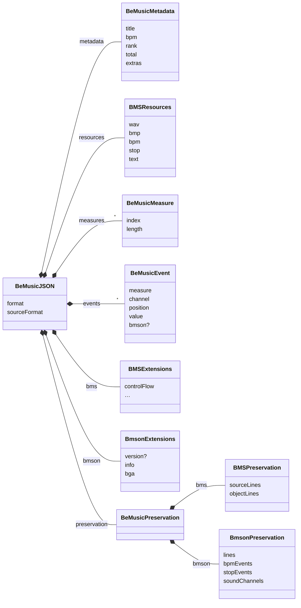
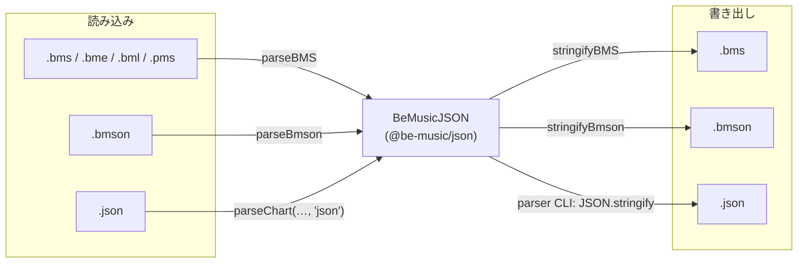

[English version](./json-spec.md)

# BMS/BMSON 中間表現 (`@be-music/json`) 実装仕様

この文書は、`@be-music/json` が提供する BMS/BMSON 中間表現の正規仕様です。
`@be-music/json` は Be-Music の内部処理専用フォーマットであり、配布や再利用を目的とした外部交換フォーマットではありません。
また、まだ開発初期段階のため、この中間表現の後方互換性は保証しません。

## 目的

- BMS / BMSON の差分を吸収して、内部処理を単一形式で扱う
- 再文字列化時にイベント時刻を安定再現する

## パッケージ境界

- `@be-music/json` は純粋な IR パッケージです
- `@be-music/json` が提供するのは、型、正規化済みのデータ構造、clone / 初期化 / 基本的な整形 helper に限られます
- beat 変換、イベント順序、ロングノート解決、sample trigger 判定などの譜面意味論は `@be-music/chart` が担当します。譜面の [Be-Music Fingerprint](fingerprint-spec.ja.md) も `@be-music/chart` が求めます（`computeChartFingerprint` / `computePlayFingerprint`）
- round-trip のための source-level 情報は IR の一部として保持しますが、正規化済みの譜面意味論とは `preservation` 層で分離します

## 設計原則

- IR は `parse` した入力を `stringify` したときに、元の譜面が持っていた構造をできる限り変えずに再現することを原則とします
- ここでいう構造には、重複定義の順序、制御構文、オブジェクト行の分割単位、bmson の小節線情報など、再文字列化結果に影響する要素を含みます
- 空行、コメント、空白、改行コード、文字コードなど、IR が明示的に保持しない表層情報はこの原則の対象外です
- IR を編集した結果、保持していた構造情報と正規化済みの `events` / `measures` / 拡張情報が一致しなくなった場合、stringifier は整合性を優先して再生成を行います

## 識別子とキーの命名

コードの識別子とBe-Music独自JSONのキーに含まれる略語は大文字にし、lowerCamelCaseの先頭は小文字を保ちます。例は `BeMusicJSON`、`backBMP`、`initBPM`、`poorBGA`、`bpm` です。略語が連続する場合は最後だけ大文字にし、それ以前はUpperCamelCase相当にします（`BmsJSON`、`inferBmsLNTypeWhenMissing`）。`Id` / `Ids` と `bmson` / `Bmson` は慣例表記を維持します。外部のBMS・bmson仕様、DBスキーマ、外部ツール・APIの契約キーは要求される表記を維持します。

保護対象の固有名詞は分解せず、連続略語ルールより公式表記を優先します。例は `LR2BGAElement`、`LR2JSON`、`FFmpegAPI`、`WebGLAPI` です。対象は [Naming Rules](../AGENTS.md#naming-rules) に列挙しています。lowerCamelCaseの先頭では慣例の先頭表記（`ffmpegQueue`、`lr2Skin`、`webGLContext`、`libavFactory`）を使い、`sRGB` は固有の小文字接頭辞を保ちます（`sRGBChannelToLinear`）。公式でも使われる `Pixi` などの略称は展開不要です。通常の形式略語である `BMS` と `JSON` には、引き続き連続略語ルールを適用します（`BmsJSON`）。

パーサーは下表の旧IRキーも入力として受け入れ、正規表記で出力します。両方の表記がある場合は正規キーが優先されます。この入力互換性には、改名したTypeScriptエクスポートの別名は含みません。

| 旧キー               | 正規キー             |
| -------------------- | -------------------- |
| `metadata.backBmp`   | `metadata.backBMP`   |
| `bmson.info.initBpm` | `bmson.info.initBPM` |
| `bms.volWav`         | `bms.volWAV`         |
| `bms.pathWav`        | `bms.pathWAV`        |
| `bms.baseBpm`        | `bms.baseBPM`        |
| `bms.exWav`          | `bms.exWAV`          |
| `bms.exBmp`          | `bms.exBMP`          |
| `bms.poorBga`        | `bms.poorBGA`        |
| `bms.swBga`          | `bms.swBGA`          |

## ルート構造

ルートオブジェクトとその部分です（フィールドの型は `packages/json/src/index.ts` にあります）。



全体の例です。

```json
{
  "format": "be-music-json/0.1.0",
  "sourceFormat": "bms | bmson | json",
  "metadata": {
    "title": "Example",
    "bpm": 130,
    "backBMP": "back.png",
    "banner": "banner.png",
    "extras": {}
  },
  "resources": {},
  "measures": [],
  "events": [],
  "bms": {
    "lnType": 1,
    "lnMode": 1,
    "lnObjs": ["AA", "ZZ"],
    "defExRank": 120,
    "exRank": {
      "01": "120,90,60,30"
    },
    "argb": {
      "0A": "FF000000"
    },
    "player": 1,
    "pathWAV": "sounds/",
    "base": 62,
    "baseBPM": 155,
    "stp": ["001.240"],
    "option": "HIGH-SPEED",
    "changeOption": {
      "01": "MIRROR"
    },
    "wavCmd": "legacy",
    "wavCmds": ["01 01 64"],
    "exWAV": {
      "01": "sample_ex.wav"
    },
    "exBMP": {
      "01": "image_ex.bmp"
    },
    "bga": {
      "01": "01"
    },
    "scroll": {
      "01": 0.5
    },
    "poorBGA": "01",
    "swBGA": {
      "01": "02"
    },
    "videoFile": "movie.mp4",
    "midiFile": "song.mid",
    "materials": "materials.def",
    "divideProp": "lane=2",
    "charset": "Shift_JIS",
    "controlFlow": [
      {
        "kind": "directive",
        "command": "RANDOM",
        "value": "2"
      },
      {
        "kind": "object",
        "measure": 0,
        "channel": "11",
        "events": [
          {
            "measure": 0,
            "channel": "11",
            "position": [0, 1],
            "value": "01",
            "bmson": {
              "l": 120,
              "c": true,
              "damage": 50
            }
          }
        ]
      }
    ]
  },
  "bmson": {
    "version": "string?",
    "info": {
      "resolution": 240,
      "chartName": "HYPER",
      "modeHint": "beat-7k",
      "judgeRank": 100,
      "total": 100,
      "backImage": "back.png",
      "bannerImage": "banner.png",
      "previewMusic": "preview.ogg"
    },
    "barlinesSuppressed": false,
    "bga": {
      "header": [
        {
          "id": 1,
          "name": "base.png"
        }
      ],
      "events": [
        {
          "y": 0,
          "id": 1
        }
      ],
      "layerEvents": [],
      "poorEvents": []
    }
  },
  "preservation": {
    "bms": {
      "sourceLines": [
        {
          "kind": "header",
          "command": "TITLE",
          "value": "Example"
        },
        {
          "kind": "object",
          "measure": 1,
          "channel": "13",
          "events": [
            {
              "measure": 1,
              "channel": "13",
              "position": [1, 4],
              "value": "22"
            }
          ]
        }
      ],
      "objectLines": [
        {
          "measure": 1,
          "channel": "13",
          "events": [
            {
              "measure": 1,
              "channel": "13",
              "position": [1, 4],
              "value": "22"
            }
          ]
        }
      ]
    },
    "bmson": {
      "lines": [0, 960, 1920],
      "bpmEvents": [{ "y": 0, "bpm": 120 }],
      "stopEvents": [{ "y": 480, "duration": 96 }],
      "soundChannels": [
        {
          "name": "lead.wav",
          "notes": [{ "x": 1, "y": 0, "l": 120, "c": true }]
        }
      ]
    }
  }
}
```

`metadata` は、format に依存しない normalized metadata 領域です。

- `stageFile`: BMS `#STAGEFILE`。bmson では `info.eyecatch_image` が存在する場合にここへ mirror します
- `backBMP`: BMS `#BACKBMP`。bmson では `info.back_image` が存在する場合にここへ mirror します
- `banner`: BMS `#BANNER`。bmson では `info.banner_image` が存在する場合にここへ mirror します
- `playLevel`: BMS `#PLAYLEVEL` または bmson `info.level`。number または string を保持できます
- `rank`: BMS `#RANK`（`0`〜`4` のランク番号）または bmson `info.judge_rank`（`100` = NORMAL の百分率）。単位が異なるため、stringifier は bmson 出力時に換算します
- `total`: BMS `#TOTAL` または bmson `info.total`
- `difficulty`: BMS `#DIFFICULTY`
- `bpm`: BMS `#BPM` または bmson `info.init_bpm`。BMS は `130` を既定値にしますが、bmson は正の `init_bpm` を必須にします
- `extras`: normalized field を持たない format 固有 metadata

`bms` は BMS 固有の追加情報を保持する拡張領域です。

- `preview`: `#PREVIEW` の値
- `lnType`: `#LNTYPE` の値
- `lnMode`: `#LNMODE` の値（`1` = LN、`2` = CN、`3` = HCN）。正の値だけを保持
- `lnObjs`: 複数 `#LNOBJ` 宣言を宣言順で保持した配列 (2桁 base36)
- `volWAV`: `#VOLWAV` の値
- `defExRank`: `#DEFEXRANK` の値
- `exRank`: `#EXRANKxx` のマップ
- `argb`: `#ARGBxx` のマップ
- `player`: `#PLAYER` の値
- `pathWAV`: `#PATH_WAV` の値
- `base`: 譜面が `#BASE 62` を宣言している場合は `62`。それ以外は省略し、省略時は `36`
- `baseBPM`: `#BASEBPM` の値
- `stp`: `#STP` の値配列
- `option`: `#OPTION` の値
- `changeOption`: `#CHANGEOPTIONxx` のマップ
- `wavCmd`: legacy compatibility のために保持する最初の `#WAVCMD` 値
- `wavCmds`: すべての `#WAVCMD` 行の directive 後テキスト。宣言順で保持します
- `exWAV`: `#EXWAVxx` のマップ
- `exBMP`: `#EXBMPxx` のマップ
- `bga`: `#BGAxx` のマップ
- `scroll`: `#SCROLLxx` のマップ
- `speed`: `#SPEEDxx` のマップ
- `poorBGA`: `#POORBGA` の値
- `swBGA`: `#SWBGAxx` のマップ
- `videoFile`: `#VIDEOFILE` の値
- `midiFile`: `#MIDIFILE` の値
- `materials`: `#MATERIALS` の値
- `divideProp`: `#DIVIDEPROP` の値
- `charset`: `#CHARSET` の値
- `controlFlow`: 制御構文 (`#RANDOM`/`#IF`/`#SWITCH` 系) と、その内側のヘッダ/オブジェクト行
- `controlFlow.kind = "object"` は通常イベントと同じ `events` 形式（必要に応じて `measureLength`）で保持
- `controlFlow.kind = "header"` は、ファイルの後のほうに同じヘッダのトップレベル行があるとき `overriddenByLaterHeader: true` を持つ。ヘッダ行はファイル順に適用するため、制御構文の解決ではこれを適用しない
- パーサは制御構文をこの配列へ保持し、分岐の実行は再生/レンダリング時に行います
- `scroll` の値は有限数を許可し、`0` および負値も保持対象です

### BMS object ID base

BMS の既定 object ID は base-36 (`0-9A-Z`) で、ASCII 小文字は大文字へ正規化します。
`bms.base` が `62` の場合は、beatoraja 互換の base-62 (`0-9A-Za-z`) として扱い、大文字小文字を保持します。

これは IR に保存される次の 2 文字 indexed ID 全体に影響します。

- `resources.wav`, `resources.bmp`, `resources.bpm`, `resources.stop`, `resources.text` などの resource map
- `bms.exRank`, `bms.argb`, `bms.exWAV`, `bms.exBMP`, `bms.bga`, `bms.scroll`, `bms.speed`, `bms.swBGA` などの BMS extension map
- `preservation.bms.sourceLines` や `bms.controlFlow` に保持される event を含む BMS object event の `value`
- `bms.lnObjs`

ID を消費する code は手動で upper-case せず、`resolveBMSBase(json)` の結果を ID normalization helper に渡してください。
これにより、base-62 譜面では `0a` と `0A` を区別し、通常譜面では従来の base-36 挙動を保てます。

`bmson` は bmson 固有の追加情報を保持する拡張領域です。

- `version`: bmson のバージョン文字列
- `info`: `resolution` に加え、`subartists`, `chartName`, `level`, `initBPM`, `modeHint`, `judgeRank`, `total`, `lnType`（beatoraja の `info.ln_type`: `1` = LN、`2` = CN、`3` = HCN）, 画像/preview 系を保持
- `barlinesSuppressed`: bmson source が明示的に `lines: []` を書いた場合だけ `true` になります。`lines` 欠落とは区別し、欠落時は既定の 4/4 barline model を意味します
- `bga`: `header`, `events`, `layerEvents`, `poorEvents` を保持

`preservation` は round-trip のための source-level 情報を保持する補助層です。

- `preservation.bms.sourceLines`: 空行/コメントを除く BMS の全行を宣言順で保持するスナップショット
- `preservation.bms.sourceLines` は BMS の header / object / 制御構文の相対位置を保ったまま `stringifyBMS(parseChart(...))` を再現するための第一選択です
- `preservation.bms.objectLines`: 制御構文の外側にあるオブジェクト行の宣言順スナップショット
- `preservation.bms.objectLines` は制御構文外の object 行だけを扱いたい処理向けの部分スナップショットです
- `preservation.bms.objectLines` が `events` / `measures` と一致しない場合、stringifier はこの配列を無視して再生成します
- `preservation.bmson.lines`: 小節線 `y` 値の配列 (昇順・重複なし・`0` 始まり)
- `preservation.bmson.bpmEvents`: `bpm_events` の配列順スナップショット
- `preservation.bmson.stopEvents`: `stop_events` の配列順スナップショット
- `preservation.bmson.scrollEvents`: beatoraja 拡張 `scroll_events` の配列順スナップショット（省略可。譜面にない場合は省く）
- `preservation.bmson.soundChannels`: `sound_channels` の配列順スナップショット。未使用チャンネルも保持します

## Event 構造 (正規)

```ts
type BeMusicPosition = readonly [numerator: number, denominator: number];

interface BeMusicEvent {
  measure: number;
  channel: string;
  position: BeMusicPosition;
  value: string;
  bmson?: {
    l?: number;
    c?: boolean;
    t?: number;
    damage?: number;
  };
}
```

`bmson.damage` は beatoraja の bmson 拡張 `mine_channels` の地雷に使います。
譜面で authoring された gauge damage を非負数で保持し、それ以外の event（`key_channels`（beatoraja の隠しノート）から読んだ不可視オブジェクトを含む）では省略します。
`bmson.t` は beatoraja のノート単位のロングノート種別（`notes[].t`: `1` = LN、`2` = CN、`3` = HCN）です。ロングノート（`l > 0`）のときだけ保持し、`bmson.info.lnType` より優先されます。

## `position` の意味

- `position[0]`: 分子 (`numerator`)
- `position[1]`: 分母 (`denominator`)

制約:

- `denominator >= 1`
- `0 <= numerator < denominator`
- いずれも整数

## 比較・ソート規則

イベント比較順:

1. `measure`
2. `position` (分数の厳密比較)
3. `channel`
4. `value`

分数比較は浮動小数を使わず、クロス積で判定します。

## 変換規則

どの形式も IR に読み込み、IR から書き出します。BMS と bmson を直接変換することはありません（途中で何が変わるかは [BMS / bmson 互換性ノート §4](./format-compat.ja.md#4-bms-と-bmson-の相互変換) にあります）。`parseChart` は形式のヒントか内容から読み込み方を選びます（`be-music-json` でない `{` の文書は bmson として読みます）。



- `stringifier` は `position` 分母情報を使って小節内解像度を決定します
- `parseJson` は `position` タプルを必須とし、欠損イベントはエラー扱いにします
- beat 変換やイベント順序などの譜面意味論 helper は `@be-music/chart` が提供します
