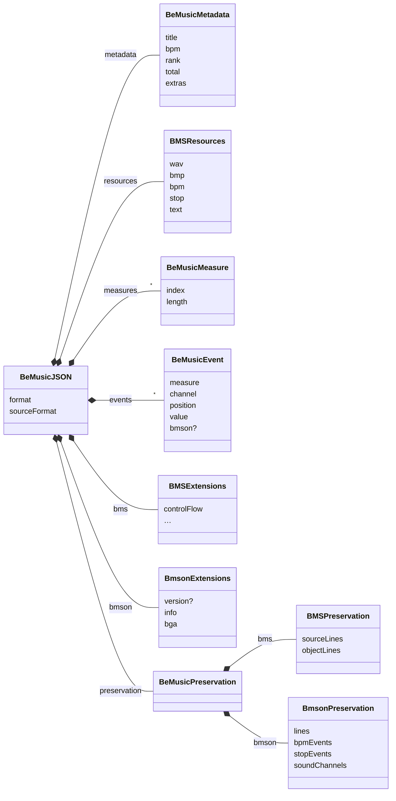
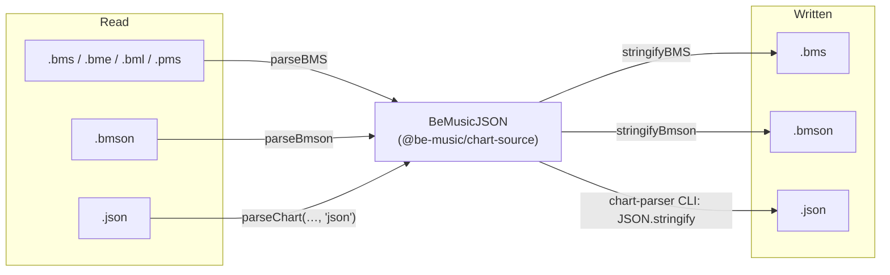

[Japanese version](./json-spec.ja.md)

# BMS/bmson intermediate representation (`@be-music/chart-source`) implementation specification

This document is the canonical specification for the BMS/bmson intermediate representation provided by `@be-music/chart-source`.
`@be-music/chart-source` is a format for Be-Music's internal processing only, and is not an external exchange format for distribution or reuse.
Also, as it is still in the early stages of development, backward compatibility of this intermediate representation cannot be guaranteed.

## Purpose

- Absorb BMS / bmson differences and handle internal processing in a single format
- Preserve event timing stably during round trips

## Package boundaries

- `@be-music/chart-source` is a pure IR package
- `@be-music/chart-source` only provides types, normalized data structures, and clone/initialization/basic formatting helpers
- `@be-music/chart-model` is in charge of score semantics such as beat conversion, event order, long note resolution, sample trigger judgment, etc., and computes the [Be-Music Fingerprint](./fingerprint-spec.md) of a chart (`computeChartFingerprint` / `computePlayFingerprint`).
- Source-level information for round-trips is kept as part of the IR, but separated from the normalized score semantics in the `preservation` layer.

## Design principles

- When stringifying parsed input, the IR aims to preserve the original chart structure as faithfully as possible.
- The structure here includes elements that affect the re-stringing result, such as the order of overlapping definitions, control syntax, object line division units, and bmson bar line information.
- Surface information that is not explicitly maintained by the IR, such as blank lines, comments, white space, line breaks, character codes, etc., is not subject to this principle.
- As a result of editing the IR, if the retained structural information and the normalized `events` / `measures` / extension information no longer match, the chart-writer will prioritize consistency and regenerate it.

## Intrinsic sample gain

`resources.wavGain` is an optional map from WAV slot ids to finite, nonnegative linear gain. Missing slots use 1. The map belongs to Be-Music JSON and is not a BMS or bmson field. It preserves composition gain without rounding authored WAVCMD parameters. NONSTOP stores each stage's effective VOLWAV multiplied by any existing intrinsic slot gain; its target chart has no global VOLWAV. Cloning and JSON parsing copy the map independently and retain base-62 slot case.

`collectBmsWAVVolumeMultipliers` multiplies WAVCMD percentage volume, EXWAV attenuation and intrinsic gain. The backend applies the target chart's VOLWAV and dynamic bus gain separately. Browser, Node and offline playback share this calculation. Gain affects audio only; timing, scoring and fingerprints are unchanged.

BMS export converts intrinsic gain into a final integer WAVCMD volume only when that volume reproduces the combined gain exactly. It never rounds, and unresolved BMS control flow must be resolved first. bmson has no supported per-channel gain field, so non-unity intrinsic gain cannot be exported to bmson. These checks also apply when preservation validation is skipped; export Be-Music JSON to retain unrepresentable gain. Unity-only maps do not change native output.

## Identifier and key naming

Abbreviations in code identifiers and Be-Music JSON keys use uppercase, while the first segment of lowerCamelCase stays lowercase: `BeMusicJSON`, `backBMP`, `initBPM`, `poorBGA`, and `bpm`. In consecutive abbreviations, only the last is uppercase (`BmsJSON`, `inferBmsLNTypeWhenMissing`). `Id` / `Ids` and `bmson` / `Bmson` keep their conventional spelling. External BMS and bmson keys, database schemas, and external tool and API contract keys retain their required spelling.

Protected proper names are indivisible and retain their official capitalization ahead of the consecutive-abbreviation rule: `LR2BGAElement`, `LR2JSON`, `FFmpegAPI`, and `WebGLAPI`. The protected names are listed in [Naming Rules](../AGENTS.md#naming-rules). LowerCamelCase starts with the conventional leading form (`ffmpegQueue`, `lr2Skin`, `webGLContext`, `libavFactory`), while `sRGB` keeps its distinctive lowercase prefix (`sRGBChannelToLinear`). Official short names such as `Pixi` may stay abbreviated. Ordinary format abbreviations such as `BMS` and `JSON` remain subject to the consecutive-abbreviation rule (`BmsJSON`).

The parser accepts the former IR keys below on input and emits their canonical spelling. When both spellings occur, the canonical key wins. This input compatibility does not provide aliases for renamed TypeScript exports.

| Former key           | Canonical key        |
| -------------------- | -------------------- |
| `metadata.backBmp`   | `metadata.backBMP`   |
| `bmson.info.initBpm` | `bmson.info.initBPM` |
| `bms.volWav`         | `bms.volWAV`         |
| `bms.pathWav`        | `bms.pathWAV`        |
| `bms.baseBpm`        | `bms.baseBPM`        |
| `bms.exWav`          | `bms.exWAV`          |
| `bms.exBmp`          | `bms.exBMP`          |
| `bms.poorBga`        | `bms.poorBGA`        |
| `bms.swBga`          | `bms.swBGA`          |

## Root structure

The root object and its parts (field types are in `packages/chart-source/src/index.ts`):



A full example:

```json
{
  "format": "be-music-json/0.1.0",
  "sourceFormat": "bms | bmson | json",
  "metadata": {
    "title": "Example",
    "bpm": 130,
    "backBMP": "back.png",
    "banner": "banner.png",
    "extras": {}
  },
  "resources": {},
  "measures": [],
  "events": [],
  "bms": {
    "lnType": 1,
    "lnMode": 1,
    "lnObjs": ["AA", "ZZ"],
    "defExRank": 120,
    "exRank": {
      "01": "120,90,60,30"
    },
    "argb": {
      "0A": "FF000000"
    },
    "player": 1,
    "pathWAV": "sounds/",
    "base": 62,
    "baseBPM": 155,
    "stp": ["001.240"],
    "option": "HIGH-SPEED",
    "changeOption": {
      "01": "MIRROR"
    },
    "wavCmd": "legacy",
    "wavCmds": ["01 01 64"],
    "exWAV": {
      "01": "sample_ex.wav"
    },
    "exBMP": {
      "01": "image_ex.bmp"
    },
    "bga": {
      "01": "01"
    },
    "scroll": {
      "01": 0.5
    },
    "poorBGA": "01",
    "swBGA": {
      "01": "02"
    },
    "videoFile": "movie.mp4",
    "midiFile": "song.mid",
    "materials": "materials.def",
    "divideProp": "lane=2",
    "charset": "Shift_JIS",
    "controlFlow": [
      {
        "kind": "directive",
        "command": "RANDOM",
        "value": "2"
      },
      {
        "kind": "object",
        "measure": 0,
        "channel": "11",
        "events": [
          {
            "measure": 0,
            "channel": "11",
            "position": [0, 1],
            "value": "01",
            "bmson": {
              "l": 120,
              "c": true,
              "damage": 50
            }
          }
        ]
      }
    ]
  },
  "bmson": {
    "version": "string?",
    "info": {
      "resolution": 240,
      "chartName": "HYPER",
      "modeHint": "beat-7k",
      "judgeRank": 100,
      "total": 100,
      "backImage": "back.png",
      "bannerImage": "banner.png",
      "previewMusic": "preview.ogg"
    },
    "barlinesSuppressed": false,
    "bga": {
      "header": [
        {
          "id": 1,
          "name": "base.png"
        }
      ],
      "events": [
        {
          "y": 0,
          "id": 1
        }
      ],
      "layerEvents": [],
      "poorEvents": []
    }
  },
  "preservation": {
    "bms": {
      "sourceLines": [
        {
          "kind": "header",
          "command": "TITLE",
          "value": "Example"
        },
        {
          "kind": "object",
          "measure": 1,
          "channel": "13",
          "events": [
            {
              "measure": 1,
              "channel": "13",
              "position": [1, 4],
              "value": "22"
            }
          ]
        }
      ],
      "objectLines": [
        {
          "measure": 1,
          "channel": "13",
          "events": [
            {
              "measure": 1,
              "channel": "13",
              "position": [1, 4],
              "value": "22"
            }
          ]
        }
      ]
    },
    "bmson": {
      "lines": [0, 960, 1920],
      "bpmEvents": [{ "y": 0, "bpm": 120 }],
      "stopEvents": [{ "y": 480, "duration": 96 }],
      "soundChannels": [
        {
          "name": "lead.wav",
          "notes": [{ "x": 1, "y": 0, "l": 120, "c": true }]
        }
      ]
    }
  }
}
```

`metadata` is the normalized, format-neutral metadata area.

- `titleImage`: bmson `info.title_image`, the pre-play title artwork, independent of the loading image
- `stageFile`: BMS `#STAGEFILE`; bmson mirrors `info.eyecatch_image` here when present
- `backBMP`: BMS `#BACKBMP`; bmson mirrors `info.back_image` here when present
- `banner`: BMS `#BANNER`; bmson mirrors `info.banner_image` here when present
- `playLevel`: BMS `#PLAYLEVEL` or bmson `info.level`; can be a number or a string
- `rank`: BMS `#RANK` (a `0`–`4` rank index) or bmson `info.judge_rank` (a percentage, `100` = NORMAL); the chart-writer converts between the two units when writing bmson
- `total`: BMS `#TOTAL` or bmson `info.total`
- `difficulty`: BMS `#DIFFICULTY`
- `bpm`: BMS `#BPM` or bmson `info.init_bpm`; BMS defaults to `130`, while bmson requires a positive `init_bpm`
- `extras`: format-specific metadata that does not have a normalized field

`bms` is an extension area that holds additional BMS-specific information.

- `preview`: value of `#PREVIEW`
- `lnType`: value of `#LNTYPE`
- `lnMode`: value of `#LNMODE` (`1` = LN, `2` = CN, `3` = HCN); only positive values are kept
- `lnObjs`: Array holding multiple `#LNOBJ` declarations in declaration order (2 digit base36)
- `volWAV`: value of `#VOLWAV`
- `defExRank`: value of `#DEFEXRANK`
- `exRank`: Map of `#EXRANKxx`
- `argb`: map of `#ARGBxx`
- `player`: value of `#PLAYER`
- `pathWAV`: value of `#PATH_WAV`
- `base`: `62` when the chart declares `#BASE 62`; omitted otherwise, which means `36`.
- `baseBPM`: value of `#BASEBPM`
- `stp`: `#STP` value array
- `option`: legacy last unconditional `#OPTION` payload; after branch resolution, the last active declaration
- `options`: optional ordered array of whole `#OPTION` payloads, including vendor arguments with spaces; when present it owns the declarations and an empty array clears the legacy alias
- `optionHeadersInControlFlow`: optional `true` when `controlFlow` includes every `#OPTION` in whole-file order, including unconditional lines; branch resolution rebuilds `options` from the active program once and removes this marker
- `changeOption`: Map of `#CHANGEOPTIONxx`
- `wavCmd`: first value of `#WAVCMD`, kept for legacy compatibility
- `wavCmds`: all `#WAVCMD` lines as raw post-directive text in declaration order
- `exWAV`: Map of `#EXWAVxx`
- `exBMP`: Map of `#EXBMPxx`
- `bga`: Map of `#BGAxx`
- `scroll`: Map of `#SCROLLxx`
- `speed`: Map of `#SPEEDxx`
- `poorBGA`: value of `#POORBGA`
- `swBGA`: Map of `#SWBGAxx`
- `videoFile`: value of `#VIDEOFILE`
- `midiFile`: value of `#MIDIFILE`
- `materials`: value of `#MATERIALS`
- `divideProp`: value of `#DIVIDEPROP`
- `charset`: value of `#CHARSET`
- `controlFlow`: Control syntax (`#RANDOM`/`#IF`/`#SWITCH` series) and the header/object lines inside it (plus unconditional OPTION declarations when marked above)
- `controlFlow.kind = "object"` is kept in the same `events` format as normal events (with `measureLength` if necessary)
- `controlFlow.kind = "header"` has `overriddenByLaterHeader: true` when a top-level line later in the file defines the same nonrepeatable header; replacing headers apply in file order, so resolving the control flow skips it
- Parser keeps control syntax in this array and branches are executed at playback/render time
- `scroll` values ​​allow finite numbers, `0` and negative values ​​are also retained

### BMS object ID base

BMS defaults to base-36 object IDs (`0-9A-Z`), and lowercase ASCII letters are normalized to uppercase.
When `bms.base` is `62`, object IDs use the beatoraja-style base-62 set (`0-9A-Za-z`) and preserve case.

This affects all two-character indexed IDs stored in the IR:

- Resource maps such as `resources.wav`, `resources.bmp`, `resources.bpm`, `resources.stop`, and `resources.text`
- BMS extension maps such as `bms.exRank`, `bms.argb`, `bms.exWAV`, `bms.exBMP`, `bms.bga`, `bms.scroll`, `bms.speed`, and `bms.swBGA`
- BMS object event `value` fields, including events retained in `preservation.bms.sourceLines` and `bms.controlFlow`
- `bms.lnObjs`

Code that consumes IDs should call `resolveBMSBase(json)` and pass the result to ID normalization helpers instead of uppercasing manually.
This keeps `0a` and `0A` distinct for base-62 charts while preserving base-36 behavior for ordinary charts.

`bmson` is an extension area that holds additional bmson-specific information.

- `version`: bmson version string
- `info`: In addition to `resolution`, retains `subartists`, `chartName`, `level`, `initBPM`, `modeHint`, `judgeRank`, `total`, `lnType` (beatoraja `info.ln_type`: `1` = LN, `2` = CN, `3` = HCN), and image/preview fields.
- `barlinesSuppressed`: `true` only when the bmson source authored an explicit `lines: []`; missing `lines` remains distinct and means the default 4/4 barline model.
- `bga`: Keep `header`, `events`, `layerEvents`, `poorEvents`

`preservation` is an auxiliary layer that maintains source-level information for round-trips.

- `preservation.bms.sourceLines`: Snapshot that preserves all lines of BMS in declaration order, excluding blank lines/comments.
- `preservation.bms.sourceLines` is the first choice to reproduce `stringifyBMS(parseChart(...))` while preserving the relative position of BMS header / object / control syntax
- `preservation.bms.objectLines`: declaration order snapshot of object lines outside of control constructs
- `preservation.bms.objectLines` is a partial snapshot for processing where you only want to handle object lines outside the control syntax
- If `preservation.bms.objectLines` does not match `events` / `measures`, chart-writer ignores and regenerates this array
- `preservation.bmson.lines`: Array of bar line `y` values ​​(ascending order, no duplicates, starting from `0`)
- `preservation.bmson.bpmEvents`: ordered snapshot of `bpm_events`
- `preservation.bmson.stopEvents`: ordered snapshot of `stop_events`
- `preservation.bmson.scrollEvents`: ordered snapshot of the beatoraja extension `scroll_events` (optional; left out when the chart has none)
- `preservation.bmson.soundChannels`: Ordered snapshot of `sound_channels`. Also retains unused channels

## Event structure (regular)

```ts
type BeMusicPosition = readonly [numerator: number, denominator: number];

interface BeMusicEvent {
  measure: number;
  channel: string;
  position: BeMusicPosition;
  value: string;
  bmson?: {
    l?: number;
    c?: boolean;
    t?: number;
    damage?: number;
    sampleOffsetSeconds?: number;
    sampleDurationSeconds?: number;
  };
}
```

`bmson.damage` is used for mines from the beatoraja bmson extension `mine_channels`.
It stores the authored gauge damage as a non-negative number and is absent on every other event, including the invisible objects read from `key_channels` (beatoraja's hidden notes).
`bmson.t` is the beatoraja per-note long-note type (`notes[].t`: `1` = LN, `2` = CN, `3` = HCN). It is kept only on long notes (`l > 0`) and overrides `bmson.info.lnType`.

Stitched bmson NONSTOP charts can use resource keys longer than two characters. `normalizeObjectKey(value, base, true)` preserves them; BMS token normalization is unchanged. `bmson.sampleOffsetSeconds` and `bmson.sampleDurationSeconds` retain source-audio coordinates independently of placed chart time. An explicit offset with no duration plays to the end of the sample. `bmson.info.totalUnit` retains the last stage's TOTAL unit (`absolute` or `percent`). These are Be-Music IR fields, not external bmson keys.

## Meaning of `position`

- `position[0]`: numerator (`numerator`)
- `position[1]`: denominator (`denominator`)

Constraints:

- `denominator >= 1`
- `0 <= numerator < denominator`
- Both are integers

## Comparison/sorting rules

Event comparison order:

1. `measure`
2. `position` (exact comparison of fractions)
3. `channel`
4. `value`

Fraction comparisons do not use floating point numbers and are determined by cross products.

## Conversion rules

Every format is read into the IR and written from it; nothing converts between BMS and bmson directly ([BMS / bmson compatibility notes §4](./format-compat.md#4-converting-between-bms-and-bmson) lists what changes on the way). `parseChart` picks the reader from the format hint or the content (a `{` document that is not `be-music-json` is read as bmson).



- `chart-writer` uses `position` denominator information to determine intra-bar resolution
- `parseJson` requires `position` tuple and treats missing events as errors
- Score semantics helpers such as beat conversion and event order are provided by `@be-music/chart-model`
