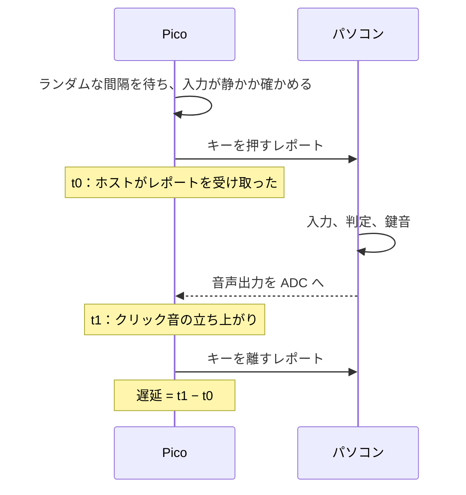
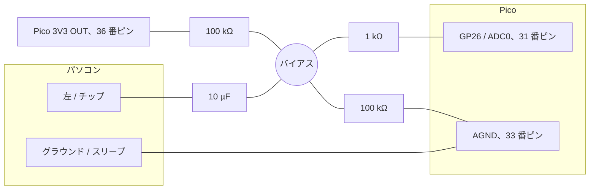

[English version](./latency-jig.md)

# 遅延計測治具

遅延計測治具は、キーを押してから鍵音が聞こえるまでの物理的な時間を測ります。Raspberry Pi Pico が USB キーボードとしてキーを押し、パソコンの音声出力を聞いてクリック音を検出します。ブラウザーが報告する遅延だけでは決められない比較、たとえばブラウザーで動く Web 版とネイティブの音声経路の比較を、同じパソコンの上で行うためのものです。

治具は [`scripts/latency-jig/`](../scripts/latency-jig/) にあります。`firmware/` にファームウェアがあり、テスト用の譜面の作成、計測の記録、結果の集計のスクリプトがその隣にあります。

## 何を測るか



- **t0** は、ホストがキーを押すレポートを受け取った時刻（USB の転送が終わった時刻）です。ホストの次のポーリングまでの待ち（最大 1 ms）は数えず、`usbUs` として別に出します。
- **t1** は、静かなときの値から閾値以上離れた ADC のサンプルが 2 つ続いたときの、1 つ目の時刻です。ADC は約 2 µs ごとにサンプリングします。
- 遅延には、OS の入力処理、プレイヤー、デバイスのバッファを含む音声出力が含まれます。
- 押す間隔は毎回ランダム（既定は 300〜800 ms）にして、プレイヤーのフレームの周期と同期しないようにしています。
- 時刻の精度は 0.1 ms 程度です。ファームウェアはサンプリングの合間に USB の処理を行い、転送の完了を処理した時点で時刻を記録します。

## 部品と配線

- Raspberry Pi Pico または Pico 2（W 付きのモデルも使えます。LED は点きません）
- パソコンのヘッドホン出力かライン出力からの 3.5 mm のオーディオケーブル、またはブレークアウト
- 10 µF のコンデンサー 1 個、100 kΩ の抵抗 2 個、1 kΩ の抵抗 1 個

コンデンサーで出力の直流分を切り、2 つの 100 kΩ で ADC の入力を 3.3 V の半分に保ちます。これで音声が中央を中心に振れます。



使うのは片方のチャンネル（左）だけです。Bluetooth のオーディオは使わないでください。遅延が押すたびに変わり、プレイヤーとは関係のない値になります。

## ファームウェアのビルドと書き込み

ワークフロー [`latency-jig.yml`](../.github/workflows/latency-jig.yml) が、ファームウェアが変わるたびに Pico と Pico 2 向けにビルドし、それぞれの UF2 を成果物（`latency-jig-pico`、`latency-jig-pico2`）として残します。手元でビルドするには、[Pico SDK](https://github.com/raspberrypi/pico-sdk)（サブモジュールを含む）、CMake、Ninja、Arm GNU ツールチェーンを入れてから、次を実行します。

```bash
cmake -S scripts/latency-jig/firmware -B build/latency-jig -G Ninja -DPICO_BOARD=pico -DPICO_SDK_PATH=/path/to/pico-sdk
```

```bash
cmake --build build/latency-jig
```

BOOTSEL ボタンを押しながら Pico をつなぎ、現れたドライブに `latency_jig.uf2` をコピーします。治具は USB キーボードとシリアルポート（macOS では `/dev/cu.usbmodem*`、Linux では `/dev/ttyACM*`、Windows では COM ポート）として認識されます。

中核の処理（コマンド、立ち上がりの検出、結果の行）には、C コンパイラーだけで動くホスト用のテストがあります。

```bash
scripts/latency-jig/firmware/test/run.sh
```

## 計測の手順

1. 1 拍ごとにレーン 1 のノートが並び、鍵音がクリック音のテスト用の譜面を書き出し、そのフォルダーをプレイヤーに読み込みます。

   ```bash
   node scripts/latency-jig/chart.ts tmp/latency-jig
   ```

2. プレイヤーで Auto play と PRACTICE をオフにし、キー配置は既定のままにします（レーン 1 は治具が押す `Z`）。出力の音量はどの計測でも同じにします。
3. 譜面を始め、プレイヤーのウィンドウにフォーカスを置いたまま、譜面が始まってから最初の押下を待ちます。
4. 入力のレベルを確かめ、閾値を決めます（どちらも ADC の値で、1 あたり約 0.8 mV）。クリック音で `thr` を十分に超え、上限には届かない音量が目安です。

   ```text
   level
   thr 300
   ```

5. 計測して記録を保存します。Ctrl+C で途中で止められます。

   ```bash
   node scripts/latency-jig/capture.ts /dev/cu.usbmodem1101 tmp/web-chrome.csv 300
   ```

   Windows では、シリアル端末から `run 300` を送り、出力をファイルに記録します。

6. 1 つ以上の記録をまとめます。「vs first」の列は最初の記録との差です。

   ```bash
   node scripts/latency-jig/analyze.ts tmp/web-chrome.csv tmp/native.csv
   ```

要約には、記録ごとの中央値、p95、p99、最大値、標準偏差（ミリ秒）が出ます。音割れ、弱い信号、タイムアウト、飛ばした押下、途中で終わった計測があれば警告します。

比べるときは条件をそろえます。同じパソコン、出力デバイス、音量、譜面で、プレイヤーの負荷（スキンと BGA）も同じにします。Web 版の計測機能（`?latency-probe`、[ブラウザープレイヤー](./player-web.ja.md)を参照）を同時に有効にすると、全体のうちブラウザーが把握している分が分かります。

## コマンド

| コマンド                              | 動作                                                                   |
| ------------------------------------- | ---------------------------------------------------------------------- |
| `run [presses] [minGapMs] [maxGapMs]` | 押下を計測する（既定は 300 回、間隔 300〜800 ms）。`stop` で止める     |
| `level`                               | 1 秒間の入力の平均、最小、最大、幅                                     |
| `thr <counts>`                        | 音とみなす、静かなときの値からの距離（既定 300）                       |
| `quiet <counts>`                      | 押す前に許す静かなときの値の揺れ（既定 150）。超えるとその押下を飛ばす |
| `timeout <ms>`                        | 音を待つ時間（既定 500）                                               |
| `hold <ms>`                           | キーを押している時間（既定 30）                                        |
| `key <usage>`                         | 押すキーの HID の usage（既定 `0x1D`、Z）                              |
| `status`、`help`                      | 今の設定、コマンドの一覧                                               |

設定は Pico を再起動するまで保たれます。

## 記録の形式

`#` で始まる行はコメントです。設定を含む `# run ...`、CSV のヘッダー、件数を含む `# done ...` があります。それ以外の行が 1 回の押下です。

| 種類 | 意味                               | 項目                                                           |
| ---- | ---------------------------------- | -------------------------------------------------------------- |
| `P`  | 音が届いた                         | `index,queuedUs,sentUs,onsetUs,latencyUs,usbUs,peak,quietSpan` |
| `T`  | タイムアウトまでに音が届かなかった | `index,queuedUs,sentUs,,,usbUs,peak,quietSpan`                 |
| `N`  | 入力が静かでなかったので飛ばした   | `index,,,,,,,quietSpan`                                        |

時刻は Pico の起動からのマイクロ秒です。`latencyUs` は `onsetUs − sentUs`、`usbUs` は `sentUs − queuedUs` です。`peak` と `quietSpan` は ADC の値です。
