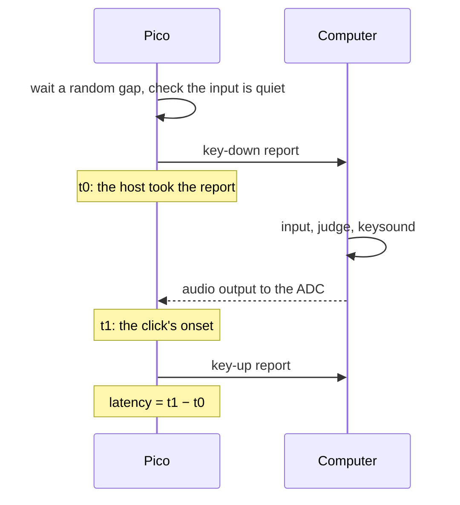
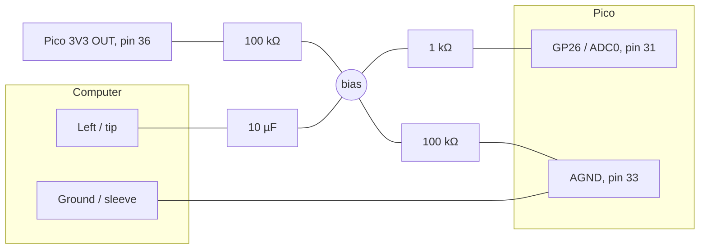

[Japanese version](./latency-jig.ja.md)

# Latency jig

The latency jig measures the physical time from a key press to its keysound: a Raspberry Pi Pico acts as a USB keyboard, presses a key, and listens to the computer's audio output for the click. It compares players and setups on the same computer, such as the web player in a browser against a native audio path, which the browser's own account of its latency cannot settle.

The jig lives in [`scripts/latency-jig/`](../scripts/latency-jig/): the firmware in `firmware/`, and the scripts that make the test chart, capture a run and summarise runs.

## What it measures



- **t0** is when the host took the key-down report: its USB transfer completed. The wait for the host's next poll (up to 1 ms) is therefore not counted; it is reported separately as `usbUs`.
- **t1** is the first of two ADC samples in a row whose distance from the resting level reaches the threshold. The ADC samples about every 2 µs.
- The latency includes the operating system's input path, the player, and the audio output with the device's buffers.
- The gaps between presses are random (300 to 800 ms by default), so the presses do not lock to the player's frame rate.
- The timestamps are accurate to about 0.1 ms: the firmware services USB between samples and stamps the transfer's completion when it handles it.

## Parts and wiring

- Raspberry Pi Pico or Pico 2 (the W models work too, without the LED)
- A 3.5 mm audio cable or breakout from the computer's headphone or line output
- A 10 µF capacitor, two 100 kΩ resistors and one 1 kΩ resistor

The capacitor blocks the output's DC; the two 100 kΩ resistors hold the ADC input at half of 3.3 V, so the audio swings around mid-scale.



Use one channel (the left) only. Do not use Bluetooth audio: its latency varies from press to press and has nothing to do with the player.

## Building and flashing the firmware

The workflow [`latency-jig.yml`](../.github/workflows/latency-jig.yml) builds the firmware for the Pico and the Pico 2 whenever it changes, and keeps each UF2 as an artifact (`latency-jig-pico`, `latency-jig-pico2`). To build locally, install the [Pico SDK](https://github.com/raspberrypi/pico-sdk) (with its submodules), CMake, Ninja and the Arm GNU toolchain, then:

```bash
cmake -S scripts/latency-jig/firmware -B build/latency-jig -G Ninja -DPICO_BOARD=pico -DPICO_SDK_PATH=/path/to/pico-sdk
```

```bash
cmake --build build/latency-jig
```

Hold BOOTSEL while plugging the Pico in, and copy `latency_jig.uf2` to the drive that appears. The jig then shows up as a USB keyboard and a serial port (`/dev/cu.usbmodem*` on macOS, `/dev/ttyACM*` on Linux, a COM port on Windows).

The core logic (commands, onset detection, result lines) has a host test that needs only a C compiler:

```bash
scripts/latency-jig/firmware/test/run.sh
```

## Running a measurement

1. Write the test chart, a note on lane 1 every beat with a click keysound, and load the folder into the player:

   ```bash
   node scripts/latency-jig/chart.ts tmp/latency-jig
   ```

2. In the player, turn Auto play and PRACTICE off and keep the default keys (lane 1 is `Z`, the key the jig presses). Use the same output volume for every run.
3. Start the chart, keep the player's window focused, and let the chart start before the first press.
4. Check the input level and set the threshold (both in ADC counts, about 0.8 mV each). A click should move the input well past `thr` without reaching the rail:

   ```text
   level
   thr 300
   ```

5. Run and save the log; Ctrl+C stops the run early:

   ```bash
   node scripts/latency-jig/capture.ts /dev/cu.usbmodem1101 tmp/web-chrome.csv 300
   ```

   On Windows, send `run 300` from a serial terminal and log its output to a file.

6. Summarise one or more runs. The first run is the baseline for the "vs first" column:

   ```bash
   node scripts/latency-jig/analyze.ts tmp/web-chrome.csv tmp/native.csv
   ```

The summary gives each run's median, p95, p99, maximum and standard deviation in milliseconds, and warns about clipping, weak signals, timeouts, skipped presses and unfinished runs.

Compare like with like: the same computer, output device, volume and chart, and the same load on the player (the same skin and BGA). The web player's own probe (`?latency-probe`, see [Browser player](./player-web.md)) can run at the same time and shows how much of the total the browser accounts for.

## Commands

| Command                               | What it does                                                                         |
| ------------------------------------- | ------------------------------------------------------------------------------------ |
| `run [presses] [minGapMs] [maxGapMs]` | Times presses (default 300, 300 to 800 ms apart); `stop` ends a run                  |
| `level`                               | The input's mean, minimum, maximum and span over one second                          |
| `thr <counts>`                        | The distance from the resting level that counts as sound (default 300)               |
| `quiet <counts>`                      | The most the resting level may move before a press (default 150); else it is skipped |
| `timeout <ms>`                        | How long to wait for the sound (default 500)                                         |
| `hold <ms>`                           | How long to hold the key (default 30)                                                |
| `key <usage>`                         | The HID usage of the key to press (default `0x1D`, Z)                                |
| `status`, `help`                      | The settings; the command list                                                       |

Settings last until the Pico restarts.

## Log format

Lines starting with `#` are comments: `# run ...` with the settings, a CSV header, and `# done ...` with the counts. Every other line is one press:

| Kind | Meaning                          | Fields                                                         |
| ---- | -------------------------------- | -------------------------------------------------------------- |
| `P`  | The sound arrived                | `index,queuedUs,sentUs,onsetUs,latencyUs,usbUs,peak,quietSpan` |
| `T`  | No sound within the timeout      | `index,queuedUs,sentUs,,,usbUs,peak,quietSpan`                 |
| `N`  | Skipped: the input was not quiet | `index,,,,,,,quietSpan`                                        |

Times are microseconds since the Pico started. `latencyUs` is `onsetUs − sentUs`; `usbUs` is `sentUs − queuedUs`. `peak` and `quietSpan` are ADC counts.
