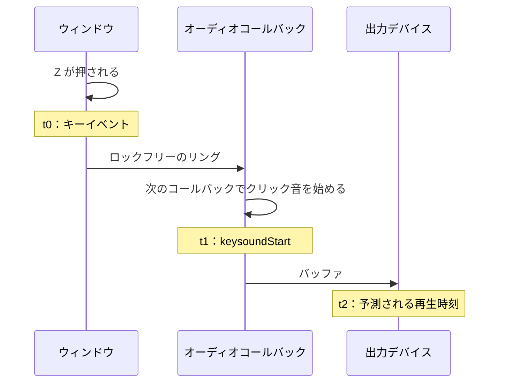

[English version](./latency-native.md)

# ネイティブの遅延計測

ネイティブの遅延計測は、キーが押されたときに、プラットフォームの音声 API で取れる最短の経路でクリック音を鳴らし、その経路にかかる時間を報告します。Web 版の遅延と比べるための基準です。同じパソコンと出力デバイスで、ネイティブの音声エンジン（たとえばデスクトップ版に積むもの）がどこまで縮められるかを示します。

計測プログラムは [`scripts/latency-native/`](../scripts/latency-native/) にあります。[cpal](https://github.com/RustAudio/cpal)（macOS では Core Audio、Windows では WASAPI、Linux では ALSA）と [winit](https://github.com/rust-windowing/winit) を使った Rust のプログラムです。

## 何を測るか



- **keysoundStart**（t1 − t0）は、次のオーディオコールバックを待つ時間です。コールバックはバッファの先頭のフレームからクリック音を始めます。長くても 1 バッファ分です。
- **outputDelay**（t2 − t1）は、そのコールバックから、バッファの先頭のフレームが再生されると予測される時刻までの時間です。ホストが報告する値（cpal の `OutputStreamTimestamp`）で、残りのバッファとデバイスの遅延を含みます。
- **audible** はその和で、キーイベントから出力のクリック音までの時間です。

行の名前は Web 版の計測機能（`?latency-probe`）と同じです。Web 版の `audible` もキーイベントの `timeStamp` から出力までなので、そのまま比べられます。どちらも、イベントがプログラムに届くまでの OS の入力処理は数えません。経路の全体は遅延計測治具（`docs/latency-jig.ja.md`）で物理的に測ります。

クリック音は治具と同じで、すべてのチャンネルに 1 ms の最大振幅を出します。キーイベントとオーディオコールバックはロックフリーのリングで押下を受け渡すので、コールバックがブロックしたりメモリーを確保したりすることはありません。

## ビルド

[rustup](https://rustup.rs/) で Rust を入れてから、次を実行します。

```bash
cargo build --release --manifest-path scripts/latency-native/Cargo.toml
```

ワークフロー [`latency-native.yml`](../.github/workflows/latency-native.yml) が、計測プログラムが変わるたびに macOS と Windows で検査とビルドを行い、それぞれのバイナリを成果物（`latency-native-macos`、`latency-native-windows`）として残します。

## 計測の手順

1. 出力デバイスを、既定のサンプルレートと受け付けるバッファの大きさとともに一覧します。

   ```bash
   scripts/latency-native/target/release/be-music-latency-native --list
   ```

2. デバイスの既定のバッファと、より小さい固定のバッファで計測します。

   ```bash
   scripts/latency-native/target/release/be-music-latency-native --device "MacBook" --auto 300 --out tmp/native-default.csv
   ```

   ```bash
   scripts/latency-native/target/release/be-music-latency-native --device "MacBook" --buffer 128 --auto 300 --out tmp/native-128.csv
   ```

   `--auto` を付けると、ウィンドウを開かず、プログラムの中から 300〜800 ms のランダムな間隔で押下を発生させます。付けないとウィンドウが開くので、Z を押し、Esc を押すかウィンドウを閉じると終わります。USB キーボードとして Z を押す遅延計測治具と組み合わせるときは、ウィンドウの方を使います。

3. 終わると、行ごとの分布をミリ秒で出力します。`--out` を付けると、押下ごとの値を CSV（`index,keysoundStartMs,outputDelayMs,audibleMs,bufferFrames`）で書き出します。

クリック音は大きいので、ヘッドホンで計測するときは先に音量を下げてください。

比べるときは条件をそろえます。Web 版を計測したときと同じパソコン、出力デバイス、サンプルレートにします。出力の 1 行目に、ホスト、デバイス、サンプルレート、形式、バッファの大きさが記録されます。

## オプション

| オプション          | 動作                                                                                         |
| ------------------- | -------------------------------------------------------------------------------------------- |
| `--list`            | 出力デバイスを一覧して終わる                                                                 |
| `--device <name>`   | 名前に `<name>` を含む出力デバイスを使う（大文字と小文字は区別しない）。既定は既定のデバイス |
| `--buffer <frames>` | バッファの大きさを固定する。既定はホストの既定値。小さすぎる値はデバイスが拒むことがある     |
| `--auto <presses>`  | ウィンドウを開かず、プログラムの中からこの回数だけ押す                                       |
| `--out <file>`      | 押下ごとの値を CSV で書き出す                                                                |
