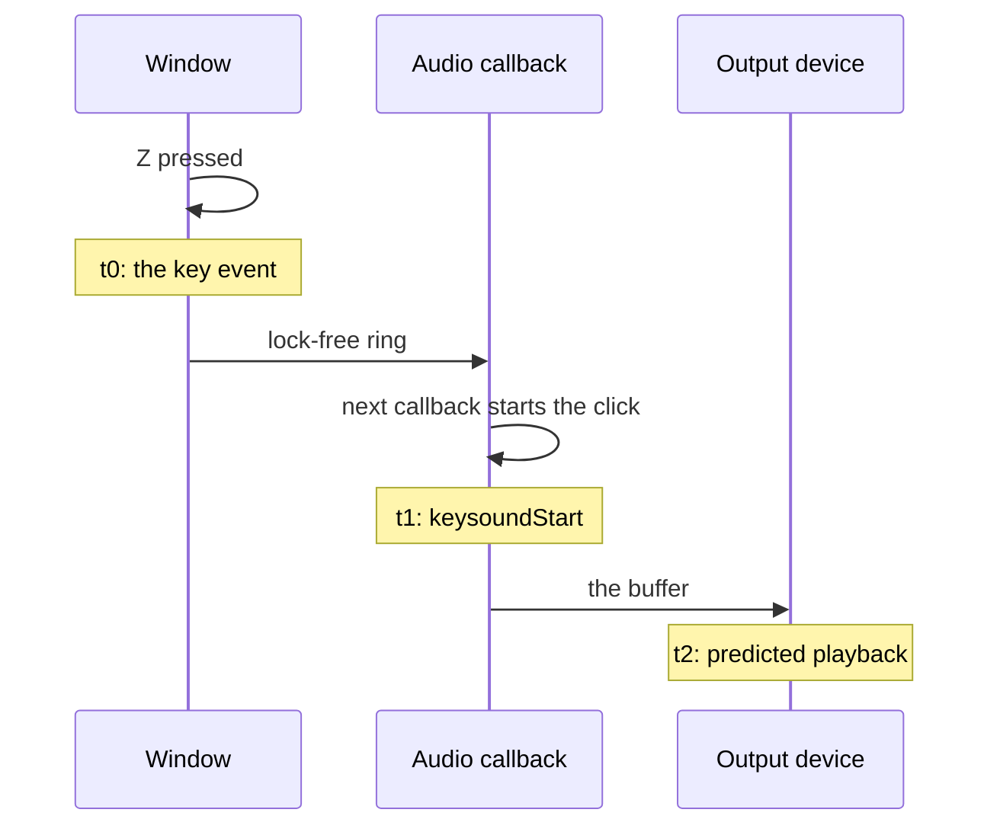

[Japanese version](./latency-native.ja.md)

# Native latency probe

The native latency probe plays a click on a key press through the shortest path the platform's audio API allows, and reports how long that path takes. It is the reference the web player's latency is compared against: what a native audio engine, such as one in a desktop build, could achieve on the same computer and output device.

The probe lives in [`scripts/latency-native/`](../scripts/latency-native/), a Rust program built on [cpal](https://github.com/RustAudio/cpal) (Core Audio on macOS, WASAPI on Windows, ALSA on Linux) and [winit](https://github.com/rust-windowing/winit).

## What it measures



- **keysoundStart** (t1 − t0) is the wait for the next audio callback, which starts the click at the buffer's first frame. It is at most one buffer period.
- **outputDelay** (t2 − t1) is the time from that callback to the predicted playback of the buffer's first frame, as the host reports it (cpal's `OutputStreamTimestamp`): the remaining buffers and the device's latency.
- **audible** is their sum: from the key event to the click at the output.

The rows match the web player's probe (`?latency-probe`), whose `audible` runs from the key event's `timeStamp` to the output, so the two can be compared directly. Neither counts the operating system's input path before the event reaches the program; the latency jig (`docs/latency-jig.md`) measures the whole path physically.

The click is the latency jig's: 1 ms at full scale on every channel. The key event and the audio callback hand presses to each other through lock-free rings, so the callback never blocks or allocates.

## Building

Install Rust with [rustup](https://rustup.rs/), then:

```bash
cargo build --release --manifest-path scripts/latency-native/Cargo.toml
```

The workflow [`latency-native.yml`](../.github/workflows/latency-native.yml) checks and builds the probe on macOS and Windows whenever it changes, and keeps each binary as an artifact (`latency-native-macos`, `latency-native-windows`).

## Running a measurement

1. List the output devices with their default sample rate and the buffer sizes they accept:

   ```bash
   scripts/latency-native/target/release/be-music-latency-native --list
   ```

2. Measure with the device's default buffer, and with smaller fixed buffers:

   ```bash
   scripts/latency-native/target/release/be-music-latency-native --device "MacBook" --auto 300 --out tmp/native-default.csv
   ```

   ```bash
   scripts/latency-native/target/release/be-music-latency-native --device "MacBook" --buffer 128 --auto 300 --out tmp/native-128.csv
   ```

   `--auto` presses from inside the program at random gaps of 300 to 800 ms, with no window. Without it, the probe opens a window: press Z, and Esc or closing the window finishes. Use the window with the latency jig, which presses Z as a USB keyboard.

3. The probe prints the distribution of each row in milliseconds when it finishes, and `--out` writes every press as CSV (`index,keysoundStartMs,outputDelayMs,audibleMs,bufferFrames`).

The click is loud: turn the volume down before measuring on headphones.

Compare like with like: the same computer, output device and sample rate as the web player's run. The first line of the output records the host, device, sample rate, format and buffer size.

## Options

| Option              | What it does                                                                     |
| ------------------- | -------------------------------------------------------------------------------- |
| `--list`            | Lists the output devices and exits                                               |
| `--device <name>`   | The output device whose name contains `<name>` (case-insensitive); else default  |
| `--buffer <frames>` | A fixed buffer size; else the host's default. The device may refuse small values |
| `--auto <presses>`  | Presses this many times from inside the program, with no window                  |
| `--out <file>`      | Writes the presses as CSV                                                        |
