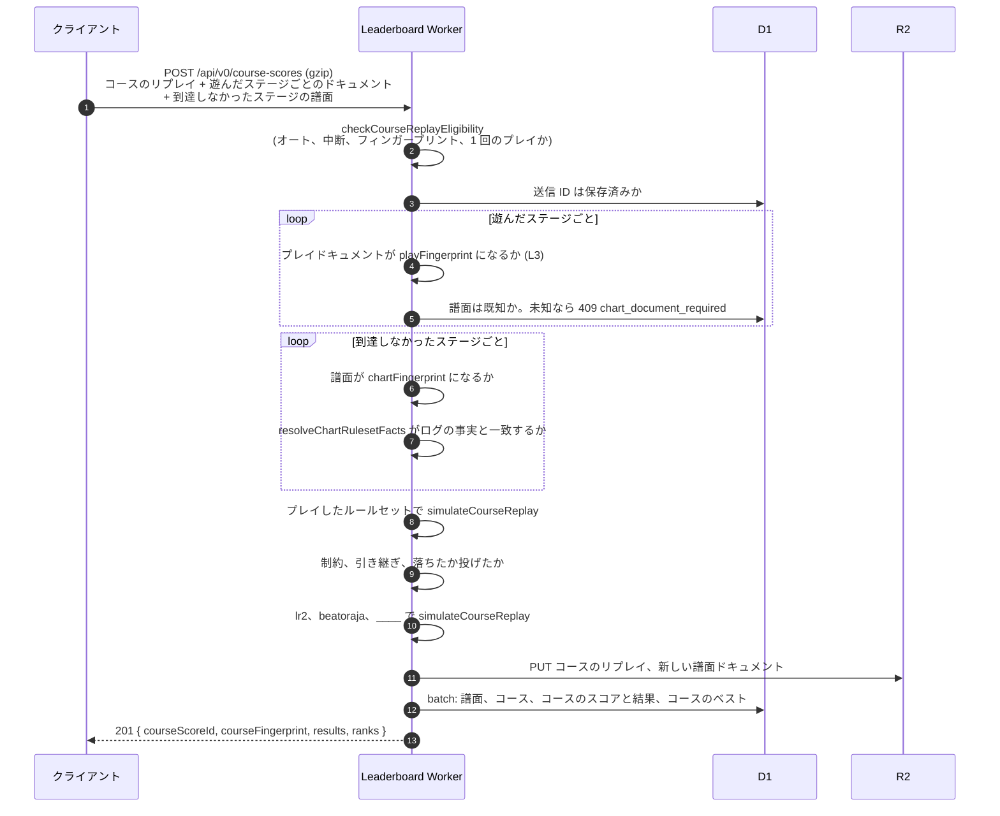
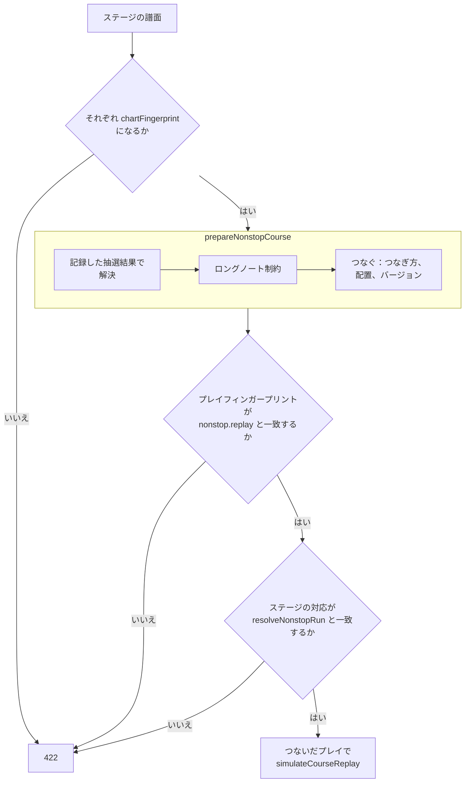

[English version](./leaderboard.md)

# Leaderboard 仕様

この仕様は `packages/app-leaderboard/src/` の実装を基準にします。運用手順は[パッケージ README](../packages/app-leaderboard/README.ja.md)、API の契約は[生成した OpenAPI](../packages/app-leaderboard/openapi.json)を参照してください。

Leaderboard は be-music のオンラインのスコアランキングで、LR2 や beatoraja が「IR」（Internet Ranking）と呼ぶ
ものにあたります。このリポジトリでは「IR」を JSON の中間表現（`@be-music/chart-source`）の意味で使っているので、
ランキングはコード・ドキュメント・UI のどこでも **Leaderboard** と呼びます。外部のものの名前（LR2IR、beatoraja
スキンの IR 系 op）はそのままの表記を使います。

## 1. 対象

譜面とコースのリプレイを検証し、`lr2`、`beatoraja`、`____` ごとに結果と自己ベストを保存します。譜面は Be-Music Fingerprint で識別します。スコア、譜面、コース、プレイヤーの公開ページとスコア共有画像を配信します。

入力が人間によるものかは保証しません。譜面や音声素材は配信しません。

## 2. 構成

構成と認証のデータフローは[サービス仕様](./services.ja.md)を参照してください。

- **実行環境**: Cloudflare Workers と D1・R2。Cloudflare から移る予定はありません。
- **フレームワーク**: Hono。API とサーバーレンダリングするページを 1 つの Worker に置き、データアクセスの関数を
  共有します。
- **パッケージ**: `packages/app-leaderboard`（private）。プレイの再計算と fingerprint の検証のために
  `@be-music/player-engine/replay` と `@be-music/chart-model` を import します。
- **型付きクライアント**: Hono RPC（`hc<AppType>`）で、`player-browser` と `player-terminal` に API の型をそのまま渡します。
- **入力検証**: Valibot と `@hono/standard-validator`。
- **ORM**: Drizzle。drizzle-kit で SQL のマイグレーションをパッケージ内に生成し、Better Auth のテーブルも同じ
  マイグレーションで管理します。
- **ホスト**（docs/services.ja.md）: Leaderboard は、ページと API を `leaderboard.be-music.app` で配信します（ページは
  ルートに置きます）。Player の Worker（`play`）が `/api/*` を Service Binding で転送するので、プレイヤーからの
  リクエストはプレイヤー自身のオリジンのままです。各アプリはホスト専用の OIDC セッションを持ち、API 向けのアクセストークンで転送します。Accounts が独立した Worker と D1 に認証を所有し、Leaderboard は公開プロフィールの参照用データとスコアを保存します。
- **CI/CD**: Deploy ワークフロー（`.github/workflows/deploy.yml`）が、`main` と `devel` への push で全サービスをデプロイ
  します（docs/services.ja.md 2 章）。
- **マイグレーションはデプロイより先に実行する**ので、どのマイグレーションも動いている旧コードと両立させます
  （追加 → 切り替え → 削除）。D1 にはロールバックがありません。
- **プレビューを本番データに触れさせない。** プレビューの Worker は preview の Leaderboard につなぎ、Leaderboard の Worker 自身のプレビュー URL は無効にします。
- **secrets**（`BETTER_AUTH_SECRET`、OAuth のクライアントシークレット）は環境ごとに設定します。値は 1Password に置き、リポジトリには `op://` の参照だけを置いて、スクリプトが `cf` で設定します（パッケージの README の「Secrets」）。
- **構成管理とツール**: `cf` CLI（`cloudflare.config.ts`）を基本にし、`cf` がまだ対応していない部分を Wrangler で
  補います。Terraform は使いません。`cf` は beta なのでバージョンを固定し、上げるときは preview で確かめてから
  にします。D1 のマイグレーションは `cf d1 migrations apply` を呼ぶ `db:migrate:*` スクリプトで適用します。

### 2.2 プランの制限

公式環境は **Workers Paid** を使います。以前の無料プランの CPU 枠は、現在の設計の前提ではありません。セルフホストでは、選んだプランと実行環境の制限を確認してください。

- **再計算**はリクエスト内で行います。検証の処理を変更するときは、gzip の展開、`parseReplay`、`simulateReplay` 3 回を regression corpus で計測します。
- **共有カードは現在ブラウザで描画**し、R2 にアップロードします（11 章）。これは現在の実装であり、公式環境のプランから必須となる制約ではありません。

## 3. 認証とアカウント

Accounts が認証、プロフィール、アバターを所有します。Leaderboard は OIDC クライアント兼 API リソースサーバーで、`(issuer, sub)` をローカルのプレイヤー ID に対応付けます。メールアドレスでアカウントを結合しません。公開プロフィールはランキング用に参照します。[サービス仕様](./services.ja.md#3-ログイン)に認証の契約を定義します。

Accounts はゲスト、パスキー、設定済みの Discord / Google を提供します。送信前にログインが必要です。ゲストを既存アカウントへ結合すると、署名されたリンク情報に基づき、次の認証済みリクエストでスコアを移します。古い handle は履歴に残り、元の所有者のために予約されます。変更した handle の URL は現在の URL へ転送します。

## 4. 譜面の識別

[Be-Music Fingerprint](./fingerprint-spec.ja.md) の `chartFingerprint` は全分岐を含む譜面を識別し、ランキングのキーになります。`playFingerprint` は実際に選ばれた分岐を識別します。譜面ファイルの SHA-256 と MD5 は別名として保存します。

`bmfp0` と `lr2/0`、`beatoraja/0`、`____/0` は開発中の定義です。互換性を壊す変更がありえ、ベータ版のランキングはリセットされる場合があります。

## 5. スコアの送信

### 5.1 クライアントが送るもの

クライアントは、すでに記録しているリプレイ（[replay.ja.md](./replay.ja.md)）を gzip して、play fingerprint の
正規化した **play document** と一緒に送ります。サーバーがまだその譜面を知らないときだけ **chart document** を
加えます。どちらのドキュメントもキー音・メタデータ・BGA を含まない正規化した JSON なので小さく、譜面ファイルその
ものでもありません。

リプレイの `recorder` フィールド（アプリ、バージョン、ビルド、エンジンのバージョン、プラットフォーム）は、それを
記録したソフトウェアを表します。さらに API のリクエストにはすべて `Be-Music-Client` ヘッダー
（`be-music-web/0.5.0 (engine 0.8.0; build 6471cd16)`）を付け、送信したソフトウェアを示します。どちらも自己申告
なので、互換性の確認と障害調査に使い、信頼の根拠にはしません。最低クライアントバージョンの制限は実装していません。

### 5.2 送信処理

[パッケージ README のフロー図](../packages/app-leaderboard/README.ja.md)に処理順を示します。認証とレート制限、入力の検証、重複判定、fingerprint の検証、3 ルールセットでの再計算、R2 と D1 への保存の順に進みます。

同じプレイを同じアカウントが再送すると保存済みの結果を返し、別アカウントからの再送は拒否します。未知の譜面には chart document が必要です。R2 への書き込み後に D1 を更新します。共有画像はスコア送信とは別の API でアップロードします。

### 5.3 検証レイヤー

- L1: 入力から結果を再計算し、リプレイの結果キャッシュは使いません。
- L2: AUTO を拒否し、アシストを分類します。テンポ変更と単独のコースステージはランキング対象外として保存し、ESC 中断は失敗として順位付けします。
- L3: play document と、登録時の chart document が申告した fingerprint と一致するか確認します。
- L4: chart と play の fingerprint が同一、または検証済みの play fingerprint と一致する場合に成立します。新しい制御構文の分岐結果の合成は未実装です。

L5（リプレイのノーツと play document の時刻の同値性）と、入力の異常検知は未実装です。実装は `src/scores/played-chart.ts` を参照してください。

## 6. スコアのルール

**送るもの。** 送信はオプトインです。プレイヤーが有効にするまで、Leaderboard には何も送りません。有効にした後は、二人用プレイ（COUPLE・TWO-PLAYER）、完全な AUTO プレイとリプレイの再生（ドロップしたリプレイ、リプレイスロット、コースのリプレイ）を除くすべてのプレイを送ります。表示するかどうか、どこに表示するかはプレイヤーではなく Leaderboard が決めます（#788）。部分的なアシスト（オートスクラッチなど）は送り、別に順位付けします。Leaderboard が保存はしても順位付けしないプレイも、それを分類するための情報をリプレイに載せて送ります（`play.tempo`、`play.course`、オプション、アシスト）。フィンガープリントがそろっていないログは検証できないため拒否します。二人用録画も `two-player` で拒否し、二人分の結果をローカルに保持します。合算・片側の譜面を一人用ランキングには載せません。

手動プレイでシークすると練習扱い（`PlayResult.practice`）になります。最初のシークでリプレイの記録を破棄し、beatoraja の PRACTICE もリプレイを記録しないので、どちらも送るリプレイがありません。ホストがリプレイデータも渡した場合を含め、Web アプリはその結果のベスト記録更新・Leaderboard 送信・リプレイ自動保存を行いません。コースのステージや NONSTOP でシークすると、コース全体と後続ステージも対象外になります。リプレイがなくてもコース結果は表示できます。練習のプレイを送るには練習範囲をリプレイに記録する必要があり、後の変更に回します。

- **3 つのルールセット。** すべてのプレイを `lr2`、`beatoraja`、`____` で計算し直し、3 つのランキングすべてに
  載せます。実際にプレイしたルールセット（`play.judgeRuleset`）を保存して印として表示し、「このルールセットで
  プレイしたもの」だけに絞り込めるようにします。
- **ゲージ**はリプレイと同じ規則でルールセット間を対応させます（`GROOVE` は beatoraja の `NORMAL`、`DEATH` は
  `HAZARD`、など）。
- **アシスト**はオプションの参照元で区分し（`classifyReplayAssists`、[アシストと記録の方針](./play-options.ja.md#アシストと記録の方針)）、フラグを付けて保存します。
  `light` と `assist` のプレイはアシストなしのプレイとは別に順位付けします。各ルールセットでは、そのルールの規則で
  ランプを制限します（`lr2` は EASY まで、`beatoraja` は LIGHT ASSIST EASY か ASSIST EASY、`____` は ASSIST EASY）。
  `no-save` のプレイ（`____` ルールの BATTLE、beatoraja の PRACTICE）は `no-save` としてランキング対象外で保存します。
  ランプは追加専用の番号で保存し（LIGHT ASSIST EASY は 10）、番号ではなくランプの順序で比べます。
- **ランキング対象外のプレイ**は保存し、すべてのルールセットで計算し直して数値を返します（順位とプレイヤー数は 0、
  理由は `unranked`）。ただし自己ベストは動かさず、ランキング・集計・すべてのリストから外れます。プレイのページは
  開け、理由を表示します（`score.unranked`）。単独で送った**コースのステージ**はこれに当たります（`course-stage`）。
  ステージは前のステージが残した状態から始まるので、単曲のプレイではありません。代わりにコースのプレイの一部として
  ランキングに載ります（6.1 節）。**テンポを変えたプレイ**（`tempo`。`play.tempo` が 1 以外。Web プレイヤーの
  テンポスライダー）も同じです。beatoraja の周波数トレーナーがスコアを保存しないのと同じく、練習として扱います。
  **落ちたプレイ**（ゲージが尽きたもの）
  は保存し、プレイ回数に数えます。**ESC で投げたプレイ**（`play.aborted`）も同じです。LR2 と beatoraja が保存するのと
  同じく、途中で投げたプレイはゲージの値に関係なく、どのルールセットでも落ちたプレイとして順位付けします。
- **ランプと BP はルールセットごとに各ゲームに従います**: `lr2` では DEATH でのクリアは NORMAL です（LR2body.exe の
  `CheckClear`）。beatoraja と 名前を言ってはいけないあのゲームでは DEATH（`HAZARD`）のクリアは EX HARD です。BP には LR2 も含めどのルールセットでも
  空 POOR を数えます。この規則より前に保存された `lr2` の結果は、マイグレーション `0012` で書き直しました。BP には、途中で落ちたり ESC で投げたりして判定されなかったノートも両ゲームと同じく数えます（#584）。この規則より前に保存された BP はそのままです。
  ランプと BP はどのクライアントとも同じ規則で決めます（`@be-music/player-engine/replay` の `resolveRulesetResultLamp` と `resolveRulesetResultMissCount`、`@be-music/player-engine/ruleset` の `resolveClearLamp` と `resolveMissCount`）。フルコンボにはすべてのノートが GOOD 以上である必要があるので、ノートのない譜面はゲージのランプになります。ランプはその順位（`clearLampRank`）で保存します。1 FAILED、2 ASSIST EASY、3 EASY、4 NORMAL、5 HARD、6 EX HARD、7 FULL COMBO、8 PERFECT、9 MAX です。
- **自己ベストは beatoraja 方式**: EX スコア、クリアランプ、ミス数のベストを別々に持ち、それぞれ達成したスコアを
  指します。各ベストは対応するスコアとリプレイを参照できます。ミス数は、クリア・失敗・ESC 中断のいずれも対象にします。
- **スコアの履歴**: 送信はすべて保存するので、推移のグラフや「伸びた譜面」の一覧はそのまま作れます。
- **プレイの非表示**: プレイヤーは自分のプレイを非表示にでき（`PATCH /api/v0/scores/:id`）、表示に戻すこともできます。
  非表示のプレイは保存したまま、ランキング・自己ベスト（表示中のプレイから作り直します）・集計・すべてのリストから外れ、
  開けるのはそのプレイヤーだけです。
- **並べ替え**: 譜面のランキングはベスト EX スコア、達成時刻、handle の順です。
- **同点**は同じ順位にします（1 位、1 位、3 位）。同順位の中では先に達成した人を上に表示しますが、順位の数字は
  同じです。

### 6.1 コースのランキング

コースのプレイ（段位認定、EXPERT / NONSTOP コース、beatoraja のコース、難易度表のコース）は、1 回のプレイとして
ルールセットごとのランキングに載せます。単曲のプレイとしては扱いません。

- **コースの識別。** コースは **コースのフィンガープリント**（`bmcourse0:<sha256>`、`@be-music/player-engine/replay` の
  `computeCourseFingerprint`）で表します。コースの種類、制約（正規化して並べ替えたもの）、各ステージの譜面
  フィンガープリントを順に並べたもの、NONSTOP コースではさらに結合譜面を決めるつなぎ方と配置モードから作ります。名前とトロフィーは含めないので、`.lr2crs`、beatoraja の
  コースファイル、難易度表のどれから読んだコースでも、譜面が同じならランキングは 1 つです。ランダムコースは抽選した
  ステージで表します。落ちたプレイにもキーがつきます。コースのリプレイは、到達しなかったステージの譜面
  フィンガープリントも持つからです（[replay.ja.md](./replay.ja.md#コースのリプレイ)）。
- **クライアントが送るもの。** コースのリプレイ（`be-music-course-replay`）を gzip し、遊んだステージごとのプレイ
  ドキュメント（サーバーがまだ知らない譜面なら譜面ドキュメントも）と一緒に `POST /api/v0/course-scores` へ送ります。
  さらに、サーバーが自分で作り直すステージの **ステージの譜面**（`stageCharts`。読み込んだままの解析済みの譜面で
  `#RANDOM` を含み、`.pms` かどうかも添える）を送ります。対象は到達しなかったステージすべてと、NONSTOP のプレイの
  全ステージ（NONSTOP ではドキュメントを送らない）です。フィンガープリントのドキュメントからはノート数を数えられず、
  つなぐこともできないので、これらのステージには譜面そのものが要ります。サーバーはプレイの検証に読むだけで、保存
  しません。冪等性、レート制限、サインイン、サイズの上限は単曲と同じです。送信 ID は、コースのフィンガープリントと、
  遊んだステージそれぞれを単曲の送信 ID と同じ方法で表したもののハッシュです（NONSTOP ではつないだプレイを使う）。
- **検証。** 遊んだステージはそれぞれ単曲と同じ確認を通ります（5.2 節と 5.3 節: オートプレイの拒否、
  フィンガープリントのドキュメント、譜面の登録、outcome の合成）。ここではコースのステージであることが条件で、拒否の
  理由にはなりません。ステージはすべて同じルールセットで判定され、コースの制約（ゲージ表、判定の制約、コースが許す
  レーンオプション）に従い、前のステージを計算し直して残った状態（ゲージ、コースのコンボ、コースの最大コンボ。最初の
  ステージは何も引き継がない）をそのまま引き継いでいる必要があります。プレイは `simulateCourseReplay` で `lr2`、
  `beatoraja`、`____` の下で計算し直し、クライアントがキャッシュした結果は使いません。
- **到達しなかったステージ。** そのノートは BP に数えるので、ノート数をクライアントの申告に任せません。到達しなかった
  ステージの譜面は必須で（`stage-chart-required`）、ログがそのステージに記録した譜面フィンガープリントになる必要が
  あり（`stage-chart-fingerprint-mismatch`。これがコースのキーにもなる）、クライアント自身が使う
  `resolveChartRulesetFacts` で求めた事実（ノートの内訳、LN モード、レーンモード、形式）が、ログの事実と一致する必要が
  あります（`course-stage-facts-mismatch`）。サーバーが譜面を知っているかどうかにかかわらず同じ規則です。サーバーが
  持つのはフィンガープリントのドキュメントで譜面ではなく、ドキュメントからはエンジンと同じようにノートを数えられない
  からです。
- **落ちたプレイと投げたプレイ。** ステージで落ちたプレイは、単曲の落ちたプレイと同じく保存してランキングに載せます。
  到達しなかったステージのノートは BP に数えます。ESC で投げたプレイも、LR2 の記録と同じく落ちたプレイとして扱います。
  最後に遊んだステージは `play.aborted` を持っていてよく、ゲージにかかわらず落ちたことになり、そのステージの残りと
  到達しなかったステージのノートを BP に数えます。それより前のステージの ESC 中断は、これまでどおり `aborted` として
  拒否します。
- **テンポを変えたプレイは順位付けしません。** コースも単曲と同じくテンポを変えて遊べますが、そのプレイは単曲と
  同じく `tempo` としてランキング対象外で保存します（どのステージでも。NONSTOP ではつないだプレイを見ます）。
  コースのベストは動かさず、コースのランキングとすべてのリストから外れます。
- **公開されていないコースは順位付けしません。** beatoraja の `release: false` のコース（抽選したランダムコースと
  コースメーカーで作ったコースもこれに当たります）は、コースのログにそのことを記録し（`course.release: false`）、beatoraja が IR に送らないのと
  同じく `unreleased` としてランキング対象外で保存します。
- **アシストを使ったプレイは順位付けしません。** アシストを受けたステージ（`none` 以外の区分）があるプレイは
  `assist` としてランキング対象外で保存します。LR2 はアシストを使ったステージを保存せず、beatoraja はアシストを
  使ったコースを保存しません。
- **NONSTOP のプレイ。** NONSTOP コースはつないだ 1 本の譜面として遊び、判定して順位を付けるのはそのプレイ
  （`nonstop.replay`）です。サーバーはステージの譜面から、クライアントとまったく同じようにつないだ譜面を作り直し
  ます。両者は同じ決定的な処理（`@be-music/player-engine/course` の `prepareNonstopCourse`。
  [コースと段位認定](./course.ja.md#nonstop-コース) を参照）を使います。各ステージの譜面はそのステージの譜面
  フィンガープリントになる必要があり、ステージが記録した `#RANDOM` の抽選結果（`nonstop.stages[].randomDraws`）で
  解決し、コースの LN 制約を当て、記録したつなぎ方・配置・結合規則のバージョン（`nonstop.stitch`。ないときはバージョン 1。
  サーバーの知らないバージョンは `nonstop-stitch-unsupported`）でつなぎます。つないだプレイはその譜面で記録されたもの
  でなければならず（プレイフィンガープリントが作り直した譜面のものと一致する。`nonstop-chart-mismatch`）、ステージの
  対応も作り直したもの（`resolveNonstopRun`）と一致する必要があります。ステージの配置、各ノーツのステージ、プレイが
  到達したステージ数です（`nonstop-stage-mismatch`）。つないだプレイは単曲と同じ対象確認を通り、コースの制約に従う必要があります。すべての
  ルールセットで計算し直し、ESC で投げたプレイは落ちたプレイとします。ほかのコースと同じくコースのフィンガープリント
  でランキングに載せます。NONSTOP のプレイはステージの譜面を登録しません。切り出したステージが持つ判定ランクと TOTAL
  はつないだプレイのもので、各譜面のものではないからです。
- **数値とベスト。** ルールセットごとに EX スコア、ランプ（コースのランプを譜面のランプと同じ尺度にしたもの）、BP、
  コース全体の最大コンボ、到達したステージ数、トロフィーを持ちます。到達したステージごとの数値（EX スコア、ノーツ数、
  BP、最大コンボ、判定、次のステージに引き継いだゲージ、クリアしたかどうか）も持ち、プレイのページはこれでステージ
  ごとに分けて表示します。ベストは譜面と同じく beatoraja 方式（EX スコア、ランプ、BP のベストを別々に持ち、それぞれ
  達成したプレイを指す）で、アシストありのプレイは別に持ちます。コースのプレイは譜面のスコアも譜面のベストも作りません。
- **トロフィーのベスト。** ほかのベストと一緒にトロフィーのベストを持ち、獲得したプレイを指します。コースの定義は
  トロフィーを易しい順に並べ、プレイは条件を満たす最後のトロフィーを獲得します。そこで各プレイのトロフィーを、その
  一覧での位置（`trophy_rank`。先頭が 1、なしは 0）と一緒に保存し、位置が真に上回ったときだけベストを置き換えます。
  同じ位置なら先のプレイを残します。名前とトロフィーはコースのフィンガープリントに含まれないため、同じコースの二つの
  定義が違うトロフィーを並べることもありえますが、位置はそのまま比べます。
- **非表示のプレイ。** プレイヤーは自分のコースのプレイを非表示にでき（`PATCH /api/v0/course-scores/:id`）、表示に
  戻せます。単曲のプレイと同じく、非表示のプレイは保存したまま、コースのランキング・ベスト（表示中のプレイから作り
  直し、トロフィーのベストも含む）・集計・すべてのリストから外れ、プレイヤー本人だけがそのプレイとリプレイを開けます。
- **リプレイ。** `GET /api/v0/course-scores/:id/replay` は保存したコースのリプレイを、保存したとおり gzip 圧縮で
  返します。コースのプレイには独自のリプレイ設定がなく、表示中のプレイのログは誰でも、非表示のプレイのログは本人だけが
  読めます。

NONSTOP のプレイでは、ステージごとのループの代わりに、つないだ譜面を 1 回作り直します。

## 7. データモデル（D1）

D1 の正本は [`src/db/schema.ts`](../packages/app-leaderboard/src/db/schema.ts) です。譜面・別名・楽曲グループ、スコアとルールセット別結果、各自己ベスト、コースと結果、ローカルのユーザー・公開プロフィール・OIDC 対応を保持します。Accounts の認証データと公開プロフィールの所有は[サービス仕様](./services.ja.md)に従います。

- ランキングの取得には `best_scores (chart_fp, ruleset, assisted, best_ex DESC)` のインデックスを使います。
- 譜面は、匿名でないプレイヤー 2 人以上がプレイしたか（匿名アカウントはいくらでも作れるので数えません）、難易度表に
  載った時点で**公開一覧に載ります**。
- **chartset** は 1 作品の譜面（同梱譜面と差分）をまとめる単位です。まとめ方は BMS Search（https://bmssearch.net）に従います。BMS Search では運営者が譜面を、ファイルの SHA-256 か MD5 で、作品へ手作業で紐付けています。`chartset.id` は BMS Search の作品 ID です。結果は `chart.chartset_id` と `chart.pack_type`（同梱か差分か）に、問い合わせた時刻は `chart.chartset_checked_at` に保存します。
  - 初めて見た譜面は、送信の直後に問い合わせます（`waitUntil`）。
  - 1 時間ごとの Cron Trigger で、最大 20 譜面を問い合わせます。未確認の譜面を先に、次に紐付けのない譜面を前回から 1 週間後、紐付け済みの譜面を 1 か月後に確認し直します。紐付けは後から追加・変更されることがあるためです。
  - BMS Search が知らない譜面や、まだ紐付けのない譜面は単独のままです。問い合わせの `User-Agent` で Leaderboard からのアクセスだと分かるようにしています。
- R2 は単曲・コースのリプレイと正規化した譜面ドキュメントを gzip した JSON（`Content-Encoding: gzip`）で保存します。スコア共有画像は圧縮しません。リプレイのダウンロード時はルートで権限を確認します。ゴーストの保存と API は未実装です。

## 8. API（`/api/v0`）

リクエストの Valibot スキーマから OpenAPI 3.1 を生成します。`GET /api/v0/openapi.json` と `/api-reference` で参照できます。次のパスは `/api/v0` からの相対パスです。

| メソッド         | パス                                          |
| ---------------- | --------------------------------------------- |
| `GET` / `PATCH`  | `/me`                                         |
| `PUT` / `DELETE` | `/me/avatar`                                  |
| `POST`           | `/scores`                                     |
| `GET` / `PATCH`  | `/scores/{id}`                                |
| `PUT`            | `/scores/{id}/card`                           |
| `GET`            | `/scores/{id}/replay`                         |
| `GET`            | `/charts/{chartFingerprint}/leaderboard`      |
| `GET`            | `/charts/{chartFingerprint}/leaderboard/me`   |
| `POST` / `GET`   | `/course-scores`                              |
| `GET` / `PATCH`  | `/course-scores/{id}`                         |
| `GET`            | `/course-scores/{id}/replay`                  |
| `PUT`            | `/course-scores/{id}/card`                    |
| `GET`            | `/courses/{courseFingerprint}`                |
| `GET`            | `/courses/{courseFingerprint}/leaderboard`    |
| `GET`            | `/courses/{courseFingerprint}/leaderboard/me` |

`v0` は開発中の API で、非互換の変更がありえます。未知の `/api/*` は `404` と `{"error":"not-found"}` を返します。`/api/auth/*` はバージョンを付けない OIDC セッション用エンドポイントです。送信はユーザー ID をキーに `SUBMIT_LIMITER` で制限し、超過時は `429` と `Retry-After: 60` を返します。具体的な制限値は `cloudflare.config.ts` が定義します。

## 9. ライバル、ターゲット、ゴースト

Leaderboard のライバル、ターゲット、ゴースト API は未実装です。スキンに表示枠があっても、サーバーの対応を意味しません。

## 10. ページ（`leaderboard.be-music.app`）

leaderboard Worker の中で Hono JSX によってサーバーレンダリングし、D1 を直接読みます。見た目は情報サイトとして、
Tailwind CSS v4 と Basecoat（フレームワークのランタイムなしの shadcn/ui デザイン）で整え、OS の配色に従います。

- `/` — 最新のスコアとコースのプレイ。匿名プレイヤーと未掲載譜面のフィルターを持ちます。
- `/scores/:id` — スコア
- `/chartsets/:id` — 1 作品の譜面一覧（同梱譜面、次に差分）
- `/charts/:chartFp` — 譜面のランキング、プレイ数とランプの分布、譜面の詳細（モード、TOTAL、判定ランク、LN モード、ファイルハッシュ）
- `/players/:handle` — プロフィールとプレイヤーの統計（プレイ数、譜面数、平均スコアレート、自己ベストのランプと DJ Rank の分布）、最新のプレイとコースのプレイ。
- `/courses/:courseFp` — コースのランキング（各プレイヤーのベスト EX スコア、ランプ、BP、トロフィー。アシストありのプレイと匿名プレイヤーは譜面のページと同じスイッチで切り替え）、譜面のページへリンクしたステージ、プレイ数とランプの分布、詳細（種類、制約）。アカウントを持つプレイヤーが誰も遊んでいないコースは検索エンジンに載せません
- `/course-scores/:id` — コースのプレイをすべてのルールセットで（到達したステージ数、トロフィー）、表示ルールセットでステージごとに（判定、BP、各ステージが引き継いだゲージ、到達しなかったステージ）表示し、リプレイと、本人には非表示にするスイッチを付けます。トップページはプレイの下に最新のコースのプレイを並べます

どのページも、ヘッダーで選んで Cookie に保存する 1 つの**表示ルールセット**（LR2、beatoraja、名前を言ってはいけないあのゲーム）で値を表示し、
プレイ自体のルールセットは「played with」として併記します。切り替えは専用の URL（`/ruleset/:id?next=…`。
戻り先は Leaderboard のページに限る）で行うので、ページの URL を共有しても、開いた人の設定は変わりません。ページが
Cookie に依存するので、`Cache-Control: private, max-age=0` を返します。譜面のページには、既知のファイルごとに、BMS Search 自身が使う形式で他のサイトへのリンクを置きます。ファイルの
SHA-256 で Mocha-Repository、MinIR、BMS Search（`/patterns/{sha256}`）を、MD5 を記録するようになれば LR2IR を
引きます。ハッシュが 1 つも分からない譜面には、BMS Search での曲名検索を置きます。

ブラウザー側の動作は、htmx 4 を同梱した 1 つのクライアントスクリプト（`client/main.ts`）が担います。フィルターのスイッチ、譜面のページのファイル選択、ルールセットのメニューは通常のリンクのままで、htmx が同じページを取得し、`<main>` とヘッダーだけを表示中のページへモーフィングで差し替えます（`src/pages/partial-swap.ts`）。スクロール位置、フォーカス、開いているポップオーバーは保たれ、フィルターの URL は履歴に積みます（ルールセットの切り替えは積みません）。サインアウト、プレイの非表示、プロフィールの保存も、再読み込みせずに同じ方法でページを更新します。スクリプトがなければ、リンクは従来どおりページを移動します。

## 11. OG 画像と共有

スコア共有画像はブラウザーの Canvas 2D で描画します（`client/score-card.ts`）。1200 × 630 のカードを `PUT /api/v0/scores/:id/card` で送信し、`/scores/:id/card` で配信します。画像がなければサイトの既定画像を返します。

アップロードはスコアの所有者に限定します。空のデータ、512 KiB を超えるデータ、未対応の画像形式を拒否します。PNG、WebP、JPEG を判別し、`cards/scores/{scoreId}/{hash}.{extension}` に保存します。URL のバージョンは内容のハッシュに由来し、古い画像は差し替え時に削除します。

カードはタイトル、アーティスト、レベル、ランプ、スコア、判定、順位、ルールセット、プレイヤーと日付を表示します。譜面ドキュメントが利用できる場合は密度の高い区間を描き、対応できない場合は装飾用ノーツを使います。重要な内容は各辺から 24 px、角の 48 px 四方と左下のラベル領域を避けます。レイアウトは `src/pages/share-card-safe-area.ts` とそのテストが定義します。

画像はクライアントが作るため、スコアの検証には使いません。コースの共有画像もブラウザーで生成します（`client/course-card.ts`）。`PUT /api/v0/course-scores/{id}/card` で送信し、`/course-scores/{id}/card` で配信します。右側にはプレイフィールドの代わりにステージ名、スコアレート、クリア・失敗・未到達を表示し、5 行を超える分は残り件数にまとめます。見出しにはコース種別、到達ステージ数、トロフィーを表示します。

## 12. モデレーション

スコアとコースの所有者は自分の結果を非表示にできます。管理画面、通報 API、入力の異常検知は未実装です。

## 13. テスト

- **純粋関数**（検証、順位付け、カードのレイアウト用のデータ）は通常どおりテストします
  （AGENTS.md を参照）。
- **API**: Hono の `app.request()` で、サーバーを起動せずにリクエストを最初から最後まで通します。D1 と R2 の
  binding は **Miniflare**（`getD1Database()` / `getR2Bucket()`）から渡すので、マイグレーションとクエリは workerd の
  本物の SQLite で動きます。これは通常の `vp test` の中で動きます。

- Workers にだけある挙動と CPU の制限は、これらのテストでは確かめられません。CPU 時間は別に計測します。

## bmson TOTAL 0 の任意設定

プレイ設定 `bmsonTotalMode` の既定は `beatoraja`。`spec` は正規化済み百分率 TOTAL 0 で正の回復だけを抑制する。Browser の Play options に **bmson TOTAL 0**、Terminal に `--bmson-total-mode spec` を用意する。型付き replay 値を優先し、省略時は再生側の選択にかかわらず互換動作を保つ。影響を受ける手動プレイ・コースは `unranked: 'bmson-total'` として保存・シミュレーションし、通常のベスト記録・ランキングを更新しない。正の TOTAL で設定を選ぶだけなら従来どおり比較する。ダメージ・開始 HP・引継ぎ・chart fingerprint は変わらない。[ADR 0030](./adr/0030-bmson-zero-total.ja.md) を参照。
