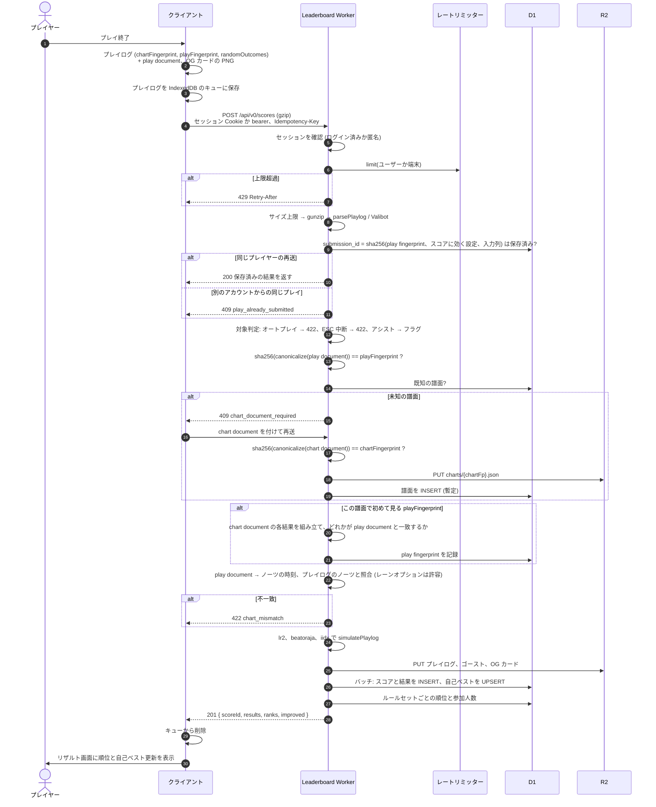

[English version](./leaderboard.md)

# Leaderboard 設計

> ステータス: P0 の中核は [`packages/leaderboard-api`](../packages/leaderboard-api/README.ja.md) に実装済みです（認証、
> 検証の層 L1〜L3 付きの送信（`#RANDOM` のない譜面では L4 も）、3 つのルールセットでの再計算、ランキングの API）。
> それ以外はまだ設計段階です。このドキュメントは、これまでに決めたことと、まだ決まっていないこと（15 章）を記録します。

Leaderboard は be-music のオンラインのスコアランキングで、LR2 や beatoraja が「IR」（Internet Ranking）と呼ぶ
ものにあたります。このリポジトリでは「IR」を JSON の中間表現（`@be-music/json`）の意味で使っているので、
ランキングはコード・ドキュメント・UI のどこでも **Leaderboard** と呼びます。外部のものの名前（LR2IR、beatoraja
スキンの IR 系 op）はそのままの表記を使います。

## 1. 目的と対象外

目的:

- 譜面ごとに、3 つの互換ルールセット（`lr2`、`beatoraja`、`iidx`）それぞれでプレイを順位付けする。
- クライアントではなくサーバーを信頼する。クライアントはプレイログを送り、結果はサーバーが計算し直す。
- 譜面を内容で識別し（Be-Music Fingerprint）、保存し直したもの・文字コードを変えたもの・変換したものが同じ
  ランキングを共有するようにする。
- 選曲・プレイ・リザルト画面でのライバル、ターゲット、ゴースト。OG 画像付きで共有できるスコアページ。

対象外:

- あらゆる不正を防ぐこと。捏造した入力（bot や TAS）は人間の入力と確実には区別できません。これはプロトコルでは
  なく、異常検知とモデレーション（12 章）で扱います。
- 譜面や音声ファイルの配信。サーバーが保存するのは、正規化した fingerprint のドキュメントとプレイログだけです。

## 2. 構成

```
player-web（ブラウザ）─┐                      ┌─ D1: users / charts / scores / best_scores / rivals ...
player-tui（CLI）─────┼─ HTTPS ─→ be-music-player-demo Worker ─(Service Binding)→ be-music-leaderboard Worker
                      │            /api/*          → Hono の API      └─ R2: プレイログ、譜面ドキュメント、ゴースト、OG 画像
                      │            /leaderboard/*  → Hono JSX のページ
```

- **実行環境**: Cloudflare Workers と D1・R2。Cloudflare から移る予定はありません。
- **フレームワーク**: Hono。API とサーバーレンダリングするページを 1 つの Worker に置き、データアクセスの関数を
  共有します。
- **パッケージ**: `packages/leaderboard-api`（private）。プレイの再計算と fingerprint の検証のために
  `@be-music/player/playlog` と `@be-music/chart` を import します。
- **型付きクライアント**: Hono RPC（`hc<AppType>`）で、`player-web` と `player-tui` に API の型をそのまま渡します。
- **入力検証**: Valibot と `@hono/standard-validator`。
- **ORM**: Drizzle。drizzle-kit で SQL のマイグレーションをパッケージ内に生成し、Better Auth のテーブルも同じ
  マイグレーションで管理します。
- **同一オリジン**: プレイヤーのデモの Worker（`be-music-player-demo`） が `/api/*` と `/leaderboard/*` を Service Binding で
  leaderboard Worker に転送します。leaderboard Worker は自分の公開 URL を持たない（`workers_dev: false`、
  `preview_urls: false`）ので、ページ・API・セッションの Cookie はプレイヤーと同じオリジンになり、CORS は不要です。

### 2.1 環境とデプロイ

| ブランチ         | Leaderboard の Worker          | D1 / R2                            | プレイヤーのデモ                                     |
| ---------------- | ------------------------------ | ---------------------------------- | ---------------------------------------------------- |
| `devel`          | `be-music-leaderboard`         | 本番                               | `be-music-player-demo` にデプロイ                    |
| それ以外のすべて | `be-music-leaderboard-preview` | preview 用のデータベースとバケット | ブランチごとに `be-music-player-demo` のプレビュー版 |

- **CI/CD**: Workers Builds。本番ブランチが `devel` のプレイヤーのデモに合わせます。それ以外のブランチは、それぞれのプレビュー URL を持つプレビュー版としてアップロードします（`wrangler versions upload --env preview`）。プレビュー版はバージョンごとに binding を持つので、preview の Leaderboard につながります。preview の Leaderboard は全ブランチで共有する 1 つの Worker で、最後のデプロイが反映されます。
- **マイグレーションはデプロイより先に実行する**ので、どのマイグレーションも動いている旧コードと両立させます
  （追加 → 切り替え → 削除）。D1 にはロールバックがありません。
- **プレビューを本番データに触れさせない。** デモのプレビュー版は preview の Leaderboard につなぎ、Leaderboard の Worker 自身のプレビュー URL は無効にします。
- **secrets**（`BETTER_AUTH_SECRET`、OAuth のクライアントシークレット）は環境ごとに設定します。値は 1Password に置き、リポジトリには `op://` の参照だけを置いて、スクリプトが `cf` で設定します（パッケージの README の「Secrets」）。
- **構成管理とツール**: `cf` CLI（`cloudflare.config.ts`）を基本にし、`cf` がまだ対応していない部分を Wrangler で
  補います。Terraform は使いません。`cf` は beta なのでバージョンを固定し、上げるときは preview で確かめてから
  にします。`cloudflare.config.ts` と並べて `wrangler d1 migrations apply` が使えるかは検証が要ります（15 章）。

### 2.2 プランの制限

Leaderboard は **Workers の無料プラン**で始め、必要になったら有料プランに移ります。無料プランは 1 リクエスト
あたり CPU 10 ms、Worker のサイズは圧縮後 3 MB までです。これが 2 つの判断を決めています。

- **再計算**（gzip の展開、`parsePlaylog`、`simulatePlaylog` 3 回）は、ノーツの多い譜面で 10 ms を超えるおそれが
  あります。API を作る前に regression corpus で計測します（15 章）。検証の処理は、その場で実行するか後で実行するか
  を切り替えられる形で書き、有料プランへの移行が設定の変更だけで済むようにします。
- **OG 画像はブラウザで描画します**（11 章）。サーバーで描画する方式（satori + resvg と日本語フォント）は、どちらの
  制限にも収まりません。

## 3. 認証とアカウント

- **ライブラリ**: Hono と D1 の上で Better Auth を使います。
- **ログイン手段**: Discord と Google の OAuth、およびプロバイダに依存しない手段としての passkey。プロバイダは後から
  増やすかもしれません。GitHub は検討したうえで採用しませんでした。
- **セッション**: ブラウザでは同一オリジンの HttpOnly Cookie。ターミナル版のプレイヤーはデバイス認可フロー
  （RFC 8628）を使い、bearer トークンを保存します。
- **匿名でのプレイ**: ログインしなくてもスコアを送れます。Better Auth の匿名セッションが匿名ユーザーを作り、後から
  Discord や Google のアカウントに紐付けられます。匿名のスコアもほかと同じように保存し、ランキングに含めるかどうか
  は閲覧する側のフィルタで選びます。passkey を登録したアカウントは、ログインし直す手段を持つので通常のアカウントに
  なります。匿名セッションのまま passkey でログインすると、そのセッションのプレイは passkey のアカウントに移ります。
- **handle**: すべてのアカウントが、一意で変更できる `handle`（URL に使う）と `display_name` を持ちます。OAuth の
  プロフィール名やメールアドレスは表示しません。変更した handle は旧 URL からのリダイレクトを残し、手放された
  handle はしばらくのあいだ他人が取れないようにします（15 章）。
- **退会**するとスコアは削除せず匿名化します。匿名のスコアと同じく、閲覧する側が含めたときだけランキングに
  出ます。
- OAuth のメールアドレスを預かるので、**利用規約とプライバシーポリシー**が必要です。

## 4. 譜面の識別

譜面は **Be-Music Fingerprint**（[fingerprint-spec.ja.md](./fingerprint-spec.ja.md)）で識別します。

- **`chart.chartFingerprint`** はすべての `#RANDOM` / `#SWITCH` の枝を含むので、同じ譜面のプレイはすべて同じ値を
  持ちます。譜面のランキングのキーです。
- **`chart.playFingerprint`** は 1 回のプレイで引いた枝を表します。何を遊んだかを識別し、検証とゴーストの対応付けに
  使います。
- **別名**: 譜面ファイルの SHA-256 と MD5 を、chart fingerprint への多対一の別名として持ちます（`chart_aliases`）。
  LR2IR と難易度表が使うキーです。Web Crypto には MD5 がないので、`@be-music/chart` の SHA-256 の隣に、テスト付きの
  小さな MD5 を追加します。

**開発用のバージョン。** fingerprint のバージョンは `bmfp0`、ルールセットの結果 ID は `lr2/0`、`beatoraja/0`、
`iidx/0` です。`0` は定義がまだリリース間で変わりうることを表します。そのため `bmfp0` をキーにするランキングは
すべて暫定です。UI では Leaderboard をリセットされうるベータ版と表示し、`bmfp1` に移るときはデータを捨てることが
あります（15 章）。

## 5. スコアの送信

### 5.1 クライアントが送るもの

クライアントは、すでに記録しているプレイログ（[playlog.ja.md](./playlog.ja.md)）を gzip して、play fingerprint の
正規化した **play document** と一緒に送ります。サーバーがまだその譜面を知らないときだけ **chart document** を
加えます。どちらのドキュメントもキー音・メタデータ・BGA を含まない正規化した JSON なので小さく、譜面ファイルその
ものでもありません。

プレイログの `recorder` フィールド（アプリ、バージョン、ビルド、エンジンのバージョン、プラットフォーム）は、それを
記録したソフトウェアを表します。さらに API のリクエストにはすべて `Be-Music-Client` ヘッダー
（`be-music-web/0.5.0 (engine 0.8.0; build 6471cd16)`）を付け、送信したソフトウェアを示します。どちらも自己申告
なので、互換性の確認と障害調査に使い、信頼の根拠にはしません。クライアントの最低バージョンは、後から
`client_policies` テーブルで強制できます（`426 Upgrade Required`）。公開時点では設けません。

### 5.2 シーケンス



- **冪等性。** 送信 ID はログ全体ではなく、プレイを特定するもの（play fingerprint、スコアに効く設定、入力列）の
  ハッシュです。ログの日時を書き換えて再送しても、同じプレイが二重に保存されることはありません。同じプレイが別の
  アカウントから届いたら、コピーされたリプレイとして拒否します。送信に失敗した分は IndexedDB に残り、次の起動時か
  ログイン時に送り直します。
- **chart document は譜面ごとに 1 回だけ送ります。** 2 人目以降は play document だけを送ります。
- **結果の組み立ては play fingerprint ごとに 1 回だけです。** 制御構文のない譜面は chart fingerprint と play
  fingerprint が等しいので、この手順を省きます。
- **R2 を D1 より先に書きます。** D1 のバッチが失敗しても残るのは参照されないオブジェクトだけで、定期的な掃除で
  消えます。逆の順だと、プレイログのないスコアが残りえます。

### 5.3 検証の層

| 層  | 確認すること                                                                              | 防げるもの                                         |
| --- | ----------------------------------------------------------------------------------------- | -------------------------------------------------- |
| L1  | サーバーが入力から計算し直す。プレイログの `results` のキャッシュは無視する               | 数値の改ざん                                       |
| L2  | オートプレイと ESC 中断は拒否し、アシストにはフラグを付ける                               | アシスト付きのスコアが通常のランキングに混ざること |
| L3  | 2 つの fingerprint ドキュメントのハッシュが申告された fingerprint と一致する              | ドキュメントの改ざん                               |
| L4  | play document が chart document の結果の 1 つである                                       | 別の譜面のプレイ                                   |
| L5  | プレイログのノーツが、レーンオプションの差を除いて play document のノーツの時刻と一致する | プレイログ内の譜面の改変                           |
| L6  | 異常検知と通報（12 章）                                                                   | bot と TAS                                         |

chart document をでっち上げることはできます。ただしそれは新しい fingerprint を持つので、誰も遊ばないランキングが
できるだけで、本物のランキングは汚せません。譜面が公開一覧に載るのは条件を満たしてからです（7 章）。

L4 と L5 には、`@be-music/chart` にテスト付きの純粋関数が 2 つ必要です。chart document の各結果を組み立てる関数と、
play document の位置とタイムラインから、エンジンと一致するノーツの時刻を求める関数です。

## 6. スコアのルール

- **3 つのルールセット。** すべてのプレイを `lr2`、`beatoraja`、`iidx` で計算し直し、3 つのランキングすべてに
  載せます。実際にプレイしたルールセット（`play.judgeRuleset`）を保存して印として表示し、「このルールセットで
  プレイしたもの」だけに絞り込めるようにします。
- **ゲージ**はプレイログと同じ規則でルールセット間を対応させます（`GROOVE` は beatoraja の `NORMAL`、`DEATH` は
  `HAZARD`、など）。
- **アシスト**（オートスクラッチ、デバッグ用の判定幅の上書きなど）はフラグを付けて保存し、アシストなしのプレイとは
  別に順位付けします。
- **ESC 中断は拒否します。落ちたプレイ**（ゲージが尽きたもの）は保存し、プレイ回数に数えます。
- **自己ベストは beatoraja 方式**: EX スコア、クリアランプ、ミス数のベストを別々に持ち、それぞれ達成したスコアを
  指します。各ベストのリプレイとゴーストにすぐたどれます。ミス数は、中断していないプレイならクリアの有無に関係なく
  対象にします。
- **スコアの履歴**: 送信はすべて保存するので、推移のグラフや「伸びた譜面」の一覧はそのまま作れます。
- **プレイの非表示**: プレイヤーは自分のプレイを非表示にでき（`PATCH /api/v0/scores/:id`）、表示に戻すこともできます。
  非表示のプレイは保存したまま、ランキング・自己ベスト（表示中のプレイから作り直します）・集計・すべてのリストから外れ、
  開けるのはそのプレイヤーだけです。
- **並べ替え**: ランキングは EX スコア、クリアランプ、ミス数のどれでも並べ替えられます。
- **同点**は同じ順位にします（1 位、1 位、3 位）。同順位の中では先に達成した人を上に表示しますが、順位の数字は
  同じです（提案。15 章）。

## 7. データモデル（D1）

```sql
charts          (chart_fp PK, title, artist, note_count, play_fps JSON, status, first_seen_at)
chart_aliases   (kind, hash, chart_fp)                         -- kind: sha256 | md5
scores          (id PK, submission_id UNIQUE, user_id, chart_fp, play_fp, played_ruleset, gauge,
                 assist_flags, failed, recorded_by JSON, submitted_by, server_engine, playlog_key,
                 ghost_key, og_key, replay_visibility, created_at)
score_results   (score_id, ruleset, ruleset_revision, ex_score, clear_lamp, miss_count,
                 max_combo, judges JSON)                       -- PK(score_id, ruleset)
best_scores     (user_id, chart_fp, ruleset, assisted,         -- PK
                 best_ex, best_ex_score_id, best_lamp, best_lamp_score_id,
                 min_miss, min_miss_score_id, play_count, updated_at)
rivals          (follower_id, rival_id, created_at)            -- PK(follower_id, rival_id)
blocks          (blocker_id, blocked_id, created_at)
user_settings   (user_id PK, allow_rival, default_replay_visibility, ...)
handle_history  (handle, user_id, released_at)
reports         (id, reporter_id, target_kind, target_id, reason, status, created_at)
client_policies (name, min_version, blocked_versions JSON)
-- ほかに Better Auth のテーブル (user, session, account, verification, passkey)
```

- ランキングの取得には `best_scores (chart_fp, ruleset, assisted, best_ex DESC)` のインデックスを使います。
- 譜面は、匿名でないプレイヤー 2 人以上がプレイしたか（匿名アカウントはいくらでも作れるので数えません）、難易度表に
  載った時点で**公開一覧に載ります**。
- **chartset** は 1 作品の譜面（同梱譜面と差分）をまとめる単位です。まとめ方は BMS Search（https://bmssearch.net）に従います。BMS Search では運営者が譜面を、ファイルの SHA-256 か MD5 で、作品へ手作業で紐付けています。`chartset.id` は BMS Search の作品 ID です。結果は `chart.chartset_id` と `chart.pack_type`（同梱か差分か）に、問い合わせた時刻は `chart.chartset_checked_at` に保存します。
  - 初めて見た譜面は、送信の直後に問い合わせます（`waitUntil`）。
  - 1 時間ごとの Cron Trigger で、最大 20 譜面を問い合わせます。未確認の譜面を先に、次に紐付けのない譜面を前回から 1 週間後、紐付け済みの譜面を 1 か月後に確認し直します。紐付けは後から追加・変更されることがあるためです。
  - BMS Search が知らない譜面や、まだ紐付けのない譜面は単独のままです。問い合わせの `User-Agent` で Leaderboard からのアクセスだと分かるようにしています。
- R2 のキー: `playlogs/{scoreId}.bmplay.json.gz`、`charts/{chartFp}.json`、`ghosts/{scoreId}.bin`、
  `og/scores/{scoreId}.png`。
- **リプレイ**: プレイログを誰がダウンロードできるかは、各ユーザーが選びます（ユーザーごとの既定値を、スコアごとに
  上書きできる）。ゴーストは常に公開します。判定の並びから分かることはわずかだからです（提案。15 章）。

## 8. API（`/api/v0`）

ルートは自分自身を記述します。valibot スキーマがリクエストを検証し、同じスキーマから OpenAPI 3.1 のドキュメントを生成します（`GET /api/v0/openapi.json`、リファレンスページは `/leaderboard/api`）。TypeSpec も検討しましたが、別に書いた仕様は、ルートが実際に行う検証とずれていきます。

| メソッド                 | パス                                                                     | 用途                                                                               |
| ------------------------ | ------------------------------------------------------------------------ | ---------------------------------------------------------------------------------- |
| `POST`                   | `/scores`                                                                | プレイの送信（5 章）                                                               |
| `GET`                    | `/scores/:id`、`/scores/:id/playlog`、`/scores/:id/ghost`                | スコアの詳細、プレイログ（公開範囲に従う）、ゴースト（不変）                       |
| `GET`                    | `/charts/:chartFp/leaderboard?ruleset=&sort=&anonymous=&played=&cursor=` | ランキング                                                                         |
| `GET`                    | `/charts/:chartFp/leaderboard/me?ruleset=`                               | 自分の順位と前後のプレイヤー                                                       |
| `POST`                   | `/charts/lookup?include=rivals`                                          | 多数の譜面の順位・参加人数・ライバルのベスト（fingerprint、SHA-256、MD5 で引ける） |
| `GET`                    | `/charts/:chartFp/targets?ruleset=&kind=`                                | ターゲットのスコアとゴースト（9 章）                                               |
| `GET`                    | `/players/:handle`、`/players/:handle/scores`                            | プロフィール                                                                       |
| `GET`                    | `/players/:handle/versus/:rival?ruleset=`                                | ライバルとの勝ち・負け・引き分け                                                   |
| `GET` / `PUT` / `DELETE` | `/me/rivals`、`/me/rivals/:handle`                                       | ライバル                                                                           |
| `PUT` / `DELETE`         | `/me/blocks/:handle`                                                     | ブロック                                                                           |
| `*`                      | `/api/auth/*`                                                            | Better Auth                                                                        |

読み取りは公開で、Cache API で短時間キャッシュします。送信があると、影響するランキングのキャッシュを消します。

**バージョニング**: メジャーバージョンをパスに入れます。各バージョンはサブアプリとして並べてマウントします。

- **`v0` はベータ**: Leaderboard は `/api/v0` から始めます（`bmfp0` の fingerprint や、ルールセットのリビジョン `/0` と同じ考え方）。`v0` の間は互換性を壊す変更もありえ、クライアントは be-music のプレイヤーだけです。API が安定したら `/api/v1` にし、それ以降は下のルールに従います。

- **同じバージョンのまま**: 追加はそのバージョンに入れます。新しいエンドポイント、レスポンスのフィールド追加、省略可能なパラメータの追加がこれに当たります。クライアントは知らないフィールドを無視します。
- **新しいバージョン**: 互換性を壊す変更は新しいバージョンに入れます。たとえばフィールドの削除・改名、値の意味の変更、リクエストの検証を厳しくすることです。
- **古いバージョンの廃止**: 旧バージョンは、使っているクライアントがいなくなるまで動かし続け、その後 `410 Gone` を返します。まだ呼んでいるクライアントは、play log の `recorder` と `be-music-client` ヘッダで分かります。
- **未知のパス**: `/api` 以下のそれ以外のパス（未知のバージョンを含む）は `404` と `{"error": "not-found"}` を返します。
- **バージョンを付けないもの**: `/api/auth/*` は Better Auth 自身のプロトコルです。Discord と Google に登録した OAuth コールバック URL もここを指します。

**レート制限**（提案）: 送信はログインユーザー 1 分あたり 10 回、匿名の端末 1 分あたり 5 回。読み取りは IP ごとに
1 分あたり 120 回。Workers のレート制限機能は 10 秒か 60 秒の単位でしか数えられないので、もっと長い期間は D1 で
数えます。

## 9. ライバル、ターゲット、ゴースト

- **一方向のフォロー**で、承認も通知もありません。スコアはもともと公開なので、`allow_rival` で追加されるのを拒否
  でき、ブロックで外して以後の追加も防げます。
- **ライバルは最大 100 人**で、設定で変えられます（`RIVAL_LIMIT`）。上限を下げても既存のライバルは残し、新規の
  追加だけを止めます。`GET /me/rivals` が上限を返すので、クライアントに数字を埋め込みません。
- **アクティブなライバル**は beatoraja と同じく、クライアントで 1 人選びます。
- **ターゲット**は公開時点で、ライバル、自己ベスト、次の順位、固定のランク（AAA、AA など）。
- **ゴースト**: 送信時に、サーバーがそのプレイの判定の並び（1 ノーツ 1 バイト、2,000 ノーツで約 2 KB）を R2 に
  書きます。クライアントはそれを累積 EX スコアの推移に変えます。play fingerprint が違う（`#RANDOM` で別の結果を
  引いた）場合は、ノーツ数に対する割合の位置でノーツを対応付けます。
- **クライアントへの組み込み**: LR2 と beatoraja のスキンには、ライバル・ターゲット・ゴーストの枠がすでにあり、
  今は仮の値（`NO TARGET`、ターゲットのスコア 0）を読んでいます。これをここで得た値に置き換えます。ゴーストの
  推移の計算と対応付けは、`@be-music/player` の純粋関数にします。

## 10. ページ（`/leaderboard/*`）

leaderboard Worker の中で Hono JSX によってサーバーレンダリングし、D1 を直接読みます。見た目は情報サイトとして、
Tailwind CSS v4 と Basecoat（フレームワークのランタイムなしの shadcn/ui デザイン）で整え、OS の配色に従います。

- `/leaderboard` — トップページ。新着のプレイを、それぞれプレイしたルールセットの結果で並べます。匿名でない
  プレイヤーのプレイは譜面に関わらずすべて表示し、まだ公開一覧に載っていない譜面には「new chart」の印を付けます。
  匿名のプレイはフィルタで含めます。架空の譜面がこのページに出るには、passkey を持つアカウントが必要です。
- `/leaderboard/scores/:id` — スコア
- `/leaderboard/chartsets/:id` — 1 作品の譜面一覧（同梱譜面、次に差分）
- `/leaderboard/charts/:chartFp` — 譜面のランキング、プレイ数とランプの分布、譜面の詳細（モード、TOTAL、判定ランク、LN モード、ファイルハッシュ）
- `/leaderboard/players/:handle` — プロフィールとプレイヤーの統計（プレイ数、譜面数、平均スコアレート、自己ベストのランプと DJ Rank の分布）。ライバル比較は `/leaderboard/players/:handle/versus/:rival`

どのページも、ヘッダーで選んで Cookie に保存する 1 つの**表示ルールセット**（LR2、beatoraja、IIDX）で値を表示し、
プレイ自体のルールセットは「played with」として併記します。切り替えは専用の URL（`/leaderboard/ruleset/:id?next=…`。
戻り先は Leaderboard のページに限る）で行うので、ページの URL を共有しても、開いた人の設定は変わりません。ページが
Cookie に依存するので、`Cache-Control: private, max-age=0` を返します。譜面のページには、既知のファイルごとに、BMS Search 自身が使う形式で他のサイトへのリンクを置きます。ファイルの
SHA-256 で Mocha-Repository、MinIR、BMS Search（`/patterns/{sha256}`）を、MD5 を記録するようになれば LR2IR を
引きます。ハッシュが 1 つも分からない譜面には、BMS Search での曲名検索を置きます。操作が必要な部分（ライバル登録ボタンなど）は、小さな
`hono/jsx/dom` の island にします。サイトが Web アプリと
呼べる規模になったら HonoX か Nuxt に移れます。データアクセスの関数を共有しておけば、その移行は軽く済みます。

## 11. OG 画像と共有

- **スコアのカードはブラウザで描画します。** 送信が成功すると、リザルト画面が Pixi で 1200 × 630 のカードを描画し、
  PNG をアップロードします。サーバーはサイズと形式を確認して `og/scores/{scoreId}.png` に保存し、不変のものとして
  配信します。ブラウザにはフォントがあるので、どの文字の曲名でもサーバー側のフォントなしで描けます。
- クライアントが描くので、カードの中身は偽れます。カードはそのプレイヤー自身のスコアページにしか使わず、画像も
  通報の対象にします（12 章）。
- **最初のカード**はスコア用の 1 種類です。曲名、アーティスト、レベル、クリアランプの帯、EX スコア、レート、
  DJ LEVEL、判定数、順位と参加人数、ルールセットのバッジ、プレイヤー名、日付。ランキング・プロフィール・ライバル
  比較のカードは後で作ります。
- **メタタグ**をすべてのページに出します。絶対 URL の `og:image`、`og:image:width` / `height`、
  `twitter:card=summary_large_image`。
- **セーフエリア**（`src/pages/share-card-safe-area.ts`）: リンクプレビューはカードの上に描き、端を切り落とすので、
  曲名・スコア・プレイヤー・サイト名はその内側に置き、左下には大事なものを置きません。2026 年 10 月時点で:
  - X は `summary_large_image` を 2:1 で表示し（1200 × 630 のカードなら上下 15 px が切れます）、角を丸め、
    2023 年 10 月からリンクのドメインを左下に重ねます。表示上で端から 12 px、高さ 20 px です
    （[Polypane, 2023-10-09](https://polypane.app/blog/where-to-put-text-so-it-doesnt-overlap-in-the-new-x-twitter-preview/)。
    下 20 % を空けることを勧めています。[TechCrunch, 2023-11-22](https://techcrunch.com/2023/11/22/elon-musk-says-x-will-show-headlines-on-the-platform-again/)）。
    カードが約 300 px 幅になるスマートフォンでは下 5 分の 1、20 文字ほどのドメインなら左半分にあたります
    （`X_DOMAIN_LABEL_ZONE`）。
  - Bluesky はリンクカードを 1200 / 630 で角を丸めて表示します（bluesky-social/social-app の `CARD_ASPECT_RATIO`）。
    Mastodon は 1.91:1・角丸 8 px、大きなカードでないときは本文横の 1:1 サムネイルです（mastodon/mastodon の
    `card.tsx`）。Facebook、Threads、Slack、Discord は 1.91:1 で、タイトルは画像の外に出します。画像に文字を
    重ねるのは X だけです。
  - そこで、内容は各辺から 24 px（`SAFE_EDGE`）離し、四隅の 48 px 四方（`SAFE_CORNER`）と X のラベルを避けます。
    スコアのカードはプレイヤーをフッターの右半分に、サイト名を右上に置き、各ブロックの枠がセーフエリアに収まることを
    テストで確かめます。
- **共有**: 「X で共有」ボタンが X の投稿用 URL を開きます。X の API も X でのログインも要りません。

  ```
  {曲名} [{レベル}] {クリアランプ} EX {EX スコア} ({レート}% {DJ LEVEL}) {順位}/{人数} #bemusic
  {スコアページの URL}
  ```

- 有料プランに移れば、サーバーでカードを描く方式（satori + resvg、実行時にフォントを必要な文字だけ取得）も
  使えます。

## 12. モデレーション

- **管理画面**は Cloudflare Access で保護します。
- スコア、プレイヤー、画像に対する**通報**。
- 送信された入力に対する**異常検知**。例えば、人間には出せない判定タイミングの分布。
- 表示名、handle、曲名は、描画する前に長さを制限し、制御文字を取り除きます。

## 13. テスト

- **純粋関数**（検証、順位付け、ゴーストの対応付け、カードのレイアウト用のデータ）は通常どおりテストします
  （AGENTS.md を参照）。
- **API**: Hono の `app.request()` で、サーバーを起動せずにリクエストを最初から最後まで通します。D1 と R2 の
  binding は **Miniflare**（`getD1Database()` / `getR2Bucket()`）から渡すので、マイグレーションとクエリは workerd の
  本物の SQLite で動きます。これは通常の `vp test` の中で動きます。
- `@cloudflare/vitest-pool-workers` はまだ使えません。0.23.0 が対応するのは Vitest `^4.1` で、このワークスペースは
  catalog と overrides で Vitest 5 に固定しているからです。Vitest 5 対応版か `cf` のテスト連携が出たら見直します。
- Workers にだけある挙動と CPU の制限は、これらのテストでは確かめられません。CPU 時間は別に計測します。

## 14. フェーズ

- **P0** — パッケージの土台、環境、D1 のスキーマとマイグレーション、認証、L1〜L5 付きの `POST /scores`、
  ランキング、Web のリザルト画面からの送信と共有、スコアページとそのカード。
- **P1** — `/charts/lookup` と選曲画面、ライバル・ターゲット・ゴースト、リプレイのダウンロード、プロフィール。
- **P2** — ターミナル版のプレイヤーからのログイン、通報、異常検知と管理画面、難易度表、ほかのカード。

## 15. 未決事項

- **無料プランでの CPU**: gzip の展開、`parsePlaylog`、`simulatePlaylog` 3 回を regression corpus で計測する。
  10 ms を超えるなら、検証を後回しにするか有料プランに移る。
- **`cf` での D1 マイグレーション**: `cloudflare.config.ts` と並べて `wrangler d1 migrations apply` が動くか、
  最小限の Wrangler の設定を横に置く必要があるか。
- **`bmfp0` から `bmfp1` への移行**: ベータのデータを捨てるか、古いキーのまま残すか。捨てるのが現実的な既定。
- **同点**: 同じ順位にして先に達成した人を上に表示する案は、提案であって確定ではない。
- **handle の変更**: 変更できる頻度（例: 30 日に 1 回）と、手放された handle を予約しておく期間。
- **レート制限**: 8 章の数値は提案。
- **ゴーストの公開範囲**: 常に公開とする案は提案。
- **アップロードされる OG カード**: サイズの上限と検証の詳細。
