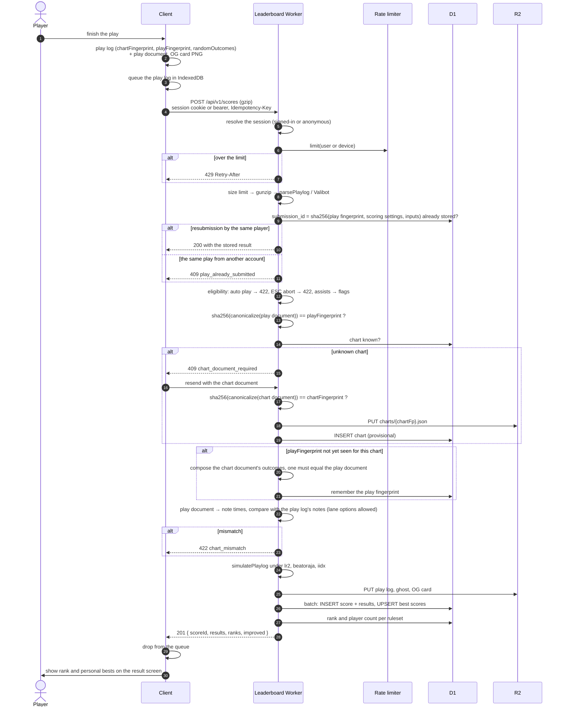

[Japanese version](./leaderboard.ja.md)

# Leaderboard design

> Status: the core of P0 is implemented in [`packages/leaderboard-api`](../packages/leaderboard-api/README.md):
> authentication, submission with verification layers L1–L3 (L4 for charts without `#RANDOM`), re-simulation under
> the three rulesets, and the ranking API. Everything else is still design. This document records the decisions made
> so far and the questions that are still open (section 15).

The Leaderboard is be-music's online score ranking — what LR2 and beatoraja call an "IR" (Internet Ranking). This
repository uses "IR" for the JSON intermediate representation (`@be-music/json`), so the ranking is called the
**Leaderboard** everywhere: in code, in docs, and in the UI. Third-party names keep their own spelling (LR2IR, the
beatoraja skin's IR ops).

## 1. Goals and non-goals

Goals:

- Rank plays per chart, under each of the three compat rulesets (`lr2`, `beatoraja`, `iidx`).
- Trust the server, not the client: the client sends its play log, and the server re-derives the result.
- Identify charts by content (the Be-Music Fingerprint), so re-saved, re-encoded or converted copies of a chart share
  one ranking.
- Rivals, targets and ghosts in the select, gameplay and result scenes; shareable score pages with OG images.

Non-goals:

- Preventing every form of cheating. A fabricated input stream (a bot or a TAS) cannot be told apart from a human one
  with certainty; it is handled by anomaly detection and moderation (section 12), not by the protocol.
- Hosting chart or audio files. The server stores canonical fingerprint documents and play logs only.

## 2. Architecture

```
player-web (browser) ─┐                       ┌─ D1: users / charts / scores / best_scores / rivals ...
player-tui (CLI) ─────┼─ HTTPS ─→ be-music-player-web Worker ─(Service Binding)→ be-music-leaderboard Worker
                      │            /api/*          → Hono API     └─ R2: play logs, chart documents, ghosts, OG images
                      │            /leaderboard/*  → Hono JSX pages
```

- **Runtime**: Cloudflare Workers with D1 and R2. There is no plan to leave Cloudflare.
- **Framework**: Hono. The API and the server-rendered pages live in one Worker and share the data-access functions.
- **Package**: `packages/leaderboard-api` (private). It imports `@be-music/player/playlog` and `@be-music/chart` to
  re-simulate plays and verify fingerprints.
- **Typed client**: Hono RPC (`hc<AppType>`) gives `player-web` and `player-tui` the API types directly.
- **Validation**: Valibot through `@hono/standard-validator`.
- **ORM**: Drizzle. drizzle-kit generates SQL migrations into the package; Better Auth's tables use the same
  migrations.
- **Same origin**: the existing `be-music-player-web` Worker forwards `/api/*` and `/leaderboard/*` to the
  leaderboard Worker through a Service Binding. The leaderboard Worker has no public URL of its own
  (`workers_dev: false`, `preview_urls: false`), so pages, API and session cookies share the player's origin and no
  CORS is needed.

### 2.1 Environments and deployment

| Branch  | Worker                         | D1 / R2                  |
| ------- | ------------------------------ | ------------------------ |
| `devel` | `be-music-leaderboard-staging` | staging database, bucket |
| `main`  | `be-music-leaderboard`         | production               |

- **CI/CD**: Workers Builds, one Worker per branch. The release PR (`devel → main`) deploys production, matching the
  package release flow.
- **Migrations run before the deploy**, so every migration must work with the code that is still running
  (expand → switch → contract). D1 has no rollback.
- **Preview deployments must never reach production data.** Preview URLs stay off; PR checks run against staging.
- **Secrets** (`BETTER_AUTH_SECRET`, OAuth client secrets) are set per environment and listed, without values, in the
  package README.
- **Configuration and tooling**: the `cf` CLI is the primary tool (`cloudflare.config.ts`); Wrangler fills the gaps
  `cf` does not cover yet. No Terraform. `cf` is in beta, so its version is pinned and upgrades go through staging
  first. Whether `wrangler d1 migrations apply` works next to `cloudflare.config.ts` must be verified (section 15).

### 2.2 Plan limits

The Leaderboard starts on the **Workers Free plan** and moves to Paid when it has to. Free allows 10 ms of CPU per
request and a 3 MB compressed Worker. This shapes two decisions:

- **Re-simulation** (gunzip, `parsePlaylog`, three `simulatePlaylog` runs) may exceed 10 ms on dense charts. It must be
  measured against the regression corpus before the API is built (section 15). The verification step is written so it
  can run inline or deferred, so the move to Paid changes configuration, not code.
- **OG images are drawn in the browser** (section 11), because server-side rendering (satori + resvg and a Japanese
  font) does not fit either limit.

## 3. Authentication and accounts

- **Library**: Better Auth on Hono and D1.
- **Sign-in methods**: Discord and Google OAuth, and passkeys as a provider-independent way back in. More providers
  may be added later; GitHub was considered and rejected.
- **Sessions**: an HttpOnly same-origin cookie for the browser. The terminal player uses the device authorization flow
  (RFC 8628) and stores a bearer token.
- **Anonymous play**: a player can submit without signing in. Better Auth's anonymous session creates an anonymous
  user, which can later be linked to a Discord or Google account. Anonymous scores are stored like any other; whether a
  ranking lists them is a viewer-side filter. Registering a passkey turns the account into a regular one (it has a way
  back in now), and signing in with a passkey while an anonymous session is open moves that session's plays into the
  passkey's account.
- **Handles**: every account has a unique, changeable `handle` (used in URLs) and a `display_name`; OAuth profile names
  and emails are never shown. A changed handle keeps redirecting from the old URL, and a released handle cannot be
  claimed by someone else for a while (section 15).
- **Account deletion** anonymizes the account's scores instead of deleting them; like anonymous scores, they appear in
  a ranking only when the viewer includes them.
- **Terms of service and a privacy policy** are required, since the service stores OAuth emails.

## 4. Chart identity

Charts are identified by the **Be-Music Fingerprint** ([fingerprint-spec.md](./fingerprint-spec.md)):

- **`chart.chartFingerprint`** covers every `#RANDOM` / `#SWITCH` branch, so every play of a chart shares it. It is the
  key of a chart's rankings.
- **`chart.playFingerprint`** covers the branches one play rolled. It identifies what was played and is used for
  verification and ghost matching.
- **Aliases**: the chart file's SHA-256 and MD5 map many-to-one onto a chart fingerprint (`chart_aliases`). They are
  the keys LR2IR and difficulty tables use. Web Crypto has no MD5, so `@be-music/chart` gains a small tested MD5 next to
  its SHA-256.

**Development versions.** The fingerprint is versioned `bmfp0` and the ruleset result ids are `lr2/0`, `beatoraja/0`
and `iidx/0`. Version `0` means the definition may still change between releases. Every ranking keyed by `bmfp0` is
therefore provisional: the UI marks the Leaderboard as a beta that may be reset, and moving to `bmfp1` may discard the
data (section 15).

## 5. Score submission

### 5.1 What the client sends

The client sends the play log it already records ([playlog.md](./playlog.md)), gzipped, with the canonical **play
document** of its play fingerprint. It adds the **chart document** only when the server does not know the chart yet.
Both documents are canonical JSON without keysounds, metadata or BGA, so they are small and are not the chart file.

The play log's `recorder` field (application, version, build, engine version, platform) says which software recorded
it. Every API request also carries a `Be-Music-Client` header (`be-music-web/0.5.0 (engine 0.8.0; build 6471cd16)`)
naming the software that sends it. Both are self-reported: they serve compatibility checks and bug triage, never
trust. A minimum client version can be enforced later through a `client_policies` table (`426 Upgrade Required`);
there is none at launch.

### 5.2 Sequence



- **Idempotency.** The submission id is the hash of what identifies a play — the play fingerprint, the settings that
  affect scoring, and the input stream — not of the whole log, so a retried request never stores a play twice even if
  the log was re-dated. The same play from a second account is a copied replay and is refused. Failed submissions stay
  in IndexedDB and are retried on the next launch or sign-in.
- **The chart document is sent once per chart.** Later players send the play document only.
- **Outcome composition runs once per play fingerprint.** A chart without control flow has equal chart and play
  fingerprints and skips it.
- **R2 is written before D1.** A failed D1 batch leaves only an unreferenced object, which a periodic sweep removes; the
  reverse order could leave a score whose play log is missing.

### 5.3 Verification layers

| Layer | Check                                                                         | Stops                               |
| ----- | ----------------------------------------------------------------------------- | ----------------------------------- |
| L1    | The server re-simulates the inputs; the play log's `results` cache is ignored | editing the numbers                 |
| L2    | Auto play and ESC aborts are rejected; assists are flagged                    | assisted scores in the main ranking |
| L3    | Both fingerprint documents hash to the claimed fingerprints                   | a tampered document                 |
| L4    | The play document is one outcome of the chart document                        | a play of a different chart         |
| L5    | The play log's notes equal the play document's note times, up to lane options | an edited chart inside the play log |
| L6    | Anomaly detection and reports (section 12)                                    | bots and TAS                        |

Someone can still invent a chart document. It gets its own new fingerprint, so it creates a ranking nobody else
plays and cannot pollute a real one; a chart is listed publicly only once it qualifies (section 7).

L4 and L5 need two new pure functions in `@be-music/chart`, with tests: composing a chart document's outcomes, and
turning a play document's positions and timeline into note times that match the engine's.

## 6. Scoring rules

- **Three rulesets.** Every play is re-simulated under `lr2`, `beatoraja` and `iidx`, and appears in all three
  rankings. The ruleset the player actually played (`play.judgeRuleset`) is stored and shown as a mark, and a ranking
  can be filtered to "played under this ruleset" only.
- **Gauges** map across rulesets as the play log already does (`GROOVE` is beatoraja's `NORMAL`, `DEATH` its
  `HAZARD`, and so on).
- **Assists** (auto scratch, a debug judge-window override, ...) are stored with flags and ranked separately from
  unassisted plays.
- **ESC aborts are rejected. Failed plays** (the gauge emptied) are stored and count as plays.
- **Personal bests, beatoraja style**: the best EX score, the best clear lamp and the fewest misses are kept separately,
  each pointing at the score that set it, so each best's replay and ghost are one click away. Misses count for every
  play that was not aborted, cleared or not.
- **Score history**: every submission is kept, which gives progress graphs and "most improved" lists for free.
- **Sorting**: a ranking can be sorted by EX score, clear lamp, or misses.
- **Ties** share a rank (1, 1, 3). Within a tie the earlier achievement is listed first, but the rank number is the same
  (proposed; section 15).

## 7. Data model (D1)

```sql
charts          (chart_fp PK, title, artist, note_count, play_fps JSON, status, first_seen_at)
chart_aliases   (kind, hash, chart_fp)                         -- kind: sha256 | md5
scores          (id PK, submission_id UNIQUE, user_id, chart_fp, play_fp, played_ruleset, gauge,
                 assist_flags, failed, recorded_by JSON, submitted_by, server_engine, playlog_key,
                 ghost_key, og_key, replay_visibility, created_at)
score_results   (score_id, ruleset, ruleset_revision, ex_score, clear_lamp, miss_count,
                 max_combo, judges JSON)                       -- PK(score_id, ruleset)
best_scores     (user_id, chart_fp, ruleset, assisted,         -- PK
                 best_ex, best_ex_score_id, best_lamp, best_lamp_score_id,
                 min_miss, min_miss_score_id, play_count, updated_at)
rivals          (follower_id, rival_id, created_at)            -- PK(follower_id, rival_id)
blocks          (blocker_id, blocked_id, created_at)
user_settings   (user_id PK, allow_rival, default_replay_visibility, ...)
handle_history  (handle, user_id, released_at)
reports         (id, reporter_id, target_kind, target_id, reason, status, created_at)
client_policies (name, min_version, blocked_versions JSON)
-- plus Better Auth's own tables (user, session, account, verification, passkey)
```

- Ranking queries use an index on `best_scores (chart_fp, ruleset, assisted, best_ex DESC)`.
- A chart is **listed publicly** once two players who are not anonymous have played it (anonymous accounts cost
  nothing, so they do not count), or once it appears in a difficulty table.
- R2 keys: `playlogs/{scoreId}.bmplay.json.gz`, `charts/{chartFp}.json`, `ghosts/{scoreId}.bin`,
  `og/scores/{scoreId}.png`.
- **Replays**: each user chooses who can download their play logs (a per-user default, overridable per score).
  Ghosts are always public: a judgment sequence reveals little (proposed; section 15).

## 8. API (`/api/v1`)

| Method                   | Path                                                                     | Purpose                                                                              |
| ------------------------ | ------------------------------------------------------------------------ | ------------------------------------------------------------------------------------ |
| `POST`                   | `/scores`                                                                | submit a play (section 5)                                                            |
| `GET`                    | `/scores/:id`, `/scores/:id/playlog`, `/scores/:id/ghost`                | score details, play log (per visibility), ghost (immutable)                          |
| `GET`                    | `/charts/:chartFp/leaderboard?ruleset=&sort=&anonymous=&played=&cursor=` | a ranking                                                                            |
| `GET`                    | `/charts/:chartFp/leaderboard/me?ruleset=`                               | my rank and the players around me                                                    |
| `POST`                   | `/charts/lookup?include=rivals`                                          | ranks, player counts and rivals' bests for many charts (fingerprint, SHA-256 or MD5) |
| `GET`                    | `/charts/:chartFp/targets?ruleset=&kind=`                                | a target score and its ghost (section 9)                                             |
| `GET`                    | `/players/:handle`, `/players/:handle/scores`                            | profile                                                                              |
| `GET`                    | `/players/:handle/versus/:rival?ruleset=`                                | win / loss / draw against a rival                                                    |
| `GET` / `PUT` / `DELETE` | `/me/rivals`, `/me/rivals/:handle`                                       | rivals                                                                               |
| `PUT` / `DELETE`         | `/me/blocks/:handle`                                                     | blocks                                                                               |
| `*`                      | `/api/auth/*`                                                            | Better Auth                                                                          |

Reads are public and cached briefly with the Cache API; a submission purges the affected rankings.

**Versioning.** The major version is in the path (`/api/v1`, later `/api/v2`), and each version is a sub-app mounted
next to the others.

- **Same version**: additions stay in it: new endpoints, new response fields, new optional parameters. Clients ignore
  fields they do not know.
- **New version**: a breaking change goes into one. Examples: removing or renaming a field, changing what a value means,
  or making a request stricter.
- **Retiring a version**: the old one keeps serving until the clients that use it are gone, then answers
  `410 Gone`. The play log's `recorder` and the `be-music-client` header show who still calls it.
- **Unknown paths**: anything else under `/api`, an unknown version included, answers `404` with
  `{"error": "not-found"}`.
- **Not versioned**: `/api/auth/*` is Better Auth's own protocol, and the OAuth callback URLs registered with Discord and
  Google point at it.

**Rate limits** (proposed): submissions 10 per minute per signed-in user and 5 per minute per anonymous device; reads
120 per minute per IP. Workers' rate-limiting binding only counts over 10 or 60 seconds, so longer windows would be
counted in D1.

## 9. Rivals, targets and ghosts

- **One-way follow**, no approval and no notification. Scores are public anyway; `allow_rival` lets a player refuse to
  be added, and a block removes and prevents it.
- **Up to 100 rivals**, configurable (`RIVAL_LIMIT`). Lowering the limit keeps existing rivals and stops new ones.
  `GET /me/rivals` returns the limit, so clients never hard-code it.
- **One active rival** is chosen on the client, as in beatoraja.
- **Targets** at launch: a rival, the personal best, the next rank, and a fixed grade (AAA, AA, ...).
- **Ghosts**: at submission the server writes the play's judgment sequence (one byte per note, about 2 KB for 2,000
  notes) to R2. The client turns it into a cumulative EX-score curve. When the play fingerprints differ (another
  `#RANDOM` outcome), notes are matched by their position as a fraction of the note count.
- **Client wiring**: the LR2 and beatoraja skins already have rival, target and ghost slots that read placeholders
  today (`NO TARGET`, zero target scores); they read these values instead. The ghost-curve and matching helpers are pure
  functions in `@be-music/player`.

## 10. Pages (`/leaderboard/*`)

Server-rendered with Hono JSX in the leaderboard Worker, reading D1 directly, and styled as an information site with
Tailwind CSS v4 and Basecoat (the shadcn/ui design without a framework runtime), following the system colour scheme:

- `/leaderboard` — the top page: the newest plays, each under the ruleset it was played with. It shows every play by
  a player who is not anonymous, on any chart, tagging charts that are not listed yet as new; anonymous plays come in
  with a filter. An invented chart reaches this page only through an account with a passkey.
- `/leaderboard/scores/:id` — a score
- `/leaderboard/charts/:chartFp` — a chart's rankings
- `/leaderboard/players/:handle` — a profile, and `/leaderboard/players/:handle/versus/:rival`

Every page shows its figures under one **display ruleset** (LR2, beatoraja or IIDX), chosen in the header and kept in a
cookie; a play's own ruleset is shown alongside as "played with". The switch is its own URL
(`/leaderboard/ruleset/:id?next=…`, which only returns to Leaderboard pages), so page URLs stay shareable without
changing the setting of whoever opens them. Since a page depends on that cookie, pages are `Cache-Control: private,
max-age=0`. The chart page links to the chart elsewhere, once per file it is known by, in the formats BMS Search itself
uses: Mocha-Repository, MinIR and BMS Search (`/patterns/{sha256}`) by the file SHA-256, and LR2IR by the MD5 once it
is recorded. A chart with no known hash gets a title search on BMS Search. Interactive parts (the rival button and similar) are
small `hono/jsx/dom` islands. If the site grows into an
application, HonoX or Nuxt can take over; the shared data-access functions keep that move cheap.

## 11. OG images and sharing

- **The score card is drawn in the browser.** After a successful submission the result scene renders a 1200 × 630 card
  with Pixi and uploads the PNG. The server checks size and format, stores it at `og/scores/{scoreId}.png`, and serves
  it as immutable. The browser has the fonts, so song titles in any script render without a server-side font.
- Because the client draws the card, it can lie about it. The card is used only on that player's own score page, and
  reports cover images (section 12).
- **First card**: one design for a score — title, artist, level, clear-lamp band, EX score, rate, DJ level, judgments,
  rank and player count, ruleset badge, player name, date. Ranking, profile and versus cards come later.
- **Meta tags** on every page: absolute `og:image`, `og:image:width` / `height`, `twitter:card=summary_large_image`.
- **Sharing**: a "Share on X" button opens the X post intent; no X API and no X sign-in are needed:

  ```
  {title} [{level}] {clear lamp} EX {ex} ({rate}% {DJ level}) {rank}/{players} #bemusic
  {score page URL}
  ```

- Moving to the Paid plan makes server-side cards (satori + resvg, fonts subset at runtime) possible.

## 12. Moderation

- **Admin pages** behind Cloudflare Access.
- **Reports** on scores, players and images.
- **Anomaly detection** on the submitted inputs, for example judgment-timing distributions that no human produces.
- Display names, handles and titles are length-limited and stripped of control characters before they are rendered.

## 13. Testing

- **Pure functions** — verification, ranking, ghost matching, card layout data — are tested as usual (see AGENTS.md).
- **API**: Hono's `app.request()` runs requests end to end without a server, with D1 and R2 bindings from **Miniflare**
  (`getD1Database()` / `getR2Bucket()`), so migrations and queries run against workerd's real SQLite. This runs inside
  the normal `vp test`.
- `@cloudflare/vitest-pool-workers` is not usable yet: 0.23.0 supports Vitest `^4.1`, and the workspace pins Vitest 5
  through the catalog and overrides. Re-check when a Vitest 5 release or `cf`'s test integration ships.
- Workers-only behaviour and the CPU limit are not covered by these tests; CPU time is measured separately.

## 14. Phases

- **P0** — package scaffold, environments, D1 schema and migrations, authentication, `POST /scores` with L1–L5,
  rankings, submission and sharing from the web result screen, the score page and its card.
- **P1** — `/charts/lookup` and the select scene, rivals, targets and ghosts, replay downloads, profiles.
- **P2** — sign-in from the terminal player, reports, anomaly detection and admin pages, difficulty tables, the other
  cards.

## 15. Open questions

- **CPU on the Free plan**: measure gunzip, `parsePlaylog` and three `simulatePlaylog` runs on the regression corpus.
  If they exceed 10 ms, defer verification or move to Paid.
- **D1 migrations with `cf`**: does `wrangler d1 migrations apply` work next to `cloudflare.config.ts`, or does it need a
  minimal Wrangler config beside it?
- **Moving from `bmfp0` to `bmfp1`**: discard the beta data, or keep it under the old key? Discarding is the realistic
  default.
- **Ties**: shared rank with the earlier achievement listed first is proposed, not confirmed.
- **Handle changes**: how often a handle can change (e.g. once every 30 days), and how long a released handle stays
  reserved.
- **Rate limits**: the numbers in section 8 are proposals.
- **Ghost visibility**: ghosts always public is proposed.
- **Uploaded OG cards**: size limit and validation details.
