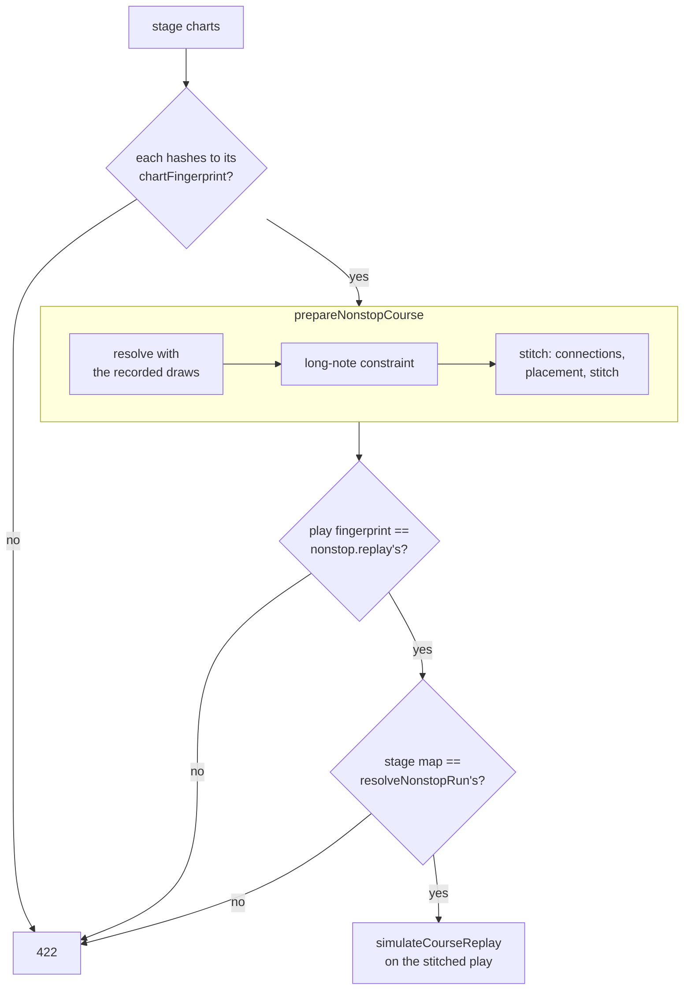

[Japanese version](./leaderboard.ja.md)

# Leaderboard specification

This specification follows `packages/app-leaderboard/src/`. See the [package README](../packages/app-leaderboard/README.md) for operations and the [generated OpenAPI document](../packages/app-leaderboard/openapi.json) for the API contract.

The Leaderboard is be-music's online score ranking — what LR2 and beatoraja call an "IR" (Internet Ranking). This
repository uses "IR" for the JSON intermediate representation (`@be-music/chart-source`), so the ranking is called the
**Leaderboard** everywhere: in code, in docs, and in the UI. Third-party names keep their own spelling (LR2IR, the
beatoraja skin's IR ops).

## 1. Scope

The service verifies chart and course replays and stores results and personal bests under `lr2`, `beatoraja` and `____`. Be-Music Fingerprints identify charts. Public pages show scores, charts, courses and players, with share images for scores.

The protocol does not guarantee human input. The service does not distribute chart or audio assets.

## 2. Architecture

See [Services](./services.md) for the architecture and authentication data flow.

- **Runtime**: Cloudflare Workers with D1 and R2. There is no plan to leave Cloudflare.
- **Framework**: Hono. The API and the server-rendered pages live in one Worker and share the data-access functions.
- **Package**: `packages/app-leaderboard` (private). It imports `@be-music/player-engine/replay` and `@be-music/chart-model` to
  re-simulate plays and verify fingerprints.
- **Typed client**: Hono RPC (`hc<AppType>`) gives `player-browser` and `player-terminal` the API types directly.
- **Validation**: Valibot through `@hono/standard-validator`.
- **ORM**: Drizzle. drizzle-kit generates SQL migrations into the package; Better Auth's tables use the same
  migrations.
- **Hosts** (docs/services.md): the Leaderboard serves its pages and API on `leaderboard.be-music.app` (pages at the
  root). The Player Worker (`play`) forwards `/api/*` to it through a Service Binding, so the player's
  requests stay on its own origin. Each app has a host-only OIDC session and forwards API calls with a resource-bound token. Accounts owns authentication in a separate Worker and D1; the Leaderboard stores public profile projections and scores.
- **CI/CD**: the Deploy workflow (`.github/workflows/deploy.yml`) deploys every service on pushes to `main` and
  `devel` (docs/services.md section 2).
- **Migrations run before the deploy**, so every migration must work with the code that is still running
  (expand → switch → contract). D1 has no rollback.
- **Previews must never reach production data.** The preview Workers bind the preview Leaderboard, and the
  Leaderboard Workers keep their Preview URLs off.
- **Secrets** (`BETTER_AUTH_SECRET`, OAuth client secrets) are set per environment. Their values live in 1Password; the
  repository holds `op://` references, and a script sets them with `cf` (package README, "Secrets").
- **Configuration and tooling**: the `cf` CLI is the primary tool (`cloudflare.config.ts`); Wrangler fills the gaps
  `cf` does not cover yet. No Terraform. `cf` is in beta, so its version is pinned and upgrades go through preview
  first. D1 migrations use the package’s `db:migrate:*` scripts, which call `cf d1 migrations apply`.

### 2.2 Plan limits

The official deployment uses **Workers Paid**. Self-hosted installations must still check the limits of their chosen plan and runtime.

- **Re-simulation** remains inline. Measure gunzip, `parseReplay` and the three `simulateReplay` runs on the regression corpus when changing verification behavior.
- **Share cards are currently drawn in the browser** and uploaded to R2 (section 11). This describes the current implementation, not a requirement imposed by the official plan.

## 3. Authentication and accounts

Accounts owns authentication, profiles and avatars. Leaderboard acts as an OIDC client and API resource server, mapping `(issuer, sub)` to a local player ID. Email does not link accounts. Public profiles are projected for ranking display. [Services](./services.md#3-sign-in) defines the authentication contract.

Accounts supports guests, passkeys and configured Discord/Google providers. Sign-in is required before submission. Linking a guest to an existing account transfers scores idempotently on the next authenticated request using signed link claims. Former handles remain reserved for their owner and redirect to the current handle.

## 4. Chart identity

The [Be-Music Fingerprint](./fingerprint-spec.md) `chartFingerprint` identifies the chart across all branches and keys its ranking. `playFingerprint` identifies the selected outcome. Chart-file SHA-256 and MD5 values are stored as aliases.

`bmfp0` and the result revisions `lr2/0`, `beatoraja/0` and `____/0` are development definitions. They may change incompatibly, and beta rankings may be reset.

## 5. Score submission

### 5.1 What the client sends

The client sends the replay it already records ([replay.md](./replay.md)), gzipped, with the canonical **play
document** of its play fingerprint. It adds the **chart document** only when the server does not know the chart yet.
Both documents are canonical JSON without keysounds, metadata or BGA, so they are small and are not the chart file.

The replay's `recorder` field (application, version, build, engine version, platform) says which software recorded
it. Every API request also carries a `Be-Music-Client` header (`be-music-web/0.5.0 (engine 0.8.0; build 6471cd16)`)
naming the software that sends it. Both are self-reported: they serve compatibility checks and bug triage, never
trust. The service does not enforce a minimum client version.

### 5.2 Sequence

The [package README flowchart](../packages/app-leaderboard/README.md) shows the processing order: authentication and rate limits, input validation, duplicate detection, fingerprint verification, simulation under three rulesets, then R2 and D1 storage.

Resubmitting the same play from its owner returns the stored result; submission from another account is rejected. Unknown charts require a chart document. R2 writes precede the D1 update. Share images are uploaded through a separate API after the score submission.

### 5.3 Verification layers

- L1 re-simulates inputs instead of trusting the replay’s result cache.
- L2 rejects AUTO and classifies assists. Tempo changes and standalone course stages are stored as unranked; ESC aborts are ranked as failed plays.
- L3 checks that the play document and, on registration, chart document hash to the claimed fingerprints.
- L4 holds when chart and play fingerprints are identical or the play fingerprint is already verified for the chart. Composing new control-flow outcomes is not implemented.

L5 (equivalence of replay notes and play-document timings) and input anomaly detection are not implemented. See `src/scores/played-chart.ts` for document verification.

## 6. Scoring rules

**What is sent.** Sending is opt-in: nothing goes to the Leaderboard until the player turns it on. Once it is on, every play is sent except a two-player play (COUPLE/TWO-PLAYER), a fully AUTO play and replay playback (a dropped replay, a replay slot, a course replay); whether a play is shown, and where, is the Leaderboard's decision, not the player's (#788). Partial assists (auto scratch and the like) are sent and ranked apart. A play the Leaderboard stores but does not rank is still sent, with the facts in its replay that classify it (`play.tempo`, `play.course`, the options and assists). A log without both fingerprints is refused because it cannot be verified. Two-player recordings are refused with `two-player`: both player results remain local, and there is no single-player ranking for the combined or partial chart.

A manual play that seeks is practice (`PlayResult.practice`). Its first seek discards the replay recorder, and beatoraja PRACTICE records none, so neither has a replay to send: the web app skips best-record writes, Leaderboard submission and replay auto-save for that result, even if a host supplies replay data alongside it. Seeking a course stage or NONSTOP run also excludes the entire course and every later stage; course results remain available without a replay. Sending practice plays needs their range in the replay, and is left to a later change.

- **Three rulesets.** Every play is re-simulated under `lr2`, `beatoraja` and `____`, and appears in all three
  rankings. The ruleset the player actually played (`play.judgeRuleset`) is stored and shown as a mark, and a ranking
  can be filtered to "played under this ruleset" only.
- **Gauges** map across rulesets as the replay already does (`GROOVE` is beatoraja's `NORMAL`, `DEATH` its
  `HAZARD`, and so on).
- **Assists** (auto scratch, a debug judge-window override, ...) are stored with flags and ranked separately from
  unassisted plays.
- **Unranked plays** are stored, simulated under every ruleset and answered with their figures (rank and players 0,
  `unranked` naming why), but they move no personal best and stay out of the rankings, the figures and every list;
  their own page still opens and says why (`score.unranked`). A **course stage** sent on its own is one
  (`course-stage`): a stage starts from the state the previous one left, so it is not a single-chart play; it is ranked
  as part of its course run instead (section 6.1). So is a **play at another tempo** (`tempo`: `play.tempo` other than
  1, the web player's tempo slider): it is practice, as beatoraja's frequency trainer does not save its scores.
  **Failed plays** (the gauge
  emptied) are stored and count as plays. So are **plays given up with ESC** (`play.aborted`): a play quit mid-way is
  ranked as a failed play under every ruleset, whatever its gauge stood at, as LR2 and beatoraja save one.
- **Lamps and BP per ruleset** follow each game: under `lr2` a DEATH clear is a NORMAL clear (LR2body.exe `CheckClear`);
  beatoraja and That-Which-Must-Not-Be-Named give DEATH (`HAZARD`) an EX HARD lamp. Every ruleset counts empty POORs in BP, LR2 included. BP also counts the notes a play never judged because it failed or was given up mid-way, as both games count them.
  The lamp and BP come from the rules every client uses (`resolveRulesetResultLamp` and `resolveRulesetResultMissCount` in `@be-music/player-engine/replay`, `resolveClearLamp` and `resolveMissCount` in `@be-music/player-engine/ruleset`): a full combo needs every note judged GOOD or better, so a chart without notes takes its gauge's lamp. Lamps are stored as their rank (`clearLampRank`): 1 FAILED, 2 ASSIST EASY, 3 EASY, 4 NORMAL, 5 HARD, 6 EX HARD, 7 FULL COMBO, 8 PERFECT, 9 MAX.
- **Personal bests, beatoraja style**: the best EX score, the best clear lamp and the fewest misses are kept separately,
  each pointing at the score that set it, so each best identifies its score and replay. Misses count for every
  play, cleared, failed or given up.
- **Score history**: every submission is kept, which gives progress graphs and "most improved" lists for free.
- **Hidden plays**: a player can hide one of their plays (`PATCH /api/v0/scores/:id`) and show it again. A hidden play
  is kept but leaves the rankings, the personal bests (rebuilt from the plays still shown), the figures and every list,
  and only its player can open it.
- **Sorting**: chart rankings use best EX score, then achievement time and handle.
- **Ties** share a rank (1, 1, 3). Within a tie the earlier achievement is listed first, but the rank number is the same
  .

### 6.1 Course rankings

A course run (a dan course, an expert or nonstop course, a beatoraja course or a table's course) is ranked as one run,
with its own rankings per ruleset, and never as single-chart plays.

- **Course identity.** A course is keyed by its **course fingerprint** (`bmcourse0:<sha256>`,
  `computeCourseFingerprint` in `@be-music/player-engine/replay`): its kind, its constraints (normalized and sorted) and its
  stages' chart fingerprints in order, and for a NONSTOP course its connections and placement mode, which decide the
  stitched chart. The name and trophies are left out, so the same course read from a `.lr2crs`,
  a beatoraja course file or a table shares one board whenever its charts match. A random course is keyed by the
  stages it drew. A failed run is keyed too: the course replay carries the chart fingerprint of every stage it never
  reached ([replay.md](./replay.md#course-replays)).
- **What the client sends.** The course replay (`be-music-course-replay`), gzipped, with the play document (and,
  for a chart the server does not know yet, the chart document) of each stage it played, to
  `POST /api/v0/course-scores`. It adds the **stage chart** (`stageCharts`: the parsed chart as loaded, `#RANDOM` still
  in, and whether it is a `.pms` file) of every stage the server rebuilds itself: each stage the run never reached,
  and every stage of a NONSTOP run (which sends no documents). Fingerprint documents cannot give a stage's note count
  or be stitched, so these stages need the chart itself; the server only reads it to verify the run and never stores
  it. The idempotency, rate limit, sign-in and size limits are those of single plays; the submission id hashes the
  course fingerprint and each played stage as a single play's id does (a NONSTOP run: its stitched play).
- **Verification.** Every played stage passes the checks of a single play (sections 5.2 and 5.3: auto play refused, fingerprint documents, chart registration, outcome composition); being a course stage is what it must
  be here, not a reason to refuse it. The stages must be judged under one ruleset, play under the course's constraints
  (its gauge set and judge constraint, and a lane option the course allows), and carry in exactly what the previous
  stage left once re-simulated (gauge, course combo and course max combo; the first stage carries in nothing). The run
  is re-simulated under `lr2`, `beatoraja` and `____` with `simulateCourseReplay`; the client's cached results are
  ignored.
- **Unreached stages.** Their notes count as BP, so their note counts must not be the client's word. Every unreached
  stage's chart is required (`stage-chart-required`), must hash to the chart fingerprint the log names for the stage
  (`stage-chart-fingerprint-mismatch`; this also keys the course), and must give, through the client's own helper
  `resolveChartRulesetFacts`, the facts the log claims for it — its note tallies, long-note mode, lane mode and format
  (`course-stage-facts-mismatch`). The rule is the same whether the server knows the chart or not: it keeps fingerprint
  documents, not charts, and a document cannot be counted the way the engine counts notes.
- **Failed and abandoned runs.** A run that failed a stage is stored and ranked like a failed play: its unreached
  stages' notes count as BP. A run given up with ESC counts as a failed run too, as LR2 records it: its last played
  stage may carry `play.aborted`, the run fails whatever its gauge, and the rest of that stage and the unreached
  stages count as BP. An ESC abort on any earlier stage is still refused as `aborted`.
- **Runs at another tempo are not ranked.** A course may be played at another tempo, as a single chart may, and the
  run is then stored unranked as `tempo` (any stage; for a NONSTOP run, its stitched play), like a single play at
  another tempo: it moves no course best and stays out of the course rankings and every list.
- **Unreleased courses are not ranked.** A course with beatoraja's `release: false`, which a drawn random course and a
  course made in the course maker also have, is recorded so in the course log (`course.release: false`), and its runs
  are stored unranked as `unreleased`, as beatoraja keeps them off IR.
- **NONSTOP runs.** A NONSTOP course is played as one stitched chart, and that play (`nonstop.replay`) is what is
  judged and ranked. The server rebuilds the stitched chart from the stage charts exactly as the client built it: both
  take the same deterministic pipeline (`prepareNonstopCourse` in `@be-music/player-engine/course`, see
  [Courses and dan certification](./course.md#nonstop-courses)). Each stage chart must hash to its stage's chart
  fingerprint, is resolved with the `#RANDOM` draws its stage recorded (`nonstop.stages[].randomDraws`), gets the
  course's long-note constraint, and the stages are stitched with the recorded connections, placement and stitching
  rules (`nonstop.stitch`, version 1 when absent; rules the server does not know are `nonstop-stitch-unsupported`). The
  stitched play must have been recorded on that chart — its play fingerprint is the rebuilt chart's
  (`nonstop-chart-mismatch`) — and the stage map must be the rebuilt one (`resolveNonstopRun`): the stage
  placements, the stage of every note, and the number of stages the play reached (`nonstop-stage-mismatch`). The
  stitched play must pass the single-play eligibility check and play under the course's constraints; it is
  re-simulated under every ruleset, and a play given up with ESC is a failed run. The run is ranked under the course
  fingerprint, like any course run. A NONSTOP run registers no stage charts: its cut-out stages carry the stitched
  play's judge rank and TOTAL, not their charts' own.
- **Figures and bests.** Per ruleset: EX score, lamp (the course lamp on the chart lamp scale), BP, course max combo,
  stages reached and trophy, and each reached stage's own figures (EX score, notes, BP, max combo, judgments, the gauge
  it handed on, cleared or not), which the run page breaks the run down by. Bests are kept beatoraja style, as for
  charts (best EX score, best lamp, fewest BP, each pointing at its run), assisted runs apart. A course run creates no
  chart scores and no chart bests.
- **Trophy best.** The best trophy is kept with the other bests, pointing at the run that earned it. A course
  definition lists its trophies easiest first and the run earns the last one it qualifies for, so each run's trophy is
  stored with its place in that list (`trophy_rank`, 1 for the first, 0 for none) and a strictly higher place replaces
  the best; a tie keeps the earlier run. The name and the trophies are not part of the course fingerprint, so two
  definitions of one course could list different trophies: their places are compared as they are.
- **Hidden runs.** A player can hide one of their course runs (`PATCH /api/v0/course-scores/:id`) and show it again,
  as a play. A hidden run is kept but leaves the course rankings, the bests (rebuilt from the runs still shown, the
  trophy best included), the figures and every list, and only its player can open it or its replay.
- **Replays.** `GET /api/v0/course-scores/:id/replay` answers the stored course replay, gzip-compressed as it is
  kept. Course runs have no replay setting of their own: anyone reads a shown run's log, only its player a hidden
  run's.

A NONSTOP run takes the place of the stage loops with one rebuild of its stitched chart:

## 7. Data model (D1)

The D1 source of truth is [`src/db/schema.ts`](../packages/app-leaderboard/src/db/schema.ts). It stores charts, aliases and chartsets; scores and per-ruleset results; personal bests; courses and their results; and local user, public-profile and OIDC mappings. Accounts ownership follows [Services](./services.md).

- Ranking queries use an index on `best_scores (chart_fp, ruleset, assisted, best_ex DESC)`.
- A chart is **listed publicly** once two players who are not anonymous have played it (anonymous accounts cost
  nothing, so they do not count), or once it appears in a difficulty table.
- **Chartsets** group the charts of one work: the original package's charts and the add-ons (差分). The grouping
  comes from BMS Search (https://bmssearch.net), whose maintainers file each chart, by its file SHA-256 or MD5, under a
  work by hand. `chartset.id` is BMS Search's id for the work; `chart.chartset_id` and `chart.pack_type` (original or
  add-on) hold the answer, and `chart.chartset_checked_at` says when BMS Search was asked.
  - A chart seen for the first time is looked up right after its submission (`waitUntil`).
  - An hourly Cron Trigger asks about up to 20 charts. It takes unchecked charts first, then unlinked charts a week
    after their last check and linked charts a month after theirs, since a link may be added or changed.
  - A chart BMS Search does not know, or has not linked, stays on its own. Calls identify the Leaderboard in their
    `User-Agent`.
- R2 stores single and course replays, canonical chart documents, and score share images. Download authorization is enforced by the replay routes; ghost storage and APIs are not implemented.

## 8. API (`/api/v0`)

The request Valibot schemas generate OpenAPI 3.1, available at `GET /api/v0/openapi.json` and `/api-reference`. Paths below are relative to `/api/v0`.

| Method           | Path                                          |
| ---------------- | --------------------------------------------- |
| `GET` / `PATCH`  | `/me`                                         |
| `PUT` / `DELETE` | `/me/avatar`                                  |
| `POST`           | `/scores`                                     |
| `GET` / `PATCH`  | `/scores/{id}`                                |
| `PUT`            | `/scores/{id}/card`                           |
| `GET`            | `/scores/{id}/replay`                         |
| `GET`            | `/charts/{chartFingerprint}/leaderboard`      |
| `GET`            | `/charts/{chartFingerprint}/leaderboard/me`   |
| `POST` / `GET`   | `/course-scores`                              |
| `GET` / `PATCH`  | `/course-scores/{id}`                         |
| `GET`            | `/course-scores/{id}/replay`                  |
| `PUT`            | `/course-scores/{id}/card`                    |
| `GET`            | `/courses/{courseFingerprint}`                |
| `GET`            | `/courses/{courseFingerprint}/leaderboard`    |
| `GET`            | `/courses/{courseFingerprint}/leaderboard/me` |

`v0` is a development API and may change incompatibly. Unknown `/api/*` paths return `404` and `{"error":"not-found"}`. `/api/auth/*` is the unversioned OIDC session endpoint. Submissions use `SUBMIT_LIMITER` keyed by user ID; exceeding it returns `429` with `Retry-After: 60`. `cloudflare.config.ts` defines the configured limit.

## 9. Rivals, targets and ghosts

Leaderboard rival, target and ghost APIs are not implemented. Skin presentation slots do not imply server support.

## 10. Pages (`leaderboard.be-music.app`)

Server-rendered with Hono JSX in the leaderboard Worker, reading D1 directly, and styled as an information site with
Tailwind CSS v4 and Basecoat (the shadcn/ui design without a framework runtime), following the system colour scheme:

- `/` — recent scores and course runs, with anonymous-player and unlisted-chart filters.
- `/scores/:id` — a score
- `/chartsets/:id` — the charts of one work (originals, then add-ons)
- `/charts/:chartFp` — a chart's rankings, its play counts and lamp spread, and its details (mode, TOTAL,
  judge rank, long-note mode, file hashes)
- `/players/:handle` — a profile with the player's figures (plays, charts, average rate, and the lamp and DJ
  Rank spreads of their bests) and their latest plays and course runs
- `/courses/:courseFp` — a course's ranking (each player's best EX score, lamp, BP and trophy, assisted runs
  and anonymous players behind the chart page's switches), its stages linked to their chart pages, its run counts,
  lamp spread and details (kind, constraints). A course no player with an account has run stays out of search engines.
- `/course-scores/:id` — a course run under every ruleset (stages reached, trophy), broken down stage by
  stage under the display ruleset (judgments, BP, the gauge each stage handed on, the stages never reached), with its
  replay and, for its player, the switch that hides it. The top page lists the latest course runs below the plays.

Every page shows its figures under one **display ruleset** (LR2, beatoraja or That-Which-Must-Not-Be-Named), chosen in the header and kept in a
cookie; a play's own ruleset is shown alongside as "played with". The switch is its own URL
(`/ruleset/:id?next=…`, which only returns to Leaderboard pages), so page URLs stay shareable without
changing the setting of whoever opens them. Since a page depends on that cookie, pages are `Cache-Control: private,
max-age=0`. The chart page links to the chart elsewhere, once per file it is known by, in the formats BMS Search itself
uses: Mocha-Repository, MinIR and BMS Search (`/patterns/{sha256}`) by the file SHA-256, and LR2IR by the MD5 once it
is recorded. A chart with no known hash gets a title search on BMS Search. Browser-side interactions use `hono/jsx/dom` components.

## 11. OG images and sharing

Score share images are drawn with browser Canvas 2D (`client/score-card.ts`). A 1200 × 630 card is uploaded through `PUT /api/v0/scores/:id/card` and served at `/scores/:id/card`. A missing card falls back to the site’s default image.

Only the score owner can upload a card. Empty data, data over 512 KiB and unsupported image formats are rejected. PNG, WebP and JPEG are detected and stored at `cards/scores/{scoreId}/{hash}.{extension}`. The URL version derives from the content hash, and replacing a card deletes the old image.

Cards show title, artist, level, lamp, score, judgments, rank, ruleset, player and date. Available chart documents provide a dense chart excerpt; unsupported excerpts use decorative notes. Important content stays 24 px from edges, outside 48 px corner squares and the lower-left label area. `src/pages/share-card-safe-area.ts` and its tests define the layout.

Client-generated images are not used for score verification. Course runs also have browser-generated cards (`client/course-card.ts`), uploaded through `PUT /api/v0/course-scores/{id}/card` and served at `/course-scores/{id}/card`. The right panel lists stage titles, score rates and clear/fail/unreached states instead of a playfield, with an overflow count after five rows. The heading shows course kind, stages reached and trophy.

## 12. Moderation

Owners can hide their scores and course runs. Admin pages, report APIs and input anomaly detection are not implemented.

## 13. Testing

- **Pure functions** — verification, ranking and card layout data — are tested as usual (see AGENTS.md).
- **API**: Hono's `app.request()` runs requests end to end without a server, with D1 and R2 bindings from **Miniflare**
  (`getD1Database()` / `getR2Bucket()`), so migrations and queries run against workerd's real SQLite. This runs inside
  the normal `vp test`.

- Workers-only behaviour and the CPU limit are not covered by these tests; CPU time is measured separately.
