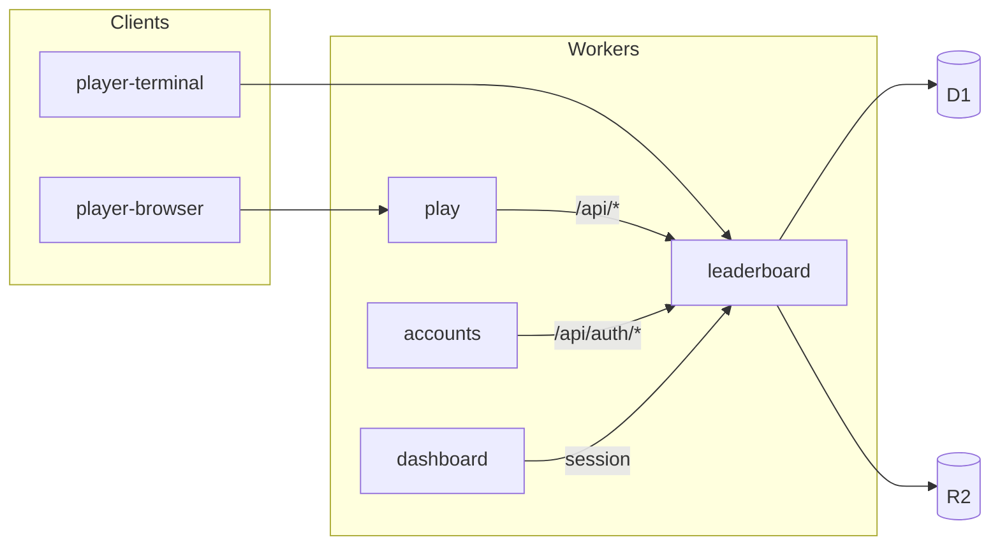
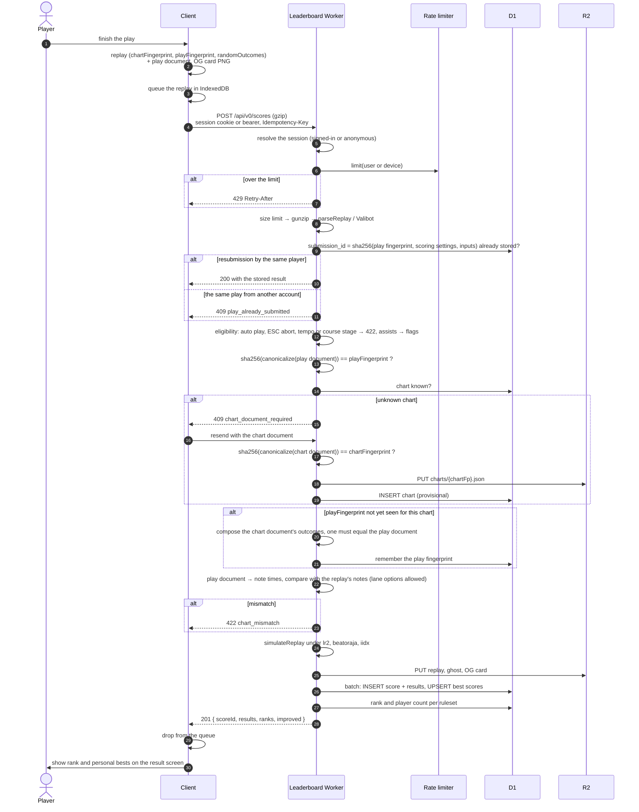
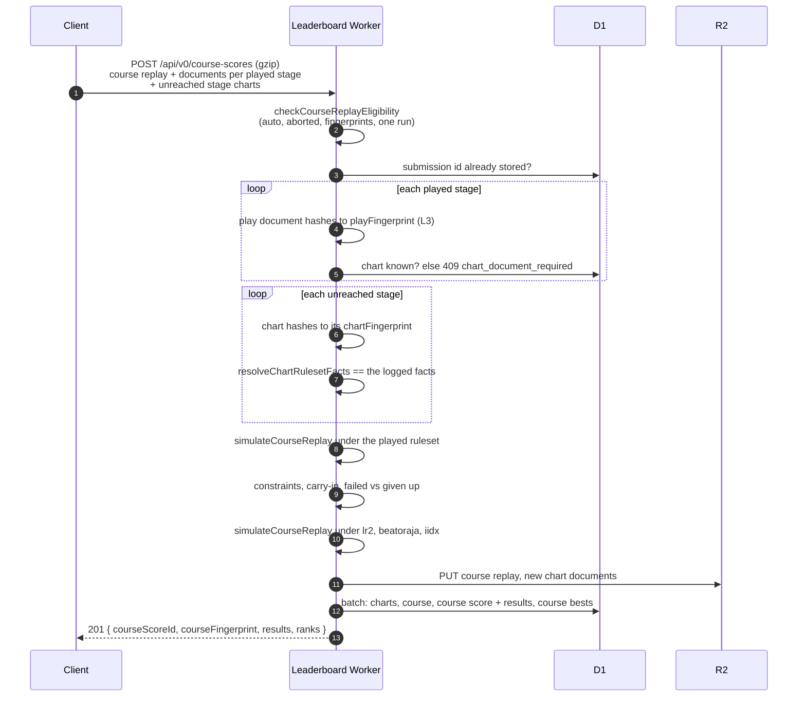
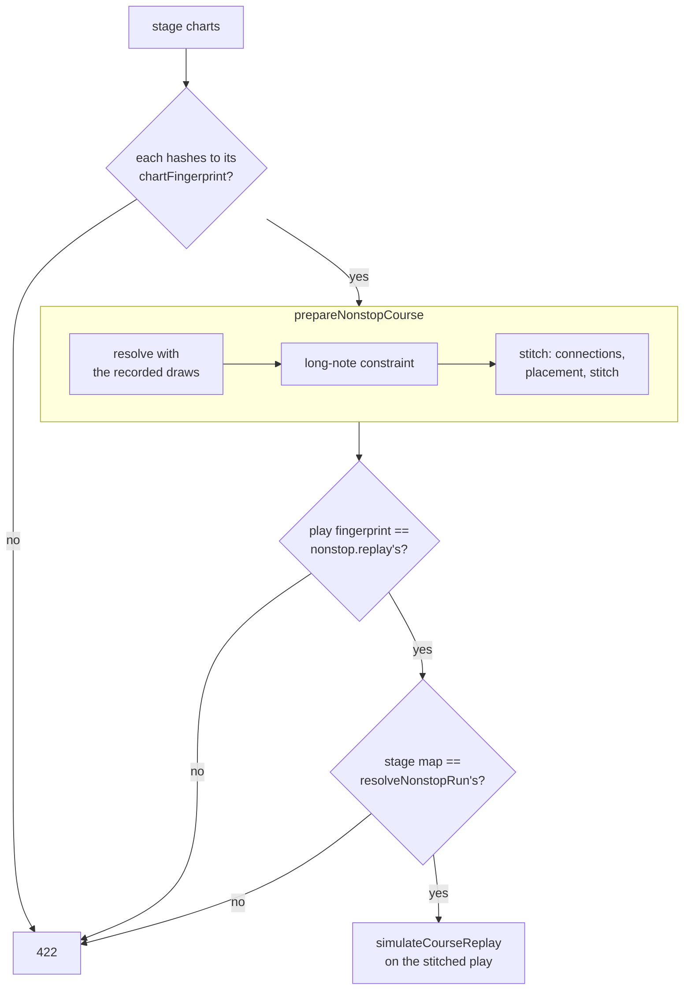

[Japanese version](./leaderboard.ja.md)

# Leaderboard design

> Status: the core of P0 is implemented in [`packages/app-leaderboard`](../packages/app-leaderboard/README.md):
> authentication, submission with verification layers L1–L3 (L4 for charts without `#RANDOM`), re-simulation under
> the three rulesets, and the ranking API. Everything else is still design. This document records the decisions made
> so far and the questions that are still open (section 15).

The Leaderboard is be-music's online score ranking — what LR2 and beatoraja call an "IR" (Internet Ranking). This
repository uses "IR" for the JSON intermediate representation (`@be-music/chart-source`), so the ranking is called the
**Leaderboard** everywhere: in code, in docs, and in the UI. Third-party names keep their own spelling (LR2IR, the
beatoraja skin's IR ops).

## 1. Goals and non-goals

Goals:

- Rank plays per chart, under each of the three compat rulesets (`lr2`, `beatoraja`, `iidx`).
- Trust the server, not the client: the client sends its replay, and the server re-derives the result.
- Identify charts by content (the Be-Music Fingerprint), so re-saved, re-encoded or converted copies of a chart share
  one ranking.
- Rivals, targets and ghosts in the select, gameplay and result scenes; shareable score pages with OG images.

Non-goals:

- Preventing every form of cheating. A fabricated input stream (a bot or a TAS) cannot be told apart from a human one
  with certainty; it is handled by anomaly detection and moderation (section 12), not by the protocol.
- Hosting chart or audio files. The server stores canonical fingerprint documents and replays only.

## 2. Architecture



- **Runtime**: Cloudflare Workers with D1 and R2. There is no plan to leave Cloudflare.
- **Framework**: Hono. The API and the server-rendered pages live in one Worker and share the data-access functions.
- **Package**: `packages/app-leaderboard` (private). It imports `@be-music/player-engine/replay` and `@be-music/chart-model` to
  re-simulate plays and verify fingerprints.
- **Typed client**: Hono RPC (`hc<AppType>`) gives `player-browser` and `player-terminal` the API types directly.
- **Validation**: Valibot through `@hono/standard-validator`.
- **ORM**: Drizzle. drizzle-kit generates SQL migrations into the package; Better Auth's tables use the same
  migrations.
- **Hosts** (docs/services.md): the Leaderboard serves its pages and API on `leaderboard.be-music.app` (pages at the
  root). The Player Worker (`play`) forwards `/api/*` to it through a Service Binding, so the player's
  requests stay on its own origin. Each app has a host-only OIDC session and forwards API calls with a resource-bound token. Accounts owns authentication in a separate Worker and D1; the Leaderboard owns public profiles and scores.
- **CI/CD**: the Deploy workflow (`.github/workflows/deploy.yml`) deploys every service on pushes to `main` and
  `devel` (docs/services.md section 2).
- **Migrations run before the deploy**, so every migration must work with the code that is still running
  (expand → switch → contract). D1 has no rollback.
- **Previews must never reach production data.** The preview Workers bind the preview Leaderboard, and the
  Leaderboard Workers keep their Preview URLs off.
- **Secrets** (`BETTER_AUTH_SECRET`, OAuth client secrets) are set per environment. Their values live in 1Password; the
  repository holds `op://` references, and a script sets them with `cf` (package README, "Secrets").
- **Configuration and tooling**: the `cf` CLI is the primary tool (`cloudflare.config.ts`); Wrangler fills the gaps
  `cf` does not cover yet. No Terraform. `cf` is in beta, so its version is pinned and upgrades go through preview
  first. Whether `wrangler d1 migrations apply` works next to `cloudflare.config.ts` must be verified (section 15).

### 2.2 Plan limits

The official deployment uses **Workers Paid**. The former Free-plan CPU budget is no longer the basis for the service's architecture. Self-hosted installations must still check the limits of their chosen plan and runtime.

- **Re-simulation** remains inline. Measure gunzip, `parseReplay` and the three `simulateReplay` runs on the regression corpus when changing verification behavior.
- **Share cards are currently drawn in the browser** and uploaded to R2 (section 11). This describes the current implementation, not a requirement imposed by the official plan. Server-side generation can be evaluated against the configured CPU budget, memory usage, font loading and rendering cost.

## 3. Authentication and accounts

- **Authentication**: the independent Accounts Worker owns Better Auth and its D1. The Leaderboard is an OIDC client and API resource server; see [Services §3](./services.md#3-sign-in).
- **Sign-in methods**: Accounts supports passkeys, guest accounts and configured Discord/Google providers. All passkey ceremonies take place on Accounts.
- **Sessions**: the browser uses a host-only encrypted HttpOnly app cookie, valid for at most ten minutes. Server-to-server API calls carry an access token bound to this API and the `be-music:api` scope. Device authorization for the terminal player remains planned.
- **Guest play**: start a guest account at Accounts before submitting; the player no longer silently creates an account after a finished play. Guest scores remain stored and filtered as before. Registering a passkey upgrades the account. Linking a guest to another account records a signed link claim; the Leaderboard transfers its plays idempotently on the target's next authenticated request.
- **Identity**: `(issuer, sub)` maps through `oidc_identity` to the local player ID. Migration preserves existing player IDs and score ownership; new accounts create local mirrors lazily. Email never links accounts. Legacy authentication records have been cleared; table definitions remain for standalone localhost development and tests. Public requests use Accounts OIDC.
- **Handles**: every account has a unique, changeable `handle` (used in URLs) and a `display_name`; OAuth profile names
  and emails are never shown. A changed handle keeps redirecting from the old URL, and a released handle cannot be
  claimed by someone else for a while (section 15).
- **Account deletion** anonymizes the account's scores instead of deleting them; like anonymous scores, they appear in
  a ranking only when the viewer includes them.
- **Terms of service and a privacy policy** are required, since the service stores OAuth emails.

## 4. Chart identity

Charts are identified by the **Be-Music Fingerprint** ([fingerprint-spec.md](./fingerprint-spec.md)):

- **`chart.chartFingerprint`** covers every `#RANDOM` / `#SWITCH` branch, so every play of a chart shares it. It is the
  key of a chart's rankings.
- **`chart.playFingerprint`** covers the branches one play rolled. It identifies what was played and is used for
  verification and ghost matching.
- **Aliases**: the chart file's SHA-256 and MD5 map many-to-one onto a chart fingerprint (`chart_aliases`). They are
  the keys LR2IR and difficulty tables use. Web Crypto has no MD5, so `@be-music/chart-model` gains a small tested MD5 next to
  its SHA-256.

**Development versions.** The fingerprint is versioned `bmfp0` and the ruleset result ids are `lr2/0`, `beatoraja/0`
and `iidx/0`. Version `0` means the definition may still change between releases. Every ranking keyed by `bmfp0` is
therefore provisional: the UI marks the Leaderboard as a beta that may be reset, and moving to `bmfp1` may discard the
data (section 15).

## 5. Score submission

### 5.1 What the client sends

The client sends the replay it already records ([replay.md](./replay.md)), gzipped, with the canonical **play
document** of its play fingerprint. It adds the **chart document** only when the server does not know the chart yet.
Both documents are canonical JSON without keysounds, metadata or BGA, so they are small and are not the chart file.

The replay's `recorder` field (application, version, build, engine version, platform) says which software recorded
it. Every API request also carries a `Be-Music-Client` header (`be-music-web/0.5.0 (engine 0.8.0; build 6471cd16)`)
naming the software that sends it. Both are self-reported: they serve compatibility checks and bug triage, never
trust. A minimum client version can be enforced later through a `client_policies` table (`426 Upgrade Required`);
there is none at launch.

### 5.2 Sequence



- **Idempotency.** The submission id is the hash of what identifies a play — the play fingerprint, the settings that
  affect scoring, and the input stream — not of the whole log, so a retried request never stores a play twice even if
  the log was re-dated. The same play from a second account is a copied replay and is refused. Failed submissions stay
  in IndexedDB and are retried on the next launch or sign-in.
- **The chart document is sent once per chart.** Later players send the play document only.
- **Outcome composition runs once per play fingerprint.** A chart without control flow has equal chart and play
  fingerprints and skips it.
- **R2 is written before D1.** A failed D1 batch leaves only an unreferenced object, which a periodic sweep removes; the
  reverse order could leave a score whose replay is missing.

### 5.3 Verification layers

| Layer | Check                                                                       | Stops                               |
| ----- | --------------------------------------------------------------------------- | ----------------------------------- |
| L1    | The server re-simulates the inputs; the replay's `results` cache is ignored | editing the numbers                 |
| L2    | Auto play and ESC aborts are rejected; assists are flagged                  | assisted scores in the main ranking |
| L3    | Both fingerprint documents hash to the claimed fingerprints                 | a tampered document                 |
| L4    | The play document is one outcome of the chart document                      | a play of a different chart         |
| L5    | The replay's notes equal the play document's note times, up to lane options | an edited chart inside the replay   |
| L6    | Anomaly detection and reports (section 12)                                  | bots and TAS                        |

Someone can still invent a chart document. It gets its own new fingerprint, so it creates a ranking nobody else
plays and cannot pollute a real one; a chart is listed publicly only once it qualifies (section 7).

L4 and L5 need two new pure functions in `@be-music/chart-model`, with tests: composing a chart document's outcomes, and
turning a play document's positions and timeline into note times that match the engine's.

## 6. Scoring rules

A manual play that seeks is practice (`PlayResult.practice`). Its first seek discards the replay recorder. The web app skips best-record writes, Leaderboard submission and replay auto-save for that result, even if a host supplies replay data alongside it. Seeking a course stage or NONSTOP run also excludes the entire course and every later stage; course results remain available without a replay.

- **Three rulesets.** Every play is re-simulated under `lr2`, `beatoraja` and `iidx`, and appears in all three
  rankings. The ruleset the player actually played (`play.judgeRuleset`) is stored and shown as a mark, and a ranking
  can be filtered to "played under this ruleset" only.
- **Gauges** map across rulesets as the replay already does (`GROOVE` is beatoraja's `NORMAL`, `DEATH` its
  `HAZARD`, and so on).
- **Assists** (auto scratch, a debug judge-window override, ...) are stored with flags and ranked separately from
  unassisted plays.
- **ESC aborts are rejected, and so are course stages**: a stage starts from the state the previous one left, so it is
  not a single-chart play; it is ranked as part of its course run instead (section 6.1). **Plays at another tempo**
  (`play.tempo` other than 1, the web player's tempo slider) are refused as `tempo`: they are practice, as beatoraja's
  frequency trainer does not save its scores. **Failed plays** (the gauge
  emptied) are stored and count as plays.
- **Lamps and BP per ruleset** follow each game: under `lr2` a DEATH clear is a NORMAL clear (LR2body.exe `CheckClear`);
  beatoraja and IIDX give DEATH (`HAZARD`) an EX HARD lamp. Every ruleset counts empty POORs in BP, LR2 included. Migration `0012` rewrote the `lr2` results stored before this rule.
  The lamp and BP come from the rules every client uses (`resolveRulesetResultLamp` in `@be-music/player-engine/replay`, `resolveClearLamp` and `resolveMissCount` in `@be-music/player-engine/ruleset`): a full combo needs every note judged GOOD or better, so a chart without notes takes its gauge's lamp. Lamps are stored as their rank (`clearLampRank`): 1 FAILED, 2 ASSIST EASY, 3 EASY, 4 NORMAL, 5 HARD, 6 EX HARD, 7 FULL COMBO, 8 PERFECT, 9 MAX.
- **Personal bests, beatoraja style**: the best EX score, the best clear lamp and the fewest misses are kept separately,
  each pointing at the score that set it, so each best's replay and ghost are one click away. Misses count for every
  play that was not aborted, cleared or not.
- **Score history**: every submission is kept, which gives progress graphs and "most improved" lists for free.
- **Hidden plays**: a player can hide one of their plays (`PATCH /api/v0/scores/:id`) and show it again. A hidden play
  is kept but leaves the rankings, the personal bests (rebuilt from the plays still shown), the figures and every list,
  and only its player can open it.
- **Sorting**: a ranking can be sorted by EX score, clear lamp, or misses.
- **Ties** share a rank (1, 1, 3). Within a tie the earlier achievement is listed first, but the rank number is the same
  (proposed; section 15).

### 6.1 Course rankings

A course run (a dan course, an expert or nonstop course, a beatoraja course or a table's course) is ranked as one run,
with its own rankings per ruleset, and never as single-chart plays.

- **Course identity.** A course is keyed by its **course fingerprint** (`bmcourse0:<sha256>`,
  `computeCourseFingerprint` in `@be-music/player-engine/replay`): its kind, its constraints (normalized and sorted) and its
  stages' chart fingerprints in order, and for a NONSTOP course its connections and placement mode, which decide the
  stitched chart. The name and trophies are left out, so the same course read from a `.lr2crs`,
  a beatoraja course file or a table shares one board whenever its charts match. A random course is keyed by the
  stages it drew. A failed run is keyed too: the course replay carries the chart fingerprint of every stage it never
  reached ([replay.md](./replay.md#course-replays)).
- **What the client sends.** The course replay (`be-music-course-replay`), gzipped, with the play document (and,
  for a chart the server does not know yet, the chart document) of each stage it played, to
  `POST /api/v0/course-scores`. It adds the **stage chart** (`stageCharts`: the parsed chart as loaded, `#RANDOM` still
  in, and whether it is a `.pms` file) of every stage the server rebuilds itself: each stage the run never reached,
  and every stage of a NONSTOP run (which sends no documents). Fingerprint documents cannot give a stage's note count
  or be stitched, so these stages need the chart itself; the server only reads it to verify the run and never stores
  it. The idempotency, rate limit, sign-in and size limits are those of single plays; the submission id hashes the
  course fingerprint and each played stage as a single play's id does (a NONSTOP run: its stitched play).
- **Verification.** Every played stage passes the checks of a single play (sections 5.2 and 5.3: auto play and ESC
  aborts refused, fingerprint documents, chart registration, outcome composition); being a course stage is what it must
  be here, not a reason to refuse it. The stages must be judged under one ruleset, play under the course's constraints
  (its gauge set and judge constraint, and a lane option the course allows), and carry in exactly what the previous
  stage left once re-simulated (gauge, course combo and course max combo; the first stage carries in nothing). The run
  is re-simulated under `lr2`, `beatoraja` and `iidx` with `simulateCourseReplay`; the client's cached results are
  ignored.
- **Unreached stages.** Their notes count as BP, so their note counts must not be the client's word. Every unreached
  stage's chart is required (`stage-chart-required`), must hash to the chart fingerprint the log names for the stage
  (`stage-chart-fingerprint-mismatch`; this also keys the course), and must give, through the client's own helper
  `resolveChartRulesetFacts`, the facts the log claims for it — its note tallies, long-note mode, lane mode and format
  (`course-stage-facts-mismatch`). The rule is the same whether the server knows the chart or not: it keeps fingerprint
  documents, not charts, and a document cannot be counted the way the engine counts notes.
- **Failed and abandoned runs.** A run that failed a stage is stored and ranked like a failed play: its unreached
  stages' notes count as BP. A run given up with ESC counts as a failed run too, as LR2 records it: its last played
  stage may carry `play.aborted`, the run fails whatever its gauge, and the rest of that stage and the unreached
  stages count as BP. An ESC abort on any earlier stage is still refused as `aborted`.
- **Runs at another tempo are not ranked.** A course may be played at another tempo, as a single chart may, and the
  run is then refused as `tempo` (naming the first such stage; for a NONSTOP run, its stitched play), like a single
  play at another tempo.
- **Unreleased courses are not ranked.** A course with beatoraja's `release: false`, which a drawn random course and a
  course made in the course maker also have, is recorded so in the course log (`course.release: false`), and its runs are refused as `unreleased`, as
  beatoraja keeps them off IR.
- **NONSTOP runs.** A NONSTOP course is played as one stitched chart, and that play (`nonstop.replay`) is what is
  judged and ranked. The server rebuilds the stitched chart from the stage charts exactly as the client built it: both
  take the same deterministic pipeline (`prepareNonstopCourse` in `@be-music/player-engine/course`, see
  [Courses and dan certification](./course.md#nonstop-courses)). Each stage chart must hash to its stage's chart
  fingerprint, is resolved with the `#RANDOM` draws its stage recorded (`nonstop.stages[].randomDraws`), gets the
  course's long-note constraint, and the stages are stitched with the recorded connections, placement and stitching
  rules (`nonstop.stitch`, version 1 when absent; rules the server does not know are `nonstop-stitch-unsupported`). The
  stitched play must have been recorded on that chart — its play fingerprint is the rebuilt chart's
  (`nonstop-chart-mismatch`) — and the stage map must be the rebuilt one (`resolveNonstopRun`): the stage
  placements, the stage of every note, and the number of stages the play reached (`nonstop-stage-mismatch`). The
  stitched play must pass the single-play eligibility check and play under the course's constraints; it is
  re-simulated under every ruleset, and a play given up with ESC is a failed run. The run is ranked under the course
  fingerprint, like any course run. A NONSTOP run registers no stage charts: its cut-out stages carry the stitched
  play's judge rank and TOTAL, not their charts' own.
- **Figures and bests.** Per ruleset: EX score, lamp (the course lamp on the chart lamp scale), BP, course max combo,
  stages reached and trophy, and each reached stage's own figures (EX score, notes, BP, max combo, judgments, the gauge
  it handed on, cleared or not), which the run page breaks the run down by. Bests are kept beatoraja style, as for
  charts (best EX score, best lamp, fewest BP, each pointing at its run), assisted runs apart. A course run creates no
  chart scores and no chart bests.
- **Trophy best.** The best trophy is kept with the other bests, pointing at the run that earned it. A course
  definition lists its trophies easiest first and the run earns the last one it qualifies for, so each run's trophy is
  stored with its place in that list (`trophy_rank`, 1 for the first, 0 for none) and a strictly higher place replaces
  the best; a tie keeps the earlier run. The name and the trophies are not part of the course fingerprint, so two
  definitions of one course could list different trophies: their places are compared as they are.
- **Hidden runs.** A player can hide one of their course runs (`PATCH /api/v0/course-scores/:id`) and show it again,
  as a play. A hidden run is kept but leaves the course rankings, the bests (rebuilt from the runs still shown, the
  trophy best included), the figures and every list, and only its player can open it or its replay.
- **Replays.** `GET /api/v0/course-scores/:id/replay` answers the stored course replay, gzip-compressed as it is
  kept. Course runs have no replay setting of their own: anyone reads a shown run's log, only its player a hidden
  run's.



A NONSTOP run takes the place of the stage loops with one rebuild of its stitched chart:



## 7. Data model (D1)

```sql
charts          (chart_fp PK, title, artist, note_count, play_fps JSON, status, first_seen_at)
chart_aliases   (kind, hash, chart_fp)                         -- kind: sha256 | md5
scores          (id PK, submission_id UNIQUE, user_id, chart_fp, play_fp, played_ruleset, gauge,
                 assist_flags, failed, recorded_by JSON, submitted_by, server_engine, replay_key,
                 ghost_key, og_key, replay_visibility, created_at)
score_results   (score_id, ruleset, ruleset_revision, ex_score, clear_lamp, miss_count,
                 max_combo, judges JSON)                       -- PK(score_id, ruleset)
best_scores     (user_id, chart_fp, ruleset, assisted,         -- PK
                 best_ex, best_ex_score_id, best_lamp, best_lamp_score_id,
                 min_miss, min_miss_score_id, play_count, updated_at)
rivals          (follower_id, rival_id, created_at)            -- PK(follower_id, rival_id)
blocks          (blocker_id, blocked_id, created_at)
user_settings   (user_id PK, allow_rival, default_replay_visibility, ...)
handle_history  (handle, user_id, released_at)
reports         (id, reporter_id, target_kind, target_id, reason, status, created_at)
client_policies (name, min_version, blocked_versions JSON)
course          (course_fp PK, name, kind, constraints JSON, stage_chart_fps JSON, created_at)
course_score    (id PK, submission_id UNIQUE, user_id, course_fp, played_ruleset, gauge, assisted,
                 assist_flags, verification, stages_played, recorded_by JSON, submitted_by,
                 server_engine, replay_key, hidden, created_at)
course_score_result (course_score_id, ruleset, ruleset_revision, ex_score, note_count, clear_lamp,
                 miss_count, max_combo, stages_played, trophy, trophy_rank, gauge_type, gauge_final,
                 judges JSON, stages JSON)
course_best_score (user_id, course_fp, ruleset, assisted,     -- PK, as best_scores
                 best_ex, best_ex_score_id, best_lamp, best_lamp_score_id,
                 min_miss, min_miss_score_id, best_trophy, best_trophy_rank, best_trophy_score_id,
                 play_count, played_here, updated_at)
-- plus local user mirrors and oidc_identity (legacy auth records are cleared; table definitions remain for localhost development)
```

- Ranking queries use an index on `best_scores (chart_fp, ruleset, assisted, best_ex DESC)`.
- A chart is **listed publicly** once two players who are not anonymous have played it (anonymous accounts cost
  nothing, so they do not count), or once it appears in a difficulty table.
- **Chartsets** group the charts of one work: the original package's charts and the add-ons (差分). The grouping
  comes from BMS Search (https://bmssearch.net), whose maintainers file each chart, by its file SHA-256 or MD5, under a
  work by hand. `chartset.id` is BMS Search's id for the work; `chart.chartset_id` and `chart.pack_type` (original or
  add-on) hold the answer, and `chart.chartset_checked_at` says when BMS Search was asked.
  - A chart seen for the first time is looked up right after its submission (`waitUntil`).
  - An hourly Cron Trigger asks about up to 20 charts. It takes unchecked charts first, then unlinked charts a week
    after their last check and linked charts a month after theirs, since a link may be added or changed.
  - A chart BMS Search does not know, or has not linked, stays on its own. Calls identify the Leaderboard in their
    `User-Agent`.
- R2 keys: `replays/{scoreId}.bmplay.json.gz`, `course-replays/{courseScoreId}.bmcourse.json.gz`,
  `charts/{chartFp}.json`, `ghosts/{scoreId}.bin`, `og/scores/{scoreId}.png`.
- **Replays**: each user chooses who can download their replays (a per-user default, overridable per score).
  Ghosts are always public: a judgment sequence reveals little (proposed; section 15).

## 8. API (`/api/v0`)

The routes describe themselves: their valibot schemas validate requests and also generate the OpenAPI 3.1 document
(`GET /api/v0/openapi.json`, reference page at `/api-reference`). TypeSpec was considered, but a separate spec would
drift from the validation the routes run.

| Method                   | Path                                                                     | Purpose                                                                              |
| ------------------------ | ------------------------------------------------------------------------ | ------------------------------------------------------------------------------------ |
| `POST`                   | `/scores`                                                                | submit a play (section 5)                                                            |
| `GET`                    | `/scores/:id`, `/scores/:id/replay`, `/scores/:id/ghost`                 | score details, replay (per visibility), ghost (immutable)                            |
| `GET`                    | `/charts/:chartFp/leaderboard?ruleset=&sort=&anonymous=&played=&cursor=` | a ranking                                                                            |
| `GET`                    | `/charts/:chartFp/leaderboard/me?ruleset=`                               | my rank and the players around me                                                    |
| `POST`                   | `/charts/lookup?include=rivals`                                          | ranks, player counts and rivals' bests for many charts (fingerprint, SHA-256 or MD5) |
| `GET`                    | `/charts/:chartFp/targets?ruleset=&kind=`                                | a target score and its ghost (section 9)                                             |
| `POST`                   | `/course-scores`                                                         | submit a course run (section 6.1)                                                    |
| `GET`                    | `/course-scores?ruleset=&player=&anonymous=&limit=`                      | the latest course runs                                                               |
| `GET` / `PATCH`          | `/course-scores/:id`, `/course-scores/:id/replay`                        | a course run (`PATCH` hides or shows it), its replay                                 |
| `GET`                    | `/courses/:courseFp`                                                     | a course: kind, constraints, stage charts                                            |
| `GET`                    | `/courses/:courseFp/leaderboard?ruleset=&anonymous=&played=&offset=`     | a course ranking                                                                     |
| `GET`                    | `/courses/:courseFp/leaderboard/me?ruleset=`                             | my rank on a course                                                                  |
| `GET`                    | `/players/:handle`, `/players/:handle/scores`                            | profile                                                                              |
| `GET`                    | `/players/:handle/versus/:rival?ruleset=`                                | win / loss / draw against a rival                                                    |
| `GET` / `PUT` / `DELETE` | `/me/rivals`, `/me/rivals/:handle`                                       | rivals                                                                               |
| `PUT` / `DELETE`         | `/me/blocks/:handle`                                                     | blocks                                                                               |
| `*`                      | `/api/auth/*`                                                            | OIDC app sign-in, callback, session and sign-out                                     |

Reads are public and cached briefly with the Cache API; a submission purges the affected rankings.

**Versioning.** The major version is in the path, and each version is a sub-app mounted next to the others.

- **`v0` is the beta**: the Leaderboard starts at `/api/v0`, like the `bmfp0` fingerprint and the `/0` ruleset
  revisions. While at `v0`, the API may still change incompatibly, and the only client is the be-music player. Once the
  API is stable it becomes `/api/v1`, and the rules below apply from then on.
- **Same version**: additions stay in it: new endpoints, new response fields, new optional parameters. Clients ignore
  fields they do not know.
- **New version**: a breaking change goes into one. Examples: removing or renaming a field, changing what a value means,
  or making a request stricter.
- **Retiring a version**: the old one keeps serving until the clients that use it are gone, then answers
  `410 Gone`. The replay's `recorder` and the `be-music-client` header show who still calls it.
- **Unknown paths**: anything else under `/api`, an unknown version included, answers `404` with
  `{"error": "not-found"}`.
- **Not versioned**: `/api/auth/*` is the app's OIDC session protocol. Discord and Google callbacks belong to Accounts, not the Leaderboard.

**Rate limits** (proposed): submissions 10 per minute per signed-in user and 5 per minute per anonymous device; reads
120 per minute per IP. Workers' rate-limiting binding only counts over 10 or 60 seconds, so longer windows would be
counted in D1.

## 9. Rivals, targets and ghosts

- **One-way follow**, no approval and no notification. Scores are public anyway; `allow_rival` lets a player refuse to
  be added, and a block removes and prevents it.
- **Up to 100 rivals**, configurable (`RIVAL_LIMIT`). Lowering the limit keeps existing rivals and stops new ones.
  `GET /me/rivals` returns the limit, so clients never hard-code it.
- **One active rival** is chosen on the client, as in beatoraja.
- **Targets** at launch: a rival, the personal best, the next rank, and a fixed grade (AAA, AA, ...).
- **Ghosts**: at submission the server writes the play's judgment sequence (one byte per note, about 2 KB for 2,000
  notes) to R2. The client turns it into a cumulative EX-score curve. When the play fingerprints differ (another
  `#RANDOM` outcome), notes are matched by their position as a fraction of the note count.
- **Client wiring**: the LR2 and beatoraja skins already have rival, target and ghost slots that read placeholders
  today (`NO TARGET`, zero target scores); they read these values instead. The ghost-curve and matching helpers are pure
  functions in `@be-music/player-engine`.

## 10. Pages (`leaderboard.be-music.app`)

Server-rendered with Hono JSX in the leaderboard Worker, reading D1 directly, and styled as an information site with
Tailwind CSS v4 and Basecoat (the shadcn/ui design without a framework runtime), following the system colour scheme:

- `/` — the top page: the newest plays, each under the ruleset it was played with. It shows every play by
  a player who is not anonymous, on any chart, tagging charts that are not listed yet as new; anonymous plays come in
  with a filter. An invented chart reaches this page only through an account with a passkey.
- `/scores/:id` — a score
- `/chartsets/:id` — the charts of one work (originals, then add-ons)
- `/charts/:chartFp` — a chart's rankings, its play counts and lamp spread, and its details (mode, TOTAL,
  judge rank, long-note mode, file hashes)
- `/players/:handle` — a profile with the player's figures (plays, charts, average rate, and the lamp and DJ
  Rank spreads of their bests) and their latest plays and course runs, and `/players/:handle/versus/:rival`
- `/courses/:courseFp` — a course's ranking (each player's best EX score, lamp, BP and trophy, assisted runs
  and anonymous players behind the chart page's switches), its stages linked to their chart pages, its run counts,
  lamp spread and details (kind, constraints). A course no player with an account has run stays out of search engines.
- `/course-scores/:id` — a course run under every ruleset (stages reached, trophy), broken down stage by
  stage under the display ruleset (judgments, BP, the gauge each stage handed on, the stages never reached), with its
  replay and, for its player, the switch that hides it. The top page lists the latest course runs below the plays.

Every page shows its figures under one **display ruleset** (LR2, beatoraja or IIDX), chosen in the header and kept in a
cookie; a play's own ruleset is shown alongside as "played with". The switch is its own URL
(`/ruleset/:id?next=…`, which only returns to Leaderboard pages), so page URLs stay shareable without
changing the setting of whoever opens them. Since a page depends on that cookie, pages are `Cache-Control: private,
max-age=0`. The chart page links to the chart elsewhere, once per file it is known by, in the formats BMS Search itself
uses: Mocha-Repository, MinIR and BMS Search (`/patterns/{sha256}`) by the file SHA-256, and LR2IR by the MD5 once it
is recorded. A chart with no known hash gets a title search on BMS Search. Interactive parts (the rival button and similar) are
small `hono/jsx/dom` islands. If the site grows into an
application, HonoX or Nuxt can take over; the shared data-access functions keep that move cheap.

## 11. OG images and sharing

- **The score card is drawn in the browser.** After a successful submission the result scene renders a 1200 × 630 card
  with Pixi and uploads the PNG. The server checks size and format, stores it at `og/scores/{scoreId}.png`, and serves
  it as immutable. The browser has the fonts, so song titles in any script render without a server-side font.
- Because the client draws the card, it can lie about it. The card is used only on that player's own score page, and
  reports cover images (section 12).
- **First card**: one design for a score — title, artist, level, clear-lamp band, EX score, rate, DJ level, judgments,
  rank and player count, ruleset badge, player name, date. Ranking, profile and versus cards come later.
- **The score card's playfield shows the chart.** When the play's own player opens a score page without a card, the
  page hands the client the chart's densest stretch (`src/pages/chart-excerpt.ts`), read from the chart's fingerprint
  document in R2 and laid on the lanes of its lane mode (`src/pages/score-card-excerpt.ts`). The card draws it on the
  right-hand playfield as the Synesthesia skin would at HIGH SPEED 2.0: its lane widths (scratch 41, white key 24,
  blue key 19 design px, double play's banks 60 px apart; 9 KEY shares a 194 px side evenly) scaled so a 7 KEY side
  fills the panel, and its scroll speed (72 px a beat at 2.0x over its 321 px playfield, 2.23 beats), so the stretch
  is the window of 2.23 beats, from a whole beat, with the most notes (the earliest on a tie). The notes come in the
  usual colours (white and blue keys, a red scratch, long notes as bars, bar lines) above the lamp-coloured judge line,
  inside the safe area and below the site's name. Without the document, with an unknown lane mode or with more than
  16 lanes (24 / 48 KEY), the playfield keeps its decorative notes. A chart with `#RANDOM` shows the notes every
  outcome shares, and the chart is drawn as written, whatever lane option the play used.
- **Meta tags** on every page: absolute `og:image`, `og:image:width` / `height`, `twitter:card=summary_large_image`.
- **Safe area** (`src/pages/share-card-safe-area.ts`): link previews draw over and crop the card, so titles, scores,
  the player and the site's name stay inside it, and the bottom left holds nothing that matters. As of October 2026:
  - X shows `summary_large_image` at 2:1 (15 px off the top and the bottom of a 1200 × 630 card), rounds the corners,
    and since October 2023 lays the link's domain over the bottom left, 12 px in and 20 px high on the shown card
    ([Polypane, 2023-10-09](https://polypane.app/blog/where-to-put-text-so-it-doesnt-overlap-in-the-new-x-twitter-preview/),
    which keeps the bottom 20 % clear; [TechCrunch, 2023-11-22](https://techcrunch.com/2023/11/22/elon-musk-says-x-will-show-headlines-on-the-platform-again/)).
    On a phone, where the card is about 300 px wide, that is the bottom fifth and, for a domain of some 20
    characters, the left half: `X_DOMAIN_LABEL_ZONE`.
  - Bluesky shows link cards at 1200 / 630 with rounded corners (`CARD_ASPECT_RATIO` in bluesky-social/social-app);
    Mastodon at 1.91:1 with 8 px corners, or a 1:1 thumbnail beside the text when the card is not large
    (mastodon/mastodon `card.tsx`); Facebook, Threads, Slack and Discord show 1.91:1 with the title outside the
    picture. None of them lays text over it.
  - So content keeps 24 px from every edge (`SAFE_EDGE`), out of a 48 px square at each corner (`SAFE_CORNER`) and out
    of X's label. The score card puts the player in the footer's right half and the site's name in the top right; the
    tests check every block's box against the safe area.
- **Sharing**: a "Share on X" button opens the X post intent; no X API and no X sign-in are needed:

  ```
  {title} [{level}] {clear lamp} EX {ex} ({rate}% {DJ level}) {rank}/{players} #bemusic
  {score page URL}
  ```

- Moving to the Paid plan makes server-side cards (satori + resvg, fonts subset at runtime) possible.

## 12. Moderation

- **Admin pages** behind Cloudflare Access.
- **Reports** on scores, players and images.
- **Anomaly detection** on the submitted inputs, for example judgment-timing distributions that no human produces.
- Display names, handles and titles are length-limited and stripped of control characters before they are rendered.

## 13. Testing

- **Pure functions** — verification, ranking, ghost matching, card layout data — are tested as usual (see AGENTS.md).
- **API**: Hono's `app.request()` runs requests end to end without a server, with D1 and R2 bindings from **Miniflare**
  (`getD1Database()` / `getR2Bucket()`), so migrations and queries run against workerd's real SQLite. This runs inside
  the normal `vp test`.
- `@cloudflare/vitest-pool-workers` is not usable yet: 0.23.0 supports Vitest `^4.1`, and the workspace pins Vitest 5
  through the catalog and overrides. Re-check when a Vitest 5 release or `cf`'s test integration ships.
- Workers-only behaviour and the CPU limit are not covered by these tests; CPU time is measured separately.

## 14. Phases

- **P0** — package scaffold, environments, D1 schema and migrations, authentication, `POST /scores` with L1–L5,
  rankings, submission and sharing from the web result screen, the score page and its card.
- **P1** — `/charts/lookup` and the select scene, rivals, targets and ghosts, replay downloads, profiles.
- **P2** — sign-in from the terminal player, reports, anomaly detection and admin pages, difficulty tables, the other
  cards.

## 15. Open questions

- **Rendering and verification budgets**: measure verification and any proposed server-side card renderer against the configured Workers Paid budget.
- **D1 migrations with `cf`**: does `wrangler d1 migrations apply` work next to `cloudflare.config.ts`, or does it need a
  minimal Wrangler config beside it?
- **Moving from `bmfp0` to `bmfp1`**: discard the beta data, or keep it under the old key? Discarding is the realistic
  default.
- **Ties**: shared rank with the earlier achievement listed first is proposed, not confirmed.
- **Handle changes**: how often a handle can change (e.g. once every 30 days), and how long a released handle stays
  reserved.
- **Rate limits**: the numbers in section 8 are proposals.
- **Ghost visibility**: ghosts always public is proposed.
- **Uploaded OG cards**: size limit and validation details.
- **Courses**: the server checks unreached stages and NONSTOP runs from the parsed stage charts the client sends.
  Re-deriving facts and re-stitching cost CPU on every such submission (see the Free-plan question above), and a
  stage chart's content outside its fingerprint (keysounds, BGM objects, the file's object-line order) is taken on
  trust; the BGM and the line order move where a NONSTOP stage is placed, so a forged one could change the gaps of a
  stitched chart, though the play must then have been recorded on that chart. Like single plays (L5), the stitched
  play's notes are not compared with the rebuilt chart beyond its play fingerprint. Course runs have no share card
  yet.
