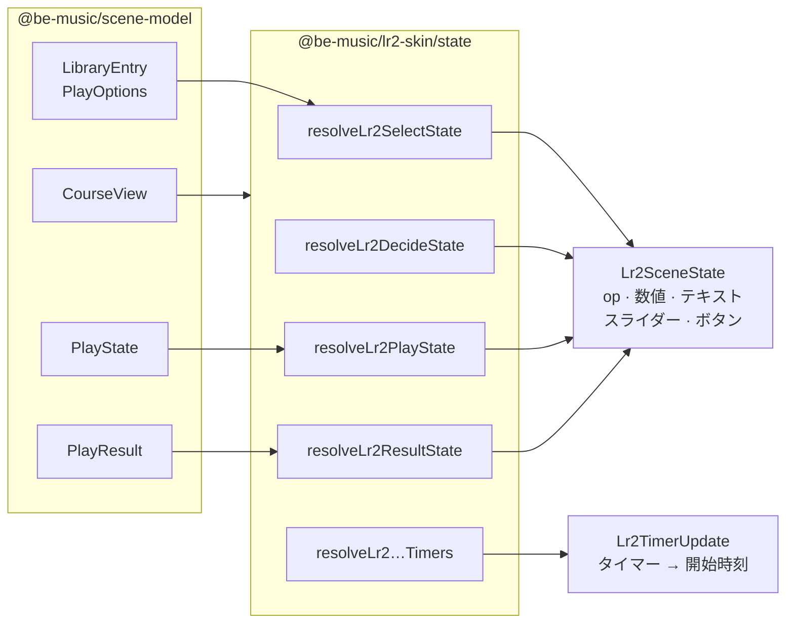

[English version](./lr2-skin.md)

# LR2 skin 実装メモ

この文書は、現在の `@be-music/lr2-skin` 実装をまとめます。
この package は Lunatic Rave 2 skin file を renderer 非依存の data structure へ parse します。PixiJS rendering は `@be-music/player-web`、CLI/TUI rendering は `@be-music/player-tui` の責務です。CLI/TUI は LR2 skin を使用しません。

## 対象範囲

- `@be-music/lr2-skin` は select、decide、play、result scene の `.lr2skin` CSV file を読み込みます。
- dropped folder や in-memory file map から theme asset を解決します。case-insensitive path、wildcard file reference、TGA / DDS image、DXA archive に対応します。
- skin timing、op condition、source rectangle、destination keyframe、scene 固有の element group を plain TypeScript object として保持します。
- PixiJS object、WebAudio node、browser DOM UI は作成しません。

## シーンモデル

skin kind は skin path と scene directory から判定します。
play skin は variant ごとにまとめ、browser player が譜面に合う layout を選べるようにします。

- `5`
- `7`
- `9`
- `10`
- `14`

LR2 には鍵盤モード用の play skin がないため、`24` / `48` KEY の譜面は `7` / `14` の play skin を借ります（`play-skin.ts` の `PLAY_SKIN_FALLBACKS`）。frame、gauge、judge の画像は skin が、レーンはホストのフォールバック playfield が描きます。

parser は select、decide、play、result data を 1 つの `Lr2Skin` shape に保持します。
consumer は scene に必要な field だけを読みます。

## コース

LR2 には、コース全体の結果を出す専用のシーンがあります。`#INFORMATION` の type 15 で、慣例では `CourseResult/` の下に置きます。`loadLr2ThemeSkinsFromFiles` はこれを `courseResultSkin` として読み込み、コース結果用のジングルも読みます。`result` の検索がこのスキンを選ぶことはありません。

LR2 は BGM とシステムサウンドを、各ファイルを名指しするサウンドセット `LR2files/Sound/*.lr2ss` から探します。標準の `lr2.lr2ss` は `#COURSECLEAR` / `#COURSEFAIL` を `Sound/lr2/course_clear.wav` / `course_fail.wav` に割り当てています。`loadLr2ThemeSkinsFromFiles` は、ドロップされたサウンドセット（`lr2.lr2ss` を優先）から選曲 / 決定の BGM、クリア / 失敗 / コースのジングル、カーソル・フォルダ・オプションの音を読みます。`*` のフォルダは `#CUSTOMFILE` の既定値で埋め、名指しされたファイルがなければ別の音声拡張子のものを使います。サウンドセットがないときや、そこに名前のないファイルは、`Sound/lr2/` の下をステム名で探します（コースのジングルは `course_clear` か `courseclear`）。

LR2 はシーンが始まるたびにスキンを読み込むので、`#IF` ブロックはシーンの間ずっと変わらない状態を条件にできます。コースでは、それがコースの op です（OpenLR2 `LR2f.cpp` L5403-L5444）。

| op              | `LR2_OP`                                            | 意味                                                |
| --------------- | --------------------------------------------------- | --------------------------------------------------- |
| 280-288         | `COURSE_STAGE1`-`COURSE_STAGE9`                     | 1〜9 ステージ目を遊んでいて、最後のステージではない |
| 289             | `COURSE_STAGE_FINAL`                                | 最後のステージ                                      |
| 290             | `COURSE`                                            | コース（選択中のバー、または遊んでいるコース）      |
| 291 / 292 / 293 | `COURSE_NONSTOP` / `COURSE_EXPERT` / `COURSE_GRADE` | コースの種類：NONSTOP / EXPERT / GRADE              |

テーマは、これらの op をオフにした状態で一度だけ解析します。`Lr2ThemeSkins.loadSkin({ kind, playVariant, parseOps })` は、読み込み済みのファイルからスキンの 1 つを解析し直します。そのとき `#IF` / `#ELSEIF` の評価中は、追加の op を真として扱います（`LoadLr2SkinOptions.parseOps`）。`pickLr2PlaySkinVariant` は譜面を遊ぶプレイスキンの variant を返すので、ホストはコースのステージ用にそのスキンを解析し直せます。

コース用スキンが読む値（数値 250-259、テキスト 150-170、104 / 105 のコースのコンボ）はシーンの状態です。[`@be-music/lr2-skin/state`](#シーンの状態) がコースの `CourseView` から求め、`CourseView` は `@be-music/player-web` が渡します。[コースと段位認定](./player-web.ja.md#コースと段位認定) を参照してください。

## 番号表

スキンはエンジンの状態を番号で指します。`#DST_*` の行や `#IF` の op、その行が従う `timer`、`#SRC_NUMBER` の `num`、`#SRC_TEXT` の `st`、`#SRC_BUTTON` と `#SRC_SLIDER` の `type`、`#SRC_BAR_BODY` と `#SRC_BAR_LAMP` の番号、実行時に結び付ける画像の `gr` です。`@be-music/lr2-skin/ids` はこれらに種類ごとの表で名前を付け、各項目に意味を、節の見出しにそれを設定・参照する画面を書いています。

| 表                                    | 名前を付けるもの        | 節                                                                                                                                                           |
| ------------------------------------- | ----------------------- | ------------------------------------------------------------------------------------------------------------------------------------------------------------ |
| `LR2_OP`                              | op（`dst_option`）      | 選択中のバー、プレイオプション、読み込みとリプレイ、リザルトの結果、自己ベスト、譜面、プレイ中のランク・ゲージ・判定、コース、リザルトのランク、コースの作成 |
| `LR2_TIMER`                           | `timer`                 | 全シーン、選曲（バーの一覧、パネル、コースの作成）、プレイ（READY、ゲージ、判定、フルコンボ、レーンのタイマー列、リズム）、リザルト                          |
| `LR2_NUM`                             | `#SRC_NUMBER` の `num`  | オプションと時計、プレイヤーの累計、選択中の譜面、プレイ中のスコア、リザルトの更新前後、コースのステージのレベル                                             |
| `LR2_TEXT`                            | `#SRC_TEXT` の `st`     | 曲の情報、検索語、スキン、オプションパネルの表示、コース                                                                                                     |
| `LR2_BUTTON`                          | `#SRC_BUTTON` の `type` | パネル、バーの一覧とプレイ、プレイオプション、コースの作成                                                                                                   |
| `LR2_SLIDER`                          | `#SRC_SLIDER` の `type` | バーの一覧の位置、ハイスピード、レーンカバー、プレイの進み                                                                                                   |
| `LR2_BAR_BODY` / `LR2_BAR_BODY_KINDS` | `#SRC_BAR_BODY` の番号  | バーの種類と、解析後の `Lr2BarBodyKind`                                                                                                                      |
| `LR2_BAR_LAMP` / `LR2_BAR_LAMP_KINDS` | `#SRC_BAR_LAMP` の番号  | クリアランプと、解析後の `Lr2BarLampKind`。ランプの op 100-105 も同じ順                                                                                      |
| `LR2_GR`                              | `gr`                    | LR2 が実行時に結び付ける画像（STAGEFILE、BACKBMP、BANNER、スキンのサムネイル、黒、白）                                                                       |

短い範囲は番号ごとに名前を付けます（コースのステージ 280-289、パネルの op 20-29 とパネルのボタン 1〜9、NONSTOP のつなぎ）。長い範囲は最初の番号だけを持ちます。レーンのタイマー列（`LR2_TIMER.BOMB_1P`、`LN_HOLD_1P`、`KEY_ON_1P`、`KEY_OFF_1P` とその 2P 側）はスクラッチのタイマーで、`LR2_LANE_TIMER_BANK_SIZE` 本のレーンのうち鍵盤 N は `+ N` です。`LR2_OP.COURSE_STAGES_OVER + N`、`COURSE_SONGS_ADDED + N`、`COURSE_STAGE_DIFFICULTY + 10 × i + 難易度` はコースの作成とステージの難易度の op です。

番号は標準スキンの説明と OpenLR2 に従い、両者が食い違うところは `LR2body.exe` に従います。292 が EXPERT、293 が GRADE です（標準スキンの説明は逆です）。op 571 は意図どおりコースを作っている間だけ立てます。バイナリでは 572 に抜け落ち、どちらでも立ちます。

標準スキンの説明ではっきりしないところは、OpenLR2 の `LR2_skinobject.cpp`（`GetOptionFlag_dst`、`SetObjectValue_Num`）と `ProcS_Select` に従います。op 20 はオプションパネルがどれも開いていない間、21-29 はパネル 1〜9 が開いている間に立ちます。op 53 は EXTRA MODE です。数値 102 は判定済みのノーツに対するスコアレート（プレイ中の値）、115 は全ノーツに対するレートです。テキスト 16 / 26 は LR2 の楽曲データベースにある譜面のタグです（`LR2_TEXT.TAG`。beatoraja はここにアーティストとサブアーティストを描きます）。

[#430](https://github.com/nulltask/be-music/issues/430) で確度が低いとした番号も、同じソースと `SaveResult`、`ProcI_Result` で確かめました。

- op 1 はフォルダのバー（LR2 のフォルダ、レベルフォルダ、カスタムフォルダ）で立ちます。op 34 は GHOST がオフのときで、判定が自動のときも立ちます。be-music にはゴーストがないので、常に立ちます。op 400-402 はキーコンフィグ画面のページ（7 / 14、9、5 / 10 KEYS）で、その後の画面でもそのまま残ります。op 999 は 900-998 と同じ `#CUSTOMOPTION` の op です。
- op 200-207 は、判定済みのノーツに対する EX スコアのランク（`exscore × 9 / (判定済みノーツ × 2)`）で、最初のノーツが判定されるまではどれも立ちません。
- 数値 38-41 はプレイをまたいだプレイヤーの連続コンボ、その最長、LR2 のトライアルレベル（プレイのミッションの段階）とその一つ下です。92-94 はインターネットランキングの順位、人数、クリア率です。150-153 は、プレイのこの時点での自己ベストとターゲットの EX スコア（LR2 のペースメーカー）と、EX スコアとそれぞれとの差です。
- 数値 109 と 154 は次の DJ ランクまでの差です。EX スコアから、全ノーツに対する次のランクの境界 `floor(ノーツ × 2 × (ランク + 1) / 9)` を引きます。境界に届くまでは負の値で、F は E まで、AAA は満点までを数えます。
- 自己ベストのレート（73、85-89）は整数の百分率で、切り捨てます。
- テキスト 20-29 は LR2 のタグ編集で書き換える欄です。20-28 はリザルト以外のどの画面でも 10-18 を繰り返し、リザルトでは LR2 がテキスト 20 をインターネットランキングのメッセージに使います。テキスト 18 / 28 は `#DIFFICULTY` の番号（0-5）で、op 150-155 がその名前に当たります。テキスト 29 は LR2 の ex レベルで、プレイヤーが楽曲データベースに設定するレベルです。LR2 はテキスト 10-29 を選曲画面で設定し、決定・プレイ・リザルトでもそのまま保ちます。

beatoraja は LR2 互換の番号を LR2 と同じ値で持つので、`@be-music/beatoraja-skin` はそれらを自分の名前のままこの表から取り（`BEATORAJA_OP.FOLDERBAR` は `LR2_OP.FOLDER_BAR`、`TIMER_READY` は `LR2_TIMER.READY`）、beatoraja 独自の番号だけを自分で持ちます。beatoraja にとって別の意味を持つ LR2 の番号もいくつかあり、それは beatoraja 自身の表が名前を付けます。数値 92 はメイン BPM、op 400 は CONSTANT のオプションで、beatoraja には数値 38-41・93-94 とテキスト 17-29 がありません。parser の解析時の op と `@be-music/player-web` の LR2 シーンもこの表を使います。

ここで名前を付けないもの：op 900-999（スキン独自の `#CUSTOMOPTION`）、`#SRC_BARGRAPH` の種類、`#DST_*` の欄の小さな列挙（`blend`、`center`、`acc`。`skin/lr2/render.ts` が読むところで対応付けます）。

## シーンの状態

`@be-music/lr2-skin/state` は、`@be-music/scene-model` のシーンモデル（[シーンモデル](./scene-model.ja.md)）を [番号表](#番号表) に写します。画面ごとに、どの op が立つか、各数値とテキストに何を描くか、各スライダーをどこに置くか、各ボタンのどのセルを描くか（`Lr2SceneState`）、そして画面のある瞬間にどのタイマーを始め、どれを止めるか（`Lr2TimerUpdate`：始めるタイマーとその開始時刻、止めるタイマー）を返します。スキンファミリーのビューは、スキンが描く番号をこの状態に問い合わせるだけで、LR2 の語彙を自分では持ちません。

| 関数                                                        | 受け取るもの                                                                                                                                      | 返すもの                                                                           |
| ----------------------------------------------------------- | ------------------------------------------------------------------------------------------------------------------------------------------------- | ---------------------------------------------------------------------------------- |
| `resolveLr2SelectState`                                     | カーソルの下のバー（`LibraryEntry`）、`PlayOptions`、記録のランプ、開いているパネル、スキンのカスタムオプション、画面の事実                       | op、数値、テキスト、スライダー、ボタンのセル                                       |
| `resolveLr2SelectButton`                                    | `#SRC_BUTTON` の type                                                                                                                             | ボタンが求めること：パネル、ハイスピードの増減、オプションの切り替えや設定、プレイ |
| `resolveLr2SelectTimers`                                    | 画面の表示、カーソルの移動、パネルの開閉、コースの作成の開始と終了                                                                                | タイマー 0、10-13、17 / 18、21-29、31-39                                           |
| `pickLr2BarBody`、`resolveLr2BarLevel`、`resolveLr2BarLamp` | 一覧のバー、その譜面、記録のランプ                                                                                                                | バーに描くボディ、レベル、ランプ                                                   |
| `resolveLr2DecideState`                                     | これから遊ぶ譜面と、そのコース                                                                                                                    | op、テキスト、コースの数値                                                         |
| `resolveLr2PlayState`                                       | プレイの準備（`Lr2PlaySetup`：譜面、レーン、特徴、オプション、ゲージ、コース）と 1 フレーム（`Lr2PlayFrame`：`PlayState` の見え方、スコア、時刻） | op、数値、テキスト、スライダー、バーグラフ                                         |
| `resolveLr2PlayTimers`、`resolveLr2LaneTimer`               | プレイの瞬間（シーンの段階、判定、フルコンボ、ゲージ、レーン）、レーン                                                                            | タイマー 0-3、40-49、レーンのタイマー列 50-139                                     |
| `resolveLr2ResultState`                                     | `PlayResult`、そのコース、遊んだスキンの `#FLIPRESULT`、スキンのカスタムオプション                                                                | op、数値、テキスト、スライダー、バーグラフ                                         |
| `resolveLr2CourseOps`、`resolveLr2CourseText` など          | `CourseView`、作成中のコース                                                                                                                      | コースの op・数値・テキスト、コース作成の op・テキスト・ボタン                     |

これらの関数は純粋で決定的です。時計も DOM もレンダラーも読まず、乱数も引かず、import するのはシーンモデル、エンジンのルール、譜面モデル、番号表だけです。時刻は入力として受け取ります。時計の数値は `Lr2Clock` で、プレイの時刻はフレームで、各タイマーの開始は瞬間の `at` で渡します。`pnpm run check` は `src/state/` に、実行環境に依存しないことと時計を読まないことの lint 規則を課します。Web ランタイムの LR2 ファミリーのビュー（決定画面、プレイ画面、リザルト画面のもの）がこれらを呼び、`@be-music/player-web` の LR2 の選曲シーンも、ビューに置き換わるまではこれらを呼びます。

LR2 のプレイビュー（`@be-music/player-web` の `view/lr2/play-view.ts`）は、プレイの op、数値、テキスト、スライダー、バーグラフを、フレームごとに `resolveLr2PlayState` で読みます。渡すのはフレームの `PlayState`、スコア、時刻、スコアの表示値、BPM、フレームレートです。プレイのタイマーは、フレームごとのきっかけから `resolveLr2PlayTimers` で始めて止め、一度きりのものはビュー自身のタイマー管理が終わらせます。

| きっかけ                           | タイマー                                                                      |
| ---------------------------------- | ----------------------------------------------------------------------------- |
| シーンの開始                       | 0 と 1（`#STARTINPUT` のあと）                                                |
| 読み込みの終わり、譜面の開始       | 40（READY）、41                                                               |
| プレイの終わり                     | 2（`#FADEOUT`）、3（`#CLOSE`）                                                |
| 片側の判定                         | 46 / 47。判定ごとに始め直す                                                   |
| フルコンボ                         | 48 と 49。スキンの演出が終わるまで                                            |
| ゲージの上昇、100 % への到達       | 42 は上昇の演出が終わるまで。44 は 100 % を下回るまで                         |
| レーンのボム                       | そのレーンのボムのタイマー（50-69）。プレイフィールドがボムを消すまで         |
| レーンでロングノートを押している間 | そのレーンのホールドのタイマー（70-89）。離したあと、その長さでフェードアウト |

キーオンの組（100-119）はプレイのセッションのものです。セッションはどの種類のキービームも LR2 のキーオンの番号（`resolveLr2LaneTimer('key-on', …)`）で持ち、LR2 のビューはそれをそのまま読みます。レーンの番号とタイマーの番号は LR2 のビューの中にとどめ、共有のプレイフィールドはチャンネルで尋ねます。

## 解析済み directive

実装済み directive:

- `#INFORMATION`, `#ENDOFHEADER`
- `#INCLUDE`
- `#IMAGE`
- `#LR2FONT`
- `#FONT`
- `#CUSTOMOPTION`
- `#CUSTOMFILE`
- `#SETOPTION`
- `#SCRATCH`
- `#STARTINPUT`
- `#LOADSTART`
- `#PLAYSTART`
- `#CLOSE`
- `#RELOADBANNER`
- `#RESOLUTION`, `#TRANSCOLOR`, `#FADEOUT`, `#SKIP`, `#LOADEND`
- `#FLIPSIDE`, `#FLIPRESULT`, `#DISABLEFLIP`
- `#IF`, `#ELSEIF`, `#ELSE`, `#ENDIF`

実装済み element family:

- `#SRC_IMAGE` / `#DST_IMAGE` による image element
- number、text、slider、bargraph、button、mouse cursor element
- play scene の BGA、groove gauge、judge line、measure line、judge/combo effect、key-on effect、LN hold effect、bomb
- play scene のノート画像: `#SRC_NOTE`、`#SRC_LN_START` / `#SRC_LN_BODY` / `#SRC_LN_END`、`#SRC_MINE` と、そのオートプレイ用 `#SRC_AUTO_*`
- `#SRC_README` / `#DST_README` と `#SRC_ONMOUSE` / `#DST_ONMOUSE` element
- select scene の bar body、title、level、lamp、my lamp、rival / rival lamp、rank、flash、cursor、click target
- result scene の gauge chart と score chart
- `STAGEFILE`、`BACKBMP`、`BANNER`、skin thumbnail、black、white の LR2 special graphic

## アセット解決

`loadLr2SkinFromSourceFiles()` は source file collection を受け取り、現在の skin file から相対 path を解決します。
resolver は LR2 風の path separator を normalize し、実際の LR2 theme でよくある path casing の揺れに備えて case-insensitive lookup を行います。

resolver は LR2 theme が使う wildcard asset reference も扱います。
asset が DXA archive 内にある場合、DXA reader が archive entry を同じ lookup path へ露出します。
TGA image は `tga.ts`、DDS image は `dds.ts` でデコードします（ブラウザは DDS をデコードできないため、browser player がこれを `.dds` のデコーダとして登録します）。bitmap font は `#LR2FONT` declaration を元に `font.ts` で準備します。

## Browser player での利用

`@be-music/player-web` は次の scene module で parsed skin model を使用します。

- `scene/lr2/select.ts`
- `view/lr2/decide-view.ts`
- `view/lr2/play-view.ts`（`play-elements.ts`、`play-timers.ts`、`play-hud.ts` とともに）
- `view/lr2/result-view.ts`

`skin/lr2/render.ts` と `skin/lr2/scene-render.ts` の共有 helper は destination keyframe、op-gated visibility、source cell、sprite transform、text、number、slider、bargraph を評価します。
シーンは [シーンの状態を求める関数](#シーンの状態) を通して op を立て、タイマーを始め、数値・テキスト・ボタン・スライダーを解決します。
browser player は song metadata、current judge、combo、gauge、score、BGA texture、play option、result history などの runtime value を parsed skin element へ結び付けます。

## 互換性の境界

parser は意図的に permissive です。
有用な object を作れない malformed element line は skip し、skin の残りは読み込み続けます。
これは、壊れた任意 asset 1 つで browser player 全体を止めないための LR2 theme loading 向け方針です。

検証済みとして扱うのは Lunatic Rave 2 default skin set のみです。
他の LR2 skin も読み込み自体は可能ですが、細かな layout 差、未実装の animation detail、未対応の button behavior が残る場合があります。

## 既知の未対応

- parser は LR2 の全 directive と全 `button_type` を実装しているわけではありません。
- `#CUSTOMOPTION` と `#CUSTOMFILE` は parse して公開しますが、user-facing な option persistence は host application の責務です。
- system font rendering は browser renderer 側の責務です。`@be-music/lr2-skin` は宣言された font metadata だけを保持します。
- PixiJS texture upload、video BGA playback、WebAudio system sound、DOM text input overlay など renderer 固有の挙動はこの package の外にあります。
- シーンの状態が LR2（OpenLR2）とまだ違うところ。どれも be-music にまだないデータや画面が要ります。
  - プレイヤーの累計（数値 30-41）は 0 です。プレイの履歴を保っていません。
  - インターネットランキングは何も読みません。数値 92-94 と、リザルト画面のテキスト 20 のメッセージです。
  - ペースメーカーは 0 です。数値 150 / 151 は 0、152 / 153 は EX スコアを読みます。自己ベストのゴーストもターゲットもプレイに届いていません。
  - テキスト 29 は、LR2 がデータベースに保つ ex レベルの代わりに、INSANE の譜面のプレイレベルを読みます。
  - リザルト画面のバーグラフとスライダーは、LR2 のバーグラフの種類（1 進み、2 読み込み、10-15 EX スコア・自己ベスト・ターゲット）ではなく独自の番号で読みます。LR2 の種類はプレイを自己ベストやターゲットと比べますが、リザルトはそれらをまだ持っていません。
  - op 400-402 は譜面のキーモードに従います。そのページに従えるキーコンフィグ画面がありません。
