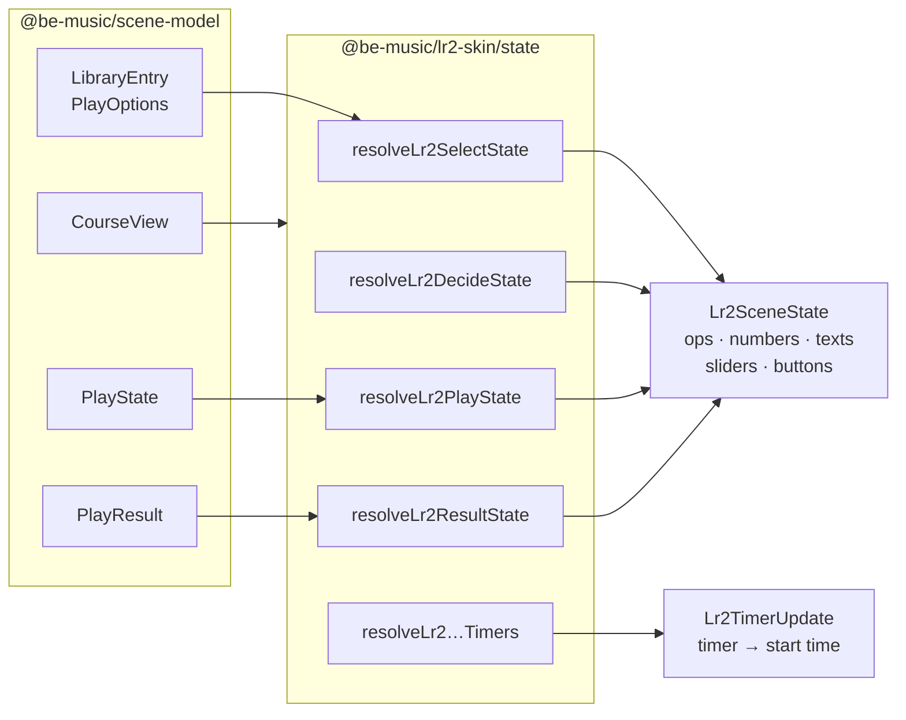

[Japanese version](./lr2-skin.ja.md)

# LR2 skin implementation notes

This document summarizes the current `@be-music/lr2-skin` implementation.
The package parses Lunatic Rave 2 skin files into renderer-independent data structures; PixiJS rendering belongs to `@be-music/player-web`, and CLI/TUI rendering belongs to `@be-music/player-tui`, which does not consume LR2 skins.

## Scope

- `@be-music/lr2-skin` reads `.lr2skin` CSV files for select, decide, play, and result scenes.
- The package resolves theme assets from dropped folders or in-memory file maps, including case-insensitive paths, wildcard file references, TGA and DDS images, and DXA archives.
- The package keeps skin timing, op conditions, source rectangles, destination keyframes, and scene-specific element groups in plain TypeScript objects.
- The package does not create PixiJS objects, WebAudio nodes, or browser DOM UI.

## Scene model

Skin kind is derived from the skin path and scene directory.
Play skins are grouped by variant so the browser player can choose the layout that matches the chart:

- `5`
- `7`
- `9`
- `10`
- `14`

LR2 never shipped keyboard-mode play skins, so `24` / `48` KEY charts borrow a `7` / `14` play skin (`PLAY_SKIN_FALLBACKS` in `play-skin.ts`): the skin supplies the frame, gauge, and judge graphics, and the lanes fall back to the host's playfield.

The parser keeps select, decide, play, and result data in one `Lr2Skin` shape.
Consumers read only the fields that make sense for their scene.

## Courses

LR2 has a scene of its own for the result of a whole course: `#INFORMATION` type 15, conventionally under `CourseResult/`. `loadLr2ThemeSkinsFromFiles` loads it as `courseResultSkin`, along with the course-result jingles. A `result` lookup never picks it.

LR2 finds its BGM and system sounds through the sound set, `LR2files/Sound/*.lr2ss`, which names each file: the stock `lr2.lr2ss` maps `#COURSECLEAR` / `#COURSEFAIL` to `Sound/lr2/course_clear.wav` / `course_fail.wav`. `loadLr2ThemeSkinsFromFiles` reads the dropped sound set (`lr2.lr2ss` first) for the select / decide BGM, the clear / fail / course jingles and the cursor, folder and option sounds, filling a `*` folder with its `#CUSTOMFILE` default and taking another audio extension when the named file is missing. Without a sound set, or for a file it does not name, it looks the stem up under `Sound/lr2/` (`course_clear` or `courseclear` for the course jingles).

LR2 reads a skin each time its scene starts, so an `#IF` block can test state that holds for the whole scene. In a course that means the course ops (OpenLR2 `LR2f.cpp` L5403-L5444):

| Op              | `LR2_OP`                                            | Meaning                                           |
| --------------- | --------------------------------------------------- | ------------------------------------------------- |
| 280-288         | `COURSE_STAGE1`-`COURSE_STAGE9`                     | Stage 1-9 is played and is not the last one       |
| 289             | `COURSE_STAGE_FINAL`                                | The last stage                                    |
| 290             | `COURSE`                                            | A course: the selected bar, or the running course |
| 291 / 292 / 293 | `COURSE_NONSTOP` / `COURSE_EXPERT` / `COURSE_GRADE` | Its kind: NONSTOP / EXPERT / GRADE                |

The theme is parsed once, with these ops off. `Lr2ThemeSkins.loadSkin({ kind, playVariant, parseOps })` parses one of its skins again from the files already read, with extra ops held true while `#IF` / `#ELSEIF` are evaluated (`LoadLr2SkinOptions.parseOps`). `pickLr2PlaySkinVariant` names the play-skin variant a chart plays on, so a host can parse that skin again for a course stage.

The values a course skin reads (numbers 250-259, texts 150-170, the course combo on 104 / 105) are scene state: [`@be-music/lr2-skin/state`](#scene-state) resolves them from the course's `CourseView`, which `@be-music/player-web` supplies. See [Courses and dan certification](./player-web.md#courses-and-dan-certification).

## Id tables

A skin refers to the engine's state by number: the ops of a `#DST_*` row or an `#IF`, the `timer` it runs on, the `num` of a `#SRC_NUMBER`, the `st` of a `#SRC_TEXT`, the `type` of a `#SRC_BUTTON` or `#SRC_SLIDER`, the index of a `#SRC_BAR_BODY` or `#SRC_BAR_LAMP`, and the `gr` of a runtime-bound image. `@be-music/lr2-skin/ids` names them in one table per kind, each entry documented with what it means and, by its section, the screen that sets or reads it:

| Table                                 | Names                 | Sections                                                                                                                                                     |
| ------------------------------------- | --------------------- | ------------------------------------------------------------------------------------------------------------------------------------------------------------ |
| `LR2_OP`                              | ops (`dst_option`)    | selected bar, play options, loading and replay, result outcome, best record, chart, running rank / gauge / judgement, courses, result ranks, making a course |
| `LR2_TIMER`                           | `timer`               | every scene, select (bar list, panels, course maker), play (ready, gauge, judge, full combo, lane banks, rhythm), result                                     |
| `LR2_NUM`                             | `#SRC_NUMBER` `num`   | options and clock, player totals, selected chart, running score, result before / after, course stage levels                                                  |
| `LR2_TEXT`                            | `#SRC_TEXT` `st`      | song info, search word, skin, option panel labels, courses                                                                                                   |
| `LR2_BUTTON`                          | `#SRC_BUTTON` `type`  | panels, bar list and play, play options, making courses                                                                                                      |
| `LR2_SLIDER`                          | `#SRC_SLIDER` `type`  | bar-list position, hi-speed, lane cover, play progress                                                                                                       |
| `LR2_BAR_BODY` / `LR2_BAR_BODY_KINDS` | `#SRC_BAR_BODY` index | each bar kind and the parsed `Lr2BarBodyKind`                                                                                                                |
| `LR2_BAR_LAMP` / `LR2_BAR_LAMP_KINDS` | `#SRC_BAR_LAMP` index | each clear lamp and the parsed `Lr2BarLampKind`; the lamp ops 100-105 follow the same order                                                                  |
| `LR2_GR`                              | `gr`                  | the images LR2 binds at run time (STAGEFILE, BACKBMP, BANNER, skin thumbnail, black, white)                                                                  |

A short range is named id by id (course stages 280-289, the panel ops 20-29 and panel buttons 1-9, NONSTOP connections). A long one keeps its first id: a lane bank (`LR2_TIMER.BOMB_1P`, `LN_HOLD_1P`, `KEY_ON_1P`, `KEY_OFF_1P` and their 2P banks) is the scratch timer, with key N at `+ N` for the `LR2_LANE_TIMER_BANK_SIZE` lanes; `LR2_OP.COURSE_STAGES_OVER + N`, `COURSE_SONGS_ADDED + N` and `COURSE_STAGE_DIFFICULTY + 10 × i + difficulty` are the course-maker and stage-difficulty ops.

The numbers follow the stock skin's documentation and OpenLR2, and `LR2body.exe` where they disagree: 292 is EXPERT and 293 GRADE (the stock documentation swaps them). Op 571 lights only while a course is being made, as intended; in the binary it falls through to 572 and lights either way.

Where the stock documentation is unclear, OpenLR2's `LR2_skinobject.cpp` (`GetOptionFlag_dst`, `SetObjectValue_Num`) and `ProcS_Select` decide: op 20 lights while no option panel is open and 21-29 while panel 1-9 is, op 53 is EXTRA MODE, number 102 is the running score rate over the notes judged so far and 115 the rate over every note, and texts 16 / 26 are the chart's tag in LR2's song database (`LR2_TEXT.TAG`; beatoraja draws the full artist there).

The ids [#430](https://github.com/nulltask/be-music/issues/430) named with less confidence were checked against the same sources, with `SaveResult` and `ProcI_Result`:

- Op 1 lights on a folder bar (LR2's folders, level folders and custom folders). Op 34 is GHOST off, and holds while the judge is automatic as well; be-music has no ghost, so it always holds. Ops 400-402 are the key-config screen's page (7 / 14, 9, 5 / 10 KEYS), which stays set on the screens after it. Op 999 is a `#CUSTOMOPTION` op like 900-998.
- Ops 200-207 rank the EX score over the notes judged so far, `exscore × 9 / (notes judged × 2)`, and none holds before the first note is judged.
- Numbers 38-41 are the player's running combo across plays, its longest run, LR2's trial level (its ladder of play missions) and the step below it; 92-94 are the internet ranking's place, players and clear rate; 150-153 are the best record's and the target's EX score at this point of the play, LR2's pacemakers, and the EX score less each.
- Numbers 109 and 154 are the distance to the next DJ Rank: the EX score less the next rank's border over every note, `floor(notes × 2 × (rank + 1) / 9)`. They read negative until the border is reached, F counts down to E, and AAA to the maximum.
- The best record's rates (73, 85-89) are whole percents, truncated.
- Texts 20-29 are the fields LR2's tag editor edits: 20-28 repeat 10-18 on every screen but the result, where LR2 reuses text 20 for the internet ranking's message. Texts 18 / 28 are the `#DIFFICULTY` number (0-5), which the ops 150-155 name. Text 29 is LR2's ex level, a level a player sets in its song database; LR2 sets texts 10-29 on the select screen and keeps them through decide, play and result.

beatoraja keeps LR2's numbers for its LR2-compatible ids, so `@be-music/beatoraja-skin` takes those from these tables under its own names (`BEATORAJA_OP.FOLDERBAR` is `LR2_OP.FOLDER_BAR`, `TIMER_READY` is `LR2_TIMER.READY`) and numbers only beatoraja's own ids. A few LR2 ids mean something else to beatoraja, which its own table names: number 92 is the main BPM and op 400 the CONSTANT option, and beatoraja defines no numbers 38-41 or 93-94 and no texts 17-29. The parser's parse-time ops and `@be-music/player-web`'s LR2 scenes use the tables too.

Not named here: ops 900-999 (the skin's own `#CUSTOMOPTION`s), the `#SRC_BARGRAPH` types, and the small enums of the `#DST_*` fields (`blend`, `center`, `acc`), which `skin/lr2/render.ts` maps where it reads them.

## Scene state

`@be-music/lr2-skin/state` maps the scene models of `@be-music/scene-model` ([Scene models](./scene-model.md)) to the [id tables](#id-tables): for each screen, which ops hold, which value each number and text draws, where each slider sits and which cell each button draws (an `Lr2SceneState`), and which timers a moment of the screen starts and stops (an `Lr2TimerUpdate`: each timer with the time it starts at, and the timers that stop). The skin family's view asks the state for the ids its skin draws; it keeps no LR2 vocabulary of its own.

| Resolver                                                    | Takes                                                                                                                                                   | Gives                                                                         |
| ----------------------------------------------------------- | ------------------------------------------------------------------------------------------------------------------------------------------------------- | ----------------------------------------------------------------------------- |
| `resolveLr2SelectState`                                     | The bar under the cursor (`LibraryEntry`), the `PlayOptions`, the record's lamp, the open panels, the skin's custom options and the screen's facts      | Ops, numbers, texts, sliders, button cells                                    |
| `resolveLr2SelectButton`                                    | A `#SRC_BUTTON` type                                                                                                                                    | What it asks for: a panel, a hi-speed step, an option to cycle or set, a play |
| `resolveLr2SelectTimers`                                    | The screen appearing, the cursor moving, a panel opening or closing, making a course starting or ending                                                 | Timers 0, 10-13, 17 / 18, 21-29 and 31-39                                     |
| `pickLr2BarBody`, `resolveLr2BarLevel`, `resolveLr2BarLamp` | A bar of the list, its chart, its record's lamp                                                                                                         | The bar body, level and lamp it draws                                         |
| `resolveLr2DecideState`                                     | The chart about to be played, and its course                                                                                                            | Ops, texts, the course's numbers                                              |
| `resolveLr2PlayState`                                       | The play's setup (`Lr2PlaySetup`: chart, lanes, features, options, gauge, course) and a frame (`Lr2PlayFrame`: a `PlayState` view, the score, the time) | Ops, numbers, texts, sliders, bar graphs                                      |
| `resolveLr2PlayTimers`, `resolveLr2LaneTimer`               | A moment of the play (scene stages, a judgement, a full combo, the gauge, a lane), a lane                                                               | Timers 0-3, 40-49 and the lane banks 50-139                                   |
| `resolveLr2ResultState`                                     | A `PlayResult`, its course, the played skin's `#FLIPRESULT`, the skin's custom options                                                                  | Ops, numbers, texts, sliders, bar graphs                                      |
| `resolveLr2CourseOps`, `resolveLr2CourseText`, …            | A `CourseView`, a course being made                                                                                                                     | The course ops, numbers and texts, the course maker's ops, texts and buttons  |

The resolvers are pure and deterministic: they read no clock, no DOM and no renderer, draw no random number, and import only the scene models, the engine's rules, the chart model and the id tables. Time comes in as an input — the clock numbers through an `Lr2Clock`, a play's time through its frame, each timer's start through the moment's `at` — and `pnpm run check` holds `src/state/` to the runtime-neutral and clock-free lint rules. The LR2 scenes of `@be-music/player-web` call them today; the LR2 family view of the web runtime will in their place.

## Parsed directives

Implemented directives include:

- `#INFORMATION`, `#ENDOFHEADER`
- `#INCLUDE`
- `#IMAGE`
- `#LR2FONT`
- `#FONT`
- `#CUSTOMOPTION`
- `#CUSTOMFILE`
- `#SETOPTION`
- `#SCRATCH`
- `#STARTINPUT`
- `#LOADSTART`
- `#PLAYSTART`
- `#CLOSE`
- `#RELOADBANNER`
- `#RESOLUTION`, `#TRANSCOLOR`, `#FADEOUT`, `#SKIP`, `#LOADEND`
- `#FLIPSIDE`, `#FLIPRESULT`, `#DISABLEFLIP`
- `#IF`, `#ELSEIF`, `#ELSE`, `#ENDIF`

Implemented element families include:

- Image elements with `#SRC_IMAGE` / `#DST_IMAGE`
- Number, text, slider, bargraph, button, and mouse cursor elements
- Play-scene elements for BGA, groove gauge, judge line, measure line, judge/combo effects, key-on effects, LN hold effects, and bombs
- Play-scene note graphics: `#SRC_NOTE`, `#SRC_LN_START` / `#SRC_LN_BODY` / `#SRC_LN_END`, `#SRC_MINE`, and their `#SRC_AUTO_*` autoplay variants
- `#SRC_README` / `#DST_README` and `#SRC_ONMOUSE` / `#DST_ONMOUSE` elements
- Select-scene bar body, title, level, lamp, my lamp, rival / rival lamp, rank, flash, cursor, and click-target elements
- Result-scene gauge chart and score chart elements
- LR2 special graphics for `STAGEFILE`, `BACKBMP`, `BANNER`, skin thumbnail, black, and white runtime-bound textures

## Asset resolution

`loadLr2SkinFromSourceFiles()` receives a collection of source files and resolves paths relative to the current skin file.
The resolver normalizes LR2-style path separators and performs case-insensitive lookup because real LR2 themes often mix path casing.

The resolver also supports wildcard asset references used by LR2 themes.
When an asset lives inside a DXA archive, the DXA reader exposes the archive entries to the same lookup path.
TGA images are decoded by `tga.ts` and DDS images by `dds.ts` (the browser player registers it as the `.dds` decoder, since browsers cannot decode DDS), and bitmap fonts are prepared from `#LR2FONT` declarations by `font.ts`.

## Browser player usage

`@be-music/player-web` consumes the parsed skin model in these scene modules:

- `scene/lr2/select.ts`
- `scene/lr2/decide.ts`
- `scene/lr2/gameplay.ts`
- `scene/lr2/result.ts`

Shared rendering helpers in `skin/lr2/render.ts` and `skin/lr2/scene-render.ts` evaluate destination keyframes, op-gated visibility, source cells, sprite transforms, text, numbers, sliders, and bargraphs.
The scenes light ops, start timers and resolve numbers, texts, buttons and sliders through the [scene-state resolvers](#scene-state).
The browser player binds runtime values such as song metadata, current judge, combo, gauge, score, BGA textures, play options, and result history onto the parsed skin elements.

## Compatibility boundary

The parser is intentionally permissive.
Malformed element lines are skipped when they cannot produce a useful object, while the rest of the skin continues to load.
This matches the practical needs of LR2 theme loading, where one broken optional asset should not block the whole browser player.

Only the Lunatic Rave 2 default skin set is treated as verified.
Other LR2 skins may load, but small layout differences, missing animation details, or unimplemented button behaviors can remain.

## Known gaps

- The parser does not implement every LR2 directive or every `button_type`.
- `#CUSTOMOPTION` and `#CUSTOMFILE` are parsed and surfaced, but full user-facing option persistence belongs to the host application.
- System font rendering is a browser-renderer concern; `@be-music/lr2-skin` only preserves the declared font metadata.
- Renderer-specific behavior such as PixiJS texture upload, video BGA playback, WebAudio system sounds, and DOM text input overlays lives outside this package.
- Where the scene state still differs from LR2 (OpenLR2), each for want of data or a screen be-music does not have yet:
  - The player's totals (numbers 30-41) read 0: no play history is kept.
  - The internet ranking reads nothing: numbers 92-94, and text 20's message on the result screen.
  - The pacemakers read 0: numbers 150 / 151, and 152 / 153 read the EX score. No best-record ghost or target reaches the play.
  - Text 29 reads an INSANE chart's play level where LR2 reads the ex level its database keeps.
  - The result screen's bar graphs and sliders read their own numbering instead of LR2's bar-graph types (1 progress, 2 loading, 10-15 the EX score, the best and the target). LR2's types compare the play with the best record and the target, which the result does not carry yet.
  - Ops 400-402 follow the chart's key mode: there is no key-config screen whose page they could follow.
