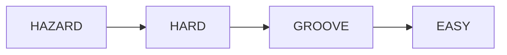

[Japanese version](./play-options-modifiers.ja.md)

# Play options for lanes, charts, and gauges

[Play options and record policy](./play-options.md)

Lane arrangements and chart modifiers follow the implementation named by the selected option. Gauge changes use the selected gauge’s rules.

Table of contents

- [R-RANDOM](#r-random)
- [SPIRAL](#spiral)
- [H-RANDOM](#h-random)
- [Include scratch (LR2)](#include-scratch-lr2)
- [CONVERGE](#converge)
- [ALL-SCR](#all-scr)
- [RANDOM-EX and S-RANDOM-EX](#random-ex-and-s-random-ex)
- [PMS playable RANDOM and S-RANDOM](#pms-playable-random-and-s-random)
- [Source seeds and previous arrangement](#source-seeds-and-previous-arrangement)
- [Result screen: the same arrangement again, and the gauge graph](#result-screen-the-same-arrangement-again-and-the-gauge-graph)
- [SCATTER](#scatter)
- [SYNCHRONIZE RANDOM and SYMMETRY RANDOM](#synchronize-random-and-symmetry-random)
- [M-RAN](#m-ran)
- [BATTLE and M-RAN keys](#battle-and-m-ran-keys)
- [nanasigroove GOOD2BAD, GREAT2BAD and HELLJUDGE](#nanasigroove-good2bad-great2bad-and-helljudge)
- [nanasigroove NOTES](#nanasigroove-notes)
- [Mine REMOVE and ADD](#mine-remove-and-add)
- [ADD LN / ADD CN / ADD HCN / ADD ALL](#add-ln--add-cn--add-hcn--add-all)
- [Scroll REMOVE and ADD](#scroll-remove-and-add)
- [SOFTLANDING](#softlanding)
- [Gauge auto-shift](#gauge-auto-shift)
- [DEATH corrected](#death-corrected)
- [P.ATTACK / G.ATTACK](#pattack--gattack)
- [EXTRA note conversion](#extra-note-conversion)
- [LR2 EXTRA MODE](#lr2-extra-mode)
- [LR2 mania chart options](#lr2-mania-chart-options)
- [LN MODE](#ln-mode)
- [SP TO DP, DP-TO-SP and 9-TO-7](#sp-to-dp-dp-to-sp-and-9-to-7)
- [7 TO 9](#7-to-9)
- [BATTLE, BATTLE AS and D-BATTLE](#battle-battle-as-and-d-battle)
- [Two-player BATTLE and COUPLE](#two-player-battle-and-couple)
- [BATTLE on skins](#battle-on-skins)

## R-RANDOM

Under any ruleset, choose **Play options → Random 1P / Random 2P → R-RANDOM** in the Options dialog. R-RANDOM rotates one side's key lanes as a whole, forwards or reversed; scratch stays fixed. As in beatoraja 0.8.9's `LaneRotateShuffleModifier`, the draw excludes the original order and MIRROR, and every remaining rotation is equally likely. Every ruleset uses this rotation set, and the choice is kept when the ruleset changes; the draw uses the side's seed (see "Source seeds and previous arrangement"). beatoraja treats R-RANDOM as an unassisted option, and a course with the `grade_random` constraint keeps it, as beatoraja keeps its first six random options.

Replays store the choice in `play.randomLane` and `play.options.random1P` / `random2P`, together with every note's final lane and its original lane (`sourceChannel`), so a replay re-applies the recorded lanes instead of drawing again. The built-in select screen's **Lanes** list and the shared play-options API list every lane-option name; a play started with a choice the active rules do not offer fails explicitly. LR2 skins show the selected name in their RANDOM option text, without its source, while their RANDOM buttons (42 / 43) step only through LR2's own six lane options, the cells OFF / MIRROR / RANDOM / S-RANDOM / SCATTER / CONVERGE (`RANDOM`, `lr2:S-RANDOM`, `SCATTER`, `lr2:CONVERGE`), as ADR 0019 has each skin cycle its own source's values. Another source's S-RANDOM or CONVERGE draws on the cell of its name and steps on from it; any other choice draws the first cell, and a click moves it to OFF. beatoraja skins' RANDOM 1P / 2P buttons (42 / 43) step the choice through beatoraja 0.8.9's ten lane options for the focused chart's play mode, PMS or not (the shared RANDOM, and its own S-RANDOM and CONVERGE), and their labels show its slot, another source's S-RANDOM on that name's slot (see [beatoraja skins](./beatoraja-skin.md)); choose the other options in the Options dialog. Its record policy is in [Assist and record policy](./play-options.md#assist-and-record-policy).

Sources: beatoraja 0.8.9 [`Random`](https://github.com/exch-bms2/beatoraja/blob/83574048ba489082eb46df7fe9806b464bf1f526/src/bms/player/beatoraja/pattern/Random.java) and [`LaneShuffleModifier`](https://github.com/exch-bms2/beatoraja/blob/83574048ba489082eb46df7fe9806b464bf1f526/src/bms/player/beatoraja/pattern/LaneShuffleModifier.java), AC 34 [play options](https://p.eagate.573.jp/game/2dx/34/howto/play/option.html). Tracked in [#693](https://github.com/nulltask/be-music/issues/693).

## SPIRAL

Under any ruleset, choose **Random 1P / Random 2P → SPIRAL**. SPIRAL draws one step of 1 to N−1 lanes and, on each timeline, rotates the key lanes one step further than on the previous timeline; while a long note is held, the rotation stays where it is until after its tail. As in beatoraja 0.8.9's `SpiralRandomizer`, every timeline counts, including one with only scratch, mine, invisible or other-side objects, or only a long-note tail. Scratch stays fixed, and the step is drawn from the side's seed.

beatoraja marks SPIRAL as LIGHT_ASSIST; its record policy is in [Assist and record policy](./play-options.md#assist-and-record-policy). A course with the `grade_random` constraint keeps it. Replays record SPIRAL in `play.randomLane` and `play.options` with every note's final lane, so a replay does not draw it again.

Sources: beatoraja 0.8.9 [`Random`](https://github.com/exch-bms2/beatoraja/blob/83574048ba489082eb46df7fe9806b464bf1f526/src/bms/player/beatoraja/pattern/Random.java) and [`Randomizer`](https://github.com/exch-bms2/beatoraja/blob/83574048ba489082eb46df7fe9806b464bf1f526/src/bms/player/beatoraja/pattern/Randomizer.java). Tracked in [#696](https://github.com/nulltask/be-music/issues/696).

## H-RANDOM

Under any ruleset, choose **Random 1P / Random 2P → H-RANDOM** and set **H-RANDOM threshold BPM (beatoraja)**: 1 to 1000, default 120, the bounds of beatoraja 0.8.9's `PlayerConfig`. H-RANDOM places notes timeline by timeline like S-RANDOM, but each note prefers a lane whose last note is more than one sixteenth note at the threshold BPM earlier (`ceil(15000 / BPM)` ms); when no free lane qualifies, it takes the free lanes idle longest. A held long note keeps its lane through its tail, and scratch stays fixed. The draw uses the side's seed. As in beatoraja's `Randomizer.create`, the same threshold also drives ALL-SCR, beatoraja CONVERGE and S_RANDOM_PLAYABLE.

beatoraja marks H-RANDOM as LIGHT_ASSIST; its record policy is in [Assist and record policy](./play-options.md#assist-and-record-policy). Replays record the choice in `play.randomLane` and `play.options`, the clamped threshold in `play.options.hRandomThresholdBPM`, and every note's final lane.

Sources: beatoraja 0.8.9 [`Randomizer`](https://github.com/exch-bms2/beatoraja/blob/83574048ba489082eb46df7fe9806b464bf1f526/src/bms/player/beatoraja/pattern/Randomizer.java) and [`PlayerConfig`](https://github.com/exch-bms2/beatoraja/blob/83574048ba489082eb46df7fe9806b464bf1f526/src/bms/player/beatoraja/PlayerConfig.java). Tracked in [#697](https://github.com/nulltask/be-music/issues/697).

## Include scratch (LR2)

In the Options dialog, **Include scratch 1P / 2P (LR2)** adds the scratch to that side's MIRROR, RANDOM, LR2 S-RANDOM, SCATTER or LR2 CONVERGE on 5, 7, 10 and 14 KEY. Each switch defaults to off. LR2 beta3's hidden command activates one side by holding buttons 12 and 13 when deciding the chart. Be-Music stores each side's switch independently. In LR2 BATTLE, players who pick the same lane option share the 1P arrangement. In D-BATTLE, enabling either switch keeps the scratches playable on both sides. [OpenLR2 input handling](https://github.com/GOMazk/OpenLR2/blob/583a38503555e59c4bafa49d60b9d0714c9007c2/Main.cpp#L1235-L1257) · [BATTLE placement](https://github.com/GOMazk/OpenLR2/blob/583a38503555e59c4bafa49d60b9d0714c9007c2/LR2f.cpp#L27432-L27485)

MIRROR swaps the scratch and the farthest key. With 1P RANDOM, when the draw maps a key to the scratch, the fixed key setting selects which source key takes that destination. For CONVERGE, 0 selects the scratch on either side and the other values select the corresponding key. The chosen lane option determines record eligibility. The switch adds no assist classification. Replays store both switches and the resulting lanes. [OpenLR2 permutations](https://github.com/GOMazk/OpenLR2/blob/583a38503555e59c4bafa49d60b9d0714c9007c2/LR2f.cpp#L27100-L27227) · [Draw range and fixed targets](https://github.com/GOMazk/OpenLR2/blob/583a38503555e59c4bafa49d60b9d0714c9007c2/LR2f.cpp#L27337-L27380) · [Score saving](https://github.com/GOMazk/OpenLR2/blob/583a38503555e59c4bafa49d60b9d0714c9007c2/LR2f.cpp#L68-L79)

## CONVERGE

Under any ruleset, choose **Random 1P / Random 2P → CONVERGE (LR2)** (`lr2:CONVERGE`); **Fixed key 1P / Fixed key 2P (LR2; 0=default)** picks the target lane: 1–9 select a key, and 0 selects the mode default, the scratch or key 5 on a nine-key chart. Following LR2 beta3, each note tries the target first; when a note on the same timeline or a held long note (through its tail) already occupies it, the note goes to a random free key lane. With [Include scratch](#include-scratch-lr2) off, scratch notes stay on the scratch. On the 2P side LR2 adds the 2P start lane to the fixed key ([L27374-L27380](https://github.com/GOMazk/OpenLR2/blob/583a38503555e59c4bafa49d60b9d0714c9007c2/LR2f.cpp#L27374-L27380)), so CONVERGE (LR2) puts the 2P target one lane to the right: 0 is key 1 rather than the scratch, key n is key n + 1, and the last key points past the keys, where nothing can hit the note (`28` on 10 KEY, `2A` on 14 KEY, which has no channel for it). **CONVERGE corrected (LR2)** (`CONVERGE-CORRECTED`) keeps the 2P target on the key picked, as on 1P, and keeps a nine-key chart's fallback draw to the nine keys ([#1083](https://github.com/nulltask/be-music/issues/1083)); it keeps CONVERGE's record policy. LR2 CONVERGE accepts 5, 7, 9, 10 and 14 KEY charts and fails explicitly on other charts. LR2 beta3 saves no score with CONVERGE (`CheckScoreSaveConditon`); its record policy is in [Assist and record policy](./play-options.md#assist-and-record-policy).

In 14 KEY LR2 S-RANDOM and CONVERGE, a scratch marks the far keys (1P keys 4–7 and 2P keys 1–4) when it is processed before the key. A draw can use a marked key once every key in the draw range is marked. The same rule applies to CONVERGE’s fixed target. The shared S-RANDOM option uses LR2 placement under every judge ruleset. The legacy `____:S-RANDOM` value resolves to the same option. Recorded replays use their saved note lanes. When no destination can pass the retry condition, Be-Music reports a chart preparation error. [Placement implementation](../packages/player-engine/src/lane-lr2-double.ts)

**CONVERGE (beatoraja)** (`beatoraja:CONVERGE`), also offered under any ruleset, is the separate PMS arrangement of beatoraja 0.8.9 (`Random.OPTION_PMS`, `ConvergeRandomizer`) and fails explicitly on a chart that is not PMS. Among the free lanes past the H-RANDOM threshold, a note goes to the lane with the longest current streak; a lane's streak resets once it has been idle for more than twice the threshold. It uses the side's seed, and beatoraja marks it as LIGHT_ASSIST. AC defines no CONVERGE. A bare `CONVERGE` from an older replay or setting is the judge ruleset's own. Replays record the choice in `play.randomLane` and `play.options`, LR2's target in `play.options.randomFixedLane1P` / `randomFixedLane2P`, and every note's final lane.

Sources: OpenLR2 [`LR2f.cpp`](https://github.com/GOMazk/OpenLR2/blob/583a38503555e59c4bafa49d60b9d0714c9007c2/LR2f.cpp#L27322-L27404) and its [score-save condition](https://github.com/GOMazk/OpenLR2/blob/583a38503555e59c4bafa49d60b9d0714c9007c2/LR2f.cpp#L68-L79), beatoraja 0.8.9 [`Random`](https://github.com/exch-bms2/beatoraja/blob/83574048ba489082eb46df7fe9806b464bf1f526/src/bms/player/beatoraja/pattern/Random.java) and [`Randomizer`](https://github.com/exch-bms2/beatoraja/blob/83574048ba489082eb46df7fe9806b464bf1f526/src/bms/player/beatoraja/pattern/Randomizer.java). Tracked in [#695](https://github.com/nulltask/be-music/issues/695) and [#701](https://github.com/nulltask/be-music/issues/701).

## ALL-SCR

Under any ruleset, choose **Random 1P / Random 2P → ALL-SCR**. Following beatoraja 0.8.9's `AllScratchRandomizer`, on each timeline one key note moves to the scratch when the scratch is free and its last note is more than 40 ms earlier; the other notes are then placed over the keys and the scratch like H-RANDOM, with its threshold. In DP each side uses its own scratch, and the other notes take the source's fixed side order instead of a random lane. ALL-SCR needs a scratch lane, so a PMS chart fails explicitly. The draw uses the side's seed.

beatoraja marks ALL-SCR as LIGHT_ASSIST; its record policy is in [Assist and record policy](./play-options.md#assist-and-record-policy), and a `grade_random` course turns it off. Replays record the choice in `play.randomLane` and `play.options` with every note's final lane.

Sources: beatoraja 0.8.9 [`Random`](https://github.com/exch-bms2/beatoraja/blob/83574048ba489082eb46df7fe9806b464bf1f526/src/bms/player/beatoraja/pattern/Random.java) and [`Randomizer`](https://github.com/exch-bms2/beatoraja/blob/83574048ba489082eb46df7fe9806b464bf1f526/src/bms/player/beatoraja/pattern/Randomizer.java). Tracked in [#698](https://github.com/nulltask/be-music/issues/698).

## RANDOM-EX and S-RANDOM-EX

Under any ruleset, choose **Random 1P / Random 2P → RANDOM-EX** or **S-RANDOM-EX**. These add the side's scratch lanes to the lanes that RANDOM and S-RANDOM move. RANDOM-EX draws one chart-wide permutation of the keys and scratch, as beatoraja 0.8.9's `LaneRandomShuffleModifier` does when it includes the scratch; it is always beatoraja's shuffle, whatever the judge rules. S-RANDOM-EX places notes timeline by timeline over the keys and scratch with beatoraja S-RANDOM's 40 ms jack threshold, falling back to the lanes idle longest. Both need a scratch lane, so a PMS chart fails explicitly, and both use the side's seed.

beatoraja marks both as LIGHT_ASSIST; its record policy is in [Assist and record policy](./play-options.md#assist-and-record-policy), and a `grade_random` course turns them off. Replays record the choice in `play.randomLane` and `play.options` with every note's final lane, so a moved scratch note replays on its recorded lane.

Sources: beatoraja 0.8.9 [`Random`](https://github.com/exch-bms2/beatoraja/blob/83574048ba489082eb46df7fe9806b464bf1f526/src/bms/player/beatoraja/pattern/Random.java), [`LaneShuffleModifier`](https://github.com/exch-bms2/beatoraja/blob/83574048ba489082eb46df7fe9806b464bf1f526/src/bms/player/beatoraja/pattern/LaneShuffleModifier.java) and [`Randomizer`](https://github.com/exch-bms2/beatoraja/blob/83574048ba489082eb46df7fe9806b464bf1f526/src/bms/player/beatoraja/pattern/Randomizer.java). Tracked in [#699](https://github.com/nulltask/be-music/issues/699) and [#700](https://github.com/nulltask/be-music/issues/700).

## PMS playable RANDOM and S-RANDOM

Under any ruleset, choose **Random 1P / Random 2P → RANDOM_PLAYABLE** or **S_RANDOM_PLAYABLE**. Both are PMS arrangements from beatoraja 0.8.9's `Random.OPTION_PMS` and fail explicitly on other charts. RANDOM_PLAYABLE (`LanePlayableRandomShuffleModifier`) picks one chart-wide permutation of the nine keys, uniformly among those that turn no chord into one of the source's ten impossible three-key shapes, excluding the original order and MIRROR. If the chart has a chord of seven or more keys, or no permutation qualifies, it uses the original order or MIRROR at random. The source randomizer ignores the modifier seed, so the Options dialog hides that side's Seed for RANDOM_PLAYABLE.

S_RANDOM_PLAYABLE (`NoMurioshiRandomizer`) places notes timeline by timeline: on a timeline with three to six notes, held long notes included, it keeps them inside one of the source's ten six-key playable shapes that contains the held lanes, together with the H-RANDOM threshold. When no shape has enough lanes past the threshold, the pinned source throws; Be-Music fails the play explicitly instead of inventing a fallback. It uses the side's seed. beatoraja marks both as LIGHT_ASSIST; its record policy is in [Assist and record policy](./play-options.md#assist-and-record-policy). Replays record the choice in `play.randomLane` and `play.options` with every note's final lane.

Sources: beatoraja 0.8.9 [`Random`](https://github.com/exch-bms2/beatoraja/blob/83574048ba489082eb46df7fe9806b464bf1f526/src/bms/player/beatoraja/pattern/Random.java), [`LaneShuffleModifier`](https://github.com/exch-bms2/beatoraja/blob/83574048ba489082eb46df7fe9806b464bf1f526/src/bms/player/beatoraja/pattern/LaneShuffleModifier.java) and [`Randomizer`](https://github.com/exch-bms2/beatoraja/blob/83574048ba489082eb46df7fe9806b464bf1f526/src/bms/player/beatoraja/pattern/Randomizer.java). Tracked in [#702](https://github.com/nulltask/be-music/issues/702) and [#703](https://github.com/nulltask/be-music/issues/703).

## Source seeds and previous arrangement

Options dialog shows **Seed 1P / Seed 2P (-1=random)** under every ruleset. A seed is a Java long from 0 to 9223372036854775807; every lane option, LR2's and AC's included, draws from it through `java.util.Random`, as beatoraja 0.8.9's modifiers do, so the same chart, lane option and seed give the same arrangement under any judge rules. For beatoraja's options the arrangement is beatoraja's, mines and hidden notes included: a timeline's lanes without a note go first to the lanes past the jack threshold, then to the rest, and DP ALL-SCR takes the lowest-numbered lane on 1P and the highest on 2P ([#1087](https://github.com/nulltask/be-music/issues/1087)). -1 draws a fresh seed below 16,777,216 for each play. Replays record the seed each side actually used in `play.options.randomSeed1P` / `randomSeed2P`. LR2 and AC offer no seed a player can enter (LR2 draws one 15-bit seed per play, shared by `#RANDOM` and both sides and recorded with the play; AC has none), so their algorithms take the same Java `Random` stream: a seed reproduces their arrangement in Be-Music, not in LR2. The chart's own ALL / ALL+ shuffle draws from the 1P seed. RANDOM_PLAYABLE ignores the seed, as in the source, and beatoraja's mine ADD RANDOM and the long-note addition stay unseeded. Tracked in [#933](https://github.com/nulltask/be-music/issues/933).

The **Reuse previous arrangement** and **New arrangement** buttons are offered under every ruleset. Reuse takes the last play, outside replays, courses and NONSTOP, and selects its lane options: Random 1P / 2P, the seeds, the fixed keys, DP flip, the H-RANDOM threshold and Long notes. The next play of the same chart then reuses that play's recorded lanes and `#RANDOM` outcomes exactly, with live input, and records a new replay, as beatoraja's chart-option reuse restores a chart's lane options, seeds and branches. Changing any of those options, or pressing **New arrangement**, drops the reuse; New arrangement also returns both seeds to -1. A play of another chart is unaffected. Reuse needs the judge rules the previous play used: under other rules it selects nothing, and a reused arrangement played under other rules fails with "The previous arrangement was played under other judgment rules." A reused arrangement whose chart hashes differ fails explicitly. Its record policy is in [Assist and record policy](./play-options.md#assist-and-record-policy).

Source: beatoraja 0.8.9 [`BMSPlayer`](https://github.com/exch-bms2/beatoraja/blob/83574048ba489082eb46df7fe9806b464bf1f526/src/bms/player/beatoraja/play/BMSPlayer.java) and [`Randomizer`](https://github.com/exch-bms2/beatoraja/blob/83574048ba489082eb46df7fe9806b464bf1f526/src/bms/player/beatoraja/pattern/Randomizer.java). Tracked in [#721](https://github.com/nulltask/be-music/issues/721).

## Result screen: the same arrangement again, and the gauge graph

Two of beatoraja's result keys ([`MusicResult` L214-L246](https://github.com/exch-bms2/beatoraja/blob/8320241d8481e0826c703878c3eba01cd81ca3e4/src/bms/player/beatoraja/result/MusicResult.java#L214-L246), [L267-L280](https://github.com/exch-bms2/beatoraja/blob/8320241d8481e0826c703878c3eba01cd81ca3e4/src/bms/player/beatoraja/result/MusicResult.java#L267-L280)) [V] are operations of the result screen, on both key maps and assignable under Keys.

**Retry (same arrangement)** (`result.retry-same`, **T**) plays the chart again on the note arrangement the play just had: its lanes and `#RANDOM` outcomes, with live input and a new replay. **Retry** (`result.retry`, R) draws a new one, as before.

- On the beatoraja key map, key 7 held as the screen leaves asks for the same arrangement and key 5 for a new one; key 5 wins when both are held, since beatoraja reads its keys in order. Both were a plain retry before.
- An assisted play is played again on a new arrangement, as beatoraja does ("アシストモード時は同じ譜面でリプレイできません"). Here that is a play whose score does not update: assist class LIGHT ASSIST or ASSIST, or one that keeps no record.
- A replay's result and an AUTO play's have no arrangement of their own to repeat, so the key retries as R does. So does a play whose judgment rules were changed on the result screen, since an arrangement is repeated only under the rules it was recorded under.
- Offered where a retry is: a single play, not a course stage or a course result.

**Gauge graph** (`result.change-graph`, **G**, and key 6 on the beatoraja key map) steps the gauge graph to the next gauge of the play's ruleset, in the ruleset's order, wrapping: ASSIST EASY to HAZARD under beatoraja's rules, EASY to DEATH under LR2's, ASSISTED EASY to EX-HARD under `____`'s. The gauge value, the lamp and every count stay the play's own; the graph alone changes, on the built-in, LR2 and beatoraja result screens. Stepping back onto the played gauge shows the play's own graph.

- beatoraja logs every gauge during a play and draws the log of the one picked. Be-Music runs only the gauges a play needs, so the other graphs are re-simulated from the play's replay (`resolveReplayGaugeHistories` in `@be-music/player-engine/replay`), each gauge alone from its starting value. The simulation is deterministic, so each graph is what that gauge would have drawn.
- A play that stopped as its gauge emptied ends every graph there. beatoraja fills the rest of each log with 0; here the graph ends at the stop [I].
- A play with gauge auto-shift shows its own graph, which follows the gauge in force, until the key is pressed; the stepped graphs are each one gauge.
- Not offered on a course: a stage's other gauges start from values the stage did not record. beatoraja steps its three class gauges there. LR2's P-ATTACK and G-ATTACK are not in the line-up, so a play on one steps from the first gauge.

Tracked in [#1133](https://github.com/nulltask/be-music/issues/1133).

## SCATTER

Under any ruleset, **Random 1P / Random 2P** offers **SCATTER (LR2)** and **SCATTER 9KEY corrected (LR2)**, recorded as `SCATTER` and `SCATTER-CORRECTED`. SCATTER reproduces LR2 beta3's placement (LR2body.exe 100201, reconstructed by OpenLR2): each key note goes to a random lane that is not yet used on its timeline or held by a long note, avoiding the lanes used on the previous timeline, and repeats one of those only when no other lane is left. A timeline with only scratch notes still advances the avoidance; invisible notes and long-note tails alone do not. Scratch stays fixed; in 14 KEY, a scratch note adds the source's set of keys on its side to the avoidance. With DP FLIP, the timeline bookkeeping follows LR2's unflipped sides. SCATTER accepts 5, 7, 9, 10 and 14 KEY charts.

On a nine-key chart, LR2 beta3's draw can reach a tenth destination, the 2P scratch, outside the PMS playfield. **SCATTER (LR2)** keeps this: such a note adds no lane, cannot be hit and is judged POOR. **SCATTER 9KEY corrected (LR2)** draws only among the nine keys; it is a nine-key option and fails explicitly on other charts. LR2's nine-key S-RANDOM and CONVERGE draw the same way (`startlane + GetRand(9)`, [L27354](https://github.com/GOMazk/OpenLR2/blob/583a38503555e59c4bafa49d60b9d0714c9007c2/LR2f.cpp#L27354), [L27372](https://github.com/GOMazk/OpenLR2/blob/583a38503555e59c4bafa49d60b9d0714c9007c2/LR2f.cpp#L27372)), so **S-RANDOM (LR2 / ????)** and **CONVERGE (LR2)** on a nine-key chart can also put a note on the 2P scratch, and **S-RANDOM 9KEY corrected (LR2)** (`S-RANDOM-CORRECTED`, a nine-key option) and **CONVERGE corrected (LR2)** (see [CONVERGE](#converge)) keep to the nine keys ([#1083](https://github.com/nulltask/be-music/issues/1083)). Replays record the choice in `play.randomLane` and `play.options` with every note's final lane, an unreachable one included, so replay simulation reproduces the same judgments. LR2 beta3 saves no score with SCATTER (`CheckScoreSaveConditon`); its record policy is in [Assist and record policy](./play-options.md#assist-and-record-policy).

Source: OpenLR2 [`LR2f.cpp`](https://github.com/GOMazk/OpenLR2/blob/583a38503555e59c4bafa49d60b9d0714c9007c2/LR2f.cpp#L27270-L27404) and its [score-save condition](https://github.com/GOMazk/OpenLR2/blob/583a38503555e59c4bafa49d60b9d0714c9007c2/LR2f.cpp#L68-L79). Tracked in [#694](https://github.com/nulltask/be-music/issues/694).

## SYNCHRONIZE RANDOM and SYMMETRY RANDOM

Under any ruleset, choose **Play options → Battle → BATTLE (beatoraja)**, **BATTLE (????)**, **BATTLE AS** or **D-BATTLE**, a one-player play with the chart copied onto both sides; **Random 1P** then also offers **SYNCHRONIZE RANDOM** and **SYMMETRY RANDOM**, recorded as `SYNCHRONIZE-RANDOM` and `SYMMETRY-RANDOM`. On the copied chart, one RANDOM permutation is drawn for the 1P keys; the 2P keys take the same lane numbers with SYNCHRONIZE RANDOM, or their mirror image with SYMMETRY RANDOM, as the AC 34 option page describes. Scratch stays fixed, and Random 2P is not applied. Leaving these modes returns Random 1P to OFF.

Replays record the choice in `play.randomLane.p1` and `play.options.random1P`, with the final lanes of both sides' notes. Its record policy, BATTLE included, is in [Assist and record policy](./play-options.md#assist-and-record-policy).

Source: AC 34 [play options](https://p.eagate.573.jp/game/2dx/34/howto/play/option.html). Tracked in [#722](https://github.com/nulltask/be-music/issues/722) and [#723](https://github.com/nulltask/be-music/issues/723).

## M-RAN

Choose a two-player play in **Play options → Battle**: **BATTLE (LR2)**, offered under every ruleset and called **2P PLAY (????)** with ???? rules, or **COUPLE (LR2)**; the Options dialog then shows **M-RAN 1P** and **M-RAN 2P** next to **Gauge 2P**. M-RAN applies MIRROR to that player's side after a RANDOM-type arrangement: any source's RANDOM or S-RANDOM, or R-RANDOM. With any other lane option it has no effect. When both players pick the same lane option on an SP chart copied onto both sides, the 2P side takes 1P's arrangement, so M-RAN on one player gives the mirror image of the other player's chart. Without a two-player play M-RAN is not applied, and the Options dialog hides the switches.

Replays record the switches in `play.options.mRan1P` / `mRan2P` with every note's final lane, so a replay does not mirror again. Its record policy is in [Assist and record policy](./play-options.md#assist-and-record-policy).

Source: AC 34 [play options](https://p.eagate.573.jp/game/2dx/34/howto/play/option.html). Tracked in [#724](https://github.com/nulltask/be-music/issues/724).

## BATTLE and M-RAN keys

On the select screen, numpad **7** switches **BATTLE (????)** on and off, numpad **6** switches **M-RAN 1P**, and Shift + numpad **6** switches **M-RAN 2P**, on both key maps. They are operations of the key table (**BATTLE (????)**, **M-RAN 1P**, **M-RAN 2P** in the Keys tab), so they can be moved. The BATTLE key selects AC's one-player BATTLE from any other Battle choice and returns to OFF from it; each takes effect where its option does (BATTLE on a 7KEY chart, M-RAN in a two-player play).

AC 34 sets BATTLE with numpad 7 in double play and M-RAN with numpad 6 in two-player play, on its option screen; there each player has a numpad, so one key serves both players. On AC's select screen itself numpad 6 switches the clear-rate display and numpad 9 the chart details ([numpad page](https://p.eagate.573.jp/game/2dx/34/howto/play/tenkey.html)); Be-Music has neither display, and binds no retired command to numpad 9.

Sources: AC 34 [play options](https://p.eagate.573.jp/game/2dx/34/howto/play/option.html) and [numpad](https://p.eagate.573.jp/game/2dx/34/howto/play/tenkey.html). Tracked in [#1138](https://github.com/nulltask/be-music/issues/1138).

## nanasigroove GOOD2BAD, GREAT2BAD and HELLJUDGE

Under any ruleset, choose **GOOD2BAD / GREAT2BAD** and **HELLJUDGE** in the **nanasigroove** folder of the Options dialog's Modifiers page. No LR2 or beatoraja option plays as nanasigroove's options do, so they are kept in a folder of their own, apart from the other sources' options. GOOD2BAD keeps every judgment as it is but moves the gauge on a GOOD as on a BAD; GREAT2BAD does the same for a GREAT and a GOOD. HELLJUDGE narrows the ruleset's PGREAT and GREAT windows to 3/8, GOOD to 1/3 and BAD to 1/4. A chart that declares its own `774:CRAZY_*` of the same family wins. The replay records them in the chart gameplay program, so every ruleset re-judges with them; they are not assists ([ADR 0033](./adr/0033-chart-authored-gameplay-options.md), [#1177](https://github.com/nulltask/be-music/issues/1177), [#1185](https://github.com/nulltask/be-music/issues/1185)).

## nanasigroove NOTES

Under any ruleset, choose **NOTES** in the same **nanasigroove** folder: **OFF** (default), **DOUBLE**, **COPY** or **DBLCOPY**. DOUBLE copies whole lanes into others as nanasigroove does, so a 5 KEY chart's keys 3 and 5 carry keys 1, 3 and 5, and keys 2 and 4 carry keys 2 and 4; it runs on 5, 7, 9, 10 and 14 KEY. COPY mirrors a 5 / 7 KEY chart onto the 2P side and plays it as 10 / 14 KEY, without its mines; DBLCOPY copies, then doubles both sides. A course stage keeps its key mode, so COPY does nothing there, and on a course bar COPY and DBLCOPY are dimmed and cannot be picked; a pick made on a chart is kept for the charts ([#1242](https://github.com/nulltask/be-music/issues/1242)). A chart's own `774:NOTES_*` wins. The replay records the conversion in the chart gameplay program, and its notes hold the result ([ADR 0035](./adr/0035-chart-authored-notes-options.md), [#1184](https://github.com/nulltask/be-music/issues/1184)). A record is of the chart's own key mode, so a play the player's COPY or DBLCOPY copied keeps none and the Leaderboard stores it unranked; the chart's own COPY keeps its record as before, and the player's DOUBLE, like GOOD2BAD / GREAT2BAD and HELLJUDGE, is an ordinary play, as nanasigroove records them. The replay names the options the player added in `play.playerChartPlayOptions` ([#1243](https://github.com/nulltask/be-music/issues/1243)).

## Mine REMOVE and ADD

Under any ruleset, choose **Mines** in the Options dialog: **OFF** (default), beatoraja's **REMOVE**, **ADD RANDOM**, **ADD NEAR** or **ADD ALL** (`ADD_BLANK`). nanasigroove's **ADDMINE** is its own option in the **nanasigroove** folder. While it is on, it replaces the Mines choice, which the dialog then shows as unavailable, as a chart's `774:CRAZY_ADDMINE` replaces it ([ADR 0033](./adr/0033-chart-authored-gameplay-options.md)); a replay records it as the mine option `NANASI_ADD`. REMOVE drops every mine, so none can explode or drain the gauge. The ADD modes follow beatoraja 0.8.9's `MineNoteModifier`: they visit every source timeline row in lane order, scratch lanes included, and consider each cell that no note, mine or held long note occupies. ADD RANDOM fills such a cell on an independent one-in-ten draw, ADD NEAR fills it when a neighbouring lane of the same row was occupied before that row's additions, and ADD ALL fills every one. Added mines deal 10 % damage and play no explosion sample; authored mines keep theirs. The modifier prepares the chart before lane options, which then move added mines with their lanes.

Replays record `play.mineModifier` and `play.mineModifierChangeCount`, the number of mines actually removed or added. The count tells a mine-free chart played with REMOVE apart from one that lost mines, since beatoraja assists only an actual removal. The effective chart notes include every added mine with its damage and `silent` flag, and reopening a replay places the recorded mines instead of drawing again. beatoraja skins' mine mode button (351) cycles the five choices in source order and shows them on its label image. Its record policy is in [Assist and record policy](./play-options.md#assist-and-record-policy).

Source: beatoraja 0.8.9 [`MineNoteModifier`](https://github.com/exch-bms2/beatoraja/blob/83574048ba489082eb46df7fe9806b464bf1f526/src/bms/player/beatoraja/pattern/MineNoteModifier.java). Tracked in [#716](https://github.com/nulltask/be-music/issues/716), [#717](https://github.com/nulltask/be-music/issues/717), [#718](https://github.com/nulltask/be-music/issues/718) and [#719](https://github.com/nulltask/be-music/issues/719).

## ADD LN / ADD CN / ADD HCN / ADD ALL

Under any ruleset, the Options dialog's **Long notes** selector also offers **ADD LN (beatoraja)**, **ADD CN (beatoraja)**, **ADD HCN (beatoraja)** and **ADD ALL (beatoraja)**; while one is selected, **Long-note add rate (beatoraja)** (0–1, default 1) sets the probability per note. As beatoraja 0.8.9's `LongNoteModifier` does, an ordinary note becomes a long note ending on the chart's next timeline row when its lane is empty there; existing long notes stay unchanged, and scratch lanes are included. ADD LN, ADD CN and ADD HCN give each added note that mode; ADD ALL draws LN, CN or HCN for each one. The added notes are judged as the judge ruleset's long notes: LR2 judges every long note as an LN, and ???? as a charge note, so the CN / HCN distinction takes effect only under beatoraja rules. The probability draw uses the browser's random source.

Replays record `play.longNoteModifier`, `play.longNoteRate` and `play.longNoteModifierChangeCount`, the number of notes converted. Each generated head in the effective chart notes carries `generatedLongNote`, its tail time and its mode, and reopening a replay restores those placements without drawing again. beatoraja skins' long-note mode button (353) cycles OFF, REMOVE, ADD LN, ADD CN, ADD HCN and ADD ALL; LEGACY NOTE is not a beatoraja mode and is chosen in the Options dialog. The Native skin's play settings panel shows the modifier and its add rate. Its record policy is in [Assist and record policy](./play-options.md#assist-and-record-policy).

Source: beatoraja 0.8.9 [`LongNoteModifier`](https://github.com/exch-bms2/beatoraja/blob/83574048ba489082eb46df7fe9806b464bf1f526/src/bms/player/beatoraja/pattern/LongNoteModifier.java). Tracked in [#712](https://github.com/nulltask/be-music/issues/712), [#713](https://github.com/nulltask/be-music/issues/713), [#714](https://github.com/nulltask/be-music/issues/714) and [#715](https://github.com/nulltask/be-music/issues/715).

## Scroll REMOVE and ADD

Under any ruleset, choose **Scroll** in the Options dialog: **OFF** (default), **REMOVE (beatoraja)**, **ADD (beatoraja)** or LR2's [SOFTLANDING](#softlanding). REMOVE and ADD follow beatoraja 0.8.9's `ScrollSpeedModifier` and change only how the chart is drawn; judgment times and audio stay as written. REMOVE keeps every object's time but draws the chart at its initial BPM and SCROLL, without BPM changes, STOPs or SCROLL changes, so notes approach at a constant speed. ADD shows **Scroll section lines** (1–1024, default 4) and **Scroll rate** (0–1, default 0.5): counting the first bar line as one, every Nth bar line sets SCROLL to a random value within ±rate of the initial SCROLL, replacing the chart's own SCROLL values.

Replays record `play.scrollModifier` and `play.scrollModifierChanged`, whether the chart actually changed: beatoraja assists REMOVE only when there was something to remove, and ADD sets no assist flag. ADD also records `play.scrollSection`, `play.scrollRate` and the effective `play.scrollModifierTimeline`, which a reopened replay uses instead of drawing again. beatoraja skins' scroll mode button (352) cycles OFF, REMOVE and ADD. Its record policy is in [Assist and record policy](./play-options.md#assist-and-record-policy).

Source: beatoraja 0.8.9 [`ScrollSpeedModifier`](https://github.com/exch-bms2/beatoraja/blob/83574048ba489082eb46df7fe9806b464bf1f526/src/bms/player/beatoraja/pattern/ScrollSpeedModifier.java). Tracked in [#739](https://github.com/nulltask/be-music/issues/739) and [#740](https://github.com/nulltask/be-music/issues/740).

## SOFTLANDING

Under any ruleset, the Options dialog's **Scroll** selector also offers **SOFTLANDING LEVEL 1 (LR2)** and **SOFTLANDING LEVEL 2 (LR2)**, the scroll option of LR2's hidden mania panel ("BPMに変化を与えるオプション"). It changes the scroll speed at random and nothing else: note times, audio and judgment stay as written.

- **LEVEL 1** draws a new factor at the start of every measure ("小節ごとにBPMが変化します").
- **LEVEL 2** also draws one at every note and mine ("常にBPMが変化し続けます").
- **The factor** is `(100 + r) / 100` or `100 / (100 + r)`, each half the time, with `r` a whole number from 0 to 100: between a half and double.

LR2 multiplies both the measure's length and the current BPM by the factor ([L26591-L26610](https://github.com/GOMazk/OpenLR2/blob/583a38503555e59c4bafa49d60b9d0714c9007c2/LR2f.cpp#L26591-L26610), [L26680-L26700](https://github.com/GOMazk/OpenLR2/blob/583a38503555e59c4bafa49d60b9d0714c9007c2/LR2f.cpp#L26680-L26700)), and later BPM changes by the factor in force, so a measure lasts exactly as long as before while its notes are spaced and scroll that much wider and faster. That is a SCROLL value, so Be-Music writes the factors as the play's scroll timeline, each point the chart's initial SCROLL times the factor, replacing the chart's own SCROLL values as scroll ADD does. OpenLR2's LEVEL 2 line reads `nowBPM = scrollSpeed * meaLength`; LR2 beta3 multiplies the chart's current BPM there, as on the LEVEL 1 and BPM-change paths, and Be-Music follows LR2.

Differences from LR2, each narrow:

- LR2 gives every measure a measure-length object, drawn bar line or not; Be-Music draws at each measure's start through the chart's last object.
- One factor is drawn per beat, where LR2 draws once per object on it (the last draw wins there too).
- A long note's end is not a redraw point [I]: OpenLR2 redraws at lane objects 10–28, and how LR2 numbers a long note's end at that point was not read.
- LR2 folds the scaled BPM into its minimum and maximum BPM, which HS-FIX MAX / MIN read. Be-Music's HS-FIX and BPM readouts keep the chart's own BPM.
- The draws are unseeded, like scroll ADD's.

Replays record `play.scrollModifier` (`SOFTLANDING-1` or `SOFTLANDING-2`), `play.scrollModifierChanged` and the drawn `play.scrollModifierTimeline`, which a reopened replay plays back instead of drawing again. LR2 saves a SOFTLANDING play as a normal play (it is not in its [score-save condition](https://github.com/GOMazk/OpenLR2/blob/583a38503555e59c4bafa49d60b9d0714c9007c2/LR2f.cpp#L67-L79)), so it is unassisted. beatoraja skins' scroll mode button (352) keeps cycling beatoraja's own OFF, REMOVE and ADD. The selector is locked during play.

Source: OpenLR2 [`LR2f.cpp`](https://github.com/GOMazk/OpenLR2/blob/583a38503555e59c4bafa49d60b9d0714c9007c2/LR2f.cpp#L26591-L26610). Tracked in [#1116](https://github.com/nulltask/be-music/issues/1116).

## Gauge auto-shift

Under every ruleset, choose **Gauge auto-shift** in the Options dialog: **NONE** (default), **CONTINUE**, **SURVIVAL TO GROOVE**, **BEST CLEAR** or **SELECT TO UNDER**. **Lowest auto-shift gauge** applies to the last two. beatoraja 0.8.9 defines the switching policies and its gauge order. For LR2, AC and plugout (which has no auto-shift of its own), Be-Music extends those policies to the gauge orders below so the same controls work across rulesets and recorded plays can reproduce their gauge shifts ([#933](https://github.com/nulltask/be-music/issues/933)):

| Ruleset     | Single play (gentlest first)                     | Grade course                                | EXPERT / NONSTOP course                         |
| ----------- | ------------------------------------------------ | ------------------------------------------- | ----------------------------------------------- |
| beatoraja   | ASSIST EASY, EASY, NORMAL, HARD, EX-HARD, HAZARD | CLASS, EXCLASS, EXHARDCLASS                 | CLASS, EXCLASS, EXHARDCLASS                     |
| LR2         | EASY, GROOVE, HARD, HAZARD (`DEATH`)             | GRADE, GRADE-HARD, GRADE-DEATH              | COURSE-EASY, COURSE, COURSE-HARD, COURSE-DEATH  |
| AC (`????`) | ASSISTED EASY, EASY, NORMAL, HARD, EX-HARD       | CLASS, EXCLASS, EXHARDCLASS                 | CLASS, EXCLASS, EXHARDCLASS                     |
| plugout     | EASY, NORMAL, HARD, HAZARD                       | GRADE-EASY, GRADE, GRADE-HARD, GRADE-HAZARD | COURSE-EASY, COURSE, COURSE-HARD, COURSE-HAZARD |

The diagram is LR2's single-play ladder, the order BEST CLEAR shifts down. AC has no HAZARD outside a course, and its course gauges are beatoraja's class gauges.

- NONE ends the play when a survival gauge empties.
- CONTINUE keeps playing to the end on the emptied gauge, which stays at zero.
- SURVIVAL TO GROOVE runs the ruleset's default recovery gauge (NORMAL, or GROOVE under LR2) alongside a survival gauge from the chart's start and, when the survival gauge empties, continues on it at its own value. Course gauges do not switch, and a gauge that is not a survival gauge has nothing to fall back from.
- BEST CLEAR runs the whole ladder in parallel and plays on the highest gauge that is above zero and would clear, never below the lowest auto-shift gauge (or the selected gauge, when that is lower); when none qualifies, it stays on that lowest gauge.
- SELECT TO UNDER does the same up to the selected gauge.
- In a course, both choose among the ruleset's course gauges from the gentlest upwards, and each course gauge carries its own value into the next stage.

**Lowest auto-shift gauge** is **ASSIST EASY** (the default), **EASY** or **NORMAL**, read on the ruleset's ladder: AC's ASSISTED EASY for ASSIST EASY, and under LR2, which has no ASSIST EASY, **EASY** or **GROOVE** (a stored ASSIST EASY reads as EASY). LR2's P.ATTACK and G.ATTACK are not on the ladder: they judge something other than a harder clear, so BEST CLEAR and SELECT TO UNDER keep them alone and play to the end, as CONTINUE does. Every policy has a reading under every ruleset, so a replay that used one is re-judged under the others along their own ladders ([ADR 0019](./adr/0019-source-qualified-option-values.md)).

Replays record `play.gaugeAutoShift` and `play.bottomShiftableGauge`; NONE also records `play.endOnFailure`, while the other policies keep judging to the end. The result's `gauge.type` names the gauge the play ended on; under BEST CLEAR and SELECT TO UNDER, `gauge.values` keeps every parallel gauge's raw value, and a course stage's `play.course.carryIn.gauges` keeps the course gauges it inherited. In a two-player play both players' gauges shift, each on its own gauge. beatoraja skins' gauge auto-shift (78) and bottom shiftable gauge (341) buttons cycle the choices in source order. The Native skin's play settings panel shows the policy, the lowest gauge and the effective gauge. No input assist is inferred from a policy; how a shifted clear is ranked is the Leaderboard's decision.

Sources: beatoraja 0.8.9 [`BMSPlayer`](https://github.com/exch-bms2/beatoraja/blob/83574048ba489082eb46df7fe9806b464bf1f526/src/bms/player/beatoraja/play/BMSPlayer.java#L600-L633), [`GrooveGauge`](https://github.com/exch-bms2/beatoraja/blob/83574048ba489082eb46df7fe9806b464bf1f526/src/bms/player/beatoraja/play/GrooveGauge.java) and [`PlayerConfig`](https://github.com/exch-bms2/beatoraja/blob/83574048ba489082eb46df7fe9806b464bf1f526/src/bms/player/beatoraja/PlayerConfig.java). Tracked in [#729](https://github.com/nulltask/be-music/issues/729), [#730](https://github.com/nulltask/be-music/issues/730), [#731](https://github.com/nulltask/be-music/issues/731) and [#732](https://github.com/nulltask/be-music/issues/732).

## DEATH corrected

With LR2 rules, choose **DEATH corrected** in the Options dialog for regular play or PRACTICE, or pass `--gauge DEATH-CORRECTED` to the terminal player. The LR2 skin shows that choice on its HAZARD cell, and the gauge button advances from there to EASY.

## P.ATTACK / G.ATTACK

With LR2 rules, the Options dialog's **Gauge** also offers **P.ATTACK** and **G.ATTACK** after GROOVE, HARD, DEATH and EASY, the order of LR2 beta3's gauge option. Both are survival gauges that start full and use LR2's death border of 2. P.ATTACK (PERFECT ATTACK) recovers 0.1 on PGREAT, drains 1 on GREAT and fails on GOOD or worse. G.ATTACK (GOOD ATTACK) recovers 0.1 on GOOD, drains 1 on GREAT and 6 on BAD, and charges PGREAT and POOR 10 times, and empty POOR 2 times, HARD's chart-dependent damage factor. On both, BAD, POOR and empty POOR damage is reduced to 60 % below 32, as on LR2's HARD. A clear earns the HARD lamp. beatoraja and AC rules do not offer these gauges and reject a direct request; changing to them restores GROOVE.

LR2 skins' gauge buttons cycle six cells, P.ATTACK and G.ATTACK being cells 4 and 5. Gauge readouts spell them P.ATTACK and G.ATTACK, while replays store `play.gauge: "P-ATTACK"` or `"G-ATTACK"` and the same result gauge name. When an LR2 GRADE course starts, it keeps P.ATTACK and, like EASY, resets G.ATTACK to GROOVE, as LR2 does; such a reset run earns NORMAL. EXPERT and NONSTOP courses keep both gauges, and a course clear on either attack gauge earns HARD. An LR2 course clear also needs every note judged, and a final gauge of exactly 2 clears only with a full combo, following LR2's course clear check. Its record policy is in [Assist and record policy](./play-options.md#assist-and-record-policy).

Source: OpenLR2 [gauge tables](https://github.com/GOMazk/OpenLR2/blob/583a38503555e59c4bafa49d60b9d0714c9007c2/LR2f.cpp#L27654-L27800) and [damage reduction](https://github.com/GOMazk/OpenLR2/blob/583a38503555e59c4bafa49d60b9d0714c9007c2/LR2f.cpp#L1954-L1960). Tracked in [#727](https://github.com/nulltask/be-music/issues/727), [#728](https://github.com/nulltask/be-music/issues/728) and [#408](https://github.com/nulltask/be-music/issues/408).

## EXTRA note conversion

Under any ruleset, set **EXTRA depth (beatoraja)** (0–100, default 0) and **EXTRA scratch (beatoraja)** in the Options dialog. A depth above zero follows beatoraja 0.8.9's `ExtraNoteModifier`: on each row with background keysounds, up to that many of them become ordinary notes on lanes that are empty there and not held by a long note, each searched from the lane that last received the same keysound; a converted sound no longer plays in the background. Scratch lanes receive notes only with EXTRA scratch on. The conversion draws no randomness and keeps the source's behaviour: empty lanes are found once per row, so a later conversion can overwrite an earlier one and drop its sound, and every conversion is a normal note. It runs after the long-note and mine modifiers and before lane options.

Replays record `play.extraNoteDepth`, `play.extraNoteScratch` and `play.extraNoteChangeCount`, the conversions actually made, overwritten ones included; the effective chart notes include the converted notes. beatoraja skins' EXTRA depth button (350) steps from 0 to 3 as the source does, although the setting holds up to 100. Its record policy is in [Assist and record policy](./play-options.md#assist-and-record-policy).

Source: beatoraja 0.8.9 [`ExtraNoteModifier`](https://github.com/exch-bms2/beatoraja/blob/83574048ba489082eb46df7fe9806b464bf1f526/src/bms/player/beatoraja/pattern/ExtraNoteModifier.java). Tracked in [#720](https://github.com/nulltask/be-music/issues/720).

## LR2 EXTRA MODE

Under any ruleset, turn on **EXTRA MODE (LR2)** in the Options dialog and choose **EXTRA minimum level (LR2)**: **LEVEL 1** (default), **LEVEL 2** or **LEVEL 3**. The conversion reproduces LR2 beta3's `MakeExtraChart` from the executable: background keysounds become notes on the lane where the same sound is used most (ties go to the lowest lane), or a nearby free lane when that one is taken, while the level and the BPM set a minimum gap around existing notes. A sound the chart never puts on a lane takes the preceding sound number's lane when its family appears on a lane; LR2 groups sounds into families by the first two bytes of their `#WAV` file names, which the parser keeps for this purpose (a UTF-16 chart has none). The chart's object count raises the level: LEVEL 1 plays as LEVEL 2 from 1,000 objects and as LEVEL 3 from 1,200, and LEVEL 2 plays as LEVEL 3 from 1,000. In DP charts, scratch notes become background sound. The conversion follows the play tempo, needs a base-36 BMS chart, refuses bmson and the keyboard modes, and is not applied in courses.

Replays record `play.lr2ExtraMode`, `play.lr2ExtraLevel`, `play.lr2ExtraEffectiveLevel`, `play.lr2ExtraConvertedObjectCount` and `play.lr2ExtraTempo`; the effective chart notes include the converted notes. LR2 play skins receive op 53 (EXTRA MODE on) instead of op 52. LR2's own score-save condition excludes EXTRA plays; its record policy is in [Assist and record policy](./play-options.md#assist-and-record-policy).

Source: OpenLR2's reconstruction of [`MakeExtraChart`](https://github.com/GOMazk/OpenLR2/blob/583a38503555e59c4bafa49d60b9d0714c9007c2/LR2f.cpp#L24799-L25088), its [level help](https://github.com/GOMazk/OpenLR2/blob/583a38503555e59c4bafa49d60b9d0714c9007c2/LR2f.cpp#L1391-L1404) and [score-save condition](https://github.com/GOMazk/OpenLR2/blob/583a38503555e59c4bafa49d60b9d0714c9007c2/LR2f.cpp#L68-L79). Tracked in [#720](https://github.com/nulltask/be-music/issues/720).

## LR2 mania chart options

Under any ruleset, the Options dialog's Play options offer the four chart generators of LR2's hidden mania panel: **ADD NOTES (LR2)**, **LOUDNESS (LR2)**, **ADD LONGNOTES (LR2)** and **ADD MINES (LR2)**. Each is **0** (off, the default) or a rate from **10** to **100** in steps of 10, as in LR2, and they combine. They apply to 5, 7, 9, 10 and 14 KEY charts, the modes LR2 loads, and not in a course or in PRACTICE (LR2 skips them in a course). They are locked during play.

| Option            | What it does                                                                                                                                                                                                      | Passes when            | LR2                                                                                                                     |
| ----------------- | ----------------------------------------------------------------------------------------------------------------------------------------------------------------------------------------------------------------- | ---------------------- | ----------------------------------------------------------------------------------------------------------------------- |
| **ADD NOTES**     | At each time a side has notes or mines, one try per such object: a try that passes puts a note on a lane of that side with nothing at that time, the scratch included, picked evenly.                             | `GetRand(100) <= rate` | [L26744-L26819](https://github.com/GOMazk/OpenLR2/blob/583a38503555e59c4bafa49d60b9d0714c9007c2/LR2f.cpp#L26744-L26819) |
| **LOUDNESS**      | At each such time, one draw per side: when it passes, every empty lane of the side gets a note, the scratch included.                                                                                             | `GetRand(100) <= rate` | [L26822-L26867](https://github.com/GOMazk/OpenLR2/blob/583a38503555e59c4bafa49d60b9d0714c9007c2/LR2f.cpp#L26822-L26867) |
| **ADD LONGNOTES** | On each key lane, one draw per object but the last: a note is held until half-way to the lane's next object, unless it is already held longer. At 100, the lane's last note is also held to the end of the chart. | `GetRand(100) < rate`  | [L27813-L27832](https://github.com/GOMazk/OpenLR2/blob/583a38503555e59c4bafa49d60b9d0714c9007c2/LR2f.cpp#L27813-L27832) |
| **ADD MINES**     | On each key lane, one draw per object but the last: when the gap to the next object is over 200 ms, a mine goes half-way across it.                                                                               | `GetRand(100) < rate`  | [L27835-L27869](https://github.com/GOMazk/OpenLR2/blob/583a38503555e59c4bafa49d60b9d0714c9007c2/LR2f.cpp#L27835-L27869) |

`GetRand(100)` is a whole number from 0 to 100, so ADD NOTES and LOUDNESS at 100 always pass, and ADD LONGNOTES and ADD MINES at 100 pass 100 times in 101.

- **Long notes.** ADD NOTES and LOUDNESS first turn every long note of the chart back into its head: LR2 resets each object's end to its start before it adds anything.
- **Added notes** carry LR2's keysound 1294, the `#WAV` slot `ZY`: they sound only on a chart that defines it. Added mines have the value 4 and no sound.
- **ADD MINES and long notes.** The gap is measured from the object's own time, unless the next object is a long note; then LR2 measures from this object's long-note end. For anything that is not a long note LR2 holds that end at −1 ms, so the mine lands at half the next long note's time, wherever that falls on the lane. Be-Music keeps this. A long note that is followed by a plain note is measured from its head, so its mine can land on the long note itself; with ADD LONGNOTES on as well, a note held half-way gets its mine exactly at its end.
- **Scratch.** ADD NOTES and LOUDNESS add to the scratch lane; ADD LONGNOTES and ADD MINES leave it alone.
- **Order.** LR2 runs ADD NOTES and LOUDNESS before its lane options and ADD LONGNOTES and ADD MINES on the arranged lanes. Be-Music runs all four before the lane options, which then move what was added with its lane. For MIRROR, RANDOM and the other options that move whole lanes the result is the same; for S-RANDOM and the other per-note options LR2 would hold and mine the lanes as shuffled [I].
- **Nine keys.** LR2's lane 0, the scratch, is not one of a nine-key chart's lanes; whether LR2 adds to it there was not read, so Be-Music adds to the nine keys only [I].
- **Draws.** One seed feeds all four, drawn below 16,777,216 for each play through `java.util.Random`, as the lane options draw. It reproduces the chart in Be-Music, not LR2's own draws.

Replays record `play.lr2Mania`: the four rates, the `seed`, and `changes`, what each generator did (notes added, chords filled, notes held, mines added). The replay's chart holds the generated notes and mines, and reopening a replay rebuilds the chart from the rates and the seed; a rebuild whose counts differ fails. LR2 saves no score with any of the four ([`CheckScoreSaveConditon`](https://github.com/GOMazk/OpenLR2/blob/583a38503555e59c4bafa49d60b9d0714c9007c2/LR2f.cpp#L67-L79)), and ADD NOTES and LOUDNESS also set its no-save flag ([L27073-L27080](https://github.com/GOMazk/OpenLR2/blob/583a38503555e59c4bafa49d60b9d0714c9007c2/LR2f.cpp#L27073-L27080)); its record policy is in [Assist and record policy](./play-options.md#assist-and-record-policy).

Source: OpenLR2 [`LR2f.cpp`](https://github.com/GOMazk/OpenLR2/blob/583a38503555e59c4bafa49d60b9d0714c9007c2/LR2f.cpp#L26744-L26867). Tracked in [#1110](https://github.com/nulltask/be-music/issues/1110), [#1111](https://github.com/nulltask/be-music/issues/1111), [#1112](https://github.com/nulltask/be-music/issues/1112) and [#1113](https://github.com/nulltask/be-music/issues/1113).

## LN MODE

With beatoraja rules, choose **LN MODE (beatoraja)** in the Options dialog: **LONG NOTE** (default), **CHARGE NOTE** or **HELL CHARGE NOTE**. As beatoraja 0.8.9's `lnmode` does, it applies only to charts that leave their long-note mode undefined (no `#LNMODE`, or bmson `ln_type` absent or 0); a chart's own mode and a course's `ln` / `cn` / `hcn` constraint take precedence. It neither adds nor removes long notes. LR2 and AC rules play such charts as LN: they hide the selector, changing to one restores LONG NOTE, and a direct CHARGE NOTE or HELL CHARGE NOTE request fails.

Replays record the effective mode in `chart.lnMode`, and reopening a replay applies that mode rather than the current selection. beatoraja skins' LN MODE button (308) cycles the three choices. Their LNMODE image shows the player's choice on the select and decide screens, and on the play and result screens the played chart's own mode when it names one. This is a normal play setting, separate from the LN REMOVE and ADD modifiers; its record policy is in [Assist and record policy](./play-options.md#assist-and-record-policy).

Source: beatoraja 0.8.9 [`PlayerConfig`](https://github.com/exch-bms2/beatoraja/blob/83574048ba489082eb46df7fe9806b464bf1f526/src/bms/player/beatoraja/PlayerConfig.java#L123). Tracked in [#604](https://github.com/nulltask/be-music/issues/604).

## SP TO DP, DP-TO-SP and 9-TO-7

Under any ruleset, choose **Play options → Battle → SP TO DP** in the Options dialog. This is LR2 beta3's SP TO DP (`battle` 3), and what it does depends on the chart's key mode, as in LR2. A 5KEY or 7KEY chart is split across both sides of a 10KEY or 14KEY play without copying any note. Measure by measure, each keysound group goes to one side, a measure dense with one sound is spread over both sides using `#PLAYLEVEL`, and scratches alternate between the sides. A key note within 200 ms of a scratch moves to the other hand, unless that side's AUTO SCRATCH is on.

On a 10KEY or 14KEY chart the same choice is DP-TO-SP: every 2P note moves onto the 1P side, to its own lane or the nearest lane that keeps half a beat (at least 125 ms) clear of other notes. On a 9KEY chart it is 9-TO-7: each measure's nine lanes are folded onto seven keys. In both, a note with no free lane becomes background sound, and a long note's end stays with its moved head. LR2 skips SP TO DP in a course and has no 24/48KEY mode, so those plays are unchanged. The conversion reads note times at the play's tempo, as LR2 does, so tempo is one of its inputs.

LR2 decides DP FLIP on the chart's own key mode ([L27318](https://github.com/GOMazk/OpenLR2/blob/583a38503555e59c4bafa49d60b9d0714c9007c2/LR2f.cpp#L27318)), and Be-Music follows it: SP TO DP never flips the doubled chart, and on DP-TO-SP DP FLIP moves every merged note to the 2P side, where the single-play lanes cannot reach it, which looks like an LR2 bug. **SP TO DP corrected (LR2)** (`SP-TO-DP-CORRECTED`) leaves DP-TO-SP unflipped and is otherwise SP TO DP; replays record it as `SP-TO-DP`, with the flipped or unflipped notes in the chart ([#1084](https://github.com/nulltask/be-music/issues/1084)).

The engine and renderer play the converted chart. Replays store the effective `play.battleMode` (`OFF` when the chart could not take it), with `battleSourceVariant`, the tempo the split was timed at (`battleTempo`), the per-side AUTO SCRATCH it honoured (`battleAssist1P` / `battleAssist2P`) and its changed and dropped object counts. The replay chart holds the converted notes and lane mode. The selected choice stays in the option snapshot. Its record policy is in [Assist and record policy](./play-options.md#assist-and-record-policy).

Sources: OpenLR2 [`SPtoDP`](https://github.com/GOMazk/OpenLR2/blob/583a38503555e59c4bafa49d60b9d0714c9007c2/LR2f.cpp#L25553), [`DPsplit`](https://github.com/GOMazk/OpenLR2/blob/583a38503555e59c4bafa49d60b9d0714c9007c2/LR2f.cpp#L24753), [`DPtoSP` and `PMStoSP`](https://github.com/GOMazk/OpenLR2/blob/583a38503555e59c4bafa49d60b9d0714c9007c2/LR2f.cpp#L25091-L25450). Tracked in [#706](https://github.com/nulltask/be-music/issues/706).

## 7 TO 9

Under any ruleset, choose **Play options → 7-to-9 (beatoraja)** in the Options dialog: **OFF** (default), **SC1 KEY2–8**, **SC1 KEY3–9**, **SC2 KEY3–9**, **SC8 KEY1–7**, **SC9 KEY1–7** or **SC9 KEY2–8**. Each pattern places the seven keys on consecutive lanes of a nine-key play and names the scratch's lane; the one lane left over is the spare. **7-to-9 scratch** picks where each scratch goes: **Fixed** always uses the scratch lane, **Alternate** uses whichever of the scratch and spare lanes was hit less recently, and **Avoid repeated hits** moves to the spare lane when the scratch lane was hit within a 16th note at **H-RANDOM threshold BPM** and more recently than the spare lane. A held long note keeps its lane.

This follows beatoraja 0.8.9's `ModeModifier`: it applies only to 7KEY charts, after lane randomization, and leaves other charts unchanged. FREE ZONE (`#17`) has no lane in beatoraja's seven-key mode and is dropped. Replays store `sevenToNinePattern`, `sevenToNineType`, `sevenToNineThresholdBPM` and whether the conversion applied (`sevenToNineApplied`), alongside the converted nine-key notes. Reopening a replay applies the conversion before restoring its lane arrangement. beatoraja skins cycle both settings with option buttons 360 (`seventonine_pattern`) and 361 (`seventonine_type`). Its record policy is in [Assist and record policy](./play-options.md#assist-and-record-policy).

Sources: beatoraja 0.8.9 [`ModeModifier`](https://github.com/exch-bms2/beatoraja/blob/83574048ba489082eb46df7fe9806b464bf1f526/src/bms/player/beatoraja/pattern/ModeModifier.java) and [`BMSPlayer`](https://github.com/exch-bms2/beatoraja/blob/83574048ba489082eb46df7fe9806b464bf1f526/src/bms/player/beatoraja/play/BMSPlayer.java). Tracked in [#707](https://github.com/nulltask/be-music/issues/707).

## BATTLE, BATTLE AS and D-BATTLE

The Options dialog's **Play options → Battle** offers every mode under every ruleset, grouped by source with the judge ruleset's own first: **BATTLE (LR2)** (two-player; **2P PLAY (????)** with ???? rules), **D-BATTLE (LR2)**, **SP TO DP (LR2)**, **BATTLE (beatoraja)**, **BATTLE AS (beatoraja)** and **BATTLE (????)**, with **COUPLE (LR2)** under LR2 rules only. BATTLE names LR2's two-player play and the beatoraja / AC one-player copy, so the one-player copies carry their source (`beatoraja:BATTLE`, `____:BATTLE`, ADR 0019) and build their source's chart under every ruleset; a bare `BATTLE` from an older replay or setting is the judge ruleset's own. A chart whose key mode the choice does not support plays unchanged.

| Choice             | Ruleset         | Source chart           | Play                                                  |
| ------------------ | --------------- | ---------------------- | ----------------------------------------------------- |
| BATTLE (beatoraja) | Any             | 5 / 7 / 24KEY          | One player, the chart on both sides (10 / 14 / 48KEY) |
| BATTLE AS          | Any (beatoraja) | 5 / 7 / 24KEY          | As BATTLE, scratches as background sound              |
| BATTLE (????)      | Any             | 7KEY                   | One player, the chart on both sides (14KEY)           |
| D-BATTLE           | Any (LR2)       | 5 / 7KEY               | One player, the chart on both sides (10 / 14KEY)      |
| BATTLE (LR2)       | LR2, beatoraja  | 5 / 7KEY, 10 / 14KEY   | Two players (see below)                               |
| 2P PLAY (????)     | ????            | 5 / 7KEY               | Two players (see below)                               |
| SP TO DP           | Any (LR2)       | 5 / 7 / 9 / 10 / 14KEY | One player, converted chart (see above)               |

beatoraja's BATTLE (`doubleoption` 2) and AC's BATTLE copy the SP chart, mines included, onto the 2P side, after the scroll, long-note, mine and EXTRA modifiers and before lane randomization. Each copy is a separate note on its 2P channel. **BATTLE AS** (`doubleoption` 3) then turns both sides' scratch notes (the wheel in 24KEY) into background sound, as beatoraja's `AutoplayModifier` does. LR2's **D-BATTLE** (`battle` 2) copies only the 1x, 3x and 5x cells, so mines stay on 1P. It also turns scratch notes into background sound unless **D-BATTLE scratch (LR2)** is on. That switch stands in for LR2's hidden command that keeps the scratch (`randSC`): buttons 12 and 13 of a side, most likely START and SELECT, held together when the chart is decided ([`Main.cpp` L1235-L1257](https://github.com/GOMazk/OpenLR2/blob/583a38503555e59c4bafa49d60b9d0714c9007c2/Main.cpp#L1235-L1257)). The switch appears only while D-BATTLE is selected; the same LR2 command also moves the scratch with that side's lane option, which Be-Music does not offer ([#1077](https://github.com/nulltask/be-music/issues/1077)). DP FLIP does not apply to a copied chart.

Replays store the effective `play.battleMode`, `battleSourceVariant`, the number of copied objects (`battleChangedObjectCount`) and, for D-BATTLE, `dBattleScratch`. The replay chart holds both sides' notes, so a replay restores each copy's arrangement independently. Its record policy is in [Assist and record policy](./play-options.md#assist-and-record-policy).

Sources: beatoraja 0.8.9 [`BMSPlayer`](https://github.com/exch-bms2/beatoraja/blob/83574048ba489082eb46df7fe9806b464bf1f526/src/bms/player/beatoraja/play/BMSPlayer.java), [`LaneShuffleModifier.PlayerBattleModifier`](https://github.com/exch-bms2/beatoraja/blob/83574048ba489082eb46df7fe9806b464bf1f526/src/bms/player/beatoraja/pattern/LaneShuffleModifier.java) and [`AutoplayModifier`](https://github.com/exch-bms2/beatoraja/blob/83574048ba489082eb46df7fe9806b464bf1f526/src/bms/player/beatoraja/pattern/AutoplayModifier.java); OpenLR2 [chart loading](https://github.com/GOMazk/OpenLR2/blob/583a38503555e59c4bafa49d60b9d0714c9007c2/LR2f.cpp#L26244) and [D-BATTLE scratch](https://github.com/GOMazk/OpenLR2/blob/583a38503555e59c4bafa49d60b9d0714c9007c2/LR2f.cpp#L27433-L27436); AC 34 [play options](https://p.eagate.573.jp/game/2dx/34/howto/play/option.html). Tracked in [#704](https://github.com/nulltask/be-music/issues/704), [#709](https://github.com/nulltask/be-music/issues/709) and [#705](https://github.com/nulltask/be-music/issues/705).

## Two-player BATTLE and COUPLE

Under LR2 and beatoraja rules, choose **Play options → Battle → BATTLE (LR2)**; with ???? rules, choose **2P PLAY (????)**. Both are two-player play (`TWO-PLAYER`): LR2's BATTLE (`battle` 1) and AC's two-player play. beatoraja has no two-player play of its own, so under its rules LR2's BATTLE builds the chart and each player is judged with beatoraja's windows and gauges. **Gauge 2P** appears with them and picks the 2P player's gauge from the same choices as **Gauge**. On a 5KEY or 7KEY chart, each player gets a copy of the chart: LR2 copies the 1x, 3x and 5x cells (also under beatoraja rules), and AC copies the whole chart, mines included. When both players choose the same lane option, the 2P player plays the 1P player's arrangement; under LR2's construction it then takes the 1P mines too, as LR2 copies the arranged lanes mines included ([L27473-L27492](https://github.com/GOMazk/OpenLR2/blob/583a38503555e59c4bafa49d60b9d0714c9007c2/LR2f.cpp#L27473-L27492)). Under LR2 and beatoraja rules, a 10KEY or 14KEY chart gives each player one side of it as written (COUPLE). A course plays one player.

Each player is judged on its own side and keys, with its own judgment counts, combo, score, TOTAL and gauge; the chart, its clock and its audio are shared. The play ends when both players have finished their notes, or when both have failed on a gauge that ends the play (LR2 stops once both players have failed). Replays store `play.battleMode: "TWO-PLAYER"` and `play.gauge2P`. `results.native` holds the 1P result and `results.secondPlayer` the 2P result, each with its own empty POORs. A two-player play's result is not recorded as a best record and is not submitted to the Leaderboard. Its replay is still saved.

Sources: OpenLR2 [chart loading](https://github.com/GOMazk/OpenLR2/blob/583a38503555e59c4bafa49d60b9d0714c9007c2/LR2f.cpp#L26244) and [score saving](https://github.com/GOMazk/OpenLR2/blob/583a38503555e59c4bafa49d60b9d0714c9007c2/LR2f.cpp#L9334-L9364); AC 34 [play options](https://p.eagate.573.jp/game/2dx/34/howto/play/option.html). Tracked in [#704](https://github.com/nulltask/be-music/issues/704).

## BATTLE on skins

LR2 skins cycle OFF, BATTLE, D-BATTLE and SP TO DP with select button 56; G-BATTLE is not offered. Text 69 labels the choice as LR2 does for the selected chart: COUPLE, DP-TO-SP, 9-TO-7, or DISABLE when the chart cannot take it; another source's one-player BATTLE reads as BATTLE. During play, numbers 120–136, rank ops 210–217 and gauge ops 250–260 report the 2P player, and the battle ops 10–13 light up for the selected mode. Key-mode ops follow the source chart. A two-player play of a 5KEY or 7KEY chart uses the theme's BATTLE play skin (`#INFORMATION` type 12 or 13) when it declares one, or a DP skin otherwise. The other battle modes use the converted chart's skin. beatoraja skins cycle OFF, FLIP, BATTLE (`beatoraja:BATTLE`) and BATTLE AS with `optiondp` (button 54), and show any source's one-player BATTLE on the BATTLE slot. On Synesthesia, Plain and Native, a two-player play shows the 2P player's gauge, EX score, combo and result next to the 1P player's. See [LR2 skins](./lr2-skin.md) for the IDs.
