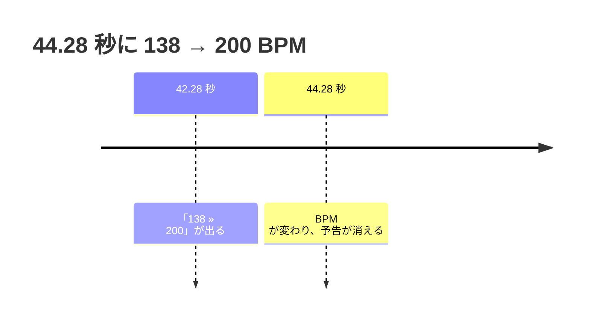
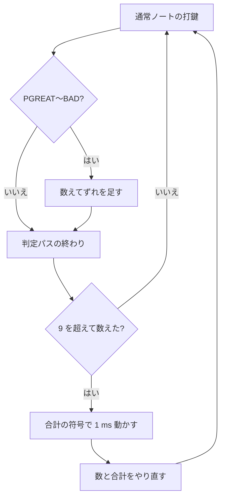

[English](./play-options.md)

# プレイオプション

Debug Menu の **Play options** と選曲画面は、実際に使う設定を共有します。新しいプレイに適用するオプションはプレイ中に変更できず、保存した設定は次回の起動で復元します。リプレイには選択した値と途中の変更を、実効譜面・表示・テンポとともに保存します。スコアの扱いは Leaderboard 側で別に決めます。実装では [#755](https://github.com/nulltask/be-music/issues/755) からリンクした各 Issue の仕様とコメントを参照します。

## オプションと判定ルール

Debug Menu の Developer にある **Judgment windows** は判定ルール（判定幅・ゲージ・判定対象ノートの選び方・ロングノートの種類・地雷の発動・スコア）を選びます。譜面または表示を変えるだけのオプションは、どのルールでも選べます。それぞれ判定ルールに関係なく参照元のアルゴリズムで動き、ルールを切り替えても維持し、参照元の譜面の種類の制限はそのまま残ります。対象は HS-FIX CONSTANT、CLASSIC と通常の HI-SPEED、FLOATING HI-SPEED と表示エリア固定、BPM 変化予告、判定タイミングの自動調整、レーンオプションの R-RANDOM・SPIRAL・H-RANDOM・ALL-SCR・RANDOM-EX・S-RANDOM-EX・RANDOM_PLAYABLE・S_RANDOM_PLAYABLE と 2 種類の SCATTER、SYNCHRONIZE RANDOM・SYMMETRY RANDOM・M-RAN、地雷とスクロールの変換、EXTRA と LR2 EXTRA MODE、SP TO DP、7 TO 9、BATTLE AS、D-BATTLE です。beatoraja ルール以外では、beatoraja のレーンオプションはブラウザの乱数で抽選します。シードは beatoraja ルールだけのままです。

それ以外はルールに従います。判定ルールはルールそのものです。RANDOM・S-RANDOM・CONVERGE・BATTLE は参照元ごとに別のアルゴリズムを指すため、どれを使うかはルールで決まります。ADD LN / CN / HCN / ALL、LN MODE、PRACTICE、CUSTOM JUDGE、ゲージの自動切り替え、ゲージの種類、判定アルゴリズムも当面はルールに従います。参照元が混ざったプレイを記録でどう扱うかは [#602](https://github.com/nulltask/be-music/issues/602) で決めます。[#774](https://github.com/nulltask/be-music/issues/774) で管理しています。

## START BPM HS-FIX

Debug Menu で **HS-FIX → STARTBPM** を選択します。既定は **OFF** のままです。START は MAX・MIN・MAIN とは別に、譜面のヘッダーにある開始 BPM をハイスピードの基準にします。`#BASEBPM` で基準速度を指定している場合の倍率は `基準 BPM / 開始 BPM` です。拍 0 の BPM 変更でヘッダーの開始 BPM を置き換えません。その後の BPM 変更ではスクロール速度も変化します。通常の表示速度オプションとして扱い、スコア・アシスト・コースの記録条件は変更しません。

モードと実際の描画ハイスピードをリプレイの表示設定に記録します。beatoraja スキンには元の START のオプション番号 1 を渡します。LR2 スキンでは既存の 5 種類の HS-FIX ボタン画像と循環順を維持するため、START は Debug Menu から選びます。スキン側でも共通のプレイオプション API で選択できます。

出典: beatoraja 0.8.9 の [`LaneRenderer.init`](https://github.com/exch-bms2/beatoraja/blob/83574048ba489082eb46df7fe9806b464bf1f526/src/bms/player/beatoraja/play/LaneRenderer.java) と [`PlayConfig`](https://github.com/exch-bms2/beatoraja/blob/83574048ba489082eb46df7fe9806b464bf1f526/src/bms/player/beatoraja/PlayConfig.java)。対応 Issue: [#736](https://github.com/nulltask/be-music/issues/736)。

## 表示エリア情報の常時表示

Debug Menu の **Display area info** で **OFF**（既定）、**ON**、**SUDDEN+ ONLY**、**HID+/LIFT ONLY** を選びます。「名前を言ってはいけないあのゲーム」AC 34 の画面にある 4 種類です。選んだ側の有効なカバーに、0〜1000 の長さと緑数字を START を押さずに表示し続けます。DP は各側のカバーと表示時間を使います。無効なカバーにはラベルを追加しません。OFF でもスキン自身の既存の表示はそのまま使えます。

同じフォルダーには既存の LR2 の **Effect 1P / 2P**、**Lane cover**、**Cover height** の設定もあり、スキンの種類を切り替えても設定を引き継ぎます。Native は DOM、Canvas・LR2・beatoraja は Canvas のラベルを使い、Canvas のキャプチャーにも含めます。表示の選択は保存する閲覧設定で、入力・判定・スクロール・リプレイの記録条件を変えません。この設定について、出典のページは追加の記録制限を示していません。

出典: AC 34 の [BPM 変化曲対策オプション](https://p.eagate.573.jp/game/2dx/34/howto/new/bpm_option.html)。4 種類の設定画面も参照しています。対応 Issue: [#748](https://github.com/nulltask/be-music/issues/748)。

## 左右別 AUTO SCRATCH

Debug Menu の **Auto scratch 1P / 2P** は、各側のスクラッチノートを独立して自動化します。反対側はロングスクラッチを含めて手動のままです。[#708](https://github.com/nulltask/be-music/issues/708) の左右別 AUTO SCRATCH に従います。リプレイは選択した設定一式と実効的な左右のスイッチを保持します。全体のスイッチだけを持つ旧リプレイでは両側に適用します。スコアの扱いは Leaderboard 側で決めます。

## LEGACY NOTE と LN REMOVE

Debug Menu の **Long notes** は **OFF** が既定です。**LEGACY NOTE (AC 34)** はチャージノートとバックスピンスクラッチを始点だけにし、通常の LN は維持します。HCN はこの AC オプションの対象外として維持します。**LN REMOVE (beatoraja)** は、beatoraja 0.8.9 の REMOVE を除去率最大で適用した場合と同様に、スクラッチを含むすべての LN・CN・HCN を始点だけにします。始点のキー音と時刻を保持し、終点の判定と音声を除去します。該当するノートがない譜面は変化しません。

エンジンと描画は変換後のノートを共有します。リプレイには変換方式と変換後の始点だけのノートを記録し、元の譜面のフィンガープリントは読み込んだ譜面を識別する値として維持します。リプレイを開く際は記録された変換を適用してからレーン配置を復元します。参照元でもプレイ前に譜面を変換する設定のため、プレイ中の選択はロックします。スコアやランプの新しい方針は追加しません。

参照元：AC 34 の[アシストオプション](https://p.eagate.573.jp/game/2dx/34/howto/play/option.html)、beatoraja 0.8.9 の [`LongNoteModifier`](https://github.com/exch-bms2/beatoraja/blob/83574048ba489082eb46df7fe9806b464bf1f526/src/bms/player/beatoraja/pattern/LongNoteModifier.java)。対応 Issue は [#710](https://github.com/nulltask/be-music/issues/710) です。

## A-SCR & LEGACY NOTE

Debug Menu の **A-SCR & LEGACY NOTE (AC 34)** ボタンは、AC 34 の複合設定として両側の AUTO SCRATCH と LEGACY NOTE を一度に適用します。既存のスイッチと Long notes が実効設定を直ちに表示し、各操作の選択や解除もできます。除去するのは CN・BSS の終点、自動化するのはスクラッチだけです。両操作と変換後のノートを明示的に記録するため、リプレイで見た目のプリセット名からアシストを推測する必要はありません。プレイ中はボタンを無効にします。スコアとランプの扱いは Leaderboard 側で決めます。

参照元：AC 34 の[アシストオプション](https://p.eagate.573.jp/game/2dx/34/howto/play/option.html)。対応 Issue は [#711](https://github.com/nulltask/be-music/issues/711) です。

## EX-HARD

Debug Menu の Developer で **Judgment windows → beatoraja / ????** を選び、**Play options → Gauge → EX-HARD** を選択します。EX-HARD は独立したサバイバルゲージで、AUTO SCRATCH などの入力アシストではありません。100 から始まり、HARD の低残量時のダメージ軽減を持たず、ゼロで失敗します。既存の参照元別テーブルに従い、beatoraja のモードごとの増減と AC の独自の増減を維持します。beatoraja の **HAZARD** は別の選択肢です（リプレイの既存キーは `DEATH`）。このキーを使う古い AC リプレイの解釈は維持します。

LR2 beta3 に EX-HARD はありません。選択肢は GROOVE / HARD / DEATH / EASY（と P.ATTACK / G.ATTACK）を維持し、LR2 ルールで EX-HARD を直接指定した場合は明示的にエラーにします。選択したゲージに対応しないルールへ切り替えると通常ゲージに戻します。LR2 スキンのボタンは従来のセルと巡回順（GROOVE・HARD・DEATH・EASY・P.ATTACK・G.ATTACK）を維持します。別のルールの EX-HARD を LR2 スキンで表示する場合は赤いサバイバルゲージ表示を使用します。EX-HARD の選択には Debug Menu を使います。リプレイは `play.gauge: "EX-HARD"` と参照元の実効ゲージ名を記録し、beatoraja / AC のコースでは EXHARDCLASS に変換します。

参照元：beatoraja 0.8.9 の [`GaugeProperty`](https://github.com/exch-bms2/beatoraja/blob/83574048ba489082eb46df7fe9806b464bf1f526/src/bms/player/beatoraja/play/GaugeProperty.java)、AC 34 の[ゲージオプション](https://p.eagate.573.jp/game/2dx/34/howto/play/option.html)。対応 Issue は [#726](https://github.com/nulltask/be-music/issues/726) です。

## ASSIST EASY / ASSISTED EASY

beatoraja ルールでは Debug Menu の **Gauge → ASSIST EASY**、???? ルールでは **ASSISTED EASY** を選べます。どちらも AUTO SCRATCH やロングノート変換から独立した、緩やかな回復ゲージです。リプレイの選択ゲージは `ASSIST-EASY`、実効的な結果のゲージ名は参照元に合わせて `ASSIST-EASY` または `ASSISTED-EASY` を保持します。ゲージ名から入力アシストのスイッチを推測しません。

既存の beatoraja テーブルに従い、モードごとの回復量・ダメージ・クリア基準を維持します。7 鍵盤の基準は 60、5 鍵盤では 50 です。AC では独自の増減量とクリア基準 60 を使います。LR2 beta3 にこの選択肢はなく、直接指定した場合はエラーにします。beatoraja / AC のコースでは、参照元のコースゲージ変換に従い CLASS に変換します。LR2 スキンでは既存の EASY セルと通常ゲージ表示を使用し、テキストには選択した名前を保持します。スコアの方針は別途扱います。

参照元：beatoraja 0.8.9 の [`GaugeProperty`](https://github.com/exch-bms2/beatoraja/blob/83574048ba489082eb46df7fe9806b464bf1f526/src/bms/player/beatoraja/play/GaugeProperty.java)、AC 34 の [ASSISTED EASY](https://p.eagate.573.jp/game/2dx/34/howto/play/option.html)。対応 Issue は [#725](https://github.com/nulltask/be-music/issues/725) です。

## 判定アルゴリズム

beatoraja ルールでは Debug Menu の **Judge algorithm** で **Combo**、**Duration**、**Lowest** を選びます。既定は **Combo** です。アルゴリズムは、押下の届く範囲に複数のノートがあるとき、どのノートで判定するかを決めます。beatoraja の既定である Combo は、手前のノートが GOOD 窓の遅い側の端を過ぎ、後ろのノートが自身の窓に入っている場合に限り後ろのノートへ移ります。Duration は時間的に最も近いノート、Lowest は届く範囲で常に最も手前のノートを選びます。beatoraja 内部の Score は選択肢にしません。LR2 と AC は常に最も手前のノートで判定するため、これらのルールでは **Source default** だけを表示し、エンジンはそれ以外の選択をエラーにします。

beatoraja のリプレイは実効アルゴリズムを `play.judgeAlgorithm` に記録し（他を選んでいなければ Combo）、リプレイのシミュレーションもこれで判定します。beatoraja の選曲スキンの判定アルゴリズムボタン（340）は 3 種類を巡回し、ラベル画像に表示します。この選択でアシストのフラグは立ちません。スコアの扱いは Leaderboard 側で決めます。

参照元：beatoraja 0.8.9 の [`JudgeAlgorithm`](https://github.com/exch-bms2/beatoraja/blob/83574048ba489082eb46df7fe9806b464bf1f526/src/bms/player/beatoraja/play/JudgeAlgorithm.java) と [`JudgeManager`](https://github.com/exch-bms2/beatoraja/blob/83574048ba489082eb46df7fe9806b464bf1f526/src/bms/player/beatoraja/play/JudgeManager.java)。対応 Issue は [#743](https://github.com/nulltask/be-music/issues/743) です。

## CLASSIC HI-SPEED と通常 HI-SPEED

どのルールでも Debug Menu に **CLASSIC HI-SPEED** と **Normal HI-SPEED (AC 32 measured)** が表示されます。どちらも既定はオフで、一方をオンにするともう一方はオフになります。どちらも HS-FIX を OFF にし、**Hi-speed** スライダーと **HS-FIX** の代わりに専用の操作を表示します。**Classic speed** では AC 34 の CLASSIC の 11 段階（1、1.5、2、2.25 … 3.75、4）から選びます。矢印キーと選曲画面のハイスピード操作も同じ表を進み、両端で止まります。

**Normal HS level** では 20 段階から選びます。各段階は masaoblue 氏が AC 32 Lightning Model で計測した緑数字（2025-08-21 公開）に従い、レーン全体で 1200 から 260 までです。AC 34 での校正を主張するものではありません。倍率は譜面の開始 BPM で計算し、その後の BPM 変化でも維持します。矢印キー 1 回で 1 段階動き、その時点の BPM で計算し直します。どちらのモードも計測したレーンの尺度で描画するため、どのスキンでも緑数字が参照元と一致します。

リプレイには `play.options.classicHiSpeed` または `play.options.normalHiSpeedLevel` と `normalHiSpeedProfile: "AC32-measured"`、選択したハイスピード、OFF の HS-FIX を記録します。プレイ中の段階の変更は `play.optionChanges` に、実際の描画速度はリプレイの表示設定に記録します。どちらのモードにも専用のスキン表示はありません。どちらも通常の表示速度の設定で、スコアの記録条件は変更しません。

参照元：AC 34 の[スピードオプション](https://p.eagate.573.jp/game/2dx/34/howto/play/option_speed.html)。対応 Issue は [#734](https://github.com/nulltask/be-music/issues/734) と [#735](https://github.com/nulltask/be-music/issues/735) です。

## BPM GUIDE

Debug Menu の **BPM GUIDE (beatoraja)** をオンにします。既定はオフです。オンにすると、beatoraja 0.8.9 の `LaneRenderer` と同様に、この先のテンポ変化をレーン上に表示します。実際に BPM が変わる位置には緑の `BPM<n>`（現在と同じ BPM の指定は省略）、正の STOP の位置には黄色の `STOP <n>ms` を表示し、どちらも整数に切り捨てます。ラベルは STOP や負のスクロールを含めてノートと同じようにスクロールし、判定線を過ぎると消えます。

内蔵スキンと LR2 のプレイフィールドは、プレイサイドごとに線とラベルを 1 つ描きます。beatoraja スキンは自身の BPM・STOP のマーカー画像を描き、それをこのオプションがオンの間だけ表示して、上にラベルを加えます。リプレイには `play.options.bpmGuide` と、譜面のヘッダー BPM（`chart.headerBPM`）と解決後の BPM 範囲（`chart.bpmRange`）を記録します。これは beatoraja のライトアシストの規則が参照する情報で、その規則は BPM が変化する譜面にだけ適用されます。スコアの扱いは Leaderboard 側で決めます。

参照元：beatoraja 0.8.9 の [`LaneRenderer`](https://github.com/exch-bms2/beatoraja/blob/83574048ba489082eb46df7fe9806b464bf1f526/src/bms/player/beatoraja/play/LaneRenderer.java) と [`BMSPlayer`](https://github.com/exch-bms2/beatoraja/blob/83574048ba489082eb46df7fe9806b464bf1f526/src/bms/player/beatoraja/play/BMSPlayer.java)。対応 Issue は [#745](https://github.com/nulltask/be-music/issues/745) です。

## BPM 変化予告

Debug Menu の **BPM change warning (AC)** をオンにします。既定はオフです。BPM が変わる前に、レーン上の枠付きの箱に `<今の BPM> » <次の BPM>` を表示し、変わるまで出し続けます。テンポが上がるときは青、下がるときは赤で、BPM は整数で表示します。変化の 2 秒前（譜面の時間）に現れるため、速い区間では遅い区間より多くの拍の前に出ます。

内蔵スキン（Canvas と DOM のスキン）・LR2・beatoraja のプレイ画面では、各サイドのレーンの中央、高さの半分の位置に箱を表示します。AC 34 の紹介では判定とコンボのすぐ上に出ていますが、スキンによって判定の位置はレーンの 40〜65 % ほどとまちまちなので、内蔵スキンで判定に重ならない中央にしています。同じ時刻の変化は 1 つにまとめ、同じ BPM に戻るだけの指定は変化として扱いません。前の変化から 2 秒以内に来る変化は、前の変化が終わった時点で予告します。STOP は予告しません。表示だけのオプションで、どのルールでも選べます。

見た目は AC 34 の[オプション紹介ページ](https://p.eagate.573.jp/game/2dx/34/howto/new/bpm_option.html)に合わせました。タイミングはプレイ動画から測りました（測定結果は [#746](https://github.com/nulltask/be-music/issues/746)）。動画ではどの BPM 変化も約 2.0 秒前に予告が出て、変化と同時に消えていました。参照元の TYPE A〜D の違い、2 秒が実時間か譜面の時間か、STOP・近い変化・ごく小さな変化での挙動はまだ分かっていません。[#746](https://github.com/nulltask/be-music/issues/746) で管理しています。

## 判定タイミングと自動調整

Debug Menu の **Judge timing (ms)** で、beatoraja と LR2 のどちらにもある表示タイミングを設定します。−500〜500 ms の整数で、既定は 0 です。どちらとも同様に、ずらすのはノートを描く時計だけで、正の値ではその時計が先に進みます。入力・音声・判定の時刻は変わらないため、記録した入力がずれることはありません。すべてのスキンの種類で適用し、beatoraja スキンの BPM 表示も同じ調整後の時計を読みます。このスライダーはプレイ中も有効で、すぐに反映します。beatoraja の選曲スキンの JUDGE TIMING ボタン（74）は ±500 ms の範囲で、LR2 の選曲スキンのボタン（74）は LR2 と同じく ±99 ms の範囲で 1 ms ずつ変更し、beatoraja と LR2 のスキンの数値 12 がその値を表示します。

どのルールでも、**Auto judge timing** で手動プレイ時にタイミングを自動で動かす方式を選びます。**OFF**（既定）、**beatoraja**、**LR2 ON**、**LR2 SILENT** のいずれかです。オートプレイとリプレイでは調整しません。

- **beatoraja:** ±150 ms 以内の PGREAT・GREAT・GOOD のたびに、その判定のずれを 30 で割った値（ミリ秒単位、ゼロから遠い側へ丸め）だけタイミングを動かします。この更新は ±500 ms の範囲に制限しません。
- **LR2 ON**（LR2 の `autojudge` 1）: 通常ノートを PGREAT・GREAT・GOOD・BAD で叩くたびに、そのずれ（ミリ秒単位の整数、遅いほうが正）を合計に足します。見逃し、空 POOR、ロングノートは数えず、ダブルプレイでは両サイドを数えます。判定の 1 パスごとに、数えた打鍵が 9 を超えていれば、合計が傾いた側へタイミングを 1 ms 動かし（遅い打鍵が多ければ増やします）、合計が 0 なら動かさず、数と合計を最初からやり直します。平均も丸めも範囲の制限もありません。LR2 の ±99 ms の範囲は選曲画面のボタンだけのものです。LR2 と同じく、2 人プレイの BATTLE では調整しません。LR2 がプレイ開始時に合計を空にするかは未確定で、be-music はどのプレイも空の状態から始めます。
- **LR2 SILENT**（`autojudge` 2）: LR2 ON と同じく調整し、さらに LR2 と同じく譜面のキー音・BGM・BGA を読み込まずに遊び、組み込みと LR2 のプレイ画面では判定とコンボを表示しません。beatoraja スキンは自前の判定表示をそのまま描きます。LR2 はゴースト表示もオフにしますが、be-music にはゴースト表示がありません。スコアは通常どおり数えます。

リプレイには `play.options.judgeTimingMs` と `judgeTimingAutoAdjust`（`"OFF"`、`"BEATORAJA"`、`"LR2-ON"`、`"LR2-SILENT"` のいずれか）を記録します。方式ができる前のリプレイは `true` か `false` を記録しており、それぞれ beatoraja と OFF として読みます。採用した自動更新（LR2 の 1 ms ごとの更新も含みます）とプレイ中の手動変更は、それぞれ譜面上の時刻とともに `play.optionChanges` に記録し、リプレイでは記録した値を表示します。LR2 自身はどちらも記録しません。LR2 SILENT のプレイのリプレイも、譜面の音と BGA なしで再生します。調整後の値は次のプレイに引き継ぎ、方式ができる前に保存した Debug Menu の設定は beatoraja のスイッチを **beatoraja** として引き継ぎます。beatoraja の選曲スキンの自動調整ボタン（75）は OFF と beatoraja を切り替えます（LR2 の方式は OFF として読みます）。LR2 の選曲スキンのボタン 75 は OFF・ON・SILENT を順に切り替え、テキスト 80 が設定を表示します（beatoraja の方式は OFF と表示します）。

参照元：beatoraja 0.8.9 の [`PlayerConfig`](https://github.com/exch-bms2/beatoraja/blob/83574048ba489082eb46df7fe9806b464bf1f526/src/bms/player/beatoraja/PlayerConfig.java)、[`LaneRenderer`](https://github.com/exch-bms2/beatoraja/blob/83574048ba489082eb46df7fe9806b464bf1f526/src/bms/player/beatoraja/play/LaneRenderer.java)、[`JudgeManager`](https://github.com/exch-bms2/beatoraja/blob/83574048ba489082eb46df7fe9806b464bf1f526/src/bms/player/beatoraja/play/JudgeManager.java)、OpenLR2 の[打鍵の集計](https://github.com/GOMazk/OpenLR2/blob/583a38503555e59c4bafa49d60b9d0714c9007c2/LR2f.cpp#L7463-L7535)、[1 ms の更新](https://github.com/GOMazk/OpenLR2/blob/583a38503555e59c4bafa49d60b9d0714c9007c2/LR2f.cpp#L12620-L12647)、[SILENT の読み込み](https://github.com/GOMazk/OpenLR2/blob/583a38503555e59c4bafa49d60b9d0714c9007c2/LR2f.cpp#L24346-L24349)と[判定表示の非表示](https://github.com/GOMazk/OpenLR2/blob/583a38503555e59c4bafa49d60b9d0714c9007c2/LR2f.cpp#L2510-L2515)、[選曲画面のボタン](https://github.com/GOMazk/OpenLR2/blob/583a38503555e59c4bafa49d60b9d0714c9007c2/LR2f.cpp#L10617-L10625)。対応 Issue は [#741](https://github.com/nulltask/be-music/issues/741)、[#742](https://github.com/nulltask/be-music/issues/742)、[#777](https://github.com/nulltask/be-music/issues/777) です。

## 表示用 CONSTANT

Debug Menu の **Visual CONSTANT (beatoraja)** をオンにします。既定はオフです。beatoraja の `PlayConfig.enableConstant` と同様に、ノート・地雷・小節線は判定線に届く前の **Note duration (ms)**（1〜10000、既定 500）の間だけ表示し、**CONSTANT fade (ms)**（−1000〜1000、既定 100）の間にフェードします。正のフェードはその時間より前から始まり、負のフェードはその時間の内側で終わります。オンの間は `#SPEED` によるスクロール変化を無視します。これは描画の設定で、譜面は書き換えず、判定も変わりません。LR2 の HS-FIX CONSTANT や scroll REMOVE とは別の機能です。

スイッチはプレイ中にロックし、表示時間とフェードはプレイ中も有効ですぐに反映します。内蔵スキン・LR2・beatoraja のプレイフィールドが描画します。beatoraja スキンでは beatoraja の `LaneRenderer` と同様に、フェードはタイムラインごとにかかり（ロングノートは始点とともにフェードします）、BPM 変化と STOP の線にもかかります。オンの間は op 400（CONSTANT）が点きます。`NO_SPEED` 制約のあるコースではその各ステージでオフになり、`#SPEED` によるスクロール変化が戻ります。beatoraja はプレイヤー自身の設定を読むので、op 400 は点いたままです。リプレイには `play.options.visualConstant`・`noteDurationMs`・`constantFadeMs` を記録し、プレイ中の変更は `play.optionChanges` に記録します。beatoraja 0.8.9 はこのオプションでアシストのフラグを立てません。スコアの扱いは Leaderboard 側で決めます。

参照元：beatoraja 0.8.9 の [`PlayConfig`](https://github.com/exch-bms2/beatoraja/blob/83574048ba489082eb46df7fe9806b464bf1f526/src/bms/player/beatoraja/PlayConfig.java) と [`LaneRenderer`](https://github.com/exch-bms2/beatoraja/blob/83574048ba489082eb46df7fe9806b464bf1f526/src/bms/player/beatoraja/play/LaneRenderer.java)。対応 Issue は [#738](https://github.com/nulltask/be-music/issues/738) と [#776](https://github.com/nulltask/be-music/issues/776) です。

## 左右別 LIFT

Debug Menu の **LIFT 1P (beatoraja)** / **LIFT 2P (beatoraja)** で各側の LIFT を独立して切り替え、**LIFT height 1P** / **2P** で高さをレーンに対する割合で設定します。beatoraja と同様に、LIFT はオフ・高さ 0.1 から始まり、オフの間も高さを保持します。これらの操作はプレイ中も有効で、すぐに反映します。LIFT は判定線とノートの到達位置を上げます。その上のレーンを圧縮するため、ノートが上げた判定線に届くまでの時間は変わらず、白数字と緑数字も変わりません。SUDDEN+ と HIDDEN+ は LIFT より上のレーンに対する割合です。ハイスピードを固定するコースでは、すべてのカバーと LIFT を 0 から始めます。

LIFT を描くのは beatoraja スキンと内蔵の Plain・Native・Synesthesia です。LR2 スキンは描きません。LR2 beta3 には LIFT のオプションがありません。これらの内蔵スキンでは beatoraja スキンと同様に、Home / End で LIFT を下げ / 上げ、PageUp / PageDown で SUDDEN+ を動かし、H で HIDDEN+ を切り替え、J / K で HIDDEN+ を動かします。1 回の変化量はレーンの 1 %（Shift で 5 %）です。リプレイには各側の LIFT を表示設定と `play.options.lift1P` / `lift2P` / `liftOn1P` / `liftOn2P` に記録し、プレイ中の変更は `play.optionChanges` に記録します。リプレイで記録した LIFT を表示するかどうかは Replay / ghost フォルダーの **LIFT** で選びます。これは表示の調整で、入力アシストではありません。

参照元：beatoraja 0.8.9 の [`LaneRenderer`](https://github.com/exch-bms2/beatoraja/blob/83574048ba489082eb46df7fe9806b464bf1f526/src/bms/player/beatoraja/play/LaneRenderer.java) と [`PlayConfig`](https://github.com/exch-bms2/beatoraja/blob/83574048ba489082eb46df7fe9806b464bf1f526/src/bms/player/beatoraja/PlayConfig.java)。対応 Issue は [#417](https://github.com/nulltask/be-music/issues/417) です。

## FLOATING HI-SPEED と表示エリア固定

どのルールでも Debug Menu の **FLOATING HI-SPEED (AC 32 measured)** をオンにするか、プレイ中にテンキーの 0 を押して切り替えます。HS-FIX を OFF にし、速度の操作を 0.5〜10 の **Floating speed** に置き換えます。プレイ中は矢印キー 1 回で速度が 0.5 動き、Shift と矢印キーでは計測値の 1/300 ずつ動きます。カバーのキーを使うスキン（Plain・Native・Synesthesia・beatoraja スキン）では、SUDDEN+ の表示中に PageUp / PageDown で、計測した 723 ピクセルの AC のレーン上でカバーを 1 ピクセル（Shift で 10 ピクセル）動かし、FLOATING HI-SPEED をオンにした時点の緑数字を保つよう速度を計算し直します。LIFT だけを表示している場合は LIFT を動かし、どちらもない場合は 1/300 の微調整になります。オンにするとカバーをこのレーンに合わせ、SUDDEN+ は 30 ピクセル以上、LIFT は 600 ピクセル以下にします。オフにすると、CLASSIC HI-SPEED では最も近い CLASSIC の段階（同距離なら上側）、それ以外では最も近い通常の段階に丸めます。通常の段階と同じく、値は masaoblue 氏による AC 32 の計測に基づき、AC 34 での校正ではありません。

**Fixed display area (AC 34)** もどのルールでも表示され、既定はオフです。プレイ中のカバーと LIFT の変更を、Debug Menu からの変更も含めてすべて無視します。リプレイでは記録したカバーを表示します。FLOATING HI-SPEED と組み合わせると、START（Enter）を 500 ms 以内に 2 回押すことで、オンにした時点の緑数字をその時点の BPM で計算し直して復元し、カバーは動かしません。コースのハイスピード固定はこれとは独立して働きます。

リプレイには `play.options.floatingHiSpeed` と `floatingHiSpeedProfile: "AC32-measured"`、`fixedDisplayArea`、ハイスピード、OFF の HS-FIX を記録します。プレイ中のモード切り替えと速度の変更は `play.optionChanges` に、カバーと実際の描画速度はリプレイの表示設定に記録します。内蔵の Plain と Synesthesia は速度のラベルを FHS と表示します。どちらも表示のオプションで、出典のページはアシストや記録の規則を示していません。

参照元：AC 34 の[スピードオプション](https://p.eagate.573.jp/game/2dx/34/howto/play/option_speed.html)と [BPM 変化曲対策オプション](https://p.eagate.573.jp/game/2dx/34/howto/new/bpm_option.html)。対応 Issue は [#733](https://github.com/nulltask/be-music/issues/733) と [#747](https://github.com/nulltask/be-music/issues/747) です。

## CUSTOM JUDGE

beatoraja ルールでは Debug Menu の **CUSTOM JUDGE (beatoraja)** をオンにし、beatoraja の判定ごとの窓の倍率を設定します。項目は **Key PGREAT %**、**Key GREAT %**、**Key GOOD %**、**Scratch PGREAT %**、**Scratch GREAT %**、**Scratch GOOD %**、**LN margin %** です。既定は鍵盤・スクラッチとも 400・400・100、マージンは 100 です。`PlayerConfig.validate` に従い、PGREAT は 25〜400、それ以外は 0〜400 を受け付けます。beatoraja と同様に、各倍率は判定ランクを適用した後の窓に掛け、BAD より広い窓にはせず、内側の窓より狭くなった窓は内側に合わせて広げます。ノートの始点は鍵盤またはスクラッチの倍率、鍵盤とスクラッチのロングノート終点はどちらも鍵盤の倍率を使います。マージンの倍率は鍵盤のロングノートの離しマージンに掛かり、このマージンは PMS モードでだけ 0 以外になります。

ほかのルールではスイッチを表示せず、エンジンもエラーにします。リプレイには倍率を `play.customJudge`（オフの間は省略）とオプションの値一式に記録し、リプレイのシミュレーションでも適用します。beatoraja はいずれかの倍率が 100 % を超えるとプレイを ASSIST とします。be-music は倍率を記録し、スコアの扱いは Leaderboard 側で決めます。

参照元：beatoraja 0.8.9 の [`PlayerConfig`](https://github.com/exch-bms2/beatoraja/blob/83574048ba489082eb46df7fe9806b464bf1f526/src/bms/player/beatoraja/PlayerConfig.java)、[`JudgeManager`](https://github.com/exch-bms2/beatoraja/blob/83574048ba489082eb46df7fe9806b464bf1f526/src/bms/player/beatoraja/play/JudgeManager.java)、[`BMSPlayer`](https://github.com/exch-bms2/beatoraja/blob/83574048ba489082eb46df7fe9806b464bf1f526/src/bms/player/beatoraja/play/BMSPlayer.java)。対応 Issue は [#744](https://github.com/nulltask/be-music/issues/744) です。

## PRACTICE

beatoraja ルールでは Debug Menu の **PRACTICE (beatoraja)** をオンにするか、beatoraja の選曲スキンの PRACTICE ボタン（315）を押します。PLAY ボタンは通常のモードで始めます。設定は beatoraja の `PracticeConfiguration` に従います。**START TIME ms** と **END TIME ms (0 = end)** は 100 ms 単位、**GAUGE TYPE** は ASSIST EASY〜EXHARD GRADE、**GAUGE CATEGORY** は **Play mode** または beatoraja のカテゴリー、**GAUGE VALUE** は 1〜120（既定 20）、ほかに **JUDGERANK (0 = chart)** と **TOTAL (0 = chart)** があります。対象は単一の譜面で、コース・NONSTOP・リプレイには適用しません。

beatoraja の `PracticeModifier` と同様に、範囲外の判定対象はすべて背景に移すため、そのキー音は鳴り続けます。どちらかの端が範囲外のロングノートも背景に移します。範囲の終わりは開始から少なくとも 1000 ms 後で、プレイは範囲の 1000 ms 前から始まり、終わりの 1000 ms 後まで続きます。TOTAL は範囲で切り出す前のノート数を基準にします。プレイテンポとレーンのオプションは通常どおり適用しますが、beatoraja が譜面の変換を PLAY と AUTOPLAY でだけ適用するのに合わせ、BATTLE、ロングノート・地雷・スクロールの変換、EXTRA、LR2 の EXTRA MODE はオフにします。範囲が終わると ESC を押すまですぐに繰り返します。練習のプレイはリプレイを記録せず、記録も更新しません。

参照元：beatoraja 0.8.9 の [`PracticeConfiguration`](https://github.com/exch-bms2/beatoraja/blob/83574048ba489082eb46df7fe9806b464bf1f526/src/bms/player/beatoraja/play/PracticeConfiguration.java) と [`PracticeModifier`](https://github.com/exch-bms2/beatoraja/blob/83574048ba489082eb46df7fe9806b464bf1f526/src/bms/player/beatoraja/pattern/PracticeModifier.java)。対応 Issue は [#749](https://github.com/nulltask/be-music/issues/749) です。

## R-RANDOM

どのルールでも、Debug Menu の **Play options → Random 1P / Random 2P → R-RANDOM** を選択します。R-RANDOM は片側の鍵盤レーン全体を正順または逆順に回転させ、スクラッチは固定します。beatoraja 0.8.9 の `LaneRotateShuffleModifier` と同様に元の並びと MIRROR を除外し、残りの回転を等確率で選びます。どのルールでもこの回転の集合を使い、ルールを切り替えても選択を維持します。beatoraja ルールではその側のシードで抽選します（「参照元のシードと前回の配置」を参照）。beatoraja は R-RANDOM をアシストなしのオプションとして扱い、`grade_random` 制約のコースでは beatoraja が先頭 6 種類のランダムを維持するのと同様に維持します。

リプレイは選択を `play.randomLane` と `play.options.random1P` / `random2P` に、各ノートの最終的なレーンを元のレーン（`sourceChannel`）とともに記録します。そのためリプレイは再抽選せず、記録したレーンを適用します。内蔵の選曲画面の **Lanes** と共通のプレイオプション API はすべてのレーンオプション名を列挙し、実行中のルールにない選択でプレイを始めると明示的にエラーにします。LR2 スキンでは RANDOM のオプションテキストに選択した名前を表示し、RANDOM ボタンは従来の 4 セル（OFF / MIRROR / RANDOM / S-RANDOM）を維持して、それ以外の選択では最初のセルを表示します。beatoraja スキンのオプションボタンはレーンオプションを切り替えないため、Debug Menu で選びます。スコアの扱いは Leaderboard 側で決めます。

参照元：beatoraja 0.8.9 の [`Random`](https://github.com/exch-bms2/beatoraja/blob/83574048ba489082eb46df7fe9806b464bf1f526/src/bms/player/beatoraja/pattern/Random.java) と [`LaneShuffleModifier`](https://github.com/exch-bms2/beatoraja/blob/83574048ba489082eb46df7fe9806b464bf1f526/src/bms/player/beatoraja/pattern/LaneShuffleModifier.java)、AC 34 の[プレイオプション](https://p.eagate.573.jp/game/2dx/34/howto/play/option.html)。対応 Issue は [#693](https://github.com/nulltask/be-music/issues/693) です。

## SPIRAL

どのルールでも **Random 1P / Random 2P → SPIRAL** を選択します。SPIRAL は 1〜N−1 レーンの刻みを 1 つ抽選し、タイムラインごとに鍵盤レーンを前のタイムラインよりその刻みだけ多く回転させます。ロングノートを押している間は、終点を過ぎるまで回転を止めます。beatoraja 0.8.9 の `SpiralRandomizer` と同様に、スクラッチ・地雷・不可視オブジェクト・反対側のオブジェクトだけのタイムラインや、ロングノートの終点だけのタイムラインもすべて数えます。スクラッチは固定し、beatoraja ルールでは刻みをその側のシードで抽選します。

beatoraja は SPIRAL を LIGHT_ASSIST とします。スコアの扱いは Leaderboard 側で決めます。`grade_random` 制約のコースでは維持します。リプレイは SPIRAL を `play.randomLane` と `play.options` に各ノートの最終的なレーンとともに記録するため、リプレイで再抽選しません。

参照元：beatoraja 0.8.9 の [`Random`](https://github.com/exch-bms2/beatoraja/blob/83574048ba489082eb46df7fe9806b464bf1f526/src/bms/player/beatoraja/pattern/Random.java) と [`Randomizer`](https://github.com/exch-bms2/beatoraja/blob/83574048ba489082eb46df7fe9806b464bf1f526/src/bms/player/beatoraja/pattern/Randomizer.java)。対応 Issue は [#696](https://github.com/nulltask/be-music/issues/696) です。

## H-RANDOM

どのルールでも **Random 1P / Random 2P → H-RANDOM** を選び、**H-RANDOM threshold BPM (beatoraja)** を設定します。範囲は beatoraja 0.8.9 の `PlayerConfig` と同じ 1〜1000、既定は 120 です。H-RANDOM は S-RANDOM と同様にタイムラインごとにノートを配置しますが、各ノートは直前のノートがしきい値 BPM の 16 分音符 1 つ分（`ceil(15000 / BPM)` ミリ秒）より前にあるレーンを優先します。条件を満たす空きレーンがない場合は、最も長く空いているレーンを使います。押しているロングノートは終点までレーンを維持し、スクラッチは固定します。beatoraja ルールでは抽選にその側のシードを使います。beatoraja の `Randomizer.create` と同様に、同じしきい値を ALL-SCR、beatoraja の CONVERGE、S_RANDOM_PLAYABLE でも使います。

beatoraja は H-RANDOM を LIGHT_ASSIST とします。スコアの扱いは Leaderboard 側で決めます。リプレイは選択を `play.randomLane` と `play.options` に、範囲内に収めたしきい値を `play.options.hRandomThresholdBPM` に、各ノートの最終的なレーンとともに記録します。

参照元：beatoraja 0.8.9 の [`Randomizer`](https://github.com/exch-bms2/beatoraja/blob/83574048ba489082eb46df7fe9806b464bf1f526/src/bms/player/beatoraja/pattern/Randomizer.java) と [`PlayerConfig`](https://github.com/exch-bms2/beatoraja/blob/83574048ba489082eb46df7fe9806b464bf1f526/src/bms/player/beatoraja/PlayerConfig.java)。対応 Issue は [#697](https://github.com/nulltask/be-music/issues/697) です。

## CONVERGE

**Judgment windows → LR2** で **Random 1P / Random 2P → CONVERGE** を選び、**Fixed key 1P / Fixed key 2P (LR2; 0=default)** で集める先のレーンを選びます。1〜9 は鍵盤を、0 はモードの既定値（スクラッチ、9 鍵盤の譜面では鍵盤 5）を選びます。LR2 beta3 に従い、各ノートはまず集める先のレーンを試し、同じタイムラインのノートや押しているロングノート（終点まで）がすでにある場合は、空いている鍵盤レーンからランダムに選びます。スクラッチのノートはスクラッチに残し、鍵盤のノートが集まる前にスクラッチを確保します。LR2 の CONVERGE は 5・7・9・10・14 鍵盤の譜面で使え、それ以外の譜面では明示的にエラーにします。LR2 beta3 は CONVERGE でスコアを保存しません（`CheckScoreSaveConditon`）。スコアの扱いは Leaderboard 側で決めます。

**Judgment windows → beatoraja** の CONVERGE は、beatoraja 0.8.9 の別の PMS 用配置（`Random.OPTION_PMS`、`ConvergeRandomizer`）で、PMS 以外の譜面では明示的にエラーにします。H-RANDOM のしきい値を過ぎた空きレーンのうち、現在の連続回数が最も多いレーンにノートを置き、しきい値の 2 倍を超えて空いたレーンの連続回数はリセットします。その側のシードを使い、beatoraja はこれを LIGHT_ASSIST とします。???? ルールに CONVERGE はありません。リプレイは選択を `play.randomLane` と `play.options` に、LR2 の集める先を `play.options.randomFixedLane1P` / `randomFixedLane2P` に、各ノートの最終的なレーンとともに記録します。

参照元：OpenLR2 の [`LR2f.cpp`](https://github.com/GOMazk/OpenLR2/blob/583a38503555e59c4bafa49d60b9d0714c9007c2/LR2f.cpp#L27322-L27404) と[スコア保存条件](https://github.com/GOMazk/OpenLR2/blob/583a38503555e59c4bafa49d60b9d0714c9007c2/LR2f.cpp#L68-L79)、beatoraja 0.8.9 の [`Random`](https://github.com/exch-bms2/beatoraja/blob/83574048ba489082eb46df7fe9806b464bf1f526/src/bms/player/beatoraja/pattern/Random.java) と [`Randomizer`](https://github.com/exch-bms2/beatoraja/blob/83574048ba489082eb46df7fe9806b464bf1f526/src/bms/player/beatoraja/pattern/Randomizer.java)。対応 Issue は [#695](https://github.com/nulltask/be-music/issues/695) と [#701](https://github.com/nulltask/be-music/issues/701) です。

## ALL-SCR

どのルールでも **Random 1P / Random 2P → ALL-SCR** を選択します。beatoraja 0.8.9 の `AllScratchRandomizer` に従い、各タイムラインでスクラッチが空いていて直前のノートが 40 ミリ秒より前にある場合、鍵盤のノートを 1 つスクラッチへ移します。残りのノートは H-RANDOM と同様に、そのしきい値で鍵盤とスクラッチに配置します。DP では各側が自分のスクラッチを使い、残りのノートはランダムではなく参照元の固定の側別順序でレーンを選びます。ALL-SCR にはスクラッチレーンが必要なため、PMS の譜面では明示的にエラーにします。beatoraja ルールでは抽選にその側のシードを使います。

beatoraja は ALL-SCR を LIGHT_ASSIST とします。スコアの扱いは Leaderboard 側で決め、`grade_random` のコースでは OFF にします。リプレイは選択を `play.randomLane` と `play.options` に各ノートの最終的なレーンとともに記録します。

参照元：beatoraja 0.8.9 の [`Random`](https://github.com/exch-bms2/beatoraja/blob/83574048ba489082eb46df7fe9806b464bf1f526/src/bms/player/beatoraja/pattern/Random.java) と [`Randomizer`](https://github.com/exch-bms2/beatoraja/blob/83574048ba489082eb46df7fe9806b464bf1f526/src/bms/player/beatoraja/pattern/Randomizer.java)。対応 Issue は [#698](https://github.com/nulltask/be-music/issues/698) です。

## RANDOM-EX と S-RANDOM-EX

どのルールでも **Random 1P / Random 2P → RANDOM-EX** または **S-RANDOM-EX** を選択します。どちらも RANDOM と S-RANDOM が動かすレーンに、その側のスクラッチレーンを加えます。RANDOM-EX は、beatoraja 0.8.9 の `LaneRandomShuffleModifier` がスクラッチを含める場合と同様に、鍵盤とスクラッチの譜面全体の並べ替えを 1 つ抽選します。判定ルールに関係なく常に beatoraja の並べ替えです。S-RANDOM-EX は、beatoraja の S-RANDOM の 40 ミリ秒の縦連しきい値でタイムラインごとに鍵盤とスクラッチへノートを配置し、条件を満たさない場合は最も長く空いているレーンを使います。どちらもスクラッチレーンが必要なため PMS の譜面では明示的にエラーにし、beatoraja ルールではその側のシードを使います。

beatoraja はどちらも LIGHT_ASSIST とします。スコアの扱いは Leaderboard 側で決め、`grade_random` のコースでは OFF にします。リプレイは選択を `play.randomLane` と `play.options` に各ノートの最終的なレーンとともに記録するため、移動したスクラッチのノートも記録したレーンで再生します。

参照元：beatoraja 0.8.9 の [`Random`](https://github.com/exch-bms2/beatoraja/blob/83574048ba489082eb46df7fe9806b464bf1f526/src/bms/player/beatoraja/pattern/Random.java)、[`LaneShuffleModifier`](https://github.com/exch-bms2/beatoraja/blob/83574048ba489082eb46df7fe9806b464bf1f526/src/bms/player/beatoraja/pattern/LaneShuffleModifier.java)、[`Randomizer`](https://github.com/exch-bms2/beatoraja/blob/83574048ba489082eb46df7fe9806b464bf1f526/src/bms/player/beatoraja/pattern/Randomizer.java)。対応 Issue は [#699](https://github.com/nulltask/be-music/issues/699) と [#700](https://github.com/nulltask/be-music/issues/700) です。

## PMS 用の無理押しなし RANDOM と S-RANDOM

どのルールでも **Random 1P / Random 2P → RANDOM_PLAYABLE** または **S_RANDOM_PLAYABLE** を選択します。どちらも beatoraja 0.8.9 の `Random.OPTION_PMS` にある PMS 用の配置で、他の譜面では明示的にエラーにします。RANDOM_PLAYABLE（`LanePlayableRandomShuffleModifier`）は、どの同時押しも参照元の 10 種類の無理な 3 鍵の形にならない並べ替えから、元の並びと MIRROR を除いて 9 鍵の譜面全体の並べ替えを等確率で 1 つ選びます。7 鍵以上の同時押しがある場合や条件を満たす並べ替えがない場合は、元の並びか MIRROR をランダムに使います。参照元の処理は変換のシードを使わないため、RANDOM_PLAYABLE ではその側の Seed を Debug Menu に表示しません。

S_RANDOM_PLAYABLE（`NoMurioshiRandomizer`）はタイムラインごとにノートを配置し、押しているロングノートを含めて 3〜6 個のノートがあるタイムラインでは、押しているレーンを含む参照元の 10 種類の 6 鍵の押せる形のいずれかに、H-RANDOM のしきい値とあわせて収めます。しきい値を過ぎたレーンが足りる形がない場合、固定した版の参照元は例外を投げます。be-music は独自の代替処理を作らず、プレイを明示的にエラーにします。beatoraja ルールでは抽選にその側のシードを使います。beatoraja はどちらも LIGHT_ASSIST とします。スコアの扱いは Leaderboard 側で決めます。リプレイは選択を `play.randomLane` と `play.options` に各ノートの最終的なレーンとともに記録します。

参照元：beatoraja 0.8.9 の [`Random`](https://github.com/exch-bms2/beatoraja/blob/83574048ba489082eb46df7fe9806b464bf1f526/src/bms/player/beatoraja/pattern/Random.java)、[`LaneShuffleModifier`](https://github.com/exch-bms2/beatoraja/blob/83574048ba489082eb46df7fe9806b464bf1f526/src/bms/player/beatoraja/pattern/LaneShuffleModifier.java)、[`Randomizer`](https://github.com/exch-bms2/beatoraja/blob/83574048ba489082eb46df7fe9806b464bf1f526/src/bms/player/beatoraja/pattern/Randomizer.java)。対応 Issue は [#702](https://github.com/nulltask/be-music/issues/702) と [#703](https://github.com/nulltask/be-music/issues/703) です。

## 参照元のシードと前回の配置

**Judgment windows → beatoraja** では、Debug Menu に **Seed 1P / Seed 2P (-1=random)** を表示します。シードは 0〜9223372036854775807 の Java の long 値で、beatoraja 0.8.9 の変換と同様に `java.util.Random` でレーンオプションを抽選します。そのため同じ譜面・レーンオプション・シードでは同じ配置になります。-1 はプレイごとに 16,777,216 未満の新しいシードを抽選します。リプレイは各側で実際に使ったシードを `play.options.randomSeed1P` / `randomSeed2P` に記録します。LR2 と ???? のルールではシードを表示せず、beatoraja のレーンオプションも含めてシードを使わずに配置を抽選します。

**Reuse previous arrangement** と **New arrangement** ボタンはどのルールでも表示します。Reuse は、リプレイ・コース・NONSTOP を除く直前のプレイを対象に、そのレーンオプション（Random 1P / 2P、シード、Fixed key、DP flip、H-RANDOM のしきい値、Long notes）を選択します。次に同じ譜面をプレイすると、beatoraja の譜面オプションの再現が譜面のレーンオプション・シード・分岐を復元するのと同様に、記録したレーンと `#RANDOM` の結果をそのまま使い、入力は通常どおり受け付けて新しいリプレイを記録します。これらのオプションを変更するか **New arrangement** を押すと再利用を解除し、New arrangement は両側のシードも -1 に戻します。別の譜面のプレイには影響しません。再利用には直前のプレイと同じ判定ルールが必要です。ほかのルールでは何も選択せず、ほかのルールで再利用の配置をプレイした場合は「The previous arrangement was played under other judgment rules.」というエラーにします。譜面のハッシュが異なる配置を再利用した場合も明示的にエラーにします。スコアの扱いは Leaderboard 側で決めます。

参照元：beatoraja 0.8.9 の [`BMSPlayer`](https://github.com/exch-bms2/beatoraja/blob/83574048ba489082eb46df7fe9806b464bf1f526/src/bms/player/beatoraja/play/BMSPlayer.java) と [`Randomizer`](https://github.com/exch-bms2/beatoraja/blob/83574048ba489082eb46df7fe9806b464bf1f526/src/bms/player/beatoraja/pattern/Randomizer.java)。対応 Issue は [#721](https://github.com/nulltask/be-music/issues/721) です。

## SCATTER

どのルールでも、**Random 1P / Random 2P** に **SCATTER (LR2 beta3)** と **SCATTER (9KEY corrected)** があり、それぞれ `SCATTER` と `SCATTER-CORRECTED` として記録します。SCATTER は LR2 beta3 の配置（LR2body.exe 100201、OpenLR2 による再構成）を再現します。各鍵盤ノートは、そのタイムラインでまだ使っておらずロングノートも押されていないレーンからランダムに選び、直前のタイムラインで使ったレーンを避けます。直前のレーンを再び使うのは、他に空きがない場合だけです。スクラッチのノートだけのタイムラインでも回避の対象は進みますが、不可視ノートやロングノートの終点だけでは進みません。スクラッチは固定し、14 鍵盤ではスクラッチのノートがあると参照元の決まった同じ側の鍵盤を回避の対象に加えます。DP FLIP を使う場合、タイムラインの管理は LR2 と同じく反転前の側に従います。SCATTER は 5・7・9・10・14 鍵盤の譜面で使えます。

9 鍵盤の譜面では、LR2 beta3 の抽選は PMS のプレイエリア外にある 10 番目の行き先（2P のスクラッチ）に届くことがあります。**SCATTER (LR2 beta3)** はこれを再現し、そのノートはレーンを増やさず、叩けないため POOR になります。**SCATTER (9KEY corrected)** は 9 鍵の中だけで抽選する 9 鍵盤用のオプションで、他の譜面では明示的にエラーにします。リプレイは選択を `play.randomLane` と `play.options` に、叩けないノートも含めて各ノートの最終的なレーンとともに記録するため、リプレイのシミュレーションは同じ判定を再現します。LR2 beta3 は SCATTER でスコアを保存しません（`CheckScoreSaveConditon`）。スコアの扱いは Leaderboard 側で決めます。

参照元：OpenLR2 の [`LR2f.cpp`](https://github.com/GOMazk/OpenLR2/blob/583a38503555e59c4bafa49d60b9d0714c9007c2/LR2f.cpp#L27270-L27404) と[スコア保存条件](https://github.com/GOMazk/OpenLR2/blob/583a38503555e59c4bafa49d60b9d0714c9007c2/LR2f.cpp#L68-L79)。対応 Issue は [#694](https://github.com/nulltask/be-music/issues/694) です。

## SYNCHRONIZE RANDOM と SYMMETRY RANDOM

どのルールでも、**Play options → Battle** で譜面を両側に複製する 1 人用の **BATTLE**・**BATTLE AS**・**D-BATTLE** を選ぶと、**Random 1P** に **SYNCHRONIZE RANDOM** と **SYMMETRY RANDOM** が加わり、それぞれ `SYNCHRONIZE-RANDOM` と `SYMMETRY-RANDOM` として記録します。複製した譜面で、1P の鍵盤に RANDOM の並べ替えを 1 つ抽選します。AC 34 のオプションのページの説明どおり、SYNCHRONIZE RANDOM では 2P の鍵盤が同じレーン番号を、SYMMETRY RANDOM ではその鏡像を使います。スクラッチは固定し、Random 2P は適用しません。これらのモードをやめると Random 1P を OFF に戻します。

リプレイは選択を `play.randomLane.p1` と `play.options.random1P` に、両側のノートの最終的なレーンとともに記録します。BATTLE を含め、スコアの扱いは Leaderboard 側で決めます。

参照元：AC 34 の[プレイオプション](https://p.eagate.573.jp/game/2dx/34/howto/play/option.html)。対応 Issue は [#722](https://github.com/nulltask/be-music/issues/722) と [#723](https://github.com/nulltask/be-music/issues/723) です。

## M-RAN

**Play options → Battle** で 2 人プレイ（LR2 ルールの **BATTLE** または ???? ルールの **2P PLAY**）を選ぶと、Debug Menu の **Gauge 2P** の隣に **M-RAN 1P** と **M-RAN 2P** を表示します。M-RAN は RANDOM 系の配置（RANDOM・R-RANDOM・S-RANDOM）のあと、そのプレイヤーの側に MIRROR を適用します。それ以外のレーンオプションでは何もしません。両側に複製した SP 譜面で 2 人が同じレーンオプションを選ぶと、2P 側は 1P の配置を引き継ぐため、片方の M-RAN でもう一方の譜面の鏡像になります。2 人プレイ以外では M-RAN を適用せず、Debug Menu にもスイッチを表示しません。

リプレイはスイッチを `play.options.mRan1P` / `mRan2P` に各ノートの最終的なレーンとともに記録するため、リプレイで再びミラーにしません。スコアの扱いは Leaderboard 側で決めます。

参照元：AC 34 の[プレイオプション](https://p.eagate.573.jp/game/2dx/34/howto/play/option.html)。対応 Issue は [#724](https://github.com/nulltask/be-music/issues/724) です。

## 地雷の REMOVE と ADD

どのルールでも、Debug Menu の **Mines (beatoraja)** で **OFF**（既定）、**REMOVE**、**ADD RANDOM**、**ADD NEAR**、**ADD ALL**（beatoraja の `ADD_BLANK`）を選びます。REMOVE はすべての地雷を取り除くため、地雷の爆発もゲージの減少も起きません。ADD は beatoraja 0.8.9 の `MineNoteModifier` に従い、参照元のタイムラインの各行をスクラッチを含むレーン順に調べ、ノート・地雷・押下中のロングノートがないセルを対象にします。ADD RANDOM はセルごとに独立した 10 分の 1 の抽選で、ADD NEAR はその行の追加前に隣のレーンが埋まっていた場合に、ADD ALL は対象のすべてのセルに地雷を置きます。追加した地雷のダメージは 10 % で、爆発音を鳴らしません。譜面にもともとある地雷は元の値を維持します。この変換はレーンオプションより前に譜面を準備するため、追加した地雷もレーンと一緒に移動します。

リプレイには `play.mineModifier` と、実際に除去・追加した地雷の数を示す `play.mineModifierChangeCount` を記録します。beatoraja は実際に除去した場合だけアシスト扱いにするため、この数で地雷のない譜面を REMOVE で遊んだ場合と、地雷を実際に除去した場合を区別できます。実効譜面のノートには追加した地雷をダメージと `silent` フラグ付きで含め、リプレイを開く際は再抽選せずに記録した位置へ地雷を置きます。beatoraja スキンの地雷モードボタン（351）は 5 つの選択肢を参照元の順で巡回し、ラベル画像に表示します。スコアの扱いは Leaderboard 側で決めます。

参照元：beatoraja 0.8.9 の [`MineNoteModifier`](https://github.com/exch-bms2/beatoraja/blob/83574048ba489082eb46df7fe9806b464bf1f526/src/bms/player/beatoraja/pattern/MineNoteModifier.java)。対応 Issue は [#716](https://github.com/nulltask/be-music/issues/716)、[#717](https://github.com/nulltask/be-music/issues/717)、[#718](https://github.com/nulltask/be-music/issues/718)、[#719](https://github.com/nulltask/be-music/issues/719) です。

## ADD LN / ADD CN / ADD HCN / ADD ALL

beatoraja ルールでは、Debug Menu の **Long notes** に **ADD LN (beatoraja)**、**ADD CN (beatoraja)**、**ADD HCN (beatoraja)**、**ADD ALL (beatoraja)** も表示します。いずれかを選んでいる間は **Long-note add rate (beatoraja)**（0〜1、既定 1）でノートごとの変換確率を設定します。beatoraja 0.8.9 の `LongNoteModifier` と同様に、通常ノートのレーンが譜面の次のタイムライン行で空いている場合、そのノートをその行で終わるロングノートに変えます。既存のロングノートは変えず、スクラッチも対象に含めます。ADD LN・ADD CN・ADD HCN は追加したノートをそれぞれのモードにし、ADD ALL はノートごとに LN・CN・HCN を抽選します。ほかのルールではこれらの選択肢を表示せず、切り替えると OFF に戻し、直接指定した場合はエラーにします。

リプレイには `play.longNoteModifier`、`play.longNoteRate` と、変換したノート数を示す `play.longNoteModifierChangeCount` を記録します。実効譜面のノートでは、生成した始点ごとに `generatedLongNote`、終点の時刻、モードを保持し、リプレイを開く際は再抽選せずにその配置を復元します。beatoraja スキンのロングノートモードボタン（353）は OFF・REMOVE・ADD LN・ADD CN・ADD HCN・ADD ALL を巡回します。LEGACY NOTE は beatoraja のモードではないため Debug Menu で選びます。Native スキンのプレイ設定パネルには変換方式と変換確率を表示します。スコアの扱いは Leaderboard 側で決めます。

参照元：beatoraja 0.8.9 の [`LongNoteModifier`](https://github.com/exch-bms2/beatoraja/blob/83574048ba489082eb46df7fe9806b464bf1f526/src/bms/player/beatoraja/pattern/LongNoteModifier.java)。対応 Issue は [#712](https://github.com/nulltask/be-music/issues/712)、[#713](https://github.com/nulltask/be-music/issues/713)、[#714](https://github.com/nulltask/be-music/issues/714)、[#715](https://github.com/nulltask/be-music/issues/715) です。

## スクロールの REMOVE と ADD

どのルールでも、Debug Menu の **Scroll (beatoraja)** で **OFF**（既定）、**REMOVE**、**ADD** を選びます。どちらも beatoraja 0.8.9 の `ScrollSpeedModifier` に従い、譜面の描画だけを変えます。判定時刻と音声は譜面のとおりです。REMOVE は各オブジェクトの時刻を維持したまま、BPM 変化・STOP・SCROLL 変化をなくし、最初の BPM と SCROLL で譜面を描画するため、ノートは一定の速度で流れます。ADD を選ぶと **Scroll section lines**（1〜1024、既定 4）と **Scroll rate**（0〜1、既定 0.5）を表示します。最初の小節線を 1 本目として N 本ごとの小節線で、SCROLL を最初の SCROLL の ±rate の範囲のランダムな値にし、譜面自身の SCROLL の値を置き換えます。

リプレイには `play.scrollModifier` と、譜面が実際に変化したかを示す `play.scrollModifierChanged` を記録します。beatoraja は除去する変化があった場合だけ REMOVE をアシスト扱いにし、ADD ではアシストのフラグを立てません。ADD では `play.scrollSection`、`play.scrollRate` と実効的な `play.scrollModifierTimeline` も記録し、リプレイを開く際は再抽選せずにこれを使います。beatoraja スキンのスクロールモードボタン（352）は OFF・REMOVE・ADD を巡回します。スコアの扱いは Leaderboard 側で決めます。

参照元：beatoraja 0.8.9 の [`ScrollSpeedModifier`](https://github.com/exch-bms2/beatoraja/blob/83574048ba489082eb46df7fe9806b464bf1f526/src/bms/player/beatoraja/pattern/ScrollSpeedModifier.java)。対応 Issue は [#739](https://github.com/nulltask/be-music/issues/739)、[#740](https://github.com/nulltask/be-music/issues/740) です。

## ゲージオートシフト

beatoraja ルールでは、Debug Menu の **Gauge auto-shift (beatoraja)** で **NONE**（既定）、**CONTINUE**、**SURVIVAL TO GROOVE**、**BEST CLEAR**、**SELECT TO UNDER** を選びます。**Lowest auto-shift gauge**（**ASSIST EASY**（既定）、**EASY**、**NORMAL**）は後の 2 つに適用します。いずれも beatoraja 0.8.9 の `BMSPlayer` に従います。NONE はサバイバルゲージがゼロになった時点でプレイを終了します。CONTINUE はゼロになったゲージのまま最後までプレイを続け、ゲージはゼロのままです。SURVIVAL TO GROOVE は譜面の開始から NORMAL ゲージを並行して動かし、サバイバルゲージがゼロになると NORMAL の現在値で続行します。コースのクラスゲージでは切り替えません。BEST CLEAR は ASSIST EASY・EASY・NORMAL・HARD・EX-HARD・HAZARD を並行して動かし、ゼロより大きくクリア条件を満たす最も上のゲージを使います。最低ゲージ（選択したゲージの方が下ならそのゲージ）より下には移らず、条件を満たすゲージがなければ最低ゲージのままです。SELECT TO UNDER は選択したゲージを上限として同じ処理をします。コースではどちらも CLASS から上の CLASS・EXCLASS・EXHARDCLASS から選び、各クラスゲージはそれぞれの値を次のステージへ持ち越します。ほかのルールでは両方の項目を隠し、切り替えると NONE に戻し、直接指定した場合はエラーにします。

リプレイには `play.gaugeAutoShift` と `play.bottomShiftableGauge` を記録します。NONE では `play.endOnFailure` も記録し、ほかの方式では最後まで判定を続けます。結果の `gauge.type` はプレイ終了時のゲージを示します。BEST CLEAR と SELECT TO UNDER では `gauge.values` に並行するすべてのゲージの値を保持し、コースのステージの `play.course.carryIn.gauges` に引き継いだクラスゲージを保持します。beatoraja スキンのゲージオートシフト（78）と最低シフトゲージ（341）のボタンは選択肢を参照元の順で巡回します。Native スキンのプレイ設定パネルには方式・最低ゲージ・実効ゲージを表示します。方式から入力アシストを推測しません。シフト後のクリアの順位付けは Leaderboard 側で決めます。

参照元：beatoraja 0.8.9 の [`BMSPlayer`](https://github.com/exch-bms2/beatoraja/blob/83574048ba489082eb46df7fe9806b464bf1f526/src/bms/player/beatoraja/play/BMSPlayer.java#L641-L674)、[`GrooveGauge`](https://github.com/exch-bms2/beatoraja/blob/83574048ba489082eb46df7fe9806b464bf1f526/src/bms/player/beatoraja/play/GrooveGauge.java)、[`PlayerConfig`](https://github.com/exch-bms2/beatoraja/blob/83574048ba489082eb46df7fe9806b464bf1f526/src/bms/player/beatoraja/PlayerConfig.java)。対応 Issue は [#729](https://github.com/nulltask/be-music/issues/729)、[#730](https://github.com/nulltask/be-music/issues/730)、[#731](https://github.com/nulltask/be-music/issues/731)、[#732](https://github.com/nulltask/be-music/issues/732) です。

## P.ATTACK / G.ATTACK

LR2 ルールでは、Debug Menu の **Gauge** に GROOVE・HARD・DEATH・EASY に続いて **P.ATTACK** と **G.ATTACK** も表示します。LR2 beta3 のゲージオプションの順です。どちらも満タンから始まるサバイバルゲージで、LR2 の死亡境界 2 を使います。P.ATTACK（PERFECT ATTACK）は PGREAT で 0.1 回復し、GREAT で 1 減少し、GOOD 以下で失敗します。G.ATTACK（GOOD ATTACK）は GOOD で 0.1 回復し、GREAT で 1、BAD で 6 減少し、PGREAT と POOR では HARD の譜面依存のダメージ係数の 10 倍、空 POOR では 2 倍を減らします。どちらも残量 32 未満では BAD・POOR・空 POOR のダメージを LR2 の HARD と同様に 60 % にします。クリアすると HARD ランプです。beatoraja と AC のルールにこれらのゲージはなく、直接指定した場合はエラーにします。これらのルールへ切り替えると GROOVE に戻します。

LR2 スキンのゲージボタンは 6 セルを巡回し、P.ATTACK と G.ATTACK はセル 4 と 5 です。ゲージの表示は P.ATTACK と G.ATTACK と綴り、リプレイには `play.gauge: "P-ATTACK"` または `"G-ATTACK"` と同じ名前の結果ゲージを記録します。LR2 の GRADE コースでは、LR2 と同様にコース開始時に P.ATTACK を維持し、G.ATTACK は EASY と同じく GROOVE に戻します。戻したプレイのランプは NORMAL です。EXPERT と NONSTOP のコースは両方のゲージを維持し、どちらの攻撃ゲージでもコースをクリアすると HARD ランプです。LR2 のコースクリアには LR2 のコースクリア判定に従い、すべてのノートの判定も必要で、最終ゲージがちょうど 2 の場合はフルコンボのときだけクリアです。スコアの扱いは Leaderboard 側で決めます。

参照元：OpenLR2 の[ゲージテーブル](https://github.com/GOMazk/OpenLR2/blob/583a38503555e59c4bafa49d60b9d0714c9007c2/LR2f.cpp#L27654-L27800)と[ダメージ軽減](https://github.com/GOMazk/OpenLR2/blob/583a38503555e59c4bafa49d60b9d0714c9007c2/LR2f.cpp#L1954-L1960)。対応 Issue は [#727](https://github.com/nulltask/be-music/issues/727)、[#728](https://github.com/nulltask/be-music/issues/728)、[#408](https://github.com/nulltask/be-music/issues/408) です。

## EXTRA ノート変換

どのルールでも、Debug Menu の **EXTRA depth (beatoraja)**（0〜100、既定 0）と **EXTRA scratch (beatoraja)** を設定します。0 より大きい深さでは beatoraja 0.8.9 の `ExtraNoteModifier` に従い、背景のキー音がある各行で最大その数までのキー音を、その行で空いていてロングノートの押下中でもないレーンの通常ノートに変えます。レーンは同じキー音を最後に置いたレーンから探します。変換したキー音は背景では鳴らしません。スクラッチには EXTRA scratch がオンの場合だけノートを置きます。この変換は抽選を使わず、参照元の挙動を維持します。空きレーンは行ごとに一度だけ求めるため、後の変換が先の変換を上書きしてその音を失うことがあり、変換したノートはすべて通常ノートです。ロングノートと地雷の変換の後、レーンオプションの前に適用します。

リプレイには `play.extraNoteDepth`、`play.extraNoteScratch` と、上書きされた分を含む実際の変換数 `play.extraNoteChangeCount` を記録し、実効譜面のノートに変換後のノートを含めます。beatoraja スキンの EXTRA 深さボタン（350）は、設定値は 100 まで持てますが、参照元と同様に 0〜3 を切り替えます。スコアの扱いは Leaderboard 側で決めます。

参照元：beatoraja 0.8.9 の [`ExtraNoteModifier`](https://github.com/exch-bms2/beatoraja/blob/83574048ba489082eb46df7fe9806b464bf1f526/src/bms/player/beatoraja/pattern/ExtraNoteModifier.java)。対応 Issue は [#720](https://github.com/nulltask/be-music/issues/720) です。

## LR2 の EXTRA MODE

どのルールでも、Debug Menu の **EXTRA MODE (LR2)** をオンにし、**EXTRA minimum level (LR2)** で **LEVEL 1**（既定）、**LEVEL 2**、**LEVEL 3** を選びます。変換は実行ファイルに基づいて LR2 beta3 の `MakeExtraChart` を再現します。背景のキー音を、同じ音が最も多く使われているレーン（同数なら最も小さいレーン）に、そこが埋まっていれば近くの空きレーンにノートとして置き、レベルと BPM で既存のノートとの最小間隔を決めます。譜面で一度もレーンに置かれない音は、同じファミリーの音がレーンに置かれていれば、直前の音番号のレーンを使います。LR2 は `#WAV` のファイル名の先頭 2 バイトで音をファミリーに分けるため、パーサーはそのバイトを保持します（UTF-16 の譜面にはありません）。譜面のオブジェクト数に応じてレベルを上げます。LEVEL 1 は 1,000 個から LEVEL 2、1,200 個から LEVEL 3 として、LEVEL 2 は 1,000 個から LEVEL 3 として遊びます。DP の譜面ではスクラッチのノートを背景音にします。変換はプレイのテンポに従い、36 進の BMS 譜面が必要で、bmson とキーボードモードは受け付けず、コースでは適用しません。

リプレイには `play.lr2ExtraMode`、`play.lr2ExtraLevel`、`play.lr2ExtraEffectiveLevel`、`play.lr2ExtraConvertedObjectCount`、`play.lr2ExtraTempo` を記録し、実効譜面のノートに変換後のノートを含めます。LR2 のプレイスキンには op 52 の代わりに op 53（EXTRA MODE オン）を渡します。LR2 自身のスコア保存条件は EXTRA のプレイを除外します。スコアの扱いは Leaderboard 側で決めます。

参照元：OpenLR2 が再構成した [`MakeExtraChart`](https://github.com/GOMazk/OpenLR2/blob/583a38503555e59c4bafa49d60b9d0714c9007c2/LR2f.cpp#L24799-L25088)、[レベルの説明](https://github.com/GOMazk/OpenLR2/blob/583a38503555e59c4bafa49d60b9d0714c9007c2/LR2f.cpp#L1391-L1404)、[スコア保存条件](https://github.com/GOMazk/OpenLR2/blob/583a38503555e59c4bafa49d60b9d0714c9007c2/LR2f.cpp#L68-L79)。対応 Issue は [#720](https://github.com/nulltask/be-music/issues/720) です。

## LN MODE

beatoraja ルールでは、Debug Menu の **LN MODE (beatoraja)** で **LONG NOTE**（既定）、**CHARGE NOTE**、**HELL CHARGE NOTE** を選びます。beatoraja 0.8.9 の `lnmode` と同様に、ロングノートのモードを指定していない譜面（`#LNMODE` がない、または bmson の `ln_type` がないか 0）だけに適用し、譜面自身のモードとコースの `ln` / `cn` / `hcn` 制約を優先します。ロングノートの追加や除去はしません。LR2 と AC のルールではこうした譜面を LN として遊ぶため、項目を隠し、切り替えると LONG NOTE に戻し、CHARGE NOTE や HELL CHARGE NOTE を直接指定した場合はエラーにします。

リプレイには実効的なモードを `chart.lnMode` に記録し、リプレイを開く際は現在の選択ではなくそのモードを適用します。beatoraja スキンの LN MODE ボタン（308）は 3 つの選択肢を巡回します。LNMODE の画像は、選曲画面と決定画面ではプレイヤーの選択を、プレイ画面とリザルト画面では遊んだ譜面が自身のモードを指定していればそのモードを表示します。これは通常のプレイ設定で、LN REMOVE や ADD の変換とは別です。スコアの扱いは Leaderboard 側で決めます。

参照元：beatoraja 0.8.9 の [`PlayerConfig`](https://github.com/exch-bms2/beatoraja/blob/83574048ba489082eb46df7fe9806b464bf1f526/src/bms/player/beatoraja/PlayerConfig.java#L123)。対応 Issue は [#604](https://github.com/nulltask/be-music/issues/604) です。

## SP TO DP・DP-TO-SP・9-TO-7

どのルールでも、Debug Menu の **Play options → Battle → SP TO DP** を選択します。LR2 beta3 の SP TO DP（`battle` 3）で、LR2 と同様に譜面のキーモードによって動作が変わります。5KEY・7KEY の譜面は、ノートを複製せずに 10KEY・14KEY の両側へ振り分けます。小節ごとに各キー音のグループをどちらかの側に割り当て、同じ音が密集する小節は `#PLAYLEVEL` に応じて両側に分散し、スクラッチは左右交互に置きます。スクラッチから 200 ms 以内のキーのノートは反対の手に移します。ただし、その側の AUTO SCRATCH が有効な場合は移しません。

10KEY・14KEY の譜面では同じ選択肢が DP-TO-SP になり、2P 側のノートをすべて 1P 側へ移します。移動先は元のレーンか、ほかのノートから半拍（125 ms 以上）離せる最も近いレーンです。9KEY の譜面では 9-TO-7 になり、小節ごとに 9 レーンを 7 鍵盤に畳みます。どちらも空きレーンのないノートは背景音にし、ロングノートの終点は移動した始点に合わせます。LR2 はコースで SP TO DP を適用せず、24/48KEY のモードもないため、これらのプレイは変化しません。LR2 と同様にプレイのテンポでノートの時刻を読むため、テンポも変換の入力です。

エンジンと描画は変換後の譜面を使います。リプレイには実効的な `play.battleMode`（適用できない譜面では `OFF`）を、`battleSourceVariant`、振り分けに使ったテンポ（`battleTempo`）、考慮した左右の AUTO SCRATCH（`battleAssist1P` / `battleAssist2P`）、変更・除去したオブジェクト数とともに記録します。リプレイの譜面には変換後のノートとレーンモードを保存し、選択した値はオプション一式に残ります。スコアとランプの扱いは Leaderboard 側で決めます。

参照元：OpenLR2 の [`SPtoDP`](https://github.com/GOMazk/OpenLR2/blob/583a38503555e59c4bafa49d60b9d0714c9007c2/LR2f.cpp#L25553)、[`DPsplit`](https://github.com/GOMazk/OpenLR2/blob/583a38503555e59c4bafa49d60b9d0714c9007c2/LR2f.cpp#L24753)、[`DPtoSP` と `PMStoSP`](https://github.com/GOMazk/OpenLR2/blob/583a38503555e59c4bafa49d60b9d0714c9007c2/LR2f.cpp#L25091-L25450)。対応 Issue は [#706](https://github.com/nulltask/be-music/issues/706) です。

## 7 TO 9

どのルールでも、Debug Menu の **Play options → 7-to-9 (beatoraja)** で **OFF**（既定）、**SC1 KEY2–8**、**SC1 KEY3–9**、**SC2 KEY3–9**、**SC8 KEY1–7**、**SC9 KEY1–7**、**SC9 KEY2–8** を選びます。各パターンは 7 つのキーを 9 鍵盤の連続したレーンに置き、スクラッチのレーンを指定します。残る 1 レーンが予備です。**7-to-9 scratch** は各スクラッチの行き先を決めます。**Fixed** は常にスクラッチのレーン、**Alternate** はスクラッチのレーンと予備のうち前回の打鍵が古いほう、**Avoid repeated hits** はスクラッチのレーンを **H-RANDOM threshold BPM** での 16 分音符以内に叩いていた場合に予備のレーンを使います。押下中のロングノートはそのレーンを維持します。

beatoraja 0.8.9 の `ModeModifier` に従い、7KEY の譜面にだけ、レーンのランダム配置の後で適用します。ほかの譜面は変化しません。FREE ZONE（`#17`）は beatoraja の 7 鍵盤モードにレーンがないため除去します。リプレイには `sevenToNinePattern`、`sevenToNineType`、`sevenToNineThresholdBPM` と変換の適用有無（`sevenToNineApplied`）を、変換後の 9 鍵盤のノートとともに記録します。リプレイを開く際は変換を適用してからレーン配置を復元します。beatoraja スキンではオプションボタン 360（`seventonine_pattern`）と 361（`seventonine_type`）で両方を切り替えられます。スコアの扱いは Leaderboard 側で決めます。

参照元：beatoraja 0.8.9 の [`ModeModifier`](https://github.com/exch-bms2/beatoraja/blob/83574048ba489082eb46df7fe9806b464bf1f526/src/bms/player/beatoraja/pattern/ModeModifier.java) と [`BMSPlayer`](https://github.com/exch-bms2/beatoraja/blob/83574048ba489082eb46df7fe9806b464bf1f526/src/bms/player/beatoraja/play/BMSPlayer.java)。対応 Issue は [#707](https://github.com/nulltask/be-music/issues/707) です。

## BATTLE・BATTLE AS・D-BATTLE

Debug Menu の **Play options → Battle** の選択肢は、**Judgment windows** で選んだルールに従います。LR2 ルールでは **OFF**、**BATTLE**（2 人プレイ）、**BATTLE AS**、**D-BATTLE**、**SP TO DP**、beatoraja ルールでは **OFF**、**BATTLE**、**BATTLE AS**、**D-BATTLE**、**SP TO DP**、???? ルールでは **OFF**、**BATTLE**、**2P PLAY**、**BATTLE AS**、**D-BATTLE**、**SP TO DP** です。BATTLE AS・D-BATTLE・SP TO DP は譜面を作るだけなので、どのルールでも参照元の対応譜面のまま選べます。BATTLE は LR2 では 2 人プレイ、beatoraja と AC では 1 人用の複製を指すため、ルールに従います。beatoraja に 2 人プレイはありません。選択中の値がないルールへ切り替えると OFF に戻します。選択肢が対応しないキーモードの譜面は変化しません。ルールにないモードを直接指定した場合は明示的にエラーにします。

| 選択肢    | ルール                | 元の譜面               | プレイ                                  |
| --------- | --------------------- | ---------------------- | --------------------------------------- |
| BATTLE    | beatoraja             | 5 / 7 / 24KEY          | 1 人、両側に同じ譜面（10 / 14 / 48KEY） |
| BATTLE AS | どれでも（beatoraja） | 5 / 7 / 24KEY          | BATTLE と同じ、スクラッチは背景音       |
| BATTLE    | ????                  | 7KEY                   | 1 人、両側に同じ譜面（14KEY）           |
| D-BATTLE  | どれでも（LR2）       | 5 / 7KEY               | 1 人、両側に同じ譜面（10 / 14KEY）      |
| BATTLE    | LR2                   | 5 / 7KEY、10 / 14KEY   | 2 人（後述）                            |
| 2P PLAY   | ????                  | 5 / 7KEY               | 2 人（後述）                            |
| SP TO DP  | どれでも（LR2）       | 5 / 7 / 9 / 10 / 14KEY | 1 人、変換後の譜面（前述）              |

beatoraja の BATTLE（`doubleoption` 2）と AC の BATTLE は、地雷を含む SP 譜面を 2P 側へ複製します。複製はスクロール・ロングノート・地雷・EXTRA の変換の後、レーンのランダム配置の前に行い、各複製は 2P のチャンネルを持つ別のノートになります。**BATTLE AS**（`doubleoption` 3）はさらに、beatoraja の `AutoplayModifier` と同様に両側のスクラッチのノート（24KEY ではホイール）を背景音にします。LR2 の **D-BATTLE**（`battle` 2）は 1x・3x・5x のセルだけを複製するため、地雷は 1P 側に残ります。また、**D-BATTLE scratch (LR2)** が無効ならスクラッチのノートを背景音にします。このスイッチは、Debug Menu にない決定アニメーション中にスクラッチのキーを押し続ける LR2 の操作の代わりで、D-BATTLE を選んだ間だけ表示します。複製した譜面に DP FLIP は適用しません。

リプレイには実効的な `play.battleMode`、`battleSourceVariant`、複製したオブジェクト数（`battleChangedObjectCount`）、D-BATTLE では `dBattleScratch` を記録します。リプレイの譜面には両側のノートを保存するため、リプレイでは各複製の配置を個別に復元します。スコアの扱いは Leaderboard 側で決めます。

参照元：beatoraja 0.8.9 の [`BMSPlayer`](https://github.com/exch-bms2/beatoraja/blob/83574048ba489082eb46df7fe9806b464bf1f526/src/bms/player/beatoraja/play/BMSPlayer.java)、[`LaneShuffleModifier.PlayerBattleModifier`](https://github.com/exch-bms2/beatoraja/blob/83574048ba489082eb46df7fe9806b464bf1f526/src/bms/player/beatoraja/pattern/LaneShuffleModifier.java)、[`AutoplayModifier`](https://github.com/exch-bms2/beatoraja/blob/83574048ba489082eb46df7fe9806b464bf1f526/src/bms/player/beatoraja/pattern/AutoplayModifier.java)、OpenLR2 の[譜面の読み込み](https://github.com/GOMazk/OpenLR2/blob/583a38503555e59c4bafa49d60b9d0714c9007c2/LR2f.cpp#L26244)と [D-BATTLE のスクラッチ](https://github.com/GOMazk/OpenLR2/blob/583a38503555e59c4bafa49d60b9d0714c9007c2/LR2f.cpp#L27433-L27436)、AC 34 の[プレイオプション](https://p.eagate.573.jp/game/2dx/34/howto/play/option.html)。対応 Issue は [#704](https://github.com/nulltask/be-music/issues/704)、[#709](https://github.com/nulltask/be-music/issues/709)、[#705](https://github.com/nulltask/be-music/issues/705) です。

## 2 人プレイの BATTLE と COUPLE

LR2 ルールでは **Play options → Battle → BATTLE**、???? ルールでは **2P PLAY** を選びます。どちらも 2 人プレイ（`TWO-PLAYER`）で、LR2 の BATTLE（`battle` 1）と AC の 2 人プレイに当たります。あわせて表示する **Gauge 2P** で、**Gauge** と同じ選択肢から 2P 側のプレイヤーのゲージを選びます。5KEY・7KEY の譜面では各プレイヤーに譜面の複製を渡します。LR2 は 1x・3x・5x のセルを、AC は地雷を含む譜面全体を複製します。両プレイヤーが同じレーンオプションを選んだ場合、2P 側は 1P 側と同じ配置で遊びます。LR2 ルールの 10KEY・14KEY の譜面は COUPLE になり、各プレイヤーが譜面の片側をそのまま遊びます。コースでは 1 人でプレイします。

各プレイヤーは自分の側とキーで判定し、判定数・コンボ・スコア・TOTAL・ゲージをそれぞれ持ちます。譜面とその時計、音声は共有します。両プレイヤーがノートを終えるか、両方がプレイを終了するゲージで失敗するとプレイを終えます（LR2 は両プレイヤーの失敗で停止します）。リプレイには `play.battleMode: "TWO-PLAYER"` と `play.gauge2P` を記録します。`results.native` が 1P、`results.secondPlayer` が 2P の結果で、空 POOR もそれぞれの値です。2 人プレイの結果は自己ベストに記録せず、Leaderboard にも送信しません。リプレイは保存します。

参照元：OpenLR2 の[譜面の読み込み](https://github.com/GOMazk/OpenLR2/blob/583a38503555e59c4bafa49d60b9d0714c9007c2/LR2f.cpp#L26244)と[スコアの保存](https://github.com/GOMazk/OpenLR2/blob/583a38503555e59c4bafa49d60b9d0714c9007c2/LR2f.cpp#L9334-L9364)、AC 34 の[プレイオプション](https://p.eagate.573.jp/game/2dx/34/howto/play/option.html)。対応 Issue は [#704](https://github.com/nulltask/be-music/issues/704) です。

## スキンでの BATTLE

LR2 スキンでは選曲画面のボタン 56 で OFF・BATTLE・D-BATTLE・SP TO DP を切り替えます。G-BATTLE は選べません。テキスト 69 は選択中の譜面に合わせて LR2 と同じ名前を表示します。COUPLE・DP-TO-SP・9-TO-7、譜面が対応しない場合は DISABLE です。プレイ中は数値 120〜136、ランクの op 210〜217、ゲージの op 250〜260 が 2P 側のプレイヤーを示し、バトルの op 10〜13 が選択中のモードに応じて点灯します。キーモードの op は元の譜面に従います。5KEY・7KEY の譜面の 2 人プレイでは、テーマが BATTLE 用のプレイスキン（`#INFORMATION` の種類 12・13）を宣言していればそれを、なければ DP のスキンを使います。ほかのバトルモードは変換後の譜面のスキンを使います。beatoraja スキンでは `optiondp`（ボタン 54）で OFF・FLIP・BATTLE・BATTLE AS を切り替えます。Synesthesia・Plain・Native では、2 人プレイのとき 2P 側のゲージ・EX スコア・コンボ・結果を 1P 側の横に表示します。ID の詳細は [LR2 スキン](./lr2-skin.ja.md)を参照してください。
