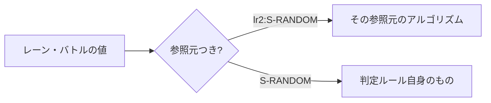
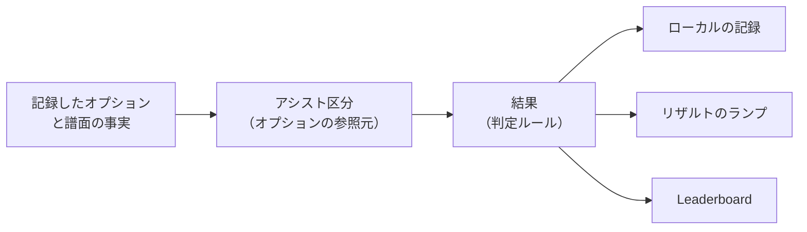
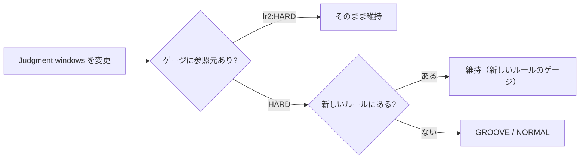
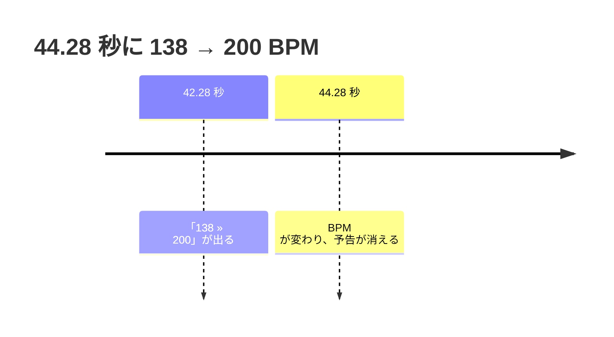
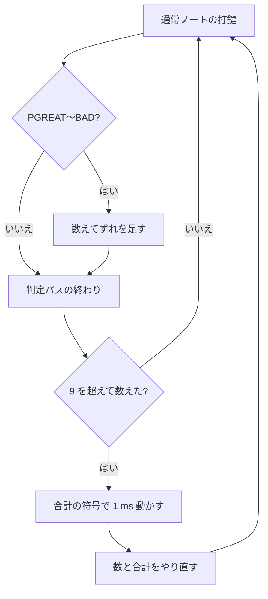
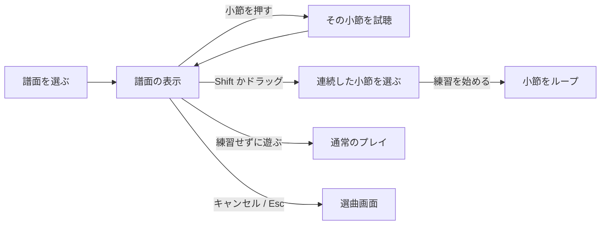

[English](./play-options.md)

# プレイオプション

Options ダイアログと選曲画面はプレイ設定を共有します。譜面の開始時に適用する項目は、そのプレイ中は変更できません。ブラウザーは次回の起動時に設定を復元します。リプレイには開始時の設定と途中の変更を、適用後の譜面・表示・テンポとともに保存します。[アシストと記録の方針](#アシストと記録の方針) [参照元の一覧](https://github.com/nulltask/be-music/issues/755)

目次

- [関連ページ](#関連ページ)
- [オプションと判定ルール](#オプションと判定ルール)
- [アシストと記録の方針](#アシストと記録の方針)
  - [プレイ前にわかる記録への影響](#プレイ前にわかる記録への影響)
- [START BPM HS-FIX](#start-bpm-hs-fix)
- [表示エリア情報の常時表示](#表示エリア情報の常時表示)
- [左右別 AUTO SCRATCH](#左右別-auto-scratch)
- [オートスクラッチのノーツ表示](#オートスクラッチのノーツ表示)
- [LR2 マニアオプション](#lr2-マニアオプション)
- [判定範囲と処理済みノーツ](#判定範囲と処理済みノーツ)
- [スコアターゲット](#スコアターゲット)
- [レーンの明るさと判定文字の表示](#レーンの明るさと判定文字の表示)
- [判定の詳細と判定数の表示](#判定の詳細と判定数の表示)
- [プレイ中に反映する表示オプション](#プレイ中に反映する表示オプション)
- [ANY KEY](#any-key)
- [LEGACY NOTE と LN REMOVE](#legacy-note-と-ln-remove)
- [A-SCR & LEGACY NOTE](#a-scr--legacy-note)
- [EX-HARD](#ex-hard)
- [ASSIST EASY / ASSISTED EASY](#assist-easy--assisted-easy)
- [ほかの参照元のゲージ](#ほかの参照元のゲージ)
- [譜面が選ぶゲージ](#譜面が選ぶゲージ)
- [判定アルゴリズム](#判定アルゴリズム)
- [CLASSIC HI-SPEED と通常 HI-SPEED](#classic-hi-speed-と通常-hi-speed)
- [GUIDE SE](#guide-se)
- [WINDOW HOLD](#window-hold)
- [BPM GUIDE](#bpm-guide)
- [BPM 変化予告](#bpm-変化予告)
- [判定タイミングと自動調整](#判定タイミングと自動調整)
- [表示用 CONSTANT](#表示用-constant)
- [左右別 LIFT](#左右別-lift)
- [FLOATING HI-SPEED と表示エリア固定](#floating-hi-speed-と表示エリア固定)
- [CUSTOM JUDGE](#custom-judge)
- [GAMBOL](#gambol)
- [PRACTICE](#practice)

## 関連ページ

- [レーン・譜面・ゲージのプレイオプション](./play-options-modifiers.ja.md)

## オプションと判定ルール

Options ダイアログの Play options にある **Judgment windows** でルールセットを選びます。判定幅、ゲージ、判定対象ノートの選び方、ロングノートの種類、地雷の発動、スコアはこの選択で決まります。譜面や表示だけを変えるオプションは、ルールセットを変更しても選択が残ります。処理方法と対応する譜面の種類は、それぞれの参照元に従います。

次のオプションはどのルールセットでも使えます。

- 表示とタイミングの設定。HS-FIX CONSTANT、CLASSIC と通常の HI-SPEED、FLOATING HI-SPEED と表示エリア固定、BPM 変化予告、判定タイミングの自動調整。
- レーン配置。R-RANDOM、SPIRAL、H-RANDOM、ALL-SCR、RANDOM-EX、S-RANDOM-EX、RANDOM_PLAYABLE、S_RANDOM_PLAYABLE、2 種類の SCATTER、SYNCHRONIZE RANDOM、SYMMETRY RANDOM、M-RAN。
- 譜面の変換とプレイ形態。地雷とスクロールの変換、EXTRA と LR2 EXTRA MODE、ADD LN / CN / HCN / ALL、SP TO DP、7 TO 9、BATTLE AS、D-BATTLE、2 人プレイ。

レーン配置の抽選には、どのルールセットでも対象サイドのシードを使います。ロングノートの追加にはブラウザーの乱数を使います。[参照元のシードと前回の配置](./play-options-modifiers.ja.md#参照元のシードと前回の配置)

Be-Music の既定ゲージは LR2 ルールでは **GROOVE**、beatoraja と AC のルールでは **NORMAL** です。beatoraja 本体の新規プロファイルでは **ASSIST EASY** が既定です。[beatoraja PlayerConfig](https://github.com/exch-bms2/beatoraja/blob/8320241d8481e0826c703878c3eba01cd81ca3e4/src/bms/player/beatoraja/PlayerConfig.java#L50-L54)

**参照元つきの値。** S-RANDOM・CONVERGE と 1 人用の BATTLE は参照元ごとに別のアルゴリズムや規則を指すため、値に参照元を付けます（[ADR 0019](./adr/0019-source-qualified-option-values.ja.md)）。`lr2:S-RANDOM`・`beatoraja:S-RANDOM`、`lr2:CONVERGE`・`beatoraja:CONVERGE`、`beatoraja:BATTLE`・`____:BATTLE` です。どれもどのルールでも選べ、その参照元の動作をします。Options ダイアログ はレーンとバトルの選択肢を参照元ごとにまとめて判定ルール自身の参照元を先頭に並べ、ラベルに **S-RANDOM (beatoraja)**・**BATTLE (????)** のように参照元を示します。古いリプレイや設定にある参照元のない値は、判定ルール自身のものとして読みます。保存した設定は読み込むときに移行し、参照元のない値を保存時のルールの参照元つきの値にします。リプレイは書き換えません。参照元のないリプレイは記録したルールのものとして読みます。

**参照元が同じに定義するオプションは 1 つの値です。** RANDOM は 1 つのオプションです。LR2・beatoraja・AC はいずれも譜面全体で鍵盤を 1 回並べ替え、スクラッチは動かしません。beatoraja 0.8.9 の `LaneRandomShuffleModifier` と同じ手順で引くので、シードから beatoraja と同じ配置になります。そのあと **Fixed key 1P (LR2; 0=default)** が、1P の元の 1 鍵を選んだ鍵盤（1〜7）へ移します。0 では抽選結果を維持し、9 鍵では使いません。RANDOM は LR2 と同じく **Fixed key 2P** を無視します。2P では引き続き [CONVERGE と CONVERGE corrected](./play-options-modifiers.ja.md#converge) の行き先を指定できます。AC の S-RANDOM は LR2 のものと同じく縦連を避けずにノートを置くため、1 つの値 `lr2:S-RANDOM` にまとめ、**S-RANDOM (LR2 / ????)** と表示します。AC のルールでの参照元のない S-RANDOM もこれとして読みます。以前の値 `lr2:RANDOM`・`beatoraja:RANDOM`・`____:RANDOM`・`____:S-RANDOM` は RANDOM と `lr2:S-RANDOM` として読みます。どの参照元でも同じ MIRROR と、AC のものと一致する R-RANDOM は、以前から 1 つの値です。

ブラウザは **Fixed key 1P** と **Fixed key 2P** をほかのプレイオプションとともに保存するため、別の譜面を選んだりブラウザを開き直したりしても引き継ぎます。LR2 は選曲を確定するたびに両方をリセットし、そのとき押しているボタンから設定し直します。[OpenLR2 Main.cpp](https://github.com/GOMazk/OpenLR2/blob/583a38503555e59c4bafa49d60b9d0714c9007c2/Main.cpp#L1235-L1257)

それ以外はルールに従います。判定ルール（判定幅・ゲージ・判定対象ノートの選び方・ロングノートの種類・地雷の発動・スコア）はルールそのものです。LN MODE、CUSTOM JUDGE、LR2 の [GAMBOL](#gambol)、判定アルゴリズムもルールに従います。参照元のないゲージ（`HARD`）も、そのルール自身のゲージです。参照元を付けたゲージ（`lr2:HARD`）は、どの判定ルールでもその参照元のゲージ・オートシフトのラダー・コースゲージを使います（[ADR 0019](./adr/0019-source-qualified-option-values.ja.md)、[#1171](https://github.com/nulltask/be-music/issues/1171)）。[ほかの参照元のゲージ](#ほかの参照元のゲージ)で説明します。[PRACTICE](#practice) と[ゲージオートシフト](./play-options-modifiers.ja.md#ゲージオートシフト)はどのルールでも使え、そのルールで読みます。PRACTICE はそのルールのゲージを並べ、自動切り替えはそのルールのゲージの並びに沿って切り替えます（[#933](https://github.com/nulltask/be-music/issues/933)）。参照元が混ざったプレイを記録でどう扱うかは[アシストと記録の方針](#アシストと記録の方針)で説明します。[#774](https://github.com/nulltask/be-music/issues/774) で管理しています。

## アシストと記録の方針

判定ルールごとに、そのルール自身のアシストの扱いに従います（[#602](https://github.com/nulltask/be-music/issues/602)）。プレイがどれだけアシストを受けたかはオプションの参照元が決め、その結果どうなるかは判定ルールが決めます。2 つの参照元が定義する素の値（BATTLE・CONVERGE・AUTO SCRATCH）は、[ADR 0019](./adr/0019-source-qualified-option-values.ja.md) の読み方どおりプレイした判定ルールのものとして扱い、参照元付きの値はその参照元のものとして扱います。`@be-music/player-engine/records` の決定的な判定（`classifyReplayAssists`、`resolveRecordPolicy`）は、リプレイに記録した値だけを読みます。ローカルの記録、リザルト画面のランプ、コースの記録、Leaderboard がすべてこれを使うので、再シミュレーションしても同じ答えになります。[ADR 0031](./adr/0031-assist-record-policy.ja.md) を参照してください。

**アシスト区分**は軽い順に `none`・`light`・`assist`・`no-save` です。プレイは使ったオプションのうち最も重い区分になります。

| オプション                                                                                   | 参照元    | 区分      | 条件                                                                 | 出典                                                      |
| -------------------------------------------------------------------------------------------- | --------- | --------- | -------------------------------------------------------------------- | --------------------------------------------------------- |
| AUTO SCRATCH（1P、または 2P 側がある譜面の 2P）                                              | LR2       | `light`   | LR2 と beatoraja のルール                                            | OpenLR2 `LR2f.cpp` L9334（`p1_assist` / `p2_assist`）     |
| AUTO SCRATCH                                                                                 | AC 34     | `light`   | `____` のルール                                                      | AC 34 のアシストオプション                                |
| HS-FIX CONSTANT                                                                              | LR2       | `light`   | すべての譜面                                                         | OpenLR2 L9334（`hsfix == 4`）                             |
| SCATTER、SCATTER（9KEY 修正版）、CONVERGE（LR2）                                             | LR2       | `light`   |                                                                      | OpenLR2 L9334（`random > 3`）                             |
| D-BATTLE、SP TO DP、LR2 EXTRA MODE                                                           | LR2       | `light`   | LR2 のルールでは別のランプ                                           | OpenLR2 L9250-L9332（`clear_db`、`clear_sd`、`clear_ex`） |
| ADD LONGNOTES、ADD MINES（LR2）                                                              | LR2       | `light`   | 確率が 0 より大きい                                                  | OpenLR2 L67-L79（`m_addlong`、`m_addmine`）               |
| SPIRAL、H-RANDOM、ALL-SCR、RANDOM-EX、S-RANDOM-EX、PMS の RANDOM / S-RANDOM、CONVERGE（PMS） | beatoraja | `light`   |                                                                      | beatoraja 0.8.9 `Random`、レーンとノートの入れ替え        |
| BATTLE、BATTLE AS                                                                            | beatoraja | `light`   | `beatoraja:BATTLE`、または beatoraja のルールでの参照元のない BATTLE | `BMSPlayer` L252                                          |
| 7 TO 9                                                                                       | beatoraja | `light`   | 変換した                                                             | `ModeModifier`                                            |
| BPM GUIDE                                                                                    | beatoraja | `light`   | 譜面の BPM が変わる                                                  | `BMSPlayer` L201-L205                                     |
| 地雷の REMOVE、スクロールの REMOVE                                                           | beatoraja | `light`   | 実際に取り除いた                                                     | `MineNoteModifier`、`ScrollSpeedModifier`                 |
| LEGACY NOTE（A-SCR & LEGACY NOTE を含む）                                                    | AC 34     | `light`   | CN か BSS を実際に変換した                                           | AC 34 のアシストオプション                                |
| LN REMOVE                                                                                    | beatoraja | `assist`  | ロングノートを取り除いた                                             | `LongNoteModifier` L27-L37                                |
| ADD CN、ADD HCN、ADD ALL                                                                     | beatoraja | `assist`  | CN か HCN を追加した                                                 | `LongNoteModifier` L41-L69                                |
| EXTRA ノート変換                                                                             | beatoraja | `assist`  | ノートを変換した                                                     | `ExtraNoteModifier`                                       |
| CUSTOM JUDGE                                                                                 | beatoraja | `assist`  | 100 % を超える倍率がある                                             | `BMSPlayer` L208-L213                                     |
| デバッグ用の判定幅上書き                                                                     | Be-Music  | `assist`  | CUSTOM JUDGE と同じく判定幅を広げる                                  |                                                           |
| BATTLE                                                                                       | AC 34     | `no-save` | `____:BATTLE`、または `____` のルールでの参照元のない BATTLE         | AC 34 のプレイオプション「スコアデータは保存されません」  |
| PRACTICE                                                                                     | beatoraja | `no-save` | どのルールでも                                                       | beatoraja の PRACTICE は何も保存しない                    |
| ANY KEY                                                                                      | PC        | `no-save` | すべてのルール                                                       | PC 版：ANY KEY のプレイは NO PLAY                         |
| ADD NOTES、LOUDNESS（LR2）                                                                   | LR2       | `no-save` | 確率が 0 より大きい。どのルールでも同じ                              | OpenLR2 L27073-L27080（`isNosave`）                       |
| プレイヤーが選んだ NOTES COPY、DBLCOPY                                                       | Be-Music  | `no-save` | 譜面を写した（5 / 7 KEY、コースの外）                                | Be-Music: 記録は譜面のキーモードのもの（#1243）           |

アシストにならないもの: MIRROR、RANDOM、S-RANDOM、R-RANDOM、SYNCHRONIZE / SYMMETRY RANDOM、M-RAN、DP FLIP、カバーと LIFT、ハイスピードのオプション、表示の CONSTANT（beatoraja の `enableConstant` は描画の設定）、地雷の ADD、スクロールの ADD、ADD LN、判定アルゴリズム、ゲージ（ASSIST EASY と ASSISTED EASY はゲージのランプで、アシストではありません）、ゲージの自動切り替え。PC 版の NO PLAY になるオプション（KEY ASSIST、ANY KEY、PC 版自身の H-RANDOM と BATTLE）は PC 版の規則で、ほかの参照元には当てはめません。ここでの H-RANDOM は beatoraja のアルゴリズムなので、beatoraja のものとして区分します。PC 版を参照元とするオプションは `____` のルールで `no-save` になります。Be-Music が提供するのは ANY KEY です（[ANY KEY](#any-key)）。

**判定ルールごとの結果:**

| ルール      | `light`                                                                            | `assist`                                     | `no-save`      |
| ----------- | ---------------------------------------------------------------------------------- | -------------------------------------------- | -------------- |
| `lr2`       | ランプは EASY まで、ランプとプレイ回数だけ。LR2 の別ランプのモードは専用の枠に残す | `light` と同じ                               | 何も保存しない |
| `beatoraja` | クリアは LIGHT ASSIST EASY、ランプとプレイ回数だけ                                 | クリアは ASSIST EASY、ランプとプレイ回数だけ | 何も保存しない |
| `____`      | クリアは ASSIST EASY（ASSIST CLEAR）、ランプとプレイ回数だけ                       | `light` と同じ                               | 何も保存しない |

- **スコアの項目。** アシストを受けたプレイは EX スコア・BP・最大コンボを更新しません。LR2 も beatoraja（`updateScore`）も保存しないためです。FAILED のプレイは FAILED のままです。
- **LR2 の別ランプ。** D-BATTLE、SP TO DP、EXTRA MODE はそれぞれ専用の枠（`lr2:d-battle:…`、`lr2:sp-to-dp:…`、`lr2:extra:…`）にランプを残します。EASY に制限するのはほかのアシストも同時に使ったときだけで、D-BATTLE の AUTO SCRATCH は LR2 の `isForceEasy` と同じく例外です。
- **コース。** アシストを受けたステージがあるコースは、コースの記録を残さず、ステージも各譜面の記録に何も書きません。LR2 はアシストを使ったステージを保存せず（`CheckScoreSaveConditon`）、beatoraja は `updateCourseScore` を切るためです。Leaderboard ではランキング対象外（`assist`）として保存します。
- **Leaderboard。** 完全な AUTO プレイとリプレイの再生以外は、これまでどおりすべて送信します（[#788](https://github.com/nulltask/be-music/issues/788)）。`none` は通常のランキング、`light` と `assist` はアシストありのランキングに載り、`no-save` は保存してもランキング対象外（`no-save`）です。各ルールの結果には、そのルールで制限したランプを付けます。
- **リプレイ**は区分に関係なく残します。記録はリプレイから導くものだからです。
- **既存の記録**は導き直さず、移行もしません。この変更より前に保存したローカルの自己ベストと Leaderboard の結果は値をそのまま残し、方針は変更後のプレイから当てはめます。

**クリアランプ。** LIGHT ASSIST EASY は ASSIST EASY と EASY の間にある独立したランプです（[#603](https://github.com/nulltask/be-music/issues/603)）。beatoraja の `ClearType` がゲージ 0 を LightAssistEasy に対応させているとおり、beatoraja の ASSIST EASY ゲージでのクリアはこのランプになります。AC の ASSISTED EASY ゲージは ASSIST EASY のままです。保存するランプの番号は追加専用で、0〜9 はそれぞれのランプのまま、LIGHT ASSIST EASY は 10 です。順序は保存した番号ではなくランプの順序（`compareClearLamps`、`compareClearLampRanks`）で比べます。beatoraja のスキンはこのランプで op 1101、ASSIST EASY で op 1100 を点け、クリアのインデックスはこのランプで 3、ASSIST EASY で 2 を読みます。LR2 のスキンはどちらも EASY にまとめます。

### プレイ前にわかる記録への影響

この方針は、選んだオプションからプレイ前にも読みます（`@be-music/player-engine/records` の `resolvePlannedRecordPolicy`）。リプレイが記録するはずの内容を組み立てて、同じ分類と同じ解決の処理に通すので、プレイ前の表示とプレイ後の記録が食い違うことはありません。

譜面によって変わる判定もあります。BPM が変わる譜面での BPM GUIDE、譜面を実際に変えた場合の REMOVE や LEGACY の変更、適用される譜面での EXTRA NOTE と 7 TO 9、2P 側がある譜面での 2P 側の AUTO SCRATCH や beatoraja のレーンオプションです。この時点では譜面を準備していないため、どれも起きない場合とすべて起きる場合の 2 通りで分類し、後者にだけ出る判定は条件付きの文として表示します（「BPM GUIDE が譜面を変える場合: …」）。

- **Options ダイアログ。** Play タブの判定幅の下にある **Record kept** の行に表示し、変更のたびに更新します。
- **選曲画面。** 選曲画面で変えたオプションによって表示が変わったときに、ステータス行に表示します。どのスキン系統でも同じです。LR2 と beatoraja のスキンは、それぞれのランプとパネルのままです。
- **リザルト画面。** リプレイの方針から、そのプレイが記録に何をしたかをステータス行に表示します（`Result: <タイトル> — <表示>`）。2 人プレイの BATTLE、PRACTICE、AUTO、回復なしの bmson（TOTAL 0）は、記録を残さない理由を表示します。続いて出る Leaderboard の行は、順位が付いたプレイのボード（メインかアシスト）を示し、保存のみのプレイはランキング外の理由を示します。

表示するのは、アシスト区分、その原因のオプション、判定ルールでのランプ（LR2 は EASY まで、beatoraja は LIGHT ASSIST EASY か ASSIST EASY、`____` は ASSIST EASY）、Leaderboard のボードです。対象はその譜面の単曲プレイで、コース固有の制限は反映しません。[#1140](https://github.com/nulltask/be-music/issues/1140) で追跡しています。

## START BPM HS-FIX

Options ダイアログ で **HS-FIX → STARTBPM** を選択します。既定は **OFF** のままです。START は MAX・MIN・MAIN とは別に、譜面のヘッダーにある開始 BPM をハイスピードの基準にします。`#BASEBPM` で基準速度を指定している場合の倍率は `基準 BPM / 開始 BPM` です。拍 0 の BPM 変更でヘッダーの開始 BPM を置き換えません。その後の BPM 変更ではスクロール速度も変化します。通常の表示速度オプションとして扱い、スコア・アシスト・コースの記録条件は変更しません。

モードと実際の描画ハイスピードをリプレイの表示設定に記録します。beatoraja スキンには元の START のオプション番号 1 を渡します。LR2 スキンでは既存の 5 種類の HS-FIX ボタン画像と循環順を維持するため、START は Options ダイアログ から選びます。スキン側でも共通のプレイオプション API で選択できます。

出典: beatoraja 0.8.9 の [`LaneRenderer.init`](https://github.com/exch-bms2/beatoraja/blob/83574048ba489082eb46df7fe9806b464bf1f526/src/bms/player/beatoraja/play/LaneRenderer.java) と [`PlayConfig`](https://github.com/exch-bms2/beatoraja/blob/83574048ba489082eb46df7fe9806b464bf1f526/src/bms/player/beatoraja/PlayConfig.java)。対応 Issue: [#736](https://github.com/nulltask/be-music/issues/736)。

## 表示エリア情報の常時表示

Options ダイアログ の **Display area info** で **OFF**（既定）、**ON**、**SUDDEN+ ONLY**、**HID+/LIFT ONLY** を選びます。「名前を言ってはいけないあのゲーム」AC 34 の画面にある 4 種類です。選んだ側の有効なカバーに、0〜1000 の長さと緑数字を START を押さずに表示し続けます。DP は各側のカバーと表示時間を使います。無効なカバーにはラベルを追加しません。OFF でもスキン自身の既存の表示はそのまま使えます。

同じフォルダーには既存の LR2 の **Effect 1P / 2P**、**Lane cover**、**Cover height** の設定もあり、スキンの種類を切り替えても設定を引き継ぎます。Native は DOM、Canvas・LR2・beatoraja は Canvas のラベルを使い、Canvas のキャプチャーにも含めます。表示の選択は保存する閲覧設定で、入力・判定・スクロール・リプレイの記録条件を変えません。この設定について、出典のページは追加の記録制限を示していません。

出典: AC 34 の [BPM 変化曲対策オプション](https://p.eagate.573.jp/game/2dx/34/howto/new/bpm_option.html)。4 種類の設定画面も参照しています。対応 Issue: [#748](https://github.com/nulltask/be-music/issues/748)。

## 左右別 AUTO SCRATCH

Options ダイアログ の **Auto scratch 1P / 2P** は、各側のスクラッチノートを独立して自動化します。反対側はロングスクラッチを含めて手動のままです。[#708](https://github.com/nulltask/be-music/issues/708) の左右別 AUTO SCRATCH に従います。リプレイは選択した設定一式と実効的な左右のスイッチを保持します。全体のスイッチだけを持つ旧リプレイでは両側に適用します。記録の扱いは[アシストと記録の方針](#アシストと記録の方針)のとおりです。

## オートスクラッチのノーツ表示

Options ダイアログの View タブにある **Auto scratch notes (AC)** は **Show**（既定）か **Hide** です。Hide では、AUTO SCRATCH が演奏しているスクラッチレーンのノーツ、ロングノートとその本体を描画しません。スクラッチの演奏、発音、カウントはそのままで、キービームとボムも描画します。設定は両サイド共通で、AUTO SCRATCH がオフのサイドと完全な AUTO プレイには影響しません。プレイ中にも反映し、すべてのスキン系統で働きます。判定も AUTO SCRATCH のアシスト区分も変わりません。

AC 34 の詳細オプションには「オートスクラッチ表示」があり、「オートスクラッチ時のノートを表示するかどうかを変更」とあります。レーンのビームや爆発も隠すかどうかはページに記載がないため、Be-Music では残します。

出典: AC 34 [詳細オプション](https://p.eagate.573.jp/game/2dx/34/howto/play/option.html)。[#1137](https://github.com/nulltask/be-music/issues/1137) で追跡しています。

## LR2 マニアオプション

Options ダイアログの View タブには、Effects の下に **LR2 mania options** があり、どのルールセットでも選べます。LR2 の隠しマニアパネル（[`LR2f.cpp` L1054-L1470](https://github.com/GOMazk/OpenLR2/blob/583a38503555e59c4bafa49d60b9d0714c9007c2/LR2f.cpp#L1054-L1470)）のうち、プレイフィールドの描画だけを変えるオプションです。ACCELERATION はモードを選び、それ以外は LR2 と同じく **0**（OFF、既定）から **100** まで 10 刻みです。ノーツの時刻、レーン、入力、音声、判定は変わらず、プレイ中にも反映します。

選曲画面では、LR2 のキーマップの **F2**（`select.mania-options`）でダイアログをこのセクションに開きます。LR2 は F2 を押している間だけパネルを表示し（[`Main.cpp` L1766-L1769](https://github.com/GOMazk/OpenLR2/blob/583a38503555e59c4bafa49d60b9d0714c9007c2/Main.cpp#L1766-L1769)）、パネルは文字で描くためスキンに画像がありません。Be-Music では押したときにダイアログを開きます。beatoraja のキーマップでは F2 がフォルダの再読み込みなので、この操作は未割り当てです。Keys でキーを割り当てられます。LR2 の譜面生成（ADD NOTES から ADD MINES）、GAMBOL、SOFTLANDING は、それぞれが属するオプションとともに Play タブにあります。[#1127](https://github.com/nulltask/be-music/issues/1127) で追跡しています。

| オプション              | 描画                                                                                                                                                                                                                                                                                  | LR2                                                                                                                 |
| ----------------------- | ------------------------------------------------------------------------------------------------------------------------------------------------------------------------------------------------------------------------------------------------------------------------------------- | ------------------------------------------------------------------------------------------------------------------- |
| **ACCELERATION (LR2)**  | OFF・ACCELERATION・DECELERATION・RANDOM。ノーツの時刻はそのままで、レーン上の位置だけを写像します。ACCELERATION は `sin(p·π/2)`、DECELERATION は `1 − cos(p·π/2)`、RANDOM は `(ノーツ番号 + レーン) % 2` でノーツごとにどちらかを選びます。レーンオプションの RANDOM とは無関係です。 | [L2253-L2270](https://github.com/GOMazk/OpenLR2/blob/583a38503555e59c4bafa49d60b9d0714c9007c2/LR2f.cpp#L2253-L2270) |
| **EARTHQUAKE (LR2)**    | プレイ画面全体が揺れます。横は周期 1000 ms、縦は周期 1234 ms の正弦波で、値が振幅です（縦は 0.75 倍）。                                                                                                                                                                               | [L2175-L2181](https://github.com/GOMazk/OpenLR2/blob/583a38503555e59c4bafa49d60b9d0714c9007c2/LR2f.cpp#L2175-L2181) |
| **TORNADO (LR2)**       | 各ノーツが、レーンと周期 1000 ms の位相による正弦波で横にずれます。ずれは判定ラインからの距離に比例します。                                                                                                                                                                           | [L2293-L2295](https://github.com/GOMazk/OpenLR2/blob/583a38503555e59c4bafa49d60b9d0714c9007c2/LR2f.cpp#L2293-L2295) |
| **SUPERLOOP (LR2)**     | 各ノーツが判定ライン上の着地点を中心に回転します。周期は `(120 − 値) × 50` ms です。                                                                                                                                                                                                  | [L2296-L2306](https://github.com/GOMazk/OpenLR2/blob/583a38503555e59c4bafa49d60b9d0714c9007c2/LR2f.cpp#L2296-L2306) |
| **CHAR (LR2)**          | `レーン + ノーツ番号` で数えて `(100 − 値) × 2 / 10 + 2` 個ごとのノーツを 3 倍の距離に描くので、3 倍の速さで落ちてきます。                                                                                                                                                            | [L2328-L2331](https://github.com/GOMazk/OpenLR2/blob/583a38503555e59c4bafa49d60b9d0714c9007c2/LR2f.cpp#L2328-L2331) |
| **HEARTBEAT (LR2)**     | 各ノーツが中心を基準に周期 500 ms の正弦波で伸び縮みします。幅は値の 2 倍、高さは値のぶんだけ変わります。                                                                                                                                                                             | [L2289-L2292](https://github.com/GOMazk/OpenLR2/blob/583a38503555e59c4bafa49d60b9d0714c9007c2/LR2f.cpp#L2289-L2292) |
| **NABEATSU (LR2)**      | プレイ時計の秒が 3 の倍数の間（50 以上では 30〜39 秒台と末尾が 3 の秒も）、ノーツと小節線が周期の揺らぐ 2 つの正弦波で揺れます。プレイ開始から 1 秒間は揺れません。                                                                                                                   | [L2159-L2174](https://github.com/GOMazk/OpenLR2/blob/583a38503555e59c4bafa49d60b9d0714c9007c2/LR2f.cpp#L2159-L2174) |
| **SINCURVE (LR2)**      | 各ノーツが `sin(値 / 10 · π · p) × 値` だけ横にずれます。レーン上の位置による正弦波です。                                                                                                                                                                                             | [L2307-L2309](https://github.com/GOMazk/OpenLR2/blob/583a38503555e59c4bafa49d60b9d0714c9007c2/LR2f.cpp#L2307-L2309) |
| **WAVE (LR2)**          | 各ノーツがレーンごとの周期 1000 ms の正弦波でレーン方向にずれます。ずれは距離の 2 乗で大きくなります。                                                                                                                                                                                | [L2324-L2327](https://github.com/GOMazk/OpenLR2/blob/583a38503555e59c4bafa49d60b9d0714c9007c2/LR2f.cpp#L2324-L2327) |
| **SPIRAL effect (LR2)** | 各ノーツが 300 ms 周期で自分の軌道のまわりを回ります。1 つおきに逆向きで、判定ラインから遠いほど大きく回ります。LR2 のノーツ演出で、beatoraja のレーンオプション SPIRAL とは別物です。                                                                                                | [L2310-L2316](https://github.com/GOMazk/OpenLR2/blob/583a38503555e59c4bafa49d60b9d0714c9007c2/LR2f.cpp#L2310-L2316) |
| **SIDEJUMP (LR2)**      | 各ノーツが 500 ms 周期で横に跳ねます。1 つおきに逆向きです。                                                                                                                                                                                                                          | [L2317-L2323](https://github.com/GOMazk/OpenLR2/blob/583a38503555e59c4bafa49d60b9d0714c9007c2/LR2f.cpp#L2317-L2323) |

- **単位。** LR2 の式は 640×480 のピクセルで計算します。Be-Music はステージの高さ ÷ 480 で拡大縮小するので、どの解像度のスキンでも同じ強さに見えます。レーン上の位置 `p` は、判定ラインからの距離を、ステージ上端から判定ラインまでの距離で割った値で、LR2 と同じ測り方です。
- **適用順。** 複数を同時に使うと LR2 の順で重なります。ACCELERATION が最初で、HEARTBEAT、TORNADO、SUPERLOOP、SINCURVE、SPIRAL、SIDEJUMP、WAVE、CHAR の順です。
- **ロングノートと地雷。** ロングノートの終点は始点と同じ規則で動き、本体はその間に伸びます。地雷もノーツと同じく動きます。レーンのノーツと地雷は時刻順に通し番号を振り、LR2 の交互に働く演出はこの番号を使います。
- **スキン系統。** 共有プレイフィールドに描画する内蔵スキンと LR2 スキンで描画します。beatoraja スキンは独自のレンダラーでノーツを描くため、ノーツ単位のオプションは適用しません。DOM に描画する内蔵スキンも同様です。EARTHQUAKE は beatoraja スキンを含むすべての系統でキャンバスを動かします。スキンが DOM に描画する部分は動きません。
- **記録。** LR2 はこれらのオプションを使ったプレイを通常のプレイとして保存します（[スコア保存条件](https://github.com/GOMazk/OpenLR2/blob/583a38503555e59c4bafa49d60b9d0714c9007c2/LR2f.cpp#L67-L79)に含まれません）。Be-Music でもアシストなしです。リプレイはオプションのスナップショットに値を保持します。

出典: OpenLR2 [`LR2f.cpp`](https://github.com/GOMazk/OpenLR2/blob/583a38503555e59c4bafa49d60b9d0714c9007c2/LR2f.cpp#L2155-L2331)。[#1115](https://github.com/nulltask/be-music/issues/1115), [#1117](https://github.com/nulltask/be-music/issues/1117), [#1119](https://github.com/nulltask/be-music/issues/1119), [#1120](https://github.com/nulltask/be-music/issues/1120), [#1121](https://github.com/nulltask/be-music/issues/1121), [#1122](https://github.com/nulltask/be-music/issues/1122), [#1118](https://github.com/nulltask/be-music/issues/1118), [#1123](https://github.com/nulltask/be-music/issues/1123), [#1124](https://github.com/nulltask/be-music/issues/1124), [#1125](https://github.com/nulltask/be-music/issues/1125), [#1126](https://github.com/nulltask/be-music/issues/1126) で追跡しています。

## 判定範囲と処理済みノーツ

Options ダイアログの View タブの Effects に、beatoraja の表示設定が 2 つあります。どちらも既定はオフで、どのルールセットとスキン系統でもプレイ中に反映し、判定と記録は変わりません。

**Show judge area (beatoraja)**（`PlayerConfig.showjudgearea`）は、各レーンの判定ラインの上に判定の幅を半透明の帯で描きます。PGREAT が青、GREAT が緑、GOOD が黄、BAD が橙、見逃しの幅が赤で、不透明度は beatoraja と同じ `0x20` です。帯は内側の判定が終わる位置から始まり、高さはその幅が現在のスクロールで占める長さです。ハイスピードや BPM に合わせて伸び縮みし、帯の中にあるノーツはいま押せばその判定になります。判定幅はプレイの実効値（`#RANK`、CUSTOM JUDGE、LR2 の GAMBOL を含む）で、スクラッチレーンはスクラッチ用の幅を使い、早押し側の幅を描きます。見逃しの幅がないルールセットでは赤の帯はなく、内側と同じ幅の判定には帯がありません。beatoraja は次のタイムラインのスクロール速度で帯を拡大縮小します。Be-Music はその時間だけ先にあるノーツの描画位置に帯の端を置くので、テンポが一定なら同じ結果になります。

**Mark processed notes (beatoraja)**（`PlayerConfig.markprocessednote`）は、本来の時刻より前に判定された単発ノーツを、消えるまで別の見た目で描きます。処理済みノーツの画像（`note.processed`）を持つ beatoraja スキンでは、beatoraja と同じくその画像を使います。画像のない beatoraja スキンと、内蔵・LR2 のプレイフィールドでは、ノーツを不透明度 35 % で描きます。beatoraja 自体はその場合に何も描きません。ロングノートと地雷は変わりません。**Judged notes** を非表示にしていると、判定済みのノーツは消えているのでマークするものがありません。

出典: beatoraja [`LaneRenderer`](https://github.com/exch-bms2/beatoraja/blob/8320241d8481e0826c703878c3eba01cd81ca3e4/src/bms/player/beatoraja/play/LaneRenderer.java#L738-L776)（`JudgeAreaOverlay` と[処理済み画像](https://github.com/exch-bms2/beatoraja/blob/8320241d8481e0826c703878c3eba01cd81ca3e4/src/bms/player/beatoraja/play/LaneRenderer.java#L538-L550)）、[`PlayerConfig`](https://github.com/exch-bms2/beatoraja/blob/8320241d8481e0826c703878c3eba01cd81ca3e4/src/bms/player/beatoraja/PlayerConfig.java#L150-L152)。[#1129](https://github.com/nulltask/be-music/issues/1129) と [#1130](https://github.com/nulltask/be-music/issues/1130) で追跡しています。

## スコアターゲット

Options ダイアログの Replay / ghost フォルダにある **Target (beatoraja)** で、ペースメーカーが目指すスコアを選びます。beatoraja 0.8.9 の `TargetProperty` に基づく **RANK A-** から **RANK MAX-**、**MAX**、**NEXT RANK**、ランキングのターゲット（**IR NEXT**、**IR RANK**、**IR RANK TOP**）、**SCORE RATE** です。既定は **RANK AAA** で、この設定ができる前からスコアグラフが基準にしていたラインです。どのルールでもプレイ中に反映します。

| ターゲット           | EX スコア                                                                                        |
| -------------------- | ------------------------------------------------------------------------------------------------ |
| RANK A-、A、A+       | 最大値の 27 分の 17、18、19                                                                      |
| RANK AA-、AA、AA+    | 27 分の 20、21、22                                                                               |
| RANK AAA-、AAA、AAA+ | 27 分の 23、24、25                                                                               |
| RANK MAX-            | 27 分の 26                                                                                       |
| MAX                  | 最大値（ノーツ数の 2 倍）                                                                        |
| NEXT RANK            | 27 分の 15 から上で、自己ベストの EX スコアがまだ届いていない最初の境界。MAX- を超えていれば MAX |
| IR NEXT nRANK        | その譜面のランキングで、プレイヤーの n 位上のスコア（n: 1〜5、10）                               |
| IR RANK n            | ランキングの n 位のスコア。人数が足りなければ最下位（n: 1、5、10〜50）                           |
| IR RANK TOP n%       | ランキングの上位 n% の位置のスコア（n: 5〜50 を 5 刻み）                                         |
| SCORE RATE           | 最大値の **Target score rate (%)**（0〜100、既定 90）                                            |

境界は整数に切り上げます。beatoraja は単精度で計算する（`rate = 100 × n / 27` として `ceil(ノーツ数 × 2 × rate / 100)`）ため、Be-Music も同じ丸めにしています。境界がちょうど整数になる譜面では、beatoraja と同じく 1 大きくなることがあります。

ターゲットはプレイのスコア目標としてすべてのスキン系統に渡ります。内蔵スキンのスコアグラフの PACEMAKER のバーと枠（SCORE RATE 90% のように 9 文字を超える名前は、PACEMAKER を付けずに枠に表示します）、beatoraja スキンのターゲットの数値（121〜123）とランクのタイマー、LR2 スキンのターゲットのスコアと差（数値 151 と 153）およびターゲットのバーグラフ（14 と 15）です。ペースは譜面全体で均等で、これまでに判定したノーツの割合ぶんのスコアになります。ゴーストをペースメーカーとして表示しているプレイでは、ゴーストが優先されます。ゴーストは実際に演奏されたとおりのペースで進むためです。設定はプレイオプションと一緒に保存し、判定と記録は変わりません。

**SCORE RATE** は beatoraja の `RATE_<n>` です。beatoraja の既定の一覧にはありませんが、`TargetProperty` は 0 から 100 の任意の割合を受け付けます（[L142-L151](https://github.com/exch-bms2/beatoraja/blob/8320241d8481e0826c703878c3eba01cd81ca3e4/src/bms/player/beatoraja/play/TargetProperty.java#L142-L151)）[V]。Be-Music は割合を独自の設定 **Target score rate (%)** に 0.1 刻みで持ち、スコアは beatoraja と同じ丸めで求めます。AC 34 にも任意の割合のターゲットがあります [C] が、丸め方がわからないため、オプションには beatoraja の名前を付けています。

ランキングのターゲットは、プレイを判定するルールでの、その譜面の Leaderboard ランキングを読みます。beatoraja が IR のランキングを読む箇所です（[`InternetRankingTargetProperty`](https://github.com/exch-bms2/beatoraja/blob/8320241d8481e0826c703878c3eba01cd81ca3e4/src/bms/player/beatoraja/play/TargetProperty.java#L327-L475)）[V]。

- **IR RANK n** は `min(人数, n)` 位です。
- **IR RANK TOP n%** は、上から `人数 × n / 100`（切り捨て）だけ下がった位置です。
- **IR NEXT nRANK** は、EX スコアが自己ベスト以下になる最初の位置を探し、そこから n 位上がります。1 位より上には行きません。すべての位置が自己ベストより上のとき（未プレイの譜面など）、beatoraja は 1 位を選ぶため、Be-Music も同じにしています。

ランキングはプレイの開始時に読むので、beatoraja と同じく、ターゲットはプレイが始まって少ししてから表示されます。それまでの間と、ランキングがない譜面（ランクインした人がいない、Leaderboard がキーにできない譜面、通信できない）では、ターゲットを表示しません。内蔵スキンのスコアグラフは RANK AAA を基準に進み、スキンのターゲットの数値は 0 のままです。ランキングは Leaderboard のページが既定で表示するもので、アシストなしのプレイが対象です。匿名プレイヤーは含みません。ターゲットの名前は beatoraja のターゲット名です。beatoraja はランキング上のプレイヤー名を表示します。

提供していないもの: beatoraja の `RIVAL_*` です。その譜面でのライバルのスコアが必要ですが、Leaderboard にはまだライバルがありません。

出典: beatoraja [`TargetProperty`](https://github.com/exch-bms2/beatoraja/blob/8320241d8481e0826c703878c3eba01cd81ca3e4/src/bms/player/beatoraja/play/TargetProperty.java#L87-L158) と [`PlayerConfig`](https://github.com/exch-bms2/beatoraja/blob/8320241d8481e0826c703878c3eba01cd81ca3e4/src/bms/player/beatoraja/PlayerConfig.java#L72-L76)。[#1132](https://github.com/nulltask/be-music/issues/1132) で追跡しています。

## レーンの明るさと判定文字の表示

Options ダイアログの View タブの Effects に、AC 34 の詳細オプションが 2 つあります。どちらも、どのルールセットとスキン系統でもプレイ中に反映し、判定と記録は変わりません。

**Lane brightness (AC)**（レーンの明るさ調整、「レーンの明るさを調整します」）は **0** から **100** まで 10 刻みの割合です。既定の **100** では、レーンはスキンが描くとおりです。Be-Music は各レーンに黒い層を重ねます。層はレーンの背景と、その上を流れるものの間に入るので、ノーツ、小節線、判定範囲、カバーの明るさは変わりません。公式ページには範囲や刻みの記載がないため、目盛りは Be-Music 独自のものです。

**Judgment display (AC)** は **Skin default** か **OFF** です。OFF では、LR2 の SILENT や譜面の HIDJUDGE と同じく、プレイ画面に判定文字とコンボを描きません。判定数とスコアは変わりません。AC 34 の「判定文字の表示位置」は判定文字の位置も変えられます（「判定文字の表示有無と表示する位置を変更」）が、ページに位置の選択肢は載っていません [C]。

**Judgment position (built-in skins, %)** は、内蔵スキンの判定文字とコンボを、レーンの高さに対する割合で下へ動かします。**-30**（上）から **30**（下）まで 5 刻みで、既定の **0** はスキンが置く位置です。判定文字はレーンの外には出ません。レーンの上端から 40 px 下、判定ラインから 56 px 上で止まります（`@be-music/player-skin-sdk` の `resolveJudgeWordY`）。もともと低い位置に置くスキンでは動く量が小さくなります。AC の位置がわからないため、値に AC の名前は付けていません。BPM 変化の予告も同じ割合で動くので、判定文字との間隔はスキンが置いたときのままです。LR2 と beatoraja のスキンは、それぞれの配置とオフセット（beatoraja スキンの判定オフセット、LR2 スキンの独自オプション）のままです。表示だけの変更で、記録は変わりません。

出典: AC 34 [詳細オプション](https://p.eagate.573.jp/game/2dx/34/howto/play/option.html)。[#1136](https://github.com/nulltask/be-music/issues/1136) と [#1135](https://github.com/nulltask/be-music/issues/1135) で追跡しています。

## 判定の詳細と判定数の表示

View タブの Effects ページにある 3 つの設定で、内蔵スキンに判定のタイミングを表示します。どれもプレイ中に反映し、記録は変わりません。

- **Judge detail (built-in skins)**: **OFF**（既定）、**FAST / SLOW**、**±ms** のいずれかです。判定文字の上に、判定パネルが FAST と SLOW を数えるときの色で描きます。
  - **FAST / SLOW** は、早い打鍵を FAST、遅い打鍵を SLOW と表示します。PGREAT と、ノーツの時刻ちょうどの打鍵には何も表示しません。
  - **±ms** は、タイミングのある判定すべて（PGREAT を含む）について、ずれをミリ秒に丸めて表示します。早いと負、遅いと正で、EARLY–LATE のメーターやタイミンググラフと同じ符号です。
  - タイミングのない判定（見逃し、AUTO の打鍵、地雷）には表示しません。
- **Judge detail: keys and scratch apart**: スクラッチの最後のタイミングと鍵盤の最後のタイミングを、`SCR` と `KEY` として横に並べて表示します。それぞれ自分の判定が表示されている間だけ出るので、スクラッチの判定で鍵盤の表示が消えません。
- **Judgment counts (built-in skins)**: オフにすると、プレイ中に PGREAT から POOR までの判定数、FAST / SLOW の数、EARLY–LATE のメーターを描きません。判定パネルの枠は残ります。リザルト画面は変わりません。

出典と、出典からはわからない点:

- AC 34 の詳細オプションには「判定タイミング表示位置」（表示の有無と位置）、「判定タイミング分割表示」（鍵盤とスクラッチで分割）、「判定の数リアルタイム表示」（プレー中の判定の数）があります（[オプションのページ](https://p.eagate.573.jp/game/2dx/34/howto/play/option.html)）[V]。ページには選択肢、位置、画像が載っていないため、ここでの配置と文言は Be-Music 独自のものです [C]。
- beatoraja では、最初と最後の 2 つはプレイヤーの設定ではなく標準のプレイスキンのオプションです。**Judge Detail**（Off、EARLY/LATE、+-ms）と **Judge Count**（Off、On）です。beatoraja スキンは自分のオプションのままで、LR2 スキンにはどちらもありません。
- beatoraja スキンの判定タイミングの数値（525）を、beatoraja と同じ符号（早いと正）にしました。`JudgeManager` はノーツの時刻から打鍵の時刻を引いた値を持ちます（[L690](https://github.com/exch-bms2/beatoraja/blob/8320241d8481e0826c703878c3eba01cd81ca3e4/src/bms/player/beatoraja/play/JudgeManager.java#L690)、[L719-L721](https://github.com/exch-bms2/beatoraja/blob/8320241d8481e0826c703878c3eba01cd81ca3e4/src/bms/player/beatoraja/play/JudgeManager.java#L719-L721)）[V]。これまでは逆の符号で表示していました。

FAST と SLOW の数え方は変わりません。どのルールでも GREAT と GOOD だけを数えます。[#1134](https://github.com/nulltask/be-music/issues/1134) で追跡しています。

## プレイ中に反映する表示オプション

プレイはオプションを開始時に読みます。描画だけを変えるオプションはプレイ中にも追従し、Options ダイアログで変えると次のフレームから反映します。対象は、オートスクラッチのノーツ表示、レーンの明るさ、判定文字の表示と位置、判定の詳細と判定数の表示、判定範囲、処理済みノーツ、スコアターゲットとその割合、LR2 マニアの描画オプション（ACCELERATION から SIDEJUMP まで）です。一覧は `@be-music/player-scene-model` の `LIVE_DISPLAY_PLAY_OPTION_KEYS` にあります。変更は、プレイ中に反映するほかのオプション（ハイスピード、カバー、LIFT、判定タイミング）と同じく、譜面時刻とともにリプレイの `play.optionChanges` に記録します。それ以外のオプションは、LR2 の譜面生成と GAMBOL を含めて、プレイ開始時のままです。

## ANY KEY

Options ダイアログ の Play options の一番上で **Judgment windows → ????** を選び、**Play options → ANY KEY (PC)** をオンにします。既定はオフで、ほかの判定ルールでは表示しません。PC 版のアシストで、PC 版のページは名前を挙げるだけなので、Be-Music は次のように読みます（[#751](https://github.com/nulltask/be-music/issues/751)）。

- **1 回の押下で 1 ノート。** どのキーを押しても、判定幅の内にある未判定のノートのうち最も近いものを、スクラッチを含むどのレーンからでも取ります。同じ近さなら早いノート、次に小さいレーンを取ります。AUTO SCRATCH が演奏するレーンと、ロングノートを押し続けているレーンは除きます。届くノートがない押下は、そのキー自身のレーンのままです。
- **同時押し**は、ノートの数だけ押して取ります。
- **ロングノート**は、始点を取ったキーを離すまで押し続けたままです。その間もほかのキーはほかのレーンのノートを取ります。
- **キービーム**は、押下を割り当てたレーンを光らせます。

押下はそのレーンで、ルールセット自身の規則で判定します。リプレイはスイッチを `play.anyKey` に記録し、`inputs` には各キー自身のレーンを残します。エンジンのリプレイ再生と `simulateReplay` は同じ規則（`core/any-key.ts`）で押下を割り当て直すので、両者は一致します。これは `replay/any-key-equivalence.test.ts` が確かめます。PC 版と同じく、ANY KEY のプレイはプレイデータを保存しません。どのルールでも `no-save` に区分し、ローカルの記録を残さず、Leaderboard ではランキング外として保存します（[アシストと記録の方針](#アシストと記録の方針)）。プレイ中はスイッチを変更できません。

## LEGACY NOTE と LN REMOVE

Options ダイアログ の **Long notes** は **OFF** が既定です。**LEGACY NOTE (AC 34)** はチャージノートとバックスピンスクラッチを始点だけにし、通常の LN は維持します。HCN はこの AC オプションの対象外として維持します。**LN REMOVE (beatoraja)** は、beatoraja 0.8.9 の REMOVE を除去率最大で適用した場合と同様に、スクラッチを含むすべての LN・CN・HCN を始点だけにします。始点のキー音と時刻を保持し、終点の判定と音声を除去します。該当するノートがない譜面は変化しません。LEGACY NOTE がアシスト扱いになるのは実際に変換した譜面だけです。チャージノートのない譜面は通常のランプになります（RemyWiki の IIDX Glossary が AC について記録 [C]。公式ページはランプに触れていません。[#1139](https://github.com/nulltask/be-music/issues/1139)）。

エンジンと描画は変換後のノートを共有します。リプレイには変換方式と変換後の始点だけのノートを記録し、元の譜面のフィンガープリントは読み込んだ譜面を識別する値として維持します。変換したノート数も `play.longNoteModifierChangeCount` に記録します。この値を持たない以前の LEGACY NOTE のリプレイは、変換したものとして扱います。リプレイを開く際は記録された変換を適用してからレーン配置を復元します。参照元でもプレイ前に譜面を変換する設定のため、プレイ中の選択はロックします。記録の扱いは[アシストと記録の方針](#アシストと記録の方針)のとおりです。

参照元：AC 34 の[アシストオプション](https://p.eagate.573.jp/game/2dx/34/howto/play/option.html)、beatoraja 0.8.9 の [`LongNoteModifier`](https://github.com/exch-bms2/beatoraja/blob/83574048ba489082eb46df7fe9806b464bf1f526/src/bms/player/beatoraja/pattern/LongNoteModifier.java)。対応 Issue は [#710](https://github.com/nulltask/be-music/issues/710) です。

## A-SCR & LEGACY NOTE

AC 34 の複合設定 A-SCR & LEGACY NOTE は、**Auto scratch 1P / 2P** をオンにして **Long notes → LEGACY NOTE (AC 34)** を選んだものです。Options ダイアログに専用のボタンはありません。除去するのは CN・BSS の終点、自動化するのはスクラッチだけです。両操作と変換後のノートを明示的に記録するため、リプレイでプリセット名からアシストを推測する必要はありません。記録の扱いは[アシストと記録の方針](#アシストと記録の方針)のとおりです。

参照元：AC 34 の[アシストオプション](https://p.eagate.573.jp/game/2dx/34/howto/play/option.html)。対応 Issue は [#711](https://github.com/nulltask/be-music/issues/711) です。

## EX-HARD

Options ダイアログ の Play options の一番上で **Judgment windows → beatoraja / ????** を選び、**Play options → Gauge → EX-HARD** を選択します。EX-HARD は独立したサバイバルゲージで、AUTO SCRATCH などの入力アシストではありません。100 から始まり、HARD の低残量時のダメージ軽減を持たず、ゼロで失敗します。既存の参照元別テーブルに従い、beatoraja のモードごとの増減と AC の独自の増減を維持します。beatoraja の **HAZARD** は別の選択肢です（リプレイの既存キーは `DEATH`）。このキーを使う古い AC リプレイの解釈は維持します。

LR2 beta3 に EX-HARD はありません。選択肢は GROOVE / HARD / DEATH / EASY（と P.ATTACK / G.ATTACK）を維持し、LR2 ルールで EX-HARD を直接指定した場合は明示的にエラーにします。選択したゲージに対応しないルールへ切り替えると通常ゲージに戻します。beatoraja や AC の EX-HARD を LR2 を含むどのルールでも使い続けるには、**EX-HARD (beatoraja)** または **EX-HARD (????)** を選びます（[ほかの参照元のゲージ](#ほかの参照元のゲージ)）。LR2 スキンのボタンは従来のセルと巡回順（GROOVE・HARD・DEATH・EASY・P.ATTACK・G.ATTACK）を維持します。別のルールの EX-HARD を LR2 スキンで表示する場合は赤いサバイバルゲージ表示を使用します。EX-HARD の選択には Options ダイアログ を使います。リプレイは `play.gauge: "EX-HARD"` と参照元の実効ゲージ名を記録し、beatoraja / AC のコースでは EXHARDCLASS に変換します。

参照元：beatoraja 0.8.9 の [`GaugeProperty`](https://github.com/exch-bms2/beatoraja/blob/83574048ba489082eb46df7fe9806b464bf1f526/src/bms/player/beatoraja/play/GaugeProperty.java)、AC 34 の[ゲージオプション](https://p.eagate.573.jp/game/2dx/34/howto/play/option.html)。対応 Issue は [#726](https://github.com/nulltask/be-music/issues/726) です。

## ASSIST EASY / ASSISTED EASY

beatoraja ルールでは Options ダイアログ の **Gauge → ASSIST EASY**、???? ルールでは **ASSISTED EASY** を選べます。どちらも AUTO SCRATCH やロングノート変換から独立した、緩やかな回復ゲージです。リプレイの選択ゲージは `ASSIST-EASY`、実効的な結果のゲージ名は参照元に合わせて `ASSIST-EASY` または `ASSISTED-EASY` を保持します。ゲージ名から入力アシストのスイッチを推測しません。

既存の beatoraja テーブルに従い、モードごとの回復量・ダメージ・クリア基準を維持します。7 鍵盤の基準は 60、5 鍵盤では 50 です。AC では独自の増減量とクリア基準 60 を使います。LR2 beta3 にこの選択肢はなく、直接指定した場合はエラーにします。LR2 ルールでは、ダイアログに **ASSIST EASY (beatoraja)** と **ASSISTED EASY (????)** として並び、それぞれの参照元のゲージを使います（[ほかの参照元のゲージ](#ほかの参照元のゲージ)）。beatoraja / AC のコースでは、参照元のコースゲージ変換に従い CLASS に変換します。LR2 スキンでは既存の EASY セルと通常ゲージ表示を使用し、テキストには選択した名前を保持します。

参照元：beatoraja 0.8.9 の [`GaugeProperty`](https://github.com/exch-bms2/beatoraja/blob/83574048ba489082eb46df7fe9806b464bf1f526/src/bms/player/beatoraja/play/GaugeProperty.java)、AC 34 の [ASSISTED EASY](https://p.eagate.573.jp/game/2dx/34/howto/play/option.html)。対応 Issue は [#725](https://github.com/nulltask/be-music/issues/725) です。

## ほかの参照元のゲージ

Options ダイアログの **Gauge** と **Gauge 2P** は、判定ルール自身のゲージを先に並べ、続けてほかの参照元のゲージを **HARD (LR2)**・**EX-HARD (beatoraja)**・**ASSISTED EASY (????)** のように参照元の名前を付けて並べます。ルール自身のゲージは参照元なし（`HARD`）で、ほかの参照元のゲージは参照元つき（`lr2:HARD`）で保存します。参照元つきのゲージは、どのルールで判定しても、その参照元のゲージ表・オートシフトのラダー・移行先・コースゲージを使います。判定ルールに従うものは [ADR 0019](./adr/0019-source-qualified-option-values.ja.md) にまとめています。

- **ルールを切り替えたとき。** 参照元つきのゲージは、ルールに依存しないので選択したまま維持します。参照元のないゲージは、新しいルールに同じ名前のゲージがあれば維持し、そのルールのゲージになります。なければ、これまでどおり通常ゲージに戻します。いま判定しているルールの参照元を付けたゲージ（LR2 ルールでの `lr2:HARD`）は参照元のないゲージとまったく同じ動作をし、選択している間は一覧に **HARD (LR2)** として残します。
- **設定とリプレイ。** 保存する設定は選択した値をそのまま持ち、以前の設定にある参照元のない値の意味は変わりません。リプレイは `play.gauge` / `play.gauge2P` に記録します。
- **スキン。** LR2 スキンのゲージボタンとオプションパネルのキーは、LR2 のセルと巡回順を維持します。参照元つきのゲージはゲージの種類で表示し（`beatoraja:EX-HARD` は EX-HARD と読み、HARD のセルを使います）、そこから次の参照元のないゲージへ進みます。進んだ先は判定ルール自身のゲージです。ほかの参照元のゲージは Options ダイアログで選びます。
- **LR2 の段位認定コース。** LR2 が EASY と G.ATTACK を GROOVE に戻す処理は、ゲージの種類を見て参照元を保ちます。`beatoraja:EASY` はコースを `beatoraja:GROOVE` でプレイします。この組み合わせを定義する参照元はなく、Be-Music が決めたものです。
- **プレイオプションの通知。** 選択したオプションで譜面を準備できないときの通知は、判定ルール自身のものではないゲージも `Gauge: HARD (LR2)` のように挙げます。

対応 Issue は [#1171](https://github.com/nulltask/be-music/issues/1171) です。

## 譜面が選ぶゲージ

`#OPTION` で nanasigroove の `774:GAMELEVEL_*` か `774:EXTRA_*` を指定した譜面は、プレイヤーの **Gauge** の選択の代わりに自らゲージを選びます（2 人プレイでは両プレイヤーの選択を置き換えます）。各 ruleset は組み合わせに最も近いゲージで遊びます。たとえば HYPER は HARD、NORMAL と EXTRA VERYHARD は EX-HARD（LR2 では HARD）、DANGER は DEATH（???? では EX-HARD）です。コースのステージはコースのゲージを、PRACTICE は自身のゲージを保ち、ゲージオートシフトは引き続き働きます。リプレイには遊んだゲージを記録し、ランプはそのゲージのものになります。対応表全体は [ADR 0034](./adr/0034-chart-authored-gauge-options.ja.md) にあります。

## 判定アルゴリズム

beatoraja ルールでは Options ダイアログ の **Judge algorithm** で **Combo**、**Duration**、**Lowest** を選びます。既定は **Combo** です。アルゴリズムは、押下の届く範囲に複数のノートがあるとき、どのノートで判定するかを決めます。beatoraja の既定である Combo は、手前のノートが GOOD 窓の遅い側の端を過ぎ、後ろのノートが自身の窓に入っている場合に限り後ろのノートへ移ります。Duration は時間的に最も近いノート、Lowest は届く範囲で常に最も手前のノートを選びます。beatoraja 内部の Score は選択肢にしません。LR2 と AC は常に最も手前のノートで判定するため、これらのルールでは **Source default** だけを表示し、エンジンはそれ以外の選択をエラーにします。

beatoraja のリプレイは実効アルゴリズムを `play.judgeAlgorithm` に記録し（他を選んでいなければ Combo）、リプレイのシミュレーションもこれで判定します。beatoraja の選曲スキンの判定アルゴリズムボタン（340）は 3 種類を巡回し、ラベル画像に表示します。この選択でアシストのフラグは立ちません。記録の扱いは[アシストと記録の方針](#アシストと記録の方針)のとおりです。

参照元：beatoraja 0.8.9 の [`JudgeAlgorithm`](https://github.com/exch-bms2/beatoraja/blob/83574048ba489082eb46df7fe9806b464bf1f526/src/bms/player/beatoraja/play/JudgeAlgorithm.java) と [`JudgeManager`](https://github.com/exch-bms2/beatoraja/blob/83574048ba489082eb46df7fe9806b464bf1f526/src/bms/player/beatoraja/play/JudgeManager.java)。対応 Issue は [#743](https://github.com/nulltask/be-music/issues/743) です。

## CLASSIC HI-SPEED と通常 HI-SPEED

どのルールでも Options ダイアログ に **CLASSIC HI-SPEED** と **Normal HI-SPEED (AC 32 measured)** が表示されます。どちらも既定はオフで、一方をオンにするともう一方はオフになります。どちらも HS-FIX を OFF にし、**Hi-speed** スライダーと **HS-FIX** の代わりに専用の操作を表示します。**Classic speed** では AC 34 の CLASSIC の 11 段階（1、1.5、2、2.25 … 3.75、4）から選びます。矢印キーと選曲画面のハイスピード操作も同じ表を進み、両端で止まります。

**Normal HS level** では 20 段階から選びます。各段階は masaoblue 氏が AC 32 Lightning Model で計測した緑数字（2025-08-21 公開）に従い、レーン全体で 1200 から 260 までです。AC 34 での校正を主張するものではありません。倍率は譜面の開始 BPM で計算し、その後の BPM 変化でも維持します。矢印キー 1 回で 1 段階動き、その時点の BPM で計算し直します。どちらのモードも計測したレーンの尺度で描画するため、どのスキンでも緑数字が参照元と一致します。

リプレイには `play.options.classicHiSpeed` または `play.options.normalHiSpeedLevel` と `normalHiSpeedProfile: "AC32-measured"`、選択したハイスピード、OFF の HS-FIX を記録します。プレイ中の段階の変更は `play.optionChanges` に、実際の描画速度はリプレイの表示設定に記録します。どちらのモードにも専用のスキン表示はありません。どちらも通常の表示速度の設定で、スコアの記録条件は変更しません。

参照元：AC 34 の[スピードオプション](https://p.eagate.573.jp/game/2dx/34/howto/play/option_speed.html)。対応 Issue は [#734](https://github.com/nulltask/be-music/issues/734) と [#735](https://github.com/nulltask/be-music/issues/735) です。

## GUIDE SE

Play タブの Assist ページにある **GUIDE SE (beatoraja)** は、beatoraja の `isGuideSE` と同じく、判定ごとにサウンドセットの音を鳴らします。どのルールでも使え、プレイの開始時に読みます。beatoraja がアシストのフラグを立てないのと同じく、アシスト区分は付きません。設定は保存され、プレイはリプレイのオプションのスナップショットに記録します。

| 音             | 判定                                              |
| -------------- | ------------------------------------------------- |
| `guide-pg.wav` | PGREAT                                            |
| `guide-gr.wav` | GREAT                                             |
| `guide-gd.wav` | GOOD                                              |
| `guide-bd.wav` | BAD                                               |
| `guide-pr.wav` | POOR（見逃したノーツ）                            |
| `guide-ms.wav` | 空 POOR（ノーツの近くで、ノーツを消費しない打鍵） |

- **音の出どころ。** beatoraja テーマのサウンドセットにある 6 つのファイルです。`sound/` フォルダ、次に `defaultsound/` を、`.wav` か `.ogg` で探します（[`SystemSoundManager` L148-L153](https://github.com/exch-bms2/beatoraja/blob/8320241d8481e0826c703878c3eba01cd81ca3e4/src/bms/player/beatoraja/SystemSoundManager.java#L148-L153)）[V]。セットにないファイルは鳴りません。beatoraja も見つかったファイルだけを登録します（[`BMSPlayer` L398-L410](https://github.com/exch-bms2/beatoraja/blob/8320241d8481e0826c703878c3eba01cd81ca3e4/src/bms/player/beatoraja/play/BMSPlayer.java#L398-L410)）。LR2 のサウンドセットにはガイド音がなく、Be-Music にも同梱していないため、LR2 スキンや内蔵スキンでのプレイは、beatoraja テーマが有効でない限り無音です。
- **鳴るタイミング。** すべての判定で、エンジンが判定した時点で鳴らします。判定と同時に鳴り、1 フレーム遅れることはありません。AUTO プレイは各ノーツで PGREAT の音を鳴らし、リプレイはプレイしたとおりに鳴ります。beatoraja の `JudgeManager` がモードに関係なく判定ごとに鳴らすためです（[L694](https://github.com/exch-bms2/beatoraja/blob/8320241d8481e0826c703878c3eba01cd81ca3e4/src/bms/player/beatoraja/play/JudgeManager.java#L694)）[V]。地雷と、届く範囲にノーツがない打鍵は判定を出さないので、beatoraja と同じく鳴りません。
- **音量。** キーバスに流すので、**Key sound (%)** とマスター音量に従います。beatoraja がガイド音をキー音と並べて登録するのに合わせています [I]。
- **再現していない点。** beatoraja は、見逃したチャージノートの始点と終点で POOR の音を 2 回鳴らします。Be-Music のエンジンは終点の見逃しを判定の通知なしで処理するため、1 回だけ鳴ります。LR2 の SILENT（自動判定タイミング）は音を読み込まないので、ガイド音も鳴りません。

[#1128](https://github.com/nulltask/be-music/issues/1128) で追跡しています。

## WINDOW HOLD

View タブの HS-FIX の隣にある **WINDOW HOLD (beatoraja)** をオンにすると、beatoraja の `isWindowHold` と同じく、プレイ中は START を押しているものとして扱います。プレイの開始から最後のノーツまで、鍵盤を押すたびに START + 鍵盤の操作も働きます（[`ControlInputProcessor` L155-L171](https://github.com/exch-bms2/beatoraja/blob/8320241d8481e0826c703878c3eba01cd81ca3e4/src/bms/player/beatoraja/play/ControlInputProcessor.java#L155-L171)、`8320241d`）[V]。beatoraja はランチャーに名前を出すだけで説明はなく、追加されたときも説明はありませんでした（[exch-bms2/beatoraja#268](https://github.com/exch-bms2/beatoraja/pull/268)）。

- **鍵盤を押したときの動き。** プレイのキー割り当てで START + その鍵盤が行う操作です。beatoraja の割り当てでは、奇数の鍵盤でハイスピードを下げ、偶数の鍵盤で上げ、ターンテーブルでレーンカバーを動かします。LR2 の割り当てでは、鍵盤 1 / 3 / 5 で下げ、2 / 4 で上げ、レーンカバーが出ているあいだは鍵盤 6 / 7 でそれを動かします。鍵盤はノーツも叩きます。
- **START そのもの。** プレイ中は離されないので、START の 2 度押しでレーンカバーを切り替えることはできません。beatoraja の割り当てでは、SELECT + 鍵盤で表示時間を変えると同時に START + 鍵盤の操作も働きます。beatoraja が同じフレームで両方の処理を行うのに合わせています。
- **効く場面。** beatoraja がこれらの操作を PLAY と PRACTICE でだけ行うので、プレイヤー自身のプレイでだけ効き、AUTO プレイとリプレイでは効きません。最後のノーツの後は離すので、START や SELECT でいつもどおりプレイを終えられます。
- **記録。** 変わるのは表示（ハイスピードとカバー。表示の変更としてリプレイに記録します）だけなので、アシストの区分はなく、リプレイの再判定も変わりません。プレイの開始時に読み込み、プレイ中は変えられません。

[#1131](https://github.com/nulltask/be-music/issues/1131) で追跡しています。

## BPM GUIDE

Options ダイアログ の **BPM GUIDE (beatoraja)** をオンにします。既定はオフです。オンにすると、beatoraja 0.8.9 の `LaneRenderer` と同様に、この先のテンポ変化をレーン上に表示します。実際に BPM が変わる位置には緑の `BPM<n>`（現在と同じ BPM の指定は省略）、正の STOP の位置には黄色の `STOP <n>ms` を表示し、どちらも整数に切り捨てます。ラベルは STOP や負のスクロールを含めてノートと同じようにスクロールし、判定線を過ぎると消えます。

内蔵スキンと LR2 のプレイフィールドは、プレイサイドごとに線とラベルを 1 つ描きます。beatoraja スキンは自身の BPM・STOP のマーカー画像を描き、それをこのオプションがオンの間だけ表示して、上にラベルを加えます。リプレイには `play.options.bpmGuide` と、譜面のヘッダー BPM（`chart.headerBPM`）と解決後の BPM 範囲（`chart.bpmRange`）を記録します。これは beatoraja のライトアシストの規則が参照する情報で、その規則は BPM が変化する譜面にだけ適用されます。記録の扱いは[アシストと記録の方針](#アシストと記録の方針)のとおりです。

参照元：beatoraja 0.8.9 の [`LaneRenderer`](https://github.com/exch-bms2/beatoraja/blob/83574048ba489082eb46df7fe9806b464bf1f526/src/bms/player/beatoraja/play/LaneRenderer.java) と [`BMSPlayer`](https://github.com/exch-bms2/beatoraja/blob/83574048ba489082eb46df7fe9806b464bf1f526/src/bms/player/beatoraja/play/BMSPlayer.java)。対応 Issue は [#745](https://github.com/nulltask/be-music/issues/745) です。

## BPM 変化予告

Options ダイアログ の **BPM change warning (AC)** をオンにします。既定はオフです。BPM が変わる前に、レーン上の枠付きの箱に `<今の BPM> » <次の BPM>` を表示し、変わるまで出し続けます。テンポが上がるときは青、下がるときは赤で、BPM は整数で表示します。変化の 2 秒前（譜面の時間）に現れるため、速い区間では遅い区間より多くの拍の前に出ます。現れるときはフェードインし、変化のあと 0.3 秒かけてフェードアウトします。本家の予告の消え方は分かっていないため、フェードアウトは Be-Music 独自の選択です。内蔵スキンでは、箱をスキン自身の書体と青・赤で描き、数字は等幅にして箱の幅が桁数だけで決まるようにしています。

内蔵スキン（Canvas と DOM のスキン）・LR2・beatoraja のプレイ画面では、各サイドのレーンの中央、高さの半分の位置に箱を表示します。AC 34 の紹介では判定とコンボのすぐ上に出ていますが、スキンによって判定の位置はレーンの 40〜65 % ほどとまちまちなので、内蔵スキンで判定に重ならない中央にしています。同じ時刻の変化は 1 つにまとめ、同じ BPM に戻るだけの指定は変化として扱いません。前の変化から 2 秒以内に来る変化は、前の変化が終わった時点で予告します。STOP は予告しません。表示だけのオプションで、どのルールでも選べます。

見た目は AC 34 の[オプション紹介ページ](https://p.eagate.573.jp/game/2dx/34/howto/new/bpm_option.html)に合わせました。タイミングはプレイ動画から測りました（測定結果は [#746](https://github.com/nulltask/be-music/issues/746)）。動画ではどの BPM 変化も約 2.0 秒前に予告が出て、変化と同時に消えていました。参照元の TYPE A〜D の違い、2 秒が実時間か譜面の時間か、STOP・近い変化・ごく小さな変化での挙動はまだ分かっていません。[#746](https://github.com/nulltask/be-music/issues/746) で管理しています。

## 判定タイミングと自動調整

Options ダイアログ の **Judge timing (ms)** で、beatoraja と LR2 のどちらにもある表示タイミングを設定します。−500〜500 ms の整数で、既定は 0 です。どちらとも同様に、ずらすのはノートを描く時計だけで、正の値ではその時計が先に進みます。入力・音声・判定の時刻は変わらないため、記録した入力がずれることはありません。すべてのスキンの種類で適用し、beatoraja スキンの BPM 表示も同じ調整後の時計を読みます。このスライダーはプレイ中も有効で、すぐに反映します。beatoraja の選曲スキンの JUDGE TIMING ボタン（74）は ±500 ms の範囲で、LR2 の選曲スキンのボタン（74）は LR2 と同じく ±99 ms の範囲で 1 ms ずつ変更し、beatoraja と LR2 のスキンの数値 12 がその値を表示します。

どのルールでも、**Auto judge timing** で手動プレイ時にタイミングを自動で動かす方式を選びます。**OFF**（既定）、**beatoraja**、**LR2 ON**、**LR2 SILENT** のいずれかです。オートプレイとリプレイでは調整しません。

- **beatoraja:** ±150 ms 以内の PGREAT・GREAT・GOOD のたびに、その判定のずれを 30 で割った値（ミリ秒単位、ゼロから遠い側へ丸め）だけタイミングを動かします。この更新は ±500 ms の範囲に制限しません。
- **LR2 ON**（LR2 の `autojudge` 1）: 通常ノートを PGREAT・GREAT・GOOD・BAD で叩くたびに、そのずれ（ミリ秒単位の整数、遅いほうが正）を合計に足します。見逃し、空 POOR、ロングノートは数えず、ダブルプレイでは両サイドを数えます。判定の 1 パスごとに、数えた打鍵が 9 を超えていれば、合計が傾いた側へタイミングを 1 ms 動かし（遅い打鍵が多ければ増やします）、合計が 0 なら動かさず、数と合計を最初からやり直します。平均も丸めも範囲の制限もありません。LR2 の ±99 ms の範囲は選曲画面のボタンだけのものです。LR2 と同じく、2 人プレイの BATTLE では調整しません。LR2 がプレイ開始時に合計を空にするかは未確定で、Be-Music はどのプレイも空の状態から始めます。
- **LR2 SILENT**（`autojudge` 2）: LR2 ON と同じく調整し、さらに LR2 と同じく譜面のキー音・BGM・BGA を読み込まずに遊び、どのプレイ画面でも判定とコンボを表示しません（組み込み、LR2、beatoraja スキンの `judge[]` 表示）。LR2 はゴースト表示もオフにしますが、Be-Music にはゴースト表示がありません。スコアは通常どおり数えます。

リプレイには `play.options.judgeTimingMs` と `judgeTimingAutoAdjust`（`"OFF"`、`"BEATORAJA"`、`"LR2-ON"`、`"LR2-SILENT"` のいずれか）を記録します。方式ができる前のリプレイは `true` か `false` を記録しており、それぞれ beatoraja と OFF として読みます。採用した自動更新（LR2 の 1 ms ごとの更新も含みます）とプレイ中の手動変更は、それぞれ譜面上の時刻とともに `play.optionChanges` に記録し、リプレイでは記録した値を表示します。LR2 自身はどちらも記録しません。LR2 SILENT のプレイのリプレイも、譜面の音と BGA なしで再生します。調整後の値は次のプレイに引き継ぎ、方式ができる前に保存した Options ダイアログ の設定は beatoraja のスイッチを **beatoraja** として引き継ぎます。beatoraja の選曲スキンの自動調整ボタン（75）は OFF と beatoraja を切り替えます（LR2 の方式は OFF として読みます）。LR2 の選曲スキンのボタン 75 は OFF・ON・SILENT を順に切り替え、テキスト 80 が設定を表示します（beatoraja の方式は OFF と表示します）。

参照元：beatoraja 0.8.9 の [`PlayerConfig`](https://github.com/exch-bms2/beatoraja/blob/83574048ba489082eb46df7fe9806b464bf1f526/src/bms/player/beatoraja/PlayerConfig.java)、[`LaneRenderer`](https://github.com/exch-bms2/beatoraja/blob/83574048ba489082eb46df7fe9806b464bf1f526/src/bms/player/beatoraja/play/LaneRenderer.java)、[`JudgeManager`](https://github.com/exch-bms2/beatoraja/blob/83574048ba489082eb46df7fe9806b464bf1f526/src/bms/player/beatoraja/play/JudgeManager.java)、OpenLR2 の[打鍵の集計](https://github.com/GOMazk/OpenLR2/blob/583a38503555e59c4bafa49d60b9d0714c9007c2/LR2f.cpp#L7463-L7535)、[1 ms の更新](https://github.com/GOMazk/OpenLR2/blob/583a38503555e59c4bafa49d60b9d0714c9007c2/LR2f.cpp#L12620-L12647)、[SILENT の読み込み](https://github.com/GOMazk/OpenLR2/blob/583a38503555e59c4bafa49d60b9d0714c9007c2/LR2f.cpp#L24346-L24349)と[判定表示の非表示](https://github.com/GOMazk/OpenLR2/blob/583a38503555e59c4bafa49d60b9d0714c9007c2/LR2f.cpp#L2510-L2515)、[選曲画面のボタン](https://github.com/GOMazk/OpenLR2/blob/583a38503555e59c4bafa49d60b9d0714c9007c2/LR2f.cpp#L10617-L10625)。対応 Issue は [#741](https://github.com/nulltask/be-music/issues/741)、[#742](https://github.com/nulltask/be-music/issues/742)、[#777](https://github.com/nulltask/be-music/issues/777)、[#917](https://github.com/nulltask/be-music/issues/917) です。

## 表示用 CONSTANT

Options ダイアログ の **Visual CONSTANT (beatoraja)** をオンにします。既定はオフです。beatoraja の `PlayConfig.enableConstant` と同様に、ノート・地雷・小節線は判定線に届く前の **Note duration (ms)**（1〜10000、既定 500）の間だけ表示し、**CONSTANT fade (ms)**（−1000〜1000、既定 100）の間にフェードします。正のフェードはその時間より前から始まり、負のフェードはその時間の内側で終わります。オンの間は `#SPEED` によるスクロール変化を無視します。これは描画の設定で、譜面は書き換えず、判定も変わりません。LR2 の HS-FIX CONSTANT や scroll REMOVE とは別の機能です。

スイッチはプレイ中にロックし、表示時間とフェードはプレイ中も有効ですぐに反映します。内蔵スキン・LR2・beatoraja のプレイフィールドが描画します。beatoraja スキンでは beatoraja の `LaneRenderer` と同様に、フェードはタイムラインごとにかかり（ロングノートは始点とともにフェードします）、BPM 変化と STOP の線にもかかります。オンの間は op 400（CONSTANT）が点きます。`NO_SPEED` 制約のあるコースではその各ステージでオフになり、`#SPEED` によるスクロール変化が戻ります。beatoraja はプレイヤー自身の設定を読むので、op 400 は点いたままです。リプレイには `play.options.visualConstant`・`noteDurationMs`・`constantFadeMs` を記録し、プレイ中の変更は `play.optionChanges` に記録します。beatoraja 0.8.9 はこのオプションでアシストのフラグを立てません。記録の扱いは[アシストと記録の方針](#アシストと記録の方針)のとおりです。

参照元：beatoraja 0.8.9 の [`PlayConfig`](https://github.com/exch-bms2/beatoraja/blob/83574048ba489082eb46df7fe9806b464bf1f526/src/bms/player/beatoraja/PlayConfig.java) と [`LaneRenderer`](https://github.com/exch-bms2/beatoraja/blob/83574048ba489082eb46df7fe9806b464bf1f526/src/bms/player/beatoraja/play/LaneRenderer.java)。対応 Issue は [#738](https://github.com/nulltask/be-music/issues/738) と [#776](https://github.com/nulltask/be-music/issues/776) です。

## 左右別 LIFT

Options ダイアログ の **LIFT 1P (beatoraja)** / **LIFT 2P (beatoraja)** で各側の LIFT を独立して切り替え、**LIFT height 1P** / **2P** で高さをレーンに対する割合で設定します。beatoraja と同様に、LIFT はオフ・高さ 0.1 から始まり、オフの間も高さを保持します。これらの操作はプレイ中も有効で、すぐに反映します。LIFT は判定線とノートの到達位置を上げます。その上のレーンを圧縮するため、ノートが上げた判定線に届くまでの時間は変わらず、白数字と緑数字も変わりません。SUDDEN+ と HIDDEN+ は LIFT より上のレーンに対する割合です。ハイスピードを固定するコースでは、すべてのカバーと LIFT を 0 から始めます。

LIFT を描くのは beatoraja スキンと内蔵の Plain・Native・Synesthesia です。LR2 スキンは描きません。LR2 beta3 には LIFT のオプションがありません。これらの内蔵スキンでは beatoraja スキンと同様に、Home / End で LIFT を下げ / 上げ、PageUp / PageDown で SUDDEN+ を動かし、H で HIDDEN+ を切り替え、J / K で HIDDEN+ を動かします。1 回の変化量はレーンの 1 %（Shift で 5 %）です。リプレイには各側の LIFT を表示設定と `play.options.lift1P` / `lift2P` / `liftOn1P` / `liftOn2P` に記録し、プレイ中の変更は `play.optionChanges` に記録します。リプレイで記録した LIFT を表示するかどうかは Replay / ghost フォルダーの **LIFT** で選びます。これは表示の調整で、入力アシストではありません。

参照元：beatoraja 0.8.9 の [`LaneRenderer`](https://github.com/exch-bms2/beatoraja/blob/83574048ba489082eb46df7fe9806b464bf1f526/src/bms/player/beatoraja/play/LaneRenderer.java) と [`PlayConfig`](https://github.com/exch-bms2/beatoraja/blob/83574048ba489082eb46df7fe9806b464bf1f526/src/bms/player/beatoraja/PlayConfig.java)。対応 Issue は [#417](https://github.com/nulltask/be-music/issues/417) です。

## FLOATING HI-SPEED と表示エリア固定

どのルールでも Options ダイアログ の **FLOATING HI-SPEED (AC 32 measured)** をオンにするか、プレイ中に上段またはテンキーの 0 を押して切り替えます。HS-FIX を OFF にし、速度の操作を 0.5〜10 の **Floating speed** に置き換えます。プレイ中は矢印キー 1 回で速度が 0.5 動き、Shift と矢印キーでは計測値の 1/300 ずつ動きます。カバーのキーを使うスキン（Plain・Native・Synesthesia・beatoraja スキン）では、SUDDEN+ の表示中に PageUp / PageDown で、計測した 723 ピクセルの AC のレーン上でカバーを 1 ピクセル（Shift で 10 ピクセル）動かし、FLOATING HI-SPEED をオンにした時点の緑数字を保つよう速度を計算し直します。LIFT だけを表示している場合は LIFT を動かし、どちらもない場合は 1/300 の微調整になります。オンにするとカバーをこのレーンに合わせ、SUDDEN+ は 30 ピクセル以上、LIFT は 600 ピクセル以下にします。オフにすると、CLASSIC HI-SPEED では最も近い CLASSIC の段階（同距離なら上側）、それ以外では最も近い通常の段階に丸めます。通常の段階と同じく、値は masaoblue 氏による AC 32 の計測に基づき、AC 34 での校正ではありません。

**Fixed display area (AC 34)** もどのルールでも表示され、既定はオフです。プレイ中のカバーと LIFT の変更を、Options ダイアログ からの変更も含めてすべて無視します。リプレイでは記録したカバーを表示します。FLOATING HI-SPEED と組み合わせると、START（Enter）を 500 ms 以内に 2 回押すことで、オンにした時点の緑数字をその時点の BPM で計算し直して復元し、カバーは動かしません。コースのハイスピード固定はこれとは独立して働きます。

リプレイには `play.options.floatingHiSpeed` と `floatingHiSpeedProfile: "AC32-measured"`、`fixedDisplayArea`、ハイスピード、OFF の HS-FIX を記録します。プレイ中のモード切り替えと速度の変更は `play.optionChanges` に、カバーと実際の描画速度はリプレイの表示設定に記録します。内蔵の Plain と Synesthesia は速度のラベルを FHS と表示します。どちらも表示のオプションで、出典のページはアシストや記録の規則を示していません。

参照元：AC 34 の[スピードオプション](https://p.eagate.573.jp/game/2dx/34/howto/play/option_speed.html)と [BPM 変化曲対策オプション](https://p.eagate.573.jp/game/2dx/34/howto/new/bpm_option.html)。対応 Issue は [#733](https://github.com/nulltask/be-music/issues/733) と [#747](https://github.com/nulltask/be-music/issues/747) です。

## CUSTOM JUDGE

beatoraja ルールでは Options ダイアログ の **CUSTOM JUDGE (beatoraja)** をオンにし、beatoraja の判定ごとの窓の倍率を設定します。項目は **Key PGREAT %**、**Key GREAT %**、**Key GOOD %**、**Scratch PGREAT %**、**Scratch GREAT %**、**Scratch GOOD %**、**LN margin %** です。既定は鍵盤・スクラッチとも 400・400・100、マージンは 100 です。`PlayerConfig.validate` に従い、PGREAT は 25〜400、それ以外は 0〜400 を受け付けます。beatoraja と同様に、各倍率は判定ランクを適用した後の窓に掛け、BAD より広い窓にはせず、内側の窓より狭くなった窓は内側に合わせて広げます。ノートの始点は鍵盤またはスクラッチの倍率、鍵盤とスクラッチのロングノート終点はどちらも鍵盤の倍率を使います。マージンの倍率は鍵盤のロングノートの離しマージンに掛かり、このマージンは PMS モードでだけ 0 以外になります。

ほかのルールではスイッチを表示せず、エンジンもエラーにします。リプレイには倍率を `play.customJudge`（オフの間は省略）とオプションの値一式に記録し、リプレイのシミュレーションでも適用します。beatoraja はいずれかの倍率が 100 % を超えるとプレイを ASSIST とします。Be-Music も同じく ASSIST として扱います（[アシストと記録の方針](#アシストと記録の方針)）。

参照元：beatoraja 0.8.9 の [`PlayerConfig`](https://github.com/exch-bms2/beatoraja/blob/83574048ba489082eb46df7fe9806b464bf1f526/src/bms/player/beatoraja/PlayerConfig.java)、[`JudgeManager`](https://github.com/exch-bms2/beatoraja/blob/83574048ba489082eb46df7fe9806b464bf1f526/src/bms/player/beatoraja/play/JudgeManager.java)、[`BMSPlayer`](https://github.com/exch-bms2/beatoraja/blob/83574048ba489082eb46df7fe9806b464bf1f526/src/bms/player/beatoraja/play/BMSPlayer.java)。対応 Issue は [#744](https://github.com/nulltask/be-music/issues/744) です。

## GAMBOL

LR2 のルールでは、Options ダイアログの Play options で **GAMBOL (LR2)** を選べます。**OFF**（既定）、**LEVEL 1**、**LEVEL 2** のいずれかです。LR2 の隠しマニアパネルにある判定オプション（「判定を厳しくするオプション」）で、譜面の `#RANK` にかかわらず、プレイ全体の判定幅を固定します。

| レベル  | PGREAT | GREAT  | GOOD   | NONSTOP コースの 2 ステージ目以降 |
| ------- | ------ | ------ | ------ | --------------------------------- |
| LEVEL 1 | ±8 ms  | ±24 ms | ±40 ms | ±12 / ±24 / ±60 ms                |
| LEVEL 2 | ±8 ms  | ±12 ms | ±12 ms | ±12 / ±12 / ±12 ms                |

LEVEL 1 は VERY HARD です。BAD は ±200 ms のままで、コースの判定制約は引き続き適用します。LR2 はこの判定幅を譜面自身の判定幅のあとに設定します。譜面を開くとき（[L27612-L27625](https://github.com/GOMazk/OpenLR2/blob/583a38503555e59c4bafa49d60b9d0714c9007c2/LR2f.cpp#L27612-L27625)）と、NONSTOP のランクオブジェクトごと（[L12863-L12876](https://github.com/GOMazk/OpenLR2/blob/583a38503555e59c4bafa49d60b9d0714c9007c2/LR2f.cpp#L12863-L12876)）で、後者では NONSTOP 用テーブルの VERY HARD を読みます。Be-Music はどちらにも従います。LR2 には `#EXRANKxx` がないため、GAMBOL のプレイではその変更を無視し、判定幅は固定のままです。PRACTICE の JUDGERANK も同様に置き換えます。

GAMBOL は LR2 の判定ルールの一部です。ほかのルールセットでは選択肢を隠し、切り替えるとオフになり、エンジンも拒否します。リプレイにはレベルを `play.lr2Gambol` として記録し（オフのときは記録しません）、LR2 のルールでのリプレイシミュレーションに適用します。ほかのルールセットで再判定するときは、そのルールセット自身の判定幅を使います。LR2 は GAMBOL のプレイを通常のプレイとして保存する（[スコア保存条件](https://github.com/GOMazk/OpenLR2/blob/583a38503555e59c4bafa49d60b9d0714c9007c2/LR2f.cpp#L67-L79)に含まれない）ため、アシストなしで、譜面の記録を共有します。プレイ中は選択をロックします。

出典: OpenLR2 [`LR2f.cpp`](https://github.com/GOMazk/OpenLR2/blob/583a38503555e59c4bafa49d60b9d0714c9007c2/LR2f.cpp#L27612-L27625)。[#1114](https://github.com/nulltask/be-music/issues/1114) で追跡しています。

## PRACTICE

どのルールでも、Options ダイアログ の **PRACTICE** をオンにするか、beatoraja の選曲スキンの PRACTICE ボタン（315）を押します。PLAY ボタンは通常のモードで始めます。設定は beatoraja の `PracticeConfiguration` に従い、**GAUGE TYPE**、**GAUGE CATEGORY**、**GAUGE VALUE** は 1〜120（既定 20、ゲージの範囲に収めます）、ほかに **JUDGERANK (0 = chart)** と **TOTAL (0 = chart)** があります。Be-Music は **REST BEFORE (bars)** と **REST AFTER (bars)**（0〜8、既定は各 1、0 は休憩なし）と **Keep LNs held into the bars**（既定でオン）を加えています。対象は単一の譜面で、コース・NONSTOP・リプレイには適用しません。

範囲は譜面そのものの上で選びます。PRACTICE をオンにして譜面を選ぶと、決定画面の前にその譜面を表示します。小節を下から上へ列に並べ、各小節に小節番号、プレイモードのレーン上のノーツ・ロングノート・地雷、横にテンポ変化と STOP を描きます（`@be-music/player-ui` の `<be-music-chart-score>`）。SP と DP の譜面（5 / 7 / 10 / 14 KEY）と 9 KEY を表示します。0 小節目に演奏する内容がない（ノーツ・ロングノート・地雷がない。BGM・BGA・テンポ変化・STOP は数えない）ときは、1 小節目から表示します。

- **小節を試聴する。** 小節を押すと、その小節だけを AUTO PLAY と同じように鳴らします。小節の中で始まるサンプルに加え、それより前に鳴り始めて小節線の時点でまだ鳴っているサンプル（長い BGM やロングノートのキー音など）もその位置から鳴らし、次の小節線を少し過ぎたところでフェードアウトします。BMS では、プレイと同じく同じスロットの後のサンプルが前のサンプルを止めます。別の小節を押すと、鳴っている小節を止め、新しい小節を頭から鳴らします。小節は下の設定のプレイテンポで、プレイと同じように鳴らします。ピッチごと速く（遅く）するか、**Keep pitch** ならピッチを保ったまま伸縮します。**Keep pitch** のときは、ダイアログを開いている間に各小節で鳴る音をバックグラウンドで 1 つずつ、選んだ小節に近い小節から伸縮しておくので、伸縮済みの小節はすぐ鳴ります。まだの小節を押すと、その小節を先に伸縮します。テンポやピッチを変えると最初から作り直します。鳴っている小節は枠で示します。
- **小節を選ぶ。** 押すとその小節を選び、Shift を押しながら押すかドラッグすると最初に押した小節から範囲を伸ばすので、1 小節でも連続した複数の小節でも選べます。範囲が新しく取り込んだ小節を、そのたびにすぐ鳴らします。小節を押したときと同じく、鳴っている音は止めてから鳴らします。範囲を縮めたときは何も鳴らしません。矢印キーで小節を移り、Shift で範囲を伸ばし、Space で押します。譜面の下には選んだ小節を小節番号と譜面の時刻（`m:ss.s`）で表示します。**譜面全体** で選択を外します。
- **設定。** 譜面の下に 3 つのグループを並べます。**テンポ** には Options ダイアログの Tempo ページにある **Tempo (%)**（0 以外にするとテンポをオンにします）と **Pitch**、**目標 BPM** があります。目標 BPM は選んだ小節の頭の BPM（選んでいないときは譜面の先頭）をプレイテンポで表示し、BPM を入力するとそれに最も近くなるテンポをスライダーと同じ 1 % 刻み・-50 %〜+50 % の範囲で決めて、そのテンポでの BPM を表示し直します。**範囲** には **REST BEFORE**、**REST AFTER**、**小節より前から続く LN を含める**、**ゲージと判定** には **GAUGE TYPE**、**GAUGE CATEGORY**（beatoraja のルール）、**GAUGE VALUE**、**JUDGERANK** と **TOTAL**（`????` のルールでは出しません）があり、Options ダイアログの Practice ページにある PRACTICE の設定と同じです。どちらも同じプレイオプションなので、片方で変えるともう片方にも反映し、設定として保存します。ダイアログは前回設定した値で開きます。譜面の BPM はテンポを反映した値で表示し（150 BPM の譜面を -50 % にすると `75`）、STOP もプレイでの長さで表示します。
- **練習を始める**（または Enter）で、ほかの開始と同じく決定画面を経て、選んだ小節をループで演奏します。小節を選んでいなければ譜面全体をループします。**練習せずに遊ぶ** では、今回は（リトライも）通常のプレイとして遊び、リザルトもふだんどおり保存します。PRACTICE はオンのままなので、次に選曲するとまたこのダイアログを開きます。**キャンセル** か Esc で選曲画面に戻ります。

選んだ小節は、譜面のミリ秒にした PRACTICE の範囲になります。最初の小節の小節線から最後の小節を閉じる小節線までで、BPM 変化・`#xxx02` の小節長・STOP を反映します。プレイヤーはページを開いている間、譜面ごとに選んだ小節を覚えておき、次にその譜面を表示するときにも選んだ状態で開き、リトライ（F5、R）でも同じ小節をループします。選んだ小節は設定には保存しません。以前の Options ダイアログにあった START TIME と END TIME はなくなり、それらを含む保存済みの設定もそれらを除いて従来どおり読み込みます。譜面の表示は曲リストと同じく譜面を読むため、`#RANDOM` のある譜面では条件なしの内容を表示します。

PRACTICE は beatoraja のモードで、設定は判定ルールが読みます（[#933](https://github.com/nulltask/be-music/issues/933)）。

| 設定           | beatoraja                                                                       | LR2                                                                                        | AC（`????`）                               |
| -------------- | ------------------------------------------------------------------------------- | ------------------------------------------------------------------------------------------ | ------------------------------------------ |
| GAUGE TYPE     | ASSIST EASY・EASY・NORMAL・HARD・EX-HARD・HAZARD・GRADE・EX GRADE・EXHARD GRADE | GROOVE・HARD・HAZARD・EASY・P.ATTACK・G.ATTACK・DEATH corrected                            | ASSISTED EASY・EASY・NORMAL・HARD・EX-HARD |
| GAUGE CATEGORY | **Play mode** または beatoraja のカテゴリー                                     | 隠す（ゲージの表が 1 つ）                                                                  | 隠す（ゲージの表が 1 つ）                  |
| JUDGERANK      | beatoraja の judgerank（`NORMAL` ルールで rank 2 = 75）                         | LR2 の `#RANK` の表での judgerank（%）。25・50・75・100 が `#RANK` 0〜3（VERY HARD〜EASY） | 隠す（判定幅が固定）                       |
| TOTAL          | NORMAL 以下のゲージでは範囲内に残ったノーツ数で換算                             | そのまま使う。0 なら譜面全体の TOTAL                                                       | 隠す（ゲージが TOTAL を使わない）          |

GAUGE TYPE には続けて、ほかの参照元の PRACTICE のゲージを参照元の名前つき（`ASSIST EASY (beatoraja)`）で並べます。このゲージは、判定ルールの判定幅のまま、参照元のゲージと TOTAL の読み方でプレイします。beatoraja のゲージなら、どのルールでも GAUGE CATEGORY を出します（[ADR 0019](adr/0019-source-qualified-option-values.ja.md)）。プレイ自身のゲージ選択は PRACTICE には使いません。ルールを切り替えてもこのゲージは保ち、選んでいたゲージがほかのルールの修飾なしのゲージなら、そのルールの既定のゲージ（NORMAL、LR2 では GROOVE）に戻します。

beatoraja の `PracticeModifier` と同様に、範囲外の判定対象はすべて背景に移すため、そのキー音は鳴り続けます。どちらかの端が範囲外のロングノートも背景に移します。**小節より前から続く LN を含める**（既定でオン、Be-Music の拡張）がオンのときは、範囲より前に始まり範囲内で終わるロングノートを残し、その始点から弾けるようにプレイの開始を早めます。前の休憩はそのロングノートが始まる小節から数えます。範囲の後まで続くロングノートは従来どおり背景に移します。範囲の終わりは開始から少なくとも 1000 ms 後です。プレイは譜面の小節線から小節単位で測ります（BPM 変化・`#xxx02` の小節長・ストップを反映します。[#954](https://github.com/nulltask/be-music/issues/954)）。選んだ最初の小節の REST BEFORE 小節前から始まり（それが最初の小節より前に届くときは譜面の先頭から）、選んだ最後の小節の REST AFTER 小節後の頭まで続くので、選んだ小節の前後にちょうどその数の小節の休憩が付きます（既定は各 1 小節で、0 なら選んだ小節そのものから始まり、そこで終わります）。前の休憩が 0 でも、初回だけは選んだ小節の 1 小節前から始めるので、最初のノーツは判定ラインからいきなり始まらずにレーンを流れてきます。以降のループは前の休憩の位置に戻ります。休憩の小節ではすべてのノートが背景に移ります。小節を選んでいないときの 1 小節の休憩は小節ではなく、テンポにかかわらず譜面の終わりの 1000 ms 後まで続きます。2 小節以上なら、譜面が終わる小節からその数だけ後の小節の頭まで続き（そのほうが後のとき）、0 なら譜面の終わりまでです。**休憩を小節で取るのは Be-Music の決め事で、beatoraja の動きではありません**（[#1191](https://github.com/nulltask/be-music/issues/1191)）。beatoraja は時間で余白を取り、`max(starttime - 1000, 0)` から始めて `endtime + 1000` ms まで弾きます。どちらもプレイ速度で換算し、さらに `TIME_MARGIN` を足します（[`BMSPlayer` L586-L587](https://github.com/exch-bms2/beatoraja/blob/83574048ba489082eb46df7fe9806b464bf1f526/src/bms/player/beatoraja/play/BMSPlayer.java#L586-L587)）[V]。そのため Be-Music の休憩は小節の長さだけ続き、遅いテンポでは beatoraja の 1 秒より長く、速いテンポでは短くなり、休憩の中のストップの分だけ延びます。譜面上で小節を選ぶので、小節単位の助走のほうが練習しやすいと考え、休憩は小節のままにします。beatoraja の時間による余白は選べるようにしていません。beatoraja のルールでは TOTAL を範囲で切り出す前のノート数を基準に換算します。プレイテンポとレーンのオプションは通常どおり適用しますが、beatoraja が譜面の変換を PLAY と AUTOPLAY でだけ適用するのに合わせ、BATTLE、ロングノート・地雷・スクロールの変換、EXTRA、LR2 の EXTRA MODE はオフにします。小節を選んだプレイは、後の休憩の有無にかかわらず、最後のノーツの判定を待たずに終わりに達した時点で開始位置へ戻り、終わりを過ぎた分の時間を引き継ぎます。レーンには終わりの先（後の休憩の間も）に次の周のノーツを流して見せるので、もとからそういう譜面だったかのようにループします。ループ先の位置以降のノーツと音はループ後に鳴らすので、選んだ小節の 1 拍目も毎周判定され、AUTO でも弾きます。小節を選んでいないときやゲージが空になったときは、すべてのノートを判定し終えてから戻ります。いずれも同じプレイ画面のまま読み込み直しません。スコア・コンボ・ゲージは練習の設定に戻り、鳴り残っている音は止め、デコード済みのサンプル・BGA・スキンはそのまま使います（[#949](https://github.com/nulltask/be-music/issues/949)）。ループで戻るたびにクロスフェードします。終わりで鳴り残っている音は 0.5 秒かけてフェードアウトさせ、終わりより先に予約済みの音は鳴らさず、次の周回の音は時刻どおり最初から全音量で鳴らすので、1 拍目が欠けません。開始もループもプレイの開始位置へのシークとして扱うので、その時点で鳴り続けている音（それより前に鳴り始めた長い BGM など）は途中から鳴らし、0.5 秒かけてフェードインさせます。小節を選んだプレイは、鳴りうるサンプルと表示しうる BGA の画像だけを読み込みます。初回の開始から終わりまでに鳴るものと、それより前に鳴り始めて開始時点でまだ鳴っているもの（WAVE はヘッダーの長さ、それ以外はファイルサイズを 32 kbps とみなした長さで判断）です。ESC を押すまで繰り返します（beatoraja は練習の設定画面に戻ります）。練習のプレイはどのルールでもリプレイを記録せず、記録も更新せず、Leaderboard にも送りません。スコアグラフの MY BEST は、自己ベストをループする小節の分だけに切り出した値と比べます。自己ベストの EX スコアに、譜面の判定対象のノーツ（通常ノーツとロングノートの始点）のうちその小節で始まるものの割合を掛けた値で、譜面全体をループするときは自己ベストそのままです。

参照元：beatoraja 0.8.9 の [`PracticeConfiguration`](https://github.com/exch-bms2/beatoraja/blob/83574048ba489082eb46df7fe9806b464bf1f526/src/bms/player/beatoraja/play/PracticeConfiguration.java) と [`PracticeModifier`](https://github.com/exch-bms2/beatoraja/blob/83574048ba489082eb46df7fe9806b464bf1f526/src/bms/player/beatoraja/pattern/PracticeModifier.java)。対応 Issue は [#749](https://github.com/nulltask/be-music/issues/749) です。
