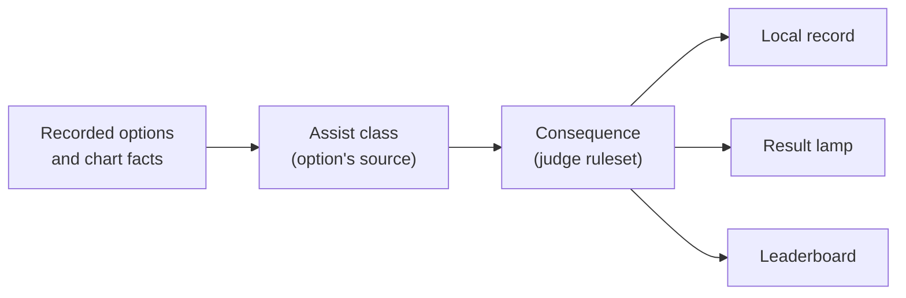
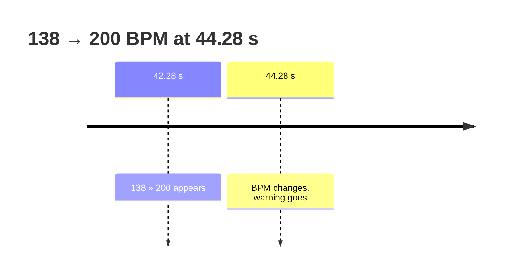
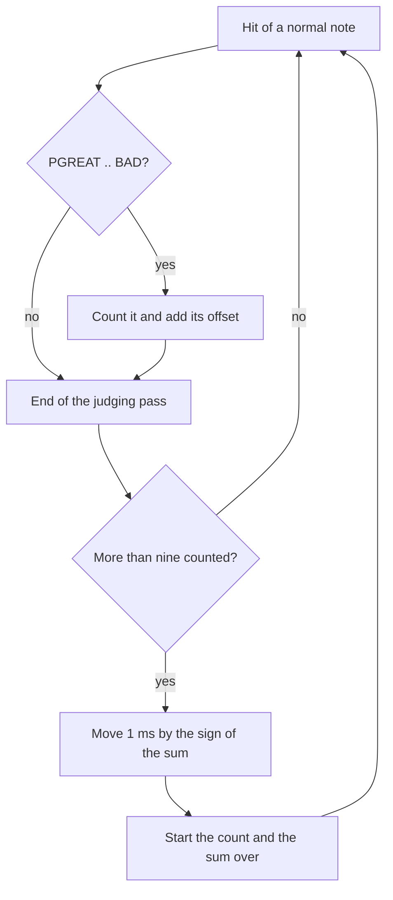

[日本語](./play-options.ja.md)

# Play options

The Debug Menu's **Play options** folder and the select screen share the same effective settings. Options that affect a new play are locked while it runs; saved preferences are restored on the next visit. Replays keep the selected option snapshot and timed changes, alongside effective chart, view and tempo state; how records treat a play follows [Assist and record policy](#assist-and-record-policy). Implementation follows the individual specifications and comments linked from [#755](https://github.com/nulltask/be-music/issues/755).

## Options and judge rules

**Judgment windows** in Debug Menu's Developer folder picks the judge rules: judgment windows, gauges, note selection, long-note style, mine trigger and score. Options that only transform the chart or the view are offered under every ruleset. Each runs its own source's algorithm whatever the judge rules, is kept when the ruleset changes, and keeps its source's chart-type limits. These are HS-FIX CONSTANT, CLASSIC and normal HI-SPEED, FLOATING HI-SPEED and the fixed display area, the BPM-change warning, automatic judge timing adjustment, the lane options R-RANDOM, SPIRAL, H-RANDOM, ALL-SCR, RANDOM-EX, S-RANDOM-EX, RANDOM_PLAYABLE, S_RANDOM_PLAYABLE and both SCATTERs, SYNCHRONIZE RANDOM, SYMMETRY RANDOM and M-RAN, the mine and scroll modifiers, EXTRA and LR2 EXTRA MODE, SP TO DP, 7 TO 9, BATTLE AS and D-BATTLE. Without beatoraja rules, the beatoraja lane options draw from the browser's random source; the seeds stay with beatoraja rules.

The rest stays with the ruleset. Judge rules are what the ruleset is. RANDOM, S-RANDOM, CONVERGE and BATTLE name different algorithms in each source, so the ruleset decides which one runs. ADD LN / CN / HCN / ALL, LN MODE, PRACTICE, CUSTOM JUDGE, gauge auto-shift, the gauge types and the judgment algorithm also remain ruleset-bound for now. How records treat a play that mixes sources is described in [Assist and record policy](#assist-and-record-policy). Tracked in [#774](https://github.com/nulltask/be-music/issues/774).

## Assist and record policy

Each judge ruleset applies its own assist rules ([#602](https://github.com/nulltask/be-music/issues/602)). The option's source decides how assisted a play is, and the judge ruleset decides what follows from that. A bare value two sources define (BATTLE, CONVERGE, AUTO SCRATCH) belongs to the ruleset the play ran under, as [ADR 0019](./adr/0019-source-qualified-option-values.md) reads it; a qualified value keeps its source. One deterministic resolver in `@be-music/player-engine/records` (`classifyReplayAssists`, `resolveRecordPolicy`) reads only recorded replay fields. Local records, the result screen's lamp, course records and the Leaderboard all use it, so a re-simulated play gets the same answer. See [ADR 0031](./adr/0031-assist-record-policy.md).

**Assist classes**, mildest first: `none`, `light`, `assist`, `no-save`. A play takes the highest class among its options.

| Option                                                                                   | Source    | Class     | Condition                               | Source citation                                           |
| ---------------------------------------------------------------------------------------- | --------- | --------- | --------------------------------------- | --------------------------------------------------------- |
| AUTO SCRATCH (1P, or 2P on a chart with a 2P side)                                       | LR2       | `light`   | Under LR2 and beatoraja rules           | OpenLR2 `LR2f.cpp` L9334 (`p1_assist` / `p2_assist`)      |
| AUTO SCRATCH                                                                             | AC 34     | `light`   | Under `____` rules                      | AC 34 assist options                                      |
| HS-FIX CONSTANT                                                                          | LR2       | `light`   | Any chart                               | OpenLR2 L9334 (`hsfix == 4`)                              |
| SCATTER, SCATTER (9KEY corrected), CONVERGE (LR2)                                        | LR2       | `light`   |                                         | OpenLR2 L9334 (`random > 3`)                              |
| D-BATTLE, SP TO DP, LR2 EXTRA MODE                                                       | LR2       | `light`   | Separate lamp under LR2 rules           | OpenLR2 L9250-L9332 (`clear_db`, `clear_sd`, `clear_ex`)  |
| SPIRAL, H-RANDOM, ALL-SCR, RANDOM-EX, S-RANDOM-EX, PMS RANDOM / S-RANDOM, CONVERGE (PMS) | beatoraja | `light`   |                                         | beatoraja 0.8.9 `Random`, lane and note shuffle modifiers |
| BATTLE, BATTLE AS                                                                        | beatoraja | `light`   | BATTLE under beatoraja rules            | `BMSPlayer` L252                                          |
| 7 TO 9                                                                                   | beatoraja | `light`   | The conversion applied                  | `ModeModifier`                                            |
| BPM GUIDE                                                                                | beatoraja | `light`   | The chart's BPM changes                 | `BMSPlayer` L201-L205                                     |
| Mine REMOVE, scroll REMOVE                                                               | beatoraja | `light`   | Something was removed                   | `MineNoteModifier`, `ScrollSpeedModifier`                 |
| LEGACY NOTE (and A-SCR & LEGACY NOTE)                                                    | AC 34     | `light`   |                                         | AC 34 assist options                                      |
| LN REMOVE                                                                                | beatoraja | `assist`  | A long note was removed                 | `LongNoteModifier` L27-L37                                |
| ADD CN, ADD HCN, ADD ALL                                                                 | beatoraja | `assist`  | A CN or HCN was added                   | `LongNoteModifier` L41-L69                                |
| EXTRA note conversion                                                                    | beatoraja | `assist`  | A note was converted                    | `ExtraNoteModifier`                                       |
| CUSTOM JUDGE                                                                             | beatoraja | `assist`  | A rate over 100 %                       | `BMSPlayer` L208-L213                                     |
| Debug judge-window override                                                              | be-music  | `assist`  | Widens the windows as CUSTOM JUDGE does |                                                           |
| BATTLE                                                                                   | AC 34     | `no-save` | BATTLE under `____` rules               | AC 34 play options: "スコアデータは保存されません"        |
| PRACTICE                                                                                 | beatoraja | `no-save` |                                         | beatoraja PRACTICE saves nothing                          |

Unassisted: MIRROR, RANDOM, S-RANDOM, R-RANDOM, SYNCHRONIZE / SYMMETRY RANDOM, M-RAN, DP FLIP, covers and LIFT, the hi-speed options, visual CONSTANT (beatoraja's `enableConstant` is a rendering setting), mine ADD, scroll ADD, ADD LN, the judge algorithm, the gauges (ASSIST EASY and ASSISTED EASY are gauge lamps, not assists) and gauge auto-shift. The PC edition's NO PLAY options (KEY ASSIST, ANY KEY, and its own H-RANDOM and BATTLE) are that edition's rules. They are not applied to other sources: H-RANDOM here is beatoraja's algorithm and is classified as beatoraja's. A PC-sourced option would be `no-save` under `____` rules.

**Consequences per judge ruleset:**

| Ruleset     | `light`                                                                                      | `assist`                                         | `no-save`     |
| ----------- | -------------------------------------------------------------------------------------------- | ------------------------------------------------ | ------------- |
| `lr2`       | Lamp capped at EASY; lamp and play count only. LR2's separate-lamp modes keep their own slot | As `light`                                       | Nothing saved |
| `beatoraja` | A clear is LIGHT ASSIST EASY; lamp and play count only                                       | A clear is ASSIST EASY; lamp and play count only | Nothing saved |
| `____`      | A clear is ASSIST EASY (ASSIST CLEAR); lamp and play count only                              | As `light`                                       | Nothing saved |

- **Score fields.** An assisted play never improves EX score, BP or max combo, as LR2 and beatoraja (`updateScore`) save neither. A failed play stays FAILED.
- **LR2 separate lamps.** D-BATTLE, SP TO DP and EXTRA MODE keep a lamp in a slot of their own (`lr2:d-battle:…`, `lr2:sp-to-dp:…`, `lr2:extra:…`). It is capped at EASY only when another assist is also on; AUTO SCRATCH on D-BATTLE is exempt, as LR2's `isForceEasy` exempts it.
- **Courses.** A course run with any assisted stage keeps no course record, and its stages write nothing to their charts' records. LR2 saves no assisted stage (`CheckScoreSaveConditon`), and beatoraja turns `updateCourseScore` off. On the Leaderboard such a run is stored unranked (`assist`).
- **Leaderboard.** Every play is still sent except a fully AUTO play and replay playback ([#788](https://github.com/nulltask/be-music/issues/788)). `none` ranks on the main board, `light` and `assist` on the assisted board, and `no-save` is stored but unranked (`no-save`). Each ruleset's result gets that ruleset's limited lamp.
- **Replays** are kept whatever the class: the records are derived from them.
- **Existing records** are not re-derived or migrated. Local bests and Leaderboard results stored before this change keep their values; the policy applies to plays from the change on.

**Clear lamps.** LIGHT ASSIST EASY is its own lamp, between ASSIST EASY and EASY ([#603](https://github.com/nulltask/be-music/issues/603)). beatoraja's ASSIST EASY gauge clears on it, as beatoraja's `ClearType` maps gauge 0 to LightAssistEasy. AC's ASSISTED EASY gauge keeps ASSIST EASY. Stored lamp ranks are append-only: ranks 0 to 9 keep their lamps, LIGHT ASSIST EASY is 10, and ordering uses the lamp order (`compareClearLamps`, `compareClearLampRanks`), not the stored number. beatoraja skins light op 1101 for it, op 1100 for ASSIST EASY, and read clear index 3 for it and 2 for ASSIST EASY; LR2 skins fold both into EASY.

## START BPM HS-FIX

Choose **HS-FIX → STARTBPM** in Debug Menu. The default remains **OFF**. START anchors the chosen hi-speed to the chart header's starting BPM, separately from MAX, MIN and MAIN. When `#BASEBPM` supplies the reference speed, the multiplier is `reference BPM / starting BPM`; a tempo event at beat zero does not replace the header's starting BPM. Subsequent BPM changes still change the scroll rate. This is an ordinary visual speed option and preserves existing score, assist and course eligibility.

The mode and effective drawn hi-speed are recorded in the replay view. beatoraja skins receive START's original option index, 1. LR2 skins retain their original five HS-FIX button cells and cycle; choose START in Debug Menu. Skins can also select it through the shared play-options API.

Source: beatoraja 0.8.9 [`LaneRenderer.init`](https://github.com/exch-bms2/beatoraja/blob/83574048ba489082eb46df7fe9806b464bf1f526/src/bms/player/beatoraja/play/LaneRenderer.java) and [`PlayConfig`](https://github.com/exch-bms2/beatoraja/blob/83574048ba489082eb46df7fe9806b464bf1f526/src/bms/player/beatoraja/PlayConfig.java). Tracked in [#736](https://github.com/nulltask/be-music/issues/736).

## Persistent display-area information

Choose **Display area info** in Debug Menu: **OFF** (default), **ON**, **SUDDEN+ ONLY**, or **HID+/LIFT ONLY**. These are the four choices shown by That-Which-Must-Not-Be-Named AC 34. On an active cover, the selected edges keep showing its length on the 0–1000 scale and the green number without holding START. Each DP side uses its own cover and visible time. A disabled cover has no added label. The original skin's own readouts remain available with OFF.

The same folder exposes the existing LR2 **Effect 1P / 2P**, **Lane cover** and **Cover height** settings. Changing the family keeps these settings. Native uses DOM labels; Canvas, LR2 and beatoraja use Canvas labels, which are included in captures. Readout visibility is a saved viewing preference; it changes no input, judgment, scroll or replay eligibility. The source page does not specify additional recording restrictions for this setting.

Source: AC 34 [BPM-change options](https://p.eagate.573.jp/game/2dx/34/howto/new/bpm_option.html), including the four-choice settings screenshot. Tracked in [#748](https://github.com/nulltask/be-music/issues/748).

## Per-side AUTO SCRATCH

Debug Menu's **Auto scratch 1P / 2P** switches independently automate each side's scratch notes. The other side remains manual, including long scratch notes. This follows the per-side AUTO SCRATCH setting tracked in [#708](https://github.com/nulltask/be-music/issues/708). Replays retain the effective side switches as well as the selected option snapshot; old replays with only the combined switch apply it to both sides. Its record policy is in [Assist and record policy](#assist-and-record-policy).

## LEGACY NOTE and LN REMOVE

Debug Menu's **Long notes** selector defaults to **OFF**. **LEGACY NOTE (AC 34)** replaces charge notes and backspin scratches with their head note; ordinary LN remains unchanged. HCN is outside this AC option's scope and remains unchanged. **LN REMOVE (beatoraja)** replaces every LN, CN and HCN with its head note, including scratch lanes, as beatoraja 0.8.9's REMOVE modifier does at its full removal rate. Both retain the head keysound and time and remove tail judgment and tail audio. A chart without matching notes is unchanged.

The engine and renderer share the transformed notes. Replays store the source modifier and effective head-only note chart, while the original chart fingerprint continues to identify the loaded chart. Reopening a replay applies the recorded modifier before restoring its lane arrangement. The selector is locked during play because these source modifiers prepare the chart before play; how a play with them is recorded is in [Assist and record policy](#assist-and-record-policy).

Sources: AC 34 [assist options](https://p.eagate.573.jp/game/2dx/34/howto/play/option.html), beatoraja 0.8.9 [`LongNoteModifier`](https://github.com/exch-bms2/beatoraja/blob/83574048ba489082eb46df7fe9806b464bf1f526/src/bms/player/beatoraja/pattern/LongNoteModifier.java). Tracked in [#710](https://github.com/nulltask/be-music/issues/710).

## A-SCR & LEGACY NOTE

Debug Menu's **A-SCR & LEGACY NOTE (AC 34)** button applies the AC 34 combined preset in one operation: AUTO SCRATCH on both play sides and LEGACY NOTE. The existing switches and Long notes selector immediately show the effective settings; use them to select an individual operation or turn it off. Only CN/BSS tails are removed, and only scratch notes are automated. Both operations are recorded explicitly, including their effective note chart, so replay does not infer an assist from a visual preset name. The button is disabled during play. Its record policy is in [Assist and record policy](#assist-and-record-policy).

Source: AC 34 [assist options](https://p.eagate.573.jp/game/2dx/34/howto/play/option.html). Tracked in [#711](https://github.com/nulltask/be-music/issues/711).

## EX-HARD

Choose **Judgment windows → beatoraja / ????** in Debug Menu's Developer folder, then **Play options → Gauge → EX-HARD**. EX-HARD is an independent survival gauge, not AUTO SCRATCH or another input assist. The gauge starts at 100 and fails at zero, without HARD's low-life damage reduction. The existing source tables retain beatoraja's mode-specific damage and recovery and AC's separate values. beatoraja's **HAZARD** remains a different choice (the replay's existing `DEATH` key); old AC replays with that key retain their former interpretation.

LR2 beta3 has no EX-HARD choice: its menu keeps GROOVE / HARD / DEATH / EASY (and P.ATTACK / G.ATTACK), and requesting EX-HARD directly with LR2 rules fails explicitly. Changing to a ruleset that does not support the selected gauge restores its normal gauge. LR2 skin buttons keep their original cells and cycle (GROOVE, HARD, DEATH, EASY, P.ATTACK, G.ATTACK); when that skin displays a play using EX-HARD from another ruleset, its survival gauge uses the red presentation. Choose EX-HARD in Debug Menu. Replays store `play.gauge: "EX-HARD"` and the source gauge result name; course conversion uses EXHARDCLASS for beatoraja / AC.

Sources: beatoraja 0.8.9 [`GaugeProperty`](https://github.com/exch-bms2/beatoraja/blob/83574048ba489082eb46df7fe9806b464bf1f526/src/bms/player/beatoraja/play/GaugeProperty.java), AC 34 [gauge options](https://p.eagate.573.jp/game/2dx/34/howto/play/option.html). Tracked in [#726](https://github.com/nulltask/be-music/issues/726).

## ASSIST EASY / ASSISTED EASY

With beatoraja rules, Debug Menu offers **Gauge → ASSIST EASY**; with ???? rules, it offers **ASSISTED EASY**. Both select a gentler recovery gauge, independently of AUTO SCRATCH and long-note modifiers. The replay's selected gauge is `ASSIST-EASY`; the effective result retains the source name `ASSIST-EASY` or `ASSISTED-EASY`. No input-assist switch is inferred from the gauge name.

The existing beatoraja tables retain their mode-specific recovery, damage and clear border: 60 for seven-key play and 50 for five-key play. AC uses its own recovery/damage and a clear border of 60. LR2 beta3 has neither option and rejects a direct request. A beatoraja / AC course converts this recovery choice to CLASS, as the source course gauge conversion does. LR2 skins keep the original EASY sprite cell and normal gauge presentation while their text readout keeps the selected name.

Sources: beatoraja 0.8.9 [`GaugeProperty`](https://github.com/exch-bms2/beatoraja/blob/83574048ba489082eb46df7fe9806b464bf1f526/src/bms/player/beatoraja/play/GaugeProperty.java), AC 34 [ASSISTED EASY](https://p.eagate.573.jp/game/2dx/34/howto/play/option.html). Tracked in [#725](https://github.com/nulltask/be-music/issues/725).

## Judgment algorithms

With beatoraja rules, choose **Judge algorithm → Combo**, **Duration** or **Lowest** in Debug Menu; **Combo** is the default. The algorithm decides which note a press is judged against when several are in reach. Combo, beatoraja's default, moves to a later note only once the earlier one has passed the late edge of its GOOD window while the later one is inside its own; Duration takes the note closest in time; Lowest always takes the earliest note in reach. beatoraja's internal Score variant is not offered. LR2 and AC always judge the earliest note, so with their rules the control shows only **Source default**, and the engine rejects any other choice.

A beatoraja replay stores the effective algorithm as `play.judgeAlgorithm` (Combo when nothing else was chosen), and replay simulation judges with it. A beatoraja select skin's judge algorithm button (340) steps the three choices and shows them on its label images. The choice sets no assist flag; its record policy is in [Assist and record policy](#assist-and-record-policy).

Sources: beatoraja 0.8.9 [`JudgeAlgorithm`](https://github.com/exch-bms2/beatoraja/blob/83574048ba489082eb46df7fe9806b464bf1f526/src/bms/player/beatoraja/play/JudgeAlgorithm.java) and [`JudgeManager`](https://github.com/exch-bms2/beatoraja/blob/83574048ba489082eb46df7fe9806b464bf1f526/src/bms/player/beatoraja/play/JudgeManager.java). Tracked in [#743](https://github.com/nulltask/be-music/issues/743).

## CLASSIC and normal HI-SPEED

Under every ruleset, Debug Menu offers **CLASSIC HI-SPEED** and **Normal HI-SPEED (AC 32 measured)**; both are off by default and turning one on turns the other off. Either one sets HS-FIX to OFF and replaces the **Hi-speed** slider and **HS-FIX** with its own control. **Classic speed** picks one of AC 34's eleven CLASSIC steps from 1.0 to 4.0 (1, 1.5, 2, 2.25 … 3.75, 4). The arrow keys and the select screen's hi-speed control step through the same table and stop at either end.

**Normal HS level** picks one of twenty levels, which follow the green numbers measured on the AC 32 Lightning Model by masaoblue (2025-08-21), from 1200 down to 260 for the full lane; they are not a claimed AC 34 calibration. The multiplier is computed at the chart's starting BPM and kept through later tempo changes; each arrow key moves one level and recomputes it at the current BPM. Both modes draw on the measured lane scale, so the green number matches the source on any skin.

Replays store `play.options.classicHiSpeed` or `play.options.normalHiSpeedLevel` with `normalHiSpeedProfile: "AC32-measured"`, the selected hi-speed and HS-FIX OFF; level changes during play go to `play.optionChanges` and the drawn speed to the replay view. Neither mode has a dedicated skin readout. Both are ordinary visual-speed settings and change no score eligibility.

Source: AC 34 [speed options](https://p.eagate.573.jp/game/2dx/34/howto/play/option_speed.html). Tracked in [#734](https://github.com/nulltask/be-music/issues/734) and [#735](https://github.com/nulltask/be-music/issues/735).

## BPM GUIDE

Turn on **BPM GUIDE (beatoraja)** in Debug Menu; it is off by default. Upcoming tempo changes then appear on the lanes as beatoraja 0.8.9's `LaneRenderer` draws them: a green `BPM<n>` label at each actual BPM change, skipping declarations that repeat the current BPM, and a yellow `STOP <n>ms` label at each positive STOP, both truncated to integers. Labels follow the notes' scroll, including STOPs and negative scroll, and leave once they pass the judge line.

The built-in and LR2 playfields draw a line and a label per play side. A beatoraja skin draws its own BPM and STOP marker images, which now appear only while the option is on, with the labels added above them. Replays store `play.options.bpmGuide` with the chart's header BPM (`chart.headerBPM`) and resolved BPM range (`chart.bpmRange`), the facts beatoraja's light-assist rule uses: it applies only to a chart whose BPM changes. Its record policy is in [Assist and record policy](#assist-and-record-policy).

Sources: beatoraja 0.8.9 [`LaneRenderer`](https://github.com/exch-bms2/beatoraja/blob/83574048ba489082eb46df7fe9806b464bf1f526/src/bms/player/beatoraja/play/LaneRenderer.java) and [`BMSPlayer`](https://github.com/exch-bms2/beatoraja/blob/83574048ba489082eb46df7fe9806b464bf1f526/src/bms/player/beatoraja/play/BMSPlayer.java). Tracked in [#745](https://github.com/nulltask/be-music/issues/745).

## BPM-change warning

Turn on **BPM change warning (AC)** in Debug Menu; it is off by default. Before each BPM change, `<current> » <next>` appears in a framed box on the lanes and stays until the change happens: blue when the tempo rises, red when it falls, in whole BPMs. It appears 2 s of chart time before the change, so it comes more beats ahead on a fast section than on a slow one.

The built-in (Canvas and DOM skins), LR2 and beatoraja play screens centre the box on each side's lanes, half-way down them. AC 34's introduction shows it just above the judgment and combo; skins put their judgment anywhere from about 40 % to 65 % down the lanes, so half-way keeps the box clear of it on the built-in skins. Changes at the same instant merge into one, and a change back to the same BPM is none. A change that comes less than 2 s after another is warned as soon as the first has happened. STOPs are not warned. It only draws, and is offered under every ruleset.

The look follows AC 34's [introduction of the option](https://p.eagate.573.jp/game/2dx/34/howto/new/bpm_option.html); the timing comes from play footage (the measurements are on [#746](https://github.com/nulltask/be-music/issues/746)), in which every BPM change was warned about 2.0 s ahead and the warning left on the change. The source's TYPE A–D variants, whether its lead runs on real time or chart time, and its behavior with STOPs, close changes or very small changes are not known yet. Tracked in [#746](https://github.com/nulltask/be-music/issues/746).

## Judge timing and automatic adjustment

**Judge timing (ms)** in Debug Menu sets the display timing beatoraja and LR2 both have: an integer from −500 to 500 ms, 0 by default. As in both, it shifts only the clock the notes are drawn with; a positive value runs that clock ahead. Input, audio and judgment times stay unchanged, so recorded inputs are never shifted. Every skin family applies it, and a beatoraja skin's BPM readout reads the same adjusted clock. The slider stays enabled during play and applies at once. A beatoraja select skin's JUDGE TIMING button (74) steps it by 1 ms within ±500 ms, an LR2 select skin's (74) by 1 ms within ±99 ms as LR2 does, and number 12 of a beatoraja or an LR2 skin shows it.

Under every ruleset, **Auto judge timing** picks how a manual play moves the timing by itself: **OFF** (the default), **beatoraja**, **LR2 ON** or **LR2 SILENT**. Auto play and replays never adjust.

- **beatoraja:** after each PGREAT, GREAT or GOOD within ±150 ms, the timing moves by that judgment's offset divided by 30, in whole milliseconds rounded away from zero. These updates are not held to the ±500 ms range.
- **LR2 ON** (LR2's `autojudge` 1): every PGREAT, GREAT, GOOD or BAD hit of a normal note adds its offset, in whole milliseconds with late hits positive, to a running sum. Misses, empty POORs and long notes are not counted; both sides of a double play are. Once per judging pass, when more than nine hits have been counted, the timing moves 1 ms toward the side the sum leans to (later hits raise it), or stays when the sum is 0, and the count and the sum start over. There is no averaging, rounding or limit: LR2's ±99 ms range holds only for its select button. A two-player BATTLE does not adjust, as in LR2. Whether LR2 empties the sum when a play starts is undetermined; be-music starts every play with an empty one.
- **LR2 SILENT** (`autojudge` 2): adjusts as LR2 ON does and, as LR2 does, plays without the chart's keysounds, BGM and BGA, which are not loaded, and draws no judgment or combo on any play screen: the built-in and LR2 ones, and a beatoraja skin's `judge[]` display. LR2 also turns its ghost display off, which be-music does not have. The play scores as usual.

Replays store `play.options.judgeTimingMs` and `judgeTimingAutoAdjust`: `"OFF"`, `"BEATORAJA"`, `"LR2-ON"` or `"LR2-SILENT"`. A replay recorded before the modes stores `true` or `false`, read as beatoraja's or OFF. Each accepted automatic update (each of LR2's 1 ms steps) or manual change during play is written to `play.optionChanges` at its chart time, and a replay shows the recorded value; LR2 itself records neither. A replay of an LR2 SILENT play plays without the chart's sounds and BGA too. The adjusted value is kept for the next play, and Debug Menu settings saved before the modes keep beatoraja's switch as **beatoraja**. A beatoraja select skin's automatic-adjustment button (75) switches between OFF and beatoraja (it reads LR2's modes as OFF). An LR2 select skin's button 75 cycles OFF, ON and SILENT, and its text 80 names the setting (beatoraja's reads as OFF).

Sources: beatoraja 0.8.9 [`PlayerConfig`](https://github.com/exch-bms2/beatoraja/blob/83574048ba489082eb46df7fe9806b464bf1f526/src/bms/player/beatoraja/PlayerConfig.java), [`LaneRenderer`](https://github.com/exch-bms2/beatoraja/blob/83574048ba489082eb46df7fe9806b464bf1f526/src/bms/player/beatoraja/play/LaneRenderer.java) and [`JudgeManager`](https://github.com/exch-bms2/beatoraja/blob/83574048ba489082eb46df7fe9806b464bf1f526/src/bms/player/beatoraja/play/JudgeManager.java); OpenLR2 [hit sampling](https://github.com/GOMazk/OpenLR2/blob/583a38503555e59c4bafa49d60b9d0714c9007c2/LR2f.cpp#L7463-L7535), [the 1 ms step](https://github.com/GOMazk/OpenLR2/blob/583a38503555e59c4bafa49d60b9d0714c9007c2/LR2f.cpp#L12620-L12647), [the SILENT loading](https://github.com/GOMazk/OpenLR2/blob/583a38503555e59c4bafa49d60b9d0714c9007c2/LR2f.cpp#L24346-L24349) and [hidden judgment](https://github.com/GOMazk/OpenLR2/blob/583a38503555e59c4bafa49d60b9d0714c9007c2/LR2f.cpp#L2510-L2515), and [the select button](https://github.com/GOMazk/OpenLR2/blob/583a38503555e59c4bafa49d60b9d0714c9007c2/LR2f.cpp#L10617-L10625). Tracked in [#741](https://github.com/nulltask/be-music/issues/741), [#742](https://github.com/nulltask/be-music/issues/742), [#777](https://github.com/nulltask/be-music/issues/777) and [#917](https://github.com/nulltask/be-music/issues/917).

## Visual CONSTANT

Turn on **Visual CONSTANT (beatoraja)** in Debug Menu; it is off by default. As beatoraja's `PlayConfig.enableConstant` does, notes, mines and bar lines show only during the last **Note duration (ms)** before they reach the judge line (1–10000, default 500), fading over **CONSTANT fade (ms)** (−1000 to 1000, default 100): a positive fade starts before that window, and a negative one ends inside it. `#SPEED` scroll changes are ignored while it is on. It is a drawing setting: the chart is not rewritten, judgment is unchanged, and it is separate from LR2's HS-FIX CONSTANT and from the scroll REMOVE modifier.

The switch is locked during play; the duration and fade stay enabled and apply at once. The built-in, LR2 and beatoraja playfields draw it; on a beatoraja skin, as in beatoraja's `LaneRenderer`, the fade applies to each timeline (a long note fades with its head) and to the BPM-change and STOP lines too, and op 400 (CONSTANT) is lit while it is on. A course with the `NO_SPEED` constraint turns it off for its stages, so `#SPEED` scrolls again there; op 400 stays lit, as beatoraja reads the player's own setting. Replays store `play.options.visualConstant`, `noteDurationMs` and `constantFadeMs`, with changes during play in `play.optionChanges`. beatoraja 0.8.9 sets no assist flag for this option; its record policy is in [Assist and record policy](#assist-and-record-policy).

Sources: beatoraja 0.8.9 [`PlayConfig`](https://github.com/exch-bms2/beatoraja/blob/83574048ba489082eb46df7fe9806b464bf1f526/src/bms/player/beatoraja/PlayConfig.java) and [`LaneRenderer`](https://github.com/exch-bms2/beatoraja/blob/83574048ba489082eb46df7fe9806b464bf1f526/src/bms/player/beatoraja/play/LaneRenderer.java). Tracked in [#738](https://github.com/nulltask/be-music/issues/738) and [#776](https://github.com/nulltask/be-music/issues/776).

## Per-side LIFT

Debug Menu's **LIFT 1P (beatoraja)** / **LIFT 2P (beatoraja)** switch each side's LIFT independently, and **LIFT height 1P** / **2P** set its height as a fraction of the lane. As in beatoraja, LIFT starts off at a height of 0.1, and the height is kept while it is off. These controls stay enabled during play and apply at once. LIFT raises the judge line and the notes' landing point; the lane above it is compressed, so a note takes the same time to reach the raised line and the white and green numbers do not change. SUDDEN+ and HIDDEN+ are fractions of the lane above the LIFT. A course that locks the hi-speed starts with every cover and the LIFT at 0.

beatoraja skins and the built-in Plain, Native and Synesthesia skins draw LIFT; LR2 skins do not, since LR2 beta3 has no LIFT option. On those built-in skins, as on a beatoraja skin, Home and End lower and raise the LIFT, PageUp and PageDown move SUDDEN+, H switches HIDDEN+ and J and K move it, by 1 % of the lane (5 % with Shift). Replays store each side's LIFT in the replay view and `play.options.lift1P` / `lift2P` / `liftOn1P` / `liftOn2P`, with changes during play in `play.optionChanges`; the Replay / ghost folder's **LIFT** switch decides whether a replay shows the recorded LIFT. It is a display adjustment, not an input assist.

Sources: beatoraja 0.8.9 [`LaneRenderer`](https://github.com/exch-bms2/beatoraja/blob/83574048ba489082eb46df7fe9806b464bf1f526/src/bms/player/beatoraja/play/LaneRenderer.java) and [`PlayConfig`](https://github.com/exch-bms2/beatoraja/blob/83574048ba489082eb46df7fe9806b464bf1f526/src/bms/player/beatoraja/PlayConfig.java). Tracked in [#417](https://github.com/nulltask/be-music/issues/417).

## FLOATING HI-SPEED and fixed display area

Under any ruleset, turn on **FLOATING HI-SPEED (AC 32 measured)** in Debug Menu, or press numpad 0 during play to switch it. It sets HS-FIX to OFF and replaces the speed controls with **Floating speed**, from 0.5 to 10. During play, each arrow key moves the speed by 0.5, and Shift with an arrow key by the measured 1/300 step. On skins that take the cover keys (Plain, Native, Synesthesia and beatoraja skins), with SUDDEN+ shown, PageUp and PageDown move the cover by one pixel of the measured 723-pixel AC lane (ten with Shift) and recalculate the speed to keep the green number captured when FLOATING HI-SPEED was turned on; with only the LIFT shown, they move the LIFT instead, and with neither, they make the fine 1/300 adjustment. Turning it on snaps the covers to that lane, keeping SUDDEN+ at 30 pixels or more and the LIFT at 600 or less. Turning it off rounds to the nearest CLASSIC step (ties upward) under CLASSIC HI-SPEED, and otherwise to the nearest normal level. Like the normal levels, the values come from masaoblue's AC 32 measurements, not an AC 34 calibration.

**Fixed display area (AC 34)**, also offered under every ruleset and off by default, ignores every cover and LIFT change during play, including Debug Menu edits; a replay still shows its recorded covers. With FLOATING HI-SPEED, pressing START (Enter) twice within 500 ms restores the green number captured when it was turned on, recalculated at the current BPM, without moving any cover. A course's hi-speed lock applies independently.

Replays store `play.options.floatingHiSpeed` with `floatingHiSpeedProfile: "AC32-measured"`, `fixedDisplayArea`, the hi-speed and HS-FIX OFF. Mode switches and speed changes during play go to `play.optionChanges`, and covers and the drawn speed to the replay view. The built-in Plain and Synesthesia skins label the speed FHS. Both are visual options; the source pages specify no assist or recording rule for them.

Sources: AC 34 [speed options](https://p.eagate.573.jp/game/2dx/34/howto/play/option_speed.html) and [BPM-change options](https://p.eagate.573.jp/game/2dx/34/howto/new/bpm_option.html). Tracked in [#733](https://github.com/nulltask/be-music/issues/733) and [#747](https://github.com/nulltask/be-music/issues/747).

## CUSTOM JUDGE

With beatoraja rules, turn on **CUSTOM JUDGE (beatoraja)** in Debug Menu to set beatoraja's per-judgment window rates: **Key PGREAT %**, **Key GREAT %**, **Key GOOD %**, **Scratch PGREAT %**, **Scratch GREAT %**, **Scratch GOOD %** and **LN margin %**. Defaults are 400, 400 and 100 for keys and scratches and 100 for the margin; PGREAT accepts 25–400 and the others 0–400, as `PlayerConfig.validate` allows. As in beatoraja, each rate scales its window after the judgerank, no window grows past BAD, and a window narrower than the one inside it is widened to match. Note heads use the key or scratch rates; key and scratch long-note ends both use the key rates. The margin rate scales the key long-note release margin, which is non-zero only in PMS mode.

Other rulesets hide the switch and the engine rejects it. Replays store the rates as `play.customJudge` (absent while the option is off) and in the option snapshot, and replay simulation applies them. beatoraja marks a play ASSIST when any rate exceeds 100 %, and so does be-music ([Assist and record policy](#assist-and-record-policy)).

Sources: beatoraja 0.8.9 [`PlayerConfig`](https://github.com/exch-bms2/beatoraja/blob/83574048ba489082eb46df7fe9806b464bf1f526/src/bms/player/beatoraja/PlayerConfig.java), [`JudgeManager`](https://github.com/exch-bms2/beatoraja/blob/83574048ba489082eb46df7fe9806b464bf1f526/src/bms/player/beatoraja/play/JudgeManager.java) and [`BMSPlayer`](https://github.com/exch-bms2/beatoraja/blob/83574048ba489082eb46df7fe9806b464bf1f526/src/bms/player/beatoraja/play/BMSPlayer.java). Tracked in [#744](https://github.com/nulltask/be-music/issues/744).

## PRACTICE

With beatoraja rules, turn on **PRACTICE (beatoraja)** in Debug Menu, or press a beatoraja select skin's PRACTICE button (315); its PLAY button starts the regular mode. The settings follow beatoraja's `PracticeConfiguration`: **START TIME ms** and **END TIME ms (0 = end)** in 100 ms steps, **GAUGE TYPE** (ASSIST EASY to EXHARD GRADE), **GAUGE CATEGORY** (**Play mode** or a beatoraja category), **GAUGE VALUE** (1–120, default 20), and **JUDGERANK (0 = chart)** and **TOTAL (0 = chart)**. It applies to a single chart, not to a course, NONSTOP or replay.

As beatoraja's `PracticeModifier` does, every judged object outside the range moves to the background, so its keysound still plays; a long note with either end outside leaves with it. The range ends at least 1000 ms after its start, the play starts 1000 ms before it and runs until 1000 ms past its end, and TOTAL scales against the note count before the cut. The play tempo and lane options apply as usual, but BATTLE, the long-note, mine and scroll modifiers, EXTRA and LR2 EXTRA MODE are turned off, as beatoraja applies chart modifiers only in PLAY and AUTOPLAY. When the range ends, it plays again at once until ESC. A practice play records no replay and changes no records.

Sources: beatoraja 0.8.9 [`PracticeConfiguration`](https://github.com/exch-bms2/beatoraja/blob/83574048ba489082eb46df7fe9806b464bf1f526/src/bms/player/beatoraja/play/PracticeConfiguration.java) and [`PracticeModifier`](https://github.com/exch-bms2/beatoraja/blob/83574048ba489082eb46df7fe9806b464bf1f526/src/bms/player/beatoraja/pattern/PracticeModifier.java). Tracked in [#749](https://github.com/nulltask/be-music/issues/749).

## R-RANDOM

Under any ruleset, choose **Play options → Random 1P / Random 2P → R-RANDOM** in Debug Menu. R-RANDOM rotates one side's key lanes as a whole, forwards or reversed; scratch stays fixed. As in beatoraja 0.8.9's `LaneRotateShuffleModifier`, the draw excludes the original order and MIRROR, and every remaining rotation is equally likely. Every ruleset uses this rotation set, and the choice is kept when the ruleset changes; with beatoraja rules the draw uses the side's seed (see "Source seeds and previous arrangement"). beatoraja treats R-RANDOM as an unassisted option, and a course with the `grade_random` constraint keeps it, as beatoraja keeps its first six random options.

Replays store the choice in `play.randomLane` and `play.options.random1P` / `random2P`, together with every note's final lane and its original lane (`sourceChannel`), so a replay re-applies the recorded lanes instead of drawing again. The built-in select screen's **Lanes** list and the shared play-options API list every lane-option name; a play started with a choice the active rules do not offer fails explicitly. LR2 skins show the selected name in their RANDOM option text, while their RANDOM buttons keep the four original cells (OFF / MIRROR / RANDOM / S-RANDOM) and draw the first cell for any other choice. beatoraja skins' RANDOM 1P / 2P buttons (42 / 43) step the choice through beatoraja 0.8.9's ten lane options for the focused chart's play mode, PMS or not, and their labels show its slot (see [beatoraja skins](./beatoraja-skin.md)); choose the other options in Debug Menu. Its record policy is in [Assist and record policy](#assist-and-record-policy).

Sources: beatoraja 0.8.9 [`Random`](https://github.com/exch-bms2/beatoraja/blob/83574048ba489082eb46df7fe9806b464bf1f526/src/bms/player/beatoraja/pattern/Random.java) and [`LaneShuffleModifier`](https://github.com/exch-bms2/beatoraja/blob/83574048ba489082eb46df7fe9806b464bf1f526/src/bms/player/beatoraja/pattern/LaneShuffleModifier.java), AC 34 [play options](https://p.eagate.573.jp/game/2dx/34/howto/play/option.html). Tracked in [#693](https://github.com/nulltask/be-music/issues/693).

## SPIRAL

Under any ruleset, choose **Random 1P / Random 2P → SPIRAL**. SPIRAL draws one step of 1 to N−1 lanes and, on each timeline, rotates the key lanes one step further than on the previous timeline; while a long note is held, the rotation stays where it is until after its tail. As in beatoraja 0.8.9's `SpiralRandomizer`, every timeline counts, including one with only scratch, mine, invisible or other-side objects, or only a long-note tail. Scratch stays fixed, and the step is drawn from the side's seed with beatoraja rules.

beatoraja marks SPIRAL as LIGHT_ASSIST; its record policy is in [Assist and record policy](#assist-and-record-policy). A course with the `grade_random` constraint keeps it. Replays record SPIRAL in `play.randomLane` and `play.options` with every note's final lane, so a replay does not draw it again.

Sources: beatoraja 0.8.9 [`Random`](https://github.com/exch-bms2/beatoraja/blob/83574048ba489082eb46df7fe9806b464bf1f526/src/bms/player/beatoraja/pattern/Random.java) and [`Randomizer`](https://github.com/exch-bms2/beatoraja/blob/83574048ba489082eb46df7fe9806b464bf1f526/src/bms/player/beatoraja/pattern/Randomizer.java). Tracked in [#696](https://github.com/nulltask/be-music/issues/696).

## H-RANDOM

Under any ruleset, choose **Random 1P / Random 2P → H-RANDOM** and set **H-RANDOM threshold BPM (beatoraja)**: 1 to 1000, default 120, the bounds of beatoraja 0.8.9's `PlayerConfig`. H-RANDOM places notes timeline by timeline like S-RANDOM, but each note prefers a lane whose last note is more than one sixteenth note at the threshold BPM earlier (`ceil(15000 / BPM)` ms); when no free lane qualifies, it takes the free lanes idle longest. A held long note keeps its lane through its tail, and scratch stays fixed. With beatoraja rules the draw uses the side's seed. As in beatoraja's `Randomizer.create`, the same threshold also drives ALL-SCR, beatoraja CONVERGE and S_RANDOM_PLAYABLE.

beatoraja marks H-RANDOM as LIGHT_ASSIST; its record policy is in [Assist and record policy](#assist-and-record-policy). Replays record the choice in `play.randomLane` and `play.options`, the clamped threshold in `play.options.hRandomThresholdBPM`, and every note's final lane.

Sources: beatoraja 0.8.9 [`Randomizer`](https://github.com/exch-bms2/beatoraja/blob/83574048ba489082eb46df7fe9806b464bf1f526/src/bms/player/beatoraja/pattern/Randomizer.java) and [`PlayerConfig`](https://github.com/exch-bms2/beatoraja/blob/83574048ba489082eb46df7fe9806b464bf1f526/src/bms/player/beatoraja/PlayerConfig.java). Tracked in [#697](https://github.com/nulltask/be-music/issues/697).

## CONVERGE

With **Judgment windows → LR2**, choose **Random 1P / Random 2P → CONVERGE**; **Fixed key 1P / Fixed key 2P (LR2; 0=default)** picks the target lane: 1–9 select a key, and 0 selects the mode default, the scratch or key 5 on a nine-key chart. Following LR2 beta3, each note tries the target first; when a note on the same timeline or a held long note (through its tail) already occupies it, the note goes to a random free key lane. Scratch notes stay on the scratch and reserve it before keys converge there. LR2 CONVERGE accepts 5, 7, 9, 10 and 14 KEY charts and fails explicitly on other charts. LR2 beta3 saves no score with CONVERGE (`CheckScoreSaveConditon`); its record policy is in [Assist and record policy](#assist-and-record-policy).

With **Judgment windows → beatoraja**, CONVERGE is the separate PMS arrangement of beatoraja 0.8.9 (`Random.OPTION_PMS`, `ConvergeRandomizer`) and fails explicitly on a chart that is not PMS. Among the free lanes past the H-RANDOM threshold, a note goes to the lane with the longest current streak; a lane's streak resets once it has been idle for more than twice the threshold. It uses the side's seed, and beatoraja marks it as LIGHT_ASSIST. ???? rules offer no CONVERGE. Replays record the choice in `play.randomLane` and `play.options`, LR2's target in `play.options.randomFixedLane1P` / `randomFixedLane2P`, and every note's final lane.

Sources: OpenLR2 [`LR2f.cpp`](https://github.com/GOMazk/OpenLR2/blob/583a38503555e59c4bafa49d60b9d0714c9007c2/LR2f.cpp#L27322-L27404) and its [score-save condition](https://github.com/GOMazk/OpenLR2/blob/583a38503555e59c4bafa49d60b9d0714c9007c2/LR2f.cpp#L68-L79), beatoraja 0.8.9 [`Random`](https://github.com/exch-bms2/beatoraja/blob/83574048ba489082eb46df7fe9806b464bf1f526/src/bms/player/beatoraja/pattern/Random.java) and [`Randomizer`](https://github.com/exch-bms2/beatoraja/blob/83574048ba489082eb46df7fe9806b464bf1f526/src/bms/player/beatoraja/pattern/Randomizer.java). Tracked in [#695](https://github.com/nulltask/be-music/issues/695) and [#701](https://github.com/nulltask/be-music/issues/701).

## ALL-SCR

Under any ruleset, choose **Random 1P / Random 2P → ALL-SCR**. Following beatoraja 0.8.9's `AllScratchRandomizer`, on each timeline one key note moves to the scratch when the scratch is free and its last note is more than 40 ms earlier; the other notes are then placed over the keys and the scratch like H-RANDOM, with its threshold. In DP each side uses its own scratch, and the other notes take the source's fixed side order instead of a random lane. ALL-SCR needs a scratch lane, so a PMS chart fails explicitly. With beatoraja rules the draw uses the side's seed.

beatoraja marks ALL-SCR as LIGHT_ASSIST; its record policy is in [Assist and record policy](#assist-and-record-policy), and a `grade_random` course turns it off. Replays record the choice in `play.randomLane` and `play.options` with every note's final lane.

Sources: beatoraja 0.8.9 [`Random`](https://github.com/exch-bms2/beatoraja/blob/83574048ba489082eb46df7fe9806b464bf1f526/src/bms/player/beatoraja/pattern/Random.java) and [`Randomizer`](https://github.com/exch-bms2/beatoraja/blob/83574048ba489082eb46df7fe9806b464bf1f526/src/bms/player/beatoraja/pattern/Randomizer.java). Tracked in [#698](https://github.com/nulltask/be-music/issues/698).

## RANDOM-EX and S-RANDOM-EX

Under any ruleset, choose **Random 1P / Random 2P → RANDOM-EX** or **S-RANDOM-EX**. These add the side's scratch lanes to the lanes that RANDOM and S-RANDOM move. RANDOM-EX draws one chart-wide permutation of the keys and scratch, as beatoraja 0.8.9's `LaneRandomShuffleModifier` does when it includes the scratch; it is always beatoraja's shuffle, whatever the judge rules. S-RANDOM-EX places notes timeline by timeline over the keys and scratch with beatoraja S-RANDOM's 40 ms jack threshold, falling back to the lanes idle longest. Both need a scratch lane, so a PMS chart fails explicitly, and with beatoraja rules both use the side's seed.

beatoraja marks both as LIGHT_ASSIST; its record policy is in [Assist and record policy](#assist-and-record-policy), and a `grade_random` course turns them off. Replays record the choice in `play.randomLane` and `play.options` with every note's final lane, so a moved scratch note replays on its recorded lane.

Sources: beatoraja 0.8.9 [`Random`](https://github.com/exch-bms2/beatoraja/blob/83574048ba489082eb46df7fe9806b464bf1f526/src/bms/player/beatoraja/pattern/Random.java), [`LaneShuffleModifier`](https://github.com/exch-bms2/beatoraja/blob/83574048ba489082eb46df7fe9806b464bf1f526/src/bms/player/beatoraja/pattern/LaneShuffleModifier.java) and [`Randomizer`](https://github.com/exch-bms2/beatoraja/blob/83574048ba489082eb46df7fe9806b464bf1f526/src/bms/player/beatoraja/pattern/Randomizer.java). Tracked in [#699](https://github.com/nulltask/be-music/issues/699) and [#700](https://github.com/nulltask/be-music/issues/700).

## PMS playable RANDOM and S-RANDOM

Under any ruleset, choose **Random 1P / Random 2P → RANDOM_PLAYABLE** or **S_RANDOM_PLAYABLE**. Both are PMS arrangements from beatoraja 0.8.9's `Random.OPTION_PMS` and fail explicitly on other charts. RANDOM_PLAYABLE (`LanePlayableRandomShuffleModifier`) picks one chart-wide permutation of the nine keys, uniformly among those that turn no chord into one of the source's ten impossible three-key shapes, excluding the original order and MIRROR. If the chart has a chord of seven or more keys, or no permutation qualifies, it uses the original order or MIRROR at random. The source randomizer ignores the modifier seed, so Debug Menu hides that side's Seed for RANDOM_PLAYABLE.

S_RANDOM_PLAYABLE (`NoMurioshiRandomizer`) places notes timeline by timeline: on a timeline with three to six notes, held long notes included, it keeps them inside one of the source's ten six-key playable shapes that contains the held lanes, together with the H-RANDOM threshold. When no shape has enough lanes past the threshold, the pinned source throws; be-music fails the play explicitly instead of inventing a fallback. With beatoraja rules it uses the side's seed. beatoraja marks both as LIGHT_ASSIST; its record policy is in [Assist and record policy](#assist-and-record-policy). Replays record the choice in `play.randomLane` and `play.options` with every note's final lane.

Sources: beatoraja 0.8.9 [`Random`](https://github.com/exch-bms2/beatoraja/blob/83574048ba489082eb46df7fe9806b464bf1f526/src/bms/player/beatoraja/pattern/Random.java), [`LaneShuffleModifier`](https://github.com/exch-bms2/beatoraja/blob/83574048ba489082eb46df7fe9806b464bf1f526/src/bms/player/beatoraja/pattern/LaneShuffleModifier.java) and [`Randomizer`](https://github.com/exch-bms2/beatoraja/blob/83574048ba489082eb46df7fe9806b464bf1f526/src/bms/player/beatoraja/pattern/Randomizer.java). Tracked in [#702](https://github.com/nulltask/be-music/issues/702) and [#703](https://github.com/nulltask/be-music/issues/703).

## Source seeds and previous arrangement

With **Judgment windows → beatoraja**, Debug Menu shows **Seed 1P / Seed 2P (-1=random)**. A seed is a Java long from 0 to 9223372036854775807; the lane options draw from it through `java.util.Random`, as beatoraja 0.8.9's modifiers do, so the same chart, lane option and seed give the same arrangement. -1 draws a fresh seed below 16,777,216 for each play. Replays record the seed each side actually used in `play.options.randomSeed1P` / `randomSeed2P`. LR2 and ???? rules hide the seeds and draw arrangements without one, the beatoraja lane options included.

The **Reuse previous arrangement** and **New arrangement** buttons are offered under every ruleset. Reuse takes the last play, outside replays, courses and NONSTOP, and selects its lane options: Random 1P / 2P, the seeds, the fixed keys, DP flip, the H-RANDOM threshold and Long notes. The next play of the same chart then reuses that play's recorded lanes and `#RANDOM` outcomes exactly, with live input, and records a new replay, as beatoraja's chart-option reuse restores a chart's lane options, seeds and branches. Changing any of those options, or pressing **New arrangement**, drops the reuse; New arrangement also returns both seeds to -1. A play of another chart is unaffected. Reuse needs the judge rules the previous play used: under other rules it selects nothing, and a reused arrangement played under other rules fails with "The previous arrangement was played under other judgment rules." A reused arrangement whose chart hashes differ fails explicitly. Its record policy is in [Assist and record policy](#assist-and-record-policy).

Source: beatoraja 0.8.9 [`BMSPlayer`](https://github.com/exch-bms2/beatoraja/blob/83574048ba489082eb46df7fe9806b464bf1f526/src/bms/player/beatoraja/play/BMSPlayer.java) and [`Randomizer`](https://github.com/exch-bms2/beatoraja/blob/83574048ba489082eb46df7fe9806b464bf1f526/src/bms/player/beatoraja/pattern/Randomizer.java). Tracked in [#721](https://github.com/nulltask/be-music/issues/721).

## SCATTER

Under any ruleset, **Random 1P / Random 2P** offers **SCATTER (LR2 beta3)** and **SCATTER (9KEY corrected)**, recorded as `SCATTER` and `SCATTER-CORRECTED`. SCATTER reproduces LR2 beta3's placement (LR2body.exe 100201, reconstructed by OpenLR2): each key note goes to a random lane that is not yet used on its timeline or held by a long note, avoiding the lanes used on the previous timeline, and repeats one of those only when no other lane is left. A timeline with only scratch notes still advances the avoidance; invisible notes and long-note tails alone do not. Scratch stays fixed; in 14 KEY, a scratch note adds the source's set of keys on its side to the avoidance. With DP FLIP, the timeline bookkeeping follows LR2's unflipped sides. SCATTER accepts 5, 7, 9, 10 and 14 KEY charts.

On a nine-key chart, LR2 beta3's draw can reach a tenth destination, the 2P scratch, outside the PMS playfield. **SCATTER (LR2 beta3)** keeps this: such a note adds no lane, cannot be hit and is judged POOR. **SCATTER (9KEY corrected)** draws only among the nine keys; it is a nine-key option and fails explicitly on other charts. Replays record the choice in `play.randomLane` and `play.options` with every note's final lane, an unreachable one included, so replay simulation reproduces the same judgments. LR2 beta3 saves no score with SCATTER (`CheckScoreSaveConditon`); its record policy is in [Assist and record policy](#assist-and-record-policy).

Source: OpenLR2 [`LR2f.cpp`](https://github.com/GOMazk/OpenLR2/blob/583a38503555e59c4bafa49d60b9d0714c9007c2/LR2f.cpp#L27270-L27404) and its [score-save condition](https://github.com/GOMazk/OpenLR2/blob/583a38503555e59c4bafa49d60b9d0714c9007c2/LR2f.cpp#L68-L79). Tracked in [#694](https://github.com/nulltask/be-music/issues/694).

## SYNCHRONIZE RANDOM and SYMMETRY RANDOM

Under any ruleset, choose **Play options → Battle → BATTLE**, **BATTLE AS** or **D-BATTLE**, a one-player play with the chart copied onto both sides; **Random 1P** then also offers **SYNCHRONIZE RANDOM** and **SYMMETRY RANDOM**, recorded as `SYNCHRONIZE-RANDOM` and `SYMMETRY-RANDOM`. On the copied chart, one RANDOM permutation is drawn for the 1P keys; the 2P keys take the same lane numbers with SYNCHRONIZE RANDOM, or their mirror image with SYMMETRY RANDOM, as the AC 34 option page describes. Scratch stays fixed, and Random 2P is not applied. Leaving these modes returns Random 1P to OFF.

Replays record the choice in `play.randomLane.p1` and `play.options.random1P`, with the final lanes of both sides' notes. Its record policy, BATTLE included, is in [Assist and record policy](#assist-and-record-policy).

Source: AC 34 [play options](https://p.eagate.573.jp/game/2dx/34/howto/play/option.html). Tracked in [#722](https://github.com/nulltask/be-music/issues/722) and [#723](https://github.com/nulltask/be-music/issues/723).

## M-RAN

Choose a two-player play in **Play options → Battle**: **BATTLE** with LR2 rules or **2P PLAY** with ???? rules; Debug Menu then shows **M-RAN 1P** and **M-RAN 2P** next to **Gauge 2P**. M-RAN applies MIRROR to that player's side after a RANDOM-type arrangement: RANDOM, R-RANDOM or S-RANDOM. With any other lane option it has no effect. When both players pick the same lane option on an SP chart copied onto both sides, the 2P side takes 1P's arrangement, so M-RAN on one player gives the mirror image of the other player's chart. Without a two-player play M-RAN is not applied, and Debug Menu hides the switches.

Replays record the switches in `play.options.mRan1P` / `mRan2P` with every note's final lane, so a replay does not mirror again. Its record policy is in [Assist and record policy](#assist-and-record-policy).

Source: AC 34 [play options](https://p.eagate.573.jp/game/2dx/34/howto/play/option.html). Tracked in [#724](https://github.com/nulltask/be-music/issues/724).

## Mine REMOVE and ADD

Under any ruleset, choose **Mines (beatoraja)** in Debug Menu: **OFF** (default), **REMOVE**, **ADD RANDOM**, **ADD NEAR** or **ADD ALL** (beatoraja's `ADD_BLANK`). REMOVE drops every mine, so none can explode or drain the gauge. The ADD modes follow beatoraja 0.8.9's `MineNoteModifier`: they visit every source timeline row in lane order, scratch lanes included, and consider each cell that no note, mine or held long note occupies. ADD RANDOM fills such a cell on an independent one-in-ten draw, ADD NEAR fills it when a neighbouring lane of the same row was occupied before that row's additions, and ADD ALL fills every one. Added mines deal 10 % damage and play no explosion sample; authored mines keep theirs. The modifier prepares the chart before lane options, which then move added mines with their lanes.

Replays record `play.mineModifier` and `play.mineModifierChangeCount`, the number of mines actually removed or added. The count tells a mine-free chart played with REMOVE apart from one that lost mines, since beatoraja assists only an actual removal. The effective chart notes include every added mine with its damage and `silent` flag, and reopening a replay places the recorded mines instead of drawing again. beatoraja skins' mine mode button (351) cycles the five choices in source order and shows them on its label image. Its record policy is in [Assist and record policy](#assist-and-record-policy).

Source: beatoraja 0.8.9 [`MineNoteModifier`](https://github.com/exch-bms2/beatoraja/blob/83574048ba489082eb46df7fe9806b464bf1f526/src/bms/player/beatoraja/pattern/MineNoteModifier.java). Tracked in [#716](https://github.com/nulltask/be-music/issues/716), [#717](https://github.com/nulltask/be-music/issues/717), [#718](https://github.com/nulltask/be-music/issues/718) and [#719](https://github.com/nulltask/be-music/issues/719).

## ADD LN / ADD CN / ADD HCN / ADD ALL

With beatoraja rules, Debug Menu's **Long notes** selector also offers **ADD LN (beatoraja)**, **ADD CN (beatoraja)**, **ADD HCN (beatoraja)** and **ADD ALL (beatoraja)**; while one is selected, **Long-note add rate (beatoraja)** (0–1, default 1) sets the probability per note. As beatoraja 0.8.9's `LongNoteModifier` does, an ordinary note becomes a long note ending on the chart's next timeline row when its lane is empty there; existing long notes stay unchanged, and scratch lanes are included. ADD LN, ADD CN and ADD HCN give each added note that mode; ADD ALL draws LN, CN or HCN for each one. The other rulesets do not list these choices: changing to one restores OFF, and a direct request fails.

Replays record `play.longNoteModifier`, `play.longNoteRate` and `play.longNoteModifierChangeCount`, the number of notes converted. Each generated head in the effective chart notes carries `generatedLongNote`, its tail time and its mode, and reopening a replay restores those placements without drawing again. beatoraja skins' long-note mode button (353) cycles OFF, REMOVE, ADD LN, ADD CN, ADD HCN and ADD ALL; LEGACY NOTE is not a beatoraja mode and is chosen in Debug Menu. The Native skin's play settings panel shows the modifier and its add rate. Its record policy is in [Assist and record policy](#assist-and-record-policy).

Source: beatoraja 0.8.9 [`LongNoteModifier`](https://github.com/exch-bms2/beatoraja/blob/83574048ba489082eb46df7fe9806b464bf1f526/src/bms/player/beatoraja/pattern/LongNoteModifier.java). Tracked in [#712](https://github.com/nulltask/be-music/issues/712), [#713](https://github.com/nulltask/be-music/issues/713), [#714](https://github.com/nulltask/be-music/issues/714) and [#715](https://github.com/nulltask/be-music/issues/715).

## Scroll REMOVE and ADD

Under any ruleset, choose **Scroll (beatoraja)** in Debug Menu: **OFF** (default), **REMOVE** or **ADD**. Both follow beatoraja 0.8.9's `ScrollSpeedModifier` and change only how the chart is drawn; judgment times and audio stay as written. REMOVE keeps every object's time but draws the chart at its initial BPM and SCROLL, without BPM changes, STOPs or SCROLL changes, so notes approach at a constant speed. ADD shows **Scroll section lines** (1–1024, default 4) and **Scroll rate** (0–1, default 0.5): counting the first bar line as one, every Nth bar line sets SCROLL to a random value within ±rate of the initial SCROLL, replacing the chart's own SCROLL values.

Replays record `play.scrollModifier` and `play.scrollModifierChanged`, whether the chart actually changed: beatoraja assists REMOVE only when there was something to remove, and ADD sets no assist flag. ADD also records `play.scrollSection`, `play.scrollRate` and the effective `play.scrollModifierTimeline`, which a reopened replay uses instead of drawing again. beatoraja skins' scroll mode button (352) cycles OFF, REMOVE and ADD. Its record policy is in [Assist and record policy](#assist-and-record-policy).

Source: beatoraja 0.8.9 [`ScrollSpeedModifier`](https://github.com/exch-bms2/beatoraja/blob/83574048ba489082eb46df7fe9806b464bf1f526/src/bms/player/beatoraja/pattern/ScrollSpeedModifier.java). Tracked in [#739](https://github.com/nulltask/be-music/issues/739) and [#740](https://github.com/nulltask/be-music/issues/740).

## Gauge auto-shift

With beatoraja rules, choose **Gauge auto-shift (beatoraja)** in Debug Menu: **NONE** (default), **CONTINUE**, **SURVIVAL TO GROOVE**, **BEST CLEAR** or **SELECT TO UNDER**. **Lowest auto-shift gauge** (**ASSIST EASY**, the default, **EASY** or **NORMAL**) applies to the last two. The policies follow beatoraja 0.8.9's `BMSPlayer`. NONE ends the play when a survival gauge empties. CONTINUE keeps playing to the end on the emptied gauge, which stays at zero. SURVIVAL TO GROOVE runs a NORMAL gauge alongside from the chart's start and, when the survival gauge empties, continues on NORMAL at its own value; course class gauges do not switch. BEST CLEAR runs ASSIST EASY, EASY, NORMAL, HARD, EX-HARD and HAZARD in parallel and plays on the highest one that is above zero and would clear, never below the lowest auto-shift gauge (or the selected gauge, when that is lower); when none qualifies, it stays on that lowest gauge. SELECT TO UNDER does the same up to the selected gauge. In a course both choose among CLASS, EXCLASS and EXHARDCLASS from CLASS upwards, and each class gauge carries its own value into the next stage. The other rulesets hide both controls; changing to one restores NONE, and a direct request fails.

Replays record `play.gaugeAutoShift` and `play.bottomShiftableGauge`; NONE also records `play.endOnFailure`, while the other policies keep judging to the end. The result's `gauge.type` names the gauge the play ended on; under BEST CLEAR and SELECT TO UNDER, `gauge.values` keeps every parallel gauge's raw value, and a course stage's `play.course.carryIn.gauges` keeps the class gauges it inherited. beatoraja skins' gauge auto-shift (78) and bottom shiftable gauge (341) buttons cycle the choices in source order. The Native skin's play settings panel shows the policy, the lowest gauge and the effective gauge. No input assist is inferred from a policy; how a shifted clear is ranked is the Leaderboard's decision.

Sources: beatoraja 0.8.9 [`BMSPlayer`](https://github.com/exch-bms2/beatoraja/blob/83574048ba489082eb46df7fe9806b464bf1f526/src/bms/player/beatoraja/play/BMSPlayer.java#L641-L674), [`GrooveGauge`](https://github.com/exch-bms2/beatoraja/blob/83574048ba489082eb46df7fe9806b464bf1f526/src/bms/player/beatoraja/play/GrooveGauge.java) and [`PlayerConfig`](https://github.com/exch-bms2/beatoraja/blob/83574048ba489082eb46df7fe9806b464bf1f526/src/bms/player/beatoraja/PlayerConfig.java). Tracked in [#729](https://github.com/nulltask/be-music/issues/729), [#730](https://github.com/nulltask/be-music/issues/730), [#731](https://github.com/nulltask/be-music/issues/731) and [#732](https://github.com/nulltask/be-music/issues/732).

## P.ATTACK / G.ATTACK

With LR2 rules, Debug Menu's **Gauge** also offers **P.ATTACK** and **G.ATTACK** after GROOVE, HARD, DEATH and EASY, the order of LR2 beta3's gauge option. Both are survival gauges that start full and use LR2's death border of 2. P.ATTACK (PERFECT ATTACK) recovers 0.1 on PGREAT, drains 1 on GREAT and fails on GOOD or worse. G.ATTACK (GOOD ATTACK) recovers 0.1 on GOOD, drains 1 on GREAT and 6 on BAD, and charges PGREAT and POOR 10 times, and empty POOR 2 times, HARD's chart-dependent damage factor. On both, BAD, POOR and empty POOR damage is reduced to 60 % below 32, as on LR2's HARD. A clear earns the HARD lamp. beatoraja and AC rules do not offer these gauges and reject a direct request; changing to them restores GROOVE.

LR2 skins' gauge buttons cycle six cells, P.ATTACK and G.ATTACK being cells 4 and 5. Gauge readouts spell them P.ATTACK and G.ATTACK, while replays store `play.gauge: "P-ATTACK"` or `"G-ATTACK"` and the same result gauge name. When an LR2 GRADE course starts, it keeps P.ATTACK and, like EASY, resets G.ATTACK to GROOVE, as LR2 does; such a reset run earns NORMAL. EXPERT and NONSTOP courses keep both gauges, and a course clear on either attack gauge earns HARD. An LR2 course clear also needs every note judged, and a final gauge of exactly 2 clears only with a full combo, following LR2's course clear check. Its record policy is in [Assist and record policy](#assist-and-record-policy).

Source: OpenLR2 [gauge tables](https://github.com/GOMazk/OpenLR2/blob/583a38503555e59c4bafa49d60b9d0714c9007c2/LR2f.cpp#L27654-L27800) and [damage reduction](https://github.com/GOMazk/OpenLR2/blob/583a38503555e59c4bafa49d60b9d0714c9007c2/LR2f.cpp#L1954-L1960). Tracked in [#727](https://github.com/nulltask/be-music/issues/727), [#728](https://github.com/nulltask/be-music/issues/728) and [#408](https://github.com/nulltask/be-music/issues/408).

## EXTRA note conversion

Under any ruleset, set **EXTRA depth (beatoraja)** (0–100, default 0) and **EXTRA scratch (beatoraja)** in Debug Menu. A depth above zero follows beatoraja 0.8.9's `ExtraNoteModifier`: on each row with background keysounds, up to that many of them become ordinary notes on lanes that are empty there and not held by a long note, each searched from the lane that last received the same keysound; a converted sound no longer plays in the background. Scratch lanes receive notes only with EXTRA scratch on. The conversion draws no randomness and keeps the source's behaviour: empty lanes are found once per row, so a later conversion can overwrite an earlier one and drop its sound, and every conversion is a normal note. It runs after the long-note and mine modifiers and before lane options.

Replays record `play.extraNoteDepth`, `play.extraNoteScratch` and `play.extraNoteChangeCount`, the conversions actually made, overwritten ones included; the effective chart notes include the converted notes. beatoraja skins' EXTRA depth button (350) steps from 0 to 3 as the source does, although the setting holds up to 100. Its record policy is in [Assist and record policy](#assist-and-record-policy).

Source: beatoraja 0.8.9 [`ExtraNoteModifier`](https://github.com/exch-bms2/beatoraja/blob/83574048ba489082eb46df7fe9806b464bf1f526/src/bms/player/beatoraja/pattern/ExtraNoteModifier.java). Tracked in [#720](https://github.com/nulltask/be-music/issues/720).

## LR2 EXTRA MODE

Under any ruleset, turn on **EXTRA MODE (LR2)** in Debug Menu and choose **EXTRA minimum level (LR2)**: **LEVEL 1** (default), **LEVEL 2** or **LEVEL 3**. The conversion reproduces LR2 beta3's `MakeExtraChart` from the executable: background keysounds become notes on the lane where the same sound is used most (ties go to the lowest lane), or a nearby free lane when that one is taken, while the level and the BPM set a minimum gap around existing notes. A sound the chart never puts on a lane takes the preceding sound number's lane when its family appears on a lane; LR2 groups sounds into families by the first two bytes of their `#WAV` file names, which the parser keeps for this purpose (a UTF-16 chart has none). The chart's object count raises the level: LEVEL 1 plays as LEVEL 2 from 1,000 objects and as LEVEL 3 from 1,200, and LEVEL 2 plays as LEVEL 3 from 1,000. In DP charts, scratch notes become background sound. The conversion follows the play tempo, needs a base-36 BMS chart, refuses bmson and the keyboard modes, and is not applied in courses.

Replays record `play.lr2ExtraMode`, `play.lr2ExtraLevel`, `play.lr2ExtraEffectiveLevel`, `play.lr2ExtraConvertedObjectCount` and `play.lr2ExtraTempo`; the effective chart notes include the converted notes. LR2 play skins receive op 53 (EXTRA MODE on) instead of op 52. LR2's own score-save condition excludes EXTRA plays; its record policy is in [Assist and record policy](#assist-and-record-policy).

Source: OpenLR2's reconstruction of [`MakeExtraChart`](https://github.com/GOMazk/OpenLR2/blob/583a38503555e59c4bafa49d60b9d0714c9007c2/LR2f.cpp#L24799-L25088), its [level help](https://github.com/GOMazk/OpenLR2/blob/583a38503555e59c4bafa49d60b9d0714c9007c2/LR2f.cpp#L1391-L1404) and [score-save condition](https://github.com/GOMazk/OpenLR2/blob/583a38503555e59c4bafa49d60b9d0714c9007c2/LR2f.cpp#L68-L79). Tracked in [#720](https://github.com/nulltask/be-music/issues/720).

## LN MODE

With beatoraja rules, choose **LN MODE (beatoraja)** in Debug Menu: **LONG NOTE** (default), **CHARGE NOTE** or **HELL CHARGE NOTE**. As beatoraja 0.8.9's `lnmode` does, it applies only to charts that leave their long-note mode undefined (no `#LNMODE`, or bmson `ln_type` absent or 0); a chart's own mode and a course's `ln` / `cn` / `hcn` constraint take precedence. It neither adds nor removes long notes. LR2 and AC rules play such charts as LN: they hide the selector, changing to one restores LONG NOTE, and a direct CHARGE NOTE or HELL CHARGE NOTE request fails.

Replays record the effective mode in `chart.lnMode`, and reopening a replay applies that mode rather than the current selection. beatoraja skins' LN MODE button (308) cycles the three choices. Their LNMODE image shows the player's choice on the select and decide screens, and on the play and result screens the played chart's own mode when it names one. This is a normal play setting, separate from the LN REMOVE and ADD modifiers; its record policy is in [Assist and record policy](#assist-and-record-policy).

Source: beatoraja 0.8.9 [`PlayerConfig`](https://github.com/exch-bms2/beatoraja/blob/83574048ba489082eb46df7fe9806b464bf1f526/src/bms/player/beatoraja/PlayerConfig.java#L123). Tracked in [#604](https://github.com/nulltask/be-music/issues/604).

## SP TO DP, DP-TO-SP and 9-TO-7

Under any ruleset, choose **Play options → Battle → SP TO DP** in Debug Menu. This is LR2 beta3's SP TO DP (`battle` 3), and what it does depends on the chart's key mode, as in LR2. A 5KEY or 7KEY chart is split across both sides of a 10KEY or 14KEY play without copying any note. Measure by measure, each keysound group goes to one side, a measure dense with one sound is spread over both sides using `#PLAYLEVEL`, and scratches alternate between the sides. A key note within 200 ms of a scratch moves to the other hand, unless that side's AUTO SCRATCH is on.

On a 10KEY or 14KEY chart the same choice is DP-TO-SP: every 2P note moves onto the 1P side, to its own lane or the nearest lane that keeps half a beat (at least 125 ms) clear of other notes. On a 9KEY chart it is 9-TO-7: each measure's nine lanes are folded onto seven keys. In both, a note with no free lane becomes background sound, and a long note's end stays with its moved head. LR2 skips SP TO DP in a course and has no 24/48KEY mode, so those plays are unchanged. The conversion reads note times at the play's tempo, as LR2 does, so tempo is one of its inputs.

The engine and renderer play the converted chart. Replays store the effective `play.battleMode` (`OFF` when the chart could not take it), with `battleSourceVariant`, the tempo the split was timed at (`battleTempo`), the per-side AUTO SCRATCH it honoured (`battleAssist1P` / `battleAssist2P`) and its changed and dropped object counts. The replay chart holds the converted notes and lane mode. The selected choice stays in the option snapshot. Its record policy is in [Assist and record policy](#assist-and-record-policy).

Sources: OpenLR2 [`SPtoDP`](https://github.com/GOMazk/OpenLR2/blob/583a38503555e59c4bafa49d60b9d0714c9007c2/LR2f.cpp#L25553), [`DPsplit`](https://github.com/GOMazk/OpenLR2/blob/583a38503555e59c4bafa49d60b9d0714c9007c2/LR2f.cpp#L24753), [`DPtoSP` and `PMStoSP`](https://github.com/GOMazk/OpenLR2/blob/583a38503555e59c4bafa49d60b9d0714c9007c2/LR2f.cpp#L25091-L25450). Tracked in [#706](https://github.com/nulltask/be-music/issues/706).

## 7 TO 9

Under any ruleset, choose **Play options → 7-to-9 (beatoraja)** in Debug Menu: **OFF** (default), **SC1 KEY2–8**, **SC1 KEY3–9**, **SC2 KEY3–9**, **SC8 KEY1–7**, **SC9 KEY1–7** or **SC9 KEY2–8**. Each pattern places the seven keys on consecutive lanes of a nine-key play and names the scratch's lane; the one lane left over is the spare. **7-to-9 scratch** picks where each scratch goes: **Fixed** always uses the scratch lane, **Alternate** uses whichever of the scratch and spare lanes was hit less recently, and **Avoid repeated hits** moves to the spare lane when the scratch lane was hit within a 16th note at **H-RANDOM threshold BPM**. A held long note keeps its lane.

This follows beatoraja 0.8.9's `ModeModifier`: it applies only to 7KEY charts, after lane randomization, and leaves other charts unchanged. FREE ZONE (`#17`) has no lane in beatoraja's seven-key mode and is dropped. Replays store `sevenToNinePattern`, `sevenToNineType`, `sevenToNineThresholdBPM` and whether the conversion applied (`sevenToNineApplied`), alongside the converted nine-key notes. Reopening a replay applies the conversion before restoring its lane arrangement. beatoraja skins cycle both settings with option buttons 360 (`seventonine_pattern`) and 361 (`seventonine_type`). Its record policy is in [Assist and record policy](#assist-and-record-policy).

Sources: beatoraja 0.8.9 [`ModeModifier`](https://github.com/exch-bms2/beatoraja/blob/83574048ba489082eb46df7fe9806b464bf1f526/src/bms/player/beatoraja/pattern/ModeModifier.java) and [`BMSPlayer`](https://github.com/exch-bms2/beatoraja/blob/83574048ba489082eb46df7fe9806b464bf1f526/src/bms/player/beatoraja/play/BMSPlayer.java). Tracked in [#707](https://github.com/nulltask/be-music/issues/707).

## BATTLE, BATTLE AS and D-BATTLE

Debug Menu's **Play options → Battle** follows the ruleset chosen under **Judgment windows**. With LR2 rules: **OFF**, **BATTLE** (two-player), **BATTLE AS**, **D-BATTLE** and **SP TO DP**. With beatoraja rules: **OFF**, **BATTLE**, **BATTLE AS**, **D-BATTLE** and **SP TO DP**. With ???? rules: **OFF**, **BATTLE**, **2P PLAY**, **BATTLE AS**, **D-BATTLE** and **SP TO DP**. BATTLE AS, D-BATTLE and SP TO DP only build a chart, so every ruleset offers them with their source's chart support. BATTLE names LR2's two-player play and the beatoraja / AC one-player copy, so it follows the ruleset; beatoraja has no two-player play. Changing to a ruleset without the selected choice resets it to OFF. A chart whose key mode the choice does not support plays unchanged. Requesting a mode the ruleset does not offer fails explicitly.

| Choice    | Ruleset         | Source chart           | Play                                                  |
| --------- | --------------- | ---------------------- | ----------------------------------------------------- |
| BATTLE    | beatoraja       | 5 / 7 / 24KEY          | One player, the chart on both sides (10 / 14 / 48KEY) |
| BATTLE AS | Any (beatoraja) | 5 / 7 / 24KEY          | As BATTLE, scratches as background sound              |
| BATTLE    | ????            | 7KEY                   | One player, the chart on both sides (14KEY)           |
| D-BATTLE  | Any (LR2)       | 5 / 7KEY               | One player, the chart on both sides (10 / 14KEY)      |
| BATTLE    | LR2             | 5 / 7KEY, 10 / 14KEY   | Two players (see below)                               |
| 2P PLAY   | ????            | 5 / 7KEY               | Two players (see below)                               |
| SP TO DP  | Any (LR2)       | 5 / 7 / 9 / 10 / 14KEY | One player, converted chart (see above)               |

beatoraja's BATTLE (`doubleoption` 2) and AC's BATTLE copy the SP chart, mines included, onto the 2P side, after the scroll, long-note, mine and EXTRA modifiers and before lane randomization. Each copy is a separate note on its 2P channel. **BATTLE AS** (`doubleoption` 3) then turns both sides' scratch notes (the wheel in 24KEY) into background sound, as beatoraja's `AutoplayModifier` does. LR2's **D-BATTLE** (`battle` 2) copies only the 1x, 3x and 5x cells, so mines stay on 1P. It also turns scratch notes into background sound unless **D-BATTLE scratch (LR2)** is on. That switch stands in for LR2's scratch key held through the decide animation, which the Debug Menu does not have, and it appears only while D-BATTLE is selected. DP FLIP does not apply to a copied chart.

Replays store the effective `play.battleMode`, `battleSourceVariant`, the number of copied objects (`battleChangedObjectCount`) and, for D-BATTLE, `dBattleScratch`. The replay chart holds both sides' notes, so a replay restores each copy's arrangement independently. Its record policy is in [Assist and record policy](#assist-and-record-policy).

Sources: beatoraja 0.8.9 [`BMSPlayer`](https://github.com/exch-bms2/beatoraja/blob/83574048ba489082eb46df7fe9806b464bf1f526/src/bms/player/beatoraja/play/BMSPlayer.java), [`LaneShuffleModifier.PlayerBattleModifier`](https://github.com/exch-bms2/beatoraja/blob/83574048ba489082eb46df7fe9806b464bf1f526/src/bms/player/beatoraja/pattern/LaneShuffleModifier.java) and [`AutoplayModifier`](https://github.com/exch-bms2/beatoraja/blob/83574048ba489082eb46df7fe9806b464bf1f526/src/bms/player/beatoraja/pattern/AutoplayModifier.java); OpenLR2 [chart loading](https://github.com/GOMazk/OpenLR2/blob/583a38503555e59c4bafa49d60b9d0714c9007c2/LR2f.cpp#L26244) and [D-BATTLE scratch](https://github.com/GOMazk/OpenLR2/blob/583a38503555e59c4bafa49d60b9d0714c9007c2/LR2f.cpp#L27433-L27436); AC 34 [play options](https://p.eagate.573.jp/game/2dx/34/howto/play/option.html). Tracked in [#704](https://github.com/nulltask/be-music/issues/704), [#709](https://github.com/nulltask/be-music/issues/709) and [#705](https://github.com/nulltask/be-music/issues/705).

## Two-player BATTLE and COUPLE

With LR2 rules, choose **Play options → Battle → BATTLE**; with ???? rules, choose **2P PLAY**. Both are two-player play (`TWO-PLAYER`): LR2's BATTLE (`battle` 1) and AC's two-player play. **Gauge 2P** appears with them and picks the 2P player's gauge from the same choices as **Gauge**. On a 5KEY or 7KEY chart, each player gets a copy of the chart: LR2 copies the 1x, 3x and 5x cells, and AC copies the whole chart, mines included. When both players choose the same lane option, the 2P player plays the 1P player's arrangement. With LR2 rules, a 10KEY or 14KEY chart is COUPLE: each player plays one side of it as written. A course plays one player.

Each player is judged on its own side and keys, with its own judgment counts, combo, score, TOTAL and gauge; the chart, its clock and its audio are shared. The play ends when both players have finished their notes, or when both have failed on a gauge that ends the play (LR2 stops once both players have failed). Replays store `play.battleMode: "TWO-PLAYER"` and `play.gauge2P`. `results.native` holds the 1P result and `results.secondPlayer` the 2P result, each with its own empty POORs. A two-player play's result is not recorded as a best record and is not submitted to the Leaderboard. Its replay is still saved.

Sources: OpenLR2 [chart loading](https://github.com/GOMazk/OpenLR2/blob/583a38503555e59c4bafa49d60b9d0714c9007c2/LR2f.cpp#L26244) and [score saving](https://github.com/GOMazk/OpenLR2/blob/583a38503555e59c4bafa49d60b9d0714c9007c2/LR2f.cpp#L9334-L9364); AC 34 [play options](https://p.eagate.573.jp/game/2dx/34/howto/play/option.html). Tracked in [#704](https://github.com/nulltask/be-music/issues/704).

## BATTLE on skins

LR2 skins cycle OFF, BATTLE, D-BATTLE and SP TO DP with select button 56; G-BATTLE is not offered. Text 69 labels the choice as LR2 does for the selected chart: COUPLE, DP-TO-SP, 9-TO-7, or DISABLE when the chart cannot take it. During play, numbers 120–136, rank ops 210–217 and gauge ops 250–260 report the 2P player, and the battle ops 10–13 light up for the selected mode. Key-mode ops follow the source chart. A two-player play of a 5KEY or 7KEY chart uses the theme's BATTLE play skin (`#INFORMATION` type 12 or 13) when it declares one, or a DP skin otherwise. The other battle modes use the converted chart's skin. beatoraja skins cycle OFF, FLIP, BATTLE and BATTLE AS with `optiondp` (button 54). On Synesthesia, Plain and Native, a two-player play shows the 2P player's gauge, EX score, combo and result next to the 1P player's. See [LR2 skins](./lr2-skin.md) for the IDs.
