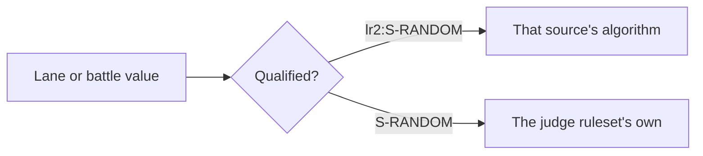
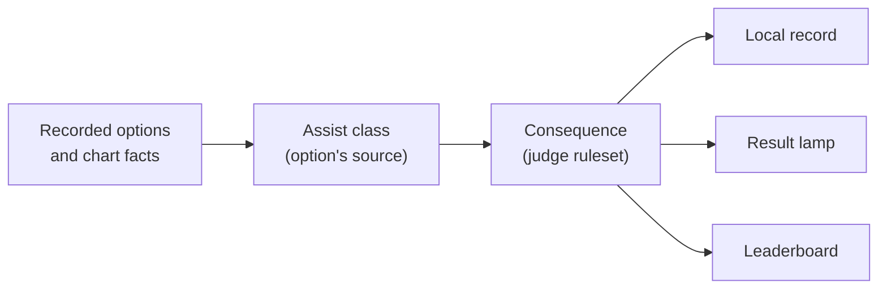
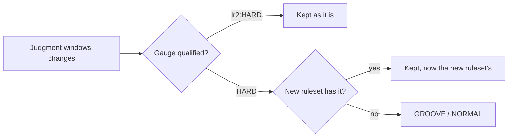
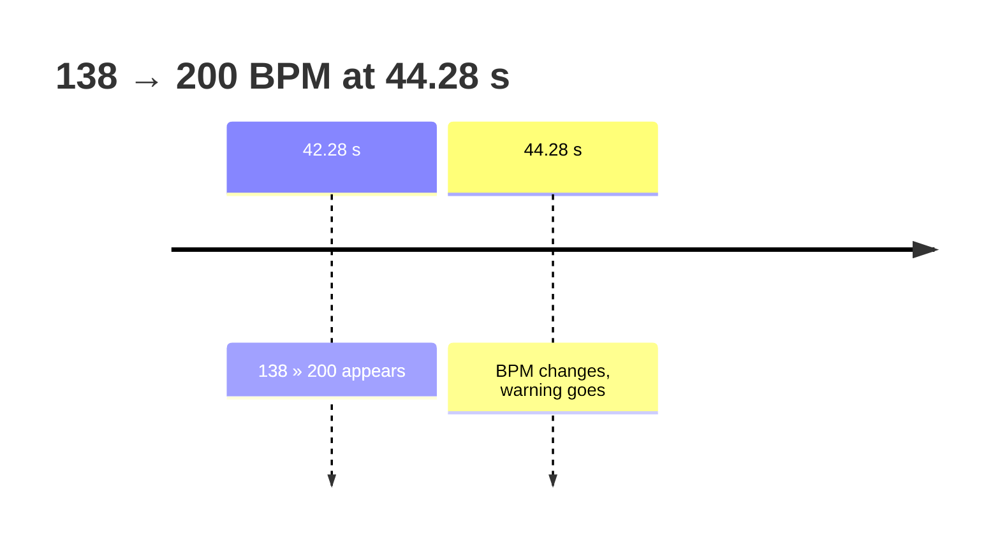
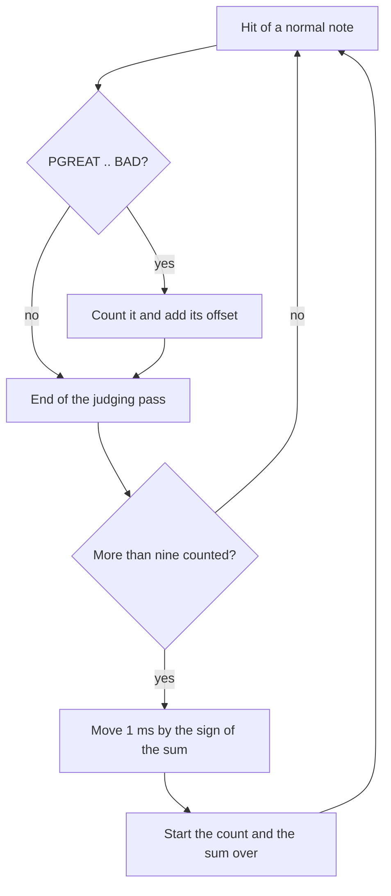
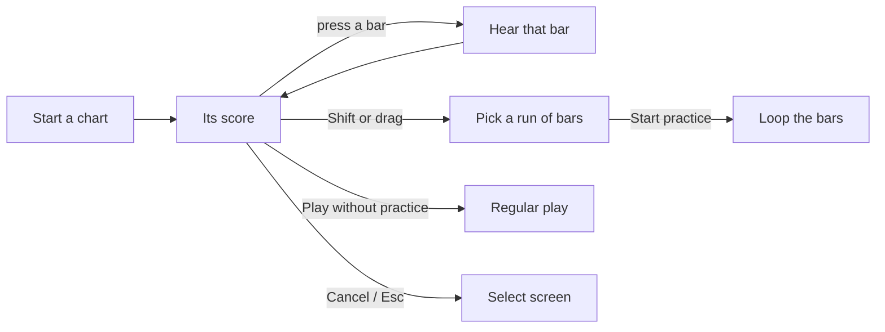

[日本語](./play-options.ja.md)

# Play options

The Options dialog and Music Select share the same play settings. Settings that apply at chart start are locked for that play. The browser restores saved preferences on the next visit. A replay keeps the starting selections and timed changes alongside the effective chart, view and tempo. [Assist and record policy](#assist-and-record-policy) [Reference issue](https://github.com/nulltask/be-music/issues/755)

Table of contents

- [Related pages](#related-pages)
- [Options and judge rules](#options-and-judge-rules)
- [Assist and record policy](#assist-and-record-policy)
  - [What the options will do, before a play](#what-the-options-will-do-before-a-play)
- [START BPM HS-FIX](#start-bpm-hs-fix)
- [Persistent display-area information](#persistent-display-area-information)
- [Per-side AUTO SCRATCH](#per-side-auto-scratch)
- [Auto scratch notes](#auto-scratch-notes)
- [LR2 mania options](#lr2-mania-options)
- [Judge area and processed notes](#judge-area-and-processed-notes)
- [Score target](#score-target)
- [Lane brightness and judgment display](#lane-brightness-and-judgment-display)
- [Judge detail and judgment counts](#judge-detail-and-judgment-counts)
- [Live display options](#live-display-options)
- [ANY KEY](#any-key)
- [LEGACY NOTE and LN REMOVE](#legacy-note-and-ln-remove)
- [A-SCR & LEGACY NOTE](#a-scr--legacy-note)
- [EX-HARD](#ex-hard)
- [ASSIST EASY / ASSISTED EASY](#assist-easy--assisted-easy)
- [Gauges of another source](#gauges-of-another-source)
- [Chart-selected gauge](#chart-selected-gauge)
- [Judgment algorithms](#judgment-algorithms)
- [CLASSIC and normal HI-SPEED](#classic-and-normal-hi-speed)
- [GUIDE SE](#guide-se)
- [WINDOW HOLD](#window-hold)
- [BPM GUIDE](#bpm-guide)
- [BPM-change warning](#bpm-change-warning)
- [Judge timing and automatic adjustment](#judge-timing-and-automatic-adjustment)
- [Visual CONSTANT](#visual-constant)
- [Per-side LIFT](#per-side-lift)
- [FLOATING HI-SPEED and fixed display area](#floating-hi-speed-and-fixed-display-area)
- [CUSTOM JUDGE](#custom-judge)
- [GAMBOL](#gambol)
- [PRACTICE](#practice)

## Related pages

- [Play options for lanes, charts, and gauges](./play-options-modifiers.md)

## Options and judge rules

Choose a ruleset with **Judgment windows** at the top of Play options in the Options dialog. It determines judgment windows, gauges, note selection, long-note behavior, mine triggers, and scoring. Options that only modify the chart or display are available under every ruleset. Changing rulesets preserves your selections. Each uses its source’s algorithm and chart-type limits.

These options are available under every ruleset.

- Display and timing settings include HS-FIX CONSTANT, CLASSIC and normal HI-SPEED, FLOATING HI-SPEED and the fixed display area, the BPM-change warning, and automatic judge timing adjustment.
- Lane arrangements include R-RANDOM, SPIRAL, H-RANDOM, ALL-SCR, RANDOM-EX, S-RANDOM-EX, RANDOM_PLAYABLE, S_RANDOM_PLAYABLE, both SCATTERs, SYNCHRONIZE RANDOM, SYMMETRY RANDOM, and M-RAN.
- Chart modifiers and play modes include mine and scroll modifiers, EXTRA and LR2 EXTRA MODE, ADD LN / CN / HCN / ALL, SP TO DP, 7 TO 9, BATTLE AS, D-BATTLE, and two-player play.

Lane options always draw from the affected side’s seed. Long-note addition uses the browser’s random source. [Source seeds and previous arrangement](./play-options-modifiers.md#source-seeds-and-previous-arrangement)

Be-Music defaults to **GROOVE** under LR2 rules and **NORMAL** under beatoraja and AC rules. A new beatoraja profile defaults to **ASSIST EASY**. [beatoraja PlayerConfig](https://github.com/exch-bms2/beatoraja/blob/8320241d8481e0826c703878c3eba01cd81ca3e4/src/bms/player/beatoraja/PlayerConfig.java#L50-L54)

**Source-qualified values.** S-RANDOM, CONVERGE and the one-player BATTLE name a different algorithm or rule in each source, so each value carries its source ([ADR 0019](./adr/0019-source-qualified-option-values.md)): `lr2:S-RANDOM` and `beatoraja:S-RANDOM`, `lr2:CONVERGE` and `beatoraja:CONVERGE`, `beatoraja:BATTLE` and `____:BATTLE`. Each is offered under every ruleset and runs its own source's behavior. The Options dialog groups the lane and battle choices by source, the judge ruleset's own first, and names the source in the label: **S-RANDOM (beatoraja)**, **BATTLE (????)**. A bare value, as older replays and settings hold it, is the judge ruleset's own. Saved settings are migrated as they are read: a bare value becomes the qualified value of the ruleset they were saved with. Replays are not rewritten; a replay without a source reads as its recorded ruleset's.

**Options the sources define alike are one value.** RANDOM is one option: LR2, beatoraja and AC all shuffle the keys once for the whole chart and leave the scratch. It draws as beatoraja 0.8.9's `LaneRandomShuffleModifier` does, so a seed gives beatoraja's arrangement, and **Fixed key 1P (LR2; 0=default)** then moves the original 1P key 1 to the chosen key (1–7, with 0 keeping the draw and nine-key play ignoring it). RANDOM ignores **Fixed key 2P**, as LR2 does. On 2P, the setting still selects the target for [CONVERGE and CONVERGE corrected](./play-options-modifiers.md#converge). AC's S-RANDOM places notes as LR2's does, without avoiding jacks, so they are one value, `lr2:S-RANDOM`, labelled **S-RANDOM (LR2 / ????)**; a bare S-RANDOM under AC rules reads as it. Older values `lr2:RANDOM`, `beatoraja:RANDOM`, `____:RANDOM` and `____:S-RANDOM` read as RANDOM and `lr2:S-RANDOM`. MIRROR, which every source defines alike, and R-RANDOM, which AC's matches, were already one value.

The browser saves **Fixed key 1P** and **Fixed key 2P** with the other play options, so the choices carry over to the next chart and visit. LR2 resets both fixed keys when it decides a chart and reads them again from the held buttons. [OpenLR2 Main.cpp](https://github.com/GOMazk/OpenLR2/blob/583a38503555e59c4bafa49d60b9d0714c9007c2/Main.cpp#L1235-L1257)

The rest stays with the ruleset. Judge rules are what the ruleset is: windows, gauges, note selection, long-note style, mine trigger and score. LN MODE, CUSTOM JUDGE, LR2's [GAMBOL](#gambol) and the judgment algorithm also remain ruleset-bound. A bare gauge (`HARD`) is the ruleset's own, too. A gauge qualified with its source (`lr2:HARD`) keeps that source's gauge, auto-shift ladder and course gauges under any judge ruleset ([ADR 0019](./adr/0019-source-qualified-option-values.md), [#1171](https://github.com/nulltask/be-music/issues/1171)); see [Gauges of another source](#gauges-of-another-source). [PRACTICE](#practice) and [gauge auto-shift](./play-options-modifiers.md#gauge-auto-shift) are offered under every ruleset and read under it: PRACTICE lists the ruleset's own gauges, and auto-shift shifts along the ruleset's own gauge ladder ([#933](https://github.com/nulltask/be-music/issues/933)). How records treat a play that mixes sources is described in [Assist and record policy](#assist-and-record-policy). Tracked in [#774](https://github.com/nulltask/be-music/issues/774).

## Assist and record policy

Each judge ruleset applies its own assist rules ([#602](https://github.com/nulltask/be-music/issues/602)). The option's source decides how assisted a play is, and the judge ruleset decides what follows from that. A bare value two sources define (BATTLE, CONVERGE, AUTO SCRATCH) belongs to the ruleset the play ran under, as [ADR 0019](./adr/0019-source-qualified-option-values.md) reads it; a qualified value keeps its source. One deterministic resolver in `@be-music/player-engine/records` (`classifyReplayAssists`, `resolveRecordPolicy`) reads only recorded replay fields. Local records, the result screen's lamp, course records and the Leaderboard all use it, so a re-simulated play gets the same answer. See [ADR 0031](./adr/0031-assist-record-policy.md).

**Assist classes**, mildest first: `none`, `light`, `assist`, `no-save`. A play takes the highest class among its options.

| Option                                                                                   | Source    | Class     | Condition                                                  | Source citation                                           |
| ---------------------------------------------------------------------------------------- | --------- | --------- | ---------------------------------------------------------- | --------------------------------------------------------- |
| AUTO SCRATCH (1P, or 2P on a chart with a 2P side)                                       | LR2       | `light`   | Under LR2 and beatoraja rules                              | OpenLR2 `LR2f.cpp` L9334 (`p1_assist` / `p2_assist`)      |
| AUTO SCRATCH                                                                             | AC 34     | `light`   | Under `____` rules                                         | AC 34 assist options                                      |
| HS-FIX CONSTANT                                                                          | LR2       | `light`   | Any chart                                                  | OpenLR2 L9334 (`hsfix == 4`)                              |
| SCATTER, SCATTER (9KEY corrected), CONVERGE (LR2)                                        | LR2       | `light`   |                                                            | OpenLR2 L9334 (`random > 3`)                              |
| D-BATTLE, SP TO DP, LR2 EXTRA MODE                                                       | LR2       | `light`   | Separate lamp under LR2 rules                              | OpenLR2 L9250-L9332 (`clear_db`, `clear_sd`, `clear_ex`)  |
| ADD LONGNOTES, ADD MINES (LR2)                                                           | LR2       | `light`   | The rate is above 0                                        | OpenLR2 L67-L79 (`m_addlong`, `m_addmine`)                |
| SPIRAL, H-RANDOM, ALL-SCR, RANDOM-EX, S-RANDOM-EX, PMS RANDOM / S-RANDOM, CONVERGE (PMS) | beatoraja | `light`   |                                                            | beatoraja 0.8.9 `Random`, lane and note shuffle modifiers |
| BATTLE, BATTLE AS                                                                        | beatoraja | `light`   | `beatoraja:BATTLE`, or a bare BATTLE under beatoraja rules | `BMSPlayer` L252                                          |
| 7 TO 9                                                                                   | beatoraja | `light`   | The conversion applied                                     | `ModeModifier`                                            |
| BPM GUIDE                                                                                | beatoraja | `light`   | The chart's BPM changes                                    | `BMSPlayer` L201-L205                                     |
| Mine REMOVE, scroll REMOVE                                                               | beatoraja | `light`   | Something was removed                                      | `MineNoteModifier`, `ScrollSpeedModifier`                 |
| LEGACY NOTE (and A-SCR & LEGACY NOTE)                                                    | AC 34     | `light`   | A charge note or backspin scratch was converted            | AC 34 assist options                                      |
| LN REMOVE                                                                                | beatoraja | `assist`  | A long note was removed                                    | `LongNoteModifier` L27-L37                                |
| ADD CN, ADD HCN, ADD ALL                                                                 | beatoraja | `assist`  | A CN or HCN was added                                      | `LongNoteModifier` L41-L69                                |
| EXTRA note conversion                                                                    | beatoraja | `assist`  | A note was converted                                       | `ExtraNoteModifier`                                       |
| CUSTOM JUDGE                                                                             | beatoraja | `assist`  | A rate over 100 %                                          | `BMSPlayer` L208-L213                                     |
| Debug judge-window override                                                              | Be-Music  | `assist`  | Widens the windows as CUSTOM JUDGE does                    |                                                           |
| BATTLE                                                                                   | AC 34     | `no-save` | `____:BATTLE`, or a bare BATTLE under `____` rules         | AC 34 play options: "スコアデータは保存されません"        |
| PRACTICE                                                                                 | beatoraja | `no-save` | Under every ruleset                                        | beatoraja PRACTICE saves nothing                          |
| ANY KEY                                                                                  | PC        | `no-save` | Under every ruleset                                        | PC edition: ANY KEY plays count as NO PLAY                |
| ADD NOTES, LOUDNESS (LR2)                                                                | LR2       | `no-save` | The rate is above 0, under every ruleset                   | OpenLR2 L27073-L27080 (`isNosave`)                        |
| NOTES COPY, DBLCOPY chosen by the player                                                 | Be-Music  | `no-save` | It copied the chart (5 / 7 KEY, not in a course)           | Be-Music: a record is of the chart's key mode (#1243)     |

Unassisted: MIRROR, RANDOM, S-RANDOM, R-RANDOM, SYNCHRONIZE / SYMMETRY RANDOM, M-RAN, DP FLIP, covers and LIFT, the hi-speed options, visual CONSTANT (beatoraja's `enableConstant` is a rendering setting), mine ADD, scroll ADD, ADD LN, the judge algorithm, the gauges (ASSIST EASY and ASSISTED EASY are gauge lamps, not assists) and gauge auto-shift. The PC edition's NO PLAY options (KEY ASSIST, ANY KEY, and its own H-RANDOM and BATTLE) are that edition's rules. They are not applied to other sources: H-RANDOM here is beatoraja's algorithm and is classified as beatoraja's. A PC-sourced option is `no-save` under `____` rules; ANY KEY is the one Be-Music offers ([ANY KEY](#any-key)).

**Consequences per judge ruleset:**

| Ruleset     | `light`                                                                                      | `assist`                                         | `no-save`     |
| ----------- | -------------------------------------------------------------------------------------------- | ------------------------------------------------ | ------------- |
| `lr2`       | Lamp capped at EASY; lamp and play count only. LR2's separate-lamp modes keep their own slot | As `light`                                       | Nothing saved |
| `beatoraja` | A clear is LIGHT ASSIST EASY; lamp and play count only                                       | A clear is ASSIST EASY; lamp and play count only | Nothing saved |
| `____`      | A clear is ASSIST EASY (ASSIST CLEAR); lamp and play count only                              | As `light`                                       | Nothing saved |

- **Score fields.** An assisted play never improves EX score, BP or max combo, as LR2 and beatoraja (`updateScore`) save neither. A failed play stays FAILED.
- **LR2 separate lamps.** D-BATTLE, SP TO DP and EXTRA MODE keep a lamp in a slot of their own (`lr2:d-battle:…`, `lr2:sp-to-dp:…`, `lr2:extra:…`). It is capped at EASY only when another assist is also on; AUTO SCRATCH on D-BATTLE is exempt, as LR2's `isForceEasy` exempts it.
- **Courses.** A course run with any assisted stage keeps no course record, and its stages write nothing to their charts' records. LR2 saves no assisted stage (`CheckScoreSaveConditon`), and beatoraja turns `updateCourseScore` off. On the Leaderboard such a run is stored unranked (`assist`).
- **Leaderboard.** Every play is still sent except a fully AUTO play and replay playback ([#788](https://github.com/nulltask/be-music/issues/788)). `none` ranks on the main board, `light` and `assist` on the assisted board, and `no-save` is stored but unranked (`no-save`). Each ruleset's result gets that ruleset's limited lamp.
- **Replays** are kept whatever the class: the records are derived from them.
- **Existing records** are not re-derived or migrated. Local bests and Leaderboard results stored before this change keep their values; the policy applies to plays from the change on.

**Clear lamps.** LIGHT ASSIST EASY is its own lamp, between ASSIST EASY and EASY ([#603](https://github.com/nulltask/be-music/issues/603)). beatoraja's ASSIST EASY gauge clears on it, as beatoraja's `ClearType` maps gauge 0 to LightAssistEasy. AC's ASSISTED EASY gauge keeps ASSIST EASY. Stored lamp ranks are append-only: ranks 0 to 9 keep their lamps, LIGHT ASSIST EASY is 10, and ordering uses the lamp order (`compareClearLamps`, `compareClearLampRanks`), not the stored number. beatoraja skins light op 1101 for it, op 1100 for ASSIST EASY, and read clear index 3 for it and 2 for ASSIST EASY; LR2 skins fold both into EASY.

### What the options will do, before a play

The policy is also read before a play, from the options picked (`resolvePlannedRecordPolicy` in `@be-music/player-engine/records`). It builds the facts a replay would record and runs them through the same classifier and resolver, so the line before a play and the record after it cannot disagree.

Some findings depend on the chart: BPM GUIDE on a chart whose BPM changes, a REMOVE or LEGACY modifier on a chart it changes, EXTRA NOTE and 7 TO 9 on a chart they apply to, and the 2P side's AUTO SCRATCH or beatoraja lane option on a chart with a 2P side. The chart is not prepared yet, so the plan is classified twice, once as if none of these arises and once as if all do, and a finding only in the second is worded as conditional ("on a chart BPM GUIDE changes: …").

- **Options dialog.** The Play tab's **Record kept** row, under the judgment windows, states the line and follows every change.
- **Select screen.** When an option changed on the select screen changes the line, the status line shows it, under every skin family. LR2 and beatoraja skins keep their own lamps and panels.
- **Result screen.** The status line states what the play did to its record, from the replay's policy: `Result: <title> — <line>`. A two-player BATTLE, a PRACTICE play, an AUTO play and a bmson chart with TOTAL 0 and no recovery each say why they keep no record. The Leaderboard's line that follows names the board a ranked play is on (main or assisted), and a stored play says why it is not ranked.

The line names the assist class, the options that cause it, the lamp under the judge ruleset (up to EASY under LR2, LIGHT ASSIST EASY or ASSIST EASY under beatoraja, ASSIST EASY under `____`), and the Leaderboard board. It describes a single play of the chart; a course's own limits are not applied. Tracked in [#1140](https://github.com/nulltask/be-music/issues/1140).

## START BPM HS-FIX

Choose **HS-FIX → STARTBPM** in the Options dialog. The default remains **OFF**. START anchors the chosen hi-speed to the chart header's starting BPM, separately from MAX, MIN and MAIN. When `#BASEBPM` supplies the reference speed, the multiplier is `reference BPM / starting BPM`; a tempo event at beat zero does not replace the header's starting BPM. Subsequent BPM changes still change the scroll rate. This is an ordinary visual speed option and preserves existing score, assist and course eligibility.

The mode and effective drawn hi-speed are recorded in the replay view. beatoraja skins receive START's original option index, 1. LR2 skins retain their original five HS-FIX button cells and cycle; choose START in the Options dialog. Skins can also select it through the shared play-options API.

Source: beatoraja 0.8.9 [`LaneRenderer.init`](https://github.com/exch-bms2/beatoraja/blob/83574048ba489082eb46df7fe9806b464bf1f526/src/bms/player/beatoraja/play/LaneRenderer.java) and [`PlayConfig`](https://github.com/exch-bms2/beatoraja/blob/83574048ba489082eb46df7fe9806b464bf1f526/src/bms/player/beatoraja/PlayConfig.java). Tracked in [#736](https://github.com/nulltask/be-music/issues/736).

## Persistent display-area information

Choose **Display area info** in the Options dialog: **OFF** (default), **ON**, **SUDDEN+ ONLY**, or **HID+/LIFT ONLY**. These are the four choices shown by That-Which-Must-Not-Be-Named AC 34. On an active cover, the selected edges keep showing its length on the 0–1000 scale and the green number without holding START. Each DP side uses its own cover and visible time. A disabled cover has no added label. The original skin's own readouts remain available with OFF.

The same folder exposes the existing LR2 **Effect 1P / 2P**, **Lane cover** and **Cover height** settings. Changing the family keeps these settings. Native uses DOM labels; Canvas, LR2 and beatoraja use Canvas labels, which are included in captures. Readout visibility is a saved viewing preference; it changes no input, judgment, scroll or replay eligibility. The source page does not specify additional recording restrictions for this setting.

Source: AC 34 [BPM-change options](https://p.eagate.573.jp/game/2dx/34/howto/new/bpm_option.html), including the four-choice settings screenshot. Tracked in [#748](https://github.com/nulltask/be-music/issues/748).

## Per-side AUTO SCRATCH

The Options dialog's **Auto scratch 1P / 2P** switches independently automate each side's scratch notes. The other side remains manual, including long scratch notes. This follows the per-side AUTO SCRATCH setting tracked in [#708](https://github.com/nulltask/be-music/issues/708). Replays retain the effective side switches as well as the selected option snapshot; old replays with only the combined switch apply it to both sides. Its record policy is in [Assist and record policy](#assist-and-record-policy).

**Guide: BPM**, **Guide: STOP**, **Guide: SCROLL** and **Guide: SPEED** choose which labels the guide shows while it is on. BPM and STOP are on by default, which is beatoraja's guide. SCROLL and SPEED are Be-Music's and off by default: they label each `#SCROLL` / `#SPEED` change that sets a new rate (starting from 1) as `SCROLL <x>` / `SPEED <x>`, with up to two decimals. On a beatoraja skin they draw their own line, since the skin has no marker image for them. These four are viewing preferences: they apply during a play, are not recorded in the replay, and leave BPM GUIDE's assist rule as it is. A label sits at the right edge of its lanes, above its line, and shrinks to fit narrow lanes. Labels whose lines fall within a label's height of each other (changes on one beat, or close together) stack in a callout: right-aligned rows with the shortest at the top, joined to the line by a leader that rises in a slant with a tick to each label. Digits are tabular (each in a cell as wide as the widest digit). The built-in skins draw labels in their own type and colours; LR2 and beatoraja skins keep beatoraja's monospace, green and yellow, with cyan for SCROLL and violet for SPEED.

## Auto scratch notes

**Auto scratch notes (AC)** in the Options dialog's View tab is **Show** (the default) or **Hide**. Hide draws no note, long note or long-note body on a scratch lane AUTO SCRATCH is playing; the scratch still plays, sounds and counts, and its key beam and bomb are still drawn. The one setting covers both sides and has no effect on a side whose AUTO SCRATCH is off, or in a full AUTO play. It applies live, on every skin family, and changes neither judgment nor the AUTO SCRATCH assist class.

AC 34's detail options list オートスクラッチ表示, which "changes whether the notes are shown during auto scratch"; the page does not say whether the lane's beam and explosion are hidden too, so Be-Music keeps them.

Source: AC 34 [detail options](https://p.eagate.573.jp/game/2dx/34/howto/play/option.html). Tracked in [#1137](https://github.com/nulltask/be-music/issues/1137).

## LR2 mania options

The Options dialog's View tab has an **LR2 mania options** section under Effects, offered under every ruleset: the options of LR2's hidden mania panel ([`LR2f.cpp` L1054-L1470](https://github.com/GOMazk/OpenLR2/blob/583a38503555e59c4bafa49d60b9d0714c9007c2/LR2f.cpp#L1054-L1470)) that only change what the playfield draws. ACCELERATION picks a mode; the others are **0** (OFF, the default) to **100** in steps of 10, as in LR2. Note times, lanes, input, audio and judgment are unchanged, and the options apply live.

On the select screen the LR2 key map's **F2** (`select.mania-options`) opens the dialog on this section. LR2 shows its panel while F2 is held ([`Main.cpp` L1766-L1769](https://github.com/GOMazk/OpenLR2/blob/583a38503555e59c4bafa49d60b9d0714c9007c2/Main.cpp#L1766-L1769)) and prints it as text, so no skin has an image for it; Be-Music opens the dialog on a press instead. The beatoraja key map leaves the operation unbound, since its F2 reloads the folders; a key can be assigned under Keys. LR2's chart generators (ADD NOTES to ADD MINES), GAMBOL and SOFTLANDING are on the Play tab, with the options they belong to. Tracked in [#1127](https://github.com/nulltask/be-music/issues/1127).

| Option                  | What it draws                                                                                                                                                                                                                                                                                                                                                                                    | LR2                                                                                                                 |
| ----------------------- | ------------------------------------------------------------------------------------------------------------------------------------------------------------------------------------------------------------------------------------------------------------------------------------------------------------------------------------------------------------------------------------------------ | ------------------------------------------------------------------------------------------------------------------- |
| **ACCELERATION (LR2)**  | OFF, ACCELERATION, DECELERATION or RANDOM. A note keeps its time but its place along the lane is remapped: ACCELERATION by `sin(p·π/2)`, so it starts fast and slows towards the line as drawn from the top (LR2 calls this "accelerating"), DECELERATION by `1 − cos(p·π/2)`, and RANDOM picks one of the two per note by `(note index + lane) % 2`. It is unrelated to the RANDOM lane option. | [L2253-L2270](https://github.com/GOMazk/OpenLR2/blob/583a38503555e59c4bafa49d60b9d0714c9007c2/LR2f.cpp#L2253-L2270) |
| **EARTHQUAKE (LR2)**    | The whole play screen sways: a sine of 1000 ms period horizontally and 1234 ms vertically, the value as its amplitude (×0.75 vertically).                                                                                                                                                                                                                                                        | [L2175-L2181](https://github.com/GOMazk/OpenLR2/blob/583a38503555e59c4bafa49d60b9d0714c9007c2/LR2f.cpp#L2175-L2181) |
| **TORNADO (LR2)**       | Each note is shifted sideways by a sine of its lane and a 1000 ms phase, in proportion to its distance from the judge line.                                                                                                                                                                                                                                                                      | [L2293-L2295](https://github.com/GOMazk/OpenLR2/blob/583a38503555e59c4bafa49d60b9d0714c9007c2/LR2f.cpp#L2293-L2295) |
| **SUPERLOOP (LR2)**     | Each note turns about its landing point on the judge line, once every `(120 − value) × 50` ms.                                                                                                                                                                                                                                                                                                   | [L2296-L2306](https://github.com/GOMazk/OpenLR2/blob/583a38503555e59c4bafa49d60b9d0714c9007c2/LR2f.cpp#L2296-L2306) |
| **CHAR (LR2)**          | Every `(100 − value) × 2 / 10 + 2`-th note, counted by `lane + note index`, is drawn at three times its distance, so it falls three times as fast.                                                                                                                                                                                                                                               | [L2328-L2331](https://github.com/GOMazk/OpenLR2/blob/583a38503555e59c4bafa49d60b9d0714c9007c2/LR2f.cpp#L2328-L2331) |
| **HEARTBEAT (LR2)**     | Each note grows and shrinks about its centre on a 500 ms sine, by twice the value in width and the value in height.                                                                                                                                                                                                                                                                              | [L2289-L2292](https://github.com/GOMazk/OpenLR2/blob/583a38503555e59c4bafa49d60b9d0714c9007c2/LR2f.cpp#L2289-L2292) |
| **NABEATSU (LR2)**      | While the play clock's second is a multiple of 3 (from 50 up, also during seconds 30–39 and seconds ending in 3), the notes and bar lines sway on two drifting sine periods; the first second of the play never sways.                                                                                                                                                                           | [L2159-L2174](https://github.com/GOMazk/OpenLR2/blob/583a38503555e59c4bafa49d60b9d0714c9007c2/LR2f.cpp#L2159-L2174) |
| **SINCURVE (LR2)**      | Each note is shifted sideways by `sin(value / 10 · π · p) × value`, a sine of its place along the lane.                                                                                                                                                                                                                                                                                          | [L2307-L2309](https://github.com/GOMazk/OpenLR2/blob/583a38503555e59c4bafa49d60b9d0714c9007c2/LR2f.cpp#L2307-L2309) |
| **WAVE (LR2)**          | Each note is shifted along the lane by a 1000 ms sine per lane, growing with the square of its distance.                                                                                                                                                                                                                                                                                         | [L2324-L2327](https://github.com/GOMazk/OpenLR2/blob/583a38503555e59c4bafa49d60b9d0714c9007c2/LR2f.cpp#L2324-L2327) |
| **SPIRAL effect (LR2)** | Each note circles its own path once every 300 ms, alternate notes in opposite directions, more widely the further it is from the line. It is LR2's note effect, not beatoraja's SPIRAL lane option.                                                                                                                                                                                              | [L2310-L2316](https://github.com/GOMazk/OpenLR2/blob/583a38503555e59c4bafa49d60b9d0714c9007c2/LR2f.cpp#L2310-L2316) |
| **SIDEJUMP (LR2)**      | Each note hops sideways on a 500 ms period, alternate notes in opposite directions.                                                                                                                                                                                                                                                                                                              | [L2317-L2323](https://github.com/GOMazk/OpenLR2/blob/583a38503555e59c4bafa49d60b9d0714c9007c2/LR2f.cpp#L2317-L2323) |

- **Units.** LR2's formulas run in its 640×480 pixels. Be-Music scales them by the stage's height over 480, so a strength looks alike on a skin of any resolution. A note's place along the lane `p` is its distance from the judge line over the judge line's distance from the top of the stage, as LR2 measures it.
- **Order.** Several options combine in LR2's order: ACCELERATION first, then HEARTBEAT, TORNADO, SUPERLOOP, SINCURVE, SPIRAL, SIDEJUMP, WAVE and CHAR.
- **Long notes and mines.** A long note's end moves with the same rule as its head and its body spans the two; mines move as notes do. A lane's notes and mines are numbered together in time order, the index LR2's alternating effects use.
- **Skin families.** The built-in skins that draw on the shared playfield and LR2 skins draw them. beatoraja skins draw their notes through their own renderer and do not apply the per-note options; neither does a built-in skin that draws on the DOM. EARTHQUAKE moves the canvas of every family, beatoraja skins included; what a skin draws on the DOM stays still.
- **Records.** LR2 saves a play with these options as a normal play (none is in its [score-save condition](https://github.com/GOMazk/OpenLR2/blob/583a38503555e59c4bafa49d60b9d0714c9007c2/LR2f.cpp#L67-L79)), so they are unassisted here too. Replays keep the values in the option snapshot.

Source: OpenLR2 [`LR2f.cpp`](https://github.com/GOMazk/OpenLR2/blob/583a38503555e59c4bafa49d60b9d0714c9007c2/LR2f.cpp#L2155-L2331). Tracked in [#1115](https://github.com/nulltask/be-music/issues/1115), [#1117](https://github.com/nulltask/be-music/issues/1117), [#1119](https://github.com/nulltask/be-music/issues/1119), [#1120](https://github.com/nulltask/be-music/issues/1120), [#1121](https://github.com/nulltask/be-music/issues/1121), [#1122](https://github.com/nulltask/be-music/issues/1122), [#1118](https://github.com/nulltask/be-music/issues/1118), [#1123](https://github.com/nulltask/be-music/issues/1123), [#1124](https://github.com/nulltask/be-music/issues/1124), [#1125](https://github.com/nulltask/be-music/issues/1125), [#1126](https://github.com/nulltask/be-music/issues/1126).

## Judge area and processed notes

Two beatoraja display settings sit in the Options dialog's View tab, under Effects. Both are off by default, apply live under every ruleset and on every skin family, and change neither judgment nor records.

**Show judge area (beatoraja)** (`PlayerConfig.showjudgearea`) draws the judge windows above the judge line of each lane as translucent bands: PGREAT in blue, then GREAT in green, GOOD in yellow, BAD in orange and the miss window in red, each at beatoraja's alpha of `0x20`. A band starts where the judgment inside it ends and is as tall as its window is long at the current scroll, so it shrinks and grows with the hi-speed and the BPM; a note inside a band would get that judgment if pressed now. The windows are the play's effective ones (`#RANK`, CUSTOM JUDGE and LR2's GAMBOL included), the scratch lane with its own, and the reach is the early side. A ruleset without a miss window has no red band, and a window no wider than the one inside it has no band. beatoraja scales the bands by the scroll rate of the next timeline; Be-Music places each edge where a note that far ahead is drawn, which is the same under a constant tempo.

**Mark processed notes (beatoraja)** (`PlayerConfig.markprocessednote`) draws a tap note that was judged before its time differently until it goes. A beatoraja skin that defines processed-note images (`note.processed`) draws those, as beatoraja does. A beatoraja skin without them, and the built-in and LR2 playfields, draw the note at 35 % opacity instead; beatoraja itself draws nothing there. Long notes and mines are unchanged. With **Judged notes** set to hide, a judged note is gone and there is nothing to mark.

Sources: beatoraja [`LaneRenderer`](https://github.com/exch-bms2/beatoraja/blob/8320241d8481e0826c703878c3eba01cd81ca3e4/src/bms/player/beatoraja/play/LaneRenderer.java#L738-L776) (`JudgeAreaOverlay`, and the [processed image](https://github.com/exch-bms2/beatoraja/blob/8320241d8481e0826c703878c3eba01cd81ca3e4/src/bms/player/beatoraja/play/LaneRenderer.java#L538-L550)) and [`PlayerConfig`](https://github.com/exch-bms2/beatoraja/blob/8320241d8481e0826c703878c3eba01cd81ca3e4/src/bms/player/beatoraja/PlayerConfig.java#L150-L152). Tracked in [#1129](https://github.com/nulltask/be-music/issues/1129) and [#1130](https://github.com/nulltask/be-music/issues/1130).

## Score target

**Target (beatoraja)** in the Options dialog's Replay / ghost folder picks the score the pacemaker aims at, from beatoraja 0.8.9's `TargetProperty`: **RANK A-** to **RANK MAX-**, **MAX**, **NEXT RANK**, the ranking targets (**IR NEXT**, **IR RANK**, **IR RANK TOP**) or **SCORE RATE**. The default is **RANK AAA**, the line the score graph paced against before the setting existed. It applies live, under every ruleset.

| Target               | EX score                                                                                        |
| -------------------- | ----------------------------------------------------------------------------------------------- |
| RANK A-, A, A+       | 17, 18 and 19 twenty-sevenths of the maximum                                                    |
| RANK AA-, AA, AA+    | 20, 21 and 22 twenty-sevenths                                                                   |
| RANK AAA-, AAA, AAA+ | 23, 24 and 25 twenty-sevenths                                                                   |
| RANK MAX-            | 26 twenty-sevenths                                                                              |
| MAX                  | The maximum, twice the note count                                                               |
| NEXT RANK            | The first border from 15/27 up that the best EX score has not reached; MAX once it is past MAX- |
| IR NEXT nRANK        | The score n places above the player on the chart's ranking (n: 1 to 5, 10)                      |
| IR RANK n            | The score at place n of the ranking, or its last place when it is shorter (n: 1, 5, 10 to 50)   |
| IR RANK TOP n%       | The score that share of the players down the ranking (n: 5 to 50 in fives)                      |
| SCORE RATE           | **Target score rate (%)** of the maximum, 0 to 100 (default 90)                                 |

A border is rounded up to a whole score. beatoraja computes it in single precision (`ceil(notes × 2 × rate / 100)` with `rate = 100 × n / 27`), and Be-Music keeps that rounding, so a border that falls exactly on a whole score can come out one higher, as in beatoraja.

The target reaches every skin family through the play's score targets: the built-in score graph's PACEMAKER bar and box (a name longer than nine characters, such as SCORE RATE 90%, stands in the box without the word PACEMAKER), a beatoraja skin's target numbers (121–123) and rank timers, and an LR2 skin's target score and difference (numbers 151 and 153) and target bar graphs (14 and 15). It paces evenly over the chart, the target's share of the notes judged so far. A ghost shown as the pacemaker takes its place for that play, since it paces as it was played. The setting is saved with the play options; it changes neither judgment nor records.

**SCORE RATE** is beatoraja's `RATE_<n>` target, which its default list does not offer but its `TargetProperty` accepts for any rate from 0 to 100 ([L142-L151](https://github.com/exch-bms2/beatoraja/blob/8320241d8481e0826c703878c3eba01cd81ca3e4/src/bms/player/beatoraja/play/TargetProperty.java#L142-L151)) [V]. Be-Music keeps the rate in its own setting, **Target score rate (%)**, on a 0.1 grid, and rounds the score as beatoraja does. AC 34 also offers a chosen percentage as a target [C]; its rounding is not known, so the option carries beatoraja's name.

The ranking targets read the chart's Leaderboard ranking under the ruleset the play is judged by, where beatoraja reads its IR ranking ([`InternetRankingTargetProperty`](https://github.com/exch-bms2/beatoraja/blob/8320241d8481e0826c703878c3eba01cd81ca3e4/src/bms/player/beatoraja/play/TargetProperty.java#L327-L475)) [V]:

- **IR RANK n** is place `min(players, n)`.
- **IR RANK TOP n%** is the place `players × n / 100` down, truncated.
- **IR NEXT nRANK** finds the first place whose EX score is the player's best record or lower, and goes n places up from it, stopping at the top. When every place is above the best record (a chart not played yet, for one), beatoraja picks the top place, and so does Be-Music.

The ranking is read as the play starts, so the target appears a moment into the play, as in beatoraja. Until then, and on a chart with no ranking (nobody ranked, a chart the Leaderboard cannot key, no network), the play shows no target: the built-in score graph paces against RANK AAA, and a skin's target numbers stay at 0. The ranking is the one the Leaderboard's page shows by default: unassisted plays, without anonymous players. The target's name is beatoraja's target name; beatoraja shows the ranked player's name instead.

Not offered: beatoraja's `RIVAL_*` targets. They need a rival's score on the chart, and the Leaderboard has no rivals yet.

Source: beatoraja [`TargetProperty`](https://github.com/exch-bms2/beatoraja/blob/8320241d8481e0826c703878c3eba01cd81ca3e4/src/bms/player/beatoraja/play/TargetProperty.java#L87-L158) and [`PlayerConfig`](https://github.com/exch-bms2/beatoraja/blob/8320241d8481e0826c703878c3eba01cd81ca3e4/src/bms/player/beatoraja/PlayerConfig.java#L72-L76). Tracked in [#1132](https://github.com/nulltask/be-music/issues/1132).

## Lane brightness and judgment display

Two of AC 34's detail options sit in the Options dialog's View tab, under Effects. Both apply live, under every ruleset and on every skin family, and change neither judgment nor records.

**Lane brightness (AC)** (レーンの明るさ調整, "adjusts the brightness of the lanes") is a percentage from **0** to **100** in steps of 10; **100**, the default, leaves the lanes as the skin draws them. Be-Music puts a black layer over each lane, between the lane's background and what scrolls on it, so the notes, the bar lines, the judge area and the covers keep their own brightness. The official page gives no range or steps, so the scale is Be-Music's.

**Judgment display (AC)** is **Skin default** or **OFF**. OFF draws no judgment and no combo on the play screen, as LR2's SILENT and a chart's HIDJUDGE already do; the counts and the score are unchanged. AC 34's 判定文字の表示位置 also moves the judgment ("change whether the judgment text is shown and where"), but the page lists no positions [C].

**Judgment position (built-in skins, %)** moves the built-in skins' judgment and combo down the lanes by a percentage of their height, from **-30** (up) to **30** (down) in steps of 5; **0**, the default, is where the skin puts them. The judgment stays inside the lanes: it stops 40 px under their top and 56 px above the judge line (`resolveJudgeWordY` in `@be-music/player-skin-sdk`), so a skin that already places it low moves less. The value carries no AC name, since AC's positions are not known. The BPM change warning moves by the same share, so it stays as clear of the judgment as the skin placed it. LR2 and beatoraja skins keep their own placement and offsets (a beatoraja skin's judge offset, an LR2 skin's own options). Display only: no record changes.

Source: AC 34 [detail options](https://p.eagate.573.jp/game/2dx/34/howto/play/option.html). Tracked in [#1136](https://github.com/nulltask/be-music/issues/1136) and [#1135](https://github.com/nulltask/be-music/issues/1135).

## Judge detail and judgment counts

Three settings on the View tab's Effects page show a judgment's timing on the built-in skins. All apply live and change no record.

- **Judge detail (built-in skins)**: **OFF** (the default), **FAST / SLOW** or **±ms**. It is drawn above the judgment, in the colours the judge panel counts FAST and SLOW in.
  - **FAST / SLOW** words an early press FAST and a late one SLOW. A PGREAT and a press on the note's time show nothing.
  - **±ms** shows the offset rounded to a millisecond for every timed judgment, a PGREAT included: negative when early, positive when late, the sign of the EARLY–LATE meter and of the timing graph.
  - A judgment without a timing (a missed note, an AUTO hit, a mine) shows no detail.
- **Judge detail: keys and scratch apart**: the detail shows the scratch's last timing and the keys' side by side (`SCR` and `KEY`), each for as long as its own judgment would show, so a scratch judgment does not replace the keys' reading.
- **Judgment counts (built-in skins)**: off draws no count of PGREAT to POOR, no FAST / SLOW count and no EARLY–LATE meter during the play. The judge panel keeps its frame. The result screen is unchanged.

Sources and what they leave open:

- AC 34's detail options list 判定タイミング表示位置 (whether the timing is shown, and where), 判定タイミング分割表示 (keys and scratch shown apart) and 判定の数リアルタイム表示 (the counts during play) on its [options page](https://p.eagate.573.jp/game/2dx/34/howto/play/option.html) [V]. The page lists no choices, positions or pictures, so the placement and the wording here are Be-Music's own [C].
- beatoraja has the first and the last as options of its stock play skin, not of the player: **Judge Detail** (Off, EARLY/LATE, +-ms) and **Judge Count** (Off, On). A beatoraja skin keeps its own, and an LR2 skin has neither.
- A beatoraja skin's judge timing number (525) now has beatoraja's sign, positive when early: `JudgeManager` keeps the note's time minus the press's ([L690](https://github.com/exch-bms2/beatoraja/blob/8320241d8481e0826c703878c3eba01cd81ca3e4/src/bms/player/beatoraja/play/JudgeManager.java#L690), [L719-L721](https://github.com/exch-bms2/beatoraja/blob/8320241d8481e0826c703878c3eba01cd81ca3e4/src/bms/player/beatoraja/play/JudgeManager.java#L719-L721)) [V]. It read with the opposite sign before.

The FAST and SLOW counts are unchanged: GREAT and GOOD only, under every ruleset. Tracked in [#1134](https://github.com/nulltask/be-music/issues/1134).

## Live display options

A play reads its options when it starts. The ones that only change what is drawn are also followed during the play: changing one in the Options dialog takes effect on the next frame. They are the auto scratch note display, lane brightness, judgment display and position, the judge detail and the judgment counts, the judge area, mark processed notes, the score target and its rate, and LR2's mania drawing options (ACCELERATION to SIDEJUMP); `LIVE_DISPLAY_PLAY_OPTION_KEYS` in `@be-music/player-scene-model` lists them. A change is recorded in the replay's `play.optionChanges` at its chart time, like the other options a play takes live (hi-speed, covers, LIFT, judge timing). Every other option, including LR2's chart generators and GAMBOL, stays as the play started.

## ANY KEY

With **Judgment windows → ????** at the top of the Options dialog's Play options, turn on **Play options → ANY KEY (PC)**; it is off by default and hidden under the other judge rules. It is the PC edition's assist, which that edition's page names without describing, so Be-Music reads it this way ([#751](https://github.com/nulltask/be-music/issues/751)):

- **One press takes one note.** Whichever key is pressed takes the nearest unjudged note inside the judgment window, on any lane, the scratch included. A tie goes to the earlier note, then to the lower lane. Lanes AUTO SCRATCH plays and lanes whose long note is still held are skipped. A press with no note in reach stays on the key's own lane.
- **Chords** are taken by as many presses as they have notes.
- **A long note** stays held until the key that took its head is released. Other keys go on taking notes on the other lanes meanwhile.
- **The key beam** lights the lane the press was routed to.

The press is then judged on that lane by the ruleset's own rules. Replays record the switch as `play.anyKey` and keep each key's own lane in `inputs`. The engine's replay playback and `simulateReplay` route the presses again with the same rule (`core/any-key.ts`), so the two agree, as `replay/any-key-equivalence.test.ts` checks. As on the PC edition, a play with ANY KEY saves no play data: it is classified `no-save` under every ruleset, keeps no local record, and is stored unranked on the Leaderboard ([Assist and record policy](#assist-and-record-policy)). The switch is locked during play.

## LEGACY NOTE and LN REMOVE

The Options dialog's **Long notes** selector defaults to **OFF**. **LEGACY NOTE (AC 34)** replaces charge notes and backspin scratches with their head note; ordinary LN remains unchanged. HCN is outside this AC option's scope and remains unchanged. **LN REMOVE (beatoraja)** replaces every LN, CN and HCN with its head note, including scratch lanes, as beatoraja 0.8.9's REMOVE modifier does at its full removal rate. Both retain the head keysound and time and remove tail judgment and tail audio. A chart without matching notes is unchanged. LEGACY NOTE assists only a chart it converted: a chart without charge notes keeps its standard lamp, as RemyWiki's IIDX Glossary records for AC [C]; the official page names no lamp ([#1139](https://github.com/nulltask/be-music/issues/1139)).

The engine and renderer share the transformed notes. Replays store the source modifier and effective head-only note chart, while the original chart fingerprint continues to identify the loaded chart. Replays also store `play.longNoteModifierChangeCount`, the number of notes converted; a LEGACY NOTE replay recorded before the count reads as converted. Reopening a replay applies the recorded modifier before restoring its lane arrangement. The selector is locked during play because these source modifiers prepare the chart before play; how a play with them is recorded is in [Assist and record policy](#assist-and-record-policy).

Sources: AC 34 [assist options](https://p.eagate.573.jp/game/2dx/34/howto/play/option.html), beatoraja 0.8.9 [`LongNoteModifier`](https://github.com/exch-bms2/beatoraja/blob/83574048ba489082eb46df7fe9806b464bf1f526/src/bms/player/beatoraja/pattern/LongNoteModifier.java). Tracked in [#710](https://github.com/nulltask/be-music/issues/710).

## A-SCR & LEGACY NOTE

AC 34's combined A-SCR & LEGACY NOTE is **Auto scratch 1P / 2P** on with **Long notes → LEGACY NOTE (AC 34)**; the Options dialog has no separate button for it. Only CN/BSS tails are removed, and only scratch notes are automated. Both operations are recorded explicitly, including their effective note chart, so replay does not infer an assist from a preset name. Its record policy is in [Assist and record policy](#assist-and-record-policy).

Source: AC 34 [assist options](https://p.eagate.573.jp/game/2dx/34/howto/play/option.html). Tracked in [#711](https://github.com/nulltask/be-music/issues/711).

## EX-HARD

Choose **Judgment windows → beatoraja / ????** at the top of the Options dialog's Play options, then **Play options → Gauge → EX-HARD**. EX-HARD is an independent survival gauge, not AUTO SCRATCH or another input assist. The gauge starts at 100 and fails at zero, without HARD's low-life damage reduction. The existing source tables retain beatoraja's mode-specific damage and recovery and AC's separate values. beatoraja's **HAZARD** remains a different choice (the replay's existing `DEATH` key); old AC replays with that key retain their former interpretation.

LR2 beta3 has no EX-HARD choice: its menu keeps GROOVE / HARD / DEATH / EASY (and P.ATTACK / G.ATTACK), and requesting EX-HARD directly with LR2 rules fails explicitly. Likewise ????'s menu has no DEATH, and a bare DEATH under ???? fails explicitly outside a course instead of playing EX-HARD. Changing to a ruleset that does not support the selected gauge restores its normal gauge; to keep beatoraja's or AC's EX-HARD under any ruleset, including LR2, choose **EX-HARD (beatoraja)** or **EX-HARD (????)** ([Gauges of another source](#gauges-of-another-source)). LR2 skin buttons keep their original cells and cycle (GROOVE, HARD, DEATH, EASY, P.ATTACK, G.ATTACK); when that skin displays a play using EX-HARD from another ruleset, its survival gauge uses the red presentation. Choose EX-HARD in the Options dialog. Replays store `play.gauge: "EX-HARD"` and the source gauge result name; course conversion uses EXHARDCLASS for beatoraja / AC.

Sources: beatoraja 0.8.9 [`GaugeProperty`](https://github.com/exch-bms2/beatoraja/blob/83574048ba489082eb46df7fe9806b464bf1f526/src/bms/player/beatoraja/play/GaugeProperty.java), AC 34 [gauge options](https://p.eagate.573.jp/game/2dx/34/howto/play/option.html). Tracked in [#726](https://github.com/nulltask/be-music/issues/726).

## ASSIST EASY / ASSISTED EASY

With beatoraja rules, the Options dialog offers **Gauge → ASSIST EASY**; with ???? rules, it offers **ASSISTED EASY**. Both select a gentler recovery gauge, independently of AUTO SCRATCH and long-note modifiers. The replay's selected gauge is `ASSIST-EASY`; the effective result retains the source name `ASSIST-EASY` or `ASSISTED-EASY`. No input-assist switch is inferred from the gauge name.

The existing beatoraja tables retain their mode-specific recovery, damage and clear border: 60 for seven-key play and 50 for five-key play. AC uses its own recovery/damage and a clear border of 60. LR2 beta3 has neither option and rejects a direct request; under LR2 rules the dialog offers them as **ASSIST EASY (beatoraja)** and **ASSISTED EASY (????)**, which keep their source's gauge ([Gauges of another source](#gauges-of-another-source)). A beatoraja / AC course converts this recovery choice to CLASS, as the source course gauge conversion does. LR2 skins keep the original EASY sprite cell and normal gauge presentation while their text readout keeps the selected name.

Sources: beatoraja 0.8.9 [`GaugeProperty`](https://github.com/exch-bms2/beatoraja/blob/83574048ba489082eb46df7fe9806b464bf1f526/src/bms/player/beatoraja/play/GaugeProperty.java), AC 34 [ASSISTED EASY](https://p.eagate.573.jp/game/2dx/34/howto/play/option.html). Tracked in [#725](https://github.com/nulltask/be-music/issues/725).

## Gauges of another source

The Options dialog's **Gauge** and **Gauge 2P** list the judge ruleset's own gauges first, then the other sources' gauges, each named with its source: **HARD (LR2)**, **EX-HARD (beatoraja)**, **ASSISTED EASY (????)**. An own gauge is stored bare (`HARD`) and one of another source qualified (`lr2:HARD`). A qualified gauge plays on its source's gauge table, auto-shift ladder, fallback and course gauges whichever ruleset judges; what stays with the judge ruleset is listed in [ADR 0019](./adr/0019-source-qualified-option-values.md).

- **Changing the ruleset.** A qualified gauge stays selected: it does not depend on the ruleset. A bare gauge stays while the new ruleset has a gauge of that name, and becomes that ruleset's; otherwise it returns to the normal gauge, as before. A gauge qualified with the ruleset that now judges (`lr2:HARD` under LR2) plays exactly as the bare one, and the list keeps showing it as **HARD (LR2)** while it is selected.
- **Settings and replays.** The saved settings hold the pick as selected, and bare values from older settings keep their meaning. A replay records it as `play.gauge` / `play.gauge2P`.
- **Skins.** An LR2 skin's gauge button and the option-panel keys keep LR2's own cells and cycle. They show a qualified gauge by its gauge type (`beatoraja:EX-HARD` reads EX-HARD, on the HARD cell) and step on from it to a bare gauge, which is the judge ruleset's own. Pick another source's gauge in the Options dialog.
- **LR2 GRADE courses.** LR2's reset of EASY and G.ATTACK to GROOVE reads the gauge type and keeps the source, so `beatoraja:EASY` plays the course on `beatoraja:GROOVE`. No reference defines this combination; it is a Be-Music choice.
- **Play option notice.** When a chart cannot be prepared with the selected options, the notice also names a gauge that is not the judge ruleset's own, as `Gauge: HARD (LR2)`.

Tracked in [#1171](https://github.com/nulltask/be-music/issues/1171).

## Chart-selected gauge

A chart whose `#OPTION` sets nanasigroove's `774:GAMELEVEL_*` or `774:EXTRA_*` selects the gauge itself, in place of the player's **Gauge** pick (both players' in a two-player play). Each ruleset plays the gauge closest to the pair: for example HYPER is HARD, NORMAL with EXTRA VERYHARD is EX-HARD (HARD under LR2), DANGER is DEATH (EX-HARD under ????). A course stage keeps its course gauge, PRACTICE keeps its own, and gauge auto-shift still applies. The replay records the gauge played, so its lamp is that gauge's. See [ADR 0034](./adr/0034-chart-authored-gauge-options.md) for the whole table.

## Judgment algorithms

With beatoraja rules, choose **Judge algorithm → Combo**, **Duration** or **Lowest** in the Options dialog; **Combo** is the default. The algorithm decides which note a press is judged against when several are in reach. Combo, beatoraja's default, moves to a later note only once the earlier one has passed the late edge of its GOOD window while the later one is inside its own; Duration takes the note closest in time; Lowest always takes the earliest note in reach. beatoraja's internal Score variant is not offered. LR2 and AC always judge the earliest note, so with their rules the control shows only **Source default**, and the engine rejects any other choice.

A beatoraja replay stores the effective algorithm as `play.judgeAlgorithm` (Combo when nothing else was chosen), and replay simulation judges with it. A beatoraja select skin's judge algorithm button (340) steps the three choices and shows them on its label images. The choice sets no assist flag; its record policy is in [Assist and record policy](#assist-and-record-policy).

Sources: beatoraja 0.8.9 [`JudgeAlgorithm`](https://github.com/exch-bms2/beatoraja/blob/83574048ba489082eb46df7fe9806b464bf1f526/src/bms/player/beatoraja/play/JudgeAlgorithm.java) and [`JudgeManager`](https://github.com/exch-bms2/beatoraja/blob/83574048ba489082eb46df7fe9806b464bf1f526/src/bms/player/beatoraja/play/JudgeManager.java). Tracked in [#743](https://github.com/nulltask/be-music/issues/743).

## CLASSIC and normal HI-SPEED

Under every ruleset, the Options dialog offers **CLASSIC HI-SPEED** and **Normal HI-SPEED (AC 32 measured)**; both are off by default and turning one on turns the other off. Either one sets HS-FIX to OFF and replaces the **Hi-speed** slider and **HS-FIX** with its own control. **Classic speed** picks one of AC 34's eleven CLASSIC steps from 1.0 to 4.0 (1, 1.5, 2, 2.25 … 3.75, 4). The arrow keys and the select screen's hi-speed control step through the same table and stop at either end.

**Normal HS level** picks one of twenty levels, which follow the green numbers measured on the AC 32 Lightning Model by masaoblue (2025-08-21), from 1200 down to 260 for the full lane; they are not a claimed AC 34 calibration. The multiplier is computed at the chart's starting BPM and kept through later tempo changes; each arrow key moves one level and recomputes it at the current BPM. Both modes draw on the measured lane scale, so the green number matches the source on any skin.

Replays store `play.options.classicHiSpeed` or `play.options.normalHiSpeedLevel` with `normalHiSpeedProfile: "AC32-measured"`, the selected hi-speed and HS-FIX OFF; level changes during play go to `play.optionChanges` and the drawn speed to the replay view. Neither mode has a dedicated skin readout. Both are ordinary visual-speed settings and change no score eligibility.

Source: AC 34 [speed options](https://p.eagate.573.jp/game/2dx/34/howto/play/option_speed.html). Tracked in [#734](https://github.com/nulltask/be-music/issues/734) and [#735](https://github.com/nulltask/be-music/issues/735).

## GUIDE SE

**GUIDE SE (beatoraja)** on the Play tab's Assist page plays the sound set's sound for each judgment, as beatoraja's `isGuideSE` does. It is offered under every ruleset, is read as a play starts, and sets no assist class, as beatoraja sets no assist flag for it. The switch is saved, and a play records it in its replay's option snapshot.

| Sound          | Judgment                                              |
| -------------- | ----------------------------------------------------- |
| `guide-pg.wav` | PGREAT                                                |
| `guide-gr.wav` | GREAT                                                 |
| `guide-gd.wav` | GOOD                                                  |
| `guide-bd.wav` | BAD                                                   |
| `guide-pr.wav` | POOR: a note that passed unhit                        |
| `guide-ms.wav` | Empty POOR: a press near a note that does not take it |

- **Where the sounds come from.** The six files of a beatoraja theme's sound set, in its `sound/` folder and then `defaultsound/`, as `.wav` or `.ogg` ([`SystemSoundManager` L148-L153](https://github.com/exch-bms2/beatoraja/blob/8320241d8481e0826c703878c3eba01cd81ca3e4/src/bms/player/beatoraja/SystemSoundManager.java#L148-L153)) [V]. A file the set lacks plays nothing, as beatoraja registers only the files it finds ([`BMSPlayer` L398-L410](https://github.com/exch-bms2/beatoraja/blob/8320241d8481e0826c703878c3eba01cd81ca3e4/src/bms/player/beatoraja/play/BMSPlayer.java#L398-L410)). An LR2 sound set has no guide sounds and Be-Music ships none, so a play on an LR2 or a built-in skin is silent unless a beatoraja theme is the active one.
- **When they play.** At every judgment, from the engine as it judges, so a sound starts with the judgment and not a frame later. AUTO play plays PGREAT's for each note and a replay plays as the play did, since beatoraja's `JudgeManager` plays the sound for every judgment whatever the mode ([L694](https://github.com/exch-bms2/beatoraja/blob/8320241d8481e0826c703878c3eba01cd81ca3e4/src/bms/player/beatoraja/play/JudgeManager.java#L694)) [V]. A mine and a press with no note in reach judge nothing and play nothing, as in beatoraja.
- **Volume.** The sounds go to the key bus, so they follow **Key sound (%)** and the master volume, like the keysounds beatoraja registers them beside [I].
- **Not carried over.** beatoraja plays two POOR sounds for a missed charge note's start and end; Be-Music's engine charges its tail miss without a judgment cue, so one plays. LR2's SILENT automatic judge timing loads no sounds, these included.

Tracked in [#1128](https://github.com/nulltask/be-music/issues/1128).

## WINDOW HOLD

**WINDOW HOLD (beatoraja)** on the View tab, beside HS-FIX, makes a play take START as held, as beatoraja's `isWindowHold` does: from the start of the play until its last note, every key press also runs the START + key controls ([`ControlInputProcessor` L155-L171](https://github.com/exch-bms2/beatoraja/blob/8320241d8481e0826c703878c3eba01cd81ca3e4/src/bms/player/beatoraja/play/ControlInputProcessor.java#L155-L171), `8320241d`) [V]. beatoraja names it in its launcher only, with no description, and it was added without one ([exch-bms2/beatoraja#268](https://github.com/exch-bms2/beatoraja/pull/268)).

- **What a key press does then.** What START + that key does in the play's key map: under beatoraja's, an odd key steps the hi-speed down, an even key up, and the turntable moves the lane cover; under LR2's, keys 1 / 3 / 5 down and 2 / 4 up, and keys 6 / 7 move the lane cover while it shows. The keys still play their notes.
- **START itself.** It never comes up during the play, so pressing it twice no longer switches the lane cover. Under beatoraja's key map SELECT + a key changes the visible time and the START + key control runs as well, as both of beatoraja's branches do in one frame.
- **When it holds.** In the player's own play only, as beatoraja runs these controls in PLAY and PRACTICE: not in AUTO play or a replay. After the last note it lets go, so START or SELECT ends the play as usual.
- **Records.** It changes only the view (the hi-speed and the covers, recorded as view changes), so it sets no assist class and the replay re-judges as before. It is read as the play starts and is locked during one.

Tracked in [#1131](https://github.com/nulltask/be-music/issues/1131).

## BPM GUIDE

Turn on **BPM GUIDE (beatoraja)** in the Options dialog; it is off by default. Upcoming tempo changes then appear on the lanes as beatoraja 0.8.9's `LaneRenderer` draws them: a green `BPM <n>` label at each actual BPM change (beatoraja writes `BPM<n>`; Be-Music puts a space before every label's number, as in `STOP <n>ms`, `SCROLL <x>` and `SPEED <x>`), skipping declarations that repeat the current BPM, and a yellow `STOP <n>ms` label at each positive STOP, both truncated to integers. Labels follow the notes' scroll, including STOPs and negative scroll, and leave once they pass the judge line.

The built-in and LR2 playfields draw a line and a label per play side. A beatoraja skin draws its own BPM and STOP marker images, which now appear only while the option is on, with the labels added above them. Replays store `play.options.bpmGuide` with the chart's header BPM (`chart.headerBPM`) and resolved BPM range (`chart.bpmRange`), the facts beatoraja's light-assist rule uses: it applies only to a chart whose BPM changes. Its record policy is in [Assist and record policy](#assist-and-record-policy).

Sources: beatoraja 0.8.9 [`LaneRenderer`](https://github.com/exch-bms2/beatoraja/blob/83574048ba489082eb46df7fe9806b464bf1f526/src/bms/player/beatoraja/play/LaneRenderer.java) and [`BMSPlayer`](https://github.com/exch-bms2/beatoraja/blob/83574048ba489082eb46df7fe9806b464bf1f526/src/bms/player/beatoraja/play/BMSPlayer.java). Tracked in [#745](https://github.com/nulltask/be-music/issues/745).

## BPM-change warning

Turn on **BPM change warning (AC)** in the Options dialog; it is off by default. Before each BPM change, `<current> » <next>` appears in a framed box on the lanes and stays until the change happens: blue when the tempo rises, red when it falls, in whole BPMs. It appears 2 s of chart time before the change, so it comes more beats ahead on a fast section than on a slow one. It fades in as it appears and fades out over 0.3 s after the change; the fade-out is Be-Music's own choice, since how the source's warning leaves is not known. The built-in skins draw the box in their own type and their own blue and red, with tabular figures so its width follows only the number of digits.

The built-in (Canvas and DOM skins), LR2 and beatoraja play screens centre the box on each side's lanes, half-way down them. AC 34's introduction shows it just above the judgment and combo; skins put their judgment anywhere from about 40 % to 65 % down the lanes, so half-way keeps the box clear of it on the built-in skins. Changes at the same instant merge into one, and a change back to the same BPM is none. A change that comes less than 2 s after another is warned as soon as the first has happened. STOPs are not warned. It only draws, and is offered under every ruleset.

The look follows AC 34's [introduction of the option](https://p.eagate.573.jp/game/2dx/34/howto/new/bpm_option.html); the timing comes from play footage (the measurements are on [#746](https://github.com/nulltask/be-music/issues/746)), in which every BPM change was warned about 2.0 s ahead and the warning left on the change. The source's TYPE A–D variants, whether its lead runs on real time or chart time, and its behavior with STOPs, close changes or very small changes are not known yet. Tracked in [#746](https://github.com/nulltask/be-music/issues/746).

## Judge timing and automatic adjustment

**Judge timing (ms)** in the Options dialog sets the display timing beatoraja and LR2 both have: an integer from −500 to 500 ms, 0 by default. As in both, it shifts only the clock the notes are drawn with; a positive value runs that clock ahead. Input, audio and judgment times stay unchanged, so recorded inputs are never shifted. Every skin family applies it, and a beatoraja skin's BPM readout reads the same adjusted clock. The slider stays enabled during play and applies at once. A beatoraja select skin's JUDGE TIMING button (74) steps it by 1 ms within ±500 ms, an LR2 select skin's (74) by 1 ms within ±99 ms as LR2 does, and number 12 of a beatoraja or an LR2 skin shows it.

Under every ruleset, **Auto judge timing** picks how a manual play moves the timing by itself: **OFF** (the default), **beatoraja**, **LR2 ON** or **LR2 SILENT**. Auto play and replays never adjust.

- **beatoraja:** after each PGREAT, GREAT or GOOD within ±150 ms, the timing moves by that judgment's offset divided by 30, in whole milliseconds rounded away from zero. These updates are not held to the ±500 ms range.
- **LR2 ON** (LR2's `autojudge` 1): every PGREAT, GREAT, GOOD or BAD hit of a normal note adds its offset, in whole milliseconds with late hits positive, to a running sum. Misses, empty POORs and long notes are not counted; both sides of a double play are. Once per judging pass, when more than nine hits have been counted, the timing moves 1 ms toward the side the sum leans to (later hits raise it), or stays when the sum is 0, and the count and the sum start over. There is no averaging, rounding or limit: LR2's ±99 ms range holds only for its select button. A two-player BATTLE does not adjust, as in LR2. Whether LR2 empties the sum when a play starts is undetermined; Be-Music starts every play with an empty one.
- **LR2 SILENT** (`autojudge` 2): adjusts as LR2 ON does and, as LR2 does, plays without the chart's keysounds, BGM and BGA, which are not loaded, and draws no judgment or combo on any play screen: the built-in and LR2 ones, and a beatoraja skin's `judge[]` display. LR2 also turns its ghost display off, which Be-Music does not have. The play scores as usual.

Replays store `play.options.judgeTimingMs` and `judgeTimingAutoAdjust`: `"OFF"`, `"BEATORAJA"`, `"LR2-ON"` or `"LR2-SILENT"`. A replay recorded before the modes stores `true` or `false`, read as beatoraja's or OFF. Each accepted automatic update (each of LR2's 1 ms steps) or manual change during play is written to `play.optionChanges` at its chart time, and a replay shows the recorded value; LR2 itself records neither. A replay of an LR2 SILENT play plays without the chart's sounds and BGA too. The adjusted value is kept for the next play, and Options settings saved before the modes keep beatoraja's switch as **beatoraja**. A beatoraja select skin's automatic-adjustment button (75) switches between OFF and beatoraja (it reads LR2's modes as OFF). An LR2 select skin's button 75 cycles OFF, ON and SILENT, and its text 80 names the setting (beatoraja's reads as OFF).

Sources: beatoraja 0.8.9 [`PlayerConfig`](https://github.com/exch-bms2/beatoraja/blob/83574048ba489082eb46df7fe9806b464bf1f526/src/bms/player/beatoraja/PlayerConfig.java), [`LaneRenderer`](https://github.com/exch-bms2/beatoraja/blob/83574048ba489082eb46df7fe9806b464bf1f526/src/bms/player/beatoraja/play/LaneRenderer.java) and [`JudgeManager`](https://github.com/exch-bms2/beatoraja/blob/83574048ba489082eb46df7fe9806b464bf1f526/src/bms/player/beatoraja/play/JudgeManager.java); OpenLR2 [hit sampling](https://github.com/GOMazk/OpenLR2/blob/583a38503555e59c4bafa49d60b9d0714c9007c2/LR2f.cpp#L7463-L7535), [the 1 ms step](https://github.com/GOMazk/OpenLR2/blob/583a38503555e59c4bafa49d60b9d0714c9007c2/LR2f.cpp#L12620-L12647), [the SILENT loading](https://github.com/GOMazk/OpenLR2/blob/583a38503555e59c4bafa49d60b9d0714c9007c2/LR2f.cpp#L24346-L24349) and [hidden judgment](https://github.com/GOMazk/OpenLR2/blob/583a38503555e59c4bafa49d60b9d0714c9007c2/LR2f.cpp#L2510-L2515), and [the select button](https://github.com/GOMazk/OpenLR2/blob/583a38503555e59c4bafa49d60b9d0714c9007c2/LR2f.cpp#L10617-L10625). Tracked in [#741](https://github.com/nulltask/be-music/issues/741), [#742](https://github.com/nulltask/be-music/issues/742), [#777](https://github.com/nulltask/be-music/issues/777) and [#917](https://github.com/nulltask/be-music/issues/917).

## Visual CONSTANT

Turn on **Visual CONSTANT (beatoraja)** in the Options dialog; it is off by default. As beatoraja's `PlayConfig.enableConstant` does, notes, mines and bar lines show only during the last **Note duration (ms)** before they reach the judge line (1–10000, default 500), fading over **CONSTANT fade (ms)** (−1000 to 1000, default 100): a positive fade starts before that window, and a negative one ends inside it. `#SPEED` scroll changes are ignored while it is on. It is a drawing setting: the chart is not rewritten, judgment is unchanged, and it is separate from LR2's HS-FIX CONSTANT and from the scroll REMOVE modifier.

The switch is locked during play; the duration and fade stay enabled and apply at once. The built-in, LR2 and beatoraja playfields draw it; on a beatoraja skin, as in beatoraja's `LaneRenderer`, the fade applies to each timeline (a long note fades with its head) and to the BPM-change and STOP lines too, and op 400 (CONSTANT) is lit while it is on. A course with the `NO_SPEED` constraint turns it off for its stages, so `#SPEED` scrolls again there; op 400 stays lit, as beatoraja reads the player's own setting. Replays store `play.options.visualConstant`, `noteDurationMs` and `constantFadeMs`, with changes during play in `play.optionChanges`. beatoraja 0.8.9 sets no assist flag for this option; its record policy is in [Assist and record policy](#assist-and-record-policy).

Sources: beatoraja 0.8.9 [`PlayConfig`](https://github.com/exch-bms2/beatoraja/blob/83574048ba489082eb46df7fe9806b464bf1f526/src/bms/player/beatoraja/PlayConfig.java) and [`LaneRenderer`](https://github.com/exch-bms2/beatoraja/blob/83574048ba489082eb46df7fe9806b464bf1f526/src/bms/player/beatoraja/play/LaneRenderer.java). Tracked in [#738](https://github.com/nulltask/be-music/issues/738) and [#776](https://github.com/nulltask/be-music/issues/776).

## Per-side LIFT

The Options dialog's **LIFT 1P (beatoraja)** / **LIFT 2P (beatoraja)** switch each side's LIFT independently, and **LIFT height 1P** / **2P** set its height as a fraction of the lane. As in beatoraja, LIFT starts off at a height of 0.1, and the height is kept while it is off. These controls stay enabled during play and apply at once. LIFT raises the judge line and the notes' landing point; the lane above it is compressed, so a note takes the same time to reach the raised line and the white and green numbers do not change. SUDDEN+ and HIDDEN+ are fractions of the lane above the LIFT. A course that locks the hi-speed starts with every cover and the LIFT at 0.

beatoraja skins and the built-in Plain, Native and Synesthesia skins draw LIFT; LR2 skins do not, since LR2 beta3 has no LIFT option. On those built-in skins, as on a beatoraja skin, Home and End lower and raise the LIFT, PageUp and PageDown move SUDDEN+, H switches HIDDEN+ and J and K move it, by 1 % of the lane (5 % with Shift). Replays store each side's LIFT in the replay view and `play.options.lift1P` / `lift2P` / `liftOn1P` / `liftOn2P`, with changes during play in `play.optionChanges`; the Replay / ghost folder's **LIFT** switch decides whether a replay shows the recorded LIFT. It is a display adjustment, not an input assist.

Sources: beatoraja 0.8.9 [`LaneRenderer`](https://github.com/exch-bms2/beatoraja/blob/83574048ba489082eb46df7fe9806b464bf1f526/src/bms/player/beatoraja/play/LaneRenderer.java) and [`PlayConfig`](https://github.com/exch-bms2/beatoraja/blob/83574048ba489082eb46df7fe9806b464bf1f526/src/bms/player/beatoraja/PlayConfig.java). Tracked in [#417](https://github.com/nulltask/be-music/issues/417).

## FLOATING HI-SPEED and fixed display area

Under any ruleset, turn on **FLOATING HI-SPEED (AC 32 measured)** in the Options dialog, or press 0 on the number row or numpad during play to switch it. It sets HS-FIX to OFF and replaces the speed controls with **Floating speed**, from 0.5 to 10. During play, each arrow key moves the speed by 0.5, and Shift with an arrow key by the measured 1/300 step. On skins that take the cover keys (Plain, Native, Synesthesia and beatoraja skins), with SUDDEN+ shown, PageUp and PageDown move the cover by one pixel of the measured 723-pixel AC lane (ten with Shift) and recalculate the speed to keep the green number captured when FLOATING HI-SPEED was turned on; with only the LIFT shown, they move the LIFT instead, and with neither, they make the fine 1/300 adjustment. Turning it on snaps the covers to that lane, keeping SUDDEN+ at 30 pixels or more and the LIFT at 600 or less. Turning it off rounds to the nearest CLASSIC step (ties upward) under CLASSIC HI-SPEED, and otherwise to the nearest normal level. Like the normal levels, the values come from masaoblue's AC 32 measurements, not an AC 34 calibration.

**Fixed display area (AC 34)**, also offered under every ruleset and off by default, ignores every cover and LIFT change during play, including edits in the Options dialog; a replay still shows its recorded covers. With FLOATING HI-SPEED, pressing START (Enter) twice within 500 ms restores the green number captured when it was turned on, recalculated at the current BPM, without moving any cover. A course's hi-speed lock applies independently.

Replays store `play.options.floatingHiSpeed` with `floatingHiSpeedProfile: "AC32-measured"`, `fixedDisplayArea`, the hi-speed and HS-FIX OFF. Mode switches and speed changes during play go to `play.optionChanges`, and covers and the drawn speed to the replay view. The built-in Plain and Synesthesia skins label the speed FHS. Both are visual options; the source pages specify no assist or recording rule for them.

Sources: AC 34 [speed options](https://p.eagate.573.jp/game/2dx/34/howto/play/option_speed.html) and [BPM-change options](https://p.eagate.573.jp/game/2dx/34/howto/new/bpm_option.html). Tracked in [#733](https://github.com/nulltask/be-music/issues/733) and [#747](https://github.com/nulltask/be-music/issues/747).

## CUSTOM JUDGE

With beatoraja rules, turn on **CUSTOM JUDGE (beatoraja)** in the Options dialog to set beatoraja's per-judgment window rates: **Key PGREAT %**, **Key GREAT %**, **Key GOOD %**, **Scratch PGREAT %**, **Scratch GREAT %**, **Scratch GOOD %** and **LN margin %**. Defaults are 400, 400 and 100 for keys and scratches and 100 for the margin; PGREAT accepts 25–400 and the others 0–400, as `PlayerConfig.validate` allows. As in beatoraja, each rate scales its window after the judgerank, no window grows past BAD, and a window narrower than the one inside it is widened to match. Note heads use the key or scratch rates; key and scratch long-note ends both use the key rates. The margin rate scales the key long-note release margin, which is non-zero only in PMS mode.

Other rulesets hide the switch and the engine rejects it. Replays store the rates as `play.customJudge` (absent while the option is off) and in the option snapshot, and replay simulation applies them. beatoraja marks a play ASSIST when any rate exceeds 100 %, and so does Be-Music ([Assist and record policy](#assist-and-record-policy)).

Sources: beatoraja 0.8.9 [`PlayerConfig`](https://github.com/exch-bms2/beatoraja/blob/83574048ba489082eb46df7fe9806b464bf1f526/src/bms/player/beatoraja/PlayerConfig.java), [`JudgeManager`](https://github.com/exch-bms2/beatoraja/blob/83574048ba489082eb46df7fe9806b464bf1f526/src/bms/player/beatoraja/play/JudgeManager.java) and [`BMSPlayer`](https://github.com/exch-bms2/beatoraja/blob/83574048ba489082eb46df7fe9806b464bf1f526/src/bms/player/beatoraja/play/BMSPlayer.java). Tracked in [#744](https://github.com/nulltask/be-music/issues/744).

## GAMBOL

With LR2 rules, choose **GAMBOL (LR2)** in the Options dialog's Play options: **OFF** (the default), **LEVEL 1** or **LEVEL 2**. It is the judgment option of LR2's hidden mania panel ("判定を厳しくするオプション"), and fixes the judge windows for the whole play, whatever the chart's `#RANK`:

| Level   | PGREAT | GREAT  | GOOD   | In a NONSTOP course, from the second stage on |
| ------- | ------ | ------ | ------ | --------------------------------------------- |
| LEVEL 1 | ±8 ms  | ±24 ms | ±40 ms | ±12 / ±24 / ±60 ms                            |
| LEVEL 2 | ±8 ms  | ±12 ms | ±12 ms | ±12 / ±12 / ±12 ms                            |

LEVEL 1 is VERY HARD. BAD stays ±200 ms, and a course's judge constraint still applies. LR2 sets these windows after the chart's own, once as the chart opens ([L27612-L27625](https://github.com/GOMazk/OpenLR2/blob/583a38503555e59c4bafa49d60b9d0714c9007c2/LR2f.cpp#L27612-L27625)) and again at each NONSTOP rank object ([L12863-L12876](https://github.com/GOMazk/OpenLR2/blob/583a38503555e59c4bafa49d60b9d0714c9007c2/LR2f.cpp#L12863-L12876)), where it reads the NONSTOP table's own VERY HARD; Be-Music follows both. LR2 has no `#EXRANKxx`, so a play with GAMBOL ignores those changes: the windows stay fixed. PRACTICE's JUDGERANK is replaced likewise.

GAMBOL is part of LR2's judge rules: other rulesets hide the selector, changing to one turns it off, and the engine rejects it. Replays store the level as `play.lr2Gambol` (absent while it is off), and replay simulation under LR2 rules applies it; another ruleset re-judges the inputs with its own windows. LR2 saves a GAMBOL play as a normal play (it is not in its [score-save condition](https://github.com/GOMazk/OpenLR2/blob/583a38503555e59c4bafa49d60b9d0714c9007c2/LR2f.cpp#L67-L79)), so it is unassisted and shares the chart's records. The selector is locked during play.

Source: OpenLR2 [`LR2f.cpp`](https://github.com/GOMazk/OpenLR2/blob/583a38503555e59c4bafa49d60b9d0714c9007c2/LR2f.cpp#L27612-L27625). Tracked in [#1114](https://github.com/nulltask/be-music/issues/1114).

## PRACTICE

Under every ruleset, turn on **PRACTICE** in the Options dialog, or press a beatoraja select skin's PRACTICE button (315); its PLAY button starts the regular mode. The settings follow beatoraja's `PracticeConfiguration`: **GAUGE TYPE**, **GAUGE CATEGORY**, **GAUGE VALUE** (1–120, default 20, clamped to the gauge's range), and **JUDGERANK (0 = chart)** and **TOTAL (0 = chart)**; Be-Music adds **REST BEFORE (bars)** and **REST AFTER (bars)** (0–8, default 1 each; 0 is no rest), and **Keep LNs held into the bars** (on by default). It applies to a single chart, not to a course, NONSTOP or replay.

The range is picked on the chart itself. With PRACTICE on, starting a chart opens its score before the decide screen: the chart's bars in columns, bottom to top, each with its measure number, its notes, long notes and mines on the play mode's lanes, and its tempo changes and stops beside it (`<be-music-chart-score>` from `@be-music/player-ui`). It shows SP and DP charts (5 / 7 / 10 / 14 KEY) and 9 KEY. When measure 0 holds nothing to play (no note, long note or mine; BGM, BGA, tempo changes and stops do not count), the score starts at measure 1.

- **Hear a bar.** A press on a bar sounds that bar alone, as AUTO PLAY would play it there: every sample that starts in the bar, and every sample started earlier that still sounds at its bar line (a long BGM, a long note's keysound) from where it is there, fading out just past the next bar line. Under BMS a slot's later sample cuts its earlier one, as in play. A press on another bar cuts the one sounding short and sounds the new one from its start. The bar sounds at the play tempo set below: sped up or slowed down with its pitch, or stretched at its own pitch with **Keep pitch**, as the play will sound. With **Keep pitch** the picker stretches what each bar sounds in the background while it is open, a sample at a time and the bars nearest the bars picked first, so a bar sounds at once when its turn has come; a bar pressed before then is stretched ahead of the rest. Changing the tempo or the pitch starts that over. The bar sounding is outlined.
- **Pick bars.** A press picks one bar; Shift-press or a drag runs the pick from the bar pressed first, so one bar or several bars in a row. Each bar a run takes in sounds at once, cutting what was sounding short, as a press does; a run drawn back sounds nothing new. The arrow keys move between bars, Shift extends, and Space presses. The line under the score shows the bars by measure number and their chart times (`m:ss.s`). **Whole chart** drops the pick.
- **Settings.** Under the score are three groups. **Tempo** holds the **Tempo (%)** (turned on at any value but 0) and **Pitch** of the Options dialog's Tempo page, and a **Target BPM**: the BPM the bars picked start at (the whole chart's start with none picked), at the play tempo; entering a BPM sets the tempo that plays them closest to it, in the slider's whole percents within -50 % to +50 %, and the field then shows the BPM that tempo plays. **Range** holds **REST BEFORE**, **REST AFTER** and **Keep LNs held into the bars**, and **Gauge and judge** holds **GAUGE TYPE**, **GAUGE CATEGORY** (beatoraja rules), **GAUGE VALUE**, and **JUDGERANK** and **TOTAL** (not under `????` rules): the PRACTICE settings of the Options dialog's Practice page. They are the same play options: a change in either place shows in the other and is saved with the settings, so the dialog opens on the values last set. The score's BPMs read at the tempo (`75` for a 150 BPM chart at -50 %), and its STOPs take as long as they will in the play.
- **Start practice** (or Enter) plays the bars picked in a loop, through the decide screen as any start does; with no bars picked the whole chart loops. **Play without practice** plays the chart as a regular play this time (a retry too), saving its result as usual, while PRACTICE stays on for the next start. **Cancel** or Esc goes back to the select screen.

The bars become the PRACTICE range as chart milliseconds: from the first bar's line to the line closing the last, through the chart's BPM changes, `#xxx02` measure lengths and stops. The player keeps each chart's pick for the page's life: its score opens on it again, and a retry (F5, R) loops the same bars. The pick is not saved with the settings: the START TIME and END TIME the Options dialog used to have are gone, and settings saved with them read as before without them. The score reads the chart as the song list does, so on a chart with `#RANDOM` it shows the unconditional content.

PRACTICE is beatoraja's mode, and the judge rules read its settings ([#933](https://github.com/nulltask/be-music/issues/933)):

| Setting        | beatoraja                                                                          | LR2                                                                                                | AC (`????`)                                   |
| -------------- | ---------------------------------------------------------------------------------- | -------------------------------------------------------------------------------------------------- | --------------------------------------------- |
| GAUGE TYPE     | ASSIST EASY, EASY, NORMAL, HARD, EX-HARD, HAZARD, GRADE, EX GRADE and EXHARD GRADE | GROOVE, HARD, HAZARD, EASY, P.ATTACK, G.ATTACK and DEATH corrected                                 | ASSISTED EASY, EASY, NORMAL, HARD and EX-HARD |
| GAUGE CATEGORY | **Play mode** or a beatoraja category                                              | Hidden (one gauge table)                                                                           | Hidden (one gauge table)                      |
| JUDGERANK      | beatoraja's judgerank (`NORMAL` rule, rank 2 = 75)                                 | A judgerank percent on LR2's `#RANK` table: 25, 50, 75 and 100 are `#RANK` 0–3 (VERY HARD to EASY) | Hidden: the windows are fixed                 |
| TOTAL          | Scaled by the notes left in the range for NORMAL and gentler gauges                | Used as is; 0 keeps the whole chart's TOTAL                                                        | Hidden: the gauges do not use TOTAL           |

GAUGE TYPE then lists the other sources' PRACTICE gauges, named with their source (`ASSIST EASY (beatoraja)`): such a gauge plays on its source's gauge and TOTAL reading under the judge rules' windows, and GAUGE CATEGORY shows for a beatoraja gauge under every ruleset ([ADR 0019](adr/0019-source-qualified-option-values.md)). The play's own gauge pick does not apply to PRACTICE. Changing the ruleset keeps such a gauge, and restores the ruleset's default gauge (NORMAL, or GROOVE under LR2) when the chosen one is a bare gauge of another ruleset.

As beatoraja's `PracticeModifier` does, every judged object outside the range moves to the background, so its keysound still plays; a long note with either end outside leaves with it. With **Keep LNs held into the bars** on (the default, a Be-Music extension), a long note that starts before the range and ends in it stays, and the play starts early enough to play it from its head: the rest bars before count from the bar it starts in. A long note that also ends past the range still leaves. The range ends at least 1000 ms after its start. The play is measured in bars from the chart's bar lines, through its BPM changes, `#xxx02` measure lengths and stops ([#954](https://github.com/nulltask/be-music/issues/954)): it starts REST BEFORE bars before the first bar picked (the chart's start when that reaches past the first bar), and runs to the head of the bar REST AFTER bars after the last bar picked, so the bars get that many whole bars of rest on either side (one each by default; 0 starts and ends at the bars themselves). The first round starts a bar before the bars picked even with no rest before them, so their first notes come down the lane instead of starting on the judgement line; each loop then goes back to the rest before. The rest bars play with every note in the background. With no bars picked, one bar of rest is not a bar: the play runs until 1000 ms past the chart's end whatever its tempo, two or more bars run to the head of that many bars after the bar the chart ends in (when later), and 0 ends at the chart's end. **The rest in bars is Be-Music's policy, not beatoraja's** ([#1191](https://github.com/nulltask/be-music/issues/1191)): beatoraja pads by time, starting at `max(starttime - 1000, 0)` and playing to `endtime + 1000` ms, both scaled by the play speed, plus its `TIME_MARGIN` ([`BMSPlayer` L586-L587](https://github.com/exch-bms2/beatoraja/blob/83574048ba489082eb46df7fe9806b464bf1f526/src/bms/player/beatoraja/play/BMSPlayer.java#L586-L587)) [V]. So the rest is as long as a bar is, longer than beatoraja's second at a slow tempo and shorter at a fast one, and a stop inside it lengthens it. Be-Music keeps whole bars of rest, as picking bars on the score makes a musical lead-in easier to practice from, and does not offer beatoraja's timed padding as a choice. Under beatoraja rules, TOTAL scales against the note count before the cut. The play tempo and lane options apply as usual, but BATTLE, the long-note, mine and scroll modifiers, EXTRA and LR2 EXTRA MODE are turned off, as beatoraja applies chart modifiers only in PLAY and AUTOPLAY. With bars picked, the play goes back to its start the moment it reaches that end, rest after the bars or not, without waiting for the last notes' judgment: the time past the end carries over, and the lanes show the next round's notes coming down past the end (through the rest after the bars), so the loop runs on as if the chart went on that way. The notes and sounds from the loop's start on are still to come after it, so the bars' first beat is judged, and AUTO plays it, every round. With no bars picked, or when its gauge empties, it goes back once every note is judged. Either way it stays in the same play screen and without loading again: the score, combo and gauge return to the practice settings, the sounds still ringing stop, and the decoded samples, BGA and skin stay ([#949](https://github.com/nulltask/be-music/issues/949)). Each loop crossfades: what still rings at the end fades out over half a second, the sounds queued past the end do not play, and the sounds of the next round start at full volume on time, so its first beat is whole. Each start and each loop is a seek to the play's start, so the sounds still ringing there (a long BGM started earlier) start partway, as they would have been heard; those fade in over half a second. With bars picked the play decodes only the samples it can sound, and loads only the BGA images it can show: those triggered from its first round's start to its end, and those triggered earlier that still ring at its start (a WAVE's length read from its header, another file's bounded by its size at 32 kbps). It loops until ESC, where beatoraja returns to its practice setup screen. A practice play records no replay, changes no records and is never sent to the Leaderboard, under every ruleset. Its score graph's MY BEST paces against the best record cut down to the bars looped: the best EX score times the share of the chart's judged notes (taps and long-note heads) that start in those bars, the whole best when the whole chart loops.

Sources: beatoraja 0.8.9 [`PracticeConfiguration`](https://github.com/exch-bms2/beatoraja/blob/83574048ba489082eb46df7fe9806b464bf1f526/src/bms/player/beatoraja/play/PracticeConfiguration.java) and [`PracticeModifier`](https://github.com/exch-bms2/beatoraja/blob/83574048ba489082eb46df7fe9806b464bf1f526/src/bms/player/beatoraja/pattern/PracticeModifier.java). Tracked in [#749](https://github.com/nulltask/be-music/issues/749).
