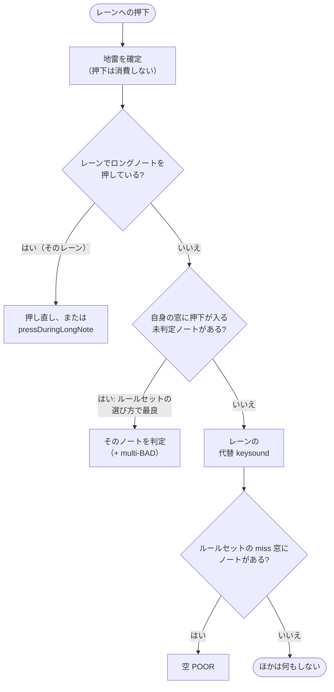
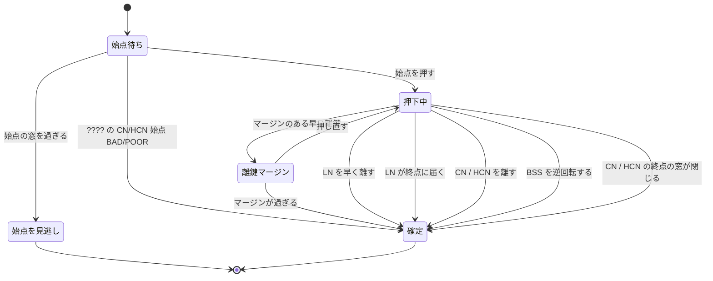

[English version](./player-judgment.md)

# プレイヤーの判定・スコア・ゲージ

[共通プレイヤー仕様](./player-spec.ja.md)

目次

- [互換ルールセット](#互換ルールセット)
- [判定幅](#判定幅)
  - [窓の形](#窓の形)
  - [基準幅](#基準幅)
  - [名前を言ってはいけないあのゲームの判定幅と根拠](#名前を言ってはいけないあのゲームの判定幅と根拠)
  - [BMS の初期判定幅](#bms-の初期判定幅)
  - [BMS の換算式](#bms-の換算式)
  - [BMS の動的判定幅変更](#bms-の動的判定幅変更)
  - [bmson の初期判定幅](#bmson-の初期判定幅)
  - [デバッグ用上書き](#デバッグ用上書き)
  - [表示上の扱い](#表示上の扱い)
- [判定語と副作用](#判定語と副作用)
  - [`PERFECT` / `GREAT` / `GOOD`](#perfect--great--good)
  - [`BAD`](#bad)
  - [`POOR`](#poor)
  - [空打鍵（candidate なし）— LR2 互換 空POOR](#空打鍵candidate-なし-lr2-互換-空poor)
  - [地雷](#地雷)
- [NOTES・combo・score](#notescomboscore)
  - [`summary.total`](#summarytotal)
  - [combo](#combo)
  - [EX-SCORE](#ex-score)
  - [SCORE](#score)
  - [空 POOR](#空-poor)
- [Groove Gauge](#groove-gauge)
  - [基本方針](#基本方針)
  - [初期値と既定値（`lr2`）](#初期値と既定値lr2)
  - [増減量](#増減量)
- [ロングノート](#ロングノート)
  - [NOTES の数え方](#notes-の数え方)
  - [ロングノートのスタイル](#ロングノートのスタイル)
  - [Manual Play](#manual-play)
  - [Auto Play](#auto-play)
  - [AUTO SCRATCH](#auto-scratch)

## 互換ルールセット

**このプレイヤーは独自の判定ロジックを持ちません。** すべてのプレイは 4 つの互換ルールセット
`lr2`（デフォルト）/ `beatoraja` / `____` / `plugout` のいずれかで動作します（`PlayerOptions.judgeRuleset`）。
判定幅、押下がどのノートを取るか、ロングノートの扱い、空 POOR の規則、ゲージの種類とカーブ、スコア計算式は
すべてルールセットが所有します。定数と出典は
[`packages/player-engine/src/ruleset/definitions.ts`](../packages/player-engine/src/ruleset/definitions.ts) にあり、
3 つの比較表は [`docs/replay.ja.md`](./replay.ja.md) にあります。

同じテーブルがライブエンジンとリプレイシミュレータの両方を駆動し、等価性テストが同一の記録入力列に対して
両者の判定が 1 つずつ一致することを要求します。

`plugout` は LRX 譜面のプレイヤーである plugout4 -ARCADE EDITION- に従います。ランクごとに固定の判定幅、終点を
離して判定するチャージノーツ、EX 版を持つ NORMAL / EASY / HARD / HAZARD のゲージ、100,000 点満点のスコア、PERFECT
までのランプです。規則とその出典は [ADR 0044](./adr/0044-plugout-ruleset.ja.md) にあります。

以降の章は既定の **`lr2` ルールセット**についての記述です。

## 判定幅

### 窓の形

判定窓はマイクロ秒の符号付き `[遅れ側の境界, 早い側の境界]` の組で、レーン種別（鍵盤 / スクラッチ）と文脈
（通常ノート / ロングノート終端）ごとに解決します。LR2 は 4 つの文脈すべてで同じテーブルを使いますが、
beatoraja はスクラッチを判定ごとに 10 ms 広げ、ロングノート終端に専用テーブルを持ちます。

### 基準幅

player は LR2 の実測判定幅を基準にします（hitkey 日記 2015-01-19 の実測値、lr2oraja の LR2 互換テーブルと一致）。

| `#RANK`         | `PGREAT`                                                   | `GREAT` | `GOOD`   | `BAD`    |
| --------------- | ---------------------------------------------------------- | ------- | -------- | -------- |
| `0` `VERY HARD` | `±8ms`                                                     | `±24ms` | `±40ms`  | `±200ms` |
| `1` `HARD`      | `±15ms`                                                    | `±30ms` | `±60ms`  | `±200ms` |
| `2` `NORMAL`    | `±18ms`                                                    | `±40ms` | `±100ms` | `±200ms` |
| `3` `EASY`      | `±21ms`                                                    | `±60ms` | `±120ms` | `±200ms` |
| `4` `VERY EASY` | `NORMAL` と同一（LR2 は `#RANK 4` を `NORMAL` として扱う） |         |          |          |

`BAD` 幅は rank・拡張命令に関わらず `±200ms` で固定です。スクラッチも鍵盤と同じ幅を使います。
`PERFECT` / `GREAT` / `GOOD` / `BAD` の境界は、この 4 本の幅を内側から順に走査して決まります。
どの窓にも入らない入力はノートに届きません — レーンのキー音だけが鳴り、押下は空 POOR の経路へ抜けます。
`POOR` は取り逃したノートです。

### 名前を言ってはいけないあのゲームの判定幅と根拠

`____` ルールセットのうち、コミュニティの実測 [C] に基づくのは通常のノーツの判定幅だけです。それ以外の範囲は暫定であることがわかるようにしています（[#1189](https://github.com/nulltask/be-music/issues/1189)）。

| 場面                    | 判定幅                                                                                | 根拠                                                                                                                                                                                                  |
| ----------------------- | ------------------------------------------------------------------------------------- | ----------------------------------------------------------------------------------------------------------------------------------------------------------------------------------------------------- |
| ノーツとスクラッチ      | PG ±16.67 / GR ±33.33 / GD ±116.67 / BD ±250 ms（60 fps で ±1 / 2 / 7 / 15 フレーム） | [C]（[iidx.org](https://iidx.org/compendium/gauges_and_timing)）                                                                                                                                      |
| 空 POOR                 | 遅い側 150 / 早い側 500 ms                                                            | 暫定。iidx.org は「?」とし、数値は「正確には知られていない」としている。beatoraja の SEVENKEYS の見逃し窓（`JudgeProperty` [V]）を借りている                                                          |
| CN の離し               | ±200 ms 以内は PGREAT のみ。BAD は +220 / -280 ms まで                                | 規則は [C]。離しの判定は PGREAT だけで、GREAT と GOOD は PGREAT に繰り上がる。範囲は暫定で、beatoraja の SEVENKEYS のロングノート終端の GOOD と BAD の窓（`JudgeProperty` [V]）を縮尺なしで借りている |
| 始点が BAD / POOR の CN | 終点の判定なし                                                                        | [C]（同じページ）                                                                                                                                                                                     |

iidx.org にある「±120、±160、±200、{+220, -280}」という離しの判定幅は beatoraja のもので、このゲームのものではありません。`____` で判定したプレイの結果は、ほかのプレイと同じくこれらの範囲で記録されます。空 POOR や範囲の端に近い CN の離しに左右される結果は、借りた値の分だけ不確かです。

### BMS の初期判定幅

BMS では、再生開始時点の判定幅を次の優先順位で決めます。

1. `#DEFEXRANK`
2. `metadata.rank` (`#RANK`)
3. 既定値 `#RANK 2`

`#DEFEXRANK` はパーセンテージ値として扱います。
`100` は基準値であり、`NORMAL` と同じ幅です。
player は `#DEFEXRANK` を `Number.parseFloat()` で解釈し、有限かつ `0` より大きい値だけを採用します。

`#RANK` は内部の judgerank パーセント軸 `[25, 50, 75, 100, 75]`（`VERY HARD`=25 / `HARD`=50 / `NORMAL`=75 / `EASY`=100 / `VERY EASY`=`NORMAL` 扱い）へ写像します。
`metadata.rank` は整数へ切り捨てて解釈し、範囲外の値は無効として既定値へフォールバックします。

### BMS の換算式

`#RANK` は上の実測テーブルをそのまま使います。

`#DEFEXRANK n` は `#RANK 2` の判定幅を `n / 100` 倍にします（[#1190](https://github.com/nulltask/be-music/issues/1190)）。たとえば `#DEFEXRANK 120` は `PGREAT=21.6ms`, `GREAT=48ms`, `GOOD=120ms`, `BAD=200ms`（固定）、`#DEFEXRANK 50` は `9ms` / `20ms` / `50ms` になります。
スケール対象は `PGREAT` / `GREAT` / `GOOD` のみです。どれだけ広げても各幅は固定の `BAD` 幅 `±200ms` を超えません。

LR2 に `#DEFEXRANK` はないため、これは `lr2` ruleset に対する Be-Music の拡張です。nanasigroove はこの値を「`100` が `#RANK 2`」の百分率と定義しており [C]、拡張はその定義をそのまま使います。基準値は `#RANK 2` の判定幅です。LR2 のほかのランクの間に値を置くことはしないので、`#DEFEXRANK 133` は `#RANK 3` にはなりません。

`#DEFEXRANK` 以外の小数の judgerank（bmson の `judge_rank` と PRACTICE の JUDGERANK）は、これまでどおり実測テーブルを judgerank パーセント軸上のアンカー（25 / 50 / 75 / 100）として区分線形補間します（lr2oraja の `JudgeWindowRule.LR2` と同じモデル）。`EASY` を超える値は最終区間の傾きで外挿します。

### BMS の動的判定幅変更

BMS では `#xxxA0` チャンネルと `#EXRANKxx` を使って、演奏途中で判定幅を変更できます。
player は `A0` チャンネルのイベント値を `#EXRANKxx` のキーとして解決し、その値を `Number.parseFloat()` で読んで、有限かつ `0` より大きい場合だけ採用します。
採用した値は `#DEFEXRANK` と同じ単位・同じ計算（`#RANK 2` の判定幅に対する百分率）で解釈するため、`#EXRANKxx 100` はちょうど `NORMAL` の判定幅に戻り、`#EXRANKxx 50` はその半分になります。

`#EXRANKxx` が未定義、空文字列、非数、`0` 以下の場合、そのイベントは判定幅を変更しません。
複数の `A0` イベントがある場合は、時刻順に適用し、後から到達した値が以後の判定幅になります。

この動的変更は現在の実装では `manualPlay()` と `AUTO SCRATCH` の手動判定側で適用します。
通常の `AUTO` は全ノートを `PERFECT` 扱いするため、chart rank 由来の判定幅はスコア結果に影響しません。

動的判定幅の変更後は、次の処理に新しい `BAD` 幅を使います。

- 入力候補ノート探索
- `PERFECT` / `GREAT` / `GOOD` / `BAD` / `POOR` の分類
- ノート取り逃し判定
- 地雷・不可視ノートの失効判定
- ロングノート終点の判定

各判定は、LR2 が 1 つの `judgetime[]` を読むのと同じく、その判定の瞬間の判定幅を使います。押下（候補探索とその分類、
多重 BAD、地雷の押下判定、ロングノートを押しているレーンへの押下）は押した瞬間の幅、離鍵（LN の早離し、チャージ
ノートの終点）は離した瞬間の幅を使います。ノートの見逃し期限とチャージノート終点の遅れ側の窓はそれぞれノートと終点の
時刻の幅、地雷の進入と確定は地雷の時刻の幅を使います。エンジンと replay シミュレータは同じ瞬間を読みます。

### bmson の初期判定幅

bmson では次の優先順位で判定幅を決めます。

1. `bmson.info.judgeRank`
2. `metadata.rank`
3. 既定値 `100`

bmson の `judgeRank` は `#DEFEXRANK` と同じ「`100` = `NORMAL`」基準の百分率として扱いますが、`#RANK 2` の判定幅を倍率で伸縮するのではなく、LR2 のアンカー補間で判定幅へ換算します。両者は `100` で一致し、それ以外では異なります。`judgeRank` が `120` なら `±19.8/±52/±112ms`、`#DEFEXRANK 120` なら `±21.6/±48/±120ms` です。
そのため `judgeRank=100` は `NORMAL`（`±18/±40/±100/±200ms`）そのままです。
`beatoraja` ruleset は `judge_rank` をそのまま judgerank として使い、`judge_rank` のない bmson 譜面は
`judge_rank: 100`（bmson の既定値。7 KEY の PGREAT は `±20ms`）として判定します。BMS の `#RANK 2` 扱いにはなりません。

現在の実装では、bmson に BMS の `#EXRANKxx` 相当の動的判定幅変更はありません。

### デバッグ用上書き

`judgeWindowMs` オプションは `BAD` 幅だけを直接上書きします。
`PGREAT` / `GREAT` / `GOOD` は rank 由来のスケーリング結果をそのまま使います。

この上書きは、初期判定幅だけでなく BMS の `#EXRANKxx` による動的変更後にも適用します。
つまり `#EXRANKxx` が変わっても、デバッグ上書きがある場合の `BAD` 幅は常にその固定値です。

### 表示上の扱い

選曲一覧、TUI、結果画面には、現在の chart から解決した rank 表示を出します。
`#DEFEXRANK` がある BMS はその数値を、通常の `#RANK 0-4` は対応ラベルを表示します。
同じく `PLAYLEVEL` は chart から解決した表示値を使い、BMS で `#PLAYLEVEL` が省略された場合は BM98 互換の既定値 `3` を出します。
`PLAYLEVEL` が `0` のとき、player は表示上 `?` を使います。文字列 `PLAYLEVEL` はそのまま表示し、小数値も丸め落とさず表示します。
`DIFFICULTY` は `1-5` の整数だけを表示対象として扱います。選曲一覧では `PLAYER -> DIFFICULTY -> PLAYLEVEL -> filename` の順で並べ、キー `1-5` で `DIFFICULTY` フィルタを切り替え、`0` で解除します。`DIFFICULTY` 未指定、または範囲外の譜面は、beatoraja が楽曲データベースで補うのと同じく、名前から推定した値を使います（サブタイトルやタイトルの括弧内にある `[SP ANOTHER]` のような難度名、なければファイル名の `_hyper` や `7a` のような語や略号）。名前からも決まらなければ、beatoraja と同じしきい値でノーツ数から決めます（250 未満 BEGINNER、600 未満 NORMAL、1000 未満 HYPER、2000 未満 ANOTHER、それ以上 INSANE）。推定値は宣言された値と同じようにソートとフィルタに使い、印を付けて表示します。名前からの推定は `?`（`3?`、`HYPER?`）、ノーツ数からの推定は `??`（`3??`、`HYPER??`）です。ノーツ数からの推定は当たりにくく、難度を宣言している譜面で比べると名前からの推定の 97% に対しておよそ 60% です。どちらでも決まらない譜面やノーツのない譜面はフィルタ対象外で、表示上も `-` とします。リプレイ、スコア、書き出した譜面には譜面自身の `#DIFFICULTY` だけを残します。

`#EXRANKxx` による動的変更が存在する BMS は、表示上の rank を `RANDOM` とします。
これは途中で判定幅が変わる譜面で、固定ラベル 1 つでは表現できないためです。

ただし、プレイ開始後に TUI の `BAD` 幅表示を動的更新する機能はまだありません。
現在の TUI/標準出力に出る `Judgment window (<ルールセットの id>): ...` 行は、再生開始時点の幅を表示するだけです。

## 判定語と副作用

### `PERFECT` / `GREAT` / `GOOD`

これらは成功判定です。
判定確定時に次を行います。

- 対応する `summary` カウンタを加算する。
- EX-SCORE を加算する。
- combo を 1 増やす。
- score を更新する。
- groove gauge を加算する。

`FAST` / `SLOW` は `GREAT` と `GOOD` のみで記録します。
`PERFECT` は FAST/SLOW を増やしません。

### `BAD`

`BAD` は失敗判定です。
判定確定時に次を行います。

- `summary.bad` を加算する。
- combo を 0 に戻す。
- score を更新する。
- 通常ノートの `BAD` では groove gauge を `-4` する。

### `POOR`

`POOR` は演奏対象ノートに対する失敗です。
ノートが打鍵されないまま `BAD` 窓を過ぎた場合に発生します。

`POOR` 発生時は次を行います。

- `summary.poor` を加算する。
- combo を 0 に戻す。
- groove gauge を `-6` する。
- POOR BGA を発火する。miss レイヤーの表示時間は 500ms（LR2 同梱 `config.xml` の既定値 `<poorbga>500</poorbga>`、beatoraja の `misslayerDuration` の既定値に一致）。beatoraja スキンでは、その間に何が判定されてもミスから 500ms 表示し、それ以外のときは `BGAProcessor` と同じく base の上に layer を重ねる。
- judge/combo 表示を `POOR` に更新する。

### 空打鍵（candidate なし）— LR2 互換 空POOR

空打鍵の際、同じレーンのノートが有効なルールセットの miss 窓に入っていると、空 POOR が発生することがあります。

押下は判定コア（`judge-core-press.ts`）で次の手順をたどります。各手順の規則は後に続きます。

- 発生条件は **同レーンのノートが「そのルールセットの miss 窓」の中にあること** です。LR2 の miss 窓は `{0, 1 s}`（lr2oraja の `JudgeProperty` LR2 ミス窓。rank / EXRANK に依存しない固定窓）なので、`lr2` ではノート通過後（遅い側）に空POOR は発生せず、1 秒以内に次のノートが無いレーンの空打鍵は keysound 再生のみで無害です。beatoraja の窓は早側 500 ms・遅側 150 ms です。
- 同一ノートの手前であれば連打で **何度でも** 発生します（LR2 の `MissCondition.ALWAYS`。判定済みノートの手前でも発生）。

空POOR は LR2 における phantom press の扱いに合わせ、次の挙動とします。

- `summary.emptyPoor` を加算し、ノート判定カウンタ (`perfect`/`great`/`good`/`bad`/`poor`) は **更新しない**。ノートを消費していないため。POOR カウンタに両者の合計を表示するかは提示側の選択で、LR2 は合算します（OpenLR2 `ApplyJudgeNote` が空POOR 分岐でも `playerstat.poor` を加算）。
- EX-SCORE とスコアは **変化させない**。
- combo はルールセットが指示する場合のみ切る（`comboBreaksOnEmptyPoor`）。beatoraja の 5 鍵 / PMS のみ切れ、LR2 と 名前を言ってはいけないあのゲームは切れません。
- ゲージには `EMPTY_POOR` を適用する。デルタはルールセットのゲージ表（[`definitions.ts`](../packages/player-engine/src/ruleset/definitions.ts)）にあり、`lr2` では GROOVE `-2`、HARD `-2`（TOTAL 補正対象）、EASY `-1.6`、DEATH `0`。GROOVE / EASY ではほぼ無害だが、HARD では実害が出る。
- **POOR BGA を発火する** (`trigger-poor-bga`)。
- **judge 表示を `POOR` で 0.6 秒フラッシュ** する (`publishJudgeCombo('POOR', combo)`)。 LR2 spec 上は op 246 (1P 空POOR) / 266 (2P 空POOR) と op 245 / 265 (見逃しPOOR) が分岐するが、本実装では NOWJUDGE index 0 / 1 を同じ `'poor'` skin slot に解決しているため、視覚上は同一の POOR 表示になる。

keysound fallback が存在する場合は、fallback 音を先に再生できます。
fallback は early `BAD` 窓がすでに開いた同レーン最新 WAV です。そのため 2 ノート間の空打鍵では、次ノートの判定窓が始まるまで前 WAV を鳴らし続けます。
次ノートの WAV は、その判定窓が開く前には使いません。
キーの離鍵が取れない入力（離鍵イベントを送らない端末で、キーリピートが LN を弾いたキーを送り直す）では、LN を弾いたレーンでその LN の終点より前に押したノートなしの押下も同様に空POOR を発火させません。離鍵が取れる入力（kitty キーボードプロトコル、ブラウザ、リプレイ）ではこの窓はなく、すべての押下を実際の押下として LR2 / beatoraja と同じく判定します。

### 地雷

地雷は判定表示やコンボ・EX-SCORE を変更しません。LR2beta3 は POOR と `minePoor` を1回加算し、地雷の生ダメージだけを適用します。他のルールセットはゲージのみの処理を保ちます。
行うのはゲージへの地雷ダメージ適用と、定義されていれば `#WAV00` の発音だけです。発動条件とダメージ規則は [地雷](./player-spec.ja.md#地雷) を参照してください。
オブジェクト値が 2 文字の大文字 base36 ID でない場合（または `00` の場合）は既定ダメージ `4%` にフォールバックします。`#BASE 62` の小文字の値もこれに該当します。`damage` のない bmson の地雷は 0 % です。

この規則の根拠は [`bms-spec.ja.md`](./bms-spec.ja.md) にまとめています。

## NOTES・combo・score

### `summary.total`

`summary.total` はアクティブなルールセットの**判定数**（EX-SCORE の分母）であり、画面上のノート数ではありません。
チャージ系のスタイルはロングノートの始点と終点を別々に数えるため、1 本のロングノートが 2 判定になります。
次の要素は含みません。

- FREE ZONE
- 地雷
- 不可視ノート
- `#LNOBJ` の終端オブジェクト

### combo

combo は `PERFECT` / `GREAT` / `GOOD` のみで増加します。
`BAD` と `POOR` は combo を 0 に戻します。

### EX-SCORE

EX-SCORE は 名前を言ってはいけないあのゲーム互換です。

- `PERFECT`: `+2`
- `GREAT`: `+1`
- それ以外: `+0`

### SCORE

`score` はアクティブなルールセットが定義する値です。

- `lr2` は LR2 のマネースコア `floor((4 × PGREAT + 2 × GREAT + GOOD) × 50000 / notes)`（上限 `200000`）を返します。
  判定内訳だけで決まり、コンボ項はありません。
- `beatoraja` と `____` は EX-SCORE を返します。これが実機の表示です（名前を言ってはいけないあのゲームは BISTROVER でマネースコアを廃止）。

スコアの定義はルールセットのもので、`@be-music/player-engine/ruleset` が公開します。`ScoreSummary`、`JudgmentKind`、
`createEmptyScore`、`computeScoreRate`、DJ ランク（`resolve____RankIndexFromScore`、`resolve____RankLabel`、
`_____RANK_LABELS`）、`resolveLR2MoneyScore`、`resolveDisplayedPoor` です。

### 空 POOR

POOR カウンタに `poor` と `emptyPoor` の合計を表示するかは提示側の選択で、ルールセットが
`emptyPoorCountsInPoorDisplay` として持ちます。LR2 のカウンタは合算します（OpenLR2 `ApplyJudgeNote` が
空POOR 分岐でも `playerstat.poor` を加算し、LR2 に独立した統計は無いため）。そのため Web のプレイのセッションは `lr2` では
表示用コピーで合算し、POOR 行・BP・判定別レートがすべて追従します。beatoraja は独自の空POOR 表示を持ち、
名前を言ってはいけないあのゲームは未測定のため、どちらも分けたままです。`PlayerSummary` は常に分けて報告します。

## Groove Gauge

### 基本方針

- ゲージは `PlayerOptions.gauge` で選び、LR2 の名前（`GROOVE` / `EASY` / `HARD` / `DEATH`）で指定します。
  各ルールセットが自分のラインナップへ対応付けます（`GROOVE` は beatoraja の `NORMAL`、`DEATH` は `HAZARD`。
  名前を言ってはいけないあのゲームに HAZARD 相当は無いため `DEATH` は `EX-HARD` に丸められます）。
- カーブはルールセットが所有します: 判定ごとの増減、TOTAL スケーリング、guts 緩和、死亡ボーダー、
  クリア判定（回復系は閾値、サバイバル系は「一度も 0 にならなかったか」）。
- 選択したゲージは実際にプレイを支配します。色だけの飾りではありません — HARD は本当に削れ、
  底を打った HARD は `failedMidPlay` を報告し、以後クリアできません。
- サバイバル系のゲージが尽きると、LR2 や beatoraja と同じくその場でプレイを終えます（`PlayerOptions.endOnFailure`、
  既定は `true`）。ゲージを尽きさせた判定が最後に数える判定で、プレイはそこで止まります。`endOnFailure: false`
  なら、尽きたゲージのまま譜面の最後まで判定を続けます。リプレイはこのフラグを記録するので、再シミュレーションも
  同じ判定で止まります。フラグがなかった頃のログは最後まで判定を続けます。
- コースのステージ（`PlayerOptions.course`）は、ルールセットのコース用ゲージで、前のステージが残した値から始めます。
  [コースと段位認定](./course.ja.md#コースのステージを遊ぶ) を参照してください。`lr2` で GROOVE か EASY を選んだときは、
  LR2 がコース中のこの 2 つで行うとおり、コース用ゲージでも地雷のダメージを `2%` で止めます（OpenLR2 `LR2f.cpp`
  L2054-L2056）。判定で `2%` を下回ったときは、これまでどおりそのステージで失敗します。
- `lr2` では LR2 と同じく TOTAL を整数として扱います。`#TOTAL` と既定の TOTAL は切り捨て、`1` 未満は既定値にします
  （OpenLR2 `LR2f.cpp` L26299、L27566-L27579）。
- テーブルは [`packages/player-engine/src/ruleset/definitions.ts`](../packages/player-engine/src/ruleset/definitions.ts) にあり、
  `RulesetGauge` を通して適用されます。最終スコアと summary の authority は共有エンジンで、
  browser scene は `summary.gauge` をミラーします。

### 初期値と既定値（`lr2`）

- `GROOVE` は `20%` 開始 / `2%` floor / `80%` クリア
- `EASY` は `20%` 開始 / `2%` floor / `80%` クリア（増減が緩やか）
- `HARD` / `EX-HARD` / `DEATH` は `100%` 開始で、`2%` を下回った時点で失敗
- 上限は `100%`
- `#TOTAL` 指定時（0 より大きい場合）はその値をそのまま使います
- `#TOTAL` 未指定または 0 以下のときは LR2 のノート数式（`LR2_bmsload.cpp`）で求めます:
  400 ノート未満は `(n / 5 + 200) × 0.8`、600 未満は `((n - 400) / 2.5 + 280) × 0.8`、
  それ以上は `((n - 600) / 5 + 360) × 0.8`。beatoraja は独自の既定値（`max(260, 7.605 n / (0.01 n + 6.5))`）を使います。
  名前を言ってはいけないあのゲームのゲージは TOTAL を参照せず（回復量はノート数から決まる）、報告する TOTAL は LR2 の式に従います。
- 既定動作では bmson の `info.total` は絶対 TOTAL ではなく、ルールセット既定値に対する百分率です。どのルールセットも
  自身の既定値の `total / 100 ×` として扱い、0 以下は 100 % とみなします（beatoraja `BMSPlayerRule.validate`）。
  したがって `total` のない bmson 譜面は TOTAL 100 ではなく、ルールセットの既定値で演奏されます。
- `summary.gauge.effectiveTotal` は解決後の値を報告し、beatoraja スキンの TOTAL 表示（ref 368）はプレイ中と
  リザルト画面でこの値を表示します。リプレイは譜面の生の値を記録し、リプレイ時に改めて解決します。

### 増減量

`noteCount` は TOTAL / EX-SCORE / SCORE の対象になる演奏ノート数です。
FREE ZONE、地雷、不可視オブジェクトは `noteCount` に含めません。

次の delta は `lr2` ルールセットの `GROOVE` gauge 向けです。`HARD`、`DEATH`、`EASY` と他ルールセットの値は
[`definitions.ts`](../packages/player-engine/src/ruleset/definitions.ts) にあります。

`baseGain = effectiveTotal / noteCount`

- `PGREAT`: `+baseGain`
- `GREAT`: `+baseGain`
- `GOOD`: `+baseGain / 2`
- `BAD`: `-4`
- `POOR`: `-6`
- 地雷の爆発: `-mineValue(base36)`（bmson では `damage`。`damage` のない bmson の地雷は `0`）。生デルタとして適用

ゲージ更新後の値は、現在の gauge type の min/max range に clamp します。

ゲージはそれぞれの出典の精度で計算します（[#1090](https://github.com/nulltask/be-music/issues/1090)）。beatoraja のゲージ（クラスゲージを含む）は Java の `float` で動きます。表、TOTAL・LIMIT_INCREMENT・MODIFY_DAMAGE による補正、増減量、足した結果をそれぞれ単精度に丸め、どの判定ルールで遊んでも同じです。LR2 は HP と増減量を `double` で持ちますが、GROOVE と EASY のノート 1 つあたりの回復量は単精度で割ります（`total / (float)notes`。EASY はその後 1.2 倍）[R]。AC のゲージは倍精度のままです。本番のプレイとリプレイのシミュレーターは同じゲージを使うので、リプレイの再判定は同じ値になります。判定ルールは開発用のリビジョン `/0` なので、版は上げずにこの変更を入れます（[ADR 0019](./adr/0019-source-qualified-option-values.ja.md)）。[beatoraja GrooveGauge](https://github.com/exch-bms2/beatoraja/blob/8320241d8481e0826c703878c3eba01cd81ca3e4/src/bms/player/beatoraja/play/GrooveGauge.java#L176-L240) · [OpenLR2 の回復量の計算](https://github.com/GOMazk/OpenLR2/blob/583a38503555e59c4bafa49d60b9d0714c9007c2/LR2f.cpp#L27658-L27660)

`HARD` / `EASY` の variant は LR2 の値（beatoraja `GaugeProperty` の `HARD_LR2` / `EASY_LR2`）に合わせます。`DEATH` は beatoraja の `HAZARD_LR2` ではなく LR2 本体（OpenLR2 `LR2f.cpp` L27673-L27680、LR2body.exe `ParseBMSFile`）に合わせます。

- `HARD`: 回復 `PGREAT/GREAT +0.1` / `GOOD +0.05`（TOTAL 非依存）、減少 `BAD -6` / `見逃しPOOR -10` / `空POOR -2`。減少には lr2oraja の `MODIFY_DAMAGE`、つまり `#TOTAL` の係数（`TOTAL ≥240` で `×1.0` から `<112` で `×10` まで）とノーツ数の係数（20 ノーツ以下で `×10` から 1000 ノーツ以上で `×1.0` まで）の大きい方を掛け、ゲージが `32%` 未満のときはさらに `×0.6` に緩和します（lr2oraja は比較前にゲージを偶数パーセントへ切り捨てるため、
  「表示 30 %」は内部 32 % に相当します）。
- `EASY`: 増加は GROOVE の `1.2` 倍、減少は `0.8` 倍（`BAD -3.2` / `POOR -4.8` / `空POOR -1.6`）。クリア閾値は GROOVE と同じ `80%` です。
- `DEATH`: 回復なし（`PGREAT` / `GREAT` / `GOOD` は `0`）、`BAD` / `見逃しPOOR` は `-100`（即死）、`空POOR` は減少なし（`0`）。beatoraja の `HAZARD` は独自の `+0.15` / `+0.06` の回復と `空POOR -10` のままです。
- `DEATH`（LR2 の HAZARD）は、単曲では最後に `80%` 以上ないとクリアになりません。LR2 の CheckClear が GROOVE と同じように判定するためです（[L1842-L1862](https://github.com/GOMazk/OpenLR2/blob/583a38503555e59c4bafa49d60b9d0714c9007c2/LR2f.cpp#L1842-L1862)）。地雷で生き残ったまま失敗になることがあり、クリアのランプは NORMAL です。`DEATH-CORRECTED`（Options ダイアログでは **DEATH corrected**）はこの境界の無い同じゲージで、生き残ればクリアです。beatoraja と ???? のルールではそれぞれの `DEATH` として読み、コースではどちらも同じコース用ゲージで遊びます（[#1082](https://github.com/nulltask/be-music/issues/1082)）。
- `HARD` / `DEATH` は `2%` 未満になった時点で `0%` に落ちて FAILED 確定（以後回復しません）。地雷ダメージなどの生デルタは guts・TOTAL 補正の対象外です。

## ロングノート

### NOTES の数え方

ロングノート 1 本が何判定に相当するかはルールセットが決めます。LR2 はすべて LN として 1 判定、
チャージ系のスタイルは始点と終点を別々に判定するため 2 判定です。

`#LNOBJ` の終端オブジェクト自体は決して数えません。
`#mmm51-69` 由来のロングノートも `#LNOBJ` 由来と同じ数え方です。

### ロングノートのスタイル

譜面の `#LNMODE` は要求であって決定ではありません。ルールセットが実際に演奏する形へ写像します。

- `lr2`（`ln`）: `#LNMODE` に関わらずすべて LN。判定は 1 回だけ遅延確定し、終点より `GOOD` 窓を超えて早く離すと `BAD`。
- `beatoraja`（`per-note`）: 譜面に従う — `1` が LN、`2` が CN、`3` が HCN。
- `____`（`charge`）: すべてチャージノート（譜面が `3` なら HCN）。始点が `BAD` / `POOR` だと終点判定は取り消されます。

BMS の `#LNMODE` 未指定時は `1` として扱います。
bmson は beatoraja 拡張の `info.ln_type` と note 単位の `t`（1: LN / 2: CN / 3: HCN、`t` が `ln_type` より優先）でモードを決め、どちらも未指定の場合は LR2 準拠の既定として `1`（LN）を使います。
FREE ZONE は `#LNMODE` の対象外で、終端を持つノートとして扱います。

### Manual Play

手動演奏では、ロングノートの始点入力時に始点側の判定を計算します。
ただし、最終的に確定するタイミングは実効のロングノートのモードによります。
以下のモードは譜面の `#LNMODE` そのものではなく、ルールセットが解決した**実効モード**です。

- モード `1`（LN）: 始点判定を保持し、終点到達時に 1 回だけ確定します。終点より前に離した場合はレーン音を止め、その時点でルールセットの規則（`lnEarlyRelease`）に従って確定します。`lr2` は終点より `GOOD` 窓を超えて早い離しを `BAD` とし、それ以外は始点判定のまま確定します（OpenLR2 `ProcLongnote`）。`beatoraja` は始点判定と、離した時点を LN 終端の判定窓で判定した結果の悪い方を取り、それが `BAD` 以下なら `BAD` とします（`JudgeManager` L533-545）。`lr2` の始点には遅い `BAD` がなく、遅れ側の `GOOD` 窓を過ぎた時点で見逃しになり、その後の押下は届く範囲の別のノートを判定します（OpenLR2 `ProcLongnote`、LR2f.cpp:7542）。
- モード `2`（CN）: 始点は押下時に即座に加点されます。終点は**離した瞬間**の時刻で判定し（フレーム時刻ではなく
  実際の解放時刻を使います）、2 つ目の判定として加算します。終点を過ぎても押し続けている間はまだ判定になりません —
  終点の遅れ側の窓が閉じるまで離す猶予があります。窓が閉じても押し続けていた場合、終点は見逃し `POOR` です
  （beatoraja の `CN end poor`）。途中離し時はレーン音も停止します。
- モード `3`（HCN）: 判定はモード `2` と同じ（終点は離した瞬間に判定）で、加えて beatoraja のゲージの刻み
  （`JudgeManager` L289-L340、`HCNTickCounter`）があります。始点と始点の判定（押下、または見逃し）の遅い方から終点の
  通過まで、符号付きのカウンタが、レーンが増加側（レーンのキーが押されている、または終点を `GOOD` 以上で離した）なら
  増え、それ以外は減ります。+200 ms を超えるたびにゲージが 1 刻み増え（beatoraja では判定表の `GREAT` ×0.5）、
  −200 ms を超えるたびに 1 刻み減ります（`BAD` ×0.5）。早く離した後も刻みは続くので、終点前に押し直すとまた増えます。
  刻むのは判定ラインを通過中のノートだけです（`JudgeManager` L235-L242）。早く判定したノートは同じレーンの前のノートが
  通過し終わるまで待ち、終点の通過後に見逃しになった始点には刻みがありません。AUTO SCRATCH のレーンには刻みはありません。
- バックスピンスクラッチ（BSS）: スクラッチレーン上のモード `2` / `3` のロングノート（`isBackSpinScratch`）は、beatoraja
  と同じく（「BSS終端処理」、`JudgeManager` L351-L370）終点を離しではなく別の入力ソースからの押下で判定します。始点を
  叩いた押下がその [入力ソース](#入力ソース) を記録し（beatoraja の `sckey`）、その後に同じレーンへ別のソース（ターン
  テーブルの逆方向、スクラッチのもう一方のキー）からの押下があると、その瞬間に終点を判定します。タイミングはロング
  スクラッチ終端の窓で測り（窓の外は `POOR`、離鍵マージンなし）、終点の keysound を鳴らします。始点と同じソースからの
  押下は押し直しです。離しても何も確定しませんが、beatoraja には例外がひとつあります（`scratchHoldsBySource`、
  `JudgeManager` L494-L511）。始点のソースの離鍵がロングスクラッチ終端の窓で `POOR` になる（どの窓にも早すぎる）とき、
  ノートはそこで `POOR` として終わります。名前を言ってはいけないあのゲームはどの離鍵も無視します。ヘルチャージの BSS のゲージの刻みは、引き続きレーンが
  押されているかに従います。こうして終わらないまま終点の遅れ側の窓が閉じると、押していてもいなくても終点は見逃し
  `POOR` です。LR2 はすべてのロングノートを LN として演奏するので BSS はありません。
- beatoraja のスクラッチ LN: スクラッチレーン上の LN（モード `1`）も始点のソースを記録し、そのソースの離鍵だけで
  離したことになります。別のソースの離鍵は無視し、レーンは押されたままです（`JudgeManager` L522-L531）。LR2 は従来
  どおり、レーンのどのキーの離鍵でもスクラッチ LN を離します。

離鍵はその瞬間に確定します。例外はルールセットのロングノート離鍵マージン（`longNoteReleaseMarginUs`、beatoraja の
`longnoteMargin` / `longscratchMargin`）で、beatoraja の PMS ルールでは、終点より前の離鍵が早い側の `BAD` 以下になる場合に
確定を 200 ms 待ち（LN では始点の方が離鍵よりずれていれば始点のタイミングを使うため、遅い `BAD` の始点はすぐ確定します）、その間にレーンを押し直すと離さなかったものとしてホールドを続けます。LR2、名前を言ってはいけないあのゲーム、beatoraja の
ほかのモードにはマージンがありません。離鍵イベントのない入力（kitty キーボードプロトコルのない端末）では、エンジンが
離鍵を推定します。キーの最後のリピートから 120 ms 後、リピートがなければロングノートの始点を叩いた押下から 380 ms 後です。

ロングノートを押しているレーンへの押下（ターンテーブルの逆回転など、同じレーンに割り当てた 2 つ目のキー）は、そのレーンの
ほかのノートを判定しません。そのレーンの現在のノートはロングノートだからです。バックスピンスクラッチへの別のソースからの
押下は終点を判定します（上記）。それ以外の押下をどうするかはルールセット（`pressDuringLongNote`）が決めます。`lr2` は押下が LN の
始点の `BAD` 窓内なら始点を判定し直し、それ以外は空 `POOR` とします（OpenLR2 `ProcLongnote`）。`beatoraja` は押し直し
として無視し（`JudgeManager` L355-377）、`____` も同じです。

#### 入力ソース

レーンの押下と離鍵はすべて入力ソース（`InputSource`、`core/input-source.ts`）から来ます。キーボードのひとつのキー、
コントローラーのひとつのボタン、タッチの領域、ターンテーブルのひとつの回転方向です。リプレイはこれを入力の `source`
（`play.inputSources` の表の id、[`replay.ja.md`](./replay.ja.md#入力ソース) を参照）として記録するので、判定コア、
リプレイ、リプレイシミュレーターはいずれも同じソースでスクラッチのホールドを識別します。

- キーボードのキーはそれぞれ独立したソースで、最初のトークンで名付けます（`keyboardInputSource`）。スクラッチレーンの
  Shift、Ctrl（macOS の端末では Option / Alt）、Space は 3 つのソースです。ホストはキーのソースを渡さず、エンジンが
  トークンから求めます。
- タッチの領域はレーンごとにひとつのソースです（`kind: 'button'`、`device: 'touch'`、レーンのキーのトークンで名付けます）。
  Web プレイヤーはタッチレーンの `lane-input` と `kitty-state` コマンドでこれを送ります。
- コントローラーは `lane-input` と `kitty-state` コマンドでソースを渡します。ターンテーブルは、デバイスが軸を報告しても
  2 つのボタンを報告しても、`up` と `down` の 2 つのソースです。軸を押下に変えるホストは、そのアルゴリズムを
  `recordReplay.analogScratch` に記録します。Web プレイヤーは標準マッピングの Gamepad を CS 版 DualShock の配置で読み取ります。
  方向キーは1鍵、L1 / □ / R1 / × / △ / ○ は2〜7鍵、L2 / R2 はターンテーブルの2方向です。記録するソース名は汎用の
  ボタン名または回転方向だけで、デバイス ID は入れません。コントローラーのソースは、パッドの `Gamepad.id` を
  `deviceName` として持ちます。リプレイがこれを残すのは、プレイヤーが選んだときだけです
  （[リプレイの入力ソース](./replay.ja.md#入力ソース)）。判定では読みません。

  USB 専用コントローラー（対応ファームウェアの GAMO2/DJDAO PHOENIXWAN など）は INFINITAS HID モードに切り替えます。
  ブラウザーが Gamepad API に公開した `Gamepad.id` で検出します。VID/PID は INFINITAS（`1ccf:8048`、
  [arcin-infinitas](https://github.com/kinetic-flow/arcin-infinitas) も使用）と KONAMI エントリーモデル
  （`1ccf:1018`）に対応します。製品名では PHOENIXWAN（`Controller INF&BMS`）、GAMO2 FP7 EMP、KONAMI IIDX
  エントリー・プレミアム・プロフェッショナル、YuanCon Dx6th+ を照合します。製品名での検出は INFINITAS と同じ
  配置を前提としており、実機での確認は未実施です。先頭の 7 ボタンが 1〜7 鍵、X 軸は 256 段階に丸めて
  一周で値が戻るターンテーブルとして扱います。Be-Music は 2 ティックの移動で押下または方向転換とし、
  その移動が 100 ms なければ解放します。
  [GAMO2 のファームウェアガイド](https://www.gamo2.com/jp/firmware/)と
  [SnekBox の HID レポート定義](https://github.com/dinsfire64/snekbox_firmware/blob/main/handlers/infinitas.h)を参照してください。

  ブラウザーが実験的な Gamepad の生入力イベントを送る場合は、イベントを受け取った時点で入力を処理します。
  4 ms 間隔を要求するポーリングで、イベント非対応時の入力、スクラッチの停止、コントローラーの切断を検出します。
  実際の取得間隔はブラウザーと OS に依存します。

  選曲・決定・リザルト画面も同じパッドをコントロールボタンとして読みます（`runtime/gamepad-menu.ts`）。パッドのボタンは、
  画面のキー操作（スキン系統による LR2 風 / beatoraja 風）で対応するキーと同じ働きをします。標準パッドはプレイと同じ鍵盤と
  スクラッチに加え、Start が START、Back（Share / Create）が SELECT で、方向キーは 1 鍵ではなく矢印キーになります。
  IIDX コントローラーの START / SELECT はボタン 9 / 10（INFINITAS 配置の E1 / E2、beatoraja のコントローラー既定の
  START / SELECT）です。これは INFINITAS の HID レポートの並びからの推定で、実機での確認は未実施です。
  1 台目が 1P、2 台目が 2P です。スクラッチと方向キーは押し続けると 300 ms 後から 60 ms ごとにくり返します（キーの長押しと同じ
  扱いにする Be-Music の方針）。画面に来たときすでに押されているボタンは押下として扱わず、モーダルダイアログや
  テキスト欄はキーと同じくパッドの入力も受け取ります。

**ソースがひとつだけのとき。** スクラッチレーンのソースがひとつだけだと、beatoraja の厳密な規則では BSS を終えるのは
別のソースだけなので、どの BSS も終えられません。そこで、レーンに対になるソースがないソースで始めたホールドは緩い規則で
演奏します。レーンへの新たな押下は、始点と同じソースからでも BSS を終え、離鍵は何も確定しません（`hasScratchCounterpart`、
`endsBackSpinScratch`）。対になるソースがあるかはソースの性質なので、ライブのプレイと再シミュレーションは常に一致します。
ターンテーブルの回転方向には常に逆方向があり、キーボードのスクラッチレーンには少なくとも 2 つのキーがある
（`createLaneBindings` が Ctrl または Option / Alt、1P では Space を加える）ので、どちらも厳密な規則です。タッチの領域、
コントローラーのボタン、不明なソースは緩い規則です。タッチのプレイヤーは終点でスクラッチをもう一度タップして BSS を
終えます。トレードオフは [ADR 0040](./adr/0040-replay-input-sources.ja.md) を参照してください。

#### スクラッチの回転方向

スクラッチの押下は、ターンテーブルを回した向き `'cw'` か `'ccw'` を表示用に持つこともあります（`ScratchSpin`、リプレイ
入力の `spin` として記録）。ライブとリプレイでのターンテーブルのアニメーションです。回転を報告するコントローラーは回した
向きを送り、キーボードは odd-even（スクラッチレーンのキーを交互に 2 方向として扱う。`LaneBinding.inputKeys`、
`createScratchSpinByToken`）を使い、タッチレーンは `spin: null` を送ります。判定はこれを読みません。

一度も触れなかったロングノートは始点分の `POOR` 1 つに加え、チャージ系ではさらに終点分の `POOR` を負います。
ただし 名前を言ってはいけないあのゲームは終点判定が取り消されるため、負いません。

手動演奏でのロングノートの一生を、実効モードごとに示します。

### Auto Play

ロングノートは始点で keysound 再生とレーン保持表示を開始します。
LN 系スタイルは 1 回の `PGREAT` を終点で付けます。チャージ系は beatoraja のオートプレイと同じく、始点の `PGREAT` を始点で、終点の `PGREAT` を終点で付けます。`AUTO` と `AUTO SCRATCH` で同じです。

### AUTO SCRATCH

`AUTO SCRATCH` は手動の判定ストラテジーで scratch レーン (`16` / `26`) だけを自動処理するモードです。
LN 方式のロングノートは 1 つの `PGREAT` を終点で付けます。チャージノートは beatoraja のオートプレイと同じく、始点の `PGREAT` を始点で、終点の `PGREAT` を終点で付けます。scratch レーンはプレイモードのもの（プレイモード表の `scratch` レーン）なので、9 KEY の BME 配置とキーボードモードではチャンネル `16` / `26` は通常のキーです。
