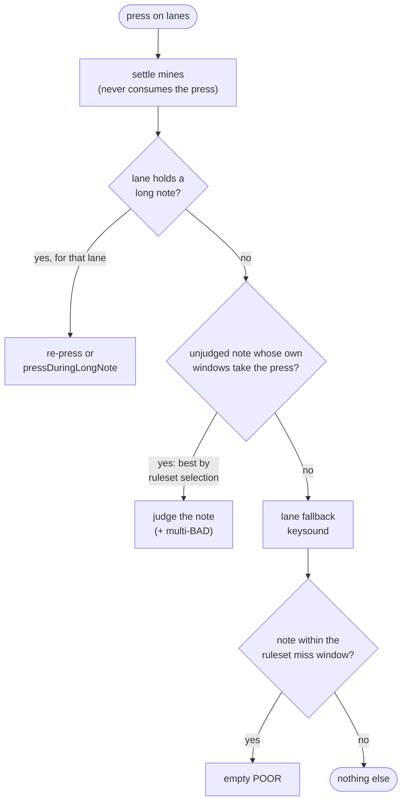
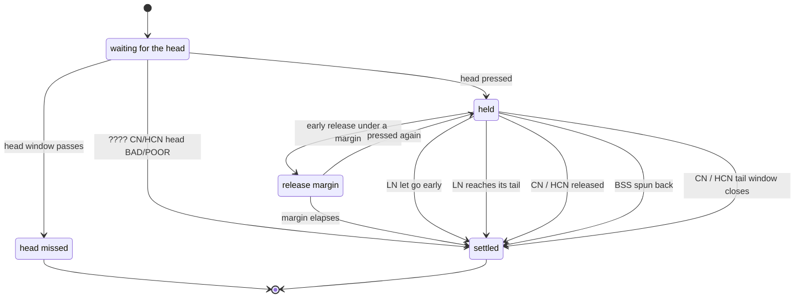

[Japanese version](./player-judgment.ja.md)

# Player judgment, scoring, and gauges

[Shared player specification](./player-spec.md)

Table of contents

- [Compat rulesets](#compat-rulesets)
- [Judgment width](#judgment-width)
  - [Window shape](#window-shape)
  - [Baseline widths](#baseline-widths)
  - [That-Which-Must-Not-Be-Named windows and their evidence](#that-which-must-not-be-named-windows-and-their-evidence)
  - [BMS initial judgment width](#bms-initial-judgment-width)
  - [BMS conversion formula](#bms-conversion-formula)
  - [BMS dynamic judgment width change](#bms-dynamic-judgment-width-change)
  - [bmson initial judgment width](#bmson-initial-judgment-width)
  - [Override for debugging](#override-for-debugging)
  - [Display treatment](#display-treatment)
- [Judgment words and side effects](#judgment-words-and-side-effects)
  - [`PERFECT` / `GREAT` / `GOOD`](#perfect--great--good)
  - [`BAD`](#bad)
  - [`POOR`](#poor)
  - [Blank keystroke (no candidate) — LR2-compatible empty POOR](#blank-keystroke-no-candidate--lr2-compatible-empty-poor)
  - [Landmine](#landmine)
- [NOTES・combo・score](#notescomboscore)
  - [`summary.total`](#summarytotal)
  - [combo](#combo)
  - [EX-SCORE](#ex-score)
  - [SCORE](#score)
  - [Empty POOR](#empty-poor)
- [Groove Gauge](#groove-gauge)
  - [Basic policy](#basic-policy)
  - [Initial and default values (`lr2`)](#initial-and-default-values-lr2)
  - [Increase/Decrease](#increasedecrease)
- [Long Note](#long-note)
  - [How to count NOTES](#how-to-count-notes)
  - [Long-note style](#long-note-style)
  - [Manual Play](#manual-play)
  - [Auto Play](#auto-play)
  - [AUTO SCRATCH](#auto-scratch)

## Compat rulesets

Every play uses the compat ruleset selected through `PlayerOptions.judgeRuleset`. The available values are `lr2` (the default), `beatoraja`, `____`, or `plugout`. The ruleset determines judgment windows, which note a press judges, long-note behavior, empty POOR, gauge types and curves, and scoring. [`packages/player-engine/src/ruleset/definitions.ts`](../packages/player-engine/src/ruleset/definitions.ts) · [`docs/replay.md`](./replay.md)

The live engine and replay simulator read the same tables. An equivalence test suite checks that each judgment matches for the same recorded input stream.

`plugout` follows plugout4 -ARCADE EDITION-, the player of LRX charts: fixed windows by rank, charge long notes whose
end is a release, NORMAL / EASY / HARD / HAZARD gauges with EX variants, a score out of 100,000 and lamps up to
PERFECT. Its rules and their sources are in [ADR 0044](./adr/0044-plugout-ruleset.md).

The rest of this chapter describes the **`lr2` ruleset**, which is the default.

## Judgment width

### Window shape

A window is a signed `[late bound, early bound]` pair in microseconds, resolved per lane kind (key vs scratch) and
per context (note vs long-note end). LR2 uses one table for all four contexts; beatoraja widens scratch by 10 ms
per judge and gives long-note ends their own table.

### Baseline widths

The player bases its windows on LR2's measured judgment widths (hitkey's diary entry of 2015-01-19; they match lr2oraja's LR2-compatible table).

| `#RANK`         | `PGREAT`                                            | `GREAT` | `GOOD`   | `BAD`    |
| --------------- | --------------------------------------------------- | ------- | -------- | -------- |
| `0` `VERY HARD` | `±8ms`                                              | `±24ms` | `±40ms`  | `±200ms` |
| `1` `HARD`      | `±15ms`                                             | `±30ms` | `±60ms`  | `±200ms` |
| `2` `NORMAL`    | `±18ms`                                             | `±40ms` | `±100ms` | `±200ms` |
| `3` `EASY`      | `±21ms`                                             | `±60ms` | `±120ms` | `±200ms` |
| `4` `VERY EASY` | Same as `NORMAL` (LR2 treats `#RANK 4` as `NORMAL`) |         |          |          |

The `BAD` width is fixed at `±200ms` regardless of rank or extension commands. Scratch uses the same widths as the keys.
The boundaries of `PERFECT` / `GREAT` / `GOOD` / `BAD` are determined by these four windows, walked inner to outer.
An input outside every window reaches no note: the lane keysound plays and the press falls through to the
empty-POOR path. `POOR` is a note that was missed outright.

### That-Which-Must-Not-Be-Named windows and their evidence

The `____` ruleset rests on community measurement [C] for its ordinary notes only, and keeps every other bound visibly provisional ([#1189](https://github.com/nulltask/be-music/issues/1189)).

| Context                    | Window                                                                             | Evidence                                                                                                                                                                                                                            |
| -------------------------- | ---------------------------------------------------------------------------------- | ----------------------------------------------------------------------------------------------------------------------------------------------------------------------------------------------------------------------------------- |
| Notes and scratch          | PG ±16.67 / GR ±33.33 / GD ±116.67 / BD ±250 ms (±1 / 2 / 7 / 15 frames at 60 fps) | [C] ([iidx.org](https://iidx.org/compendium/gauges_and_timing))                                                                                                                                                                     |
| Empty POOR                 | late 150 / early 500 ms                                                            | Provisional: iidx.org lists it as "?" and says the numbers "are not precisely known"; beatoraja's SEVENKEYS miss window (`JudgeProperty` [V]) is borrowed                                                                           |
| CN release                 | only PGREAT inside ±200 ms; BAD to +220 / -280 ms                                  | The rule is [C]: the release judgment "only has PGREAT; GREAT and GOODs get automatically upgraded to PGREAT". The bounds are provisional: beatoraja's SEVENKEYS long-note end GOOD and BAD windows (`JudgeProperty` [V]), unscaled |
| CN after a BAD / POOR head | no tail judgment                                                                   | [C] (same page)                                                                                                                                                                                                                     |

iidx.org's "±120, ±160, ±200, {+220, -280}" release windows describe beatoraja, not this game. A play judged under `____` stores these bounds in its result like any other; results that depend on an empty POOR or a CN release near a bound are only as exact as the borrowed values.

### BMS initial judgment width

BMS determines the judgment range at the start of playback using the following priority order.

1. `#DEFEXRANK`
2. `metadata.rank` (`#RANK`)
3. Default value `#RANK 2`

`#DEFEXRANK` is treated as a percentage value.
`100` is the standard value and has the same width as `NORMAL`.
The player interprets `#DEFEXRANK` with `Number.parseFloat()` and only accepts values ​​​​that are finite and greater than `0`.

`#RANK` maps onto the internal judgerank percent axis `[25, 50, 75, 100, 75]` (`VERY HARD` = 25 / `HARD` = 50 / `NORMAL` = 75 / `EASY` = 100 / `VERY EASY` treated as `NORMAL`).
`metadata.rank` is interpreted by rounding down to an integer, and values ​​​​outside the range are invalidated and fallback to the default value.

### BMS conversion formula

`#RANK` reads the measured table above directly.

`#DEFEXRANK n` scales the `#RANK 2` widths by `n / 100` ([#1190](https://github.com/nulltask/be-music/issues/1190)). For example `#DEFEXRANK 120` yields `PGREAT=21.6ms`, `GREAT=48ms`, `GOOD=120ms`, `BAD=200ms` (fixed), and `#DEFEXRANK 50` yields `9ms` / `20ms` / `50ms`.
Only `PGREAT` / `GREAT` / `GOOD` scale, and no width ever exceeds the fixed `BAD` gate of `±200ms`.

LR2 has no `#DEFEXRANK`, so this is a Be-Music extension of the `lr2` ruleset. nanasigroove defines the value as a percentage where `100` is `#RANK 2` [C], and the extension takes that definition as it is: the `#RANK 2` width is the base value. It does not place the value among LR2's other ranks, so `#DEFEXRANK 133` is not `#RANK 3`.

A fractional judgerank that is not a `#DEFEXRANK` (bmson `judge_rank` and PRACTICE's JUDGERANK) is still interpolated piecewise-linearly over the judgerank percent anchors (25 / 50 / 75 / 100) of the measured table — the same model as lr2oraja's `JudgeWindowRule.LR2` — with values beyond `EASY` extrapolated along the final segment.

### BMS dynamic judgment width change

In BMS, you can use the `#xxxA0` channel and `#EXRANKxx` to change the judgment range during the performance.
The player resolves the event value of the `A0` channel as a key in `#EXRANKxx`, reads the value with `Number.parseFloat()`, and uses it only if it is finite and greater than `0`.
The adopted value shares `#DEFEXRANK`'s unit and its scaling — a percentage of the `#RANK 2` widths — so `#EXRANKxx 100` restores exactly the `NORMAL` judgment width and `#EXRANKxx 50` halves it.

If `#EXRANKxx` is undefined, an empty string, a non-number, or less than or equal to `0`, the event does not change the judgment width.
If there are multiple `A0` events, they are applied in chronological order, and the value reached later becomes the subsequent judgment width.

In the current implementation, this dynamic change is applied on the manual judgment side of `manualPlay()` and `AUTO SCRATCH`.
Normal `AUTO` treats all notes as `PERFECT`, so the judgment width derived from chart rank does not affect the score result.

After changing the dynamic judgment width, use the new `BAD` width for the next process.

- Input candidate note search
- Classification of `PERFECT` / `GREAT` / `GOOD` / `BAD` / `POOR`
- Missed note detection
- Determination of expiration of mines/invisible notes
- Determining the end point of a long note

Each judgment reads the width in force at its own instant, as LR2 reads its one global `judgetime[]`: a press (the
candidate search, its classification, the multi-BAD collector, a mine's press leg, a press on a held long note) uses the
width at the press, and a release (an LN's early release, a charge note's tail) the width at the release. A note's miss
deadline and a charge tail's late window use the width at the note and at the tail, and a mine's entry and settling
the width at the mine. The engine and the replay simulator read the same instants.

### bmson initial judgment width

bmson determines the judgment width using the following priority order.

1. `bmson.info.judgeRank`
2. `metadata.rank`
3. Default value `100`

bmson's `judgeRank` shares the `100 = NORMAL` percentage unit with `#DEFEXRANK`, but converts through the LR2 anchor interpolation instead of scaling the `#RANK 2` widths. The two agree at `100` and differ away from it: a `judgeRank` of `120` is `±19.8/±52/±112ms`, where `#DEFEXRANK 120` is `±21.6/±48/±120ms`.
Therefore `judgeRank=100` is exactly `NORMAL` (`±18/±40/±100/±200ms`).
The `beatoraja` ruleset uses `judge_rank` as the judgerank directly, and a bmson chart without it judges like
`judge_rank: 100` (the bmson default; PGREAT `±20ms` in 7 KEY), never like BMS `#RANK 2`.

In the current implementation, bmson does not have dynamic judgment width change equivalent to BMS's `#EXRANKxx`.

### Override for debugging

The `judgeWindowMs` option directly overrides only the `BAD` width.
`PGREAT` / `GREAT` / `GOOD` use the scaling result derived from rank as is.

This override applies not only to the initial judgment width but also after dynamic changes by `#EXRANKxx` in BMS.
This means that even if `#EXRANKxx` changes, the `BAD` width with debug overrides will always be that fixed value.

### Display treatment

The rank display resolved from the current chart is displayed on the song selection list, TUI, and result screen.
BMS with `#DEFEXRANK` will display that number, and normal `#RANK 0-4` will display the corresponding label.
Similarly, `PLAYLEVEL` uses the display value resolved from the chart, and if `#PLAYLEVEL` is omitted in BMS, it will give a BM98-compatible default value of `3`.
When `PLAYLEVEL` is `0`, player uses `?` for display. The string `PLAYLEVEL` is displayed as is, and decimal values ​​​​are also displayed without rounding.
`DIFFICULTY` only displays integers between `1-5`. In the song selection list, arrange them in the order of `PLAYER -> DIFFICULTY -> PLAYLEVEL -> filename`, use the keys `1-5` to switch the `DIFFICULTY` filter, and press `0` to cancel it. A chart whose `DIFFICULTY` is unspecified or out of range gets one estimated from its names instead (a difficulty word in the subtitle or a bracketed part of the title, such as `[SP ANOTHER]`, else a word or an abbreviation in the file name, such as `_hyper` or `7a`), as beatoraja fills one in for its song database. When the names suggest none, the note count gives one by beatoraja's bounds (under 250 notes BEGINNER, 600 NORMAL, 1000 HYPER, 2000 ANOTHER, else INSANE). An estimated value is sorted and filtered like a declared one and shown with a mark: `?` from the names (`3?`, `HYPER?`), `??` from the note count (`3??`, `HYPER??`), which is right far less often (about 60% against charts that name their difficulty, against 97% for the names). A chart with neither, or without notes, is not filtered and is displayed as `-`. Replays, scores and written charts keep only the chart's own `#DIFFICULTY`.

A BMS that has dynamic changes using `#EXRANKxx` will have a displayed rank of `RANDOM`.
This is because the judgment range changes midway through the score, and it cannot be expressed with a single fixed label.

However, there is still no ability to dynamically update the TUI's `BAD` width display after play has started.
The `Judgment window (<ruleset id>): ...` line that appears on the current TUI/standard output only displays the width at the start of playback.

## Judgment words and side effects

### `PERFECT` / `GREAT` / `GOOD`

These are success tests.
When the judgment is confirmed, do the following:

- Increment the corresponding `summary` counter.
- Add EX-SCORE.
- Increase combo by 1.
- Update score.
- Add groove gauge.

`FAST` / `SLOW` records only `GREAT` and `GOOD`.
`PERFECT` does not increase FAST/SLOW.

### `BAD`

`BAD` is a failure judgment.
When the judgment is confirmed, do the following:

- Add `summary.bad`.
- Set combo back to 0.
- Update score.
- For ordinary note `BAD`, set groove gauge to `-4`.

### `POOR`

`POOR` is a failure for the note being played.
Occurs when a note passes the `BAD` window without being hit.

When `POOR` occurs, do the following:

- Add `summary.poor`.
- Set combo back to 0.
- Set groove gauge to `-6`.
- Fire POOR BGA. The miss layer stays visible for 500 ms — the shipped default of LR2 (`<poorbga>500</poorbga>` in its `config.xml`) and of beatoraja (`misslayerDuration`). On a beatoraja skin the window runs from the miss whatever is judged meanwhile, and outside it the layer draws over the base, as `BGAProcessor` does.
- Update judge/combo display to `POOR`.

### Blank keystroke (no candidate) — LR2-compatible empty POOR

If there is an input but no undecided notes inside the `BAD` window for that lane set, fire an LR2-compatible "empty POOR" (空POOR).

A press goes through these steps in the judge core (`judge-core-press.ts`); the rules for each step follow.

- The trigger condition is that a note on the same lane falls inside the **ruleset's miss window**. LR2's is `{0, 1 s}` (lr2oraja's `JudgeProperty` LR2 miss window — fixed, independent of rank / EXRANK), so under `lr2` an empty POOR never fires after a note passes and a press with no note within the next second is harmless: only the keysound plays. beatoraja's window reaches 500 ms early and 150 ms late.
- It fires **repeatedly** for the same note while mashing in front of it (LR2's `MissCondition.ALWAYS`, including in front of already-judged notes).

Empty POOR mirrors LR2's phantom-press behaviour:

- Increment `summary.emptyPoor`, and do NOT touch the note-judgment counters (`perfect` / `great` / `good` / `bad` / `poor`) — no note was consumed. Whether a player's POOR counter displays the two summed is a presentation choice; LR2's does (OpenLR2 `ApplyJudgeNote` increments `playerstat.poor` for the empty-POOR branch).
- Do NOT change EX-SCORE or the score.
- Cut the combo only where the ruleset says to (`comboBreaksOnEmptyPoor`): beatoraja's five-key and PMS rules do, LR2 and That-Which-Must-Not-Be-Named do not.
- Apply `EMPTY_POOR` to the gauge — the delta lives in the ruleset's gauge table ([`definitions.ts`](../packages/player-engine/src/ruleset/definitions.ts)). Under `lr2`: GROOVE `-2`, HARD `-2` (subject to the TOTAL multiplier), EASY `-1.6`, DEATH `0`. Nearly harmless on GROOVE / EASY; a drain on HARD.
- Trigger POOR BGA (`trigger-poor-bga`).
- Flash the judge display as `POOR` for 0.6 s (`publishJudgeCombo('POOR', combo)`). The LR2 spec separates op 246 (1P empty POOR) / 266 (2P empty POOR) from op 245 / 265 (missed POOR), but both NOWJUDGE indices currently resolve to the same `'poor'` skin slot in this implementation, so the rendered sprite is identical.

If a keysound fallback exists, play it first.
The fallback is the latest same-lane WAV whose early `BAD` window has already opened, so a blank press between two notes keeps playing the previous WAV until the next note's judgment window begins.
The next note's WAV is never used before that window opens.
Without key-state input (a terminal that sends no release events, so key repeat re-sends the key that played a long note), a note-less press on a lane before the tail of a long note it played is taken as a key repeat: it judges nothing and fires no empty POOR. With key-state input (kitty keyboard protocol, browsers, replays) there is no such window: every press is a real press and is judged as LR2 and beatoraja judge it.

### Landmine

A mine does not emit a judgment cue or change combo/EX-SCORE. LR2beta3 increments POOR and `minePoor` once, with only the mine's raw damage; the other rulesets keep gauge-only accounting.
It only applies the mine damage to the gauge and triggers `#WAV00` when defined. See [Landmines](./player-spec.md#landmines) for the detonation conditions and the damage rule.
An object value that is not a two-character upper-case base36 ID (or is `00`) falls back to the default damage of `4%`; under `#BASE 62` this also covers lower-case values. A bmson mine without `damage` deals zero damage.

The basis for this rule is documented in [`bms-spec.md`](./bms-spec.md).

## NOTES・combo・score

### `summary.total`

`summary.total` is the active ruleset's **judgment count** — its EX-SCORE denominator, not the number of notes on
screen. Charge-note styles count a long note's head and tail separately, so one long note contributes two.

It does not contain the following elements:

- FREE ZONE
- Landmine
- invisible note
- Terminal object of `#LNOBJ`

### combo

combo is increased only by `PERFECT` / `GREAT` / `GOOD`.
`BAD` and `POOR` return combo to 0.

### EX-SCORE

EX-SCORE is That-Which-Must-Not-Be-Named compatible.

- `PERFECT`: `+2`
- `GREAT`: `+1`
- Otherwise: `+0`

### SCORE

`score` is whatever the active ruleset defines.

- `lr2` reports LR2's money score, `floor((4 × PGREAT + 2 × GREAT + GOOD) × 50000 / notes)`, capped at `200000`.
  It is purely a function of the judge tally — there is no combo term.
- `beatoraja` and `____` report EX-SCORE, which is what they display. That-Which-Must-Not-Be-Named retired its own money score in
  BISTROVER.

Hosts import score types and helpers from `@be-music/player-engine/ruleset`: `ScoreSummary`, `JudgmentKind`,
`createEmptyScore`, `computeScoreRate`, the DJ Ranks (`resolve____RankIndexFromScore`, `resolve____RankLabel`,
`_____RANK_LABELS`), `resolveLR2MoneyScore` and `resolveDisplayedPoor`.

### Empty POOR

An empty POOR (空POOR) is a press with no note in reach but one inside the ruleset's miss window. It costs gauge
and fires the POOR cue without consuming a note, so it never reaches EX-SCORE and is counted in
`summary.emptyPoor` rather than `summary.poor`. LR2's miss window is early-only (`{0, 1 s}`) — a press up to a
second before a note charges one, a press after never does; beatoraja's reaches 500 ms early and 150 ms late.
Whether it breaks the combo is the ruleset's call: beatoraja's five-key and PMS rules say yes, LR2 and That-Which-Must-Not-Be-Named say no.

Whether a player's POOR counter displays `poor` and `emptyPoor` summed is a presentation choice, carried by the
ruleset as `emptyPoorCountsInPoorDisplay`. LR2's counter does sum them (OpenLR2 `ApplyJudgeNote` increments
`playerstat.poor` for the empty-POOR branch, and LR2 exposes no separate stat), so the web play session folds
them into its display copy under `lr2` — the POOR row, BP, and the per-judge rates all follow. beatoraja shows an empty-POOR
figure of its own and That-Which-Must-Not-Be-Named's counter is unmeasured, so both keep them apart. `PlayerSummary` always reports the
split.

## Groove Gauge

### Basic policy

- The gauge is picked with `PlayerOptions.gauge`, spelled in LR2's names (`GROOVE` / `EASY` / `HARD` / `DEATH`),
  and each ruleset maps that pick onto its own line-up: `GROOVE` is beatoraja's `NORMAL`, `DEATH` its `HAZARD`,
  and That-Which-Must-Not-Be-Named — which has no HAZARD equivalent — folds `DEATH` onto `EX-HARD`.
- The ruleset owns the curve: per-judge deltas, TOTAL scaling, guts softening, the death border, and the clear
  rule (a threshold for the recovery gauges, "never bottomed out" for the survival gauges).
- The selected gauge governs the run. It is not a colour: HARD really drains, and a HARD run that bottoms out
  reports `failedMidPlay` and can no longer clear.
- A survival gauge that empties ends the play there, as in LR2 and beatoraja (`PlayerOptions.endOnFailure`, default
  `true`): the judgment that emptied it is the last one counted, and the play stops. With `endOnFailure: false` the run
  keeps judging to the end of the chart on a dead gauge. The replay records the flag, so re-simulations stop at the
  same judgment; logs from before it existed keep judging to the end.
- A course stage (`PlayerOptions.course`) runs on the ruleset's course gauge instead, starting from the value the
  previous stage left. See [Courses and dan certification](./course.md#playing-a-course-stage). Under `lr2` a
  GROOVE or EASY pick still holds mine damage at `2%` on the course gauge, as LR2 does for those picks in a course
  (OpenLR2 `LR2f.cpp` L2054-L2056); a judgment below `2%` still fails the stage.
- Under `lr2` TOTAL is an integer, as LR2 keeps it: `#TOTAL` and the default TOTAL are truncated, and a value below
  `1` takes the default (OpenLR2 `LR2f.cpp` L26299, L27566-L27579).
- The tables live in [`packages/player-engine/src/ruleset/definitions.ts`](../packages/player-engine/src/ruleset/definitions.ts)
  and are applied through `RulesetGauge`. The shared engine is the authority for final score and summary values;
  browser scenes mirror `summary.gauge`.

### Initial and default values (`lr2`)

- `GROOVE` starts at `20%`, floors at `2%`, and clears at `80%`
- `EASY` starts at `20%`, floors at `2%`, and clears at `80%` with gentler numbers
- `HARD` / `EX-HARD` / `DEATH` start at `100%` and fail the moment they drop below `2%`
- Upper limit is `100%`
- When `#TOTAL` is specified (and above 0), use that value as is
- When `#TOTAL` is absent or ≤ 0, LR2's note-count formula supplies it (`LR2_bmsload.cpp`): `(n / 5 + 200) × 0.8` below
  400 notes, `((n - 400) / 2.5 + 280) × 0.8` below 600, `((n - 600) / 5 + 360) × 0.8` above. beatoraja uses its own
  default (`max(260, 7.605 n / (0.01 n + 6.5))`); the That-Which-Must-Not-Be-Named gauge does not read TOTAL at all (its recovery comes from
  the note count), and the TOTAL it reports follows the LR2 curve.
- By default, bmson `info.total` is not an absolute TOTAL but a percentage of the ruleset's default: every ruleset plays it as
  `total / 100 ×` its own default, and a value ≤ 0 means 100 % (beatoraja `BMSPlayerRule.validate`). A bmson chart
  without `total` therefore plays at the ruleset default, not at TOTAL 100.
- `summary.gauge.effectiveTotal` reports the resolved value, and beatoraja skins' TOTAL readout (ref 368) shows it during
  play and on the result screen. Replays record the chart's raw value and resolve it again on replay.

### Increase/Decrease

`noteCount` is the number of notes played for TOTAL / EX-SCORE / SCORE.
FREE ZONE, mines, and invisible objects are not included in `noteCount`.

The following deltas describe the `lr2` ruleset's `GROOVE` gauge. `HARD`, `DEATH`, `EASY`, and the other rulesets' values live in [`definitions.ts`](../packages/player-engine/src/ruleset/definitions.ts).

`baseGain = effectiveTotal / noteCount`

- `PGREAT`: `+baseGain`
- `GREAT`: `+baseGain`
- `GOOD`: `+baseGain / 2`
- `BAD`: `-4`
- `POOR`: `-6`
- Landmine explosion: `-mineValue(base36)` (or the bmson `damage`, zero when a bmson mine has none), applied as a raw delta

The value after gauge update is clamped to the current gauge type's min/max range.

Each source's gauge keeps its own precision ([#1090](https://github.com/nulltask/be-music/issues/1090)). beatoraja's gauges, its class gauges included, run in Java `float`: the table, its TOTAL, LIMIT_INCREMENT and MODIFY_DAMAGE scaling, each delta and each sum round to single precision, under whichever judge ruleset plays them. LR2 keeps HP and its deltas in `double`, but divides the per-note GROOVE and EASY gain in single precision (`total / (float)notes`, then × 1.2 for EASY) [R]. AC's gauges stay in double precision. The live play and the replay simulator share the gauge, so a replay re-judges to the same value, and the rulesets' development revision `/0` takes the change without a bump ([ADR 0019](./adr/0019-source-qualified-option-values.md)). [beatoraja GrooveGauge](https://github.com/exch-bms2/beatoraja/blob/8320241d8481e0826c703878c3eba01cd81ca3e4/src/bms/player/beatoraja/play/GrooveGauge.java#L176-L240) · [OpenLR2 gain calculation](https://github.com/GOMazk/OpenLR2/blob/583a38503555e59c4bafa49d60b9d0714c9007c2/LR2f.cpp#L27658-L27660)

The `HARD` / `EASY` variants follow the LR2 values (beatoraja `GaugeProperty`'s `HARD_LR2` / `EASY_LR2`). `DEATH` follows LR2 itself (OpenLR2 `LR2f.cpp` L27673-L27680, LR2body.exe `ParseBMSFile`), not beatoraja's `HAZARD_LR2`.

- `HARD`: recovery `PGREAT/GREAT +0.1` / `GOOD +0.05` (TOTAL-independent); damage `BAD -6` / `missed POOR -10` / `empty POOR -2`. Damage is multiplied by lr2oraja's `MODIFY_DAMAGE`, the larger of a `#TOTAL` factor (`×1.0` at `TOTAL ≥ 240` up to `×10` below `112`) and a note-count factor (`×10` at 20 notes or fewer down to `×1.0` from 1000 notes), and softened by `×0.6` while the gauge is under `32%` (lr2oraja rounds the gauge down to an even percent before
  the comparison, so "display 30 %" is internal 32 %).
- `EASY`: gains are `1.2×` GROOVE, damage is `0.8×` GROOVE (`BAD -3.2` / `POOR -4.8` / `empty POOR -1.6`). The clear threshold stays at `80%`, same as GROOVE.
- `DEATH`: no recovery (`PGREAT` / `GREAT` / `GOOD` `0`); `BAD` / missed `POOR` are `-100` (instant death); an `empty POOR` costs nothing (`0`). beatoraja's `HAZARD` keeps its own `+0.15` / `+0.06` recovery and `empty POOR -10`.
- `DEATH` (LR2's HAZARD) also needs `80%` or more at the end of a single chart to clear, as LR2's CheckClear checks it like GROOVE ([L1842-L1862](https://github.com/GOMazk/OpenLR2/blob/583a38503555e59c4bafa49d60b9d0714c9007c2/LR2f.cpp#L1842-L1862)): a mine can leave a surviving run FAILED, and a clear earns NORMAL. `DEATH-CORRECTED` (**DEATH corrected** in the Options dialog) is the same gauge without that border: it clears by surviving. Under beatoraja and ???? rules it reads as their `DEATH`, and a course plays both on the same course gauge ([#1082](https://github.com/nulltask/be-music/issues/1082)).
- `HARD` / `DEATH` collapse to `0%` (FAILED, no recovery) the moment they drop below `2%`. Raw deltas such as mine damage bypass the guts softening and the TOTAL multiplier.

## Long Note

### How to count NOTES

How many judgments a long note is worth is the ruleset's call. LR2 plays every long note as an LN and counts one;
charge-note styles judge the head and the tail separately and count two.

The terminal object of `#LNOBJ` itself is never counted.
Long notes derived from `#mmm51-69` are counted the same way as `#LNOBJ` ones.

### Long-note style

The chart's `#LNMODE` is a request, not a decision — the ruleset maps it to what it actually plays:

- `lr2` (`ln`): every long note is an LN, whatever `#LNMODE` says. One deferred judgment; a release more than the `GOOD` window before the tail is a `BAD`.
- `beatoraja` (`per-note`): honours the chart — `1` is an LN, `2` a CN, `3` an HCN.
- `____` (`charge`): every long note is a charge note, an HCN where the chart says `3`. A `BAD` or `POOR` on the
  head cancels the tail judgment entirely.

If `#LNMODE` of BMS is not specified, it is treated as `1`.
bmson resolves the mode via the beatoraja extensions `info.ln_type` and the per-note `t` (1: LN / 2: CN / 3: HCN, `t` takes precedence over `ln_type`); when neither is specified the LR2-aligned default `1` (LN) is used.
FREE ZONE is not subject to `#LNMODE` and is treated as a note with a terminal.

### Manual Play

In manual performance, the start point side judgment is calculated when inputting the long note start point.
However, the final decision timing depends on the effective long-note mode.

The modes below are the EFFECTIVE modes the ruleset resolved to, not the chart's raw `#LNMODE`.

- Mode `1` (LN): the head judgment is held and confirmed once, at the end point. Releasing before the end point
  stops the lane sound and settles the LN at once, by the ruleset (`lnEarlyRelease`): `lr2` makes a release more than
  the `GOOD` window before the tail a `BAD` and otherwise keeps the head judgment (OpenLR2 `ProcLongnote`);
  `beatoraja` takes the worse of the head and the release judged against the long-note-end windows, and makes it a
  `BAD` when that is `BAD` or worse (`JudgeManager` L533-545). Under `lr2` the head has no late `BAD`: it is missed
  once time moves past its late `GOOD` leg, and a press after that judges whatever else is in reach (OpenLR2
  `ProcLongnote`, LR2f.cpp:7542).
- Mode `2` (CN): the head scores immediately on the press. The tail is judged on the RELEASE — against the exact
  release instant, not the frame that noticed it — and contributes a second judgment. Holding past the end point
  is not yet a judgment: the player has until the tail's late window closes to let go. Still holding when it
  closes makes the tail a missed `POOR` (beatoraja's `CN end poor`). The lane sound stops on release.
- Mode `3` (HCN): judged exactly as mode `2` (the tail on the release), plus beatoraja's gauge ticks
  (`JudgeManager` L289-L340, `HCNTickCounter`). From the later of the start point and the head's judgment (pressed, or
  missed) until the end point passes, a signed counter runs up while the lane gains — a key on it is down, or the
  tail was released at `GOOD` or better — and down otherwise. Each time it passes +200 ms the gauge gains one tick
  (beatoraja: `GREAT` ×0.5 of the judge table); each time it passes −200 ms it loses one (`BAD` ×0.5). The ticks
  keep running after an early release, so pressing the lane again before the end point gains once more. Only the note
  crossing the judge line ticks (`JudgeManager` L235-L242): one judged early waits until the one ahead of it on the
  lane has passed, and a head missed only after its end point passed has no ticks. AUTO SCRATCH lanes have none.
- Back-spin scratch (BSS): a mode `2` / `3` long note on a scratch lane (`isBackSpinScratch`) has its tail judged on a
  press from another input source instead of the release, as beatoraja does ("BSS終端処理", `JudgeManager` L351-L370).
  The press that hits the head records its [input source](#input-sources) (beatoraja's `sckey`); a later press on the
  lane from a different source — the turntable's other direction, the scratch's other key — judges the tail at once,
  its timing against the long-scratch-end windows (`POOR` outside them, no release margin), and plays the tail's
  keysound. A press from the head's own source is a re-press. A release settles nothing, with one exception under
  beatoraja (`scratchHoldsBySource`, `JudgeManager` L494-L511): a release of the head's source that would judge `POOR`
  against the long-scratch-end windows (too early for any of them) ends the note there as a `POOR`. That-Which-Must-Not-Be-Named ignores
  every release. The gauge ticks of a hell-charge BSS still follow whether the lane is down. A tail never ended this way
  is a missed `POOR` once its late window closes, held or not. LR2 plays every long note as an LN, so it has no BSS.
- Scratch LN under beatoraja: an LN (mode `1`) on a scratch lane remembers its head's source too, and only that source's
  release lets it go; a release from another source is ignored and the lane stays held (`JudgeManager` L522-L531).
  LR2 releases a scratch LN on any of the lane's keys, as before.

A release is settled at its own instant. The one exception is the ruleset's long-note release margin
(`longNoteReleaseMarginUs`, beatoraja's `longnoteMargin` / `longscratchMargin`): under beatoraja's PMS rule a release
that would score an early `BAD` or worse before the tail waits 200 ms (for an LN the timing is the head's when the head
was further off than the release, so a late `BAD` head settles at once), and pressing the lane again inside it resumes the hold as
if it had never been let go. LR2, That-Which-Must-Not-Be-Named and beatoraja's other modes have no margin. For input without release events (a terminal without the kitty
keyboard protocol) the engine infers the release: 120 ms after the key's last repeat, or 380 ms after the press that
hit the long note's head when no repeat followed.

A press on a lane whose long note is held (a second key bound to the lane, such as the turntable's other direction)
never judges another note on that lane: the lane's current note is the long note. A press from another source on a
back-spin scratch judges its tail (above). What any other press does is the ruleset's (`pressDuringLongNote`): `lr2` judges the LN's head
again when the press falls within its `BAD` window and charges an empty `POOR` otherwise (OpenLR2 `ProcLongnote`);
`beatoraja` ignores it as a re-press (`JudgeManager` L355-377), and `____` does the same.

#### Input sources

Every lane press and release comes from an input source (`InputSource`, `core/input-source.ts`): one key of a
keyboard, one button of a controller, a touch zone, or one rotation direction of a turntable. The replay records it as
the input's `source`, an id into its `play.inputSources` table (see [`replay.md`](./replay.md#input-sources)), so the
judge core, a replay and the replay simulator all key a scratch hold by the same source:

- A keyboard key is its own source, named by its first token (`keyboardInputSource`): a scratch lane's Shift, Ctrl
  (Option / Alt in a macOS terminal) and Space are three sources. A host passes no source for a key; the engine takes
  it from the tokens.
- A touch zone is one source per lane (`kind: 'button'`, `device: 'touch'`, named by the lane's key token); the web
  player sends it on the touch lane's `lane-input` and `kitty-state` commands.
- A controller passes its source on the `lane-input` and `kitty-state` commands: a turntable is two sources, `up` and
  `down`, whether the device reports an axis or two buttons, and a host that turns an axis into presses names the
  algorithm in `recordReplay.analogScratch`. The web player reads standard-mapped Gamepads with the CS DualShock
  assignment: D-pad to key 1, L1 / Square / R1 / Cross / Triangle / Circle to keys 2–7, and L2 / R2 to the two
  turntable directions. Its source labels are generic button / turntable names, never a device id. A controller source
  also carries the pad's `Gamepad.id` as `deviceName`, which a replay keeps only when the player opts in
  ([Replays, Input sources](./replay.md#input-sources)); judging never reads it.

  For USB arcade controllers, select the INFINITAS HID mode (including on compatible GAMO2/DJDAO PHOENIXWAN firmware).
  The browser must expose the controller through Gamepad API. Be-Music recognizes the INFINITAS VID/PID
  (`1ccf:8048`, also used by [arcin-infinitas](https://github.com/kinetic-flow/arcin-infinitas)) and the KONAMI
  Entry Model VID/PID (`1ccf:1018`) in `Gamepad.id`. It also recognizes product names for PHOENIXWAN
  (`Controller INF&BMS`), GAMO2 FP7 EMP, KONAMI IIDX Entry / Premium / Professional, and YuanCon Dx6th+.
  The name-based matches assume the INFINITAS layout and are pending hardware verification. The first seven buttons
  play keys 1–7, and the X axis is quantized to 256 positions and treated as a wrapping turntable encoder. Two ticks start or reverse the
  scratch, and 100 ms without a qualifying movement releases it. These thresholds are Be-Music policy.
  See the [GAMO2 firmware guide](https://www.gamo2.com/en/firmware/) and
  [SnekBox's HID report definitions](https://github.com/dinsfire64/snekbox_firmware/blob/main/handlers/infinitas.h).

  The web player handles experimental raw Gamepad input events when the browser dispatches them. A timer requests
  a sample every 4 ms as a fallback and checks for stopped turntables and disconnected controllers. The browser
  and operating system determine the actual sampling interval.

  The select, decide and result screens read the same pads as their control buttons (`runtime/gamepad-menu.ts`), so
  a pad button does what the key it stands for does on the screen's key map (LR2's or beatoraja's, by the skin
  family). A standard pad keeps the play's keys and turntable; its Start is START, its Back (Share / Create) SELECT,
  and its D-pad is the arrow keys there instead of key 1. An IIDX controller's START and SELECT are its buttons 9 and
  10 (E1 / E2 on the INFINITAS layout, beatoraja's default controller START and SELECT); this follows the INFINITAS
  HID report order and is pending hardware verification. The first pad is 1P, the second 2P. A held turntable or
  D-pad repeats after 300 ms every 60 ms (Be-Music policy, as a held key repeats). A button already held when a
  screen comes is not a press on it, and a modal dialog or a text field takes the pads as it takes the keys.

**Single-source fallback.** With only one source on a scratch lane, beatoraja's strict rules would leave every BSS
unclearable: only another source ends one. A hold started by a source that has no counterpart on its lane therefore
plays a lenient rule: any fresh press on the lane ends the BSS, its own source's included, and a release settles
nothing (`hasScratchCounterpart`, `endsBackSpinScratch`). Which sources have a counterpart is a property of the source,
so a live play and its re-simulation always agree: a turntable direction always has the other direction, and every
keyboard scratch lane has at least two keys (`createLaneBindings` adds Ctrl or Option / Alt, and Space on 1P), so both
play strict; a touch zone, a controller button and an unknown source play lenient. A touch player clears a BSS by
tapping the scratch again at its tail. See [ADR 0040](./adr/0040-replay-input-sources.md) for the trade-off.

#### Scratch spin

A scratch press may also carry the way it turned the turntable, `'cw'` or `'ccw'` (`ScratchSpin`, recorded as the replay
input's `spin`), for display only: the turntable's animation, live and in a replay. A controller that reports rotation
sends the direction it turned; a keyboard uses odd-even, its scratch lane's keys alternating as the two directions
(`LaneBinding.inputKeys`, `createScratchSpinByToken`); a touch lane sends `spin: null`. Judging does not read it.

A long note the player never touched owes one `POOR` for the head, plus a second for the tail under charge modes —
except under That-Which-Must-Not-Be-Named, where the cancelled tail owes nothing.

The life of a long note in manual play, by the effective mode:

### Auto Play

A long note starts keysound playback and lane holding display at the start point. Under LN styles it scores its one
`PGREAT` at the end point; under charge styles it scores the head's `PGREAT` at the start point and the tail's at the
end point, as beatoraja's autoplay does. `AUTO` and `AUTO SCRATCH` score them alike.

### AUTO SCRATCH

`AUTO SCRATCH` is a mode that automatically processes only the scratch lane (`16` / `26`) with the manual judge strategy.
An LN-style long note scores its one `PGREAT` at the end point; a charge note scores its head's `PGREAT` at the start point and its tail's at the end point, as beatoraja's autoplay does. The scratch lanes are the play mode's (`scratch` lanes of the play-mode table), so channel `16` / `26` is an ordinary key in the 9 KEY BME-type layout and the keyboard modes.
