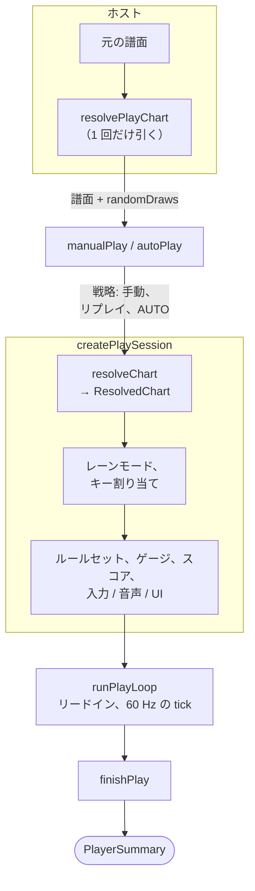
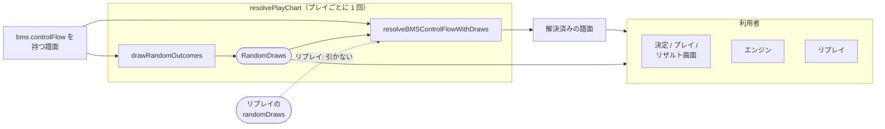

[English version](./player-spec.md)

# Player 実装仕様

`@be-music/player-engine` は譜面を準備し、ブラウザー版と端末版で共通のプレイループを実行します。各形式で読み込める値と中間表現への格納方法は、形式ごとの仕様を参照してください。[BMS](./bms-spec.ja.md)・[bmson](./bmson-spec.ja.md)・[JSON](./json-spec.ja.md)

<details>
<summary>目次</summary>

- [関連ページ](#関連ページ)
- [公開するエントリポイント](#公開するエントリポイント)
- [Node 音声アダプター](#node-音声アダプター)
- [BMS 対応範囲](#bms-対応範囲)
  - [対応チャンネル](#対応チャンネル)
  - [対応コマンド](#対応コマンド)
  - [一部対応・未対応チャンネル](#一部対応未対応チャンネル)
  - [一部対応・未対応コマンド](#一部対応未対応コマンド)
  - [HDX の BGA 配置](#hdx-の-bga-配置)
- [実行フロー](#実行フロー)
- [制御構文の扱い](#制御構文の扱い)
- [ノートモデル](#ノートモデル)
  - [演奏対象ノート](#演奏対象ノート)
  - [ロングノート](#ロングノート)
  - [重複ノート](#重複ノート)
  - [地雷](#地雷)
  - [不可視ノート](#不可視ノート)
  - [FREE ZONE](#free-zone)
- [レーンモードと入力](#レーンモードと入力)
  - [プレイモード表](#プレイモード表)
  - [選択できるレーンオプション](#選択できるレーンオプション)
  - [S-RANDOM の配置](#s-random-の配置)
- [既知の未対応](#既知の未対応)
- [bmson TOTAL 0 の任意設定](#bmson-total-0-の任意設定)

</details>

## 関連ページ

- [判定・スコア・ゲージ](./player-judgment.ja.md)
  - <a name="判定幅"></a>[判定幅](./player-judgment.ja.md#判定幅)
  - <a name="groove-gauge"></a>[Groove Gauge](./player-judgment.ja.md#groove-gauge)
- [実行時の挙動](./player-runtime.ja.md)
  - <a name="モード別挙動"></a>[モード別挙動](./player-runtime.ja.md#モード別挙動)
  - <a name="playersummary"></a>[`PlayerSummary`](./player-runtime.ja.md#playersummary)

端末版の操作は [端末プレイヤー仕様](./player-tui.ja.md)、ブラウザー固有の動作は [ブラウザープレイヤー仕様](./player-web.ja.md) を参照してください。

## 公開するエントリポイント

`@be-music/player-engine` は、ファイル構成ではなく設計したエントリポイントを公開します（[ADR 0005](./adr/0005-public-entry-points.ja.md)）。

| エントリポイント          | 公開するもの                                                                                                                                                                                                                                                                                                                                       |
| ------------------------- | -------------------------------------------------------------------------------------------------------------------------------------------------------------------------------------------------------------------------------------------------------------------------------------------------------------------------------------------------- |
| `@be-music/player-engine` | エンジン：`manualPlay`、`autoPlay`、`PlayerOptions` と 5 つの分類の型、`PlayerSummary`、読み込みの進捗、`PlayerInterruptedError`、ランタイムの契約（`AudioSession`、`PlayerInputRuntime`、`PlayerUIRuntime` とその `Create*Context` の型）、`resolvePlayChart`、`preparePlaybackChart`、`resolveChartRulesetFacts`、`createTempoClock`             |
| `./signals`               | ホストの入力と UI のランタイムが演奏中のプレイとやり取りするもの：入力のバスとそのコマンド、UI のバスとそのフレーム・コマンド・`PlayerGaugeSummary`、状態のシグナル、ハイスピードの範囲と操作                                                                                                                                                      |
| `./lanes`                 | プレイモードのレーン：レイアウトとスロット、スクラッチとホイールのレーン、キーの割り当て、FREE ZONE の入力、レーンオプションが入れ替えるレーン                                                                                                                                                                                                     |
| `./display`               | ホストが表示するもの：時刻を付けたプレイのノート（`extract*`、`toTimed*`）、`ScrollDistanceMapper`、画面の BGA の cue（`pickActiveBGACue`、`pickActiveBGAKey`、`DEFAULT_POOR_BGA_DISPLAY_SECONDS`）、選曲画面が表示する譜面の情報（`resolveDisplayed*`）、`formatSeconds`、`resolveAltModifierLabel`、TUI のノートの高さ、BGA の縮小のアルゴリズム |
| `./ruleset`               | ホスト・スキン・リーダーボードが共有する定義：判定ルールセットの id（`RULESET_IDS`）、判定幅、ゲージ、クリアランプ、BP、スコア                                                                                                                                                                                                                     |
| `./replay`                | リプレイの形式、その記録・シミュレーター・対象の判定、コースと NONSTOP のログ                                                                                                                                                                                                                                                                      |
| `./records`               | 判定ルールセットごとのベスト記録と、その記録の規則                                                                                                                                                                                                                                                                                                 |
| `./course`                | コースの定義：LR2 の `.lr2crs`、beatoraja のコース、難易度表のコース、コースメーカー、NONSTOP の通しプレイ                                                                                                                                                                                                                                         |

譜面を扱う API は `@be-music/chart-model` からインポートします。`ChartPlayVariant`、`LongNoteMode`、タイムラインとその点、`BGACue` と BGA のタイムラインを作る関数、タイミングの解決、サンプルのトリガーです。それ以外はパッケージの内部です。

## Node 音声アダプター

エンジンは `PlayerOptions.createAudioSession` を通して音声を開きます。未指定または戻り値が `undefined` の場合は無音で再生します。`audio: false` の場合はファクトリーを呼びません。ファクトリーにはエンジン自身の `resolvedChart` を渡し、タイミング、サンプルのスライス、元イベントの参照を共有します。

Node で音声を再生する場合は `@be-music/player-node-audio` を導入します。ルートは `createNodeAudioSession` と `loadNodeAudioSampleDurations` を公開します。PCM シンクは `@be-music/player-engine/audio-sink` から `@be-music/player-node-audio/audio-sink` に移動しました。ターミナルプレイヤーはこのアダプターを自動設定し、ブラウザーホストは自身のアダプターを使用します。

```typescript
import { autoPlay } from '@be-music/player-engine';
import { createNodeAudioSession, loadNodeAudioSampleDurations } from '@be-music/player-node-audio';

await autoPlay(chart, {
  audioBaseDir: chartDirectory,
  createAudioSession: createNodeAudioSession,
  loadAudioSampleDurations: loadNodeAudioSampleDurations,
});
```

`loadAudioSampleDurations` は無音再生を含むアクティブ音声のデバッグ表示にサンプル長を提供します。未指定なら譜面のスライス長または従来の短い推定値を使い、ファイル読み込みやデコードは行いません。[ADR 0011](./adr/0011-host-provided-audio.ja.md) を参照してください。

## BMS 対応範囲

この節では、[`bms-spec.md`](./bms-spec.ja.md) の一次参照に現れる BMS コマンドとチャンネルを、現在の `player` 実装に対して分類します。
ここでの「対応」は、player が実行時にその値を参照して、再生、判定、表示、選曲画面、プレビュー、loading screen のいずれかに反映することを意味します。
parser が IR へ保持するだけで、player が実行時に参照しないものは未対応として扱います。

### 対応チャンネル

| channel                                                             | player における扱い                                                                                                                                                                                                                                      |
| ------------------------------------------------------------------- | -------------------------------------------------------------------------------------------------------------------------------------------------------------------------------------------------------------------------------------------------------- |
| `#xxx01`                                                            | BGM / sample trigger として再生します。                                                                                                                                                                                                                  |
| `#xxx02`                                                            | 小節長として時間解決と beat 解決に反映します。                                                                                                                                                                                                           |
| `#xxx03`, `#xxx08`                                                  | BPM change として時間解決に反映します。                                                                                                                                                                                                                  |
| `#xxx04`, `#xxx07`, `#xxx0A`                                        | BGA base / layer / layer2 として描画します。                                                                                                                                                                                                             |
| `#xxx06`                                                            | POOR BGA cue として扱います。`#POORBGA` が `2` でなければ `#BMP00` を fallback に使います。                                                                                                                                                              |
| `#xxx09`                                                            | STOP として時間解決に反映します。                                                                                                                                                                                                                        |
| `#xxx0B`–`#xxx0E`                                                   | BGA base / layer / layer2 / POOR 面の不透明度を置き換えます。                                                                                                                                                                                            |
| `#xxx11-19`, `#xxx21-29`                                            | 可視演奏ノートとして扱います。`16` / `26` は scratch、`17` / `27` は 9KEY / 24KEY 以外では FREE ZONE、9KEY / 24KEY では通常ノートです。                                                                                                                  |
| `#xxx1A-1O`, `#xxx2A-2O`                                            | 可視演奏ノートとして扱います。24 key (Keyboardmania) バンクのレーン 10..24 です。これらのチャンネルが 1 つでもあれば `24 KEY SP` / `48 KEY DP` と判定します。                                                                                            |
| `#xxx1P`, `#xxx1Q`, `#xxx2P`, `#xxx2Q`                              | 24 / 48 KEY のホイールの可視演奏ノートとして扱います。`1P` / `2P` が上、`1Q` / `2Q` が下です（bmson `keyboard-24k` のホイール `x` = 25 / 26 に対応する Be-Music 独自の BMS 規約）。ほかの拡張チャンネルと同じく `24 KEY SP` / `48 KEY DP` と判定します。 |
| `#xxx31-39`, `#xxx41-49`（拡張の `#xxx3A-3O` / `#xxx4A-4O` を含む） | 不可視ノートとして扱います。可視ノートと同じく対応レーンの manual keysound state を更新し、表示補助にも使えますが、`summary.total` には含めません。`AUTO` では発音しません。                                                                             |
| `#xxx51-59`, `#xxx61-69`（拡張の `#xxx5A-5O` / `#xxx6A-6O` を含む） | BMS legacy long note として扱います。                                                                                                                                                                                                                    |
| `#xxx97`, `#xxx98`                                                  | 以後に鳴る BGM / playable sound の初期 gain を変更する動的音量変更として扱います。                                                                                                                                                                       |
| `#xxxA0`                                                            | `#EXRANKxx` を参照する動的判定幅変更として扱います。                                                                                                                                                                                                     |
| `#xxxSC`                                                            | `#SCROLLxx` 参照の scroll segment として描画距離へ反映します。                                                                                                                                                                                           |
| `#xxxSP`                                                            | `#SPEEDxx` 参照の speed keyframe として描画距離へ反映します。                                                                                                                                                                                            |
| `#xxxD1-D9`, `#xxxE1-E9`（拡張の `#xxxDA-DO` / `#xxxEA-EO` を含む） | 地雷として扱います。                                                                                                                                                                                                                                     |
| `#xxx99`                                                            | 演奏中に表示する `#TEXTxx` の譜面テキストを選びます（[ADR 0025](./adr/0025-chart-text-playback.ja.md)）。同じ番号の WAV は鳴らしません。                                                                                                                 |
| `#xxxA1`–`#xxxA4`                                                   | BGA base / layer / layer2 / POOR 面の `#ARGBxx` による色と不透明度を選びます。                                                                                                                                                                           |
| `#xxxA5`                                                            | キー入力連動の `#SWBGAxx` アニメーションを選びます。                                                                                                                                                                                                     |

### 対応コマンド

| command                                                                                                                                 | player における扱い                                                                                                                                                                                                                                                                                                |
| --------------------------------------------------------------------------------------------------------------------------------------- | ------------------------------------------------------------------------------------------------------------------------------------------------------------------------------------------------------------------------------------------------------------------------------------------------------------------ |
| `#TITLE`, `#SUBTITLE`, `#ARTIST`, `#SUBARTIST`, `#GENRE`, `#COMMENT`                                                                    | 選曲画面の metadata 表示に使います。`#TITLE` / `#ARTIST` / `#GENRE` は TUI と結果画面にも使います。                                                                                                                                                                                                                |
| `#BANNER`                                                                                                                               | 選曲画面の banner 表示に使います。bmson では `info.banner_image` を同用途で使います。                                                                                                                                                                                                                              |
| `#STAGEFILE`                                                                                                                            | 選曲後の loading screen 専用画像として使います。gameplay 中の BGA renderer では参照しません。                                                                                                                                                                                                                      |
| `#PLAYLEVEL`, `#DIFFICULTY`                                                                                                             | 選曲画面の表示、ソート、フィルタ、結果表示に使います。                                                                                                                                                                                                                                                             |
| `#BPM`, `#BPMxx`, `#EXBPMxx`, `#STOPxx`, `#STP`                                                                                         | 時間解決に使います。`#EXBPMxx` は同じスロットを定義する nanasi の `#BPMxx` の別名で、`#BPMxx` として書き戻します。                                                                                                                                                                                                 |
| `#RANK`, `#DEFEXRANK`, `#EXRANKxx`, `#TOTAL`                                                                                            | 判定幅、表示ランク、groove gauge 計算に使います。                                                                                                                                                                                                                                                                  |
| `#WAVxx`, `#BMPxx`                                                                                                                      | 音声・BGA リソース解決に使います。                                                                                                                                                                                                                                                                                 |
| `#BASE`                                                                                                                                 | BMS object ID の base を選びます。`#BASE 62` では sample、BGA、BPM/STOP 参照、long-note 終端、地雷値の解決時に小文字 ID を case-sensitive に扱います。                                                                                                                                                             |
| `#PREVIEW`                                                                                                                              | 選曲画面のプレビュー再生で優先的に使います。                                                                                                                                                                                                                                                                       |
| `#PATH_WAV`                                                                                                                             | ゲームプレイで sample を解決するとき、素のパスより先にディレクトリ接頭辞として試します。対象はブラウザー、ターミナル（診断用の長さ取得を含む）、オフラインレンダラ（`renderJSON`）です。選曲画面プレビューのファイル探索にも使います。                                                                             |
| `#LNTYPE`, `#LNMODE`, `#LNOBJ`                                                                                                          | BMS long note の解釈に使います。                                                                                                                                                                                                                                                                                   |
| `#PLAYER`                                                                                                                               | レーンモード推定と表示上の player metadata に使います。任意設定の **CHART HEADER** バトルモードでは、LR2 ruleset で `#PLAYER 2` / `4` が COUPLE / TWO-PLAYER を選びます（[ADR 0028](./adr/0028-player-header-selection.ja.md)）。既定は OFF のままです。                                                           |
| `#VOLWAV`                                                                                                                               | 譜面全体の音量倍率として使います。                                                                                                                                                                                                                                                                                 |
| `#POORBGA`                                                                                                                              | `0`（指定なし・不正値も同じ）はミス時に POOR 画像へ切り替え、`1` は通常のレイヤーの上に POOR を重ねます。`2` はチャンネル 06 と `#BMP00` の両方の POOR 画像を非表示にします。                                                                                                                                      |
| `#SCROLLxx`, `#SPEEDxx`                                                                                                                 | ノート描画距離の計算に使います。                                                                                                                                                                                                                                                                                   |
| `#BASEBPM`                                                                                                                              | 開始 BPM の代わりに、HS-FIX と HI-SPEED 表示の基準 BPM として使います。時間解決には使いません。                                                                                                                                                                                                                    |
| `#CHARSET`                                                                                                                              | ファイルに BOM がなく、宣言が対応する文字コードを指すとき、その文字コードで読みます（[BMS 仕様 — 文字コード](./bms-spec.ja.md#文字コード)）。                                                                                                                                                                      |
| `#TEXTxx`, `#TEXT00`, `#SONGxx`                                                                                                         | チャンネル `99` が選ぶ譜面テキストです。`#TEXT00` はミス時のテキストです。pomu の旧名 `#SONGxx` は `#TEXTxx` に定義がない番号を補います。Native・Canvas・LR2・beatoraja・ターミナルで表示します（[ADR 0025](./adr/0025-chart-text-playback.ja.md)）。                                                              |
| `#WAVCMD`, `#EXWAVxx`                                                                                                                   | browser・Node・オフラインは WAVCMD のピッチ・百分率音量・発音時間上限と EXWAV のファイル名・音量・左右バランス・周波数を反映します。コマンド 02 は発音時間でありループではありません。元レート・スロット別バッファ・テンポ準備は [ADR 0024](./adr/0024-extended-bms-audio.ja.md) を参照してください。              |
| `#EXBMPxx`, `#BGAxx`, `#SWBGAxx`, `#ARGBxx`                                                                                             | Browser と terminal は EXBMP 静止画・不透明動画の透過色、BGA 部分領域、元画像の半透明、A1〜A4 の ARGB、キー入力連動 A5 SWBGA（動画の切り出しを含む）に対応します。NONSTOP ではホストが変換済みの SWBGA 選択を渡します。nanasigroove との厳密な一致は未検証です。[BMS 対応範囲](bms-spec.ja.md)を参照してください。 |
| `#RANDOM`, `#SETRANDOM`, `#IF`, `#ELSEIF`, `#ELSE`, `#ENDIF`, `#ENDRANDOM`, `#SWITCH`, `#SETSWITCH`, `#CASE`, `#SKIP`, `#DEF`, `#ENDSW` | 再生開始前に制御構文として解決します。                                                                                                                                                                                                                                                                             |

### 一部対応・未対応チャンネル

- **`#xxxA6`** 一部対応です。時刻付きの `#CHANGEOPTIONxx` 参照は HI-SPEED（[ADR 0026](./adr/0026-chart-authored-display-options.ja.md)）と HIDDEN・CHANGE-HS・CRAZY のサイズ / 揺れ（[ADR 0032](./adr/0032-chart-authored-visual-families.ja.md)）、M-SUDDEN とその他の表示系 CRAZY（[ADR 0036](./adr/0036-chart-authored-skin-level-options.ja.md)）を実行します。時刻付きの HDX LONGMODE は診断のみで、ノートは変えません（[ADR 0027](./adr/0027-hdx-long-note-modes.ja.md)）。その他のオプション系列は診断のみです（[対応範囲](./research/chart-authored-options.ja.md#対応範囲決定)）。
- **`#xxx05`** 未対応です。各方言で `#ExtChr` と `#SEEKxx` が使います。下記を参照してください。
- **上の対応一覧に含まれないその他の object channel** parser が保持しても、player runtime は意味解釈しません。

### 一部対応・未対応コマンド

- **`#OPTION`, `#CHANGEOPTIONxx`** 一部対応です。すべての宣言を順序どおり保持します。初期の `charatbeatHDX:LONGMODE` は CN / HCN を選び（[ADR 0027](./adr/0027-hdx-long-note-modes.ja.md)）、HI-SPEED（[ADR 0026](./adr/0026-chart-authored-display-options.ja.md)）と HIDDEN・CHANGE-HS・CRAZY のサイズ / 揺れ（[ADR 0032](./adr/0032-chart-authored-visual-families.ja.md)）、M-SUDDEN・その他の表示系 CRAZY・旧 `HID-*`・`CRA-*` 別名（[ADR 0036](./adr/0036-chart-authored-skin-level-options.ja.md)）は実行します。初期の RANDOM と判定系 CRAZY も実行します（[ADR 0033](./adr/0033-chart-authored-gameplay-options.ja.md)）。NOTES の DOUBLE・COPY・DBLCOPY も実行し、COPY はコースの外で 5 / 7 KEY の譜面を 10 / 14 KEY として遊ばせます（[ADR 0035](./adr/0035-chart-authored-notes-options.ja.md)）。初期の GAMELEVEL・EXTRA はゲージを選びます（[ADR 0034](./adr/0034-chart-authored-gauge-options.ja.md)）。その他のオプション系列は診断のみです（[対応範囲](./research/chart-authored-options.ja.md#対応範囲決定)）。
- **`#BACKBMP`** core/terminal runtime には専用挙動がありません。browser LR2 special graphic はこの値を利用できます。
- **`#MAKER`** metadata-only / unsupported です。
- **`#VIDEOFILE`, `#MIDIFILE`** LR2・beatoraja と同じく未実装です。保持のみで再生しません。動画 BGA は `#BMPxx` で参照した動画ファイルを使います。後続対応：[#841](https://github.com/nulltask/be-music/issues/841)、[#842](https://github.com/nulltask/be-music/issues/842)。[歴史的なコマンド](./research/historical-bms-commands.ja.md#midifile-と-videofile836)を参照してください。
- **`#VIDEOf/s`, `#VIDEODLY`** `metadata.extras` に保持し、実行しません。`#VIDEOFILE` を補うだけの命令です（[#842](https://github.com/nulltask/be-music/issues/842)）。
- **`#CHARFILE`, `#ExtChr`, `#CDDA`, `#VIDEOCOLORS`, `#SEEKxx`, `#MATERIALSBMP`, `#MATERIALSWAV`** 実行せず、往復で失わないよう `metadata.extras` に保持します。後続対応：[#848](https://github.com/nulltask/be-music/issues/848)（`#ExtChr`・`#CHARFILE`）、[#849](https://github.com/nulltask/be-music/issues/849)（`#SEEKxx`・`#VIDEOCOLORS`）。`#CDDA` と Materials 系は未対応のままです（Be-Music には音楽 CD も実行ファイル基準のフォルダーもないため）。出自・使用状況・理由は[歴史的なコマンド](./research/historical-bms-commands.ja.md)を参照してください。
- **`#MATERIALS`, `#DIVIDEPROP`** `bms` に保持し、実行しません。`<folder>` による Materials 参照は解決しません。位置は厳密な分数で扱うため、`#DIVIDEPROP` で変わるものはありません。

### HDX の BGA 配置

初期 `#OPTION charatbeatHDX:BGAMODE n` の `0` は BGA 枠全体に合わせます。`1` は原寸、`2` は 80% で、どちらも枠の上中央から配置します。各スキンの BGA 枠とターミナルの ANSI・Kitty 表示領域は、256×256 の論理キャンバスに対応します。`#BGA` は切り出した画像をこの規則で配置し、枠外をクリップします。BGA を自前で描くスキンには `frame.bga.bgaMode` を渡します。

NONSTOP はステージの指定を引き継ぎ、ブラウザーのクロスフェードでは各スタックにそのステージの配置を適用します。リプレイは配置を表示プログラムのバージョン 4 に記録します。A6 による指定は診断し、配置は譜面 fingerprint と記録条件に影響しません。[公式資料の調査結果](./research/chart-authored-options.ja.md#charatbeathdx-の一次資料で確定した規則)

## 実行フロー

player は次の順序で譜面を実行します。

1. ホストが今回のプレイ用に解決した譜面（`resolvePlayChart`）を受け取ります。制御構文が残った譜面は `PlayerOptions.randomDraws` で 1 回だけ解決します。
2. 分岐後の譜面を `resolveChart`（`@be-music/chart-model`、[アーキテクチャ](./architecture.ja.md) を参照）で 1 回だけ解決し、演奏ノート、地雷、不可視ノート、リアルタイム音声トリガ、テンポマップ、譜面の事実を、得られた `ResolvedChart` から取り出します。
3. 分岐後の譜面からレーンモードを確定し（[レーンモードと入力](#レーンモードと入力)）、実際に存在するチャンネル群からキー割り当てと FREE ZONE のエイリアスを確定します。
4. ゲージ、スコア、UI state、入力 runtime、音声 runtime を初期化します。
5. 1 つのプレイループ（`play-loop.ts`）を、そのプレイの判定ストラテジー（手動（AUTO SCRATCH を含む）、リプレイ（`replayInputs`）、AUTO）で実行し、最後に `PlayerSummary` を返します。

同じ手順を流れで示します（`play.ts`、`play-session.ts`、`play-loop.ts`、`play-finish.ts`）。



時間解決では、通常の `#STOPxx` に加えて、BMS 拡張 `#STP` も停止イベントとして扱います。
同じ位置に `#STOPxx` のオブジェクトが複数あれば、LR2 や beatoraja と同じく最後のものが勝ちます。bmson の同じパルスの `stop_events` は、bmson 仕様のとおり加算します。
`#STP` は `xxx[.yyy] zzzz` を `measure xxx` の `yyy / 1000` 位置にある `zzzz ms` の停止として解釈し、同位置の複数定義は加算します。`.yyy` が省略された場合は `000` として扱います。書式に合わない `bms.stp` 要素は IR には保持されますが、プレイヤーの時間解決では無視します。

## 制御構文の扱い

BMS の `#RANDOM` / `#SETRANDOM` / `#SWITCH` 系制御構文は、再生開始前に、ホストがプレイごとに 1 回だけ解決します。

1 回のプレイの結果は、はっきりした値 `RandomDraws`（`@be-music/chart-model`）で表します。`#RANDOM` / `#SETRANDOM` / `#SWITCH` / `#SETSWITCH` の行ごとにファイル順で 1 項目あり、各項目は行のコマンド、`range`（取りうる結果の数）、その行の後で有効な `value` を持ちます。

- 選ばれなかった分岐の中にある行も含め、該当する行にはすべて項目があります。評価器は分岐の状態にかかわらずすべての制御行をたどるためです。
- `#RANDOM n` / `#SWITCH n` は `1..n` から `value` を引きます。`n` がない、0、負、数値でない行は結果が 1 つしかない行として扱い、`range` 1、`value` 1 とし、乱数源を消費しません。
- `#SETRANDOM n` / `#SETSWITCH n` は `value` を `n`（`n` がないか正でなければ 1）に固定し、`range` は 1 です。乱数は引きません。

解決する場所は 1 か所だけで、`drawRandomOutcomes(chart, random)` → `RandomDraws` と `resolveBMSControlFlowWithDraws(chart, draws)`（`@be-music/chart-parser`）→ 解決済みの譜面、の組です。ホスト向けには `resolvePlayChart(chart)`（`@be-music/player-engine`）がこれをまとめ、`{ chart, randomDraws }` を返します。
分岐の意味（スタックは 1 本で共有する、閉じていない `#IF` は `#ENDRANDOM` の後も残る、選ばれた分岐の中の定義は譜面全体に効く）は、`evaluateControlFlow`（`@be-music/chart-model`）の 1 か所だけにあります。
同じ譜面と draws からは常に同じ結果が得られ、その譜面のために引かれていない draws は `RangeError` で拒否します。
解決済みの譜面は `bms.controlFlow` を持たないので、もう一度解決しても何も変わりません。

譜面とその draws は、ホストが 1 回だけ引いたところから、すべての利用者へ一緒に渡ります。



どのホストも 1 回だけ引き、同じ譜面と draws をそのプレイのすべての利用者に渡します。CLI はプレビューの描画とゲームプレイ worker に、Web プレイヤー は決定画面、プレイ画面、エンジン、リザルト画面に渡します。
リスタートでは引き直します。LR2 や beatoraja もプレイごとに引き直すためです。
エンジン（`autoPlay` / `manualPlay`）は自分では引きません。解決済みの譜面はそのまま再生し、`PlayerOptions.randomDraws` は RANDOM 要約にだけ使います。
制御構文が残った譜面を `randomDraws` と一緒に渡された場合（たとえば元の譜面とリプレイの draws）は、その draws でちょうど 1 回だけ解決します。draws なしで渡された場合は、エンジンの外の誰も知らない分岐を引く代わりに `TypeError` を投げます。

リプレイは draws を `play.randomDraws` に記録し、リプレイはそれを `PlayerOptions.randomDraws` として渡し直します（[リプレイ](./replay.ja.md) を参照）。

RANDOM 要約は draws から作ります。
`#SETRANDOM` は固定値として表示し、複数の RANDOM 系がある場合は宣言順で `RANDOM #1 2/3  #2 1/2` のように整形します。

## ノートモデル

### 演奏対象ノート

ノートは解決済みの譜面（`ResolvedChart.notes`、`@be-music/chart-model` の `resolveChart`）から取ります。`resolveChart` は IR の `events` を beat/seconds 付きのノート列へ正規化し、エンジンはそれをプレイごとの状態を持つ演奏ノートにコピーします（`preparePlaybackChart`）。
演奏対象に含めるのは playable channel のみで、各ノートは少なくとも次の情報を持ちます。

- `channel`
- `beat`
- `seconds`
- `judged`
- 必要に応じて `endBeat` / `endSeconds` / `longNoteMode`

### ロングノート

player はロングノートを「始点 1 ノート + 終点情報」に正規化して扱います。
bmson の `l`、FREE ZONE (`17` / `27`)、BMS の `#LNOBJ`、BMS legacy LN (`#mmm51-69`) はすべてこの形へ畳み込みます。

`#LNOBJ` の終端オブジェクト自体は演奏ノート列に残しません。
そのため、`#LNOBJ` 由来の LN も `#mmm51-69` 由来の LN も、player では 1 本につき 1 ノートです。

### 重複ノート

1 つのレーンの同じ位置に置くノートは最大 1 つです。タイムラインがレーンごとに 1 ノートだけを持つ beatoraja と同じです。
同じレーン・同じ位置から複数のノートが始まる場合（BMS の 2 つのオブジェクト行が同じセルに書く場合、`#mmm51-69` / `#LNOBJ` のロングノートの始点にタップがある場合、`x` と `y` が同じ bmson のレイヤーノート）は、1 つだけを判定します。

- ロングノートはタップより優先します。beatoraja も、`5x` / `6x` のロングノートが始まる位置のタップをロングノートに置き換えます。
- それ以外は、BMS では beatoraja と同じく、ファイル内で後の行のオブジェクトを採用します。LR2 の選び方は分かっていません。行順を記録する前に JSON として保存した譜面は、以前の規則（最小のオブジェクト ID）のままです。
- bmson では最初の sound channel のノートを採用します。これが beatoraja の判定するノートです。

残りのノートは判定・描画せず、`summary.total` にも数えません。BMS のキー音は、採用したノートと同じ `#WAVxx` でない限り、マニュアルプレイでは各ノートの時刻に BGM として鳴らします（AUTO はもともと演奏レーンのオブジェクトをすべて鳴らします）。
bmson では 1 つの判定ノートの `soundEvents` に、代表の `event` を含む構成イベントをすべて保持します。早押し・遅押し・レーンの空打ち音・リプレイでも、そのノートへの入力時に全スライスを鳴らし、ミス時は鳴らしません。AUTO は譜面時刻に全スライスを予約します。最初の sound channel のノートと同じ長さのノートだけを重ねます。長さの異なるノート（ロングノートに重なったタップを含む）は、beatoraja と同じく音ごと捨てます（[BMSONDecoder](https://github.com/exch-bms2/jbms-parser/blob/8108cd54a19275810e1f5d2c9586f008eb6db95e/src/bms/model/BMSONDecoder.java#L243-L306)。beatoraja は警告を記録します）。譜面はそのまま読み込めます。
解決済みの譜面は残りの構成ノートを確認用の `shadowedNotes` として返します（`extractTimedNotes` も同じ）。bmson のホストはこれを BGM として予約しません。
地雷と不可視ノートはまとめません。

### 地雷

地雷チャンネルは、対応する playable lane に写像したうえで別配列として保持します。
地雷は `summary.total` に含めません。

地雷がいつ爆発するかは判定 ruleset が決めます（[`definitions.ts`](../packages/player-engine/src/ruleset/definitions.ts) の `mineTrigger`）。engine と replay simulator は同じ規則を使います。ダメージモデルはどの ruleset でも同じです（beatoraja `JudgeManager` で確認）。

- `lr2` ruleset — LR2beta3 本体の挙動。押下は判定線から早い側の GREAT 境界の手前までで地雷を踏みます（境界は含めない）。押したままなら通過時に爆発します。通過した地雷は最初のポーリングで消費し、遅い押下や、押したまま判定幅に入っただけでは爆発しません。
- `beatoraja` ruleset — beatoraja のモデル（`JudgeManager` L244）。「**地雷が判定線を通過する瞬間にキーが押されている**」ときだけ爆発します。少し前に押して通過前に離した場合や、通過後の押下では何も起きません。
- 「押されている」かどうかはレーンごとに記録した押下・離鍵の時刻から判定するため、地雷をいつ確定させてもライブプレイ・リプレイ・シミュレータの結果は一致します。2 つのキーで押さえたレーンは、どちらかが押されている間は押されたままです。通過と同じ瞬間の入力は通過より先に扱い、その µs に押したキーは押されている、その µs に離したキーは離れているものとします。離鍵を送らない入力では、判定が押下を受ける前にエンジンが離鍵を推定し、押下のたびにレーンを 120 ms（ロングノートの始点を弾いた押下では 380 ms）押されたままにします（[解放のない入力](./replay.ja.md#解放のない入力)）。
- `____` ruleset — 名前を言ってはいけないあのゲームに地雷はないため、再現すべき本家の規則がありません。Be-Music は LR2 の地雷の方針をまとめて取り入れます（[Reference Compatibility Rules](../AGENTS.md#reference-compatibility-rules) の基準）。前方だけに届く押下、押したままの通過、POOR/BP の加算は LR2 と同じです。届く範囲だけは ruleset 自身の判定幅で読み、押下は判定線から `____` の早い側の GREAT 境界（33.33 ms）の手前までで地雷を踏みます（境界は含めない）。これは Be-Music の拡張であり、AC の挙動を示すものではありません。以前の暫定モデル（前後対称の PGREAT 窓内の押下、ゲージのみ減少）を置き換えます。リプレイは取り入れた方針で再判定し、暫定モデルの結果は残しません（[#1169](https://github.com/nulltask/be-music/issues/1169)）。
- 爆発はゲージを減らし `#WAV00` を鳴らします。LR2 と、その方針を取り入れた `____` は POOR/BP も1回加算しますが、判定表示・コンボ切断・EX-SCORE 変更・通常 POOR 分の追加ゲージダメージは発生しません。`minePoor` は `poor` に含まれる地雷数を記録し、コース BP で未判定ノートの代わりに数えないようにします。beatoraja はゲージのみを減らします。通常ノート判定は独立して行い、地雷は近接ノートの押下を消費しません。
- ダメージは地雷オブジェクト値（大文字 base36）を **そのままパーセントとして解釈**します（LR2 / beatoraja 準拠。nanasi 系仕様の `value / 2` とは異なります）。bmson の `mine_channels[].notes[].damage` が付いた地雷はその値を優先します。`damage` のない bmson の地雷は 0 % です（オブジェクト値はパーサーが割り当てた WAV スロットでありダメージ表現ではないため、ダメージとしては読みません）。
- ダメージは HARD の 30% 緩和・`#TOTAL` 補正の対象外です（beatoraja の `gauge.addValue()` 直接加算と同じ）。
- `ZZ`（= 1295%）は survival 系（HARD / DEATH）では即 FAILED、GROOVE / EASY では下限 `2%` で止まります。
- kitty keyboard protocol 入力では押下/解放の実状態を使います。release イベントの無い入力では、先に離鍵を推定する（`play-key-inference.ts`）ので、判定は常に押下/解放の状態を読みます。

### 不可視ノート

不可視ノートは通常の演奏対象とは別に保持します。
可視ノートと同じタイミングルールで同レーンの keysound fallback state を更新します。不可視オブジェクトの early `BAD` 窓が開いた時点で、その WAV が後続の可視または不可視オブジェクトに置き換わるまで、そのレーンの現在 fallback 音になります。
`showInvisibleNotes` が有効な場合だけ UI 描画対象へ含めますが、判定数や `summary.total` には含めません。
bmson の `key_channels`（beatoraja の隠しノート）は不可視ノートとして読み、`AUTO` と選曲画面のプレビューは 24 / 48 KEY の拡張レーンを含むどのレーンでも発音しません。

### FREE ZONE

FREE ZONE (`17` / `27`) は 1 beat の終端を持つノートとして扱います。
通常の score/gauge 対象からは除外し、keysound fallback と描画上の補助対象として扱います。
判定上の効果はありません。FREE ZONE 中のスクラッチの押下はほかの押下と同じく判定し、空 `POOR` になりえます。LR2 と
beatoraja はどちらも 7 鍵・14 鍵の譜面で `17` / `27` チャンネルを読み込み時に捨て、名前を言ってはいけないあのゲームにはもともと FREE ZONE が
ありません（FREE ZONE は beatmania 1st / 2ndMIX の仕組みです）。
これが適用されるのは 名前を言ってはいけないあのゲーム 系のみです。`9 KEY` と `24 KEY` / `48 KEY` の keyboard mode では、これらのチャンネルは通常のキーレーンなので、譜面が書いた長さのまま（単押しは単押しのまま）扱います。

## レーンモードと入力

レーンモードは、すべての host が共有するひとつのルール `@be-music/chart-model` の `resolveChartPlayVariant` で決めます。
入力は分岐後の譜面のイベント、`bms.player`、bmson の `mode_hint`、譜面の拡張子 (`PlayerOptions.laneModeExtension`) です。
bmson の `keyboard-24k` / `keyboard-24k-double` は `24 KEY SP` / `48 KEY DP` をそのまま選ぶため、最初の 9 鍵しか使わない
キーボード譜面も 7 / 9 KEY とは判定しません。ほかの hint はレーンによる判定に任せます。variant をすでに
知っている host は `PlayerOptions.playVariant` で明示できます。レーン使用は `1x` / `2x` のレーンチャンネルと `5x` / `6x` の
`#LNTYPE` ロングノートチャンネルで数え、地雷と不可視オブジェはレーンモードを変えません。そのため、これらが beatoraja
ruleset の 5 KEY / 7 KEY 判定幅を切り替えることもありません。判定順は
[BMS 仕様 — player 固有挙動](./bms-spec.ja.md#player-固有挙動) にあります。モードを表す拡張子は `.pms` だけで、それ以外の
拡張子では使われているレーンで決めます。そのため 6 / 7 鍵の列がない `.bme` 譜面は、beatoraja と同じく `5 KEY SP` /
`5 KEY DP` です。
判定の流れは [`@be-music/chart-model` — レーンモード自動判定](../packages/chart-model/README.ja.md#レーンモード自動判定) にフローチャートで示しています。
現実装で自動判定できる主なモードは次のとおりです。

- `5 KEY SP`
- `5 KEY DP`
- `7 KEY SP`
- `14 KEY DP`
- `9 KEY (PMS-STD / PMS-COMPAT)`
- `24 KEY SP`
- `48 KEY DP`
- `N KEY GENERIC`（1〜70）

既知の固定レイアウトに存在しないチャンネルは、未使用キーへ順番にフォールバック割り当てします。
beat 系の配置では、FREE ZONE は対応する scratch レーン (`17 -> 16`, `27 -> 26`) の入力トークンも共有します。

`24 KEY SP` / `48 KEY DP` は Keyboardmania 系の keyboard mode です。片側 26 レーンで、24 鍵をチャンネル `11..19` + `1A..1O`（2P 側は `21..29` + `2A..2O`）に、ホイールを `1P`（上）/ `1Q`（下）（2P 側は `2P` / `2Q`）に持ちます。scratch 列はありません。鍵はチャンネル昇順に左から右へ並べ、ホイールは 名前を言ってはいけないあのゲーム 系が scratch を置く外側（1P の鍵の左、2P の鍵の右）に置きます。判定は内容ベースで、拡張レーンチャンネル（ホイールを含む）が 1 つでもあれば `.pms` 拡張子や `#PLAYER 3` + `17` の POPN-9 シグネチャよりも優先してこのモードを選び、bmson のキーボード系 `mode_hint` はそのままこのモードを選びます。

ホイールは鍵とまったく同じに判定し（beatoraja ruleset の keyboard 判定幅で、scratch 固有の扱いはありません）、FREE ZONE にもなりません。レーンオプション（MIRROR / RANDOM / S-RANDOM）は片側の 24 鍵を入れ替え、ホイールは scratch と同じく動かしません。SP の 24 鍵は fallback キー配置を順に消費します (`a s d f g h j k l ; q w e r u i o p z x c v b n`)。ホイールはその割り当てとも、Web プレイヤー がハイスピード変更に使う矢印キーとも重ならない、キーボードの端のキーを使います。1P のホイール上 / 下は `Tab` / 左 `Shift`、2P は `Enter` / 右 `Shift` です（beatoraja は MIDI コントローラのピッチベンドでホイールを操作しますが、Be-Music には MIDI 入力がありません）。48 鍵の DP は印字キーの数を超えるため鍵の末尾がファンクションキーに落ちますが、48 鍵は AUTO PLAY と描画の検証対象であって手で押す対象ではないため、意図的な割り切りです。

名前を言ってはいけないあのゲーム 系の既定キーボード配置は、1P を `Z S X D C F V`、2P を `B H N J M K ,` とします。
scratch は 1P が左 `Shift`、2P が右 `Shift` です。
reverse scratch は 1P が左 `Ctrl`、2P が右 `Ctrl` を使います。macOS では `Ctrl` の代わりに左/右 `Option` を使います。

left/right `Ctrl` と left/right `Option` の識別は kitty keyboard protocol で行います。
kitty 非対応端末へフォールバックした場合、reverse scratch の side-specific 入力は保証しません。

`generic-Nkeys` の bmson 譜面は、1〜70 個の等幅の通常キーを片側に並べる `N KEY GENERIC` を使います。疎な譜面でも宣言したキー数を保持し、チャンネルからのモード推定より優先します。`16` / `17` / `26` / `27` も通常キーであり、scratch・ホイール・FREE ZONE の別名・DP のバンクにはしません。既定の入力は既存の 28 キーのプール、数字 `1..0`、`t y - = [ ] \` とバッククォート、`F1..F24` の順です。Browser はこれらのコードを認識します。F5 がレーンに割り当てられていればレーン入力とし、未割り当てなら再開します。Terminal の kitty／Win32 入力モードは、ファンクションキーの押下・リピート・解放を保持します。多いキー数では適切な入力機器または独自の入力と、十分に横幅のある端末が必要です。割り当てがあっても、一般的なキーボードで全列の同時押しができるとは限りません。

Native・Canvas・LR2 は等幅のフォールバック列を使います。beatoraja のスキンではノート領域の外周を借りて N 等分し、通常キーのフォールバックノートを使います。スキンの scratch 画像は generic のキーへ割り当てません。Terminal は通常の白キーの配色を使います。beatoraja ruleset の判定幅と既定 TOTAL は、N にかかわらず keyboard の規則を使います。beat 固有の BATTLE / SP TO DP 変換は利用できません。NONSTOP はすべてのステージで同じ generic のキー数を保持できます。異なるキー数や beat／keyboard のステージとの混在は `generic-layout-mismatch` として拒否します。Be-Music の方針は [ADR 0023](./adr/0023-generic-bmson-keyboards.ja.md) に記録します。

### プレイモード表

すべてのプレイモードは `PLAY_MODE_LAYOUTS`（[`chart/src/play-modes.ts`](../packages/chart-model/src/play-modes.ts)、
`@be-music/chart-model` から export）の 1 か所で宣言します。レイアウトごとにレーンを左から右へ並べ、各レーンの種類（鍵、scratch、
ホイールの上 / 下）、side、slot（鍵の番号。scratch は `0`、ホイールは `25` / `26`）、色の分類、そのレーンに載る各オブジェ系統の
BMS チャンネル（可視 `1x` / `2x`、不可視 `3x` / `4x`、`#LNTYPE` の `5x` / `6x`、地雷 `Dx` / `Ex`。拡張レーン `A`..`Q` を含む）と、
scratch で扱う FREE ZONE のチャンネルを持ちます。bmson の `mode_hint` のレーン表（`BMSON_MODE_HINT_LAYOUTS`）も同じレイアウトから
作ります。parser、chart-writer、`resolveChartPlayVariant`、プレイヤーのレーン配置とレーンオプション、CLI のレーン色、skin SDK の
レーン種別は、すべてこの表から導出します。

| レイアウト | 表示名               | レーン（左から右）                                                             | bmson `mode_hint`     |
| ---------- | -------------------- | ------------------------------------------------------------------------------ | --------------------- |
| `5`        | `5 KEY SP`           | `16`（scratch）、`11`-`15`                                                     | `beat-5k`             |
| `7`        | `7 KEY SP`           | `16`（scratch）、`11`-`15`、`18`、`19`                                         | `beat-7k`             |
| `9-pms`    | `9 KEY (PMS-STD)`    | `11`-`15`、`22`-`25`                                                           | `popn-9k`             |
| `9-bme`    | `9 KEY (PMS-COMPAT)` | `11`-`19`                                                                      | —                     |
| `10`       | `5 KEY DP`           | `16`（scratch）、`11`-`15`、`21`-`25`、`26`（scratch）                         | `beat-10k`            |
| `14`       | `14 KEY DP`          | `16`（scratch）、`11`-`15`、`18`、`19`、`21`-`25`、`28`、`29`、`26`（scratch） | `beat-14k`            |
| `24`       | `24 KEY SP`          | `1P` / `1Q`（ホイール）、`11`-`19`、`1A`-`1O`                                  | `keyboard-24k`        |
| `48`       | `48 KEY DP`          | `24` と同じ並びの後に `21`-`29`、`2A`-`2O`、`2P` / `2Q`（ホイール）            | `keyboard-24k-double` |

### 選択できるレーンオプション

新しいプレイでは OFF、MIRROR、RANDOM、S-RANDOM を提供します。SCATTER は前の行・LN の配置条件とアシスト・記録方針を合わせて実装するまで無効化します。新しい SCATTER の直接要求は譜面準備・リプレイ記録より前に失敗し、暗黙に RANDOM を引くことはありません。旧リプレイに SCATTER という名前があっても、保存済みの確定チャンネルをそのまま再生できます。

### S-RANDOM の配置

`randomizeSRandomNotes`（`@be-music/player-engine/lanes`）は実行環境に依存しない純粋なヘルパーです。確定済みイベントの時刻（ms）、モード・左右の完全な鍵盤範囲、選択した判定ルールセット、外から渡す乱数を受け取り、ノートを変更せず入力順のチャンネルを返します。ブラウザはエンジンが判定するノートと同じオブジェクトに配置を適用し、LN の終端も保持します。スクラッチ・ホイール・反対側のイベントは固定します。

| 規則                   | LR2 と暫定 名前を言ってはいけないあのゲーム            | beatoraja                                                |
| ---------------------- | ------------------------------------------------------ | -------------------------------------------------------- |
| 保持中の LN            | 終端の行まで配置先を予約                               | 終端の行まで元と先の対応を保持                           |
| 通常ノート             | 同時刻・保持中の LN が使わない配置先から選択           | 前の得点対象ノートから整数 ms で40msを超えた配置先を優先 |
| 連打間隔が足りない場合 | 連打間隔の制限なし                                     | 最も古い配置先を使い、同時なら乱数で選択                 |
| 地雷・不可視ノート     | 地雷は空きに配置し、不可視ノートは元レーンの対応に従う | 行の置換に従い、連打時刻を更新しない                     |

描画ファミリーに関係なく、選択した判定ルールセットが規則を決めます。完全な範囲は PMS の2形式と5/7/9/10/14/24/48鍵を含みます。LR2 で空きレーンよりイベントが多い行は、無限に引き直さず明示的に失敗します。確定したチャンネルを記録し、リプレイは引き直さずそれを適用するため、旧記録の配置も保たれます。

## 既知の未対応

- browser gameplay での 2P 独立 gauge variant
- ゲージ推移タイムライン表示
- beatoraja の非デフォルトのノート選択アルゴリズム（`duration` / `lowest` / `score`）は実装済みですが
  ライブプレイのオプションとしては公開していません（`bms-replay` のシミュレータでは `--algorithm=` で選べます）

Battle 選択に CHART HEADER（AUTO）と COUPLE を追加します。実際の作者が SP・DP・PMS にも PLAYER 2 を使うため、既定値は OFF を維持します。ヘッダ解釈は明示的な選択を必要とし、LR2・単一譜面・beat 配置だけで有効です。明示的な選択と replay の記録モードを優先します。[ADR 0028](./adr/0028-player-header-selection.ja.md) を参照してください。

## bmson TOTAL 0 の任意設定

回復・リプレイ・記録への影響は [bmson の変換仕様](./bmson-spec.ja.md#bmson---bmsbmson-中間表現-be-musicchart-source-変換) を参照してください。端末では `--bmson-total-mode spec` で選びます。
