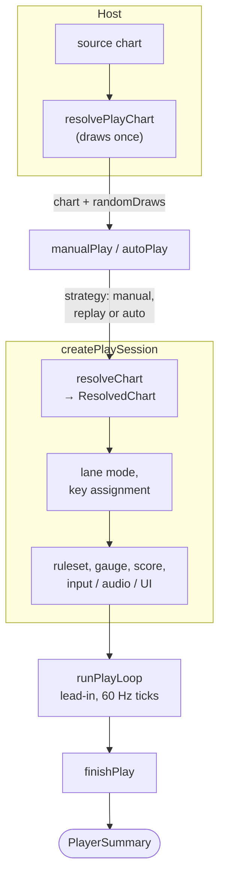
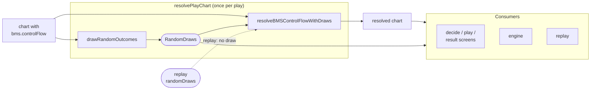

[Japanese version](./player-spec.ja.md)

# Player implementation specifications

`@be-music/player-engine` prepares the chart and runs the same play loop for browser and terminal hosts. The format documents define what the parser accepts and what it stores in the intermediate representation. [BMS](./bms-spec.md) · [bmson](./bmson-spec.md) · [JSON](./json-spec.md)

<details>
<summary>Table of contents</summary>

- [Related pages](#related-pages)
- [Entry points](#entry-points)
- [Node audio adapter](#node-audio-adapter)
- [BMS compatible range](#bms-compatible-range)
  - [Supported channels](#supported-channels)
  - [Supported commands](#supported-commands)
  - [Partially supported and unsupported channels](#partially-supported-and-unsupported-channels)
  - [Partially supported and unsupported commands](#partially-supported-and-unsupported-commands)
  - [HDX BGA placement](#hdx-bga-placement)
- [Execution flow](#execution-flow)
- [Handling control syntax](#handling-control-syntax)
- [Note model](#note-model)
  - [Notes to be played](#notes-to-be-played)
  - [Long Note](#long-note)
  - [Duplicate notes](#duplicate-notes)
  - [Landmines](#landmines)
  - [Invisible Note](#invisible-note)
  - [FREE ZONE](#free-zone)
- [Lane mode and input](#lane-mode-and-input)
  - [Play-mode table](#play-mode-table)
  - [Available lane options](#available-lane-options)
  - [S-RANDOM arrangement](#s-random-arrangement)
- [Known unsupported](#known-unsupported)
- [Optional bmson zero-total policy](#optional-bmson-zero-total-policy)

</details>

## Related pages

- [Judgment, scoring, and gauges](./player-judgment.md)
  - <a name="judgment-width"></a>[Judgment width](./player-judgment.md#judgment-width)
  - <a name="groove-gauge"></a>[Groove Gauge](./player-judgment.md#groove-gauge)
- [Runtime behavior](./player-runtime.md)
  - <a name="behavior-by-mode"></a>[Behavior by mode](./player-runtime.md#behavior-by-mode)
  - <a name="playersummary"></a>[`PlayerSummary`](./player-runtime.md#playersummary)

See the frontend guides for [terminal controls and settings](./player-tui.md) and [browser behavior](./player-web.md).

## Entry points

`@be-music/player-engine` exports designed entries, not its file layout ([ADR 0005](./adr/0005-public-entry-points.md)):

| Entry                     | What it exports                                                                                                                                                                                                                                                                                                                                                   |
| ------------------------- | ----------------------------------------------------------------------------------------------------------------------------------------------------------------------------------------------------------------------------------------------------------------------------------------------------------------------------------------------------------------- |
| `@be-music/player-engine` | The engine: `manualPlay`, `autoPlay`, `PlayerOptions` with its five category types, `PlayerSummary`, the load progress, `PlayerInterruptedError`, the runtime contracts (`AudioSession`, `PlayerInputRuntime`, `PlayerUIRuntime` and their `Create*Context` types), `resolvePlayChart`, `preparePlaybackChart`, `resolveChartRulesetFacts` and `createTempoClock` |
| `./signals`               | What a host's input and UI runtimes exchange with a running play: the input bus and its commands, the UI bus with its frames, commands and `PlayerGaugeSummary`, the state signals, and the high-speed range and actions                                                                                                                                          |
| `./lanes`                 | The lanes of a play mode: the layout and its slots, scratch and wheel lanes, key bindings, FREE ZONE input, and the lanes the lane options permute                                                                                                                                                                                                                |
| `./display`               | What a host shows: the timed play notes (`extract*`, `toTimed*`), `ScrollDistanceMapper`, the BGA cue on screen (`pickActiveBGACue`, `pickActiveBGAKey`, `DEFAULT_POOR_BGA_DISPLAY_SECONDS`), the chart facts a song screen shows (`resolveDisplayed*`), `formatSeconds`, `resolveAltModifierLabel`, the TUI note heights and the BGA resize algorithms           |
| `./ruleset`               | The vocabulary hosts, skins and the Leaderboard share: the judge ruleset ids (`RULESET_IDS`), the judge windows, gauges, clear lamps, BP and the score                                                                                                                                                                                                            |
| `./replay`                | The replay format, its recorder, simulator and eligibility checks, and the course and NONSTOP logs                                                                                                                                                                                                                                                                |
| `./records`               | Best records per judge ruleset and the rules that keep them                                                                                                                                                                                                                                                                                                       |
| `./course`                | Course definitions: LR2 `.lr2crs`, beatoraja courses and table courses, the course maker, and NONSTOP runs                                                                                                                                                                                                                                                        |

The chart-layer names come from `@be-music/chart-model`: `ChartPlayVariant`, `LongNoteMode`, the timelines and their points, `BGACue` and the BGA timeline builders, the timing resolver and the sample triggers. Everything else in the package is internal.

## Node audio adapter

The engine opens audio only through `PlayerOptions.createAudioSession`. Omitting the factory or returning `undefined` plays silently. `audio: false` skips the factory. The factory receives the engine's `resolvedChart`, preserving its timing, sample slices and source-event identities.

Install `@be-music/player-node-audio` for Node playback. Its root exports `createNodeAudioSession` and `loadNodeAudioSampleDurations`; PCM sinks moved from `@be-music/player-engine/audio-sink` to `@be-music/player-node-audio/audio-sink`. The terminal player installs this adapter automatically. Browser hosts keep their own adapter.

```typescript
import { autoPlay } from '@be-music/player-engine';
import { createNodeAudioSession, loadNodeAudioSampleDurations } from '@be-music/player-node-audio';

await autoPlay(chart, {
  audioBaseDir: chartDirectory,
  createAudioSession: createNodeAudioSession,
  loadAudioSampleDurations: loadNodeAudioSampleDurations,
});
```

`loadAudioSampleDurations` supplies sample lengths for optional active-audio diagnostics, including playback with audio disabled. Without it, diagnostics use chart-defined slice lengths or the existing short estimate and perform no file reads or decoding. See [ADR 0011](./adr/0011-host-provided-audio.md).

## BMS compatible range

This section classifies the BMS commands and channels that appear in the primary reference in [`bms-spec.md`](./bms-spec.md) relative to the current `player` implementation.
"Compatible" here means that the player refers to the value at runtime and reflects it in playback, judgment, display, song selection screen, preview, and loading screen.
Items that are only stored in the IR by the parser and not referenced by the player during execution are treated as unsupported.

### Supported channels

| channel                                                               | Handling in player                                                                                                                                                                                                                                                            |
| --------------------------------------------------------------------- | ----------------------------------------------------------------------------------------------------------------------------------------------------------------------------------------------------------------------------------------------------------------------------- |
| `#xxx01`                                                              | Play as BGM / sample trigger.                                                                                                                                                                                                                                                 |
| `#xxx02`                                                              | Reflected in time resolution and beat resolution as bar length.                                                                                                                                                                                                               |
| `#xxx03`, `#xxx08`                                                    | Reflected in time resolution as BPM change.                                                                                                                                                                                                                                   |
| `#xxx04`, `#xxx07`, `#xxx0A`                                          | Render as BGA base / layer / layer2.                                                                                                                                                                                                                                          |
| `#xxx06`                                                              | Treated as POOR BGA cue. Unless `#POORBGA` is `2`, `#BMP00` is used as fallback.                                                                                                                                                                                              |
| `#xxx09`                                                              | Reflects in time resolution as STOP.                                                                                                                                                                                                                                          |
| `#xxx0B`–`#xxx0E`                                                     | Replace the opacity of the BGA base / layer / layer2 / POOR plane.                                                                                                                                                                                                            |
| `#xxx11-19`, `#xxx21-29`                                              | Treated as visible performance notes. `16` / `26` is scratch, `17` / `27` is FREE ZONE except for 9KEY / 24KEY, and normal note for 9KEY / 24KEY.                                                                                                                             |
| `#xxx1A-1O`, `#xxx2A-2O`                                              | Treated as visible performance notes — lanes 10..24 of the 24-key (Keyboardmania) bank. A single one of these channels classifies the chart as `24 KEY SP` / `48 KEY DP`.                                                                                                     |
| `#xxx1P`, `#xxx1Q`, `#xxx2P`, `#xxx2Q`                                | Treated as visible performance notes on the 24 / 48 KEY wheel: `1P` / `2P` turn it up, `1Q` / `2Q` down (Be-Music's BMS convention for the bmson `keyboard-24k` wheel, `x` = 25 / 26). They classify the chart as `24 KEY SP` / `48 KEY DP` like the other extended channels. |
| `#xxx31-39`, `#xxx41-49` (and the extended `#xxx3A-3O` / `#xxx4A-4O`) | Treated as invisible notes. They update the corresponding lane's manual keysound state like visible notes, and may be used for display aids, but are not included in `summary.total`. `AUTO` does not produce a sound.                                                        |
| `#xxx51-59`, `#xxx61-69` (and the extended `#xxx5A-5O` / `#xxx6A-6O`) | Treated as BMS legacy long note.                                                                                                                                                                                                                                              |
| `#xxx97`, `#xxx98`                                                    | Treated as a dynamic volume change that changes the initial gain of the BGM/playable sound that plays after that.                                                                                                                                                             |
| `#xxxA0`                                                              | Treated as a dynamic judgment width change that refers to `#EXRANKxx`.                                                                                                                                                                                                        |
| `#xxxSC`                                                              | Reflects in the drawing distance as a scroll segment of the `#SCROLLxx` reference.                                                                                                                                                                                            |
| `#xxxSP`                                                              | Reflects in the drawing distance as a speed keyframe of `#SPEEDxx` reference.                                                                                                                                                                                                 |
| `#xxxD1-D9`, `#xxxE1-E9` (and the extended `#xxxDA-DO` / `#xxxEA-EO`) | Treated as a landmine.                                                                                                                                                                                                                                                        |
| `#xxx99`                                                              | Selects the `#TEXTxx` chart text shown during play ([ADR 0025](./adr/0025-chart-text-playback.md)). Never triggers a WAV with the same id.                                                                                                                                    |
| `#xxxA1`–`#xxxA4`                                                     | Select the `#ARGBxx` tint and opacity of the BGA base / layer / layer2 / POOR plane.                                                                                                                                                                                          |
| `#xxxA5`                                                              | Selects the input-bound `#SWBGAxx` animation.                                                                                                                                                                                                                                 |

### Supported commands

| command                                                                                                                                 | Handling in player                                                                                                                                                                                                                                                                                                   |
| --------------------------------------------------------------------------------------------------------------------------------------- | -------------------------------------------------------------------------------------------------------------------------------------------------------------------------------------------------------------------------------------------------------------------------------------------------------------------- |
| `#TITLE`, `#SUBTITLE`, `#ARTIST`, `#SUBARTIST`, `#GENRE`, `#COMMENT`                                                                    | Used to display metadata on the song selection screen. `#TITLE` / `#ARTIST` / `#GENRE` are also used for TUI and results screens.                                                                                                                                                                                    |
| `#BANNER`                                                                                                                               | Used to display the banner on the song selection screen. bmson uses `info.banner_image` for the same purpose.                                                                                                                                                                                                        |
| `#STAGEFILE`                                                                                                                            | Used as a dedicated image for the loading screen after song selection. It is not referenced by the BGA renderer during gameplay.                                                                                                                                                                                     |
| `#PLAYLEVEL`, `#DIFFICULTY`                                                                                                             | Used to display, sort, filter, and display the results of the song selection screen.                                                                                                                                                                                                                                 |
| `#BPM`, `#BPMxx`, `#EXBPMxx`, `#STOPxx`, `#STP`                                                                                         | Used for time resolution. `#EXBPMxx` is nanasi's alias of `#BPMxx` for the same slot and is written back as `#BPMxx`.                                                                                                                                                                                                |
| `#RANK`, `#DEFEXRANK`, `#EXRANKxx`, `#TOTAL`                                                                                            | Used for judgment range, display rank, groove gauge calculation.                                                                                                                                                                                                                                                     |
| `#WAVxx`, `#BMPxx`                                                                                                                      | Used for audio/BGA resource resolution.                                                                                                                                                                                                                                                                              |
| `#BASE`                                                                                                                                 | Selects the BMS object ID base. `#BASE 62` keeps lowercase IDs case-sensitive when resolving samples, BGA, BPM/STOP references, long-note ends, and landmine values.                                                                                                                                                 |
| `#PREVIEW`                                                                                                                              | Used preferentially for preview playback on the song selection screen.                                                                                                                                                                                                                                               |
| `#PATH_WAV`                                                                                                                             | Tried as a directory prefix before the bare path whenever gameplay resolves samples: browser, terminal (including diagnostic durations) and the offline renderer (`renderJSON`). The song selection screen preview also uses it to search for files.                                                                 |
| `#LNTYPE`, `#LNMODE`, `#LNOBJ`                                                                                                          | Used to interpret BMS long notes.                                                                                                                                                                                                                                                                                    |
| `#PLAYER`                                                                                                                               | Used for mode estimation and display player lane metadata. With the opt-in **CHART HEADER** battle mode, `#PLAYER 2` / `4` select COUPLE / TWO-PLAYER under LR2 ([ADR 0028](./adr/0028-player-header-selection.md)). The default stays OFF.                                                                          |
| `#VOLWAV`                                                                                                                               | Used as a volume multiplier for the entire score.                                                                                                                                                                                                                                                                    |
| `#POORBGA`                                                                                                                              | `0` (also missing/invalid) replaces the BGA with the POOR image during a miss; `1` draws POOR over the normal layers; `2` hides both explicit channel-06 POOR cues and the `#BMP00` fallback.                                                                                                                        |
| `#SCROLLxx`, `#SPEEDxx`                                                                                                                 | Used to calculate note drawing distance.                                                                                                                                                                                                                                                                             |
| `#BASEBPM`                                                                                                                              | Reference BPM for HS-FIX and the hi-speed readouts, in place of the start BPM. Not used for time resolution.                                                                                                                                                                                                         |
| `#CHARSET`                                                                                                                              | Selects the text encoding when the file has no BOM and the declaration names a supported encoding ([BMS spec — Character Encoding](./bms-spec.md#character-encoding)).                                                                                                                                               |
| `#TEXTxx`, `#TEXT00`, `#SONGxx`                                                                                                         | Chart text selected by channel `99`; `#TEXT00` is the miss text. pomu's obsolete `#SONGxx` defines an index `#TEXTxx` leaves undefined. Native, Canvas, LR2, beatoraja and terminal display it ([ADR 0025](./adr/0025-chart-text-playback.md)).                                                                      |
| `#WAVCMD`, `#EXWAVxx`                                                                                                                   | Browser, Node and offline playback apply WAVCMD pitch/percentage volume/sounding-time limits and EXWAV filename/volume/balance/frequency. Command 02 is duration, not looping. See [ADR 0024](./adr/0024-extended-bms-audio.md) for native rates, slot buffers and tempo preparation.                                |
| `#EXBMPxx`, `#BGAxx`, `#SWBGAxx`, `#ARGBxx`                                                                                             | Browser and terminal apply EXBMP still-image and opaque-video color keys, BGA sub-regions, fractional source-image alpha, A1–A4 ARGB and input-bound A5 SWBGA (including video crops). NONSTOP hosts supply remapped SWBGA selections; exact nanasigroove parity remains unverified; see [BMS support](bms-spec.md). |
| `#RANDOM`, `#SETRANDOM`, `#IF`, `#ELSEIF`, `#ELSE`, `#ENDIF`, `#ENDRANDOM`, `#SWITCH`, `#SETSWITCH`, `#CASE`, `#SKIP`, `#DEF`, `#ENDSW` | Resolved as control syntax before playback starts.                                                                                                                                                                                                                                                                   |

### Partially supported and unsupported channels

- **`#xxxA6`** Partial. Timed `#CHANGEOPTIONxx` references execute HI-SPEED ([ADR 0026](./adr/0026-chart-authored-display-options.md)), HIDDEN, CHANGE-HS and CRAZY size / wave ([ADR 0032](./adr/0032-chart-authored-visual-families.md)), M-SUDDEN and the other visual CRAZY options ([ADR 0036](./adr/0036-chart-authored-skin-level-options.md)); a timed HDX LONGMODE is diagnosed without changing notes ([ADR 0027](./adr/0027-hdx-long-note-modes.md)). Other option families produce diagnostics only ([support boundary](./research/chart-authored-options.md#support-boundary-decision)).
- **`#xxx05`** Unsupported. Used by `#ExtChr` and `#SEEKxx` in their dialects; see below.
- **Other object channels that are not included in the above list of correspondence** Even if the parser holds them, the player runtime does not interpret them.

### Partially supported and unsupported commands

- **`#OPTION`, `#CHANGEOPTIONxx`** Partial. Every declaration is kept in order. The initial `charatbeatHDX:LONGMODE` selects CN / HCN ([ADR 0027](./adr/0027-hdx-long-note-modes.md)) and HI-SPEED ([ADR 0026](./adr/0026-chart-authored-display-options.md)), HIDDEN, CHANGE-HS and CRAZY size / wave ([ADR 0032](./adr/0032-chart-authored-visual-families.md)), M-SUDDEN, the other visual CRAZY options and the legacy `HID-*` / `CRA-*` aliases ([ADR 0036](./adr/0036-chart-authored-skin-level-options.md)) execute, as do initial RANDOM and judgment CRAZY ([ADR 0033](./adr/0033-chart-authored-gameplay-options.md)) and NOTES DOUBLE / COPY / DBLCOPY, COPY playing a 5 / 7 KEY chart as 10 / 14 KEY outside a course ([ADR 0035](./adr/0035-chart-authored-notes-options.md)), and initial GAMELEVEL / EXTRA select the gauge ([ADR 0034](./adr/0034-chart-authored-gauge-options.md)); other option families produce diagnostics only ([support boundary](./research/chart-authored-options.md#support-boundary-decision)).
- **`#BACKBMP`** The core/terminal runtime has no dedicated behavior for this command. Browser LR2 special graphics can use it.
- **`#MAKER`** Metadata-only/unsupported.
- **`#VIDEOFILE`, `#MIDIFILE`** Not implemented, as in LR2 and beatoraja: kept, not played. Video BGA uses video files referenced with `#BMPxx`. Follow-ups: [#841](https://github.com/nulltask/be-music/issues/841), [#842](https://github.com/nulltask/be-music/issues/842). See [historical commands](./research/historical-bms-commands.md#midifile-and-videofile-836).
- **`#VIDEOf/s`, `#VIDEODLY`** Kept in `metadata.extras`, not executed; they only modify `#VIDEOFILE` ([#842](https://github.com/nulltask/be-music/issues/842)).
- **`#CHARFILE`, `#ExtChr`, `#CDDA`, `#VIDEOCOLORS`, `#SEEKxx`, `#MATERIALSBMP`, `#MATERIALSWAV`** Not executed; kept in `metadata.extras` for lossless round trips. Follow-ups: [#848](https://github.com/nulltask/be-music/issues/848) (`#ExtChr`, `#CHARFILE`), [#849](https://github.com/nulltask/be-music/issues/849) (`#SEEKxx`, `#VIDEOCOLORS`). `#CDDA` and the Materials commands stay unsupported (no audio CDs or executable-relative folders in Be-Music). See [historical commands](./research/historical-bms-commands.md) for origin, use and rationale.
- **`#MATERIALS`, `#DIVIDEPROP`** Kept in `bms`, not executed. `<folder>` Materials references are not resolved; `#DIVIDEPROP` has nothing to change because positions are exact fractions.

### HDX BGA placement

An initial `#OPTION charatbeatHDX:BGAMODE n` fills the BGA viewport with `0`, draws at source size with `1`, and draws at 80% with `2`. Modes 1 and 2 align the image to the top centre. Each skin BGA target and the terminal ANSI or Kitty viewport represents a 256×256 logical canvas. The player crops `#BGA` subregions before placement and clips to the viewport. A skin that paints the BGA itself receives `frame.bga.bgaMode`.

NONSTOP uses the stage's declaration, including each individual stack during a browser crossfade. Replays carry the effective mode in version 4 of the display program. A6 declarations are diagnosed. Placement does not change chart fingerprints or record eligibility. [First-party reference findings](./research/chart-authored-options.md#charatbeathdx-confirmed-first-party-contract)

## Execution flow

player executes the score in the following order:

1. Take the chart the host resolved for this play (`resolvePlayChart`); a chart that still carries control flow is resolved once with `PlayerOptions.randomDraws`.
2. Resolve the branched score once with `resolveChart` (`@be-music/chart-model`, see [Architecture](./architecture.md)) and take the performance notes, mines, invisible notes, real-time audio triggers, tempo map and chart facts from the resulting `ResolvedChart`.
3. Confirm the lane mode from the branched score (see [Lane mode and input](#lane-mode-and-input)), then the key assignment and lane FREE ZONE alias from the actual channels.
4. Initialize gauges, scores, UI state, input runtime, and audio runtime.
5. Run the one play loop (`play-loop.ts`) with the play's judge strategy — manual (AUTO SCRATCH included), replay (`replayInputs`) or AUTO — and return `PlayerSummary` at the end.

The same steps as a flow (`play.ts`, `play-session.ts`, `play-loop.ts`, `play-finish.ts`):



In addition to the regular `#STOPxx`, time resolution also treats the BMS extension `#STP` as a stop event.
Of several `#STOPxx` objects at one position the last one wins, as in LR2 and beatoraja; bmson `stop_events` on one pulse add up, as the bmson spec says.
`#STP` interprets `xxx[.yyy] zzzz` as a stop of `zzzz ms` at `yyy / 1000` position of `measure xxx`, and multiple definitions at the same position are added together. If `.yyy` is omitted, it is treated as `000`. Malformed `bms.stp` elements are retained in the IR but ignored by the player's time resolution.

## Handling control syntax

BMS's `#RANDOM` / `#SETRANDOM` / `#SWITCH` control syntax is resolved once per play, by the host, before playback starts.

The outcome of a play is an explicit value, `RandomDraws` (`@be-music/chart-model`): one entry per `#RANDOM` / `#SETRANDOM` / `#SWITCH` / `#SETSWITCH` line in file order, each with the line's command, its `range` (the number of outcomes) and the `value` in force after it.

- Every such line has an entry, including the ones nested in a branch that is not taken: the evaluator walks every directive whatever the branch state.
- `#RANDOM n` / `#SWITCH n` draw `value` from `1..n`. A missing, zero, negative or non-numeric `n` is a single-outcome line: `range` 1, `value` 1, and it does not consume the random source.
- `#SETRANDOM n` / `#SETSWITCH n` fix `value` to `n` (1 when `n` is missing or not positive), with `range` 1; they draw nothing.

The single resolution point is the pair `drawRandomOutcomes(chart, random)` → `RandomDraws` and `resolveBMSControlFlowWithDraws(chart, draws)` (`@be-music/chart-parser`) → resolved chart, wrapped for hosts as `resolvePlayChart(chart)` (`@be-music/player-engine`), which returns `{ chart, randomDraws }`.
The branch semantics (one shared stack, an open `#IF` outliving `#ENDRANDOM`, definitions in a taken branch applying to the whole chart) live once in `evaluateControlFlow` (`@be-music/chart-model`).
The same chart and draws always resolve to the same result, and draws that were not drawn for the chart are rejected with a `RangeError`.
A resolved chart carries no `bms.controlFlow`, so resolving it again changes nothing.

The chart and its draws travel together from the host's single draw to every consumer:



Every host draws once and hands the same chart and draws to every consumer of the play: the CLI to the preview render and the gameplay worker, the web player to the decide screen, the play screen, the engine and the result screen.
A restart draws again, as LR2 and beatoraja re-roll each play.
The engine (`autoPlay` / `manualPlay`) never draws: it plays a resolved chart as is, taking `PlayerOptions.randomDraws` only for the RANDOM summary.
Handed a chart that still carries control flow together with `randomDraws` (for example a replay's draws against the source chart), it resolves the chart exactly once with them; handed one without draws, it throws a `TypeError` instead of rolling branches nobody outside the engine knows about.

A replay records the draws as `play.randomDraws`, and a replay hands them back as `PlayerOptions.randomDraws` (see [Replay](./replay.md)).

The RANDOM summary is derived from the draws.
`#SETRANDOM` is shown as a fixed value, and if there are multiple RANDOM types, they are formatted as `RANDOM #1 2/3  #2 1/2` in the order of declaration.

## Note model

### Notes to be played

The notes come from the resolved chart (`ResolvedChart.notes`, `resolveChart` in `@be-music/chart-model`), which normalizes the IR `events` into a sequence of notes with beats/seconds; the engine copies them into play notes (`preparePlaybackChart`) that carry the per-play state.
Only the playable channel is included, and each note has at least the following information:

- `channel`
- `beat`
- `seconds`
- `judged`
- `endBeat` / `endSeconds` / `longNoteMode` as required

### Long Note

The player handles long notes by normalizing them to "1 note from the starting point + information about the ending point."
bmson's `l`, FREE ZONE (`17` / `27`), BMS's `#LNOBJ`, and BMS legacy LN (`#mmm51-69`) all fold into this shape.

The terminal object of `#LNOBJ` itself is not left in the performance note string.
Therefore, both LNs derived from `#LNOBJ` and LNs derived from `#mmm51-69` are worth 1 note per book on the player.

### Duplicate notes

A lane holds at most one note per position, as in beatoraja, whose timeline keeps one note per lane.
When several notes start on the same lane and position (two BMS object lines writing the same cell, a tap on the start of a `#mmm51-69` / `#LNOBJ` long note, or layered bmson notes with the same `x` and `y`), only one is judged:

- A long note wins over a tap. beatoraja also replaces a tap with a `5x` / `6x` long note that starts on it.
- Otherwise, for BMS, the object from the later line of the file wins, as in beatoraja; LR2's choice is not known. A chart saved as JSON before line order was recorded keeps the earlier rule, the lowest object ID.
- For bmson, the first sound channel's note wins. This is the note beatoraja judges.

The other notes are not judged, drawn, or counted in `summary.total`. For BMS, their keysounds play at their own time as background audio in manual play (AUTO already sounds every play-lane object), unless they use the kept note's `#WAVxx`.
For bmson, one judged note holds all constituent source events in `soundEvents`, including the representative `event`. Every slice sounds on that note's press, including early/late input, lane fallback and replay; a missed note sounds none. AUTO schedules all constituent slices at chart time. Only notes with the same length as the first sound channel's note layer onto it. A note of another length, including a tap stacked on a long note, is dropped with its sound, as beatoraja does ([BMSONDecoder](https://github.com/exch-bms2/jbms-parser/blob/8108cd54a19275810e1f5d2c9586f008eb6db95e/src/bms/model/BMSONDecoder.java#L243-L306), which logs a warning); the chart still loads.
The resolved chart returns the remaining source notes as `shadowedNotes` for inspection (`extractTimedNotes` too); a bmson host must not schedule them as BGM.
Landmines and invisible notes are not collapsed.

### Landmines

Mine channels are mapped to their corresponding playable lane and kept in a separate array.
Mines are not included in `summary.total`.

When a mine detonates belongs to the judge ruleset (`mineTrigger` in [`definitions.ts`](../packages/player-engine/src/ruleset/definitions.ts)); the engine and the replay simulators apply the same rule. The damage model is the same everywhere (confirmed against beatoraja's `JudgeManager`).

- `lr2` ruleset — LR2beta3 executable behavior: a key-down hits a mine from the judge line up to, but excluding, the early GREAT boundary. A held key detonates at crossing. A passed mine retires at the first poll; late presses and held-key early-window entry do not detonate it.
- `beatoraja` ruleset — beatoraja's model (`JudgeManager` L244): a mine explodes only when **the lane's key is down at the moment the mine crosses the judge line**. A press shortly before (released before the crossing) or after does nothing.
- "Held" is read off each lane's recorded presses and releases, so live play, replays and the simulators agree however late the mine is settled; a lane held by two keys stays held while either is down. An input at the very instant of a crossing counts before the crossing: a key pressed at that µs is down, one released at that µs is up. For input that sends no releases the engine infers them before the judge sees the press, holding the lane for 120 ms after each press (380 ms after one that hits a long note's head) ([Input without key releases](./replay.md#input-without-key-releases)).
- `____` ruleset — That-Which-Must-Not-Be-Named has no mines, so there is no native rule to reproduce. Be-Music imports LR2's mine policy as a whole (the baseline in the [Reference Compatibility Rules](../AGENTS.md#reference-compatibility-rules)): the same ahead-only key-down reach, the same held crossing and the same POOR/BP accounting. Only the reach is read on the ruleset's own window: a key-down detonates a mine from the judge line up to, but excluding, the early GREAT boundary of `____` (33.33 ms). This is a Be-Music extension, not evidence of AC behavior. It replaces the earlier provisional model (a press within the symmetric PGREAT window, gauge damage only); replays re-judge under the imported policy, and no result keeps the provisional one ([#1169](https://github.com/nulltask/be-music/issues/1169)).
- Every explosion drains the gauge and plays `#WAV00`. LR2, and `____` with it, also increments POOR/BP once, without a judgment cue, combo break, EX-SCORE change or extra ordinary-POOR gauge damage. `minePoor` records the hits already included in `poor`, so they never replace unjudged notes in course BP. beatoraja applies gauge damage only. Note judgment runs independently; a mine never consumes a nearby note press.
- Damage interprets the mine object value (upper-case base36) **directly as a percentage** (LR2 / beatoraja behavior; this differs from the nanasi-lineage `value / 2` rule). A bmson mine with `mine_channels[].notes[].damage` uses that value instead; a bmson mine without `damage` deals zero damage (its object value is the WAV slot the parser assigned, not a damage encoding, so it is never read as damage).
- Mine damage bypasses the HARD sub-30% softening and the `#TOTAL` damage multiplier (same as beatoraja's direct `gauge.addValue()`).
- `ZZ` (= 1295 %) instantly FAILs survival gauges (HARD / DEATH); GROOVE / EASY stop at the `2%` floor.
- kitty keyboard protocol input uses the real press/release state; release-less input has its releases inferred first (`play-key-inference.ts`), so the judge always reads a press/release state.

### Invisible Note

Invisible notes are kept separate from the normal playing target.
They update the same-lane keysound fallback state using the same timing rule as visible notes: once the invisible object's early `BAD` window opens, that WAV becomes the lane's current fallback sound until a later visible or invisible object takes over.
They are included in the UI drawing target only when `showInvisibleNotes` is enabled, but are not included in the number of judgments or `summary.total`.
bmson `key_channels` (beatoraja's hidden notes) are read as invisible notes, and `AUTO` and the select-screen preview stay silent on them on every lane, the extended 24 / 48 KEY lanes included.

### FREE ZONE

FREE ZONE (`17` / `27`) is treated as a note with a 1 beat ending.
It is excluded from the normal score/gauge target and treated as a keysound fallback and a drawing aid target.
It has no judging effect: a scratch press during it is judged as any other press and can charge an empty `POOR`, as in
LR2 and beatoraja (both drop channel `17` / `27` from 7-key and 14-key charts) and That-Which-Must-Not-Be-Named (which never had FREE ZONE; it
belongs to beatmania 1st / 2ndMIX).
This only applies to the That-Which-Must-Not-Be-Named families — under `9 KEY` and the `24 KEY` / `48 KEY` keyboard modes those channels are
ordinary key columns, so they keep whatever length the chart authored (a plain tap stays a tap).

## Lane mode and input

The lane mode comes from one rule shared by every host: `resolveChartPlayVariant` in `@be-music/chart-model`, run over the
branched score's events, `bms.player`, the bmson `mode_hint`, and the chart extension (`PlayerOptions.laneModeExtension`).
A bmson `keyboard-24k` / `keyboard-24k-double` hint selects `24 KEY SP` / `48 KEY DP` outright, so a keyboard chart that
only uses its first nine keys is not read as 7 / 9 KEY; every other hint leaves the decision to the lanes. A host that already
knows the variant can declare it with `PlayerOptions.playVariant`. Lane usage counts the `1x` / `2x` lane channels and
the `5x` / `6x` `#LNTYPE` long-note channels; mines and invisible objects never change the lane mode, so they cannot
switch the beatoraja ruleset between its 5 KEY and 7 KEY judge windows. The detection order is listed in
[BMS spec — Player-Specific Behavior](./bms-spec.md#player-specific-behavior). Only `.pms` names a mode; every other
extension leaves the decision to the lanes in use, so a `.bme` chart without a 6 / 7 key column is `5 KEY SP` /
`5 KEY DP`, as in beatoraja.
The decision is drawn as a flowchart in [`@be-music/chart-model` — Automatic lane mode determination](../packages/chart-model/README.md#automatic-lane-mode-determination).
The main modes the current implementation determines automatically are as follows.

- `5 KEY SP`
- `5 KEY DP`
- `7 KEY SP`
- `14 KEY DP`
- `9 KEY (PMS-STD / PMS-COMPAT)`
- `24 KEY SP`
- `48 KEY DP`
- `N KEY GENERIC` (1–70)

Channels that do not exist in a known fixed layout will fallback to unused keys in order.
In beat-family layouts, FREE ZONE also shares the input tokens of the corresponding scratch lanes (`17 -> 16`, `27 -> 26`).

`24 KEY SP` / `48 KEY DP` are the Keyboardmania-style keyboard modes. Each side has 26 lanes: 24 keys on channels
`11..19` + `1A..1O` (`21..29` + `2A..2O` for the 2P side) and the wheel, up on `1P` and down on `1Q` (`2P` / `2Q`).
There is no scratch column. The keys are laid out left to right in ascending channel order, and the wheel sits on the
side's outer edge where the That-Which-Must-Not-Be-Named modes keep their scratch: left of the 1P keys, right of the 2P keys. Detection is
content-based: one extended lane channel (the wheel included) selects the mode ahead of every other rule, including the
`.pms` extension and the `#PLAYER 3` + `17` POPN-9 signature, and a bmson keyboard `mode_hint` selects it outright.

The wheel is judged exactly like a key (the beatoraja ruleset's keyboard judge windows, no scratch-specific handling),
it is not FREE ZONE, and the lane options (MIRROR / RANDOM / S-RANDOM) move the 24 keys of a side but leave the wheel in
place, as they do the scratch. The 24 SP keys take the fallback key layout in order
(`a s d f g h j k l ; q w e r u i o p z x c v b n`); the wheel has its own keys on the keyboard's edges, off that pool
and off the arrow keys the web player uses for hi-speed: `Tab` / left `Shift` turn the 1P wheel up / down, `Enter` /
right `Shift` the 2P wheel. (beatoraja plays the wheel from a MIDI controller's pitch bend; Be-Music has no MIDI input.)
A 48-key DP chart runs past the printable-key pool and the tail of its keys lands on function keys, which is a
deliberate trade — 48 keys are an AUTO PLAY / rendering target, not a hand-playable one.

The default keyboard layout for the That-Which-Must-Not-Be-Named series is 1P as `Z S X D C F V` and 2P as `B H N J M K ,`.
For scratch, 1P is left `Shift`, 2P is right `Shift`.
For reverse scratch, 1P uses left `Ctrl` and 2P uses right `Ctrl`. On macOS, use left/right `Option` instead of `Ctrl`.

Distinguishing between left/right `Ctrl` and left/right `Option` is done using the kitty keyboard protocol.
If you fall back to a terminal that does not support kitty, side-specific input of reverse scratch is not guaranteed.

`generic-Nkeys` bmson charts use `N KEY GENERIC` with 1–70 equal-width normal keys on one side. The declared count remains authoritative for sparse charts and takes precedence over channel-based mode detection. Channels `16` / `17` / `26` / `27` are ordinary keys; there is no scratch, wheel, FREE ZONE alias or DP bank. Default tokens use the existing 28-key pool, then digits `1..0`, `t y - = [ ] \` and backquote, followed by `F1..F24`. Browser input recognizes those codes; a bound F5 is a lane key, and an unbound F5 restarts. Terminal stateful function-key events retain press, repeat and release through kitty and Win32 input modes. Large layouts need suitable hardware or custom input and a sufficiently wide terminal; a binding does not imply that a conventional keyboard can press a full chord.

Native, Canvas and LR2 use uniform fallback columns. A beatoraja skin contributes its note-area bounds, divided into N equal columns with normal-key fallback notes, rather than assigning its scratch image to a generic key. Terminal uses normal white-key coloring. In the beatoraja ruleset, generic layouts use keyboard judgment windows and default TOTAL independently of N. Beat-specific BATTLE / SP TO DP conversions remain unavailable. A NONSTOP course may retain one generic count throughout; a different generic count or a beat/keyboard stage is rejected as `generic-layout-mismatch`. These Be-Music policies are recorded in [ADR 0023](./adr/0023-generic-bmson-keyboards.md).

### Play-mode table

Every play mode is declared once, in `PLAY_MODE_LAYOUTS` ([`chart/src/play-modes.ts`](../packages/chart-model/src/play-modes.ts),
exported by `@be-music/chart-model`). For each layout it lists the lanes left to right, each with its kind (key, scratch, wheel
up / down), side, slot (key number, `0` for the scratch, `25` / `26` for the wheel), colour class, and the BMS channels of
every object family on it (visible `1x` / `2x`, invisible `3x` / `4x`, `#LNTYPE` `5x` / `6x`, mine `Dx` / `Ex`, the
extended `A`..`Q` lanes included), plus the FREE ZONE channels it plays on its scratch. The bmson `mode_hint` lane tables
(`BMSON_MODE_HINT_LAYOUTS`) are built from the same layouts. The parser, the chart-writer, `resolveChartPlayVariant`, the
player's lane layout and lane options, the CLI's lane colours, and the skin SDK's lane kinds all derive from it.

| Layout  | Label                | Lanes, left to right                                                         | bmson `mode_hint`     |
| ------- | -------------------- | ---------------------------------------------------------------------------- | --------------------- |
| `5`     | `5 KEY SP`           | `16` (scratch), `11`-`15`                                                    | `beat-5k`             |
| `7`     | `7 KEY SP`           | `16` (scratch), `11`-`15`, `18`, `19`                                        | `beat-7k`             |
| `9-pms` | `9 KEY (PMS-STD)`    | `11`-`15`, `22`-`25`                                                         | `popn-9k`             |
| `9-bme` | `9 KEY (PMS-COMPAT)` | `11`-`19`                                                                    | —                     |
| `10`    | `5 KEY DP`           | `16` (scratch), `11`-`15`, `21`-`25`, `26` (scratch)                         | `beat-10k`            |
| `14`    | `14 KEY DP`          | `16` (scratch), `11`-`15`, `18`, `19`, `21`-`25`, `28`, `29`, `26` (scratch) | `beat-14k`            |
| `24`    | `24 KEY SP`          | `1P` / `1Q` (wheel), `11`-`19`, `1A`-`1O`                                    | `keyboard-24k`        |
| `48`    | `48 KEY DP`          | as `24`, then `21`-`29`, `2A`-`2O`, `2P` / `2Q` (wheel)                      | `keyboard-24k-double` |

### Available lane options

New plays offer OFF, MIRROR, RANDOM and S-RANDOM. SCATTER is disabled until its previous-row/LN placement constraints and assist/record policy are implemented together. A direct new SCATTER request fails before chart preparation or replay recording; it never silently draws RANDOM. Legacy replay files may still contain the SCATTER name and their resolved channels continue to replay unchanged.

### S-RANDOM arrangement

`randomizeSRandomNotes` (`@be-music/player-engine/lanes`) is a runtime-neutral pure helper: it takes resolved event times in milliseconds, a complete mode/side key domain, the selected judge ruleset and an injected random source, and returns channels in input order without mutating notes. The browser applies the channels to the same note objects the engine judges, preserving long-note endpoints. Scratch/wheel and other-side events stay fixed.

| Rule                      | LR2 and provisional That-Which-Must-Not-Be-Named                     | beatoraja                                                                     |
| ------------------------- | -------------------------------------------------------------------- | ----------------------------------------------------------------------------- |
| Active LN                 | Reserve its destination through the tail row                         | Preserve its source/destination map through the tail row                      |
| Ordinary notes            | Choose unused, unheld destinations                                   | Prefer destinations more than 40 integer ms after their previous scoring note |
| Insufficient jack spacing | No jack threshold                                                    | Use the oldest available destinations, choosing ties randomly                 |
| Mines and hidden notes    | Mines choose free destinations; hidden notes follow their source map | Follow the timeline permutation without updating jack times                   |

The selected judge ruleset controls these rules independently of the drawing family. Complete domains include both PMS encodings and 5/7/9/10/14/24/48-key modes. An impossible LR2 row with more events than free destinations fails explicitly instead of retrying indefinitely. Record the resolved channels; replay playback applies those channels rather than drawing again, so older recordings retain their arrangement.

## Known unsupported

- Independent 2P gauge variant in browser gameplay
- Gauge timeline display
- beatoraja's non-default note-selection algorithms (`duration` / `lowest` / `score`) are implemented but not
  exposed as a live-play option (the `bms-replay` simulator can select them with `--algorithm=`)

The Battle selector adds CHART HEADER (AUTO) and COUPLE. OFF remains the default because actual authors use PLAYER 2 for SP/DP/PMS. Header interpretation is opt-in, LR2-only, single-chart and beat-layout only; explicit choices and recorded replay modes take precedence. See [ADR 0028](./adr/0028-player-header-selection.md).

## Optional bmson zero-total policy

Per-play `bmsonTotalMode` defaults to `beatoraja`; `spec` suppresses positive recovery only for normalized percentage TOTAL 0. Browser Play options exposes **bmson TOTAL 0** and terminal accepts `--bmson-total-mode spec`. The typed replay field is authoritative; absence means compatibility regardless of the viewer. Affected manual plays and courses remain stored and simulated with `unranked: 'bmson-total'`, without ordinary best-record or ranking updates. Positive-total opt-ins remain comparable. Damage, initial HP, carry and chart fingerprints stay unchanged. See [ADR 0030](./adr/0030-bmson-zero-total.md).
