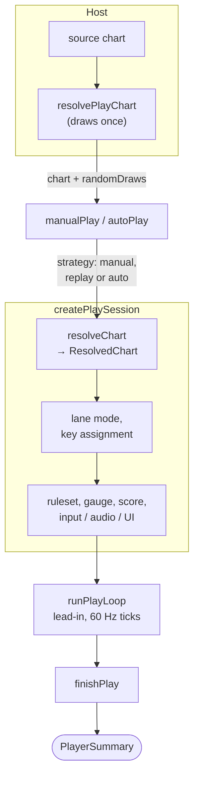
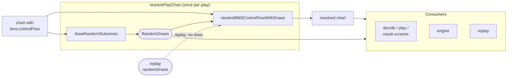
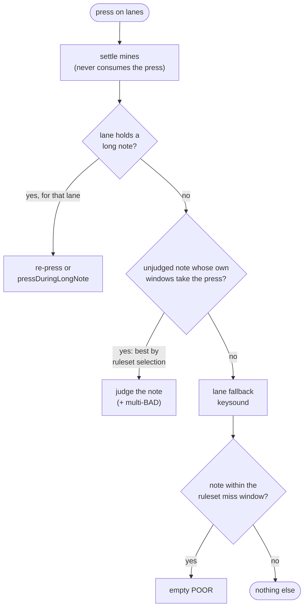
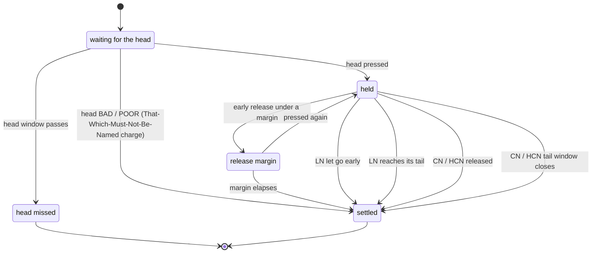

[Japanese version](./player-spec.ja.md)

# Player implementation specifications

This document defines the runtime specification for the shared `@be-music/player-engine` core engine.
Regarding the acceptance rules of musical score formats and the meaning of IR, priority is given to [`bms-spec.md`](./bms-spec.md), [`bmson-spec.md`](./bmson-spec.md), and [`json-spec.md`](./json-spec.md), and this document only deals with how the player plays, judges, and displays them.

## Purpose

- Consolidate the behavior of `@be-music/player-engine` by mode in one place.
- Clarify criteria for judgment, scores, gauges, audio, and display.
- Leave a compatibility policy that should be checked when changing the implementation.

## Scope

This document covers the results returned by `autoPlay()` and `manualPlay()`, as well as the judgment, display, and audio processing they use internally.
Invocation methods such as `@be-music/player-terminal` CLI arguments, configuration file persistence, and Node worker communication are not covered.
The terminal player and browser player reuse the same chart semantics for timing, notes, BGA cues, score, and results. Terminal UI behavior is documented separately in [Terminal player implementation notes](./player-tui.md), while PixiJS scenes, LR2/beatoraja skin rendering, browser file loading, and WebAudio lifecycle are documented in [Browser player implementation notes](./player-web.md).

The core engine defaults to the `lr2` compat ruleset and its `GROOVE` gauge, which corresponds to LR2's `NORMAL`
gauge. Both are options: `PlayerOptions.judgeRuleset` picks the ruleset and `PlayerOptions.gauge` the gauge, and
`bms-player` exposes them as `--ruleset` and `--gauge`.

## Entry points

`@be-music/player-engine` exports designed entries, not its file layout ([ADR 0005](./adr/0005-public-entry-points.md)):

| Entry                     | What it exports                                                                                                                                                                                                                                                                                                                                                   |
| ------------------------- | ----------------------------------------------------------------------------------------------------------------------------------------------------------------------------------------------------------------------------------------------------------------------------------------------------------------------------------------------------------------- |
| `@be-music/player-engine` | The engine: `manualPlay`, `autoPlay`, `PlayerOptions` with its five category types, `PlayerSummary`, the load progress, `PlayerInterruptedError`, the runtime contracts (`AudioSession`, `PlayerInputRuntime`, `PlayerUIRuntime` and their `Create*Context` types), `resolvePlayChart`, `preparePlaybackChart`, `resolveChartRulesetFacts` and `createTempoClock` |
| `./signals`               | What a host's input and UI runtimes exchange with a running play: the input bus and its commands, the UI bus with its frames, commands and `PlayerGaugeSummary`, the state signals, and the high-speed range and actions                                                                                                                                          |
| `./lanes`                 | The lanes of a play mode: the layout and its slots, scratch and wheel lanes, key bindings, FREE ZONE input, and the lanes the lane options permute                                                                                                                                                                                                                |
| `./display`               | What a host shows: the timed play notes (`extract*`, `toTimed*`), `ScrollDistanceMapper`, the BGA cue on screen (`pickActiveBGACue`, `pickActiveBGAKey`, `DEFAULT_POOR_BGA_DISPLAY_SECONDS`), the chart facts a song screen shows (`resolveDisplayed*`), `formatSeconds`, `resolveAltModifierLabel`, the TUI note heights and the BGA resize algorithms           |
| `./ruleset`               | The vocabulary hosts, skins and the Leaderboard share: the judge ruleset ids (`RULESET_IDS`), the judge windows, gauges, clear lamps, BP and the score                                                                                                                                                                                                            |
| `./replay`                | The replay format, its recorder, simulator and eligibility checks, and the course and NONSTOP logs                                                                                                                                                                                                                                                                |
| `./records`               | Best records per judge ruleset and the rules that keep them                                                                                                                                                                                                                                                                                                       |
| `./course`                | Course definitions: LR2 `.lr2crs`, beatoraja courses and table courses, the course maker, and NONSTOP runs                                                                                                                                                                                                                                                        |

The chart-layer names come from `@be-music/chart-model`: `ChartPlayVariant`, `LongNoteMode`, the timelines and their points, `BGACue` and the BGA timeline builders, the timing resolver and the sample triggers. Everything else in the package is internal.

## Node audio adapter

The engine opens audio only through `PlayerOptions.createAudioSession`. Omitting the factory or returning `undefined` plays silently. `audio: false` skips the factory. The factory receives the engine's `resolvedChart`, preserving its timing, sample slices and source-event identities.

Install `@be-music/player-node-audio` for Node playback. Its root exports `createNodeAudioSession` and `loadNodeAudioSampleDurations`; PCM sinks moved from `@be-music/player-engine/audio-sink` to `@be-music/player-node-audio/audio-sink`. The terminal player installs this adapter automatically. Browser hosts keep their own adapter.

```typescript
import { autoPlay } from '@be-music/player-engine';
import { createNodeAudioSession, loadNodeAudioSampleDurations } from '@be-music/player-node-audio';

await autoPlay(chart, {
  audioBaseDir: chartDirectory,
  createAudioSession: createNodeAudioSession,
  loadAudioSampleDurations: loadNodeAudioSampleDurations,
});
```

`loadAudioSampleDurations` supplies sample lengths for optional active-audio diagnostics, including playback with audio disabled. Without it, diagnostics use chart-defined slice lengths or the existing short estimate and perform no file reads or decoding. See [ADR 0011](./adr/0011-host-provided-audio.md).

## BMS compatible range

This section classifies the BMS commands and channels that appear in the primary reference in [`bms-spec.md`](./bms-spec.md) relative to the current `player` implementation.
"Compatible" here means that the player refers to the value at runtime and reflects it in playback, judgment, display, song selection screen, preview, and loading screen.
Items that are only stored in the IR by the parser and not referenced by the player during execution are treated as unsupported.

### Supported channels

| channel                                                               | Handling in player                                                                                                                                                                                                                                                            |
| --------------------------------------------------------------------- | ----------------------------------------------------------------------------------------------------------------------------------------------------------------------------------------------------------------------------------------------------------------------------- |
| `#xxx01`                                                              | Play as BGM / sample trigger.                                                                                                                                                                                                                                                 |
| `#xxx02`                                                              | Reflected in time resolution and beat resolution as bar length.                                                                                                                                                                                                               |
| `#xxx03`, `#xxx08`                                                    | Reflected in time resolution as BPM change.                                                                                                                                                                                                                                   |
| `#xxx04`, `#xxx07`, `#xxx0A`                                          | Render as BGA base / layer / layer2.                                                                                                                                                                                                                                          |
| `#xxx06`                                                              | Treated as POOR BGA cue. Unless `#POORBGA` is `2`, `#BMP00` is used as fallback.                                                                                                                                                                                              |
| `#xxx09`                                                              | Reflects in time resolution as STOP.                                                                                                                                                                                                                                          |
| `#xxx11-19`, `#xxx21-29`                                              | Treated as visible performance notes. `16` / `26` is scratch, `17` / `27` is FREE ZONE except for 9KEY / 24KEY, and normal note for 9KEY / 24KEY.                                                                                                                             |
| `#xxx1A-1O`, `#xxx2A-2O`                                              | Treated as visible performance notes — lanes 10..24 of the 24-key (Keyboardmania) bank. A single one of these channels classifies the chart as `24 KEY SP` / `48 KEY DP`.                                                                                                     |
| `#xxx1P`, `#xxx1Q`, `#xxx2P`, `#xxx2Q`                                | Treated as visible performance notes on the 24 / 48 KEY wheel: `1P` / `2P` turn it up, `1Q` / `2Q` down (be-music's BMS convention for the bmson `keyboard-24k` wheel, `x` = 25 / 26). They classify the chart as `24 KEY SP` / `48 KEY DP` like the other extended channels. |
| `#xxx31-39`, `#xxx41-49` (and the extended `#xxx3A-3O` / `#xxx4A-4O`) | Treated as invisible notes. They update the corresponding lane's manual keysound state like visible notes, and may be used for display aids, but are not included in `summary.total`. `AUTO` does not produce a sound.                                                        |
| `#xxx51-59`, `#xxx61-69` (and the extended `#xxx5A-5O` / `#xxx6A-6O`) | Treated as BMS legacy long note.                                                                                                                                                                                                                                              |
| `#xxx97`, `#xxx98`                                                    | Treated as a dynamic volume change that changes the initial gain of the BGM/playable sound that plays after that.                                                                                                                                                             |
| `#xxxA0`                                                              | Treated as a dynamic judgment width change that refers to `#EXRANKxx`.                                                                                                                                                                                                        |
| `#xxxSC`                                                              | Reflects in the drawing distance as a scroll segment of the `#SCROLLxx` reference.                                                                                                                                                                                            |
| `#xxxSP`                                                              | Reflects in the drawing distance as a speed keyframe of `#SPEEDxx` reference.                                                                                                                                                                                                 |
| `#xxxD1-D9`, `#xxxE1-E9` (and the extended `#xxxDA-DO` / `#xxxEA-EO`) | Treated as a landmine.                                                                                                                                                                                                                                                        |

### Supported commands

| command                                                                                                                                 | Handling in player                                                                                                                                                                                                                                                       |
| --------------------------------------------------------------------------------------------------------------------------------------- | ------------------------------------------------------------------------------------------------------------------------------------------------------------------------------------------------------------------------------------------------------------------------ |
| `#TITLE`, `#SUBTITLE`, `#ARTIST`, `#SUBARTIST`, `#GENRE`, `#COMMENT`                                                                    | Used to display metadata on the song selection screen. `#TITLE` / `#ARTIST` / `#GENRE` are also used for TUI and results screens.                                                                                                                                        |
| `#BANNER`                                                                                                                               | Used to display the banner on the song selection screen. bmson uses `info.banner_image` for the same purpose.                                                                                                                                                            |
| `#STAGEFILE`                                                                                                                            | Used as a dedicated image for the loading screen after song selection. It is not referenced by the BGA renderer during gameplay.                                                                                                                                         |
| `#PLAYLEVEL`, `#DIFFICULTY`                                                                                                             | Used to display, sort, filter, and display the results of the song selection screen.                                                                                                                                                                                     |
| `#BPM`, `#BPMxx`, `#STOPxx`, `#STP`                                                                                                     | Used for time resolution.                                                                                                                                                                                                                                                |
| `#RANK`, `#DEFEXRANK`, `#EXRANKxx`, `#TOTAL`                                                                                            | Used for judgment range, display rank, groove gauge calculation.                                                                                                                                                                                                         |
| `#WAVxx`, `#BMPxx`                                                                                                                      | Used for audio/BGA resource resolution.                                                                                                                                                                                                                                  |
| `#BASE`                                                                                                                                 | Selects the BMS object ID base. `#BASE 62` keeps lowercase IDs case-sensitive when resolving samples, BGA, BPM/STOP references, long-note ends, and landmine values.                                                                                                     |
| `#PREVIEW`                                                                                                                              | Used preferentially for preview playback on the song selection screen.                                                                                                                                                                                                   |
| `#PATH_WAV`                                                                                                                             | Tried as a directory prefix before the bare path when browser gameplay and the offline renderer (`renderJSON`) resolve samples; the song selection screen preview also uses it to search for files. The terminal player does not apply it when loading samples for play. |
| `#LNTYPE`, `#LNMODE`, `#LNOBJ`                                                                                                          | Used to interpret BMS long notes.                                                                                                                                                                                                                                        |
| `#PLAYER`                                                                                                                               | Used for mode estimation and display player lane metadata.                                                                                                                                                                                                               |
| `#VOLWAV`                                                                                                                               | Used as a volume multiplier for the entire score.                                                                                                                                                                                                                        |
| `#POORBGA`                                                                                                                              | `0` (also missing/invalid) replaces the BGA with the POOR image during a miss; `1` draws POOR over the normal layers; `2` hides both explicit channel-06 POOR cues and the `#BMP00` fallback.                                                                            |
| `#SCROLLxx`, `#SPEEDxx`                                                                                                                 | Used to calculate note drawing distance.                                                                                                                                                                                                                                 |
| `#RANDOM`, `#SETRANDOM`, `#IF`, `#ELSEIF`, `#ELSE`, `#ENDIF`, `#ENDRANDOM`, `#SWITCH`, `#SETSWITCH`, `#CASE`, `#SKIP`, `#DEF`, `#ENDSW` | Resolved as control syntax before playback starts.                                                                                                                                                                                                                       |

### Unsupported channels

| channel                                                                         | Current player implementation                                                                                                                       |
| ------------------------------------------------------------------------------- | --------------------------------------------------------------------------------------------------------------------------------------------------- |
| `#xxxA6`                                                                        | It is not supported as a runtime reflection channel for `#CHANGEOPTIONxx`. Even if it is kept as an event, the player runtime does not refer to it. |
| Other object channels that are not included in the above list of correspondence | Even if the parser holds them, the player runtime does not interpret them.                                                                          |

### Unsupported commands

| command                                                                                                                                     | Current player implementation                                                                                                                                                                                                                                                                                        |
| ------------------------------------------------------------------------------------------------------------------------------------------- | -------------------------------------------------------------------------------------------------------------------------------------------------------------------------------------------------------------------------------------------------------------------------------------------------------------------- |
| `#TEXTxx`, `#TEXT00`                                                                                                                        | The parser is retained, but it is not used for player display or runtime performance.                                                                                                                                                                                                                                |
| `#OPTION`, `#CHANGEOPTIONxx`                                                                                                                | Parser is retained, but forced play-option changes are not supported by the core runtime.                                                                                                                                                                                                                            |
| `#WAVCMD`, `#EXWAVxx`                                                                                                                       | Browser, Node and offline playback apply WAVCMD pitch/percentage volume/sounding-time limits and EXWAV filename/volume/balance/frequency. Command 02 is duration, not looping. See [ADR 0024](./adr/0024-extended-bms-audio.md) for native rates, slot buffers and tempo preparation.                                |
| `#BACKBMP`                                                                                                                                  | The core/terminal runtime has no dedicated behavior for this command. Browser LR2 special graphics can use it.                                                                                                                                                                                                       |
| `#MAKER`                                                                                                                                    | Metadata-only/unsupported.                                                                                                                                                                                                                                                                                           |
| `#EXBMPxx`, `#BGAxx`, `#SWBGAxx`, `#ARGBxx`                                                                                                 | Browser and terminal apply EXBMP still-image and opaque-video color keys, BGA sub-regions, fractional source-image alpha, A1–A4 ARGB and input-bound A5 SWBGA (including video crops). NONSTOP hosts supply remapped SWBGA selections; exact nanasigroove parity remains unverified; see [BMS support](bms-spec.md). |
| `#BASEBPM`                                                                                                                                  | The parser is retained, but the player is not used for time resolution.                                                                                                                                                                                                                                              |
| `#VIDEOFILE`                                                                                                                                | The parser is retained, but it is not used for BGA video resolution in the player. Real-world video playback only handles video files referenced with `#BMPxx`.                                                                                                                                                      |
| `#MIDIFILE`, `#MATERIALS`, `#DIVIDEPROP`, `#CHARSET`                                                                                        | Retains the parser but does not refer to the player runtime.                                                                                                                                                                                                                                                         |
| `#SONGxx`, `#EXBPMxx`, `#CHARFILE`, `#ExtChr`, `#CDDA`, `#VIDEOFPS`, `#VIDEODLY`, `#VIDEOCOLORS`, `#SEEK`, `#MATERIALSBMP`, `#MATERIALSWAV` | Not supported by the current player implementation.                                                                                                                                                                                                                                                                  |

## Execution flow

player executes the score in the following order:

1. Take the chart the host resolved for this play (`resolvePlayChart`); a chart that still carries control flow is resolved once with `PlayerOptions.randomDraws`.
2. Resolve the branched score once with `resolveChart` (`@be-music/chart-model`, see [Architecture](./architecture.md)) and take the performance notes, mines, invisible notes, real-time audio triggers, tempo map and chart facts from the resulting `ResolvedChart`.
3. Confirm the lane mode from the branched score (see [Lane mode and input](#lane-mode-and-input)), then the key assignment and lane FREE ZONE alias from the actual channels.
4. Initialize gauges, scores, UI state, input runtime, and audio runtime.
5. Run the one play loop (`play-loop.ts`) with the play's judge strategy — manual (AUTO SCRATCH included), replay (`replayInputs`) or AUTO — and return `PlayerSummary` at the end.

The same steps as a flow (`play.ts`, `play-session.ts`, `play-loop.ts`, `play-finish.ts`):



In addition to the regular `#STOPxx`, time resolution also treats the BMS extension `#STP` as a stop event.
Of several `#STOPxx` objects at one position the last one wins, as in LR2 and beatoraja; bmson `stop_events` on one pulse add up, as the bmson spec says.
`#STP` interprets `xxx[.yyy] zzzz` as a stop of `zzzz ms` at `yyy / 1000` position of `measure xxx`, and multiple definitions at the same position are added together. If `.yyy` is omitted, it is treated as `000`. Malformed `bms.stp` elements are retained in the IR but ignored by the player's time resolution.

## Handling control syntax

BMS's `#RANDOM` / `#SETRANDOM` / `#SWITCH` control syntax is resolved once per play, by the host, before playback starts.

The outcome of a play is an explicit value, `RandomDraws` (`@be-music/chart-model`): one entry per `#RANDOM` / `#SETRANDOM` / `#SWITCH` / `#SETSWITCH` line in file order, each with the line's command, its `range` (the number of outcomes) and the `value` in force after it.

- Every such line has an entry, including the ones nested in a branch that is not taken: the evaluator walks every directive whatever the branch state.
- `#RANDOM n` / `#SWITCH n` draw `value` from `1..n`. A missing, zero, negative or non-numeric `n` is a single-outcome line: `range` 1, `value` 1, and it does not consume the random source.
- `#SETRANDOM n` / `#SETSWITCH n` fix `value` to `n` (1 when `n` is missing or not positive), with `range` 1; they draw nothing.

The single resolution point is the pair `drawRandomOutcomes(chart, random)` → `RandomDraws` and `resolveBMSControlFlowWithDraws(chart, draws)` (`@be-music/chart-parser`) → resolved chart, wrapped for hosts as `resolvePlayChart(chart)` (`@be-music/player-engine`), which returns `{ chart, randomDraws }`.
The branch semantics (one shared stack, an open `#IF` outliving `#ENDRANDOM`, definitions in a taken branch applying to the whole chart) live once in `evaluateControlFlow` (`@be-music/chart-model`).
The same chart and draws always resolve to the same result, and draws that were not drawn for the chart are rejected with a `RangeError`.
A resolved chart carries no `bms.controlFlow`, so resolving it again changes nothing.

The chart and its draws travel together from the host's single draw to every consumer:



Every host draws once and hands the same chart and draws to every consumer of the play: the CLI to the preview render and the gameplay worker, the web player to the decide screen, the play screen, the engine and the result screen.
A restart draws again, as LR2 and beatoraja re-roll each play.
The engine (`autoPlay` / `manualPlay`) never draws: it plays a resolved chart as is, taking `PlayerOptions.randomDraws` only for the RANDOM summary.
Handed a chart that still carries control flow together with `randomDraws` (for example a replay's draws against the source chart), it resolves the chart exactly once with them; handed one without draws, it throws a `TypeError` instead of rolling branches nobody outside the engine knows about.

A replay records the draws as `play.randomDraws`, and a replay hands them back as `PlayerOptions.randomDraws` (see [Replay](./replay.md)).

The RANDOM summary is derived from the draws.
`#SETRANDOM` is shown as a fixed value, and if there are multiple RANDOM types, they are formatted as `RANDOM #1 2/3  #2 1/2` in the order of declaration.

## Note model

### Notes to be played

The notes come from the resolved chart (`ResolvedChart.notes`, `resolveChart` in `@be-music/chart-model`), which normalizes the IR `events` into a sequence of notes with beats/seconds; the engine copies them into play notes (`preparePlaybackChart`) that carry the per-play state.
Only the playable channel is included, and each note has at least the following information:

- `channel`
- `beat`
- `seconds`
- `judged`
- `endBeat` / `endSeconds` / `longNoteMode` as required

### Long Note

The player handles long notes by normalizing them to "1 note from the starting point + information about the ending point."
bmson's `l`, FREE ZONE (`17` / `27`), BMS's `#LNOBJ`, and BMS legacy LN (`#mmm51-69`) all fold into this shape.

The terminal object of `#LNOBJ` itself is not left in the performance note string.
Therefore, both LNs derived from `#LNOBJ` and LNs derived from `#mmm51-69` are worth 1 note per book on the player.

### Duplicate notes

A lane holds at most one note per position, as in beatoraja, whose timeline keeps one note per lane.
When several notes start on the same lane and position (two BMS object lines writing the same cell, a tap on the start of a `#mmm51-69` / `#LNOBJ` long note, or layered bmson notes with the same `x` and `y`), only one is judged:

- A long note wins over a tap. beatoraja also replaces a tap with a `5x` / `6x` long note that starts on it.
- Otherwise the first note in event order wins: the lowest object ID for BMS, the first sound channel for bmson. For bmson this is the note beatoraja judges. For BMS, beatoraja keeps the later line of the file instead, but the IR does not record line order. LR2's choice is not known.

The other notes are not judged, drawn, or counted in `summary.total`. For BMS, their keysounds play at their own time as background audio in manual play (AUTO already sounds every play-lane object), unless they use the kept note's `#WAVxx`.
For bmson, one judged note holds all constituent source events in `soundEvents`, including the representative `event`. Every slice sounds on that note's press, including early/late input, lane fallback and replay; a missed note sounds none. AUTO schedules all constituent slices at chart time. Layers with unequal lengths are invalid and throw a `RangeError` during resolution; a tap layered with a long note is invalid too.
The resolved chart returns the remaining source notes as `shadowedNotes` for inspection (`extractTimedNotes` too); a bmson host must not schedule them as BGM.
Landmines and invisible notes are not collapsed.

### Landmines

Mine channels are mapped to their corresponding playable lane and kept in a separate array.
Mines are not included in `summary.total`.

When a mine detonates belongs to the judge ruleset (`mineTrigger` in [`definitions.ts`](../packages/player-engine/src/ruleset/definitions.ts)); the engine and the replay simulators apply the same rule. The damage model is the same everywhere (confirmed against beatoraja's `JudgeManager`).

- `lr2` ruleset — LR2beta3 executable behavior: a key-down hits a mine from the judge line up to, but excluding, the early GREAT boundary. A held key detonates at crossing. A passed mine retires at the first poll; late presses and held-key early-window entry do not detonate it.
- `beatoraja` ruleset — beatoraja's model (`JudgeManager` L244): a mine explodes only when **the lane's key is down at the moment the mine crosses the judge line**. A press shortly before (released before the crossing) or after does nothing.
- "Held" is read off each lane's recorded presses and releases, so live play, replays and the simulators agree however late the mine is settled; a lane held by two keys stays held while either is down. An input at the very instant of a crossing counts before the crossing: a key pressed at that µs is down, one released at that µs is up. For input that sends no releases the engine infers them before the judge sees the press, holding the lane for 120 ms after each press (380 ms after one that hits a long note's head) ([Input without key releases](./replay.md#input-without-key-releases)).
- `____` ruleset — That-Which-Must-Not-Be-Named has no mines. Its existing provisional symmetric PGREAT press/hold model is retained; it is not evidence of That-Which-Must-Not-Be-Named behavior.
- Every explosion drains the gauge and plays `#WAV00`. LR2 also increments POOR/BP once, without a judgment cue, combo break, EX-SCORE change or extra ordinary-POOR gauge damage. `minePoor` records the hits already included in `poor`, so they never replace unjudged notes in course BP. beatoraja and the provisional That-Which-Must-Not-Be-Named model keep gauge-only accounting. Note judgment runs independently; a mine never consumes a nearby note press.
- Damage interprets the mine object value (upper-case base36) **directly as a percentage** (LR2 / beatoraja behavior; this differs from the nanasi-lineage `value / 2` rule). A bmson mine with `mine_channels[].notes[].damage` uses that value instead; a bmson mine without `damage` deals the default `4%` (its object value is the WAV slot the parser assigned, not a damage encoding, so it is never read as damage).
- Mine damage bypasses the HARD sub-30% softening and the `#TOTAL` damage multiplier (same as beatoraja's direct `gauge.addValue()`).
- `ZZ` (= 1295 %) instantly FAILs survival gauges (HARD / DEATH); GROOVE / EASY stop at the `2%` floor.
- kitty keyboard protocol input uses the real press/release state; release-less input has its releases inferred first (`play-key-inference.ts`), so the judge always reads a press/release state.

### Invisible Note

Invisible notes are kept separate from the normal playing target.
They update the same-lane keysound fallback state using the same timing rule as visible notes: once the invisible object's early `BAD` window opens, that WAV becomes the lane's current fallback sound until a later visible or invisible object takes over.
They are included in the UI drawing target only when `showInvisibleNotes` is enabled, but are not included in the number of judgments or `summary.total`.
bmson `key_channels` (beatoraja's hidden notes) are read as invisible notes, and `AUTO` and the select-screen preview stay silent on them on every lane, the extended 24 / 48 KEY lanes included.

### FREE ZONE

FREE ZONE (`17` / `27`) is treated as a note with a 1 beat ending.
It is excluded from the normal score/gauge target and treated as a keysound fallback and a drawing aid target.
It has no judging effect: a scratch press during it is judged as any other press and can charge an empty `POOR`, as in
LR2 and beatoraja (both drop channel `17` / `27` from 7-key and 14-key charts) and That-Which-Must-Not-Be-Named (which never had FREE ZONE; it
belongs to beatmania 1st / 2ndMIX).
This only applies to the That-Which-Must-Not-Be-Named families — under `9 KEY` and the `24 KEY` / `48 KEY` keyboard modes those channels are
ordinary key columns, so they keep whatever length the chart authored (a plain tap stays a tap).

## Lane mode and input

The lane mode comes from one rule shared by every host: `resolveChartPlayVariant` in `@be-music/chart-model`, run over the
branched score's events, `bms.player`, the bmson `mode_hint`, and the chart extension (`PlayerOptions.laneModeExtension`).
A bmson `keyboard-24k` / `keyboard-24k-double` hint selects `24 KEY SP` / `48 KEY DP` outright, so a keyboard chart that
only uses its first nine keys is not read as 7 / 9 KEY; every other hint leaves the decision to the lanes. A host that already
knows the variant can declare it with `PlayerOptions.playVariant`. Lane usage counts the `1x` / `2x` lane channels and
the `5x` / `6x` `#LNTYPE` long-note channels; mines and invisible objects never change the lane mode, so they cannot
switch the beatoraja ruleset between its 5 KEY and 7 KEY judge windows. The detection order is listed in
[BMS spec — Player-Specific Behavior](./bms-spec.md#player-specific-behavior). Only `.pms` names a mode; every other
extension leaves the decision to the lanes in use, so a `.bme` chart without a 6 / 7 key column is `5 KEY SP` /
`5 KEY DP`, as in beatoraja.
The decision is drawn as a flowchart in [README — Automatic lane mode determination](../README.md#automatic-lane-mode-determination-and-input-assignment).
The main modes the current implementation determines automatically are as follows.

- `5 KEY SP`
- `5 KEY DP`
- `7 KEY SP`
- `14 KEY DP`
- `9 KEY (PMS-STD / PMS-COMPAT)`
- `24 KEY SP`
- `48 KEY DP`
- `N KEY GENERIC` (1–70)

Channels that do not exist in a known fixed layout will fallback to unused keys in order.
In beat-family layouts, FREE ZONE also shares the input tokens of the corresponding scratch lanes (`17 -> 16`, `27 -> 26`).

`24 KEY SP` / `48 KEY DP` are the Keyboardmania-style keyboard modes. Each side has 26 lanes: 24 keys on channels
`11..19` + `1A..1O` (`21..29` + `2A..2O` for the 2P side) and the wheel, up on `1P` and down on `1Q` (`2P` / `2Q`).
There is no scratch column. The keys are laid out left to right in ascending channel order, and the wheel sits on the
side's outer edge where the That-Which-Must-Not-Be-Named modes keep their scratch: left of the 1P keys, right of the 2P keys. Detection is
content-based: one extended lane channel (the wheel included) selects the mode ahead of every other rule, including the
`.pms` extension and the `#PLAYER 3` + `17` POPN-9 signature, and a bmson keyboard `mode_hint` selects it outright.

The wheel is judged exactly like a key (the beatoraja ruleset's keyboard judge windows, no scratch-specific handling),
it is not FREE ZONE, and the lane options (MIRROR / RANDOM / S-RANDOM) move the 24 keys of a side but leave the wheel in
place, as they do the scratch. The 24 SP keys take the fallback key layout in order
(`a s d f g h j k l ; q w e r u i o p z x c v b n`); the wheel has its own keys on the keyboard's edges, off that pool
and off the arrow keys the web player uses for hi-speed: `Tab` / left `Shift` turn the 1P wheel up / down, `Enter` /
right `Shift` the 2P wheel. (beatoraja plays the wheel from a MIDI controller's pitch bend; be-music has no MIDI input.)
A 48-key DP chart runs past the printable-key pool and the tail of its keys lands on function keys, which is a
deliberate trade — 48 keys are an AUTO PLAY / rendering target, not a hand-playable one.

The default keyboard layout for the That-Which-Must-Not-Be-Named series is 1P as `Z S X D C F V` and 2P as `B H N J M K ,`.
For scratch, 1P is left `Shift`, 2P is right `Shift`.
For reverse scratch, 1P uses left `Ctrl` and 2P uses right `Ctrl`. On macOS, use left/right `Option` instead of `Ctrl`.

Distinguishing between left/right `Ctrl` and left/right `Option` is done using the kitty keyboard protocol.
If you fall back to a terminal that does not support kitty, side-specific input of reverse scratch is not guaranteed.

`generic-Nkeys` bmson charts use `N KEY GENERIC` with 1–70 equal-width normal keys on one side. The declared count remains authoritative for sparse charts and takes precedence over channel-based mode detection. Channels `16` / `17` / `26` / `27` are ordinary keys; there is no scratch, wheel, FREE ZONE alias or DP bank. Default tokens use the existing 28-key pool, then digits `1..0`, `t y - = [ ] \` and backquote, followed by `F1..F24`. Browser input recognizes those codes; a bound F5 is a lane key, and an unbound F5 restarts. Terminal stateful function-key events retain press, repeat and release through kitty and Win32 input modes. Large layouts need suitable hardware or custom input and a sufficiently wide terminal; a binding does not imply that a conventional keyboard can press a full chord.

Native, Canvas and LR2 use uniform fallback columns. A beatoraja skin contributes its note-area bounds, divided into N equal columns with normal-key fallback notes, rather than assigning its scratch image to a generic key. Terminal uses normal white-key coloring. In the beatoraja ruleset, generic layouts use keyboard judgment windows and default TOTAL independently of N. Beat-specific BATTLE / SP TO DP conversions remain unavailable. A NONSTOP course may retain one generic count throughout; a different generic count or a beat/keyboard stage is rejected as `generic-layout-mismatch`. These Be-Music policies are recorded in [ADR 0023](./adr/0023-generic-bmson-keyboards.md).

### Play-mode table

Every play mode is declared once, in `PLAY_MODE_LAYOUTS` ([`chart/src/play-modes.ts`](../packages/chart-model/src/play-modes.ts),
exported by `@be-music/chart-model`). For each layout it lists the lanes left to right, each with its kind (key, scratch, wheel
up / down), side, slot (key number, `0` for the scratch, `25` / `26` for the wheel), colour class, and the BMS channels of
every object family on it (visible `1x` / `2x`, invisible `3x` / `4x`, `#LNTYPE` `5x` / `6x`, mine `Dx` / `Ex`, the
extended `A`..`Q` lanes included), plus the FREE ZONE channels it plays on its scratch. The bmson `mode_hint` lane tables
(`BMSON_MODE_HINT_LAYOUTS`) are built from the same layouts. The parser, the chart-writer, `resolveChartPlayVariant`, the
player's lane layout and lane options, the CLI's lane colours, and the skin SDK's lane kinds all derive from it.

| Layout  | Label                | Lanes, left to right                                                         | bmson `mode_hint`     |
| ------- | -------------------- | ---------------------------------------------------------------------------- | --------------------- |
| `5`     | `5 KEY SP`           | `16` (scratch), `11`-`15`                                                    | `beat-5k`             |
| `7`     | `7 KEY SP`           | `16` (scratch), `11`-`15`, `18`, `19`                                        | `beat-7k`             |
| `9-pms` | `9 KEY (PMS-STD)`    | `11`-`15`, `22`-`25`                                                         | `popn-9k`             |
| `9-bme` | `9 KEY (PMS-COMPAT)` | `11`-`19`                                                                    | —                     |
| `10`    | `5 KEY DP`           | `16` (scratch), `11`-`15`, `21`-`25`, `26` (scratch)                         | `beat-10k`            |
| `14`    | `14 KEY DP`          | `16` (scratch), `11`-`15`, `18`, `19`, `21`-`25`, `28`, `29`, `26` (scratch) | `beat-14k`            |
| `24`    | `24 KEY SP`          | `1P` / `1Q` (wheel), `11`-`19`, `1A`-`1O`                                    | `keyboard-24k`        |
| `48`    | `48 KEY DP`          | as `24`, then `21`-`29`, `2A`-`2O`, `2P` / `2Q` (wheel)                      | `keyboard-24k-double` |

### Available lane options

New plays offer OFF, MIRROR, RANDOM and S-RANDOM. SCATTER is disabled until its previous-row/LN placement constraints and assist/record policy are implemented together. A direct new SCATTER request fails before chart preparation or replay recording; it never silently draws RANDOM. Legacy replay files may still contain the SCATTER name and their resolved channels continue to replay unchanged.

### S-RANDOM arrangement

`randomizeSRandomNotes` (`@be-music/player-engine/lanes`) is a runtime-neutral pure helper: it takes resolved event times in milliseconds, a complete mode/side key domain, the selected judge ruleset and an injected random source, and returns channels in input order without mutating notes. The browser applies the channels to the same note objects the engine judges, preserving long-note endpoints. Scratch/wheel and other-side events stay fixed.

| Rule                      | LR2 and provisional That-Which-Must-Not-Be-Named                     | beatoraja                                                                     |
| ------------------------- | -------------------------------------------------------------------- | ----------------------------------------------------------------------------- |
| Active LN                 | Reserve its destination through the tail row                         | Preserve its source/destination map through the tail row                      |
| Ordinary notes            | Choose unused, unheld destinations                                   | Prefer destinations more than 40 integer ms after their previous scoring note |
| Insufficient jack spacing | No jack threshold                                                    | Use the oldest available destinations, choosing ties randomly                 |
| Mines and hidden notes    | Mines choose free destinations; hidden notes follow their source map | Follow the timeline permutation without updating jack times                   |

The selected judge ruleset controls these rules independently of the drawing family. Complete domains include both PMS encodings and 5/7/9/10/14/24/48-key modes. An impossible LR2 row with more events than free destinations fails explicitly instead of retrying indefinitely. Record the resolved channels; replay playback applies those channels rather than drawing again, so older recordings retain their arrangement.

## Compat rulesets

**The player has no judge logic of its own.** Every play runs under one of three compat rulesets — `lr2` (the
default), `beatoraja`, or `____` — chosen with `PlayerOptions.judgeRuleset`. The ruleset owns the judge windows,
which note a press resolves against, the long-note style, the empty-POOR rule, the gauge line-up and its curve,
and the score formula. The tables and their primary sources live in
[`packages/player-engine/src/ruleset/definitions.ts`](../packages/player-engine/src/ruleset/definitions.ts) and are compared
side by side in [`docs/replay.md`](./replay.md).

The same tables drive the live engine and the replay simulator, and an equivalence suite requires the two to
agree judge for judge on the same recorded input stream.

The rest of this chapter describes the **`lr2` ruleset**, which is the default.

## Judgment width

### Window shape

A window is a signed `[late bound, early bound]` pair in microseconds, resolved per lane kind (key vs scratch) and
per context (note vs long-note end). LR2 uses one table for all four contexts; beatoraja widens scratch by 10 ms
per judge and gives long-note ends their own table.

### Baseline widths

The player bases its windows on LR2's measured judgment widths (hitkey's diary entry of 2015-01-19; they match lr2oraja's LR2-compatible table).

| `#RANK`         | `PGREAT`                                            | `GREAT` | `GOOD`   | `BAD`    |
| --------------- | --------------------------------------------------- | ------- | -------- | -------- |
| `0` `VERY HARD` | `±8ms`                                              | `±24ms` | `±40ms`  | `±200ms` |
| `1` `HARD`      | `±15ms`                                             | `±30ms` | `±60ms`  | `±200ms` |
| `2` `NORMAL`    | `±18ms`                                             | `±40ms` | `±100ms` | `±200ms` |
| `3` `EASY`      | `±21ms`                                             | `±60ms` | `±120ms` | `±200ms` |
| `4` `VERY EASY` | Same as `NORMAL` (LR2 treats `#RANK 4` as `NORMAL`) |         |          |          |

The `BAD` width is fixed at `±200ms` regardless of rank or extension commands. Scratch uses the same widths as the keys.
The boundaries of `PERFECT` / `GREAT` / `GOOD` / `BAD` are determined by these four windows, walked inner to outer.
An input outside every window reaches no note: the lane keysound plays and the press falls through to the
empty-POOR path. `POOR` is a note that was missed outright.

### BMS initial judgment width

BMS determines the judgment range at the start of playback using the following priority order.

1. `#DEFEXRANK`
2. `metadata.rank` (`#RANK`)
3. Default value `#RANK 2`

`#DEFEXRANK` is treated as a percentage value.
`100` is the standard value and has the same width as `NORMAL`.
The player interprets `#DEFEXRANK` with `Number.parseFloat()` and only accepts values ​​​​that are finite and greater than `0`.

`#RANK` maps onto the internal judgerank percent axis `[25, 50, 75, 100, 75]` (`VERY HARD` = 25 / `HARD` = 50 / `NORMAL` = 75 / `EASY` = 100 / `VERY EASY` treated as `NORMAL`).
`metadata.rank` is interpreted by rounding down to an integer, and values ​​​​outside the range are invalidated and fallback to the default value.

### BMS conversion formula

Judgment widths are derived by piecewise-linear interpolation of the measured table above over the judgerank percent anchors (25 / 50 / 75 / 100) — the same model as lr2oraja's `JudgeWindowRule.LR2`.
`#DEFEXRANK n` converts to the percent axis as `n × 75 / 100`. For example `#DEFEXRANK 120` is percent `90` and yields `PGREAT=19.8ms`, `GREAT=52ms`, `GOOD=112ms`, `BAD=200ms` (fixed).
Values beyond `EASY` (percent `100`) extrapolate along the final segment; only `PGREAT` / `GREAT` / `GOOD` scale, and no width ever exceeds the fixed `BAD` gate of `±200ms`.

### BMS dynamic judgment width change

In BMS, you can use the `#xxxA0` channel and `#EXRANKxx` to change the judgment range during the performance.
The player resolves the event value of the `A0` channel as a key in `#EXRANKxx`, reads the value with `Number.parseFloat()`, and uses it only if it is finite and greater than `0`.
The adopted value shares `#DEFEXRANK`'s unit — a percentage with `RANK 2 = 100` as the baseline — so `#EXRANKxx 100` restores exactly the `NORMAL` judgment width.

If `#EXRANKxx` is undefined, an empty string, a non-number, or less than or equal to `0`, the event does not change the judgment width.
If there are multiple `A0` events, they are applied in chronological order, and the value reached later becomes the subsequent judgment width.

In the current implementation, this dynamic change is applied on the manual judgment side of `manualPlay()` and `AUTO SCRATCH`.
Normal `AUTO` treats all notes as `PERFECT`, so the judgment width derived from chart rank does not affect the score result.

After changing the dynamic judgment width, use the new `BAD` width for the next process.

- Input candidate note search
- Classification of `PERFECT` / `GREAT` / `GOOD` / `BAD` / `POOR`
- Missed note detection
- Determination of expiration of mines/invisible notes
- Determining the end point of a long note

Each judgment reads the width in force at its own instant, as LR2 reads its one global `judgetime[]`: a press (the
candidate search, its classification, the multi-BAD collector, a mine's press leg, a press on a held long note) uses the
width at the press, and a release (an LN's early release, a charge note's tail) the width at the release. A note's miss
deadline and a charge tail's late window use the width at the note and at the tail, and a mine's entry and settling
the width at the mine. The engine and the replay simulator read the same instants.

### bmson initial judgment width

bmson determines the judgment width using the following priority order.

1. `bmson.info.judgeRank`
2. `metadata.rank`
3. Default value `100`

bmson's `judgeRank` shares the `100 = NORMAL` percentage unit with `#DEFEXRANK` and converts through the same LR2 anchor interpolation.
Therefore `judgeRank=100` is exactly `NORMAL` (`±18/±40/±100/±200ms`).
The `beatoraja` ruleset uses `judge_rank` as the judgerank directly, and a bmson chart without it judges like
`judge_rank: 100` (the bmson default; PGREAT `±20ms` in 7 KEY), never like BMS `#RANK 2`.

In the current implementation, bmson does not have dynamic judgment width change equivalent to BMS's `#EXRANKxx`.

### Override for debugging

The `judgeWindowMs` option directly overrides only the `BAD` width.
`PGREAT` / `GREAT` / `GOOD` use the scaling result derived from rank as is.

This override applies not only to the initial judgment width but also after dynamic changes by `#EXRANKxx` in BMS.
This means that even if `#EXRANKxx` changes, the `BAD` width with debug overrides will always be that fixed value.

### Display treatment

The rank display resolved from the current chart is displayed on the song selection list, TUI, and result screen.
BMS with `#DEFEXRANK` will display that number, and normal `#RANK 0-4` will display the corresponding label.
Similarly, `PLAYLEVEL` uses the display value resolved from the chart, and if `#PLAYLEVEL` is omitted in BMS, it will give a BM98-compatible default value of `3`.
When `PLAYLEVEL` is `0`, player uses `?` for display. The string `PLAYLEVEL` is displayed as is, and decimal values ​​​​are also displayed without rounding.
`DIFFICULTY` only displays integers between `1-5`. In the song selection list, arrange them in the order of `PLAYER -> DIFFICULTY -> PLAYLEVEL -> filename`, use the keys `1-5` to switch the `DIFFICULTY` filter, and press `0` to cancel it. `DIFFICULTY` Unspecified values ​​​​or values ​​​​outside the range are not filtered and will be displayed as `-`.

A BMS that has dynamic changes using `#EXRANKxx` will have a displayed rank of `RANDOM`.
This is because the judgment range changes midway through the score, and it cannot be expressed with a single fixed label.

However, there is still no ability to dynamically update the TUI's `BAD` width display after play has started.
The `Judgment window (<ruleset id>): ...` line that appears on the current TUI/standard output only displays the width at the start of playback.

## Judgment words and side effects

### `PERFECT` / `GREAT` / `GOOD`

These are success tests.
When the judgment is confirmed, do the following:

- Increment the corresponding `summary` counter.
- Add EX-SCORE.
- Increase combo by 1.
- Update score.
- Add groove gauge.

`FAST` / `SLOW` records only `GREAT` and `GOOD`.
`PERFECT` does not increase FAST/SLOW.

### `BAD`

`BAD` is a failure judgment.
When the judgment is confirmed, do the following:

- Add `summary.bad`.
- Set combo back to 0.
- Update score.
- For ordinary note `BAD`, set groove gauge to `-4`.

### `POOR`

`POOR` is a failure for the note being played.
Occurs when a note passes the `BAD` window without being hit.

When `POOR` occurs, do the following:

- Add `summary.poor`.
- Set combo back to 0.
- Set groove gauge to `-6`.
- Fire POOR BGA. The miss layer stays visible for 500 ms — the shipped default of LR2 (`<poorbga>500</poorbga>` in its `config.xml`) and of beatoraja (`misslayerDuration`). On a beatoraja skin the window runs from the miss whatever is judged meanwhile, and outside it the layer draws over the base, as `BGAProcessor` does.
- Update judge/combo display to `POOR`.

### Blank keystroke (no candidate) — LR2-compatible empty POOR

If there is an input but no undecided notes inside the `BAD` window for that lane set, fire an LR2-compatible "empty POOR" (空POOR).

A press goes through these steps in the judge core (`judge-core-press.ts`); the rules for each step follow.



- The trigger condition is that a note on the same lane falls inside the **ruleset's miss window**. LR2's is `{0, 1 s}` (lr2oraja's `JudgeProperty` LR2 miss window — fixed, independent of rank / EXRANK), so under `lr2` an empty POOR never fires after a note passes and a press with no note within the next second is harmless: only the keysound plays. beatoraja's window reaches 500 ms early and 150 ms late.
- It fires **repeatedly** for the same note while mashing in front of it (LR2's `MissCondition.ALWAYS`, including in front of already-judged notes).

Empty POOR mirrors LR2's phantom-press behaviour:

- Increment `summary.emptyPoor`, and do NOT touch the note-judgment counters (`perfect` / `great` / `good` / `bad` / `poor`) — no note was consumed. Whether a player's POOR counter displays the two summed is a presentation choice; LR2's does (OpenLR2 `ApplyJudgeNote` increments `playerstat.poor` for the empty-POOR branch).
- Do NOT change EX-SCORE or the score.
- Cut the combo only where the ruleset says to (`comboBreaksOnEmptyPoor`): beatoraja's five-key and PMS rules do, LR2 and That-Which-Must-Not-Be-Named do not.
- Apply `EMPTY_POOR` to the gauge — the delta lives in the ruleset's gauge table ([`definitions.ts`](../packages/player-engine/src/ruleset/definitions.ts)). Under `lr2`: GROOVE `-2`, HARD `-2` (subject to the TOTAL multiplier), EASY `-1.6`, DEATH `-10`. Nearly harmless on GROOVE / EASY; meaningful drain on HARD / DEATH.
- Trigger POOR BGA (`trigger-poor-bga`).
- Flash the judge display as `POOR` for 0.6 s (`publishJudgeCombo('POOR', combo)`). The LR2 spec separates op 246 (1P empty POOR) / 266 (2P empty POOR) from op 245 / 265 (missed POOR), but both NOWJUDGE indices currently resolve to the same `'poor'` skin slot in this implementation, so the rendered sprite is identical.

If a keysound fallback exists, play it first.
The fallback is the latest same-lane WAV whose early `BAD` window has already opened, so a blank press between two notes keeps playing the previous WAV until the next note's judgment window begins.
The next note's WAV is never used before that window opens.
Without key-state input (a terminal that sends no release events, so key repeat re-sends the key that played a long note), a note-less press on a lane before the tail of a long note it played is taken as a key repeat: it judges nothing and fires no empty POOR. With key-state input (kitty keyboard protocol, browsers, replays) there is no such window: every press is a real press and is judged as LR2 and beatoraja judge it.

### Landmine

A mine does not emit a judgment cue or change combo/EX-SCORE. LR2beta3 increments POOR and `minePoor` once, with only the mine's raw damage; the other rulesets keep gauge-only accounting.
It only applies the mine damage to the gauge and triggers `#WAV00` when defined. See [Landmines](#landmines) for the detonation conditions and the damage rule.
An object value that is not a two-character upper-case base36 ID (or is `00`) falls back to the default damage of `4%`; under `#BASE 62` this also covers lower-case values. A bmson mine without `damage` uses the same `4%`.

The basis for this rule is documented in [`bms-spec.md`](./bms-spec.md).

## NOTES・combo・score

### `summary.total`

`summary.total` is the active ruleset's **judgment count** — its EX-SCORE denominator, not the number of notes on
screen. Charge-note styles count a long note's head and tail separately, so one long note contributes two.

It does not contain the following elements:

- FREE ZONE
- Landmine
- invisible note
- Terminal object of `#LNOBJ`

### combo

combo is increased only by `PERFECT` / `GREAT` / `GOOD`.
`BAD` and `POOR` return combo to 0.

### EX-SCORE

EX-SCORE is That-Which-Must-Not-Be-Named compatible.

- `PERFECT`: `+2`
- `GREAT`: `+1`
- Otherwise: `+0`

### SCORE

`score` is whatever the active ruleset defines.

- `lr2` reports LR2's money score, `floor((4 × PGREAT + 2 × GREAT + GOOD) × 50000 / notes)`, capped at `200000`.
  It is purely a function of the judge tally — there is no combo term.
- `beatoraja` and `____` report EX-SCORE, which is what they display. That-Which-Must-Not-Be-Named retired its own money score in
  BISTROVER.

The score vocabulary is the ruleset's, exported from `@be-music/player-engine/ruleset`: `ScoreSummary`, `JudgmentKind`,
`createEmptyScore`, `computeScoreRate`, the DJ Ranks (`resolve____RankIndexFromScore`, `resolve____RankLabel`,
`_____RANK_LABELS`), `resolveLR2MoneyScore` and `resolveDisplayedPoor`.

### Empty POOR

An empty POOR (空POOR) is a press with no note in reach but one inside the ruleset's miss window. It costs gauge
and fires the POOR cue without consuming a note, so it never reaches EX-SCORE and is counted in
`summary.emptyPoor` rather than `summary.poor`. LR2's miss window is early-only (`{0, 1 s}`) — a press up to a
second before a note charges one, a press after never does; beatoraja's reaches 500 ms early and 150 ms late.
Whether it breaks the combo is the ruleset's call: beatoraja's five-key and PMS rules say yes, LR2 and That-Which-Must-Not-Be-Named say no.

Whether a player's POOR counter displays `poor` and `emptyPoor` summed is a presentation choice, carried by the
ruleset as `emptyPoorCountsInPoorDisplay`. LR2's counter does sum them (OpenLR2 `ApplyJudgeNote` increments
`playerstat.poor` for the empty-POOR branch, and LR2 exposes no separate stat), so the web play session folds
them into its display copy under `lr2` — the POOR row, BP, and the per-judge rates all follow. beatoraja shows an empty-POOR
figure of its own and That-Which-Must-Not-Be-Named's counter is unmeasured, so both keep them apart. `PlayerSummary` always reports the
split.

## Groove Gauge

### Basic policy

- The gauge is picked with `PlayerOptions.gauge`, spelled in LR2's names (`GROOVE` / `EASY` / `HARD` / `DEATH`),
  and each ruleset maps that pick onto its own line-up: `GROOVE` is beatoraja's `NORMAL`, `DEATH` its `HAZARD`,
  and That-Which-Must-Not-Be-Named — which has no HAZARD equivalent — folds `DEATH` onto `EX-HARD`.
- The ruleset owns the curve: per-judge deltas, TOTAL scaling, guts softening, the death border, and the clear
  rule (a threshold for the recovery gauges, "never bottomed out" for the survival gauges).
- The selected gauge governs the run. It is not a colour: HARD really drains, and a HARD run that bottoms out
  reports `failedMidPlay` and can no longer clear.
- A survival gauge that empties ends the play there, as in LR2 and beatoraja (`PlayerOptions.endOnFailure`, default
  `true`): the judgment that emptied it is the last one counted, and the play stops. With `endOnFailure: false` the run
  keeps judging to the end of the chart on a dead gauge. The replay records the flag, so re-simulations stop at the
  same judgment; logs from before it existed keep judging to the end.
- A course stage (`PlayerOptions.course`) runs on the ruleset's course gauge instead, starting from the value the
  previous stage left. See [Courses and dan certification](./course.md#playing-a-course-stage).
- The tables live in [`packages/player-engine/src/ruleset/definitions.ts`](../packages/player-engine/src/ruleset/definitions.ts)
  and are applied through `RulesetGauge`. The shared engine is the authority for final score and summary values;
  browser scenes mirror `summary.gauge`.

### Initial and default values (`lr2`)

- `GROOVE` starts at `20%`, floors at `2%`, and clears at `80%`
- `EASY` starts at `20%`, floors at `2%`, and clears at `80%` with gentler numbers
- `HARD` / `EX-HARD` / `DEATH` start at `100%` and fail the moment they drop below `2%`
- Upper limit is `100%`
- When `#TOTAL` is specified (and above 0), use that value as is
- When `#TOTAL` is absent or ≤ 0, LR2's note-count formula supplies it (`LR2_bmsload.cpp`): `(n / 5 + 200) × 0.8` below
  400 notes, `((n - 400) / 2.5 + 280) × 0.8` below 600, `((n - 600) / 5 + 360) × 0.8` above. beatoraja uses its own
  default (`max(260, 7.605 n / (0.01 n + 6.5))`); the That-Which-Must-Not-Be-Named gauge does not read TOTAL at all (its recovery comes from
  the note count), and the TOTAL it reports follows the LR2 curve.
- By default, bmson `info.total` is not an absolute TOTAL but a percentage of the ruleset's default: every ruleset plays it as
  `total / 100 ×` its own default, and a value ≤ 0 means 100 % (beatoraja `BMSPlayerRule.validate`). A bmson chart
  without `total` therefore plays at the ruleset default, not at TOTAL 100.
- `summary.gauge.effectiveTotal` reports the resolved value, and beatoraja skins' TOTAL readout (ref 368) shows it during
  play and on the result screen. Replays record the chart's raw value and resolve it again on replay.

### Increase/Decrease

`noteCount` is the number of notes played for TOTAL / EX-SCORE / SCORE.
FREE ZONE, mines, and invisible objects are not included in `noteCount`.

The following deltas describe the `lr2` ruleset's `GROOVE` gauge. `HARD`, `DEATH`, `EASY`, and the other rulesets' values live in [`definitions.ts`](../packages/player-engine/src/ruleset/definitions.ts).

`baseGain = effectiveTotal / noteCount`

- `PGREAT`: `+baseGain`
- `GREAT`: `+baseGain`
- `GOOD`: `+baseGain / 2`
- `BAD`: `-4`
- `POOR`: `-6`
- Landmine explosion: `-mineValue(base36)` (or the bmson `damage`, `4` when a bmson mine has none), applied as a raw delta

The value after gauge update is clamped to the current gauge type's min/max range.

The `HARD` / `EASY` variants follow the LR2 values (beatoraja `GaugeProperty`'s `HARD_LR2` / `EASY_LR2`). `DEATH` follows LR2 itself (OpenLR2 `LR2f.cpp` L27673-L27680, LR2body.exe `ParseBMSFile`), not beatoraja's `HAZARD_LR2`.

- `HARD`: recovery `PGREAT/GREAT +0.1` / `GOOD +0.05` (TOTAL-independent); damage `BAD -6` / `missed POOR -10` / `empty POOR -2`. Damage is multiplied by lr2oraja's `MODIFY_DAMAGE`, the larger of a `#TOTAL` factor (`×1.0` at `TOTAL ≥ 240` up to `×10` below `112`) and a note-count factor (`×10` at 20 notes or fewer down to `×1.0` from 1000 notes), and softened by `×0.6` while the gauge is under `32%` (lr2oraja rounds the gauge down to an even percent before
  the comparison, so "display 30 %" is internal 32 %).
- `EASY`: gains are `1.2×` GROOVE, damage is `0.8×` GROOVE (`BAD -3.2` / `POOR -4.8` / `empty POOR -1.6`). The clear threshold stays at `80%`, same as GROOVE.
- `DEATH`: no recovery (`PGREAT` / `GREAT` / `GOOD` `0`); `BAD` / missed `POOR` are `-100` (instant death); an `empty POOR` costs nothing (`0`). beatoraja's `HAZARD` keeps its own `+0.15` / `+0.06` recovery and `empty POOR -10`.
- `HARD` / `DEATH` collapse to `0%` (FAILED, no recovery) the moment they drop below `2%`. Raw deltas such as mine damage bypass the guts softening and the TOTAL multiplier.

## Long Note

### How to count NOTES

How many judgments a long note is worth is the ruleset's call. LR2 plays every long note as an LN and counts one;
charge-note styles judge the head and the tail separately and count two.

The terminal object of `#LNOBJ` itself is never counted.
Long notes derived from `#mmm51-69` are counted the same way as `#LNOBJ` ones.

### Long-note style

The chart's `#LNMODE` is a request, not a decision — the ruleset maps it to what it actually plays:

- `lr2` (`ln`): every long note is an LN, whatever `#LNMODE` says. One deferred judgment; a release more than the `GOOD` window before the tail is a `BAD`.
- `beatoraja` (`per-note`): honours the chart — `1` is an LN, `2` a CN, `3` an HCN.
- `____` (`charge`): every long note is a charge note, an HCN where the chart says `3`. A `BAD` or `POOR` on the
  head cancels the tail judgment entirely.

If `#LNMODE` of BMS is not specified, it is treated as `1`.
bmson resolves the mode via the beatoraja extensions `info.ln_type` and the per-note `t` (1: LN / 2: CN / 3: HCN, `t` takes precedence over `ln_type`); when neither is specified the LR2-aligned default `1` (LN) is used.
FREE ZONE is not subject to `#LNMODE` and is treated as a note with a terminal.

### Manual Play

In manual performance, the start point side judgment is calculated when inputting the long note start point.
However, the final decision timing depends on the effective long-note mode.

The modes below are the EFFECTIVE modes the ruleset resolved to, not the chart's raw `#LNMODE`.

- Mode `1` (LN): the head judgment is held and confirmed once, at the end point. Releasing before the end point
  stops the lane sound and settles the LN at once, by the ruleset (`lnEarlyRelease`): `lr2` makes a release more than
  the `GOOD` window before the tail a `BAD` and otherwise keeps the head judgment (OpenLR2 `ProcLongnote`);
  `beatoraja` takes the worse of the head and the release judged against the long-note-end windows, and makes it a
  `BAD` when that is `BAD` or worse (`JudgeManager` L533-545). Under `lr2` the head has no late `BAD`: it is missed
  once time moves past its late `GOOD` leg, and a press after that judges whatever else is in reach (OpenLR2
  `ProcLongnote`, LR2f.cpp:7542).
- Mode `2` (CN): the head scores immediately on the press. The tail is judged on the RELEASE — against the exact
  release instant, not the frame that noticed it — and contributes a second judgment. Holding past the end point
  is not yet a judgment: the player has until the tail's late window closes to let go. Still holding when it
  closes makes the tail a missed `POOR` (beatoraja's `CN end poor`). The lane sound stops on release.
- Mode `3` (HCN): judged exactly as mode `2` (the tail on the release), plus beatoraja's gauge ticks
  (`JudgeManager` L289-L340, `HCNTickCounter`). From the later of the start point and the head's judgment (pressed, or
  missed) until the end point passes, a signed counter runs up while the lane gains — a key on it is down, or the
  tail was released at `GOOD` or better — and down otherwise. Each time it passes +200 ms the gauge gains one tick
  (beatoraja: `GREAT` ×0.5 of the judge table); each time it passes −200 ms it loses one (`BAD` ×0.5). The ticks
  keep running after an early release, so pressing the lane again before the end point gains once more. Only the note
  crossing the judge line ticks (`JudgeManager` L235-L242): one judged early waits until the one ahead of it on the
  lane has passed, and a head missed only after its end point passed has no ticks. AUTO SCRATCH lanes have none.

A release is settled at its own instant. The one exception is the ruleset's long-note release margin
(`longNoteReleaseMarginUs`, beatoraja's `longnoteMargin` / `longscratchMargin`): under beatoraja's PMS rule a release
that would score an early `BAD` or worse before the tail waits 200 ms (for an LN the timing is the head's when the head
was further off than the release, so a late `BAD` head settles at once), and pressing the lane again inside it resumes the hold as
if it had never been let go. LR2, That-Which-Must-Not-Be-Named and beatoraja's other modes have no margin. For input without release events (a terminal without the kitty
keyboard protocol) the engine infers the release: 120 ms after the key's last repeat, or 380 ms after the press that
hit the long note's head when no repeat followed.

A press on a lane whose long note is held (a second key bound to the lane, such as the turntable's other direction)
never judges another note on that lane: the lane's current note is the long note. What it does instead is the
ruleset's (`pressDuringLongNote`): `lr2` judges the LN's head again when the press falls within its `BAD` window and
charges an empty `POOR` otherwise (OpenLR2 `ProcLongnote`); `beatoraja` ignores it as a re-press (`JudgeManager`
L355-377), and `____` does the same.

A long note the player never touched owes one `POOR` for the head, plus a second for the tail under charge modes —
except under That-Which-Must-Not-Be-Named, where the cancelled tail owes nothing.

The life of a long note in manual play, by the effective mode:



### Auto Play

A long note starts keysound playback and lane holding display at the start point. Under LN styles it scores its one
`PGREAT` at the end point; under charge styles it scores the head's `PGREAT` at the start point and the tail's at the
end point, as beatoraja's autoplay does. `AUTO` and `AUTO SCRATCH` score them alike.

### AUTO SCRATCH

`AUTO SCRATCH` is a mode that automatically processes only the scratch lane (`16` / `26`) with the manual judge strategy.
An LN-style long note scores its one `PGREAT` at the end point; a charge note scores its head's `PGREAT` at the start point and its tail's at the end point, as beatoraja's autoplay does. The scratch lanes are the play mode's (`scratch` lanes of the play-mode table), so channel `16` / `26` is an ordinary key in the 9 KEY BME-type layout and the keyboard modes.

## Behavior by mode

### `AUTO`

`AUTO` automatically processes all notes to be played.
A normal note confirms `PERFECT` once when the time is reached. An LN-style long note confirms its one `PERFECT` at the
end point; a charge note confirms its head's `PERFECT` at the start point and its tail's at the end point (see Auto
Play above).

`AUTO` accepts pause/resume, restart, and high-speed changes.
No judgment window or manual input candidate search is used.

### `MANUAL`

`MANUAL` selects the most appropriate candidate note within the `BAD` window from the set of lanes corresponding to the input token.
If there are no candidates, the runtime may play the latest same-lane keysound whose early `BAD` window has already opened, then applies LR2-compatible empty POOR unless, without key-state input, the press falls before the tail of a long note played on that lane.
It does not play the next pending lane keysound before that note's judgment window opens.

In manual input, objects that pass the `BAD` window without any note input are automatically set to `POOR`.
Invisible notes are not included in this miss judgment.

### `AUTO SCRATCH`

`AUTO SCRATCH` is a derivative of `MANUAL`.
Only the notes on the scratch playable channel are automatically processed, and the rest are subjected to normal manual judgment.

## Time control and interrupts

### `speed`

`speed` is the speed at which in-game time progresses.
Both `AUTO` and `MANUAL` are used to convert seconds on the musical score to real time.

`speed` is the tempo at the start. A host can change it during the play with the `{ kind: 'tempo', tempo }` input command.
The engine re-anchors its clock at the chart time it drains the command (`createTempoClock`), so chart time stays continuous and runs at the new tempo from then on.
It records the change in the replay (`play.tempoChanges`), calls `AudioSession.setTempo` and reports the change through `onTempoChange`.
Judgments and recorded inputs stay in chart time, so a re-simulation is unaffected.
A replay follows its log's changes when the host passes them as `replayTempoChanges`.
The Node audio adapter renders its audio for the starting tempo and does not follow a change.

### Seek

A host moves a running play to another chart second with the `{ kind: 'seek', seconds }` input command; `startAtSeconds` is a play's first seek ([ADR 0016](./adr/0016-seek-play-loop-command.md)).
The engine keeps the last seek of each drain and applies it at its next tick, clamped to the chart; during the lead-in it sets where the chart starts.
The audio session stops what plays (`AudioSession.seek`), the volume changes before the target apply again and the sounds still ringing there start partway (`AudioSession.triggerEventAt`).
Chart time re-bases on the play clock at the tempo in force, so a paused play stays paused.
The judge state becomes the one a play from the start reaches at the target: the score, the gauge, the combos and the notes' judged marks are rebuilt from 0.
The UI gets a `seek` command, the long notes held across the target again and a frame at the target with the next `generation`; the hold after the chart is re-armed.
A play that seeks records no replay.
Only AUTO play seeks for now; manual play and replays drop the command.

### `highSpeed`

`highSpeed` is a display parameter that primarily changes the visible range and scrolling density of the TUI.
The judgment window itself cannot be changed.
The runtime normalizes high-speed values with `resolveHighSpeedMultiplier` from `@be-music/player-engine/signals`.
Valid values range from `0.5` to `10.0` and snap to `0.5` increments.

### pause / restart / interrupt

The player can handle input events for pause/resume, restart, and high-speed changes.
During pause, the playback clock and audio session are stopped at the same time, and resume restarts them both.

`escape` returns the current `summary` and exits.
`ctrl-c` and `restart` raise `PlayerInterruptedError` and have exit codes of `130` and `0`, respectively.

## Audio processing

### Play timing

Real-time playback uses the resolved chart's trigger sequence (`ResolvedChart.sampleTriggers`, built by `collectSampleTriggers()`) from the score after branch resolution.
Clamp the playback time so that it does not become negative.

### Volume separation

`playVolume` applies to the sound on the playable lane side.
`bgmVolume` applies to the other BGM side.

### `#VOLWAV`

BMS's `#VOLWAV` is treated as the volume multiplier for the entire score.
If omitted, the default value is `100`. The effective gain is `bms.volWAV / 100` when `0 < bms.volWAV < 200` and `1` otherwise, as in beatoraja (LR2 ignores `#VOLWAV`).

- `#VOLWAV 100`: Keep the original volume
- `#VOLWAV 150`: `1.5` times the original volume
- `#VOLWAV 0`, `#VOLWAV 200` or above: Keep the original volume

This scaling factor applies to keysound for real-time playback, song selection screen preview, and offline audio rendering using `renderJSON()`.
The actual device applies only linear gain and does not reproduce player- or hardware-dependent volume differences.

### `#xxx97` / `#xxx98`

BMS's `97` / `98` channels are treated as bus volume automation during play.
`97` corresponds to the BGM side, `98` corresponds to the playable/key side, and converts the value `01-FF` to a gain of `value / 255`.

- `#xxx97`: Update the volume on the BGM side
- `#xxx98`: Update the volume on the playable/key side
- `FF`: Original volume
- `00`: No event is generated because it is an empty token.

The player applies `97` / `98` before the sample trigger at the same time.
Therefore, if the same beat is pronounced as volume change, the new volume will be used when pronouncing it.

This change only affects the initial gain of newly triggered notes from that point on.
Voices that are already playing will not be changed. If CLI's `playVolume` / `bgmVolume` or `#VOLWAV` exists, apply them by multiplying them.

The reason for this interpretation is that if the PCM gain is changed instantly during playback, discontinuous steps are likely to occur, which can easily be heard as clicks or unstable volume changes.
Also, since `#xxx98` can be read as a command close to the pronunciation conditions of a playable/key sound, it is easier to understand the correspondence between the implementation and the result if you interpret it as ``change the initial gain of the sound that will be played afterward.''

### BGM headroom control

When `limiter === false`, enable BGM headroom control for auto mix.
In this mode, while maintaining the amplitude of the playable/key-sound side, only the BGM side is reduced to the extent that the peak after addition does not clip.

### Long stop

If the retention expires with manual long note, the playback sound of the corresponding channel will be stopped.
With `LNMODE=3`, the gauge continues to decrease even during hold break.

## UI and display

### UI runtime

The player body is independent of the UI implementation and notifies the state through `stateSignals` and `uiSignals`.
Judgment/combo, frame information, POOR BGA, lane flash, and lane hold indication are communicated via this signal.
The UI command queue also carries long-note lifecycle commands: `long-note-start` (with `mode`: `ln` / `cn` / `hcn`, the mode the active ruleset actually plays the note in, which can differ from the chart's `#LNMODE`) when a hold begins, and `long-note-end` (with `outcome`: `complete` / `dropped`) when it finishes.
A seek pushes `seek` (with its `generation`, the `seconds` sought and a `snapshot`: the summary, the combo, the max combo and every judgment before the target) after dropping the commands and judge cues still queued.
Every frame carries its seek `generation` (0 until the first seek) and the `clock` its chart time holds at (`outputSeconds` of the audio session's output clock, `tempo`, `paused`), and the summary carries `combo` and `maxCombo`.

`PlayerOptions.onRulesetResolved` is called once before playback starts with a `PlayerRulesetInfo` (`id`, `rulesetId`, `longNoteStyle`, and the judge `windows` in µs at the start of the chart), so a host can show the windows the engine actually uses instead of re-deriving them.

Conditional bmson BGA state is carried on `PlayerUIFramePayload.bmsonBGA`: the active image filename, layer/POOR plane, trigger time and source-frame start time. The engine derives it from actual judgments using [ADR 0022](./adr/0022-bmson-bga-events.md). The terminal worker forwards it as the optional third argument to `BgaANSIRenderer.getANSILines` / `getKittyImage`, preserving source alpha and movie timing through the existing compositor. Browser Native/Canvas/LR2/beatoraja consume the same state through their BGA stacks, preload every alternative and retain independent base/layer/POOR video handles. NONSTOP sequence placement remains pending in #826.

### Loading screen

During loading after song selection, the CLI draws a progress bar and current steps to standard output.
At this time, if `metadata.stageFile` exists and the image can be resolved, the image will be converted to ANSI and drawn across the terminal, and the loading text will be overlaid on top of it.

The loading statement displays the high-level `Step` as well as the separate states of `Sound` and `Visual`.
The audio and graphics loads proceed in parallel, so you can tell on the screen which one you're waiting on.
The detail of each line also displays the name of the file currently being processed and the number of items, such as `3/24`, if necessary.

The display size of `#STAGEFILE` is used up to the current terminal size.
When drawing, the image is enlarged using the equivalent of `cover` to cover the entire terminal while maintaining the image's aspect ratio. If it does not match the terminal ratio, crop a part based on the center.
The loading text is overlaid on top of it, and the background color of each character cell uses the corresponding `STAGEFILE` pixel color. The font color is chosen to have a higher contrast ratio with the background, so it can be either white or black.

If `#STAGEFILE` is not specified, the file is not found, the format is not supported, or decoding fails, it will fall back to a text loading screen without an image.
`#STAGEFILE` is only for loading and does not refer to the BGA renderer during gameplay. The viewport remains a black background while the first base BGA cue is not yet enabled.
If `--kitty-graphics` is enabled and the device supports it, `#STAGEFILE` will be displayed as an image overlay using the Kitty graphics protocol. Kitty graphics is enabled by default; with `--no-kitty-graphics` or on an unsupported terminal, ANSI display is used.
The default implementation of video BGA is progressive decode. The UI runtime is set to ready when the first frame is ready, and the remaining frames are decoded step by step with another worker after the gameplay starts.

### Music Select (song selection screen)

The song selection screen displays the following information:

- `TITLE` / `SUBTITLE` / `ARTIST` / `SUBARTIST` / `GENRE` / `COMMENT` of the selected chart
- List of music scores (`PLAYER`, `DIFF`, `RANK`, `PLEVEL`, `BPM`, `NOTES`)
- Operation help, current directory, play mode, HIGH-SPEED, audio backend
- `#BANNER` or bmson `info.banner_image`

The banner will be displayed on the right side of the metadata block and will fit within the block while maintaining the aspect ratio.
If `--kitty-graphics` is enabled and the terminal supports it, the banner will also be displayed using the Kitty graphics protocol. Kitty graphics is enabled by default; with `--no-kitty-graphics` or on an unsupported terminal, ANSI display is used.

On the song selection screen, `#PREVIEW` is given priority for preview playback.
Place a short settle delay before starting the preview to prevent the preview process from continuing to run while the cursor is being hit.
The focus of Music Select is saved for each directory and restores not only the chart but also the `random` entry.
The chart summary of the song list is reused using the local cache for each user, and re-parsing is omitted as long as the content hash of the chart body matches.

### TUI

The standard TUI displays the following information:

- Song title, genre, play mode, BPM, SCROLL, STOP
- progress, current measure, judgment window, HIGH-SPEED
- NOTES / EX-SCORE / SCORE / judgment counts / FAST / SLOW
- Lane body, judge/combo, input key, groove gauge
- RANDOM summary, BGA, audio debug lines as needed

The default drawing limit for TUI is `60fps`.
By specifying `--tui-fps <value>`, you can change the target refresh rate during playback to any positive value.

When drawing a note, the head and tail are drawn with priority over the long note body.
Mines are drawn with even higher priority.
A playback progress indicator is displayed outside the lane, and the line closest to the current position is displayed as a brighter vertical bar.

### Visualization rules

Even on judged notes, drawing will remain until the judge line is crossed or the `visibleUntilBeat` expires.
A long note is drawn as a single note with a body and tail lane, and the highlight continues while being held.
The visual distance of a note is determined by the integral of the piecewise-constant coefficient of `#SCROLLxx` / `#xxxSC` multiplied by the piecewise-linear interpolation coefficient of `#SPEEDxx` / `#xxxSP`. If there is no `#SPEEDxx`, it is always `1`, and multiple keyframes with the same beat are the last to win. Before the first keyframe, the coefficient ramps linearly from `1` at beat 0 to the first keyframe's value, as beatoraja ramps from 1.0 at time 0 (a keyframe at beat 0 applies at once; Bemuse instead holds the first value). If the value of `#SPEEDxx` is a negative number, a non-number, or an undefined reference, that keyframe will be ignored from drawing calculations.

### Negative BPM — LR2 reverse scroll

A negative `#BPMxx` referenced through channel 08 (truncated to an integer first, so `-1 < BPM < 0` does not count) arms LR2's one-way reverse-scroll gimmick (issue #134; the LR2 basis and the documented deviations live in [`bms-spec.md`](./bms-spec.md)):

- Timing stays monotonic: the resolver integrates |BPM|, so every note keeps a forward `seconds` and audio scheduling is unaffected before the reversal.
- From the reversal on, the engine publishes `displayBeat = 2 × beat(reversal) − beat(now)` on the UI frame — a mirror in chart-position space, as LR2 draws it. The TUI grid and the web scenes scroll from it, so the chart visibly runs backwards at the post-reversal tempo (pausing through post-reversal STOPs, following later BPM changes, pinning at the chart head if it rewinds past the start) while the status clock and summary stay on the true clock.
- Presses keep being judged on the mirrored clock `t' = 2 × reversal − now`: notes around the reversal stay hittable just after it, empty POORs fire while the lane's next note is within the ruleset's empty-POOR reach of `t'`, and there is no miss sweep past the reversal. A hold spanning the reversal BADs on release and stays open otherwise. Mines freeze at the reversal; a press at the reversal instant itself still detonates a mine within its PGREAT reach.
- Realtime audio freezes with LR2's event pump: BGM / keysound triggers behind the reversal never fire, while BGM and BGA on the reversal tick itself still do (LR2's op order). BGA cues stop changing; a movie that is already playing keeps running. NOWBPM holds `|trunc(BPM)|` of the negative value.
- The run ends at the chart's precomputed end time (a documented deviation — real LR2 soft-locks until ESC). If scorable notes are left unjudged — post-reversal notes, open holds, an AUTO SCRATCH long note whose tail lies past the reversal — the gauge drops to 0 and the run is FAILED, as LR2 zeroes HP when such a play is left. Replays record `chart.reversalTimeUs` so re-simulations apply the same mirrored clock and result.

### Non-TUI output

If TUI is disabled, the mode start message, lane assignment, judgment log, and final result are output as text.
`renderSummary()` formats the result in the following order: `TOTAL / GAUGE / PGREAT / GREAT / GOOD / BAD / POOR / EMPTY / FAST / SLOW / EX-SCORE / SCORE`.
`EMPTY` is the empty-POOR count. The `SCORE` line is printed only under the `lr2` ruleset, the only one that defines a money score.

## `PlayerSummary`

`PlayerSummary` is the final playback result.
The main items are:

- `total`
- `perfect`
- `fast`
- `slow`
- `great`
- `good`
- `bad`
- `poor`
- `emptyPoor`
- `exScore`
- `score`
- `gauge`

`gauge` includes `current` / `max` / `clearThreshold` / `initial` / `effectiveTotal` / `cleared`, plus `type` (the
ruleset-scoped gauge id), `survival`, and `failedMidPlay`.

## Known unsupported

- Independent 2P gauge variant in browser gameplay
- Gauge timeline display
- beatoraja's non-default note-selection algorithms (`duration` / `lowest` / `score`) are implemented but not
  exposed as a live-play option (the `bms-replay` simulator can select them with `--algorithm=`)

The Battle selector adds CHART HEADER (AUTO) and COUPLE. OFF remains the default because actual authors use PLAYER 2 for SP/DP/PMS. Header interpretation is opt-in, LR2-only, single-chart and beat-layout only; explicit choices and recorded replay modes take precedence. See [ADR 0028](./adr/0028-player-header-selection.md).

## Optional bmson zero-total policy

Per-play `bmsonTotalMode` defaults to `beatoraja`; `spec` suppresses positive recovery only for normalized percentage TOTAL 0. Browser Play options exposes **bmson TOTAL 0** and terminal accepts `--bmson-total-mode spec`. The typed replay field is authoritative; absence means compatibility regardless of the viewer. Affected manual plays and courses remain stored and simulated with `unranked: 'bmson-total'`, without ordinary best-record or ranking updates. Positive-total opt-ins remain comparable. Damage, initial HP, carry and chart fingerprints stay unchanged. See [ADR 0030](./adr/0030-bmson-zero-total.md).
