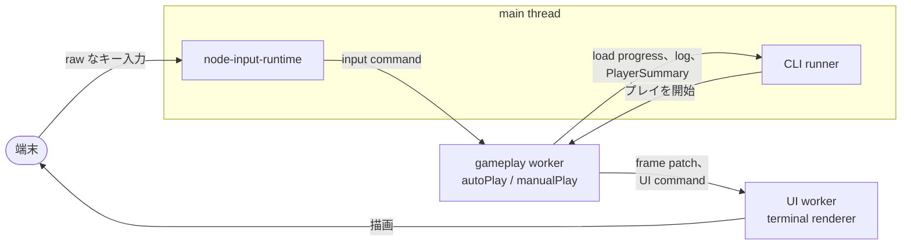
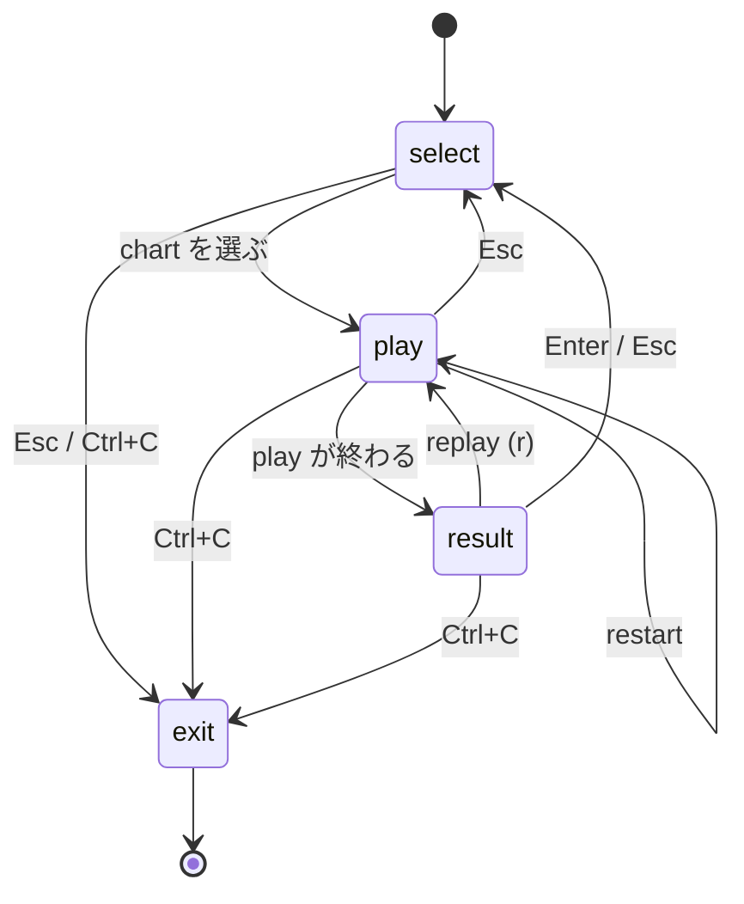

[English version](./player-tui.md)

# Terminal player 実装メモ

この文書は、`@be-music/player-terminal` と `bms-player` CLI で実装する terminal frontend の実装メモです。
timing、note、判定、score、gauge、BGA cue などの共有再生意味論は [Player 実装仕様](./player-spec.ja.md) で定義します。
browser 固有の PixiJS / WebAudio 挙動は [Browser player 実装メモ](./player-web.ja.md) に記述します。

目次

- [Runtime 境界](#runtime-境界)
- [Entry flow](#entry-flow)
- [Music Select](#music-select)
- [Preview playback](#preview-playback)
- [Input model](#input-model)
- [TUI rendering](#tui-rendering)
- [BGA と terminal image](#bga-と-terminal-image)
- [読み込み画面](#読み込み画面)
- [設定とログ](#設定とログ)
- [Compatibility boundary](#compatibility-boundary)

## Runtime 境界

`@be-music/player-terminal` は、共有 `@be-music/player-engine` engine を使う Node frontend です。
CLI runner は chart file の parse、directory selection、loading / result screen 描画、1 回の gameplay session 起動を担当します。
gameplay 本体は worker thread 上で動き、`@be-music/player-engine` の `autoPlay()` または `manualPlay()` を呼びます。
UI worker が import するのは `@be-music/player-engine/signals` と `@be-music/player-engine/display` だけなので、プレイループや音声レンダラーは読み込みません。

main thread は terminal input を所有し、worker 側の 2 つの surface と自身の input runtime を調停します。

- `node-gameplay-worker.ts` は共有 engine を実行し、load progress、log、frame patch、input request、最終 `PlayerSummary` を転送します。
- `node-ui-worker.ts` は terminal renderer を所有し、compact frame patch、UI command、pause state、high-speed change、judge/combo state を受け取ります。
- `node-input-runtime.ts` は main thread で raw keyboard input を捕捉し、正規化した input command を gameplay worker へ送ります。

TTY support がない場合や TUI 初期化に失敗した場合、player は text output へ fallback します。
`--no-tui` を渡した場合も TUI 経路を無効化します。この mode では実効 play mode は `AUTO` です。

## Entry flow

input path が単一 chart の場合、CLI はその chart を parse し、loading screen を準備し、gameplay を実行し、その後 result screen を表示します。
単一 chart mode の result screen は replay を受け付けます。

input path が directory の場合、CLI は `.bms`、`.bme`、`.bml`、`.pms`、`.bmson`、`.n2s`（ナナシグルーヴ2）、LRX の `.lrs` file を再帰的に探索します。
Music Select list を構築し、次の小さな state machine で遷移します。

- `select`: chart browse、difficulty filter、play mode 変更、high-speed 変更、random entry 選択を扱います。
- `play`: 選択した play mode と high-speed で 1 chart を再生します。
- `result`: 直前の play result を表示し、replay、select へ戻る、exit を受け付けます。
- `exit`: 適切な process exit code で終了します。

directory mode では gameplay 中の `Esc` は Music Select へ戻ります。
`Ctrl+C` は exit code `130` で終了します。
restart は新しい playback run を作り、control-flow random branch を引き直します。

## Music Select

Music Select は chart metadata、chart row、play mode、high-speed、difficulty filter、audio backend state、任意の banner を表示します。
chart row は directory ごとに group 化し、`PLAYER`、`DIFFICULTY`、`PLAYLEVEL`、file label、relative path の順で sort します。
先頭 row は random-entry pseudo chart です。

chart summary builder は各 chart を parser で読み、metadata 抽出用に deterministic random value で BMS control flow を解決し、note count、表示用 player / rank / play level、BPM range、banner path、preview identity を計算します。
metadata 抽出に失敗しても chart は list から除外せず、欠けた field は空欄として表示します。

summary cache は `~/.be-music/chart-selection-cache.json` に保存します。
各 entry は chart 本文の SHA-256 content hash で key 化し、派生 metadata を含む cache hash で検証します。
hash が一致している間、player は再 parse を省略します。

## Preview playback

選曲画面は短い settle delay の後に preview playback を開始し、cursor 連打で不要な render work が走らないようにします。
`#PREVIEW` を優先し、relative preview path の解決では `#PATH_WAV` も考慮します。
preview file が使えない場合、controller は chart の最初の sample trigger から fallback preview を render します。

preview audio は Node audio sink を使い、render 済み PCM を loop 再生します。
controller は小さな in-memory preview cache を持ち、次に focus した chart が同じ preview file または fallback signature へ解決される場合は再生を継続します。

## Input model

input runtime は、共有 engine に渡す前に keyboard input を token string へ正規化します。
非 Windows terminal では既定で Kitty keyboard protocol へ opt-in し、左右 modifier key を区別できるようにします。
Windows では Win32 terminal input mode へ opt-in します。
protocol opt-in を上書きする場合は、`BE_MUSIC_KEYBOARD_PROTOCOLS=kitty`、`win32`、または comma-separated combination を設定します。
terminal が opt-in にその protocol の key event で応えたあとは、同じ process の以降の play がすべて key の解放を伝えると宣言する（`PlayerInputRuntime.reportsKeyReleases`）ので、engine は最初の key から key-state input として判定します。
それまでは、最初の `kitty-state` command が来るまで engine が各 key を離した時刻を推定します（[解放のない入力](./replay.ja.md#解放のない入力)）。

主な command mapping は次のとおりです。

- `Space`: pause / resume。
- `Esc`: 現在の play を interrupt し、summary を返します。
- `Ctrl+C`: exit code `130` の interrupt。
- restart key input: `restart` interruption を発生させ、chart を再実行します。
- `Alt` / `Option` + 奇数 lane input: high-speed を `0.5` 減らします。
- `Alt` / `Option` + 偶数 lane input: high-speed を `0.5` 増やします。

manual lane input は worker boundary を越える前に wall-clock milliseconds で timestamp を付けます。
engine はその timestamp を playback clock へ戻し、UI frame 間に入った key press でも物理 timing で判定します。

## TUI rendering

TUI は song metadata、mode、BPM / SCROLL / STOP status、progress、current measure、judgment window、high-speed、score counter、FAST / SLOW、lane body、judge/combo state、input label、groove gauge、BGA、任意の audio debug line を表示します。
target refresh rate の既定値は `60fps` です。`--tui-fps <value>` は任意の正の値を受け付けます。

UI worker は可能な限り full frame payload ではなく compact frame patch を受け取ります。
terminal resize event、pause state、high-speed change、judge/combo update、deferred UI command flush も追跡します。

ロングノートの始点と終点を本体より優先して描き、地雷はそれらより優先します。レーン外の再生位置表示では、現在位置に最も近い行を明るい縦棒で示します。

## BGA と terminal image

端末版は共通の BGA タイムラインを使い、ベース、レイヤー、レイヤー 2、POOR を描画します。BMP、PNG、JPEG と対応する動画フレームを読み、ANSI の色付きブロックか Kitty graphics の画像に合成します。BMS のレイヤーでは黒を透明として扱い、bmson のレイヤーでは黒をそのまま描きます。

同梱の LibAV デコーダーは H.264、HEVC、VP9/WebM などに対応します。デコーダーや画素形式が非対応の場合、その素材は表示できません。先頭フレームの読み込みは、変換済みのフレームが 1 枚できた時点で止まります。ファイル末尾で遅延フレームを取り出す場合も同じです。

端末に十分な表示幅があれば、選曲画面に `#BANNER` または bmson の `info.banner_image` を表示します。対応端末では既定で Kitty graphics を使います。ANSI で描くには `--no-kitty-graphics` を指定してください。

動画 BGA は既定で順次デコードします。再生前に全フレームをデコードするには `--no-video-bga-streaming` を指定してください。

## 読み込み画面

選曲後、CLI は進捗バーと処理中の手順を標準出力に表示します。`Step` は全体の手順を示し、`Sound` と `Visual` で並行して進む音声と画像の読み込み状況を確認できます。必要に応じて処理中のファイル名や `3/24` のような件数も表示します。

`metadata.stageFile` の画像を読み込めた場合は、縦横比を保って端末全体を覆う `cover` 相当の方法で拡大し、はみ出す分を中央基準で切り取ります。ANSI 表示では、`STAGEFILE` の画像の色を各文字セルの背景に使います。読み込み状況の文字は、背景とのコントラストが高い白か黒で描きます。対応端末で `--kitty-graphics` が有効なら、Kitty graphics protocol で画像を表示します。既定では有効で、`--no-kitty-graphics` を指定するか端末が未対応の場合は ANSI で表示します。

`#STAGEFILE` が未指定、ファイルが見つからない、形式が非対応、またはデコードに失敗した場合は、テキストだけを表示します。`#STAGEFILE` を使うのは読み込み画面です。プレイ画面では最初のベース BGA が始まるまで背景が黒のままです。

## 設定とログ

CLI は `~/.be-music/player.json` に次の設定を保存します。

- プレイモード（`manual`、`auto-scratch`、`auto`）
- ハイスピード（共通の `0.5`〜`10.0` の範囲に収めた値）
- ディレクトリーごとに最後に選んだ譜面ファイルと、選曲画面のフォーカスキー

コマンドラインでプレイモードやハイスピードを指定すると、その実行では指定した値を使います。

構造化ログの既定の出力先は `~/.be-music/logs/player.ndjson` です。変更するには `--log-file <path>` を指定してください。

## Compatibility boundary

terminal player は LR2 skin file や beatoraja skin file を読み込みません。
独自の TUI を描画し、note、scoring、gauge、input、timing、BGA cue、result summary は共有 engine semantics を使います。

互換ルールセットとゲージは選択できます: `--ruleset <lr2|beatoraja|____>`（既定 `lr2`）と
`--gauge <GROOVE|EASY|HARD|DEATH|DEATH-CORRECTED>`（既定 `GROOVE`）。各ルールセットが何を支配するかは
[判定とゲージ](./player-judgment.ja.md) を参照してください。サバイバル系ゲージが尽きるとその場でプレイを終えます。
`--no-end-on-failure` は練習用に最後まで判定を続けます（`PlayerOptions.endOnFailure: false`）。

2P independent gauge variant と LR2 / beatoraja skin option panel は browser 側の関心事です。
