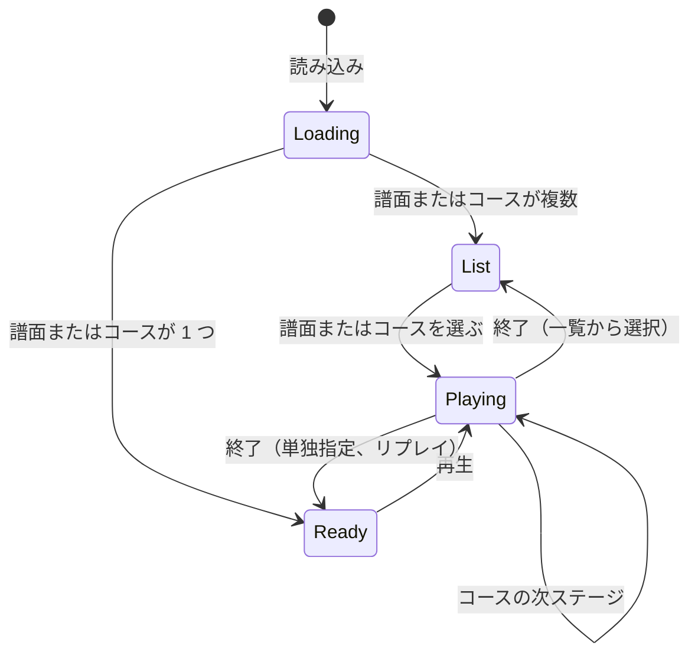

[English version](./player-web-integration.md)

# ブラウザープレイヤーの埋め込みとコントローラー

[ブラウザープレイヤーの概要](./player-web.ja.md)

<details>
<summary>目次</summary>

- [埋め込みプレビュー](#埋め込みプレビュー)
  - [譜面・コースの指定](#譜面コースの指定)
  - [プレビューの画面](#プレビューの画面)
- [DOM スキンと独立した controller](#dom-スキンと独立した-controller)

</details>

## 埋め込みプレビュー

`/embed/?track=<URL>` は譜面アーカイブを iframe で開きます。本番では `play.be-music.app`、プレビューでは `play.preview.be-music.app` を使います。通常版と同じ Worker が配信し、iframe では自動ログインを省きます。埋め込み用のコードは `embed/index.html` と `src/embed/` にあります。

同一オリジンのアーカイブは直接読み込み、別の HTTPS オリジンは `/__url-load-proxy` を経由します。プロキシはキャッシュの検証情報と条件付きリクエストを転送します。配信元が `ETag` または `Last-Modified` を返せば、変更のないアーカイブを再利用できます。スマートフォン、タブレット、データ節約モードでは、**Load** ボタンを押してからダウンロードします。サーバーがサイズを返す場合は HEAD リクエストで取得して表示します。

```html
<iframe
  src="https://play.be-music.app/embed/?track=https%3A%2F%2Fexample.com%2Fsong.zip"
  width="854"
  height="480"
  allow="autoplay; fullscreen"
></iframe>
```

既定ではプレビューは AUTO で再生し、入力を判定しない。`mode=play` を付けると、閲覧者がキーボードで譜面をプレイできる。既定のレーンキーで通常のプレイと同じく判定し、シークはできない。このとき M と F はレーンなので、ミュートと全画面の切り替えはプレイ開始前だけ効く。プレイ中はコントロールバーを使う。ステージのクリックやタップでも一時停止しない。一時停止はコントロールバーかプレイ自体の一時停止キーで行う。埋め込みではタッチレーンは使えない。どちらのモードでもリプレイとスコアは記録しない。閲覧者は URL を変えずにモードを切り替えることもできる。譜面一覧のヘッダと、単一の譜面の再生ボタンの下にある **AUTO** チェックボックスは、`preview` ではオン、`play` ではオフで始まる。再生ボタンの下で切り替えると、もう一方のモードでプレイを読み込み直す。

| パラメーター | 意味                                                                     |
| ------------ | ------------------------------------------------------------------------ |
| `mode`       | `preview`（既定）は AUTO で再生する。`play` は閲覧者が譜面をプレイする。 |

### 譜面・コースの指定

`track` が指定するアーカイブには、譜面と音声・BGA アセットをまとめて入れる。次のクエリパラメーターで再生対象を選ぶ。

| パラメーター | 意味                                                                                                 |
| ------------ | ---------------------------------------------------------------------------------------------------- |
| `chart`      | アーカイブ内の譜面のファイル名またはパス。一致しなければ譜面一覧を表示する。                         |
| `course`     | アーカイブ内の LR2 `.lr2crs` または beatoraja `.json` コースファイル。`chart` より優先する。         |
| `courseName` | 指定したファイル内のコース名（完全一致）。省略時は複数ならコース一覧、1 つならそのコースを表示する。 |

例えば `/embed/?track=https%3A%2F%2Fexample.com%2Fpack.zip&course=courses%2Fexpert.lr2crs&courseName=Expert` は、`courses/expert.lr2crs` 内の `Expert` コースを指定する。各パラメーターの値は `encodeURIComponent` でエンコードする。ファイルの照合では大文字・小文字を区別せず、パス区切りはどちらも使える。一意ならファイル名だけ、またはパスの末尾でも指定できる。複数のファイルに一致する場合は、より長いパスを指定する。`course` で明示した beatoraja JSON は `course/` ディレクトリの外にも置ける。

各ステージは元の譜面ファイルの MD5 または SHA-256 でアーカイブ内の譜面と照合する。コースファイルがない場合、不正な場合、コース名が見つからない場合はエラーを表示し、譜面が欠けたコースは開始できない。複数コースの一覧には種類とステージを表示し、譜面が欠けた行は選択できない。`be-music-preview-select` の `courses` プロパティでこの一覧を渡し、React・Vue のラッパーでも指定できる。

EXPERT・GRADE はリザルト画面を挟まず順に再生し、既存のコース実行処理でゲージとコースコンボを引き継ぐ。ロングノートのモードやハイスピード固定を含む制約も適用する。LR2 NONSTOP は共通の NONSTOP パイプラインで連結し、BGA の切り替え、FIT の音声処理、シーク操作を利用する。ステージごとに再生するコースのシークは、そのステージ内に限る。指定したコースが終了した場合や途中で抜けた場合は、Replay で最初のステージから再び再生できる状態になる。一覧から選んだコースは、終了すると一覧に戻る。

### プレビューの画面



- **選曲:** 譜面が複数あるトラックは一覧を表示し（`be-music-preview-select`）、各行にその譜面の `#STAGEFILE`、なければ `#BANNER` を出す。選んだ譜面はすぐに再生する。
- **再生待ち:** 譜面が 1 つのときは、プレイ画面の上に再生ボタン（`be-music-preview-start`）を表示する。再生後はリプレイボタンになる。リザルト画面はない。
- **再生中:** プレビュー用スキン（`src/embed/preview-skin.ts`）は、左ペインにレーン、右ペインに BGA を置く。縦長の画面では BGA を上、レーンをその下に置く。レーンは縦横どちらでも動画コントロールのすぐ上まで伸ばす（`previewJudgementInset`：短辺 320 px のスマートフォンでのコントロールの高さ 54 CSS px 分と 16 px）。コントロールはステージではなく画面の下端に置くので、縦に持ったスマートフォンで横長ステージを縮めて表示する DP 譜面でも、コントロールがレーンに重ならない。譜面の情報・スコア・コンボ・ゲージ・判定は BGA 側に置き（`be-music-preview-hud`）、下端に動画プレイヤー風のコントロール（`be-music-playback-controls`）を置く。細いシークバー、再生／一時停止、ミュートの横に開く音量、時間、全画面である。画面をクリックすると再生／一時停止する。ただし閲覧者がプレイしている間（`mode=play`、`embedStageTapPauses`）は一時停止しない。一時停止中は再生ボタンとその下に **Back** を表示する。Back は Escape と同じくプレイを抜けて一覧（または Replay ボタン）に戻る。スマートフォンやタブレットではこれが戻る手段になる。Space で再生／一時停止、AUTO プレイ中は ← / → で 5 秒シーク、M でミュート、F で全画面を切り替える。

シーク（`PlayScene.seek`）は、動いているエンジンにシークのコマンドを送る（[ADR 0016](./adr/0016-seek-play-loop-command.ja.md)）。プレイを始め直すことはない。エンジンは譜面の頭からシークした秒までプレイを組み直すので、スコア・ゲージ・コンボ・最大コンボ・グラフ・タイミングはそこまでプレイしたときと同じになる。その時点で鳴っている音は途中から鳴らし（`AudioSession.triggerEventAt`）、Web の音声セッションは鳴っていた音を止め、音量の変化を戻し、NONSTOP の譜面のフェードを動かす（`WebAudioSession.seek`）。シークバーと時間は新しい世代のフレームに従い、一時停止中のプレイは一時停止したままになる。セッションの側は「プレイの部品の置き場所」を参照。

## DOM スキンと独立した controller

Options ダイアログ → Skin → Built-in → Built-in skin で **Native (DOM + Canvas)** を選ぶ。Native はコレクション、検索、プレイオプション、ロード画面、スコア HUD、結果画面を HTML で表示し、メーターと SVG のゲージ履歴も使う。BGA・レーン・ノート・レーンカバー・判定ライン・ボム・判定文字はそれぞれ独立した component で、ステージ上の自分の範囲と同じ大きさの canvas に描画する。Native の画面を表示している間、host はステージ全体の canvas をページから外し、タッチレーンは DOM の画面で指を追う。Synesthesia または Plain を選ぶとフル Canvas に戻り、選択は保存される。入力にはブラウザーのフォーカス、スクロール、IME の挙動を使い、`/` ショートカットは DOM の検索欄にフォーカスする。

Native は横画面では HUD をレーン横の空間に、縦画面ではコンパクトな上部バーに配置し、レーンを画面下部まで広げます。タッチ操作では判定ラインの下に指を置く余白を確保します。ステージ固有の `playfield` 範囲を描画・ノート配置・タッチ判定で共有します。DOM のゲームプレイフレームにもレイアウトを渡し、リサイズや画面回転後も HUD とプレイフィールドを Canvas の表示領域に揃えます。プレイフィールドは毎アニメーションフレーム、HUD は制限した頻度で更新し、どちらもプレイ画面と一緒にフェードします。

ゲームプレイのダッシュボードには EX スコア・ランク・スコア率、コンボ、BPM、時間・進行状況に加え、判定内訳と早遅の件数、空 POOR を含む BP、直近の判定ずれ、ゲージ推移と判定タイミングのグラフを表示します。ハイスピードと描画速度、HS-FIX、緑数字、表示時間、BPM 範囲、レーンカバー、ランダム・ゲージ設定、オートスクラッチ、DP フリップ、BGA モード、譜面情報とコースのステージも確認できます。横画面ではレーン横の空間を使い、情報カードを最初から展開します。縦画面では **All play information** から詳細カードをレーンに重ねて開き、レーンを短くしません。DOM の更新はおよそ毎秒12回に抑え、グラフはゲージ最大96点・タイミング最大32件を表示します。

`BeMusicSkin` は任意の `dom.select`・`dom.decide`・`dom.result`・`dom.gameplay` factory を宣言できる（`player-skin-sdk/src/dom.ts`）。それぞれ `HTMLElement` と既存 session に届く操作を受け取り、`update(frame)` と `dispose()` を返す。先頭の三つは Canvas の描画を置き換え、gameplay は Canvas のプレイフィールドを補う。スキンが `gameplay.drawsOnDOM` を設定すると、gameplay は `drawPlayfield(frame)` でプレイフィールドを描画し、host はゲームプレイ用の surface を作らない。画面がすべて DOM の scene は `drawsOnCanvas: false` を返す。`PixiSceneHost` は、有効な scene が canvas に描く間だけ canvas をページに置くため、ステージ全体への入力は `PixiSceneHost.container` で受ける。frame はスキン設定とエフェクトの設定も持つ。select 画面が `focusSearch()` を返すと、自分で検索欄を所有して host の重複する入力欄を隠せる。DOM は attach 時に作り、document が存在する前でもスキンの module を import できる。detach は mount とローカル状態を再入場まで保持し、dispose は listener、フレームワークの root、リソースを解放する。Native は shadow DOM でスタイルを分離する。別の場所に DOM を置く host は `PixiSceneHost.mount` に `domContainer` を渡す。

`@be-music/player-browser/controller` は Pixi を実行時に import せず、`SceneController` と `createSelectController` を公開する。controller の操作は明示的な `enter(nowMs)`・`advance(nowMs)`・`dispatch(intent)`・`exit()`・`dispose()` で、所有者一つが進行させる。`getSnapshot()` と購読者は一時イベントも含め同じ frame を共有する。`createStore(selector, equals?)` は選択した値の安定した snapshot を提供し、最初の advance 前の `getSnapshot()` は `undefined`、`subscribe(listener)` の戻り値は購読解除関数になる。購読を解除しても session は終了しない。React・Vue の adapter は store をコンポーネントのライフサイクルにつなぎ、Canvas renderer は独自の frame loop を使える。

独立したコレクションブラウザーでも、プレビュー再生と選曲の振る舞いを共有できる。

```ts
import { createSelectController } from '@be-music/player-browser/controller';

const controller = createSelectController({ library, audio, sounds: {}, on: { start: openChart } });
const query = controller.createStore((frame) => frame.browse.searchText);
const unsubscribe = query.subscribe(() => updateSearch(query.getSnapshot()));
controller.enter(performance.now());
// ブラウザーがアクティブな間、host が animation tick ごとに一度進行させる。
controller.advance(performance.now());
controller.dispatch({ type: 'browse', command: { type: 'search', text: 'title' } });
// 最終的な破棄時:
unsubscribe();
controller.dispose();
```

既存の Pixi scene でも同じ controller を `scene.controller` から参照できる。進行は host が担当するため、購読者はもう一度 advance しない。gameplay preparation と内部の `PlayfieldRuntime` には描画リソースが残り、独立した gameplay controller の公開 interface にはしていない。Canvas のスクリーンショットと録画はプレイヤーの canvas を対象とし、DOM 画面を含まない。そのため Native の画面は映らない。[ADR 0012](./adr/0012-native-skin-screens.ja.md) と [ADR 0014](./adr/0014-native-playfield-components.ja.md) を参照。

Native の各画面は `@be-music/player-ui` の Lit 製 Web Components で組み立て、スキン側はフレームと操作イベントの受け渡しを担当します。同じ画面とパネルを `@be-music/player-ui-react`・`@be-music/player-ui-vue` からも使えます。[Player UI ガイド](../packages/player-ui/README.ja.md) と [ADR 0013](./adr/0013-player-ui-components.ja.md) を参照してください。

描画の契約と計測手順は[性能仕様](./player-performance.ja.md)を参照してください。
