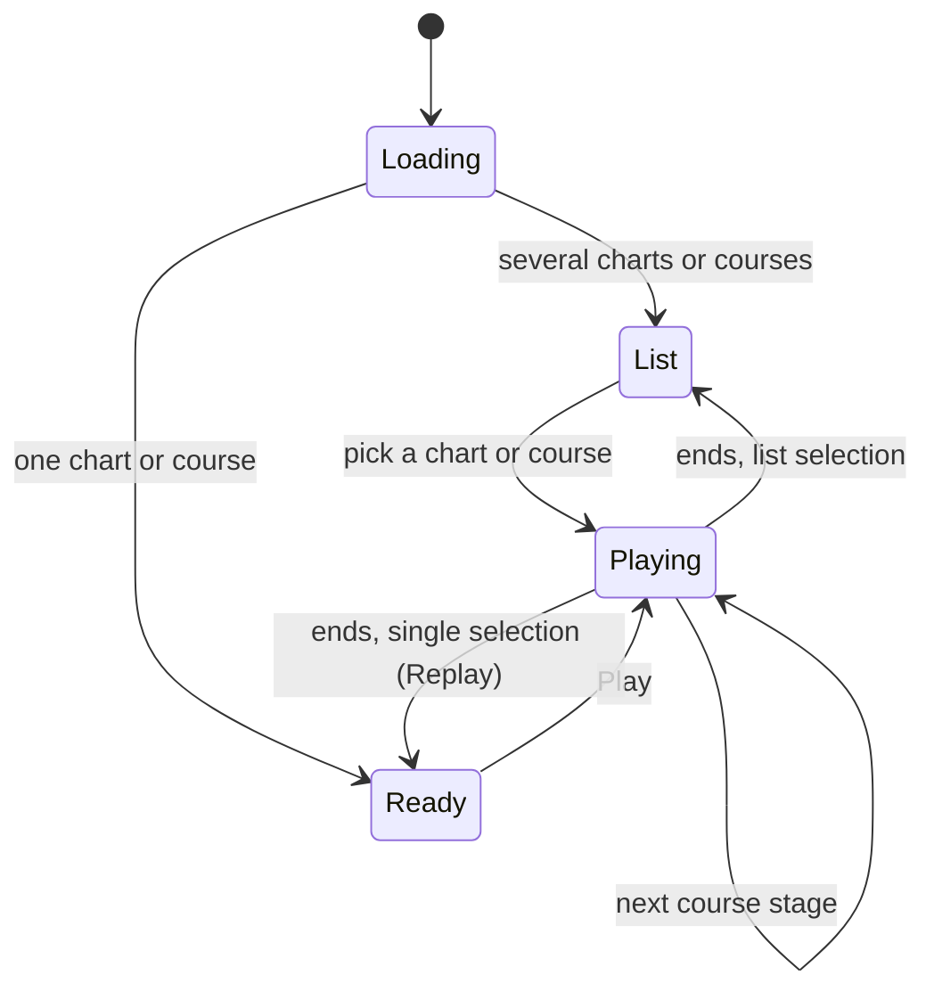

[Japanese version](./player-web-integration.ja.md)

# Browser player embedding and controllers

[Browser player overview](./player-web.md)

<details>
<summary>Table of contents</summary>

- [Embedded preview](#embedded-preview)
  - [Select a chart or course](#select-a-chart-or-course)
  - [Preview screens](#preview-screens)
- [Native DOM skins and standalone controllers](#native-dom-skins-and-standalone-controllers)

</details>

## Embedded preview

`/embed/?track=<URL>` opens a chart archive inside an iframe. Use `play.be-music.app` in production or `play.preview.be-music.app` in preview. The same Worker serves both app entries and skips automatic sign-in for iframes. The embed entry lives in `embed/index.html` and `src/embed/`.

The browser fetches same-origin archives directly and other HTTPS archives through `/__url-load-proxy`. The proxy forwards cache validators and conditional requests. An unchanged archive with an `ETag` or `Last-Modified` can reuse the cached response. On phones, tablets and browsers with data saving on, the embed shows a **Load** button before downloading. It uses a HEAD request to show the size when the server provides it.

```html
<iframe
  src="https://play.be-music.app/embed/?track=https%3A%2F%2Fexample.com%2Fsong.zip"
  width="854"
  height="480"
  allow="autoplay; fullscreen"
></iframe>
```

The preview plays in AUTO by default and ignores lane input. Add `mode=play` to let viewers play with the default lane keys. Manual play uses normal judgment and disables seeking. The embed has no touch lanes. Neither mode saves scores or replays.

During manual play, M and F act as lane keys. Before play, they mute audio and toggle fullscreen. During play, use the controls bar for those actions. To pause, use the bar or the pause key. Clicking or tapping the stage leaves the play running.

Viewers can switch modes with the **AUTO** checkbox in the chart list header or beneath a single chart’s Play button. The box starts checked in `preview` mode and unchecked in `play` mode. Changing it beneath the Play button reloads the chart in the selected mode.

| Parameter | Meaning                                                                       |
| --------- | ----------------------------------------------------------------------------- |
| `mode`    | `preview` (the default) plays in AUTO; `play` lets the viewer play the chart. |

### Select a chart or course

Keep the charts and their audio/BGA assets together in the archive named by `track`. Use these query parameters to select what the preview plays:

| Parameter    | Meaning                                                                                                          |
| ------------ | ---------------------------------------------------------------------------------------------------------------- |
| `chart`      | A chart file name or path inside the archive. Without a match, the preview lists the charts.                     |
| `course`     | An LR2 `.lr2crs` or beatoraja `.json` course file inside the archive. It takes precedence over `chart`.          |
| `courseName` | The exact course name in the selected file. Omit it to list multiple courses, or to play the file's only course. |

For example, `/embed/?track=https%3A%2F%2Fexample.com%2Fpack.zip&course=courses%2Fexpert.lr2crs&courseName=Expert` selects the course named `Expert` in `courses/expert.lr2crs`. Encode each parameter value with `encodeURIComponent`. File matching ignores case and accepts either path separator; a unique file name or path suffix also works. Specify a fuller path if several files match. A beatoraja JSON explicitly selected by `course` can sit outside a `course/` directory.

Course stages resolve by their original chart-file MD5 or SHA-256 against the charts in the archive. The preview reports missing or invalid course files and unknown course names; courses with missing stages cannot start. A multi-course list shows each course's kind and stages, and disables rows with missing charts. The `courses` property of `be-music-preview-select` supplies this list; the React and Vue wrappers accept it too.

EXPERT and GRADE previews play stages in order without result screens, carrying gauge and course combo through the existing course runner. Course constraints, including the long-note mode and hi-speed lock, apply. LR2 NONSTOP previews stitch their stages through the shared NONSTOP pipeline, with its BGA transitions, FIT audio and seek controls. Seeking in a staged course stays within its current stage. When a selected course finishes or is exited, Replay prepares it again from the first stage; a course selected from a list returns to that list instead.

### Preview screens



- **List:** a track with several charts lists them (`be-music-preview-select`), each row showing the chart's `#STAGEFILE` or, without one, its `#BANNER`; picking one plays it at once.
- **Ready:** a single chart shows its play screen behind a play button (`be-music-preview-start`), which becomes Replay after the play. There is no result screen.
- **Playing:** the preview skin (`src/embed/preview-skin.ts`) lays the lanes in the left pane and the BGA in the right, and on a tall screen the BGA across the top with the lanes below it. The lanes reach down to just above the video controls in either orientation (`previewJudgementInset`: the controls' 54 CSS px as tall as they get on a phone 320 px across its short side, and 16 px). The controls run along the bottom of the screen rather than the stage, so a DP chart on a phone held upright, which plays on the landscape stage letterboxed into the screen, keeps them off its lanes. The chart's facts, score, combo, gauge and judgments sit with the BGA (`be-music-preview-hud`), and video-player controls run along the bottom (`be-music-playback-controls`): a thin seek bar, play / pause, a volume slider that opens beside mute, the time, and full screen. Clicking the picture plays or pauses, except while the viewer plays (`mode=play`, `embedStageTapPauses`). A paused play shows a play button and, under it, **Back**, which leaves the play for the list (or the replay button) the way Escape does: the way back on a phone or tablet. Space plays or pauses, ← / → seek 5 seconds during AUTO play, M mutes and F toggles full screen.

Seeking (`PlayScene.seek`) sends the running engine a seek command ([ADR 0016](./adr/0016-seek-play-loop-command.md)); the play is not started again. The engine rebuilds the play from the chart's start to the second sought, so the score, gauge, combo, max combo, graphs and timings read as if the play had run there; the sounds still ringing there start partway (`AudioSession.triggerEventAt`), and the web audio session stops what played, resets the dynamic volumes and moves a NONSTOP chart's fades (`WebAudioSession.seek`). The seek bar and the time follow the frames of the new generation, and a paused play stays paused. See "Where the play's parts live" for the session's side.

## Native DOM skins and standalone controllers

Choose **Native (DOM + Canvas)** under Options → Skin → Built-in → Built-in skin. Native uses HTML for the collection, search, play options, loading card, score HUD and results, including a meter and an SVG gauge history. The BGA, lanes, notes, lane covers, judge line, bombs and judgment words are separate components, each drawing on a canvas the size of its part of the stage. While a Native screen is showing, the host takes its stage-sized canvas out of the page, and touch lanes follow the fingers on the native screen instead. Choose Synesthesia or Plain to return to full Canvas; the choice is remembered. Native inputs keep browser focus, scrolling and IME behavior. The `/` shortcut focuses the native search input.

Native uses the space beside the lanes for its landscape HUD and uses a compact header in portrait. The lanes extend toward the bottom edge; touch layouts keep space below the judgment line for the fingers. Stage-specific `playfield` bounds are shared by drawing, note placement and touch hit testing. DOM gameplay frames expose the layout so the HUD and playfield stay aligned with the Canvas viewport after resizing or rotation. The playfield redraws every animation frame, the HUD at its limited rate, and both fade with the play screen.

The gameplay dashboard shows EX score, rank and score rate, combo, BPM, time and progress, plus judgment counts with early/late splits, BP (including empty POOR), the latest timing offset, gauge history and recent timing graphs. It also lists the current hi-speed and drawn speed, HS-FIX, green number, visible time, BPM range, lane covers, random and gauge choices, auto scratch, DP flip, BGA mode, chart metadata and course stage. Landscape uses the space beside the lanes and opens the information cards by default. In portrait, **All play information** opens the detailed cards over the playfield without shortening it. Live DOM updates are limited to roughly 12 updates per second; graphs sample at most 96 gauge points and 32 timed hits.

A `BeMusicSkin` declares optional `dom.select`, `dom.decide`, `dom.result` and `dom.gameplay` factories (`player-skin-sdk/src/dom.ts`). Each receives an `HTMLElement` and actions that reach the existing session, and returns `update(frame)` and `dispose()`. The first three replace Canvas drawing; gameplay supplements the Canvas playfield, or draws it through `drawPlayfield(frame)` when the skin sets `gameplay.drawsOnDOM` (the host then creates no gameplay surface). A scene whose screens are all DOM reports `drawsOnCanvas: false`: `PixiSceneHost` keeps its canvas in the page only while the active scene draws on it, so listen on `PixiSceneHost.container` for input meant for the whole stage. Frames carry skin settings and effect preferences. A select screen can return `focusSearch()` to own the search input and suppress the host's overlay. Factories create DOM only when attached; skin modules remain safe to import before a document exists. Detaching preserves the mount and its local state for re-entry; disposing releases listeners, framework roots and resources. Native uses shadow DOM for style isolation. `PixiSceneHost.mount` accepts `domContainer` when a host wants to place native screens elsewhere.

`@be-music/player-browser/controller` exposes `SceneController` and `createSelectController` without importing Pixi at runtime. A controller has explicit `enter(nowMs)`, `advance(nowMs)`, `dispatch(intent)`, `exit()` and `dispose()` operations. One owner advances it; `getSnapshot()` and subscribers share that frame, including its transient events. Call `createStore(selector, equals?)` for a stable selected snapshot: its `getSnapshot()` returns `undefined` before the first advance and its `subscribe(listener)` returns an unsubscribe function. Removing a subscription does not end the session. React or Vue adapters can bind these stores to their own component lifecycle while the Canvas renderer keeps its frame loop.

For example, a standalone collection browser can reuse preview playback and browse behavior:

```ts
import { createSelectController } from '@be-music/player-browser/controller';

const controller = createSelectController({ library, audio, sounds: {}, on: { start: openChart } });
const query = controller.createStore((frame) => frame.browse.searchText);
const unsubscribe = query.subscribe(() => updateSearch(query.getSnapshot()));
controller.enter(performance.now());
// The host advances once per animation tick while the browser is active.
controller.advance(performance.now());
controller.dispatch({ type: 'browse', command: { type: 'search', text: 'title' } });
// On final teardown:
unsubscribe();
controller.dispose();
```

The existing Pixi scenes expose the same controller as `scene.controller`. The host already advances it; observers must not advance it again. Gameplay preparation and its internal `PlayfieldRuntime` still contain rendering resources and are not a standalone public gameplay controller. Canvas screenshots and video recording capture the player's canvas; they do not capture DOM screens, so they show nothing of Native's screens. See [ADR 0012](./adr/0012-native-skin-screens.md) and [ADR 0014](./adr/0014-native-playfield-components.md).

Native screens are composed from the Lit Web Components in `@be-music/player-ui`; the skin modules only adapt frame delivery and request events. The same screen and panel elements are available through `@be-music/player-ui-react` and `@be-music/player-ui-vue`. See the [Player UI guide](../packages/player-ui/README.md) and [ADR 0013](./adr/0013-player-ui-components.md).

See the [performance specification](./player-performance.md) for rendering contracts and measurement procedures.
