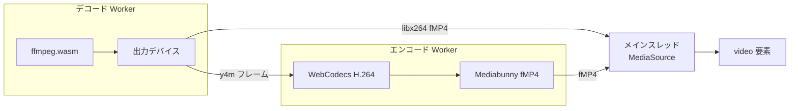
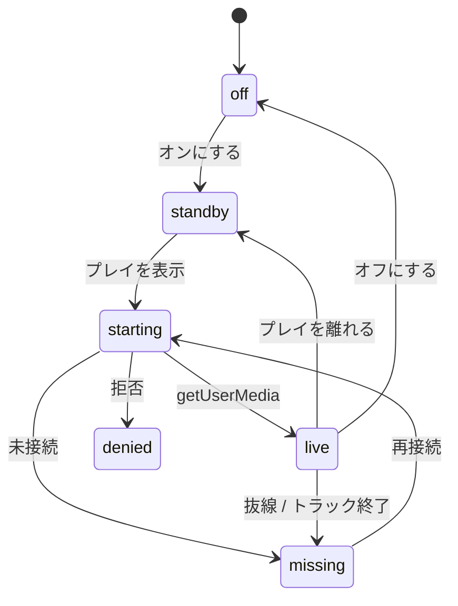
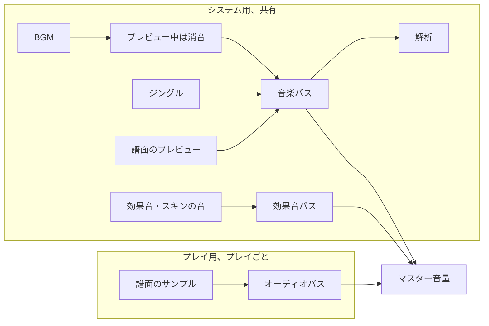

[English version](./player-web-media.md)

# ブラウザープレイヤーの音声・BGA・録画

[ブラウザープレイヤーの概要](./player-web.ja.md)

<details>
<summary>目次</summary>

- [Audio, BGA, recording](#audio-bga-recording)
  - [音声出力](#音声出力)
  - [BGA の描画](#bga-の描画)
  - [録画とリザルト](#録画とリザルト)
  - [Leaderboard への送信](#leaderboard-への送信)
  - [BGA 動画の transcode](#bga-動画の-transcode)
  - [BGA カメラ](#bga-カメラ)
  - [オーディオサービス](#オーディオサービス)

</details>

## Audio, BGA, recording

### 音声出力

試聴とプレイ中の音声には Web Audio を使います。

- `@be-music/player-browser/audio` は platform audio session 用の helper を export します（engine 内部の `WebAudioSession` とは別物です）。`supportsSystemAudioSession`、`getSystemAudioSession`、`applySystemAudioSessionType` は `navigator.audioSession.type` を feature detection して設定し、`applySilentModePlayback(on)` はオンで `'playback'`、オフで `'auto'` を設定します。例外は握りつぶし、API がない環境では何もしません。`AudioContext` の作成・resume より前と、音声を unlock する gesture の中で呼んでください。
- gameplay audio は既定の split topology で key、BGM、master compressor stage を分けます。
- `?compressor=legacy` は比較用に旧 single-compressor 構成を維持します。
- `?compressor=off` は player で compressor construction を無効化します。
- beatoraja theme audio は Lua `main_state.audio_play` / `audio_loop` call、select BGM、navigation system sound、decide BGM、result jingle に同じ browser bundle lookup を使います。

### BGA の描画

- BGA は chart BGA event が参照する still image と video asset を扱います。
- BGA rect（LR2 の `#DST_BGA`、beatoraja の `bga`、built-in frame）はいずれも 256x256 の BMS キャンバスとして扱います。長辺 256 px 以下の静止画は等倍のまま X 軸中央・上詰めで黒地の上に置き、それより大きい画像と動画は rect いっぱいに描きます（[フォーマット互換性](./format-compat-bms.ja.md#217-bga)）。
- default family は LR2 skin と同じ chart BGA layer stack を built-in BGA frame 内に描画します。
- BMS rendering は `#BGAxx` の部分領域、EXBMP 静止画・不透明動画の透過色、面ごとの A1〜A4 ARGB、キー入力連動 A5 SWBGA を反映します。SWBGA は透過色付き動画の切り出しと NONSTOP のリソース変換にも対応します。選択と表示はステージ境界で終了し、アニメーションと動画の時計は FIT に合わせます。[BMS 対応範囲](bms-spec.ja.md)を参照してください。
- bmson rendering は `bga.bga_events`、`bga.layer_events`、`bga.poor_events` を使います。BMS layer channel と異なり、bmson layer image は黒を透明化せず黒ピクセルとして保持します。
- ブラウザが再生できない BGA 動画（`.wmv`、`.avi`、`.mpg` など）は、ffmpeg.wasm と single-threaded の `@ffmpeg/core` で H.264 に transcode し、transcode の途中から再生を始めます（[BGA 動画の transcode](#bga-動画の-transcode)）。現在の 0.12.x の multithreaded core は libx264 でクラッシュするため含めていません。BGA 動画の音声はいずれにしても扱いません。

### 録画とリザルト

- chart の自然終了時は、短い post-chart delay を置いてから result scene を開きます。視覚的に result へ遷移しても、残っている gameplay audio tail は中断しません。
- gameplay recorder は MP4 か WebM の output を書き出し、active recording が gameplay bus の破棄前に flush されるよう、scene disposal より前に stop / finalization を終えます。
- リプレイの記録・ダウンロード・再生は [リプレイ仕様](./replay.ja.md) を参照してください。

### Leaderboard への送信

- Options ダイアログ の Leaderboard フォルダにある「Submit to Leaderboard」（デフォルト OFF。自動保存と同じく曲開始時にラッチ）をオンにすると、終了した手動プレイを result scene のマウント時に Leaderboard（[leaderboard.ja.md](./leaderboard.ja.md)）へ送信します。送信にはログイン済みのアカウントが要ります（ゲストで足ります）。楽曲の譜面からプレイの fingerprint ドキュメントを作り直してログと照合してから送り、サーバーに求められたら chart document を付けて再送し、順位をステータス行に表示します。デプロイ先の Worker は `/api/*` と `/leaderboard/*` を Service Binding で Leaderboard の Worker に転送し、`pnpm player:web` はローカルの Leaderboard（`pnpm --filter @be-music/app-leaderboard run dev`、または `LEADERBOARD_DEV_ORIGIN`）にプロキシします。
- 「Submit when」（Options → Leaderboard。「Submit to Leaderboard」と一緒に曲開始時にラッチ）で、どのプレイを送るかを選びます。「EX-SCORE improves (first play always)」（既定）はその譜面の自己ベスト EX-SCORE を超えたプレイだけを送り、「Always」は毎回送ります。自己ベストはローカルの記録（`be-music.chart-best-records`。そのときの判定ルールでの譜面の通常の記録）を、リザルトで更新される前のプレイ開始時に読みます。EX-SCORE の記録がない譜面は初回プレイとして送り、同点は更新とみなしません。送らなかったプレイはステータス行にそう表示します。このルール（`leaderboard-submit-rule.ts` の `shouldSubmitPlay`）は通信を減らすだけで、送ったプレイをどう表示するかは引き続き Leaderboard が決めます。コースはルールにかかわらず常に送ります。コースは EX-SCORE 以外でも順位が決まり、送信の回数も少ないためです。
- Accounts ではゲストアカウントから始められます。「Keep this account」で Accounts を開き、パスキー・Google・Discord のどれかで保存すると通常のアカウントになり、プレイはゲストのフィルタの陰ではなく handle で一覧に載るようになります。「Sign in」で Accounts から別のアカウントにログインすると、このブラウザーのゲストのプレイはそのアカウントに移ります。

### BGA 動画の transcode

ブラウザが BGA 動画をデコードできないとき、`loadVideoTextureFromBytes` はそれを H.264 に transcode し、ネイティブの動画と同じ `<video>` / Pixi `VideoSource` の経路で再生します。ホストが Worker を登録し（`./compute` の `configureBGAVideoWorkers`。各エントリーは `runBGAVideoDecodeWorker()` / `runBGAVideoEncodeWorker()` を呼ぶ）、ブラウザに Media Source Extensions があれば、transcode は逐次的に進みます。動画は fragmented MP4 を `MediaSource`（iPhone のように `ManagedMediaSource` があればそちら）経由で届いた順に再生するため、BGA は最初のフレームができた時点で使えます。



- デコード Worker は無改造の ffmpeg.wasm コアを起動し、ffmpeg の出力先としてキャラクターデバイスを登録します。これで `exec` の実行中に出力が少しずつ JavaScript に届きます。出力は偶数の寸法に縮小し、最大 60 fps の固定フレームレートに揃えるため、可変フレームレートの素材も時刻がずれません。
- cross-origin isolated なページでは、ffmpeg が y4m の生フレームを書き、エンコード Worker が WebCodecs（ハードウェア優先）で符号化して Mediabunny で多重化します。デコーダはエンコーダより数フレーム以上先行すると `SharedArrayBuffer` のカウンターで待つ（`Atomics.wait`）ため、フレームを捨てることも生フレームが溜まることもありません。
- それ以外のページ（`Cross-Origin-Embedder-Policy: credentialless` に対応しない Safari など、ページを isolated にできないブラウザー）、「Use WebCodecs encoder」がオフのとき、WebCodecs のエンコーダが失敗したときは、ffmpeg 自身の libx264 で直接 fragmented MP4 を書きます。デコードと同じスレッドで符号化するので、デコードの速さは自然に抑えられます。
- media source は stream が終わるまで仮の長さを宣言するため、まだ transcode されていない位置へシークした cue はそこでフレームを待ちます。複数のトラックで同じバイト列を使う動画は 1 つの transcode を共有し、transcode は同時に 2 本まで走り、それを使う最後の動画を閉じると取り消します。
- Worker か MSE がないとき、または最初のフレームより前に stream が失敗したときは、従来どおりファイル全体を transcode してから再生します。

### BGA カメラ

Options → **Camera** で、プレイ画面の BGA の枠に、譜面の BGA の代わりにカメラの映像を映せます。ウェブカメラで手元を写して打鍵の様子を見せたり、配信で顔を出したりするときに使います。内蔵スキン（Synesthesia・Plain・Native）、LR2 スキン、beatoraja スキンのどれでも使えます。



- **共通の入口。** アプリの `BGACameraService`（`services/bga-camera.ts`）が `getUserMedia` でカメラを開き、`MediaStream` を `PlayScene.setBGACamera({ stream, mirror })` でプレイに渡します。シーンはそれを `BGACameraFeed`（`media/bga-camera.ts`。譜面の動画 BGA と同じく、ミュートした `<video>` と Pixi の `VideoSource`）に包み、プレイセッションの `bgaCamera` に置きます。`renderBGA`（内蔵と LR2 のプレイ画面）と beatoraja の BGA 層は、譜面の BGA の代わりにその texture をすべての BGA の矩形に、黒地に全体が収まるように描き（`fitBGACameraRect`）、譜面の動画は止めます。BGA を自分で合成する Be-Music Skin（`drawsBGA`。Native スキン）には、256x256 の canvas を `frame.bga.base` として渡します。BGA の設定や譜面に BGA があるかどうかにかかわらず映し、内蔵スキンはそのために BGA の枠を描きます。左右反転は texture を反転する（`groupD8.MIRROR_HORIZONTAL`）ので、sprite は変えません。
- **カメラが動くとき。** 設定がオンで、プレイがステージにあるときだけです。シーンルーターの `setScene` が表示中のシーンをサービスに伝えるので、選曲・決定・リザルト画面ではカメラを止めます。リトライでは開いているカメラをそのまま引き継ぎます。オン / オフ、カメラ、左右反転の変更は、プレイ中でも次のフレームから反映されます。
- **カメラの選択。** 一覧は `enumerateDevices` から作り、`devicechange` で更新します。一度カメラを許可するまで、ブラウザはカメラの名前を教えないので、フォルダに **Allow camera access** ボタンを置き、一度だけ許可を求めてすぐカメラを止めます。名前が分かったあとは無効になります。選んだカメラは `deviceId` と名前の両方で覚えるので、ブラウザが id を変えても見つけ直せます（`bga-camera-settings.ts` の `pickCamera`）。
- **カメラを失ったとき。** プレイ中にカメラが抜かれたり、許可が取り消されたりするとトラックが終わります。サービスはカメラを閉じ、プレイは次のフレームから譜面の BGA に戻り、ステータス行で知らせます。選んだカメラがつながっていなければ待ち、つながったときに開きます。
- **プレビュー。** **Preview camera** を押すと、選んだカメラをタブの中に、プレイと同じ向き（左右反転を含む）で映します。設定がオンかどうかにかかわらず使えるので、プレイの前に画角を合わせられます。カメラはボタンを押したときだけ開き（プレイ中ならその映像を共有）、もう一度押す、タブを離れる、ダイアログを閉じる（プレビューが表示されなくなる）、カメラがなくなる、のいずれかで止めます。
- **プライバシー。** 映像はプレイの canvas にしか行かず、どこにも送りません。Capture の録画は canvas を記録するので、BGA の枠ごとカメラの映像も記録されます。
- **cross-origin isolation。** `MediaStream` は cross-origin のリソースではないので、COEP `credentialless` の影響を受けません。cross-origin isolated の状態で、Chromium の偽カメラ（`--use-fake-device-for-media-stream`）を使って確かめました。
- **リプレイとゴースト。** リプレイも同じプレイシーンで再生するので、カメラを映せます。ゴーストのプレイフィールドやペースメーカーは自分の BGA を描かないので、影響しません。

### オーディオサービス

`createAudioService()`（`@be-music/player-browser/audio`）は、プレイ中の譜面の音以外を鳴らす唯一の手段です（[ADR 0007](./adr/0007-one-system-audio-context.ja.md)）。scene session はできるごとにこれで音を鳴らします。どの選曲画面、決定画面、プレイ画面、リザルト画面もこれで鳴らします（プレイは `openPlayGraph` で専用のグラフを開きます）。Web プレイヤーは起動時にサービスを 1 つ作り、これで作るすべての scene に渡します。beatoraja のテーマを読み込むと、beatoraja の選曲画面のパスで指す効果音と選曲 BGM、beatoraja の選曲画面・決定画面・プレイ画面・リザルト画面のスキンの音のために、そのファイルを設定します（`setTheme({ files })`）。



- システム用の AudioContext は最初に使うときに作ります。ユーザー操作の前のページで、ブラウザーが開始を拒む AudioContext を作らないためです。音はバイト列（またはテーマのファイル）ごとに 1 回だけデコードし、デコードの失敗も覚えておきます。
- `setTheme({ sounds, files })` でテーマの `SystemSoundSet`（player-scene-model）と、beatoraja のテーマならそのファイルを設定します。`playCue(slot)` はその効果音を 1 回鳴らします。`playBGM` と `playJingle` はスロットか解決済みの `SystemSound` を受け取ります。パスで指定された音（beatoraja テーマの効果音など）はテーマのファイルから読みます。
- `playBGM(sound, { owner, volume, loop, duckUnderPreview })` が鳴らす BGM は常に 1 つです。別の BGM なら置き換え、同じ BGM ならそのまま鳴らし続けてオーナーと音量だけを変えます。譜面のプレビューが鳴っている間は消音します。`duckUnderPreview` が `false` なら消音しません。
- `skinSounds.play` / `loop` / `stop` は beatoraja スキンの `main_state.audio_*` です。`skinSounds.owned(owner)` は同じ呼び出しをオーナー付きで行います。
- `preview.focus(target, owner)` は 1 つの `ChartPreviewEngine` を動かします。`analyzer.sample(now)` は、音に反応する Be-Music Skin のために音楽バスを解析します。
- `openPlayGraph(chart, mode, busOptions, { owner })` は、プレイ専用の `interactive` な AudioContext と、`#VOLWAV` を反映したオーディオバスを開き、バスの出力に解析を付けます。`close({ delayMs, beforeClose })` で、余韻を鳴らしきってから閉じます。
- `chartSamples` は、直前のプレイのデコード済みサンプルを持ちます。クイックリトライ（F5、リザルトでの R）や、同じ楽曲の別の譜面のプレイ（NORMAL → HYPER）で、サンプルをデコードし直しません（[#953](https://github.com/nulltask/be-music/issues/953)）。デコード結果は、`#WAV` のパスが（譜面のフォルダー、`#PATH_WAV`、コーデックの代替を経て）解決される音声ファイルごとに、オブジェクトの同一性で持ちます。2 つの譜面がデコード結果を共有するのは、パスがまったく同じファイルに解決されるときだけです。別のフォルダーにある同名のファイルや、別の `#PATH_WAV` ではデコードし直します。`chart/play-audio.ts` は、プレイが鳴らしうるすべてのファイルを渡してこれを確保します。それらのファイルのデコード結果は残り、それ以外はプレイがデコードする前に手放すので、キャッシュが持つのは多くても 1 プレイ分で、別の `#RANDOM` 分岐で増えることはありません。別のソース（ドロップしたフォルダーやアーカイブ。同一のオブジェクトか）や別のコンテキストのサンプルレートのプレイは、先にすべてを手放します。キャッシュが持つのはデコードしたままのものだけです。プレイごとに RANDOM を引き直し、ピッチを保つ伸縮、`#WAVCMD` / `#EXWAV`、ピークゲインは新しいバッファーに施し（ピークゲインは複製を拡大縮小します）、新しいリプレイを記録します。サンプルは、選曲画面のカーソルが同じ楽曲（同じソースとフォルダー）の譜面にある間は残ります。プレビューがそれ以外の譜面に合うか、どの譜面にも合わなくなると手放します（`chartSamples.keepTrackOf`）。Web プレイヤーは `pagehide` で `chartSamples.release()` を呼びます。SILENT のプレイと `dispose()` も手放します。

  ```mermaid
  stateDiagram-v2
    state "空" as Empty
    state "保持" as Holding
    [*] --> Empty
    Empty --> Holding: 譜面のプレイ
    Holding --> Holding: 同じ譜面のリトライ
    Holding --> Holding: 別の譜面（先に手放す）
    Holding --> Empty: 選曲画面、pagehide、SILENT、dispose
  ```

- `stopOwned(owner)` は、そのオーナーが鳴らしたものをすべて止めます。BGM、ジングル、効果音、スキンの音、そのオーナーがフォーカスしたプレビュー、まだ閉じ始めていないプレイのグラフです。AudioContext を閉じても音は止まらなくなったので、scene は画面を出るときにこれを呼びます。オーナーなしで鳴らした音は最後まで鳴ります（選曲画面を出るときの決定音など）。`dispose()` はすべてを止め、すべての AudioContext を閉じます。
