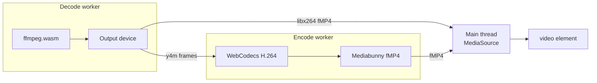
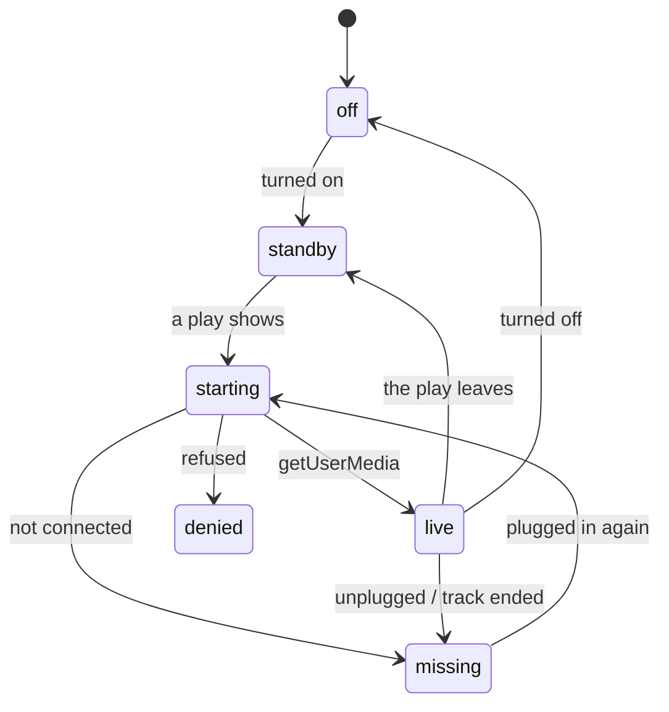
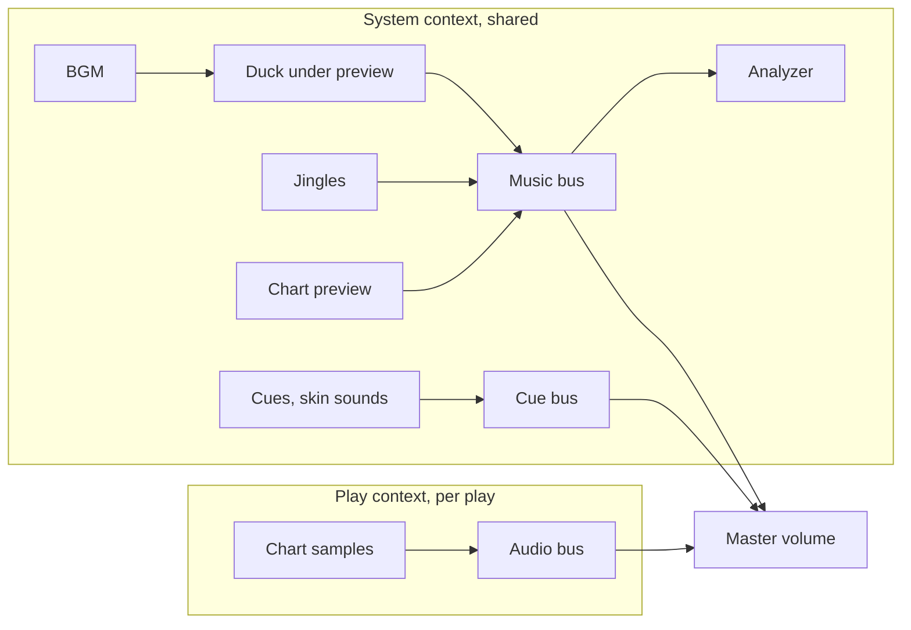

[Japanese version](./player-web-media.ja.md)

# Browser player audio, BGA, and recording

[Browser player overview](./player-web.md)

<details>
<summary>Table of contents</summary>

- [Audio, BGA, and recording](#audio-bga-and-recording)
  - [Audio output](#audio-output)
  - [BGA rendering](#bga-rendering)
  - [Recording and results](#recording-and-results)
  - [Leaderboard submissions](#leaderboard-submissions)
  - [BGA video transcode](#bga-video-transcode)
  - [BGA camera](#bga-camera)
  - [Audio service](#audio-service)

</details>

## Audio, BGA, and recording

### Audio output

Chart preview and gameplay use Web Audio.

- `@be-music/player-browser/audio` exports the platform audio session helpers (unrelated to the engine's internal `WebAudioSession`): `supportsSystemAudioSession`, `getSystemAudioSession`, and `applySystemAudioSessionType` feature-detect and set `navigator.audioSession.type`; `applySilentModePlayback(on)` sets `'playback'` (on) or `'auto'` (off). They swallow errors and are no-ops where the API is missing. Call them before creating or resuming an `AudioContext`, and again from the gesture that unlocks audio.
- Gameplay audio separates key, BGM, and master compressor stages in the default split topology.
- `?compressor=legacy` keeps the old single-compressor shape for comparison.
- `?compressor=off` disables compressor construction in the player.
- beatoraja theme audio uses the same browser bundle lookup for Lua `main_state.audio_play` / `audio_loop` calls, select BGM, navigation system sounds, decide BGM, and result jingles.

### BGA rendering

BGA events can reference still images and video.

- Every BGA rect (LR2 `#DST_BGA`, beatoraja `bga`, the built-in frames) stands for the 256x256 BMS canvas: a still image whose long edge is at most 256 px keeps its pixel size on it, centered horizontally and top-aligned over black, while larger images and videos fill the rect ([format compatibility](./format-compat-bms.md#217-bga)).
- The default family renders the same chart BGA layer stack as LR2 skins inside its built-in BGA frame.
- BMS rendering applies `#BGAxx` sub-regions, EXBMP still-image/opaque-video transparent-color keys, channel-scoped A1–A4 ARGB and input-bound A5 SWBGA. SWBGA includes keyed video crops and remapped NONSTOP resources, with selection/animation ending at the stage boundary and FIT-adjusted animation/movie clocks. See [BMS support](bms-spec.md).
- bmson rendering uses `bga.bga_events`, `bga.layer_events`, and `bga.poor_events`; unlike BMS layer channels, bmson layer images preserve black pixels instead of treating black as transparent.
- A BGA video the browser can't play (`.wmv`, `.avi`, `.mpg`, …) is transcoded to H.264 with ffmpeg.wasm and its single-threaded `@ffmpeg/core`, and starts playing while the transcode is still running ([BGA video transcode](#bga-video-transcode)). The multithreaded core is not installed because its current 0.12.x build crashes in libx264. BGA video has no sound in any case.

### Recording and results

- The result screen opens after a short delay. Samples already playing ring out across the transition.
- The gameplay recorder writes MP4 or WebM output and coordinates stop/finalization before scene disposal so active recordings are flushed before the gameplay bus is torn down.
- See the [replay specification](./replay.md) for recording, downloads, and playback.

### Leaderboard submissions

- With "Submit to Leaderboard" on (Options → Leaderboard, OFF by default, latched like the auto-save), a finished manual play is sent to the Leaderboard ([leaderboard.md](./leaderboard.md)) when the result scene mounts: it needs a signed-in account (a guest one is enough), rebuilds the play's fingerprint documents from the song's chart and checks them against the log before sending, resends with the chart document when the server asks for it, and shows the rank in the status line. The deployed Worker forwards `/api/*` and `/leaderboard/*` to the Leaderboard Worker through a Service Binding; `pnpm player:web` proxies them to a local one (`pnpm --filter @be-music/app-leaderboard run dev`, or `LEADERBOARD_DEV_ORIGIN`).
- "Submit when" (Options → Leaderboard, latched with "Submit to Leaderboard") picks which of those plays are sent: "EX-SCORE improves (first play always)" (the default) sends a play only when its EX-SCORE beats the player's own best on the chart, or "Always" sends every play. The best is the local record (`be-music.chart-best-records`, the chart's ordinary record under the judge ruleset in force) read as the play starts, before its result updates it; a chart without a recorded EX-SCORE counts as a first play and is sent, and an equal EX-SCORE is not an improvement. A play held back says so in the status line. The rule (`shouldSubmitPlay` in `leaderboard-submit-rule.ts`) only cuts traffic: the Leaderboard still decides what a sent play shows. Course runs are always sent whatever the rule, since a run is ranked by more than its EX-SCORE and is few requests.
- Accounts can start a guest account. "Keep this account" opens Accounts, where a passkey, Google or Discord keeps it as a regular account, which also lists its plays under its handle instead of behind the Guests filter; "Sign in" opens Accounts to sign in to another account, which moves this browser's guest plays into it.

### BGA video transcode

When the browser can't decode a BGA video, `loadVideoTextureFromBytes` transcodes it to H.264 and plays the result in the same `<video>` / Pixi `VideoSource` path as a native video. With the host's workers installed (`configureBGAVideoWorkers` from `./compute`, whose entries call `runBGAVideoDecodeWorker()` / `runBGAVideoEncodeWorker()`) and Media Source Extensions in the browser, the transcode streams: the video plays fragmented MP4 through a `MediaSource` (`ManagedMediaSource` where there is one, as on iPhone) as the fragments come, so the BGA is ready as soon as its first frame is.



- The decode worker boots the stock ffmpeg.wasm core and registers a character device as ffmpeg's output, so each piece of output reaches JavaScript while `exec` is still running. The output is scaled to even dimensions and resampled to a constant frame rate of at most 60 fps, which keeps a variable-rate source in time.
- On a cross-origin isolated page, ffmpeg writes raw y4m frames that the encode worker encodes with WebCodecs (hardware first) and muxes with Mediabunny. The decoder waits on a `SharedArrayBuffer` counter (`Atomics.wait`) while it is more than a few frames ahead of the encoder, so no frame is dropped and raw frames don't pile up.
- Elsewhere (a browser that cannot isolate the page, such as Safari, which does not support `Cross-Origin-Embedder-Policy: credentialless`), or with "Use WebCodecs encoder" off, or when the WebCodecs encoder fails, ffmpeg encodes with its own libx264 straight to fragmented MP4. Encoding on the decoding thread paces the decode by itself.
- The media source declares a provisional duration until the stream ends, so a cue seeking past what has been transcoded waits there for the frames. The same bytes on several tracks share one transcode, two transcodes run at a time, and closing the last video using one cancels it.
- Without the workers or MSE, or when the stream fails before its first frame, the whole file is transcoded before it plays (the earlier path).

### BGA camera

Options → **Camera** shows a camera in the play's BGA frame in place of the chart's BGA: a webcam on the hands to show the keys being played, or on the face for a stream. It works with every skin: the built-in Synesthesia, Plain and Native, LR2 skins and beatoraja skins.



- **One way in.** The app's `BGACameraService` (`services/bga-camera.ts`) opens the camera with `getUserMedia` and hands the `MediaStream` to the play through `PlayScene.setBGACamera({ stream, mirror })`. The scene wraps it in a `BGACameraFeed` (`media/bga-camera.ts`: a muted `<video>` and a Pixi `VideoSource`, as a chart's video BGA is) and puts it on the play session (`bgaCamera`). `renderBGA` (built-in and LR2 play screens) and the beatoraja BGA layer then draw the feed's texture in every BGA rect instead of the chart's BGA, fitted whole on black (`fitBGACameraRect`), and pause the chart's videos; a Be-Music Skin that composites the BGA itself (`drawsBGA`, the Native skin) gets a 256x256 canvas of it as `frame.bga.base`. It shows whatever the BGA setting and whether the chart has a BGA, and a built-in skin draws its BGA frame for it. Mirror flips the texture (`groupD8.MIRROR_HORIZONTAL`), so no sprite changes.
- **When the camera is on.** Only while the setting is on and a play is on the stage: the scene router's `setScene` tells the service which scene shows, so the camera closes on the select, decide and result screens, and a retry takes the open camera over without opening it again. Turning the setting, the camera or the mirror changes applies from the next frame, during a play too.
- **Choosing the camera.** The list comes from `enumerateDevices` and follows `devicechange`. Until the player allows the camera once, browsers list cameras without names, so the folder has an **Allow camera access** button that asks once and closes the camera again; it is disabled once the names are known. The pick is kept by `deviceId` and by name, so a camera whose id the browser changed is found again (`pickCamera` in `bga-camera-settings.ts`).
- **Losing the camera.** A camera unplugged during a play, or whose permission is taken back, ends its track: the service closes it, the play shows the chart's BGA again from the next frame, and the status line says so. A picked camera that is not connected is waited for and opens when it is plugged in.
- **Preview.** **Preview camera** shows the picked camera in the tab, mirrored as the play would show it, whether the setting is on or not, so a camera can be framed before a play. It opens the camera only when pressed (sharing the play's camera when one shows it), and stops when pressed again, when the tab is left or the dialog closes (the preview is no longer laid out), or when the camera goes away.
- **Privacy.** The picture goes only to the play's canvas; nothing sends it anywhere. A Capture recording records the canvas, so it includes the camera in the BGA frame.
- **Cross-origin isolation.** A `MediaStream` is not a cross-origin resource, so COEP `credentialless` does not affect it. Checked in Chromium with its fake camera (`--use-fake-device-for-media-stream`) with the page cross-origin isolated.
- **Replays and ghosts.** A replay plays on the same play scene, so it can show the camera too; a ghost's playfield or pacemaker draws no BGA of its own and is not affected.

### Audio service

`createAudioService()` (`@be-music/player-browser/audio`) is the one way the player plays sounds outside a play's chart ([ADR 0007](./adr/0007-one-system-audio-context.md)). The scene sessions play through it: every select, decide, play and result screen (a play opens its own graph through `openPlayGraph`). The web player creates one service at start-up and hands it to every scene made on it, and sets a beatoraja theme's files on it (`setTheme({ files })`) for the path-only cues and select BGM of the beatoraja select screen and the skin sounds of the beatoraja select, decide, play and result screens.



- The system context is created on first use, so a page without a user gesture does not start one the browser refuses. Each sound is decoded once per bytes (or theme file), and a failed decode is remembered.
- `setTheme({ sounds, files })` sets the theme's `SystemSoundSet` (player-scene-model) and, for a beatoraja theme, its files. `playCue(slot)` plays a cue of that set once. `playBGM` and `playJingle` take a slot or a resolved `SystemSound`. A sound given by path, such as a beatoraja theme's cues, is read from the theme's files.
- `playBGM(sound, { owner, volume, loop, duckUnderPreview })` keeps one BGM. A new one replaces it; the same one again keeps playing and only its owner and level change. It goes silent while a chart preview is audible, unless `duckUnderPreview` is `false`.
- `skinSounds.play` / `loop` / `stop` are a beatoraja skin's `main_state.audio_*` calls; `skinSounds.owned(owner)` makes the same calls with an owner.
- `preview.focus(target, owner)` drives the one `ChartPreviewEngine`. `analyzer.sample(now)` reads the music bus for audio-reactive Be-Music Skins.
- `openPlayGraph(chart, mode, busOptions, { owner })` opens a play's own `interactive` context and audio bus with `#VOLWAV` applied, and an analyzer on the bus output. `close({ delayMs, beforeClose })` ends it once the tail has rung out.
- `chartSamples` keeps the decoded samples of the play played last, so a quick retry (F5, R on the result) or a play of another chart of the same track (NORMAL → HYPER) does not decode them again ([#953](https://github.com/nulltask/be-music/issues/953)). It keeps each decode under the audio file a `#WAV` path resolves to (through the chart's folder, `#PATH_WAV` and the codec fallbacks), by identity, so two charts share a decode only when their paths resolve to the very same file: a same-named file in another folder, or another `#PATH_WAV`, decodes again. `chart/play-audio.ts` claims it with every file the play may sound: the decodes of those files it holds stay, and every other one goes before the play decodes, so the cache holds one play's samples at most and another `#RANDOM` branch does not add to it. A play from another source (the dropped folder or archive, by identity) or at another context sample rate releases everything first. The cache keeps the raw decodes only: each play still draws its own RANDOM, stretches for keep pitch, applies `#WAVCMD` / `#EXWAV` and peak gain to new buffers (peak gain scales a copy), and records a new replay. The samples sit through the select screen while its cursor is on a chart of the same track (the same source and folder); the preview's focus on any other chart, or on none, releases them (`chartSamples.keepTrackOf`). The web player calls `chartSamples.release()` on `pagehide`; a SILENT play releases it, and `dispose()` does too.

  ```mermaid
  stateDiagram-v2
    [*] --> Empty
    Empty --> Holding: play of a chart
    Holding --> Holding: retry of the same chart
    Holding --> Holding: another chart (released first)
    Holding --> Empty: select screen, pagehide, SILENT, dispose
  ```

- `stopOwned(owner)` stops everything an owner started: its BGM, jingles, cues and skin sounds, the preview it focused, and its play graphs that are not closing yet. A scene calls it on exit, since closing a context no longer stops its sounds. A sound started without an owner plays out, such as the decide cue as the select screen leaves. `dispose()` stops everything and closes every context.
