[English version](./player-web-scenes.md)

# ブラウザープレイヤーの構成

[ブラウザープレイヤーの概要](./player-web.ja.md)

<details>
<summary>目次</summary>

- [プレイヤーの作り](#プレイヤーの作り)
- [Scene lifecycle](#scene-lifecycle)
  - [gameplay family が共有するもの](#gameplay-family-が共有するもの)
- [シーンセッションとファミリービュー](#シーンセッションとファミリービュー)
  - [選曲画面](#選曲画面)
  - [決定画面](#決定画面)
  - [リザルト画面](#リザルト画面)
  - [プレイ画面](#プレイ画面)
  - [プレイの部品の置き場所](#プレイの部品の置き場所)
  - [レイヤーの分け方](#レイヤーの分け方)

</details>

## プレイヤーの作り

`packages/app-play/src/main.ts` がアプリを起動します。アプリは各ルートと Options ダイアログを共有サービスにつなぎます。画面の切り替えは各ルートからシーンルーターに依頼します。

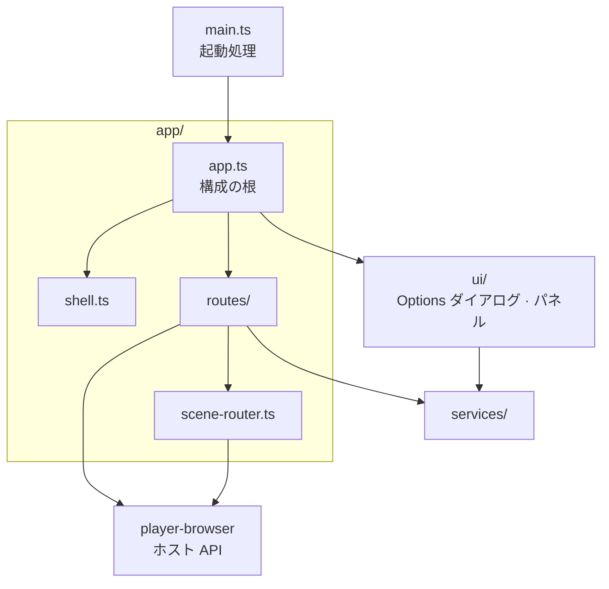

矢印は、モジュールから、それが作るもの・使うものへ向かいます。シーンルーターとサービスもアプリが作り、ルートと Options ダイアログ に渡します。

**起動処理**。
`main.ts` はページのマークアップを出力し、レンダラーを起動する前にブラウザーの互換性を確認します。非対応のブラウザーでも起動できない理由を表示できます。スマートフォンとタブレットを判別し、Help のダイアログを設定します。UI のフォントが使えるようになったら、アプリを作成し、テスト用フックを登録してから起動します。[テスト用フック](./player-web.ja.md#テスト用フック)

**アプリの組み立て**。
`app/app.ts`（`PlayerWebApp`）はサービス、ルート、シーンルーターを作り、互いにつなぎます。Options ダイアログと Leaderboard もここで接続します。

プレイ開始時に **Auto-save replays** の設定を確定し、開始時に適用するオプションをロックします。**Submit to Leaderboard**、**Submit when**、**Skin system** 以外のスキン操作もロックします。リザルト画面や選曲画面に移るとロックを解除します。**Skin system** では、譜面を再生したまま描画を担当するスキンファミリーを切り替えられます。

`app/shell.ts` はステージの周囲の表示をシーンに合わせます。選曲画面で譜面を決めると、`SelectScene.launching()` が `in-gameplay` を設定します。この状態ではピンチズームを無効にし、選曲画面の終了演出が始まる時点でヘッダーを退け、ステージをプレイ時のサイズに変えます。シーンの切り替え中も状態を保ちます。タッチ用の一時停止と Quit、ダブルクリックによる全画面表示、全画面での `Esc` もこのモジュールが扱います。

**レイヤー。** サービスは状態と規則を持ち、アプリから必要なものは deps として受け取ります。`ui/`、`app/` のモジュールは、型でも import しません（[レイヤーの規則とサイズの上限](./architecture.ja.md#レイヤーの規則とサイズの上限)）。ルートと Options ダイアログ はサービスを通して働き、ルートが scene を stage に載せるのは、すべての切り替えを受け持つシーンルーターを通してだけです（[Scene lifecycle](#scene-lifecycle)、[ADR 0006](./adr/0006-scene-router.ja.md)）。

**選曲と決定。** 選曲画面は `app/routes/select.ts` が出します。シーンルーターは選曲画面を決定画面、プレイ、リザルトのあいだも保持するので、戻るたびに同じ scene をまた出します。enter する前に最新のテーマのスキンと音、ライブラリを渡し、そのあとカーソルを元の位置（コースのあとはそのコースのバー）に戻します。作り直すのは、別のファミリーが描くようになったときだけです。選曲画面で始めた譜面は、作成中のコースがあればそこに加わり、なければ `app/routes/decide.ts` に進みます。こちらは決定画面を出し、その裏の stage の外でプレイを読み込み、決定画面が終わるとそのプレイに stage を渡します。決定画面がなければ、すぐに譜面を遊ばせます。

**プレイ、リザルト、リプレイ。** プレイはすべて `app/routes/play.ts` が作って出します。決定画面を通らない譜面（リトライ、F5、コースのステージ、NONSTOP のプレイ、リプレイ）はすぐに遊ばせます。選曲画面を保持したまま stage から外し、プレイに stage を渡して、そこで読み込んでから始めます。プレイの設定は純粋関数の `app/play-scene-options.ts` が作ります。Options ダイアログ の選択と有効なプレイオプションに、コースが許すレーンオプション、リプレイが記録した設定、選んだテンポを反映したものです。プレイが作られたときの内容を有効にするのは、そのプレイが stage を受け取ったときだけです。リザルトで R を押したときにもう一度遊ぶ開始の内容、リザルトを記録するキー、beatoraja のプレイのエントリです。そのため、決定画面の裏で読み込み中のプレイは、決定画面から戻ってもこれらを変えません。`app/routes/result.ts` は、プレイ、コースのステージ、コース全体、NONSTOP のプレイのリザルトを、描くファミリーのリザルトスキンで出します。後ろではプレイの最後の音が鳴り終わるまで残ります。記録を保ち、リプレイを保存してランキングに送り、次のステージ、R でのリトライ、または選曲画面へ進みます。`app/routes/replay.ts` は、ドロップしたリプレイを、記録された譜面が見つかったら再生します。探す順は譜面ファイルのハッシュ、パス、タイトルとアーティストです。

**コース。** 選曲画面でコースのバーを始めると `app/routes/course.ts` に進みます。NEW COURSE のバーならコースメーカーを始め、ランダムコースならステージをライブラリから抽選し、EXPERT や GRADE のコースは決定画面を出してからステージを 1 つずつ遊ばせ、コースリザルトを出します。NONSTOP のコースは `app/routes/nonstop.ts` がつなぎ合わせて 1 譜面として遊ばせ、F5 と R ではつなぎ直し、そのリザルトを出します。両者が扱うコースのプレイは `services/courses.ts` が持ちます。ステージの間のコース、始めたときの AUTO（どのステージにも、つなぎ直したプレイにも引き継ぎます）、終わったあとカーソルをコースのバーに戻すための選曲画面の位置です。シーンが求めていない遷移（ドロップ、スキンの切り替えなど）が来ると、シーンルーターの割り込みでコースのプレイを終えます。

**ライブラリと記録。** ドロップと Options ダイアログ の Open folder / Open files での選択を `app/drop-target.ts` が受け取ります。読み込み中の表示を出し、選曲画面を stage から外してからファイルを読みます。ブラウザはハンドラーが返るとドロップの中身を空にするので、ドロップの項目はハンドラーが最初に何かを待つ前に読みます。読んだものは `services/library.ts` が振り分けてライブラリを保ちます。譜面は曲のコレクションに、テーマのファイルは LR2 と beatoraja のテーマの読み込みに、コースファイルと保存した表のヘッダーはコースのフォルダーに、リプレイはリプレイに回します。ドロップまたは選択した ZIP アーカイブは、展開せずに中央ディレクトリから読んだエントリーの一覧で振り分けます（`services/drop-archives.ts`）。譜面を含むものは `?music=` のアーカイブと同じく丸ごと曲のコレクションに、それ以外（スキン、リプレイ、コースファイル）は `?skin=` のアーカイブと同じく展開してドロップの残りと一緒に振り分けます。`?music=` / `?skin=` のアーカイブの読み込みと、URL からの難易度表の取り込みもここで行います。[ベスト記録](./player-web.ja.md#ベスト記録)と、そのキーになる譜面のハッシュは `services/records.ts` が、[プレイヤーが作るコース](./player-web.ja.md#コースと段位認定)は `services/course-maker.ts` が持ちます。

**記憶したフォルダー。** Open folder で開いたフォルダー、またはブラウザーがディレクトリハンドルを渡すドロップで読み込んだフォルダーは記憶され（IndexedDB `be-music-folders`）、次回の起動時に、最初の選曲画面が出る前にもう一度一覧にします。この起動を短くするために 3 つの仕組みがあり、譜面ファイルを 1 つも読まず、フォルダーの走査も待ちません。

- **パース済み譜面**（`be-music-charts`、`services/parsed-chart-database.ts`）: 各譜面のパース結果を、ファイルの SHA-256 をキーに保存します。新しいビルドでは消去します。
- **フォルダーのスナップショット**（`be-music-folder-snapshots`、`services/folder-snapshots.ts`）: 前回読み込んだ時点の、各フォルダーのファイル一覧と、譜面ファイルごとのサイズ、更新日時、パース済み譜面のキーです。
- **一覧そのもの**（`services/folder-listing.ts`）: 全ファイルのパスです。専用の worker（`folder-listing-worker.ts`）で走査し、一覧にあるファイルは最初に読まれるときにだけフォルダーのハンドルから開きます。

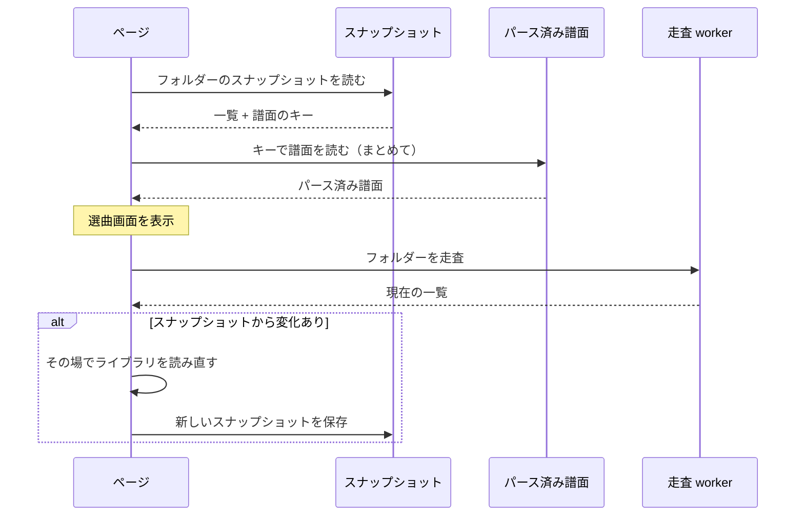

スナップショットのないフォルダー（初回）は、先に走査してから譜面を読み、ハッシュを計算してパースします。譜面が揃った時点でスナップショットを保存します。裏の走査は、一覧と、譜面ファイルごとのサイズと更新日時をスナップショットと比べます。違いがあれば、選曲画面の位置を保ったままライブラリを読み直します（`LibraryService.refreshCharts`）。キーを再び使うのは、キーを求めたときとサイズも更新日時も同じファイルだけなので、読むのは変化した譜面ファイルだけです。プレイ中は、選曲画面に戻るまで読み直しを待ちます。読めなくなったフォルダーはその旨を表示し、その譜面はライブラリから外れます。走査が終わるまでの一覧はスナップショットのものです。前回の起動以降にディスク上で編集した譜面は、その間だけ古いヘッダーで表示されます。LRX の譜面は、キーが隣のファイルにも依存するため、毎回読みます。

譜面が worker やパース済み譜面のキャッシュを通るときは、ほぼヘッダーだけの大きさです。イベントは値が収まる最小の幅の列に詰め（`packed-events.ts`）、一覧が読まないフィールド（リソース、小節、形式ごとのセクション、preservation）は JSON テキストのまま運び、どれかを最初に読むときにパースします（`deferChartFields`）。数千譜面のライブラリをキャッシュから取り出す時間は、譜面のオブジェクトを組み立てる場合の数分の一になり、一度もフォーカスしない譜面のオブジェクトは作られません。パース結果は譜面ファイルの MD5 も持ち、キャッシュのキーはファイルの SHA-256 で始まるので、ローダーは両方のハッシュを譜面と一緒に保持します（`seedChartFileHashes`）。コースのステージの照合やベスト記録の参照（`RecordsService.resolveChartHashes`）で、譜面ファイルを読み直すことはありません。

**テーマ。** ドロップが持ってきたテーマは `services/themes/` が持ちます。`lr2.ts` はこれまでのドロップの LR2 テーマをすべて持ち、そのうち 1 つを読み込みます。そのスキン、BGM、システム音と、コース用に読み直したスキンです。`beatoraja.ts` は beatoraja のテーマを持ち、そのエントリを scene kit として読み込みます。どのエントリを読むかはスキンの種類ごとに Options ダイアログ で選んだもの、オプションはプレイヤーが選んだものです。`built-in.ts` は標準のファミリーが描く Be-Music Skin と、その保存した設定、追加したスキンを持ちます。各画面をどのファミリーが描くか（Options ダイアログ の Skin system、選んでいなければ beatoraja、LR2、標準の順）と、そのときの kit と選曲画面の音は `app/family-kits.ts` が決めます。

**リプレイ履歴とスロット。** `ReplaySlotStore` は履歴のメタデータとスロットの割り当てをメモリーに持ち、必要に応じて IndexedDB から圧縮されたリプレイを読み込みます。`ResultReplaySlots` は対象のリプレイを1回保存し、スロットの条件を適用します。選曲画面の Lit パネルはすべてのスキンで履歴の再生とダウンロードを提供します。beatoraja はスロットの操作を独自に描画します。[リプレイスロット](./replay-browser.ja.md#リプレイスロット)を参照してください。

**リプレイ、録画、ステータス。** `services/replays.ts` は、player が書くリプレイの記録者として プレイヤーの名前（`REPLAY_RECORDER`: `be-music-web`、そのバージョンとビルド元のコミット）を持ち、リプレイを自動保存します。プレイのログはリザルトが出たとき、コースのログはコースリザルトが出たときに、そのプレイ（コースなら最後のステージ）を始めたときの Auto-save replays の設定に従って保存します。`services/recording.ts` は、Capture フォルダーの録画とスクリーンショットがプレイをまたいで使うものを持ちます。選曲画面で予約した録画（次のプレイと一緒に始まります）、次の録画を保存するファイル名（譜面のタイトル）、選んだ動画の形式です。録画そのものは `recording-controller.ts` が行い、録画中のものはシーンルーターが遷移のたびに確定させます。`services/status.ts` はステータス行を持ちます。Options ダイアログ の Status の行で、テスト用のフックが記録するものです。その行がプレイやリザルトを説明しているかどうかも持ちます。説明している行は、選曲画面に戻るとライブラリの要約に置き換わります。

**テスト用フック。** E2E テストの[テスト用フック](./player-web.ja.md#テスト用フック)（`window.__beMusicTest`）に答えるのは `services/test-hook.ts` です。読まれるたびに、シーンルーターが出しているシーン、選曲画面のカーソルとその下のバーの自己ベスト、stage のプレイ、ライブラリ、コースのプレイ、作成中のコースを読みます。結果、リプレイ、読み込みの完了など、アプリが渡すものは `test-hook.ts` が足します。読むだけで何も始めず、アプリがすでに持っているものからすぐに答えます。バーの自己ベストは選曲画面と同じく今の判定ルールのものです。譜面の自己ベストは、選曲画面がその譜面のハッシュを計算したあとはハッシュで、それまではパスで探すので、読んでも譜面のハッシュは計算しません。

**Options ダイアログ。** [Options ダイアログ](./player-web.ja.md#options-ダイアログ) は `ui/options/` にあります。`OptionsDialog`（`index.ts`）がフォルダーごとのモジュールでメニューを組み立て、アプリには `OptionsDialogDeps` を通してだけ触れます。アプリが設定、ライブラリ・記録・コースメーカーのサービス、アプリの状態を読む関数、アプリの操作をそこに渡します。タブ、フォルダー名、Play options のページは `folders.ts`、項目の説明の表示は `help.ts`、プレイ中に確定したオプションとスキンの操作にかけるロックは `play-lock.ts` です。beatoraja のスキンオプションのパネルは `ui/beatoraja-skin-options.ts` です。

## Scene lifecycle

browser player は session 全体で 1 つの `PixiSceneHost`（`host/scene-host.ts`）を使います。
host は 1 つの PixiJS `Application` を所有し、同時に 1 つの scene だけを表示し、scene transition を直列化し、host dispose 時だけ renderer を破棄します。

LR2 と beatoraja は同じ high-level scene set をそれぞれ持ちます。default family は、Be-Music Skin が decide 画面を持つときだけ decide 画面を表示します。

- chart browsing、preview playback、skin-side interaction を扱う select scene
- active family が提供する場合、gameplay 前の短い transition を扱う decide scene
- note、lane、BGA、HUD、judgment、audio、recording tap を扱う play scene
- score summary と skin-rendered result presentation を扱う result scene

標準・LR2・beatoraja のどの scene も `PixiScene` を実装し、host は `setScene` だけで scene を切り替えます。

- `root` は、scene の表示中に host が stage に載せる container です。scene はその下に scene graph を組み、自分で stage に載ることはありません。
- `identity` は `{ kind, family }` で、画面（`select`、`decide`、`play`、`result`）と、描く skin family（`built-in`、`lr2`、`beatoraja`）を表します。表示中の scene は `getCurrentScene()?.identity` でわかり、プレイヤーの test hook はシーンルーターが表示している scene の `identity` を報告します。
- `enter(host)` は scene が active になるたびに、host が `root` を stage に載せる前に呼ばれます。最初の entry で scene graph を組み、input と ticker の処理をつなぎます。2 回目以降は `exit()` で止めたものを再開し、画面の入場演出をもう一度始めます。
- `exit()` は別の scene に替わるときや stage を空にするときに、host が `root` を stage から外す前に呼ばれます。ticker の処理、input、画面自身の音（BGM、preview、jingle）が止まります。scene はもう一度 enter できます。
- `dispose()` はすべてを解放します。呼ぶのは scene の所有者で、`setScene` は置き換える scene を exit するだけです。

`SessionScene`（[シーンセッションとファミリービュー](#シーンセッションとファミリービュー)）も同じ契約に従い、`identity` は session と view から取ります。

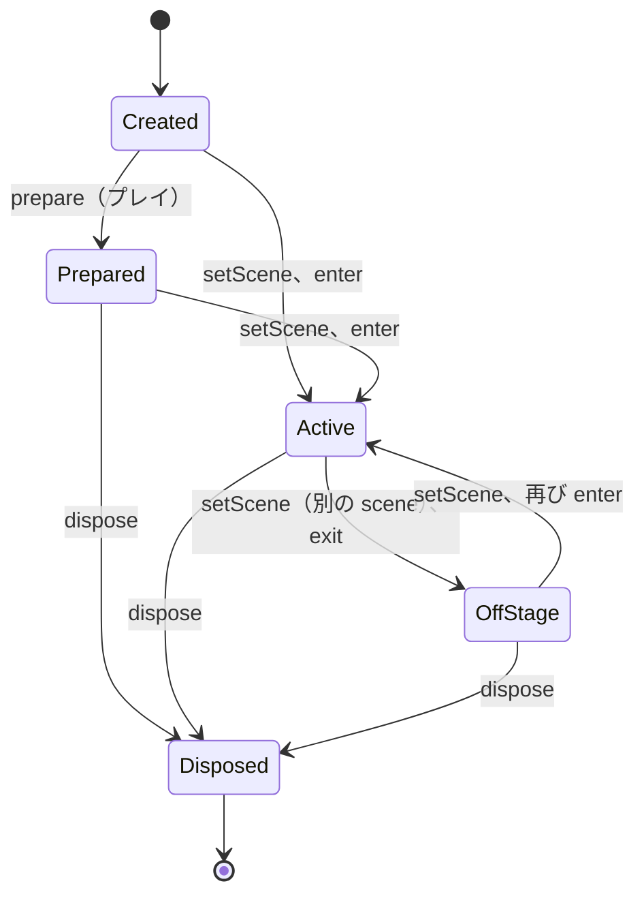

scene が表示する内容は表示の前に渡します。decide 画面はどれも `createDecideScene` の option、result 画面はどれも `createResultScene` の option、プレイ画面はどれも `createPlayScene` の option、select 画面はどれも `createSelectScene` の option です。

Web の player では、scene の所有者はシーンルーター（`app/scene-router.ts`、[ADR 0006](./adr/0006-scene-router.ja.md)）で、アプリ（`app/app.ts`）とそのルートは自分で `setScene` も `dispose` も呼びません。切り替えのたびに、録画中なら確定し、`setScene(next)` で表示中の scene を exit すると同時に次を enter させ（stage が空のフレームはありません）、そのあと退いた scene を dispose します。切り替えは 1 つずつ処理します。切り替えはそれぞれ 1 回の移動に属し、より新しい移動に置き換えられた移動のために作った scene（result の読み込み中に select 画面へ戻ったときの result など）は、表示せずに dispose します。ファイルを読み込むあいだ（ドロップ、ファイルの選択、URL）は、select 画面が表示中ならそれを stage から外して何も表示せず、読み終えたら戻します。

- **select scene は生かしておきます。** どの種類の select 画面も decide、プレイ、result のあいだも残ります。`exit()` で BGM と chart preview と描画を止めますが、cursor、一覧の状態、decode 済みの BGM は保ちます。もう一度 enter すると scene timer を始め直して skin の入場演出を再び流し、BGM を再開します。preview は、離れたときと別の譜面にカーソルが乗ってから始め直します。select 画面（`createSelectScene`）は exit で音を `stopOwned` で止め、input を外します。プレイヤーのルーターはこれを select scene として持ち、切り替えでは dispose しません。別の LR2 テーマや skin family を選んだとき、別の family のテーマに替わったとき、beatoraja の select 画面のルートで Escape を押したときに手放し（`dropSelect`）、次の select 画面を作り直します。
- **プレイは stage の外で読み込みます。** `prepare()` は stage にも listener にも触れずに譜面を parse して音声を decode するので、player は decide 画面の裏でプレイを準備します（ルーターの `prepare`）。decide 画面が終わると `setScene(play)` で decide scene を exit して、その裏で準備したプレイを enter し、`start()` で始めます。decide 画面のあいだに押した key は decide 画面にだけ届きます。decide 画面、プレイ、その読み込みは 1 回の移動を共有するので、Escape で decide 画面を離れると裏で準備したプレイも手放し、読み込みに失敗したときは decide 画面の `#RANDOM` の抽選（`preResolved`）でプレイを作り直します。decide 画面がないときは、player はプレイを作るあいだ select 画面を stage から外し、先にプレイを表示します。表示中に走る `prepare()` は読み込み中の playfield を描きます。
- **プレイの音は画面より長く残ります。** gameplay scene の `exit()` は描画と input を止めますが音は止めないので、最後の音が鳴っているあいだに result を表示できます。ルーターはそのあとプレイを `preserveAudioTail` で dispose します。ステージごとの result を飛ばすコースのステージも同じように stage を離れ、あいだに画面を挟まずに次のステージを表示します。
- **decide と result の scene は使い捨てです。** もう一度 enter すると timeline を最初から始めます。ルーターは別の scene が stage に載ると dispose します。次のステージやリトライへ進む result 画面は先に stage を離れるので、次のプレイの読み込み中に key を受けません。
- **外からの移動は、進行中の流れを終わらせます。** scene が求めた移動は、その流れを続けます。プレイの result、result からの次のステージやリトライ、コースの decide 画面とステージがそうです（`continuesRun`）。それ以外の移動（ドロップ、skin やテーマの変更、ファイル・URL・リプレイの読み込み）は流れを中断します。ルーターは移動の始まりにプレイヤーの `onInterrupt` を呼び、プレイヤーはコースの実行を終えます。そのため次の単曲のプレイがステージとして扱われることはなく、select 画面はコースのバーに戻ります。Options ダイアログ の skin の項目のうち、select 画面へ戻ってしまうもの（Built-in skin、Skin effects、LR2 theme、Add skin のボタン）はプレイ中は無効にします。Skin system は有効なままです。プレイ中に LR2 または beatoraja のスキンをドロップしても、譜面を終わらせずに描画する family を切り替えます。譜面も一緒にドロップしたときは選曲画面へ戻ります。選曲画面はプレイから戻ったときにその family になります。

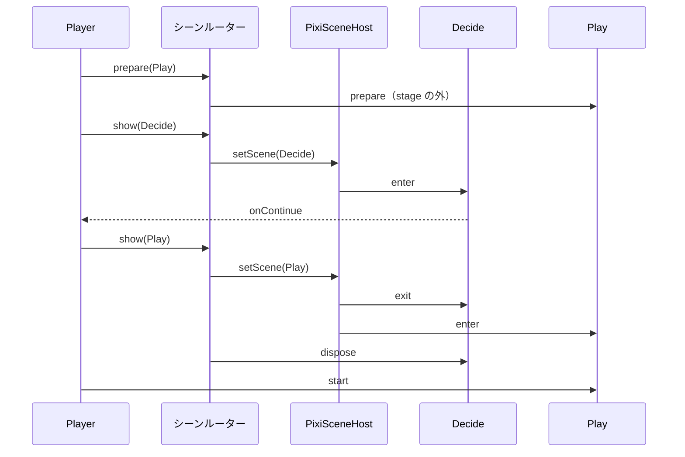

### gameplay family が共有するもの

どのプレイ画面も、同じプレイのセッションをそれぞれの種類のビューが描いたものです（[プレイ画面](#プレイ画面)）。プレイの音、見た目、終了処理を決める処理は 1 か所にまとまっていて、種類のあいだでずれることはありません。

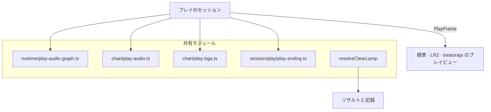

- `runtime/play-audio-graph.ts` は、プレイの AudioContext と bus を作ります（`#VOLWAV` を含む）。オーディオサービスがこれをプレイのために開きます（[オーディオサービス](./player-web-media.ja.md#オーディオサービス)）。
- `chart/play-audio.ts` は、`#WAV` のサンプルを audio session が引くキーでそこへデコードし、ピッチを保つテンポのときは伸縮し、`#WAVCMD` / `#EXWAV` の音量をまとめます。プレイの `#WAV` のパスが解決されるファイルのデコード結果をオーディオサービスの `chartSamples` が持っていれば、リトライでも同じ楽曲の別の譜面でもそれを使います（[オーディオサービス](./player-web-media.ja.md#オーディオサービス)）。
- `chart/play-bga.ts` は、プレイに要る BGA リソース（`#BMPxx`、bmson の `bga.header`、`#BGAxx` の切り出し元、LR2 view では暗黙の `#BMP00` POOR 画像）を選び、静止画は共通のテクスチャローダーで、動画は動画ローダーでデコードし、BMS の layer の黒を抜き、切り出し領域のビューを作ります。
- `session/play/play-ending.ts` は、プレイの終わりの時間を決めます（`resolvePlayEnding`、`beginExitSequence`）。最後まで進んだプレイは、最後のノートのあと譜面時刻で約 2 小節の余韻を置き、`exit-fade-out`（LR2 のタイマー 2、beatoraja の `TIMER_FADEOUT`）を出して、テーマや skin のフェードアウト（LR2 の `#FADEOUT`、beatoraja の `fadeout`）のあとに次の画面へ移ります。Escape と F5 も同じフェードアウトです。ゲージが尽きて途中で終わったプレイは、LR2 と beatoraja と同じくその場で止まります。`exit-close`（LR2 のタイマー 3、beatoraja の `TIMER_FAILED`）を出し、フェードアウトは出さず、スキンの close の時間（LR2 の `#CLOSE`、beatoraja の `close`）のあとに結果を出します。close の時間がないテーマ（組み込みスキン）は 1.5 秒待ち、その間に画面をフェードします。音はスキンの閉じる演出に合わせて、その close の間にフェードアウトします。LR2 と beatoraja はその場で音を切ります。画面のフェードは各ビューが `playEndingFadeAlpha`（`view/shared/play-frame.ts`）で行います。

  ```mermaid
  flowchart TD
    how{プレイの終了処理} -->|譜面の終わり、ESC、F5| fade[exit-fade-out：タイマー 2]
    fade --> next[フェードアウトのあと次の画面へ]
    how -->|ゲージが尽きた| stop[exit-close：タイマー 3、音をフェード]
    stop --> result[close の時間のあと結果へ]
  ```

- `resolveClearLamp`（`@be-music/player-engine/ruleset`）がクリアランプの唯一の規則です。どのリザルトもこれでプレイのランプを決めます。LR2 / 既定のリザルト（LR2 のリザルトのランプの op 101-105 も、LR2 のランプで）、`beatorajaClearLampOp` を通した beatoraja のリザルトと選曲です。player はどの family のプレイもこれで記録し、リーダーボードもこれで順位付けします。判定のルールセットのランプに合わせ、LR2 と 名前を言ってはいけないあのゲームではフルコンボが最上位（PERFECT・MAX なし）、LR2 では DEATH でのクリアを NORMAL にします。

## シーンセッションとファミリービュー

どの画面も同じ構造をしています（[ADR 0001](./adr/0001-skin-families-only-draw.ja.md)）。**シーンセッション**は、画面の振る舞いをスキンの種類によらず 1 か所に持ちます。**ファミリービュー**は、それを自分の種類のスキンで描きます。どの種類の選曲画面、決定画面、プレイ画面、リザルト画面もこの形で作ります（[選曲画面](#選曲画面)、[決定画面](#決定画面)、[リザルト画面](#リザルト画面)、[プレイ画面](#プレイ画面)）。

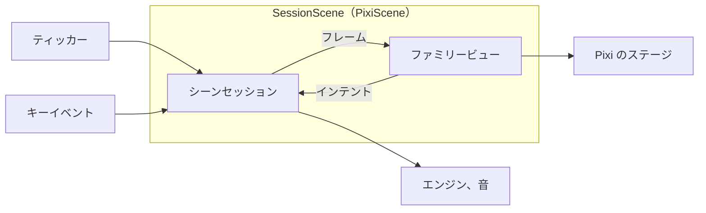

- **ファミリーキット**（`host/family-kit.ts`）。ホストが種類ごとに scene に渡すものです。`{ family: 'built-in', skin }`（Be-Music Skin とプレイヤーの設定値）、`{ family: 'lr2', skin }`、`{ family: 'beatoraja', kit }`（読み込んだテーマの 1 エントリ。スキン、テクスチャ、フォント、オプション、テーマのファイル）のどれかで、`SelectKit`・`DecideKit`・`PlayKit`・`ResultKit` があります。
- **フレーム**（`view/types.ts`）。セッションはティックごとに、シーンモデルの上に組んだフレームをビューに渡します。
  - `SelectFrame`: ライブラリ、`BrowseState`、一覧とカーソル、プレイオプション、記録
  - `DecideFrame`: 譜面、プレイが遊ぶとおりの譜面、コースのステージ、読み込みの進み具合
  - `PlayFrame`: `PlayState`、譜面の時刻、ノート、押されているレーン、前のフレームからのできごと
  - `ResultFrame`: `PlayResult`、プレイが遊んだとおりの譜面、その見せ方
- **インテント。** ビューは、プレイヤーが求めたことを scene ごとに返します。
  - 選曲: 一覧の操作、開始、プレイオプション、パネル
  - 決定: 進む、戻る
  - プレイ: タッチのレーン、ハイスピード、カバー、一時停止、中断
  - リザルト: 進む、リトライ
- **`FamilyView`** は `attach(host, emit)`・`draw(frame)`・`detach()`・`dispose()` を持ちます。外したビューは読み込んだものを保ちます。決定・プレイ・リザルトのビューは、スキンのタイミングも渡します。入力までの待ち、自動で進むまでの時間、フェードアウト（beatoraja のように Escape も入力を待つかどうかも）で、プレイなら読み込み終了・譜面開始・フェードアウト・クローズのオフセット（LR2 のスキンのもの、または beatoraja のスキンの 1.5 秒の前置きとフェードアウト）です。
- **`SessionScene`** は、セッションとビューから作る `PixiScene` です。
  - `enter(host)` でビューを付け、セッションを始め、最初のフレームを描きます。
  - ティッカーがセッションにフレームを求め、ビューに描かせます。
  - キーイベントは素のデータとしてセッションに渡します。テキスト欄にフォーカスがあるときは渡しません。ビューのインテントは、scene に入っている間だけセッションに渡します。
  - `exit()` は両方を外し、次の `enter` のために保ちます。`dispose()` で両方を終えます。
- **`PlayfieldSkin`** は、種類ごとのスキンが共通のプレイフィールドに渡すものです。ステージ、レーン、ノート・小節線・ボムの画像、エフェクトの長さです。プレイのビューは、プレイフィールドのまわりに自分で描くものも **`PlayChrome`** として共通のフレームの処理に渡します。自分のレイヤー、クローム、最後に描くテキスト、ボムが消えたときに止めるものです。この 2 つで、削除した `CoreGameplayView` のサブクラスが上書きしていたフックを置き換えました。

  | `CoreGameplayView` のフック                               | 置き換え先                                                                 |
  | --------------------------------------------------------- | -------------------------------------------------------------------------- |
  | `stageSize`                                               | `PlayfieldSkin.stage`                                                      |
  | `themeOwnsPlayfield`                                      | `PlayfieldSkin.ownsLanes`                                                  |
  | `resolveThemeLaneRect`                                    | `PlayfieldSkin.laneRect`                                                   |
  | `resolveThemeNoteCell`                                    | `PlayfieldSkin.noteCell`（チャンネルで引く）                               |
  | `renderThemeMeasureLines`                                 | `PlayfieldSkin.measureLines`（配置はプレイフィールド）                     |
  | `collectBGATargets`                                       | `PlayfieldSkin.bgaTargets`                                                 |
  | `renderBombEffects`                                       | `PlayfieldSkin.bombCell`                                                   |
  | `resolveBombDurationMs`                                   | `PlayfieldSkin.bombDurationMs`                                             |
  | `resolveKeyOnFadeMs`                                      | `PlayfieldSkin.keyOnFadeMs`（チャンネルで引く）                            |
  | `themeTiming`                                             | `PlayView.timing`                                                          |
  | `onThemeEvent`                                            | `PlayFrame.events`（`draw` で読む）。消えたボムは `PlayChrome.bombRetired` |
  | `updateThemeState`、`renderThemeLayer`、`renderThemeText` | `FamilyView.draw`（`PlayChrome.draw` と `drawText` のまわり）              |
  | `attachThemeLayers`                                       | `PlayChrome.attachLayers`                                                  |
  | `prepareTheme`                                            | ビューの読み込み。セッションが走らせる（`PlaySessionTheme.prepareView`）   |
  | `disposeTheme`                                            | `FamilyView.dispose`                                                       |

  LR2 のレーン番号と LR2 のタイマー番号は LR2 のビューの中にとどめます。セッションはキービームをチャンネルごとに持ち（`keyBeamStartedAt`、`keyBeamFadeStartedAt`）、プレイフィールドはチャンネルで尋ねます。

- **レイヤーの分け方。** `pnpm run check` は、セッション、ビュー、その下のレイヤーを互いに分けたまま保ちます（[レイヤーの分け方](#レイヤーの分け方)）。

### 選曲画面

`createSelectScene(kit, options)`（`@be-music/player-browser/host`）は、どの種類の選曲画面も作ります。選曲画面のセッション（`session/select/select-session.ts`）を kit の種類のビューが描くもので、`setScene` で表示する `SessionScene` です。標準の kit（`{ family: 'built-in', skin }`）は標準の選曲画面のビュー（`view/built-in/select-view.ts`）が、LR2 の kit（`{ family: 'lr2', skin }`。テーマの選曲画面のスキン）は LR2 の選曲画面のビュー（`view/lr2/select-view.ts`）が、beatoraja の kit（`{ family: 'beatoraja', kit }`。`loadBeatorajaSceneKit` で読み込んだテーマの選曲画面のエントリ）は beatoraja の選曲画面のビュー（`view/beatoraja/select-view.ts`）が描きます。標準と LR2 のビューはポインターの入力（`view/shared/select-pointer.ts`）を共有し、どのビューも README のダイアログを画面の上に出します（`view/shared/readme-dialog.ts`。`@be-music/player-ui` の `<be-music-readme-dialog>` をホストの DOM レイヤーに置きます）。ダイアログには、選んでいる譜面のフォルダにある最初の `.txt` ファイル（`collection/readtext.ts`）を、譜面と同じ方法で文字コードを判定して表示します（`decodeBMSText`。BOM、厳密な UTF-8、Shift_JIS などの古い文字コードのうち最もそれらしいもの、の順）。テキスト中の Web アドレスとメールアドレスはリンクになり、新しいタブで開きます。

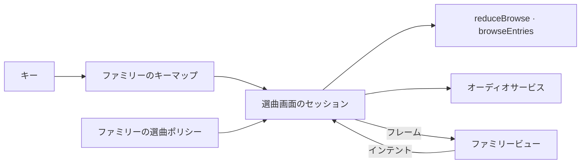

- **オプション。** `library`（譜面のファイルを含むコレクション）、`browse`（開く位置の `BrowseSnapshot`）、`playOptions`、`records`（バーとパネルに出す自己ベスト）、`sounds`（テーマの `SystemSoundSet`）、`audio`（ホストのオーディオサービス）、`courseMaker`（プレイヤーのコースと作っているコース。LR2 のスキン向け）、`on`：`start(entry, { autoPlay })`、`playOptions`、`search`、省略できる `readtext`・`courseMaker`（コースの名前を付ける、消す）・`skinConfig`・`skinConfigChange`（beatoraja のスキンが自分のオプションを変えた）・`exit`。
- **scene。** `snapshot()`、`focused()`、`getPlayOptions()` / `setPlayOptions()`（ホストによる変更で、`on.playOptions` には返しません）、`setLibrary()`（同じライブラリなら描き直し、新しいライブラリならプレイヤーの位置をその上に保ちます）、`restore()`、`refreshRecords()`、`setSearch()` / `setSearchEditing()`、`searchError()`（検索中の `?` の譜面フィルター式を解析できない理由）、`searchFieldRect()`、`setSounds()`、`updateKit()`（Be-Music Skin へのプレイヤーの設定、別の LR2 の選曲画面のスキン、または読み込み直した beatoraja の選曲画面のエントリ。前と同じエントリなら何も作り直しません）。
- **キー**（`session/select/select-keys.ts`）。ファミリーのキーマップで決まります。どのキーも操作表（`CONTROL_ACTIONS`）の操作なので、ユーザーが変更できます。LR2 の画面と、ユーザーが beatoraja のキー操作を選んでいない内蔵スキンの画面（`builtInControlScheme`）では、↑ / ↓ とスクラッチでカーソルを動かし（スクラッチを下に回す、つまり 2 つ目のキーで次のバーへ）、Enter と白鍵でフォルダを開くかバーを始め、→ でフォルダを開き（譜面の上では SELECT や数字の 1 と同じく、同じ曲の次の譜面へ移ります。同じソースの同じディレクトリにある譜面です。`select-difficulty.ts`）、鍵盤 6 は離したときにバーを AUTO で始め（`REPLAY_HOLD_MS`、2 秒押し続けると、代わりに保存したリプレイを再生します）、鍵盤 4 は短く押すと戻り、`RANKING_HOLD_MS` 押し続けると Leaderboard でその譜面のランキングを開きます（`SelectSessionEvents.ranking`。LR2 の IR）。F3 を押している間は矢印キーがレベルの編集になり（↑ / ↓ で難易度、← / → でレベル。`SelectSessionEvents.levelEdit`。Web player はこのブラウザに編集を保存し、ライブラリを読むたびに譜面に当てはめます。`chart-level-edits.ts`）、Escape・Backspace・←・鍵盤 2 でフォルダから戻ります。F1 でヘルプを開きます。START・Space・Tab でプレイオプションのパネルを開きます。短く押すと次に押すまで開いたまま、`PANEL_HOLD_MS` 以上押し続けると押している間だけ表示します（LR2 と同じ）。開いている間は、LR2 のパネル 1 と同じく 1P の鍵盤で設定を切り替えます（鍵盤 1 が鍵盤数の絞り込み、2 がランダム、3 がバトル（DP の絞り込みでは DP FLIP）、4 がゲージ、5 / 7 がハイスピード、6 がオートスクラッチ）。Escape で閉じます。数字の 2 でソート、3 で鍵盤数の絞り込みを切り替え、0 で検索を開き、F8 でライブラリのフォルダを読み直します（`SelectSessionEvents.reload`。Web player はドロップしたフォルダをたどり直すので、その後ディスクで足した・変えた・消した譜面が反映されます。選んだファイルやアーカイブはそのまま読み直します。Bemuse 音楽サーバーの index と難易度表のヘッダー・曲リストも、保存した内容の古さにかかわらず取り直します。`LibraryService.reloadCharts`）。F2 で Options ダイアログを LR2 マニアオプションに開きます（`SelectSessionEvents.maniaOptions`）。LR2 がマニアパネルを出すキーです。beatoraja の画面では、↑ / ↓ とスクラッチでカーソルを動かし（スクラッチを上に回すと次のバーへ）、Page Up / Page Down で 10 本、Home / End で先頭と末尾のバーへ、R でランダムなバーへ（beatoraja のランダムセレクト）移ります。Enter・→・鍵盤 1 でフォルダを開くかバーを始め、鍵盤 3 でフォルダを開き、鍵盤 5 でバーを AUTO で始めます。Escape でフォルダから戻り（ルートではどの画面でもまず確認します）、Backspace・←・鍵盤 2 / 4 はフォルダの中でだけ戻ります。数字の 1 で鍵盤数の絞り込み、2 でソート（beatoraja の順）、3 で LN モードを切り替え、0 で検索を開き、F2 でフォルダを読み直し、F8 / F9 で曲 / 譜面をお気に入りにします。Ctrl+F3 と Ctrl+Shift+F3（Mac では ⌘）で選んでいる譜面の MD5 と SHA-256 をコピーします（`SelectSessionEvents.copyChartHash`。Web player はクリップボードに書き込みます）。F10 で選んでいるフォルダ（譜面の上では表示中の一覧）の譜面を順に AUTO で再生します（`SelectSessionEvents.autoplayFolder`。Web player はこの画面に戻るたびに次の譜面を始め、プレイを中断すると終わります）。数字の 8 で検索やお気に入りの一覧から、その譜面があるフォルダを開き、9 でその譜面のテキストファイルを開くか閉じます。beatoraja の 7（ライバルのランプ）、F3 単独（譜面のフォルダをファイルマネージャーで開く）、リザルトの鍵盤 6（次のグラフ）は受け付けません。Web player の選曲画面にはライバルがなく、開くファイルマネージャーもなく、ゲージのグラフも 1 つだけだからです。START・SELECT・数字の 5（または START と SELECT の同時押し）で beatoraja のオプションパネル 1〜3 を開きます。スキンはパネルのタイマー（開くとき 21〜23、閉じるとき 31〜33）と `OPTION_PANEL1`〜`3` で描きます。パネルを開いている間は、1P の鍵盤で beatoraja と同じ設定を切り替えます（`BEATORAJA_PANEL_KEYS`。パネル 1 は RANDOM、ゲージ、DP オプション、HS-FIX、2P の RANDOM。パネル 2 は CUSTOM JUDGE、CONSTANT、判定エリアの表示、LN モード、BPM ガイド、地雷。パネル 3 は BGA、ゲージの自動シフト、判定タイミングの自動調整、表示時間と判定タイミングの 1 ms ずつの調整）。ルートで Escape を押すと、どの種類でも終了メニューを開きます（`SelectSessionEvents.exitMenu`。PC 版の終了メニュー）。Web player はドロップ画面へ戻るかを確認し（`ui/exit-menu.ts`）、キャンセルか Escape ならこの画面のままです。どの画面でも F4 でフルスクリーンを切り替え、F6 でスクリーンショットを撮り、フレームレートのキー（スキンの種類に従い、LR2 は F7、beatoraja は F1）でフレームレートの表示を出し入れします（`ui/fps-overlay.ts`）（プレイ中の譜面のレーンが使うキーならレーンになります）。README のダイアログが開いている間は、↑ / ↓・Page Up / Page Down・Space・Home / End でスクロールし、Enter・Backspace・Escape で閉じます。ほかのキーは後ろの一覧に届きません。閉じるボタンとダイアログの外のクリックでも閉じます。ヘルプの「キーボード」タブは、各画面のキーをキーボードの図で示します（`ui/keyboard/`、`<be-music-keyboard-map>`）。図はユーザー自身のレーンキー・START / SELECT・操作のキーから作り、そこで選んだキー操作（最初は表示中の画面が使うもの）で描きます。数字は白鍵と黒鍵、◎ はスクラッチ、ST / SL は START / SELECT、● は操作のキーを表し、横の一覧の行を指すとその操作のキーが光ります。
- **ポインター。** ビューは、バーのクリックやタップ、スワイプとその惰性、ホイール、スキンの当たり判定をインテントにします。Be-Music Skin では PLAY・AUTO・検索・プレイオプション・README の当たり判定（Synesthesia と Plain は選んでいる譜面のカードの右上に小さな README ボタンを描き、Native は詳細パネルに README ボタンがあります。どれも README がある譜面でだけ有効です。`frame.hasReadme`）、LR2 スキンではボタン（`resolveLR2SelectButton`・`resolveLR2CourseMakerAction`：パネル、ハイスピード、プレイオプション、ソートとフィルター、PLAY / AUTOPLAY / READ TEXT、コースメーカー）、検索語、コース名です。LR2 のバーをクリックすると、その間のスロット分カーソルを動かしてそのバーを選びます。beatoraja のバーは、カーソルの下のバーならクリックで選び、ほかのバーならその間の行の分だけカーソルを動かします。beatoraja のスキンのボタン（`image[].act`）は PLAY、AUTO、PRACTICE（PLAY として遊びます）、READ TEXT、曲と譜面のお気に入り、MODE と SORT です。MODE と SORT は一覧の位置のキーモードフィルターとソートを切り替えます（Shift で逆に回ります）。
- **LR2 の描画。** LR2 のビューは `resolveLR2SelectState` でスキンを描き、フレームが伝えること（`SelectFrame.events`）から LR2 のタイマーを始めます。入場でタイマー 0、`#STARTINPUT` のあとでタイマー 1、カーソルが動くとタイマー 10〜13（バーはその分スライドし、フォルダを開くか閉じると 1 本分スライドします）、オプションパネルの開閉でタイマー 21〜29 と 31〜39、コースを作り始めるときと終えるときにタイマー 17 / 18 です。LR2 の番号はビューの中にとどまります。
- **beatoraja の描画。** beatoraja のビューは選曲画面のスキンを `BeatorajaPlaySkinView` で、キャンバスをウィンドウに合わせて描きます。`@be-music/skin-beatoraja/scene` のシーンの対応づけで、カーソルの下のバーの op、数値、テキストと、MODE・SORT・LNMODE の imageset を決めます（`resolveBeatorajaSelectBarOps` / `Number` / `Text` / `RefValue` / `SliderValue`。一覧の位置の一覧オプションと、`records` から読むバーの自己ベストのランプを使います）。バーの一覧はスキンの `songlist` のアンカーの位置にあり（`view/beatoraja/select/rows.ts`）、カーソルへ滑ります。一周するときは近い向きに滑ります。カーソルの下の譜面の画像、BPM グラフとノーツグラフ、検索中は一致した数を出すプロンプトも描きます。beatoraja のタイマーはフレームから読みます。scene のタイマー（0）は入場から、バーの変更のタイマー（11）はカーソルの下のバーが変わるたびに始まります。LNMODE ボタンの選択はビューの中にとどまります。一覧のモデルはこれを持ちません（まだ何もこれで遊びません）。JUDGE TIMING ボタンはスキンのタイミングのずれ（数値 12）を変え、オプションをホストに渡します（`on.skinConfigChange`）。番号はビューの中にとどまります。
- **リプレイスロット。** `records.replaySlots` を渡すと、セッションはカーソルの下のバーが変わるたびにリプレイのある最初のスロットを選び、フレームに載せます（`SelectFrame.replaySlots`）。beatoraja のキーマップでは 4 と F で次のスロットを選び、V で再生します（リプレイのあるスロットがなければバーを通常どおり遊びます）。beatoraja のスキンのリプレイボタン（19、316-318）と `SelectScene.replay(slot)` はそのスロットを再生します。リプレイの開始は `replaySlot` 付きで `on.start` に届きます。`on.focus` は、ホストのリプレイスロットのカードのために、カーソルの下のバーが変わるたびに知らせます。
- **コースメーカー。** セッションは LR2 スキンの完了・キャンセル・つなぎのボタンを `courseMaker` で実行します。つなぎの変更と削除（`on.courseMaker('delete', course)` を通し、ホストが確認します）は、カーソルの下にあるプレイヤー自身のコースにだけ効きます。
- **開始。** 譜面で Enter、クリック、PLAY / AUTO を押すと、Be-Music Skin の開始の演出のあとで `on.start` に渡します（その間の入力は待たせます）。コースはすぐに渡します。譜面の開始の演出が始まるとき、`on.launch` で譜面が選ばれたことをホストに伝えるので、ホストはその時点でプレイの読み込みを始められます。決定の効果音と決定音は `on.start` が `false` を返さなかったときに鳴ります（[決定音](#決定音)）。ステージが欠けたコースはキャンセルの効果音を鳴らします。
- **音。** セッションはオーディオサービスで鳴らします。選曲 BGM（半分の音量で、プレビューの間は消えます）とカーソルの下の譜面のプレビューはセッション自身のもので、画面の exit が `stopOwned` で止め、次の入場で BGM がまた始まります。効果音と決定音はオーナーなしで最後まで鳴ります。プレビューはカーソルの下の譜面に従い、検索でも追従します。離れたときと同じ譜面にカーソルを置いて戻ってきたときは、カーソルが動くまでその譜面のプレビューを始め直しません。beatoraja のスキンの Lua の音（`main_state.audio_*`）は、オーディオサービスのスキンの音でセッションのものとして鳴らします（`skinSounds.owned`）。画面を出るときにこれも止まります。beatoraja のテーマの音のセット（`systemSoundSetFromBeatoraja`）は効果音と選曲 BGM をパスで持ち、テーマのファイルから読みます（`audio.setTheme({ files })`）。決定音は持ちません。beatoraja の決定画面がテーマの決定音を鳴らします。

一覧、一覧の位置、選曲ポリシーは、どの種類の画面でもファミリーの選曲ポリシーに沿って同じように働きます。

- **一覧。** セッションは `@be-music/player-scene-model` の一覧のモデル（[一覧](./scene-model.ja.md#一覧ブラウズ)）の `BrowseState` を持ちます。コマンドは `reduceBrowse` を通り、描く一覧は `browseEntries`、フォルダとオプションの効果音は `browseSystemSound` から決まります。標準と LR2 の画面では、ソート、キーモードフィルター、難易度フィルターはプレイオプション（LR2 のオプションパネル、LR2 スキンのボタン、Be-Music Skin のプレイオプション、ホストの `setPlayOptions`）に置いたままで、一覧はそれに従います。beatoraja の画面では、MODE と SORT のボタンが一覧の位置のキーモードフィルターとソートを変え（beatoraja に難易度フィルターはありません）、プレイオプションはそれに触れません。ソートやフィルターを変えても、カーソルはそれまでのバーに残ります。フィルターでそのバーが消えたときは同じ行に、範囲に収めて残ります。検索を変えるとカーソルは先頭に移ります。キーモードフィルターは譜面をそのキーモードの下に並べるので、24 鍵の譜面は、キーモードフィルターに 24 鍵の選択肢のない LR2 の画面では ALL にだけ、beatoraja の画面では 24 KEYS（または 24 KEYS DOUBLE）に並びます。フォルダのバーはどのフィルターでも並び、コースのフォルダはフィルターのキーモードのコースと、キーモードを持たないコースを並べます。検索は譜面のタイトル、サブタイトル、アーティスト、ジャンル、ファイル名と、コースの名前に、前後の空白を除いた文字列で、大文字と小文字を区別せずに一致します。文字列全体を 1 つの語句として扱い、語に分けず、引用符や `OR` も読まず、全角と半角、ひらがなとカタカナも同一視しません。`?` で始まる検索は譜面フィルター式です（beatoraja のランダムコースの SQL の `WHERE` 句、[course.ja.md](course.ja.md#フィルタの列)）。セッションは各譜面を `createCourseChartRecord` で読み（譜面ごとに 1 回だけ解決）、`score` の行はそのときの記録から読むので、`refreshRecords()` のあとは新しい記録で並べ直します。式を解析できないあいだはフレームに `searchError` が載り、一覧は絞り込みません。ページの検索欄（`InlineSearch`）は自身を不正な入力として示し、その理由をすぐ下に出します。Native スキンは自分の入力欄の下に出します。ヘルプの「使い方」タブは 2 種類の検索を例とともに説明します。例（`ui/help-search-examples.ts`）は `help-search-examples.test.ts` が `listEntriesAt` で検索し、ヘルプに書いたとおりに並ぶことを確かめます。ソートはルートのフォルダのバーもラベルで並べます。
- **一覧の位置。** `BrowseSnapshot`（`captureBrowse`）は `restoreBrowse` で戻します。保存したときの検索、ラベルでたどれる限りのフォルダ、各親のカーソルを開いたフォルダのバーに置き（戻るとそのバーに着きます）、保存したバーがまだ並んでいればキーで探してカーソルをそこに置きます。ソートとフィルターは、標準と LR2 の画面ではそのときのものを保ち、beatoraja の画面ではスナップショットのものに戻します。
- **選曲ポリシー。** モデルが画面に任せることは、ファミリーの選曲ポリシー（`session/select/select-policy.ts`）で決めます。標準と LR2 の画面では、ルートで戻っても何もせず、戻す位置がなければ譜面フォルダが一つだけのライブラリはそれを開きます。beatoraja の画面では、ルートで戻るとキャンセルの効果音を鳴らして画面を出て（`on.exit`）、ライブラリはルートで開き、ソートとキーモードフィルターは一覧の位置に置き、キーは beatoraja のもので、フォルダを開くか閉じるとフォルダの効果音だけを鳴らします（LR2 では一覧が滑るたびと同じく、カーソルの効果音も一緒に鳴ります）。

Web player は、どの種類が描く場合も選曲画面の scene を 1 つ保ち、プレイ、コース（カーソルはコースのバーに戻ります）、スキンの変更をまたいでスナップショットを保持し、ドロップしたフォルダもスナップショットで開きます。Options ダイアログ の Play options でも標準と LR2 の画面のソートとフィルターを設定できます。beatoraja のテーマの選曲画面のエントリは一度読み込み、テーマとエントリが同じ間は戻るたびにそれを渡します。スキンのオプションのパネル、JUDGE TIMING ボタン、Options ダイアログ のスキンの選択は、エントリを読み込み直して `updateKit` で渡します。beatoraja の画面のルートで Escape を押すとドロップの画面に戻ります。

### 決定画面

`createDecideScene(kit, options)`（`@be-music/player-browser/host`）は、どの種類の決定画面も作ります。決定画面のセッション（`session/decide/decide-session.ts`）を kit の種類のビューが描くもので、`setScene` で表示する `SessionScene` です。標準の kit（`{ family: 'built-in', skin }`）は標準の決定画面のビュー（`view/built-in/decide-view.ts`）が、LR2 の kit（`{ family: 'lr2', skin }`。テーマの決定画面のスキン）は LR2 の決定画面のビュー（`view/lr2/decide-view.ts`）が、beatoraja の kit（`{ family: 'beatoraja', kit }`。`loadBeatorajaSceneKit` で読み込んだテーマの決定画面のエントリ）は beatoraja の決定画面のビュー（`view/beatoraja/decide-view.ts`）が描きます。

- **オプション。** `chart`（これから遊ぶ譜面）、`course`（コースのステージなら、そのコース）、`playOptions`（スキンに見せるプレイオプション）、`source`（スキンの画像のための譜面のファイル）、`sounds`（テーマの `SystemSoundSet`）、`audio`（ホストのオーディオサービス）、`progress`（裏で準備しているプレイの読み込みの進み具合。ないときは、自動で進むまでの時間のうち過ぎた割合をフレームに入れます）、`on: { continue, cancel }` です。
- **タイミング。** セッションは、ビューのスキンのタイミング（`DecideView.timing`）で画面を進めます。入力は入力までの待ちのあとに受け付けます。自動で進むまでの時間がたつと、画面はひとりでにプレイへ進みます。その時間がなければ、プレイヤーの操作を待ちます。画面を出るときはまずフェードアウトし、そのあと `on.continue`（プレイへ）か `on.cancel`（選曲画面へ戻る）を、enter ごとに 1 回だけ呼びます。Be-Music Skin の画面はすぐに入力を受け付け、`decide.durationMs`（既定は 2000 ms）のあとに進み、フェードアウトはありません。LR2 スキンの画面は `#STARTINPUT`（なければ 1500 ms）のあとに入力を受け付け、その 1200 ms 後に進み、`#FADEOUT` の間フェードアウトします。beatoraja スキンの画面は `input`（なければ 500 ms）のあとに入力を受け付け、`scene`（なければ 3000 ms）のあとに進み、`fadeout`（なければ 500 ms）の間フェードアウトします。`scene` が 0 なら、入力を受け付ける前にすぐ進みます。beatoraja の [`MusicDecide`](https://github.com/exch-bms2/beatoraja/blob/c2ed5db1a46145ed10790c3872f717e95b59db9d/src/bms/player/beatoraja/decide/MusicDecide.java#L46-L50) が `nowtime > scene` になった時点でフェードアウトを始めるためで（46〜50 行）、Escape でも選曲画面へは戻れません。
- **入力。** Enter、Space、鍵盤（LR2 はどれでも、beatoraja は鍵盤 1 / 3 / 5 / 7）、キャンバスのクリックは、入力を受け付けてから進みます。START と SELECT を同時に押すと戻ります。beatoraja の画面は、beatoraja と同じくクリックもタップも受け付けず、`scene` のあとにひとりでに進むので、タッチの端末でもプレイに進めます。Escape はいつでも戻ります。LR2 が `#STARTINPUT` の前でも Escape を受け付けるのと同じです。beatoraja のスキンでは、beatoraja の `input` がすべてのキーを待たせるのと同じく、Escape も入力を受け付けるまで待ちます（`SceneViewTiming.escapeWaitsForInput`）。キーリピートは無視するので、選曲画面から押したままの Enter で画面を飛ばすことはありません。
- **標準の描画。** 標準のビューは、Be-Music Skin の `decide` をそのステージに描き、ウィンドウにレターボックスで収めます。`decide` のないスキンではすぐに先へ進みます。Native は DOM の画面を描きます。Synesthesia は、選曲画面が始めた決定時のワープを引き継ぎます。選曲画面のアウトロは最初の 210 ms（パネルが消え、カメラがまっすぐな突進に落ち着き、曲名が詰まり始めるところ）を描き、そこから決定画面が決定からの経過時間で同じワープを引き継ぎます（`skins/synesthesia/launch-warp.ts`）。曲名のズームとロックオンのレティクルを仕上げ、ジャンル、モード・難易度・レベル、バナー、薄いステージファイルを加え、最後の 320 ms で暗転します。表示時間は 1800 ms です。
- **LR2 の描画。** LR2 のビューは、譜面の `#STAGEFILE` の上に決定画面のスキンを `resolveLR2DecideState`（譜面の難易度、キーモード、テキスト。コースのステージならコースのもの）で描きます。LR2 のタイマーはフレームごとにフレームから読みます。タイマー 0 は画面に入った時刻から、タイマー 1 は入力を受け付けた時刻から、タイマー 2 は画面を出始めた時刻からです。タイマーの ID はビューの中にとどめます。
- **beatoraja の描画。** beatoraja のビューは、決定画面のスキンを `BeatorajaPlaySkinView` で、キャンバスをウィンドウに合わせて描きます。`@be-music/skin-beatoraja/scene` のシーンの対応づけで、譜面の難易度の op、`#PLAYLEVEL` と BPM、読み込みのバーと割合（`NOW_LOADING` のあと `LOADED`。`resolveBeatorajaDecideOps`、`resolveBeatorajaDecideNumber`、`resolveBeatorajaDecideGraphValue`）と、譜面とスキンのテキストを描きます。`DecideFrame.playChart` の BPM グラフとノート種別のグラフ、譜面の `#STAGEFILE`・`#BACKBMP`・`#BANNER` も描きます。画像は最初のフレームの前に `source` から読み込みます。beatoraja のタイマーは、フレームごとに画面自身のクロック（入ってからの ms）で読みます。タイマー 0 は画面に入った時刻から、タイマー 1 と READY / PLAY は入力を受け付けた時刻から、タイマー 2 は画面を出始めた時刻からです。
- **音。** セッションは、画面に入るときにテーマの決定音（`sounds.decideBGM`）をオーナーとしてオーディオサービスで鳴らし、画面がステージから外れるときに `stopOwned` で止めます。Web プレイヤーは、標準と LR2 の決定画面に決定音を渡しません（`sounds: {}`）。[決定音](#決定音) を見てください。beatoraja の画面にはテーマの決定音を渡します（`systemSoundSetFromBeatoraja`）。beatoraja スキンの Lua の音（`main_state.audio_*`）はオーディオサービスのスキンの音でセッションのものとして鳴らすので（`skinSounds.owned`）、画面を出るときに一緒に止まります。
- **`#RANDOM`。** セッションは、scene を作るときに譜面の `#RANDOM` / `#SWITCH` の分岐を 1 回だけ引きます。beatoraja の決定画面と同じです。`scene.resolved` は分岐を解決した譜面と引いた値で、プレイに渡す（`preResolved`）ためのものです。`DecideFrame.playChart` はビューのグラフのための同じ譜面なので、画面はプレイが遊ぶ分岐を表示します。Web プレイヤーは引いた値をプレイに渡します。画面の裏で先読みする LR2 / 標準のプレイも、beatoraja のプレイも同じです（コースのステージは自分で引きます）。分岐を描くのは beatoraja の決定画面のビュー（BPM グラフとノート種別のグラフ）だけです。
- **スキンの設定。** `updateKit(kit)` は、プレイヤーが変えたスキンの設定値を受け取り、次のフレームからそれで描きます。beatoraja のスキンはオプションを反映して読み込むので、別のスキンの beatoraja の kit は無視します。

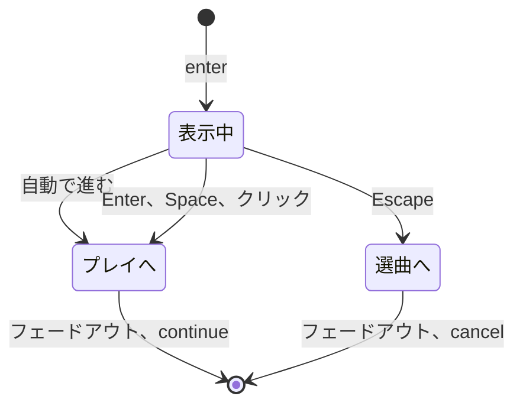

Web プレイヤーは、どの決定画面の裏でもプレイを準備し、`on.continue` でそれを表示します。選曲画面で譜面を選ぶと、すぐにわかる決定画面（Be-Music Skin か LR2 テーマのもの）が続くときは、選んだ時点でプレイの読み込みを始めます（`on.launch`、`DecideRoute.preloadOnLaunch`）。そのため読み込みは選曲画面の開始の演出の間にも進みます。ルートはその時点で譜面の `#RANDOM` の分岐を引いて決定画面に渡し（`resolved`）、決定画面はそのナビゲーションとプレイを引き継ぎます（ルーターの `leave` は `keepHeldPlay` でそれを残します）。ほかへ進む開始（別の譜面、コース、決定画面なし）は自分のナビゲーションを始め、選んだ時点で読み込んだプレイは古いものとして捨てられます。作成中のコースに加える譜面、先に練習の小節を選ぶ譜面、リプレイスロットは、選んだ時点では何も読み込みません。

#### 決定音

選曲画面は、譜面かコースでプレイが始まるときに LR2 のサウンドセットの決定音（`#DECIDE`、`sounds.decideBGM`）を鳴らします。選曲画面のセッション（標準と LR2）は、これをオーナーなしでオーディオサービスから鳴らします。選曲画面の exit（`stopOwned`）は BGM とプレビューを止めますが決定音は止めないので、決定音は LR2 と同じく決定画面を通ってプレイまで鳴り続けます。決定画面が出ないとき（決定画面のスキンのないテーマ）にも鳴ります。beatoraja の選曲画面の音のセットに決定音はありません。beatoraja の決定画面が、テーマの決定音をセッションのジングルとして鳴らし、画面を出るときに止めます。以前の画面自身の AudioContext で止まっていたのと同じです。

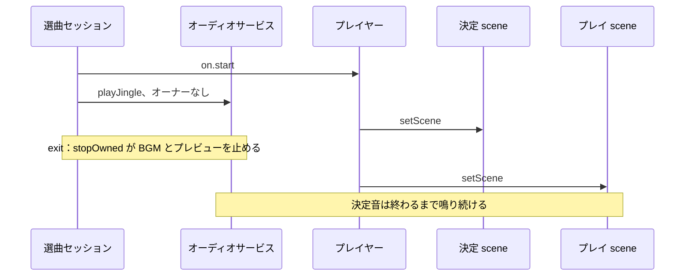

決定画面のセッションも決定音を鳴らせます（`sounds.decideBGM`）。ただしそれは決定 scene 自身の音で、scene が出るときに `stopOwned` が止めるので、プレイが始まるところで決定音が切れます。そのためプレイヤーは標準と LR2 の決定画面に `sounds: {}` を渡し、決定音は選曲画面のものにしています。開始でプレイが始まるかどうかはホストが選曲画面に伝えます。作っているコースが譜面を受け取ったときや、コースが始められないときは `on.start` が `false` を返し、決定音は鳴りません。

### リザルト画面

`createResultScene(kit, options)`（`@be-music/player-browser/host`）は、どの種類のリザルト画面も作ります。リザルト画面のセッション（`session/result/result-session.ts`）を kit の種類のビューが描くもので、`setScene` で表示する `SessionScene` です。標準の kit（`{ family: 'built-in', skin }`）は標準のリザルト画面のビュー（`view/built-in/result-view.ts`）が、LR2 の kit（`{ family: 'lr2', skin }`。テーマのリザルト画面のスキン、コース全体の結果ではコースリザルトのスキン）は LR2 のリザルト画面のビュー（`view/lr2/result-view.ts`）が、beatoraja の kit（`{ family: 'beatoraja', kit }`。`loadBeatorajaSceneKit` で読み込んだテーマのリザルト画面のエントリ、コース全体の結果ではコースリザルトのエントリ）は beatoraja のリザルト画面のビュー（`view/beatoraja/result-view.ts`）が描きます。

- **オプション。** `result`（`PlayResult`。LR2 と beatoraja のスキンは `result.course` のコースを表示します）、`run`（`result.run` がプレイの種類を表さないとき、たとえばコースのステージのときの種類）、`source`（スキンの画像のための譜面のファイル）、`playChart`（プレイが遊んだとおりの譜面。beatoraja のスキンの BPM グラフ、ノート種別、TOTAL の表示のため）、`sounds`（テーマの `SystemSoundSet`）、`audio`（ホストのオーディオサービス）、`on: { continue, retry? }` です。
- **リプレイスロット。** `replaySlots`（各スロットの状態。毎フレーム読みます）と `on.saveReplay` を渡すと、キー 1-4 と `saveReplay` のインテント（beatoraja のスキンのリプレイボタン）で、プレイをスロット 1-4 に保存するようホストに頼みます。beatoraja のリザルトが数字キーを受けるのと同じく、入力が開いてから画面が出始めるまでの間だけです。フレームは状態（`ResultFrame.replaySlots`）を持ち、beatoraja のスキンは op 196-198 と 1196-1204 で表示します。
- **見せ方。** セッションは `resolveResultPresentation(run)` でプレイの見せ方を決めます。コース全体の結果ではコースのジングルを鳴らし、クイックリトライは単曲のプレイと NONSTOP のときだけです。
- **ジングル。** セッションは、画面に入るときに `sounds` からリザルトのジングル（`resolveResultJingles` と `resolveResultJingle`。判定に応じたクリアかフェイルのもの、なければ共通のもの。コース全体の結果ではコースのものを先に選ぶ）をオーナーとしてオーディオサービスで鳴らし、画面がステージから外れるときに `stopOwned` で止めます。以前は scene が自分の AudioContext を閉じてジングルを止めていました。テーマに逆の判定のジングルしかないときは、標準の画面でも LR2 の画面でも何も鳴らしません。
- **段階。** 入力はビューの入力までの待ち（LR2 スキンでは `#STARTINPUT`。Be-Music Skin と `#STARTINPUT` のない LR2 スキンでは、LR2 の既定の 1500 ms）のあとに受け付け、結果のグラフもそこから描き始めます。グラフは 3 秒後にひとりでに描き終わり、それより前に Enter、Space、クリックを押すと飛ばします。次の操作で記録の更新を表示し、その次の操作で `on.continue` を呼びます。フレームには各段階を表示した時刻（`graphShownAtMs`、`updateShownAtMs`。LR2 のタイマー 151 と 152）が入ります。Be-Music Skin の入場演出は、グラフを表示した時点で落ち着いた配置に飛びます。beatoraja スキンの画面には押して進む段階がありません（`ResultViewTiming.skipsResultSteps`）。`input`（なければ 500 ms）のあとに入力を受け付け、最初の Enter、Space、タップで、`fadeout`（なければ 500 ms）の間フェードアウトしてから `on.continue` を呼びます。タップはタッチかペンの操作です。beatoraja のリザルトはキーしか読まないので、マウスのクリックでは進みませんが、スマートフォンやタブレットにはほかにこの画面を出る方法がありません。
- **閉じる音。** テーマに閉じる音（beatoraja の `resultclose`。コース全体の結果では `course_close`、なければ `resultclose`）があるときは、beatoraja の `MusicResult` / `CourseResult` と同じく、フェードアウトを始めるときにジングルを止めてその音を鳴らします。LR2 にはこの音がないので、LR2 のリザルトは何も鳴らしません。
- **画面を出る。** Escape はどの段階でも `on.continue` を呼びます。beatoraja のスキンでは、beatoraja の `input` がすべてのキーを待たせるのと同じく、入力を受け付けるまで待ちます（`SceneViewTiming.escapeWaitsForInput`）。修飾キーのない R は、入力を受け付けたあと、プレイがクイックリトライできて、ホストが `on.retry` を渡しているときに `on.retry` を呼びます。どちらも enter ごとに 1 回だけです。
- **LR2 の描画。** LR2 のビューは、結果、`result.course` のコース、スキンの `#FLIPRESULT`、カスタムオプションの既定値から `resolveLR2ResultState` でリザルト画面のスキンを描きます。LR2 のリザルトのタイマーはフレームごとにフレームから読み、タイマーの ID はビューの中にとどめます。
  - タイマー 0 は画面に入った時刻から。
  - タイマー 1 と 150 は入力を受け付けた時刻から。
  - タイマー 151 は `graphShownAtMs`（ランクとスコアを表示した時刻）から。
  - タイマー 152 は `updateShownAtMs`（記録の更新を表示した時刻）から。

  ゲージとスコアのグラフは、タイマーから `start` と `end` の間に左から描かれます。LR2 の標準スキンでは、タイマー 150 の 500 ms 後から 2000 ms 後までです。

- **beatoraja の描画。** beatoraja のビューは、リザルト画面のスキンを `BeatorajaPlaySkinView` で、キャンバスをウィンドウに合わせて描きます。`PlayResult` を `@be-music/skin-beatoraja/scene` のシーンの対応づけ（`resolveBeatorajaResult*`）でそのまま読みます。スコアと判定の数、タイミングの平均と標準偏差、ボーダーと TOTAL 付きのゲージ（`gaugeBorder`、`gaugeTotal`）、ランク・クリアかどうか・ランプの op、ゲージと EX スコアのグラフ、判定のグラフ、タイミングの分布、`result.course` のコースです。BPM グラフ、ノート種別、譜面の `#TOTAL` は `ResultFrame.playChart` から読み、これがなければ何も表示しません。譜面の `#STAGEFILE`・`#BACKBMP`・`#BANNER` は最初のフレームの前に `source` から読み込みます。beatoraja のタイマーは、フレームごとに画面自身のクロックで読みます。タイマー 0 と READY / PLAY は画面に入った時刻から、タイマー 1 は入力を受け付けた時刻から、タイマー 2 は画面を出始めた時刻からです。スキンの Lua の音はオーディオサービスのスキンの音でセッションのものとして鳴らすので、画面を出るときに止まります。
- **スキンの設定。** `updateKit(kit)` は、プレイヤーが変えたスキンの設定値を受け取り、次のフレームからそれで描きます。beatoraja のスキンはオプションを反映して読み込むので、別のスキンの beatoraja の kit は無視します。

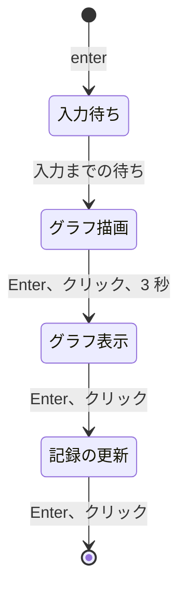

Web プレイヤーは、リザルトをすべてこの画面で表示します。単曲のプレイ、リプレイ、コースのステージ、コース全体（テーマにコースリザルトのスキンがあればそれで）、NONSTOP（リザルトのスキンで。それがない beatoraja のテーマでは標準の画面にフォールバックし、そのテーマのジングルを鳴らします）です。どのプレイも結果を `PlayResult`（`playResultFromPlayState`）で渡し、グラフは譜面の始めから再生位置までです。コース全体は `playResultFromCourseRun` で 1 つとして読み、LR2 と組み込みでは最後のステージのグラフ、beatoraja では全ステージをつないだグラフです。

### プレイ画面

`createPlayScene(kit, options)`（`@be-music/player-browser/host`）はどの種類のプレイ画面も作ります。プレイのセッション（`session/play/play-session.ts`）を kit の種類のビューが描く `SessionScene` で、読み込み、`setScene` で表示し、開始します。標準の kit（`{ family: 'built-in', skin }`）は組み込みのプレイビュー（`view/built-in/play-view.ts`）が、LR2 の kit（`{ family: 'lr2', skin, invisibleNoteSkin? }`。譜面のプレイスキンと、見えないノート用のテーマの 9 鍵スキン）は LR2 のプレイビュー（`view/lr2/play-view.ts`）が、beatoraja の kit（`{ family: 'beatoraja', kit }`。譜面の鍵盤数に合うテーマのプレイのエントリ）は beatoraja のプレイビュー（`view/beatoraja/play-view.ts`）が描きます。

プレイには任意の `sounds: SystemSoundSet` を渡せます。途中で失敗して終了すると `sounds.playStop` をオーディオサービスで 1 回だけ、プレイ画面が所有する音として鳴らします。LR2 テーマではサウンドセットの `#STOP` を読み、なければ `Sound/lr2/playstop` を探します。beatoraja テーマでは `sound/playstop` を探します。通常終了・Escape・リトライでは鳴らしません。音のないテーマでは何も再生せず、画面を離れると再生中の停止音も止まります。

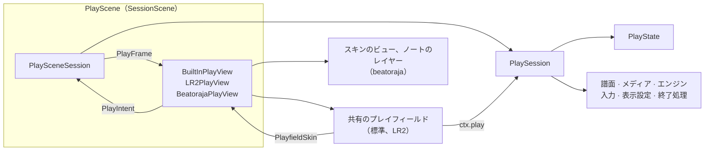

- **オプション。** `chart` と `source`。`settings` は、譜面・スキン・行き先以外の、プレイの進め方です（判定とスクロールに使うプレイオプション、テンポ、音量とミックス、BGA、描画の設定）。`course`（ステージの規則とコースの表示）、`replay`（再生するリプレイ）、`preResolved`（決定画面が引いた `#RANDOM`）、`audio`（ホストのオーディオサービス。beatoraja のスキンの音もこれで鳴らします）、`playOptions`（選曲画面で設定されたもの。フレーム用）、`host`（画面外で読み込む間にレイヤーを組み立てるため）、`on: { finish(result, replay), exit, restart, hiSpeed?, tempo? }` です。
- **ライフサイクル。** `prepare(onProgress)` は譜面、ビュー自身の素材（LR2 スキンの画像とフォント。beatoraja のプレイではノートの配置、レイヤー、譜面の画像）、サンプルを読み、BGA の読み込みを裏で始めます。ステージには触れません。`setScene` でプレイを表示し、`start()` でイントロに続いて譜面を始めます。`dispose({ preserveAudioTail })` はシーンを終わらせ、プレイが最後まで終わったときは最後のサンプルが鳴り終わるのを待ちます。ほかに `requestExit`、`requestTogglePause`、テンポとハイスピードの設定、`recording`（ホストの録画用）、`progress()`（ここまでの結果。プレイヤーのテストフックが読みます）、`waitForReplay`、`resolved`（プレイが遊ぶとおりの譜面と `#RANDOM` の抽選。リザルトのグラフ用）、`updateKit`（標準のスキンの設定、または beatoraja のエントリのオプションや別のエントリのスキン。シーンは種類を変えません）、`takesKey`（譜面のレーンがそのキーを使うか）、音と描画の調整があります。
- **START と SELECT**（`play-input.ts`。ファミリーのキー操作 `PlaySessionOptions.controlScheme` に従います）。START + 鍵盤でハイスピードを変えます（奇数鍵で下げ、偶数鍵で上げ）。LR2 のキー操作では SELECT でも同じで、SUDDEN+ の表示中は鍵盤 6 / 7 でそれを動かします（表示していなければハイスピードの上げ / 下げ）。beatoraja のキー操作では START + スクラッチで SUDDEN+ を動かし（1 つ目のキーでカバーが増えます）、SELECT + 鍵盤で表示時間を 1 ms ずつ変えます（奇数鍵とスクラッチの 2 つ目のキーで短く、偶数鍵と 1 つ目のキーで長く。ハイスピードを変えて合わせる `adjustWhiteNumber`）。START を 2 回押すと（LR2 は 250 ms、beatoraja は 500 ms 以内）SUDDEN+ を切り替えます。START と SELECT を `START_SELECT_QUIT_MS` 押し続けると中断し、すべてのノーツを判定した後はどちらか一方だけでプレイを終えます。中断のキーをフェードアウトの間 `QUICK_RETRY_HOLD_MS` 押し続けると、もう一度プレイします（PC 版のクイックリトライ）。↑ / ↓ は LR2 のキー操作ではハイスピード、beatoraja ではレーンカバーを動かします。LR2 では AUTO プレイ以外で ← / → がレーンカバーを動かします。LR2 のキー操作では、数字キーを押しながら矢印キーを押すと、プレイのスキンを 1 デザインピクセルずつ動かし（1。Shift で 10）、1 % ずつ拡大縮小し（2。半分から 2 倍まで）、1P / 2P のレーンの LIFT を上げ下げします（6 / 7）。フレームは動かしたスキンを描き（`PlayfieldRuntime.skinAdjust`）、ホストは次のプレイのためにそれを覚えます（`PlaySceneEvents.skinAdjust`）。LR2 のほかの数字キー（判定文字、ノーツの大きさ、描画の制限）は扱いません。beatoraja のキー操作では、AUTO プレイ中に 1 / 2 / 3 / 4 を押している間だけ ×0.25 / ×0.5 / ×2 / ×3 で再生し、離すと戻ります（beatoraja と同じ。Web player が再生できるテンポ 0.5〜1.5 の範囲に収めます）。
- **セッション。** `PlaySession` は一つの `PlayState` を中心にプレイの振る舞いを持ちます。譜面（`play-chart.ts`）、メディア（`play-media.ts`。オーディオサービスの `openPlayGraph` で専用の `interactive` なコンテキストを開き、所有者はセッションです）、エンジン（`play-engine.ts`）、プレイ自身の入力（`play-input.ts`）、表示設定（`play-view-settings.ts`）、終了処理（`play-ending.ts`）です。ビューに求めるものは `PlaySessionTheme`（`play-session-theme.ts`）で受け取ります。イントロとフェードアウトの時間、アニメーションのきっかけ（`PlayMoment`）、チャンネルごとのキービームのフェード、譜面の準備のあとのビュー自身の読み込み（`prepareView`）、BGA の GPU への転送です。ビューのタッチのレーンは `lane` のインテントで戻ってきます。
- **フレーム。** `PlaySceneSession` は毎ティック、エンジンの UI シグナルをプレイ状態に取り込み、リプレイの表示設定を記録または再生し、ビューに `PlayFrame` を渡します。プレイ状態とその段階、譜面時刻と拍、ノートと押されているレーン、前のフレームからのきっかけ（`playViewEventFromMoment`）、解析したミックス、プレイをもう表示するか（`shown`）、進行中のプレイそのもの（`playfield`）です。
- **ゴースト。** `settings.ghost`（`GhostSource`、`session/play/ghost/ghost.ts`）がゴーストの再生するリプレイを、`settings.ghostMode` がその見せ方（既定の `'side-playfield'`、`'pacemaker'`、`'lane-overlay'`）を指します。セッションはプレイの読み込み中にリプレイを読み、タイムラインへ再シミュレーションします（`prepare-ghost.ts`）。ただしリプレイ、コースのステージ、NONSTOP のラン、（2 つ目のプレイフィールドでは）2P 側を貸せない譜面（貸せるのは 5 / 7 KEY のシングルプレイだけ）では行いません。見せるのは `GhostPresentation` です。
  - `SidePlayfieldGhost` は、今のプレイの上にかぶせたプレイフィールドをビューに渡します（`present`）。10 / 14 KEY のレーン順と `twoPlayer: true` で、今のプレイとゴーストのレーンの間に BGA を配置し、ゴーストのノートを 2P のレーンに、HUD を `secondPlayer` に置き、キービーム、ボム、2P の判定表示を自分のレーンに書き込みます。
  - `PacemakerGhost` は何も描きません。その `scoreTarget` は、今のプレイが判定したノート数でのゴーストの EX スコア（`ghost-pace.ts`）で、`PlaySceneSession` がフレームの `scoreTargets`（`targetEXScore`、`targetPaceEXScore`、`targetLabel`）に入れます。組み込みのクロームはスキンへ `BeMusicGameplayRuntime.targetPaceEXScore` として、LR2 のビューはターゲット（数値 151 / 153、バーグラフ 14 / 15）として、beatoraja のブリッジは数値 121-123 として渡します。ゴーストがなければ、フレームにはプレイヤーが選んだターゲット（`PlayOptions.scoreTarget`）が入ります。ノーツ数から求める固定のターゲットか、ランキング上の位置です。ランキング上の位置のスコアは、セッションがホストに 1 度だけ問い合わせ（`PlaySceneOptions.rankingTarget`）、届いた時点から表示します。こうしたターゲットには自前のペースがないため、LR2 のビューは、組み込みのスコアグラフと同じく、判定したノーツ数に応じて進めます（`view/shared/target-pace.ts`）。
  - `LaneOverlayGhost` はペースメーカーに加えて、リプレイの押下と判定を自分の `GhostLaneOverlay` に書き込み、プレイフィールドの `ghostLanes` として見せます。レーンのパスがそれをレーンの上に描きます（`view/shared/playfield/ghost-lanes.ts`）。

  `PlaySceneSession` はフレームごとにゴーストをその秒まで進めます（`update`）。自分のフィールドを持つ見せ方（`drawsOnPlayfield`）は、プレイを描くビューが組み込みのものである間だけ進めて見せます（`showsGhost`）。ペースメーカーはどのビューでも進みます。エンジンと今のプレイの配列はゴーストを見ず、ゴーストのレーンへのタッチは捨てます。[replay.ja.md](./replay-browser.ja.md#ゴースト) を参照してください。

- **組み込みのビュー。** `BuiltInPlayView` は自分のレイヤー（`PlayLayers`）に共有のプレイフィールドを描き、`PlayfieldSkin` で答えます。Be-Music Skin のステージ、プレイフィールド自身のレーン配置・ノート・小節線・ボム（スキンはこれらをデータとして描きます）、組み込みの BGA の矩形、スキンのボムの長さ、既定のキービームのフェードです。キービームはどのレーンにも点き、24 / 48 KEY の 8 番目以降の鍵とホイールも例外ではありません。Be-Music のクロームがプレイフィールドの周りを描きます（`renderBuiltInChrome`。ビューの `PlayChrome` です）。
- **LR2 のビュー。** `LR2PlayView` は、同じプレイフィールドのまわりに LR2 のプレイスキンを スキンの設計キャンバス（SD・HD・FHD）で描きます。
  - op、数字、テキスト、スライダー、バーグラフはフレームの LR2 の状態（フレームの `PlayState`、スコア、時刻、フレームレートからの `resolveLR2PlayState`）から、タイマーはフレームのきっかけから取ります（[LR2 skin 実装メモ](./lr2-skin.ja.md#シーンの状態)）。
  - `PlayfieldSkin` は、スキンの `#DST_NOTE` のレーンの矩形、ノートのセル（オートスクラッチのレーンでは `#SRC_AUTO_*` のダミーノート）、`#DST_LINE` の小節線、`#DST_BGA` の矩形、タイマーから求めたボムとキービームの長さを渡します。レーンはスキンのものなので、レーンの背景、キービーム、ボムはスキンが自分で描きます。
  - `PlayChrome` はスキンの要素を描き（`view/lr2/play-elements.ts`）、フルコンボのタイマーを演出が終わったら止め、スキンに判定の画像がなければ判定を文字で描き、プレイフィールドがボムを消したらそのタイマーを止めます。
  - セッションはスキンの `#LOADSTART` + `#LOADEND`（READY）、`#PLAYSTART`、`#FADEOUT`、`#CLOSE` でプレイの時間を決めます（`resolveLR2PlayTiming`）。
- **beatoraja のビュー。** `BeatorajaPlayView` は beatoraja のプレイスキンを `BeatorajaPlaySkinView` で描き、ノート、小節線などの印、BGA のレイヤー（`view/beatoraja/play/*`）をスキンが置く位置に差し込みます（`BeatorajaPlayStage`）。
  - `BeatorajaPlayBridge`（`view/beatoraja/play-bridge.ts`）は、フレームごとにスキンの描画コンテキストを作ります。op、数字、テキスト、ゲージ、グラフは、フレームの `PlayState` とエンジンの最新のフレームから [Scene mapping](./beatoraja-skin.ja.md#scene-mapping) で求め、タイマーはフレームのきっかけ（判定、レーンの光りと押しっぱなし、読み込み終了、フェードアウト）で始めます。判定の状態のグラフは自分で持ち、レーンの光りも自分で終わらせます。
  - ノートは beatoraja のスケールで、譜面の `#SCROLL` / `#SPEED` のタイムラインに沿って、フレームの描くハイスピードとプレイ状態のレーンカバーで流れます。リプレイはそのスケールで表示設定を記録します（`PlaySessionTheme.replayView`）。
  - セッションは読み込み終了からプレイの時間を決めます。READY、PLAY、STARTINPUT はそのとき、譜面はその 1.5 秒後に始まり（`resolveBeatorajaPlayTiming`）、退出はスキンの `fadeout` をかけてフェードし、失敗したプレイはスキンの `close` のあとに次へ進みます。
  - beatoraja の kit も、ほかの種類と同じくホストのレーンオプション（RANDOM、MIRROR、S-RANDOM、SCATTER、DP FLIP）、[HS-FIX](./player-web.ja.md#hs-fix)、開始時のレーンカバー（HIDDEN / SUDDEN、レーンカバーの高さと表示、左右それぞれのリフト）で遊び、リプレイの `play.randomLane` と `play.view` に記録します。内蔵の Plain・Native・Synesthesia と同じく、カバーのキーを有効にします（`coverKeys`）。PageUp / PageDown で SUDDEN+、Home / End でリフトを動かし、H で HIDDEN+ を切り替え、J / K で動かします（Shift で大きく動きます）。譜面のレーンが使うキーはレーンを押します（14 鍵の DP 譜面では H / J / K は 2P のレーンです）。ホイールとスキンのカバーのボタン（act 330-332）はカバーのインテントを送ります。
  - スキンの `main_state.audio_*` は、オーディオサービスのスキンの音として、scene の `PlaySceneSession` を所有者にして鳴らします。scene がステージを離れると、ループも含めて止めます。プレイの音のグラフは別の所有者のままなので、終わったプレイの音は最後まで鳴ります。
- **入力。** プレイのキー（ESC、F5、Pause と Tab、矢印キー、Backspace の長押し、カバーのキー、FLOATING HI-SPEED の 0（上段またはテンキー）、表示エリア固定の Enter 2 回押し）は、window にあるプレイ自身のリスナーのままで、capture 段階で受けます。レーン入力のランタイムはレーンのトークンを持つキーすべての既定動作を取るので、それより先に受けるためです。フォーカス中の入力欄はそのキーを、フォーカス中のボタンは Enter / Space をそのまま受け取ります。シーンはキーを聞きません。
  - タッチのレーンはビューのものです。各プレイのビューは、共有のプレイフィールドが並べたレーンの上で canvas の指を追い（`view/shared/touch-lane-input.ts`。プレイの間は `touch-action: none` も設定します）、レーンを最初の指が押したときと最後の指が離したときに `lane` のインテントを送ります。セッションはキーボードと同じようにエンジンの入力でレーンを押し、離します（`handleTouchLaneIntent`）。beatoraja のスキンはプレイフィールドにレーンを並べないので、そのプレイにタッチのレーンはありません。
  - 一時停止すると、セッションはタッチで押されているレーンをすべて離し、その回数を数えます（`touchLiftCount`）。ビューはそれまで触れていた指を忘れるので、その指は触れ直すまで何も押しません。
  - LR2 のキー操作では ArrowUp / ArrowDown でハイスピードを変え、beatoraja ではレーンカバーを動かします。ホストはハイスピードを直接設定でき（`setHiSpeed`）、操作キーの上書きで既定のショートカットを置き換えられます。
  - ハイスピード、カバー、リフトの調整キーは、長押しするとブラウザーのキーリピートで連続調整できます。HIDDEN+ は H を押した最初の 1 回だけ切り替わります。Fn による移動キー（PageUp / PageDown / Home / End）は、カバーのキーが無効でも矢印キーの操作には流れません。FLOATING HI-SPEED では、SUDDEN+ と LIFT が両方 OFF のとき PageUp / PageDown でハイスピードを微調整し、それ以外では既存のカバーと速度の連動が適用されます。
  - TUI の Alt / Option + レーンのショートカットは、Web ではどのファミリーにもありません。Web の入力ランタイム（`createWebInputRuntime`）がエンジンに送るのはレーンのキー、ESC、F5、Pause だけで、`high-speed` コマンドは送りません。ブラウザでは Alt とレーンのキーの組み合わせがブラウザのショートカットであることが多くあります（Windows の Alt + D や Alt + F）。START / SELECT の組み合わせはプレイのセッション自身が扱います。どちらのキー操作でも START + レーンのキーでハイスピードを変え、LR2 では SELECT でも同じ操作ができ、beatoraja では SELECT + レーンのキーで表示時間を変えます。START / SELECT の押下と解放は `ReplayPlay.controlInputs` にも記録しますが、この診断用の記録はリプレイの判定には使いません。
- **`#RANDOM`。** `preResolved` があると、決定画面が見せた抽選のとおりにプレイします。Web プレイヤーは先に決定画面を作り、その `resolved` を渡してプレイを先読みします（どのプレイ画面も）。コースのステージとリプレイは自分で引きます（リプレイはログのとおりです）。

Web プレイヤーはどの種類のプレイもすべてこの方法で、その種類自身のプレイ画面で表示します。単曲、AUTO、リプレイ、コースのステージ、NONSTOP、クイックリトライ、F5 で、beatoraja のテーマでも同じです（ADR 0001）。

### プレイの部品の置き場所

プレイのセッションとプレイのビューは、プレイの部品を共有します。各モジュールはプレイ（またはビュー）を明示的なコンテキスト（`ctx`）として受け取り、自分のインターフェースを通してその状態を読み書きします。セッションの状態は `PlaySessionState` です。ビューはレイヤーを `PlayLayers` に持ち、進行中のプレイを `PlayfieldRuntime` として読みます。

進行中のプレイは player-scene-model の `PlayState`（`playState`）一つです。ゲージと EX スコアとそのグラフ、コンボ、最大コンボ、コースのコンボ、時刻つきの判定と判定ごとの早い / 遅いの数、表示設定（HS-FIX のかかったハイスピードとレーンカバー）を持ちます。これを変えるものはすべて `applyPlayEvent`（`session/play/play-state.ts`）を通ります。`applyPlayEvent` は `reducePlayState` で状態を進め、描くハイスピードが変わればノートのスクロールをそこへなめらかに移します。エンジンのフレーム、判定、空 POOR、シークのスナップショット、最終の集計、プレイヤーのハイスピードのキー、ホストの `setHiSpeed`、リプレイが記録した表示設定がこれを通ります。スキンのランタイム、LR2 の状態の解決（`resolveLR2PlayState`）、beatoraja のプレイのブリッジ、リザルト（`playResultFromPlayState`）はこれを読みます。セッションはその横に、表示のとおりのエンジンの判定数（`score`。LR2 では空 POOR を POOR の数に含めます）と、エンジンのゲージの集計（`gaugeState`）を持ちます。

譜面上の時刻はエンジンが持ちます。どのフレームも、表示する譜面の秒、シークの世代、その秒がどのクロックの値にあたるか（音声クロックの値、テンポ、一時停止中か）を持ち、セッションの譜面のクロック（`currentSeconds`）は最新のフレームから `audioContext.currentTime` で進めます（`play-clock.ts`）。エンジンの最初のフレームより前は、プレイ開始のゲートから進めます。プレイフィールドは、段差を除いた音声クロックで描きます（`createAudioClockSmoother`）。`currentTime` はレンダリングのコールバック単位（macOS の Chromium、44.1 kHz で 5.8 ms）でしか進まないため、表示フレームごとにそのまま読むと 0〜2 段ずつ進み、ノートが譜面時刻で最大 5.6 ms ぶれていました。スムーザーは直近 1 秒の 2 つのクロックの差の平均を `performance.now()` に足して読むので、プレイフィールドはフレームごとにそのフレームの時間だけ進み（実測で最大 0.1 ms の誤差）、`currentTime` から半段以内に留まります。コンテキストの停止や飛びがあれば平均を取り直します。判定と発音は生のクロックのままです。シーク、テンポの変更、一時停止は次のフレームに現れ、合わせ直す基準点はありません。最後のシークより古い世代のフレームは捨てます。プレイ状態のほかに 1 回の実行が表示するもの（キービームと点滅、ボム、押さえているロングノート、判定の表示、POOR の画像、一度だけの瞬間、スコア表示の繰り上がり）は 1 つの `PlayPresentation`（`play-presentation.ts`）にまとめ、`resetPresentation` で新しいプレイの状態に戻します。

シークは動いているエンジンへのコマンドです（[ADR 0016](./adr/0016-seek-play-loop-command.ja.md)）。`PlayScene.seek(T)` は入力バスに `{ kind: 'seek', seconds: T }` を送り（`play-seek.ts`）、エンジンがそれか後のシークを適用したら解決します。エンジンは `T` での次の世代のフレームと `seek` の UI コマンドを返し、セッションはそのスナップショットからスコア、ゲージ、プレイ状態を取ります（`reducePlayState` の `seek` イベント）。表示は戻し、進行中のリードアウトは取り消し、BGA の動画は合わせ直し、ビューには `seek` イベントを知らせます（LR2 のビューは `resolveLR2PlayTimers` で、beatoraja のブリッジは `resolveBeatorajaSeekTimers` で判定とレーンのタイマーを止め、ブリッジは判定状態のグラフをスナップショットの判定から組み直します）。`T` をまたいで押さえているロングノートは、エンジンが再通知するとそのあとに続きます。一時停止中のプレイは `T` で一時停止したままです。

AUTO プレイとリプレイはシークできます。ホストは `PlaySceneOptions.allowSeek: 'practice'` で手動練習も有効にできます。目標より前のノートを得点なしで消化済みにし、スコアとゲージを開始時に戻します。最初のシークで記録を破棄し、`PlayResult.practice` により記録更新・ランキング・リプレイ自動保存を行いません。リプレイでは記録された入力を先頭から目標まで再適用し、その位置のテンポとテンポ変更カーソルを復元します。記録された表示設定も、ホストの Replay / ghost 設定に従って目標位置の値を再適用します。通常のプレイ画面では、AUTO プレイ中だけ ← / → で 5 秒シークできます。シークしたプレイは新しいリプレイを記録しません。コースのステージや NONSTOP でシークすると、後続ステージも含むコース全体を練習扱いにします。ステージの結果からリプレイとは独立してゲージとコンボを引き継ぎ、コース結果を表示しますが、記録更新・送信・リプレイ自動保存は行いません。

PRACTICE のプレイ（`practiceRange`）は、同じシークの経路で範囲を繰り返します（[#949](https://github.com/nulltask/be-music/issues/949)）。セッションは範囲を `loop: true`（`PlayPractice.loop`）付きでエンジンに渡し、プレイが終わるところ（範囲の後の小節の頭ですべてのノートを判定し終えたとき、またはゲージが空になったとき）で、エンジンは終わらせずに自らプレイの開始位置へ戻します（`player-engine/src/core/play-seek.ts` の `restartPractice`）。セッションはこれを通常のシークとして受け取ります。スコア・コンボ・ゲージは練習の設定に戻り、鳴り残っている音は止まり、プレイ画面とデコード済みのサンプル・BGA・スキンはそのまま残るので、繰り返しの間に読み込み画面は出ません。プレイは自然には終わらず、ESC でいつもどおり抜けます。

セッションは音声のデコード後、BGA の読み込みとスキンのイントロ中にエンジンを準備します。`PlayerOptions.waitForStart` により、スキンの PLAY START ゲートが `{ kind: 'start' }` を送るまで譜面時刻と音声を開始しません。イントロ中のシークは開始位置を選び、START 後に適用します。イントロ中に一時停止した場合も停止したままです。曲末の余韻中に前へ戻ると余韻を取り消して終了通知を再度有効にし、終了済みの譜面の終端にシークした場合は終了通知を重複させません。

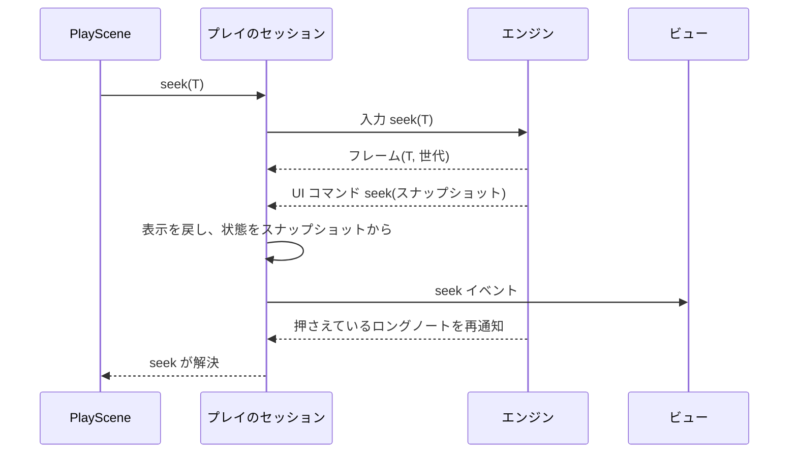

- `session/play/`：
  - `play-session.ts`：`PlaySession`。部品の組み立て、クロック、一時停止、録画、後片付け。`play-session-state.ts`：その状態。`play-options.ts`：そのオプション（`PlaySessionOptions`）。`play-session-theme.ts`：ビューに求めるもの（`PlaySessionTheme`）と、知らせるきっかけ（`PlayMoment`）
  - `play-scene-session.ts`：`SceneSession` としてのセッション、そのフレームとインテント。`play-view-events.ts`：ビューのイベントとしてのきっかけ
  - `play-chart.ts`：`prepareChart`、レーンオプション（RANDOM、MIRROR、S-RANDOM、SCATTER、DP FLIP）、リプレイの配置、決定画面の抽選
  - `play-media.ts`：オーディオグラフ、サンプル、BGA のテクスチャと動画、それらの後片付け
  - `play-engine.ts`：共通エンジンの起動、その UI シグナル、判定とレーンの演出、エンディングの開始
  - `play-input.ts`：ESC、F5、Pause / Tab、矢印キー、リプレイ用の START / SELECT、長押しでの終了、自動一時停止、ビューが送るタッチのレーン。`play-cover-keys.ts`：beatoraja のプレイと、内蔵の Plain・Native・Synesthesia のカバーのキー（`coverKeys`）
  - `play-keys.ts`：`PLAY_SCENE_KEY_CODES`。プレイが自分で扱い、エンジンの Web 入力ランタイムが読み飛ばすキーの一覧です
  - `play-seek.ts`：シークのコマンドと、それを待つシーク。`play-clock.ts`：フレームから進める譜面のクロック。`play-presentation.ts`：プレイ状態のほかに 1 回の実行が表示するもの（`PlayPresentation`）
  - `play-state.ts`：`applyPlayEvent`。プレイの状態を変える唯一の道です
  - `play-view-settings.ts`：ハイスピードのキー、エンジンが従うテンポ、描くとおりのレーンカバー、リプレイの表示設定
  - `play-ending.ts`：退出のタイムラインと、結果のスナップショット
  - それらが共有する補助：`long-note-tracker.ts`（スキンが描く各ロングノートの状態）、`live-tempo.ts`（プレイ中のテンポとその変更）、`tempo-range.ts`（プレイの最低・最高・メインの BPM）、`quit-hold.ts`（Backspace の長押し）、`result-delay.ts`（結果の前の余韻と、音の尾を鳴らす長さ）、`judge-windows.ts`（スキンに渡すルールセットの判定幅）、`placeholder-gauge.ts`（エンジンの最初のフレームまでのゲージ）
- `view/shared/`：`playfield/*`（レーン、ノート、ロングノート、地雷、小節線、ボム、カバー、テキスト。進行中のプレイは `ctx.play`、`PlayfieldRuntime`。ビューの `PlayfieldSkin` と `PlayChrome`）、`bga-renderer.ts`、`play-frame.ts`（レイヤーの木、画面への合わせ込み、フェード）、`play-layers.ts`、`texture-upload.ts`、`touch-lanes.ts` と `touch-lane-input.ts`（タッチのレーンの指を `lane` のインテントにする）
- `view/built-in/`：`play-view.ts`（組み込みのプレイビューとその `PlayfieldSkin`）、`play-chrome.ts`（組み込みのレーンの配置、BGA の矩形、Be-Music のレイアウトと、クロームのランタイムと描画）
- `view/lr2/`：`play-view.ts`（LR2 のプレイビュー、その `PlayfieldSkin`、読み込み、フレームの LR2 の状態）、`play-elements.ts`（スキンの要素と、プレイフィールドに渡すレーンの矩形・ノートのセル・小節線・BGA の矩形）、`play-timers.ts`（スキンのタイマー）、`play-turntable.ts`（スクラッチのターンテーブル）、`play-hud.ts`（判定・コンボ・グルーヴゲージの描画とスキンのタイマーの長さ）
- `view/beatoraja/`：`play-view.ts`（beatoraja のプレイビュー、その読み込み、時間、リプレイの表示設定のスケール）、`play-bridge.ts`（スキンの描画コンテキストとしてのフレーム。op、タイマー、数字、グラフ）、`play-stage.ts`（ノート、印、BGA のレイヤーを差し込んだスキンのビュー）、`play/*`（ノート、印、BGA のレイヤー、スクロールの配置、ノートの `dst` のブロック、スキンの寸法）

### レイヤーの分け方

このパッケージのソースはレイヤーに分かれていて、`pnpm run check` が [`vite.config.ts`](../vite.config.ts) の Oxlint の上書き設定でそれを守ります。上から順に次のとおりです。

- **ホスト API**：`host/` とパッケージの barrel（`index.ts`）。`create*Scene` の関数、種類ごとのキット、`PixiSceneHost`、`./host` の barrel です。
- **シーンセッション**（`session/`）と**ファミリービュー**（`view/`）。セッションが画面のふるまいを持ち、ビューがそれを描きます。互いを知るのは型だけです。
- **下位レイヤー**：ほかのすべてのディレクトリ。音と入力のランタイムとエンジンドライバー（`runtime/`）、譜面とメディアの準備（`chart/`、`media/`）、コレクション（`collection/`）、ブラウザの検査（`browser/`）、Pixi のステージの補助（`stage/`）、スキンの読み込み（`skin/`）、組み込みスキン（`skins/`）、録画（`recording/`）、ロガーです。

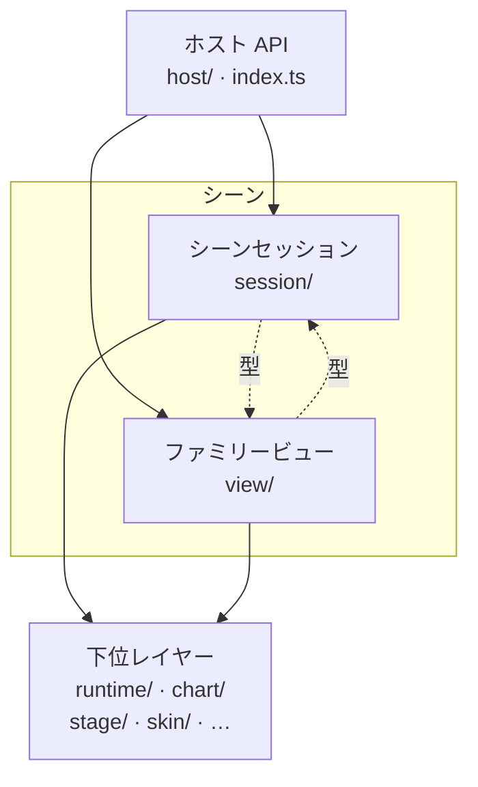

矢印は import を、点線は型だけの import を表します。規則は次のとおりです。

- **下位レイヤーはシーンを知りません。** `host/`、`session/`、`view/` のモジュールを、型であっても import しません。パッケージのファイルはどれも初めは下位レイヤーに入るので、新しいディレクトリも設定で別のレイヤーに入れるまでは下位レイヤーです。
- **セッションがビューとホストに触れるのは型だけです。** Pixi も型にしか使いません。そのためセッションは、偽のビューを相手に Node のテストで動きます。
- **ビューがセッションとホストに触れるのは型だけです。** エンジン（`@be-music/player-engine`）も、`runtime/engine-driver` と `runtime/web-*-runtime` のモジュールも import しません。プレイヤーのほかのエントリポイント（`./signals`、`./lanes`、`./display`、`./ruleset` など）はエンジンではないので、ビューも import できます。
- **エンジンを動かすのはセッションだけです。** `session/` のほかにエンジンを値として import するのは `runtime/engine-driver.ts` だけで、ほかのファイルは Web プレイヤー も含めて型だけを import します。
- **オーディオコンテキストを作るのは音声レイヤーだけです。** `runtime/` が、システムのコンテキスト（`audio-service.ts`）、プレイごとのグラフ（`play-audio-graph.ts`）、ピッチを保つ伸縮のオフラインのコンテキスト（`time-stretch-signalsmith.ts`）を作ります。ほかはすべて、Web プレイヤー も含めてオーディオサービスを通して鳴らし、`AudioContext` は型としてだけ使います。

テストは対象外です。組み込みスキンには、さらに厳しい独自の境界もあります。`skins/boundary.test.ts` は、スキンが import してよいものをスキン SDK、描画のフレームワーク、自分のファイルに限ります。
