[Japanese version](./player-web-scenes.ja.md)

# Browser player architecture

[Browser player overview](./player-web.md)

<details>
<summary>Table of contents</summary>

- [How the player is built](#how-the-player-is-built)
- [Scene lifecycle](#scene-lifecycle)
  - [What the gameplay families share](#what-the-gameplay-families-share)
- [Scene sessions and family views](#scene-sessions-and-family-views)
  - [The select screen](#the-select-screen)
  - [The decide screen](#the-decide-screen)
  - [The result screen](#the-result-screen)
  - [The play screen](#the-play-screen)
  - [Where the play's parts live](#where-the-plays-parts-live)
  - [Layering](#layering)

</details>

## How the player is built

In `packages/app-play/src`, `main.ts` starts the app. The app wires routes and the Options dialog to shared services. Routes change screens through the scene router.

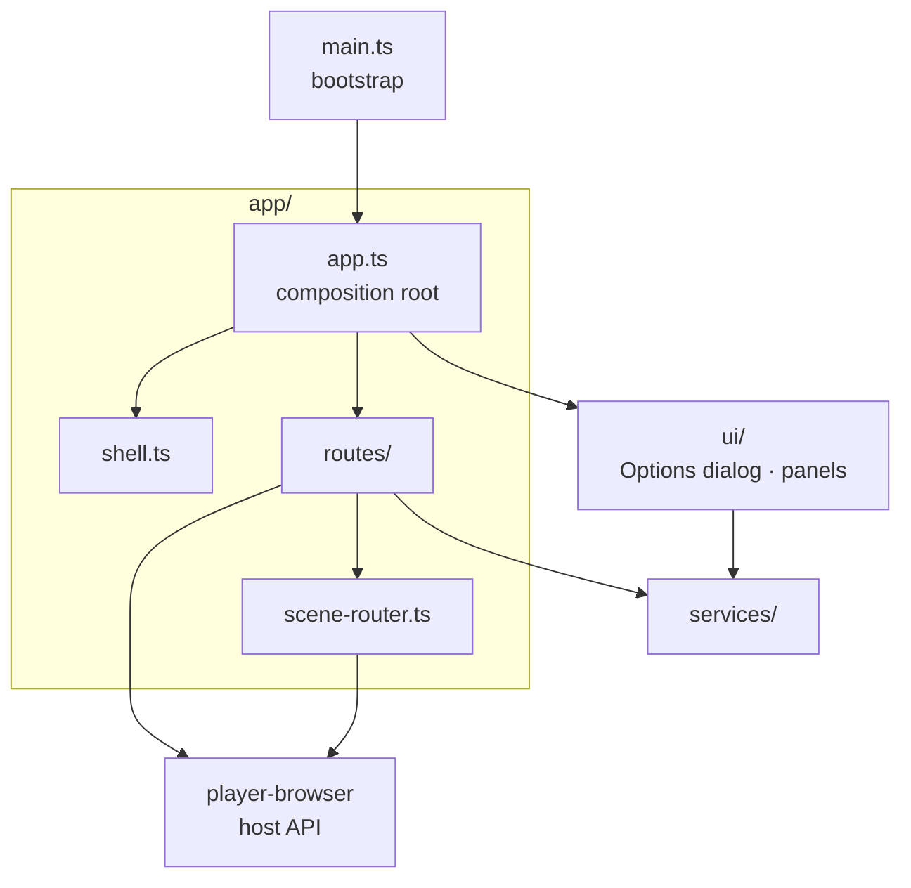

An arrow points to a module the caller creates or uses.

**Bootstrap.** `main.ts` writes the page markup and checks browser compatibility before starting the renderer, so unsupported browsers can still display an explanation. It marks phones and tablets and connects the Help dialog. Once the UI fonts are ready, it creates the app, installs the test hook, and starts the app. [Test hook](./player-web.md#test-hook)

**Composition root.** `app/app.ts` (`PlayerWebApp`) creates the services, routes, and scene router. It connects them to each other, the Options dialog, and the Leaderboard.

At chart start, it records the **Auto-save replays** setting and locks the options that were fixed for the play. It also locks **Submit to Leaderboard**, **Submit when**, and every skin control except **Skin system**. The result or select screen releases those locks. **Skin system** can switch the view family while the chart continues.

`app/shell.ts` keeps the page around the stage in sync with the active scene. `SelectScene.launching()` sets `in-gameplay` when the player selects a chart. The state blocks pinch zoom, moves the site header out of the way, and resizes the stage when the launch outro starts. It persists across scene transitions. The shell also handles the touch pause and quit buttons, double-click fullscreen, and `Esc` in fullscreen.

**Layers.** A service holds state and rules and takes what it needs of the app as deps: it imports no `ui/` or `app/` module, not even a type ([Layering and size guards](./architecture.md#layering-and-size-guards)). The routes and the Options dialog work through the services, and the routes put scenes on the stage only through the scene router, which owns every transition ([Scene lifecycle](#scene-lifecycle), [ADR 0006](./adr/0006-scene-router.md)).

**Select and decide.** `app/routes/select.ts` shows the select screen. The scene router keeps it across a decide screen, a play and its result, so every return shows the same scene again: the latest theme's skin and sounds and the library go onto it before it enters, and then the cursor goes back where it was (to the course bar after a course). It is made afresh only when another family takes it over. A chart started on it joins the course being made, if there is one, or goes to `app/routes/decide.ts`, which shows the decide screen with the play loading off stage behind it and then hands the stage to that play. Without a decide screen the chart plays at once.

**Play, result and replay.** `app/routes/play.ts` makes every play and shows it. A chart with no decide screen (a retry, F5, a course stage, a NONSTOP run or a replay) plays at once: the select screen goes off the stage, kept, and the play takes it, loads there and then starts. A play's settings come from `app/play-scene-options.ts`, a pure function of the Options dialog's picks and the play options in force, with the lane options a course allows, a replay's recorded setup and the tempo chosen. A play puts what it was made with in force only as it takes the stage: its start, which R on its result plays again, the record keys its result is kept under and its beatoraja play entry. A play loading behind a decide screen that is backed out of therefore changes none of them. `app/routes/result.ts` shows the result of a play, a course stage, a course run or a NONSTOP run on the result skin of the family that draws it, with the play's last samples ringing out behind it. It keeps the record, saves and ranks the replay, and leads on to the next stage, to R's retry or back to the select screen. `app/routes/replay.ts` plays a dropped replay back once it finds the chart the log was recorded on: by the chart file's hash, then by its path, then by title and artist.

**Courses.** A course bar started on the select screen goes to `app/routes/course.ts`: it starts the course maker for a NEW COURSE bar, draws a random course's stages from the library, shows an EXPERT or GRADE course's decide screen, plays its stages one by one and shows its course result. `app/routes/nonstop.ts` stitches a NONSTOP course and plays it as one chart, stitches it again on F5 or R, and shows the run's result. The run they act on is kept by `services/courses.ts`: the course between its stages, the AUTO it was started with (which every stage and every restitch takes) and where the select screen was, so that the cursor comes back to the course bar afterwards. A navigation the scenes did not ask for (a drop, a skin change) ends the run through the scene router's interrupt.

**Library and records.** `app/drop-target.ts` takes a drop or a pick from the Options dialog's Open folder / Open files: it shows the loading overlay, takes the select screen off the stage and reads the files, a drop's items before its handler first waits on anything, since the browser empties a drop once the handler returns. `services/library.ts` sorts what was read and keeps the library: charts go to the song collection, theme files to the LR2 and beatoraja theme loaders, course files and saved table headers to the course folders, and replays to a replay. A ZIP archive, dropped or picked, is sorted by its entry list, read from its central directory without inflating it (`services/drop-archives.ts`): one that holds a chart goes to the song collection whole, as a `?music=` archive does, and any other (a skin, replays, course files) is expanded and sorted with the rest of the drop, as a `?skin=` archive is. It also loads the `?music=` / `?skin=` archives and imports difficulty tables by URL. `services/records.ts` keeps the [best records](./player-web.md#best-records) and the chart hashes they are keyed by, and `services/course-maker.ts` the [courses the player makes](./player-web.md#courses-and-dan-certification).

**Remembered folders.** A folder opened with Open folder, or dropped where the browser hands out its directory handle, is remembered (IndexedDB `be-music-folders`) and listed again on the next visit, before the first select screen shows. Three stores keep that start short, so that it reads no chart file and does not wait on the folder:

- **Parsed charts** (`be-music-charts`, `services/parsed-chart-database.ts`): each chart's parse, by the SHA-256 of its file. A new build clears it.
- **Folder snapshots** (`be-music-folder-snapshots`, `services/folder-snapshots.ts`): each folder's file listing, and the size, modification time and parsed-chart key of each chart file, as of the last load.
- **The listing itself** (`services/folder-listing.ts`): every file's path, walked in a worker of its own (`folder-listing-worker.ts`), and a listed file opens through the folder's handle only when it is first read.

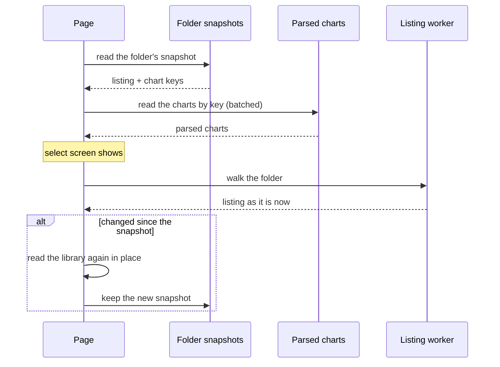

A folder without a snapshot (its first visit) is walked first and its charts are read, hashed and parsed; the snapshot is kept once they are in. The background walk compares the listing and each chart file's size and modification time with the snapshot. When they differ, the library is read again where the select screen stands, which keeps its place (`LibraryService.refreshCharts`); only the changed chart files are read, since a key is offered again only for a file as large and as old as when it was worked out. During a play the re-read waits until the select screen shows again. A folder that can no longer be read is reported and its charts leave the library. Until the walk is done, the list is the snapshot's: a chart edited on disk since the last visit shows its old header for those moments. An LRX chart is always read, as its key also depends on the files beside it.

A chart crosses a worker and the parsed-chart cache as little more than its headers: its events are packed into columns as narrow as their values allow (`packed-events.ts`), and the fields a list does not read (resources, measures, format sections, preservation) travel as JSON text that is parsed when one of them is first read (`deferChartFields`). A library of thousands of charts is copied out of the cache in a fraction of the time the charts' objects would take, and a chart that is never focused never has them built. The parse also carries the MD5 of the chart file, and its cache key starts with the file's SHA-256, so the loader keeps both hashes with the chart (`seedChartFileHashes`): matching course stages and looking up best records (`RecordsService.resolveChartHashes`) reads no chart file again.

**Themes.** The themes a drop brings are kept in `services/themes/`. `lr2.ts` holds every LR2 theme the drops brought and mounts one: its skins, BGM and system sounds, and its skins parsed again for a course. `beatoraja.ts` holds the beatoraja theme and loads its entries as scene kits, each by the entry the Options dialog picked for its skin type and with the player's options for it. `built-in.ts` holds the Be-Music Skin the built-in family draws with, its stored settings and the skins added. `app/family-kits.ts` picks the family that draws each screen (the Options dialog's Skin system, or beatoraja, then LR2, then built-in) and the kit and select-screen sounds it draws with.

**Replay history and slots.** `ReplaySlotStore` keeps history metadata and slot selections in memory and reads compressed payloads from IndexedDB on demand. `ResultReplaySlots` writes each eligible replay once and applies the current slot rules. The select screen’s Lit panel lists history with playback and downloads on every skin. Beatoraja continues to render its own slot controls. See [Replay slots](./replay-browser.md#replay-slots).

**Replays, recording and status.** `services/replays.ts` names the player as the recorder of the replays it writes (`REPLAY_RECORDER`: `be-music-web`, its version and the commit it was built from) and auto-saves them: a play's log as its result shows and a course's as its course result shows, each by the Auto-save replays setting as it was when the play (for a course, its last stage) started. `services/recording.ts` keeps what the Capture folder's video recording and screenshots need between plays: a recording armed on the select screen, which starts with the next play, the file name the next recording is saved under (the chart's title) and the video format picked. The recording itself is `recording-controller.ts`, and the scene router finalizes one in progress on every transition. `services/status.ts` keeps the status line, the Options dialog's Status row that the test hook logs, and whether it describes a play or a result: the select screen replaces such a line with a summary of the library when it comes back.

**Test hook.** `services/test-hook.ts` answers the end-to-end suite's [test hook](./player-web.md#test-hook) (`window.__beMusicTest`). At each read it takes the scene the router shows, the select screen's cursor and the record kept for the bar under it, the play on the stage, the library, the course run and the course being made; `test-hook.ts` adds what the app hands it: each result, replay and finished load. A read only looks: it answers at once, from what the app holds already. A bar's record is the current judge ruleset's, as the select screen shows it, and a chart's is found by the chart's hash once the select screen has hashed it, by its path before, so a read hashes no chart.

**Options dialog.** The [Options dialog](./player-web.md#options-dialog) is `ui/options/`: `OptionsDialog` (`index.ts`) builds it, each folder in a module of its own, and reaches the app only through `OptionsDialogDeps`, which the app fills with the settings, the library, records and course-maker services, readers of the app's state and the app's actions. The tabs, the folder titles and the Play options pages are `folders.ts`, the hover help is `help.ts`, and the locks a play puts on the options it latched and on the skin controls are `play-lock.ts`. The beatoraja skin-options panel is `ui/beatoraja-skin-options.ts`.

## Scene lifecycle

The browser player uses one `PixiSceneHost` (`host/scene-host.ts`) for the whole session.
The host owns a single PixiJS `Application`, shows one scene at a time, serializes scene transitions, and destroys the renderer only when the host is disposed.

The LR2 and beatoraja paths each provide the same high-level scene set; the default family shows a decide screen only when its Be-Music Skin declares one:

- Select scene for chart browsing, preview playback, and skin-side interactions
- Decide scene for the short transition before gameplay when the active family supplies one
- Play scene for notes, lanes, BGA, HUD, judgment, audio, and recording taps
- Result scene for score summary and skin-rendered result presentation

Every scene, built-in, LR2 and beatoraja alike, implements `PixiScene`, and a host changes scenes only with `setScene`:

- `root` is the container the host puts on the stage while the scene shows. A scene builds its scene graph under it and never adds itself to the stage.
- `identity` is `{ kind, family }`: the screen (`select`, `decide`, `play` or `result`) and the skin family drawing it (`built-in`, `lr2` or `beatoraja`). `getCurrentScene()?.identity` says what is showing; the player's test hook reports the identity of the scene its scene router shows.
- `enter(host)` runs each time the scene becomes the active one, before the host puts `root` on the stage. The first entry builds the scene graph and wires input and ticker work; a later one resumes what `exit()` paused and starts the screen's entrance again.
- `exit()` runs when another scene takes over or the stage is cleared, before the host takes `root` off it. The scene's ticker work, input and its own screen sound (BGM, preview, jingle) stop; it can be entered again.
- `dispose()` releases everything. The scene's owner calls it: `setScene` only exits the scene it replaces.

`SessionScene` ([Scene sessions and family views](#scene-sessions-and-family-views)) keeps the same contract, with its `identity` taken from its session and view.

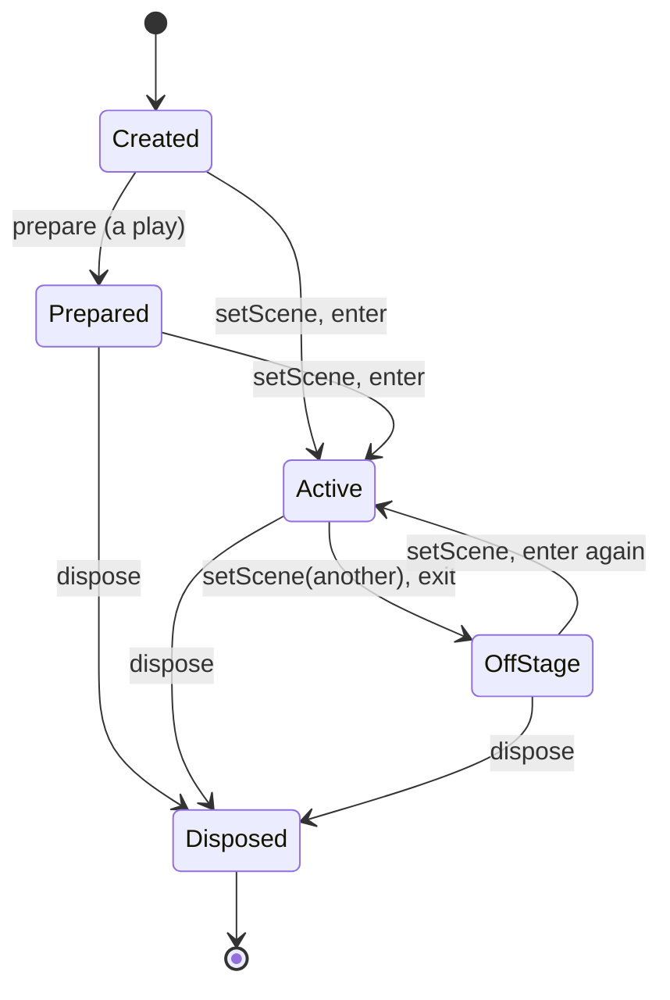

What a scene shows is handed to it before it is shown: the options of `createDecideScene` for every decide screen, the options of `createResultScene` for every result screen, the options of `createPlayScene` for every play screen, and the options of `createSelectScene` for every select screen.

In the web player the scenes' owner is its scene router (`app/scene-router.ts`, [ADR 0006](./adr/0006-scene-router.md)); the app (`app/app.ts`) and its routes never call `setScene` or `dispose` themselves. Every transition finalizes a video recording in progress, then calls `setScene(next)`, so the scene showing exits as the next enters and the stage never shows an empty frame, and then disposes the scene that left. Transitions run one at a time. A transition belongs to a navigation, and a scene made for a navigation that a newer one replaced (the select screen back while a result was still loading) is disposed instead of shown. While files load (a drop, a file pick, a URL), the select screen goes off the stage when it is showing, leaving no scene up, and comes back once they are read.

- **The select scene is kept alive.** Every family's select screen stays across a decide, play and result: their `exit()` stops the BGM and the chart preview and the drawing, and they keep their cursor, browse state and decoded BGM. Entering again restarts the scene timers, so the skin's entrance plays again, and the BGM; the preview starts again once the cursor is on another chart than the one it left on. The screen (`createSelectScene`) stops its sounds with `stopOwned` and detaches its input on exit. The player's router holds it as its select scene and never disposes it on a transition; picking another LR2 theme or skin family, a theme of another family taking over, or Escape at the root of a beatoraja select screen drops it (`dropSelect`), and the next select screen is made afresh.
- **A play loads off stage.** `prepare()` parses the chart and decodes its audio without touching the stage or adding listeners, so the player prepares the play behind a decide splash (the router's `prepare`). When the splash is done, `setScene(play)` exits the decide scene and enters the play prepared behind it, then `start()` begins it; keys pressed during the splash reach only the splash. The splash, the play and its preload share one navigation, so a splash left with Escape drops the play prepared behind it, and a preload that fails makes the play again with the splash's `#RANDOM` draws (`preResolved`). Without a splash the player takes the select screen off the stage while it makes the play, shows the play first, and a `prepare()` that runs while the play is showing draws the playfield in its loading state.
- **A play's sound outlives its screen.** The gameplay scene's `exit()` stops its drawing and input but not its sound, so the result shows while the last notes ring out; the router then disposes the play with `preserveAudioTail`. A course stage whose result is skipped leaves the stage the same way, and the next stage shows with no screen in between.
- **Decide and result scenes are one-shot.** Entered again, they restart their timeline; the router disposes them once another scene has taken the stage. A result screen that leads to the next stage or a retry leaves the stage first, so it takes no keys while the next play loads.
- **A navigation from outside ends the run.** A navigation the scenes ask for carries their run on: a play's result, a result's next stage or retry, a course's decide screen and stages (`continuesRun`). Any other one (a drop, a skin or theme change, files, a URL or a replay loaded) interrupts it: as it begins, the router calls the player's `onInterrupt`, which ends a course run, so the next single play is not taken for a stage, and the select screen comes back on the course bar. The Options dialog's skin controls that would go back to the select screen (Built-in skin, Skin effects, LR2 theme and the Add skin buttons) are disabled during a play. Skin system stays enabled, and dropping an LR2 or beatoraja skin onto the play swaps the drawing family without ending the chart. A drop that also brings charts still returns to the select screen. The select screen takes the new family when the play returns.

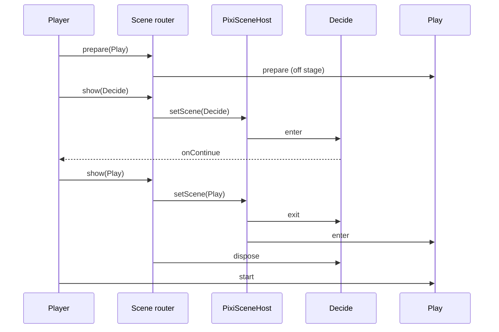

### What the gameplay families share

Every play screen is the one play session drawn by its family's view ([The play screen](#the-play-screen)), so everything that decides how a play sounds, looks and ends comes from one place and the families cannot drift apart:

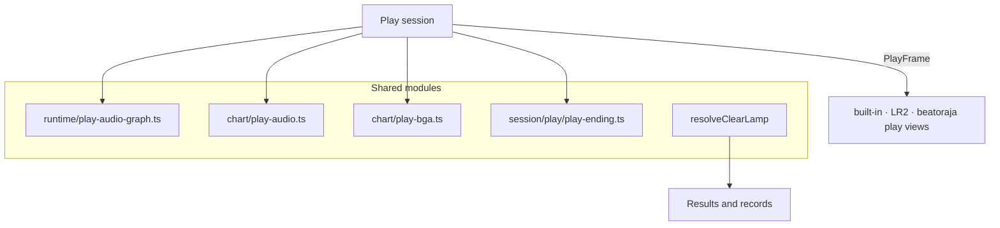

- `runtime/play-audio-graph.ts` builds the play's AudioContext and bus (with `#VOLWAV`); the audio service opens it for the play ([Audio service](./player-web-media.md#audio-service)).
- `chart/play-audio.ts` decodes the `#WAV` samples into it under the key the audio session looks them up by, stretches them for a keep-pitch tempo, and folds the `#WAVCMD` / `#EXWAV` volumes. It takes the decodes the audio service's `chartSamples` holds of the files the play's `#WAV` paths resolve to, as a retry or another chart of the same track finds them ([Audio service](./player-web-media.md#audio-service)).
- `chart/play-bga.ts` picks the BGA resources a play needs (`#BMPxx`, bmson `bga.header`, the sources of `#BGAxx` sub-regions, the implicit `#BMP00` POOR image for the LR2 view), decodes stills through the shared texture loader and videos through the video loader, keys the BMS layer track's black out, and cuts the sub-region views.
- `session/play/play-ending.ts` times the end of a play (`resolvePlayEnding`, `beginExitSequence`). A play that reaches its end holds a lead-out of about two measures after the last note, in chart time, then raises `exit-fade-out` (LR2 timer 2, beatoraja `TIMER_FADEOUT`) and leaves after the theme or skin fade-out (LR2 `#FADEOUT`, beatoraja `fadeout`); Escape and F5 run the same fade-out. A play cut short by its gauge emptying stops at once, as LR2 and beatoraja do: it raises `exit-close` (LR2 timer 3, beatoraja `TIMER_FAILED`) and no fade-out, and shows the result after the skin's close time (LR2 `#CLOSE`, beatoraja `close`); a theme without one (the built-in skins) holds 1.5 s and fades its picture. The sound fades out over that close, with the skin's closing animation; LR2 and beatoraja cut it at once. The views fade the picture with `playEndingFadeAlpha` (`view/shared/play-frame.ts`).

  ```mermaid
  flowchart TD
    how{How the play ends} -->|chart end, ESC, F5| fade[exit-fade-out: timer 2]
    fade --> next[Next screen after the fade-out]
    how -->|gauge emptied| stop[exit-close: timer 3, sound fades]
    stop --> result[Result after the close time]
  ```

- `resolveClearLamp` (`@be-music/player-engine/ruleset`) is the one clear-lamp rule. Every result lamps a play with it: the LR2 / default result (and the LR2 result's lamp ops 101-105, on LR2's lamps), and the beatoraja result and select through `beatorajaClearLampOp`; the player records every family's plays with it, and the Leaderboard ranks them with it. It keeps the lamp to the judge ruleset's own set: under LR2 and That-Which-Must-Not-Be-Named a full combo is the top lamp (no PERFECT or MAX), and under LR2 a DEATH clear is NORMAL.

## Scene sessions and family views

Every screen has one shape ([ADR 0001](./adr/0001-skin-families-only-draw.md)). A **scene session** holds a screen's behaviour once, for every skin family. A **family view** draws it in the family's skin. Every family's select, decide, play and result screens are built this way ([The select screen](#the-select-screen), [The decide screen](#the-decide-screen), [The result screen](#the-result-screen), [The play screen](#the-play-screen)).

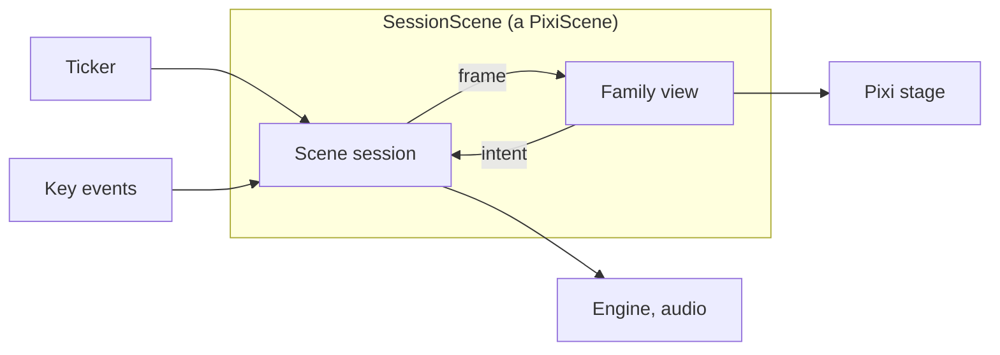

- **Family kit** (`host/family-kit.ts`). What a host hands a scene, per family: `{ family: 'built-in', skin }` (a Be-Music Skin and the player's settings for it), `{ family: 'lr2', skin }`, or `{ family: 'beatoraja', kit }` (one theme entry, loaded: skin, textures, fonts, options and the theme's files). The kits are `SelectKit`, `DecideKit`, `PlayKit` and `ResultKit`.
- **Frames** (`view/types.ts`). On every tick the session gives its view a frame built over the scene models:
  - `SelectFrame`: the library, the `BrowseState`, the list and its cursor, the play options and the records;
  - `DecideFrame`: the chart, the chart as the play will play it, the course stage and the loading progress;
  - `PlayFrame`: the `PlayState`, the chart time, the notes, the held lanes and the events since the last frame;
  - `ResultFrame`: the `PlayResult`, the chart as the play played it and how the run is presented.
- **Intents.** The view sends back what the player asked for, per scene:
  - select: a browse command, start, a play option or a panel;
  - decide: continue or cancel;
  - play: a touch lane, the hi-speed, a cover, pause or quit;
  - result: continue or retry.
- **`FamilyView`**: `attach(host, emit)`, `draw(frame)`, `detach()` and `dispose()`. A detached view keeps what it loaded. The decide, play and result views also give their skin's timing: the input delay, the auto advance and the fade-out (and whether Escape waits for input too, as on beatoraja), and for the play, the load-end, play-start, fade-out and close offsets (an LR2 skin's, or a beatoraja skin's 1.5 s lead-in and fade-out).
- **`SessionScene`** is the `PixiScene` made of a session and a view:
  - `enter(host)` attaches the view, starts the session and draws a first frame.
  - The ticker asks the session for a frame and has the view draw it.
  - Key events go to the session as plain data, except while a text field has the focus. The view's intents go to the session while the scene is entered.
  - `exit()` detaches both and keeps them for the next `enter`; `dispose()` ends them.
- **`PlayfieldSkin`** is what a family's skin gives the shared playfield: the stage, the lanes, the note, measure-line and bomb images, and the effect lengths. A play view also hands the shared frame pass its own drawing around the playfield, as a **`PlayChrome`**: its layers, its chrome, its late text and what it stops when a bomb goes out. Together they replaced the hooks the subclasses of the removed `CoreGameplayView` overrode:

  | `CoreGameplayView` hook                                   | Replaced by                                                                  |
  | --------------------------------------------------------- | ---------------------------------------------------------------------------- |
  | `stageSize`                                               | `PlayfieldSkin.stage`                                                        |
  | `themeOwnsPlayfield`                                      | `PlayfieldSkin.ownsLanes`                                                    |
  | `resolveThemeLaneRect`                                    | `PlayfieldSkin.laneRect`                                                     |
  | `resolveThemeNoteCell`                                    | `PlayfieldSkin.noteCell`, by channel                                         |
  | `renderThemeMeasureLines`                                 | `PlayfieldSkin.measureLines`, placed by the playfield                        |
  | `collectBGATargets`                                       | `PlayfieldSkin.bgaTargets`                                                   |
  | `renderBombEffects`                                       | `PlayfieldSkin.bombCell`                                                     |
  | `resolveBombDurationMs`                                   | `PlayfieldSkin.bombDurationMs`                                               |
  | `resolveKeyOnFadeMs`                                      | `PlayfieldSkin.keyOnFadeMs`, by channel                                      |
  | `themeTiming`                                             | `PlayView.timing`                                                            |
  | `onThemeEvent`                                            | `PlayFrame.events`, read in `draw`; a retired bomb, `PlayChrome.bombRetired` |
  | `updateThemeState`, `renderThemeLayer`, `renderThemeText` | `FamilyView.draw`, around `PlayChrome.draw` and `drawText`                   |
  | `attachThemeLayers`                                       | `PlayChrome.attachLayers`                                                    |
  | `prepareTheme`                                            | the view's loading, run by the session (`PlaySessionTheme.prepareView`)      |
  | `disposeTheme`                                            | `FamilyView.dispose`                                                         |

  The LR2 lane index and LR2 timer ids stay inside the LR2 view: the session keeps the key beams by channel (`keyBeamStartedAt`, `keyBeamFadeStartedAt`), and the playfield asks by channel.

- **Layering.** `pnpm run check` keeps the sessions, the views and the layers under them apart ([Layering](#layering)).

### The select screen

`createSelectScene(kit, options)` (`@be-music/player-browser/host`) makes every family's select screen: a select session (`session/select/select-session.ts`) drawn by the view of the kit's family, as a `SessionScene` to show with `setScene`. A built-in kit (`{ family: 'built-in', skin }`) is drawn by the built-in select view (`view/built-in/select-view.ts`), an LR2 kit (`{ family: 'lr2', skin }`, the theme's select skin) by the LR2 select view (`view/lr2/select-view.ts`), and a beatoraja kit (`{ family: 'beatoraja', kit }`, the theme's select entry loaded with `loadBeatorajaSceneKit`) by the beatoraja select view (`view/beatoraja/select-view.ts`). The built-in and LR2 views share the pointer input (`view/shared/select-pointer.ts`), and every view shows the README dialog over the screen (`view/shared/readme-dialog.ts`: `<be-music-readme-dialog>` of `@be-music/player-ui` in the host's DOM layer). The dialog shows the first `.txt` file in the focused chart's folder (`collection/readtext.ts`), decoded as a chart's own text is (`decodeBMSText`: a BOM, then strict UTF-8, then the likeliest of Shift_JIS and the other legacy encodings), with its web and mail addresses as links that open in a new tab.

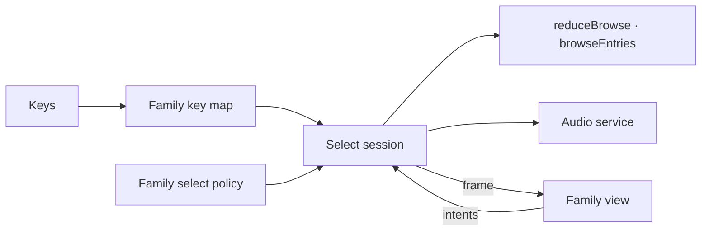

- **Options.** `library` (the collection, with its charts' files), `browse` (a `BrowseSnapshot` to open on), `playOptions`, `records` (the best records for the bars and panels), `sounds` (the theme's `SystemSoundSet`), `audio` (the host's audio service), `courseMaker` (the player's own courses and the course being made, for an LR2 skin) and `on`: `start(entry, { autoPlay })`, `playOptions`, `search`, and the optional `readtext`, `courseMaker` (name or delete a course), `skinConfig`, `skinConfigChange` (a beatoraja skin changed its own options) and `exit`.
- **The scene.** `snapshot()`, `focused()`, `getPlayOptions()` / `setPlayOptions()` (the host's change, not reported back), `setLibrary()` (the same library redraws; a new one keeps the player's place over it), `restore()`, `refreshRecords()`, `setSearch()` / `setSearchEditing()`, `searchError()` (why a `?` chart filter expression searched for does not parse), `searchFieldRect()`, `setSounds()` and `updateKit()` (the player's settings for a Be-Music Skin, another LR2 select skin, or a beatoraja select entry loaded again; the entry loaded before is taken without building anything again).
- **Keys** (`session/select/select-keys.ts`), by the family's key map. Every key is an operation of the key table (`CONTROL_ACTIONS`), so the player can move it. On the LR2 screens, and the built-in ones unless the player picked beatoraja's keys (`builtInControlScheme`), ↑ / ↓ and the turntable move the cursor (turned down, its second key, to the next bar), Enter and the white keys open the folder or start the bar, → opens a folder (and on a chart, like SELECT and 1, moves to the next chart of the same track: the charts in the same directory of the same source, `select-difficulty.ts`), key 6 starts the bar in AUTO as it comes up (held for `REPLAY_HOLD_MS`, 2 s, it plays the chart's saved replay instead), key 4 backs out on a tap and, held for `RANKING_HOLD_MS`, opens the chart's ranking on the Leaderboard (`SelectSessionEvents.ranking`, LR2's IR), F3 held turns the arrows to the level edit (↑ / ↓ the chart's difficulty, ← / → its level: `SelectSessionEvents.levelEdit`; the web player keeps the edits in this browser and puts them over the charts each time the library is read, `chart-level-edits.ts`), and Escape, Backspace, ← and key 2 back out of a folder. F1 opens Help. START, Space or Tab opens the play-options panel: a tap keeps it open until the next press, and a press held for `PANEL_HOLD_MS` shows it only while held, as LR2's does. While it is open the 1P keys step its options as LR2's panel 1 does (key 1 the key mode filter, 2 random, 3 battle, or DP flip with a double-play filter, 4 gauge, 5 / 7 hi-speed, 6 auto scratch), and Escape closes it. 2 steps the sort, 3 the key mode filter, 0 opens the search and F8 reads the library's folders again (`SelectSessionEvents.reload`: the web player walks each dropped folder again, so charts added, changed or removed on disk since show up, reads picked files and archives again as they were, and asks the Bemuse music servers for their indexes and the difficulty tables for their headers and song lists again, whatever the age of their kept copies, `LibraryService.reloadCharts`). F2 opens the Options dialog on its LR2 mania options (`SelectSessionEvents.maniaOptions`), where LR2 shows its mania panel. On the beatoraja screens ↑ / ↓ and the turntable move the cursor (turned up to the next bar), Page Up / Page Down ten bars, Home / End to the first and the last bar, R to a random bar (beatoraja's random select), Enter, → and key 1 open the folder or start the bar, key 3 opens a folder, key 5 starts the bar in AUTO, Escape backs out of a folder (and at the root asks first, as on every screen) and Backspace, ← and keys 2 / 4 back out of a folder only; 1 steps the key mode filter, 2 the sort (in beatoraja's orders), 3 the LN mode, 0 opens the search, F2 reloads the folders and F8 / F9 mark the song / the chart as a favourite. Ctrl+F3 and Ctrl+Shift+F3 (⌘ on a Mac) copy the focused chart's MD5 and SHA-256 (`SelectSessionEvents.copyChartHash`: the web player writes them to the clipboard), F10 plays the charts of the focused folder (or of the list shown, on a chart) in AUTO one after the other (`SelectSessionEvents.autoplayFolder`: the web player starts the next one each time it would come back to the screen, and a play given up ends the run), 8 opens the folder the focused chart is in, out of a search or a favourites list, and 9 opens or closes its text file. beatoraja's 7 (the rival's lamps), F3 alone (the chart's folder in the file manager) and the result's key 6 (the next graph) are not taken: the web player has no rivals on the select screen, no file manager to open and one gauge graph. START, SELECT and 5 (or START and SELECT together) open beatoraja's option panels 1 to 3, which the skin draws on its panel timers (21-23 open, 31-33 close) and `OPTION_PANEL1`-`3`; their 1P keys step the options beatoraja's do (`BEATORAJA_PANEL_KEYS`: panel 1 RANDOM, gauge, DP option, HS-FIX and 2P RANDOM; panel 2 CUSTOM JUDGE, CONSTANT, the judge area display, the LN mode, the BPM guide and the mines; panel 3 the BGA, the gauge auto-shift, the judge timing auto-adjust and the visible time and judge timing by 1 ms). At the root, Escape on every family opens the exit menu (`SelectSessionEvents.exitMenu`, That-Which-Must-Not-Be-Named PC's): the web player asks whether to leave for the drop screen (`ui/exit-menu.ts`), and Cancel or Escape stays. On every screen F4 switches full screen, F6 takes a screenshot and the frame rate key (LR2's F7, beatoraja's F1, by the skin's family) shows or hides the frame rate readout (`ui/fps-overlay.ts`), unless a lane of the play's chart takes the key. While the README dialog is open, ↑ / ↓, Page Up / Page Down, Space and Home / End scroll it, Enter, Backspace and Escape close it, and no other key reaches the list behind it; its close button and a click outside it close it too. Help's Keyboard tab draws each screen's keys on a keyboard (`ui/keyboard/`, `<be-music-keyboard-map>`) from the player's own lane keys, START / SELECT and operation keys, on the key map picked there (starting on the one the screen shown reads): numbers mark the white and black keys, ◎ the turntable, ST / SL START / SELECT and ● an operation's key, and pointing at a line of the list beside it lights that operation's keys.
- **Pointer.** The view turns a click or a tap on a bar, a swipe and its glide, the wheel, and the skin's hit areas into intents: a Be-Music Skin's PLAY, AUTO, search, play option and README areas (Synesthesia and Plain draw a small README button at the top right of the focused chart's card, and Native's details panel has one, each enabled on a chart with a README: `frame.hasReadme`); an LR2 skin's buttons (`resolveLR2SelectButton`, `resolveLR2CourseMakerAction`: panels, the hi-speed, the play options, the sort and filters, PLAY / AUTOPLAY / READ TEXT, the course maker's), its search word and course name. A click on an LR2 bar moves the cursor the slots between and takes the bar. A click on a beatoraja bar takes it when it is the focused one, else moves the cursor onto it by the rows between; a beatoraja skin's buttons (`image[].act`) are PLAY, AUTO, PRACTICE (played as PLAY), READ TEXT, the song and chart favourites, and MODE and SORT, which step the browse position's key filter and sort (Shift steps back).
- **LR2 drawing.** The LR2 view draws the skin through `resolveLR2SelectState` and starts LR2's timers from what the frames report (`SelectFrame.events`): timer 0 at the entry and timer 1 after `#STARTINPUT`, timers 10-13 as the cursor moves (the bars slide by the move; a folder opened or closed slides them one bar), the panel timers 21-29 and 31-39 as option panels open and close, and timers 17 / 18 as a course starts and stops being made. The LR2 ids stay in the view.
- **beatoraja drawing.** The beatoraja view draws the select skin through `BeatorajaPlaySkinView`, its canvas fitted into the window, with the scene mapping of `@be-music/skin-beatoraja/scene`: the focused bar's ops, numbers and texts and the MODE, SORT and LNMODE image sets (`resolveBeatorajaSelectBarOps` / `Number` / `Text` / `RefValue` / `SliderValue`, over the browse position's list options and the bar's best lamp from `records`). The bar list sits at the skin's `songlist` anchor (`view/beatoraja/select/rows.ts`) and glides to the cursor, the short way round a wrap; the view also draws the focused chart's images and BPM and notes graphs, and a prompt with the number of matches while a search is applied. It reads beatoraja's timers off the frames: the scene timer (0) from the entry and the bar-change timer (11) whenever the bar under the cursor changes. The LNMODE button's choice stays in the view, as the browse model leaves it out (nothing plays it yet); the JUDGE TIMING button steps the skin's timing offset (number 12) and hands the options to the host (`on.skinConfigChange`). The ids stay in the view.
- **Replay slots.** With `records.replaySlots`, the session picks the first slot of the bar under the cursor that holds a replay whenever the bar changes and frames it (`SelectFrame.replaySlots`). On the beatoraja key map 4 and F pick the next one and V replays it (or plays the bar when none holds a replay); the beatoraja skin's replay buttons (19, 316-318) and `SelectScene.replay(slot)` replay a slot. A replay start reaches `on.start` with `replaySlot`. `on.focus` reports the bar under the cursor as it changes, for the host's replay-slot card.
- **Course maker.** The session runs an LR2 skin's finish, cancel and connection buttons on `courseMaker`; a connection, and a delete (through `on.courseMaker('delete', course)`, which the host confirms), only on the player's own course under the cursor.
- **Starting.** Enter, a click or PLAY / AUTO on a chart hands it to `on.start` after the Be-Music Skin's launch outro (input waits meanwhile); a course is handed at once. As a chart's outro begins, `on.launch` tells the host it was picked, so the host can start loading the play then. The decide cue and jingle play when `on.start` does not return `false` ([The decide jingle](#the-decide-jingle)); a course with a stage missing plays the cancel cue.
- **Sound.** The session plays through the audio service. The select BGM (at half level, ducked under the preview) and the preview of the chart under the cursor are its own: the screen's exit stops them with `stopOwned`, and its next entry starts the BGM again. The cues and the decide jingle have no owner and play out. The preview follows the chart under the cursor, a search included; coming back with the cursor on the chart it left on does not start that chart's preview again until the cursor moves. A beatoraja skin's Lua sounds (`main_state.audio_*`) play through the audio service's skin sounds as the session's (`skinSounds.owned`), so they stop as the screen leaves too. A beatoraja theme's set (`systemSoundSetFromBeatoraja`) names its cues and select BGM by path, read from the theme's files (`audio.setTheme({ files })`), and has no decide jingle: the beatoraja decide screen plays its theme's decide sound.

The list, the browse position and the select policy work the same on every family, by the family's select policy:

- **The list.** The session keeps a `BrowseState` of the browse model of `@be-music/player-scene-model` ([Browse](./scene-model.md#browse)): commands go through `reduceBrowse`, the list drawn is `browseEntries`, and the folder and option cues come from `browseSystemSound`. On the built-in and LR2 screens the sort, the key filter and the difficulty filter stay in the play options (LR2's option panel, an LR2 skin's buttons, a Be-Music Skin's play options, the host's `setPlayOptions`), and the list follows them; on the beatoraja screen the MODE and SORT buttons change the browse position's key filter and sort (beatoraja has no difficulty filter), which the play options leave alone. A sort or a filter change keeps the cursor on the bar it was on, or on its row, clamped, when the filter takes that bar out. A search change puts the cursor on the top. The key filter lists a chart under its own key mode, so a 24-key chart is listed only under ALL on an LR2 screen, whose key filter has no 24-key choice, and under 24 KEYS (or 24 KEYS DOUBLE) on the beatoraja one. Folder bars stay listed under every filter, and a course folder lists the courses of the filter's key mode and those that name none. The search matches a chart's title, subtitle, artist, genre or file label and a course's name, by the text trimmed and ignoring case, as one phrase: it splits no words, reads no quotes or `OR`, and folds neither full-width / half-width letters nor hiragana / katakana. A search that starts with `?` is a chart filter expression (the SQL `WHERE` clause of beatoraja's random courses, [course.md](course.md#filter-columns)): the session reads each chart through `createCourseChartRecord`, resolved once per chart, with its `score` row from the records in force, so `refreshRecords()` lists again by the new records; the frame carries `searchError` while the expression does not parse, and the list stays unfiltered. The page's search field (`InlineSearch`) marks itself invalid and shows the reason just under it; the Native skin shows it under its own input. Help's Usage tab explains both kinds of search, with examples (`ui/help-search-examples.ts`) that `help-search-examples.test.ts` runs through `listEntriesAt` so each lists what Help says. A sort orders the folder bars at the root by label too.
- **The browse position.** A `BrowseSnapshot` (`captureBrowse`) is restored with `restoreBrowse`: the search it was saved with, the folders walked by label as far as they are still found, each parent cursor on the bar of the folder opened from it (so backing out lands on it), and the cursor on the saved bar, found by its key, while it is still listed. The sort and the filters in force are kept on the built-in and LR2 screens; the beatoraja screen takes the snapshot's.
- **The select policy.** What the model leaves to the screen is the family's select policy (`session/select/select-policy.ts`): on the built-in and LR2 screens a back-out at the root does nothing, and a library of one chart folder opens it when there is no position to restore. On the beatoraja screen a back-out at the root plays the cancel cue and leaves the screen (`on.exit`), a library opens at its root, the sort and the key filter live in the browse position, the keys are beatoraja's, and a folder opened or closed plays its folder cue alone (on LR2 the cursor cue plays with it, as with every slide of the list).

The web player keeps one select scene, whichever family draws it, and its snapshot across a play, a course (the cursor comes back to the course bar) and a skin change, and opens a drop's folder with one. Its Options dialog's Play options set the sort and the filters of the built-in and LR2 screens too. It loads a beatoraja theme's select entry once and hands it again on each return while the theme and the entry stay the same; the skin-options panel, the JUDGE TIMING button and the Options dialog's skin picker load it again and hand it with `updateKit`. Escape at the root of the beatoraja screen goes back to the drop screen.

### The decide screen

`createDecideScene(kit, options)` (`@be-music/player-browser/host`) makes every family's decide screen: a decide session (`session/decide/decide-session.ts`) drawn by the view of the kit's family, as a `SessionScene` to show with `setScene`. A built-in kit (`{ family: 'built-in', skin }`) is drawn by the built-in decide view (`view/built-in/decide-view.ts`), an LR2 kit (`{ family: 'lr2', skin }`, the theme's decide skin) by the LR2 decide view (`view/lr2/decide-view.ts`), and a beatoraja kit (`{ family: 'beatoraja', kit }`, the theme's decide entry loaded with `loadBeatorajaSceneKit`) by the beatoraja decide view (`view/beatoraja/decide-view.ts`).

- **Options.** `chart` (the chart about to be played), `course` (the course stage, if any), `playOptions` (as the skin shows them), `source` (the chart's files, for the skin's images), `sounds` (the theme's `SystemSoundSet`), `audio` (the host's audio service), `progress` (how far the play behind the screen has loaded; without it the frame reads how much of the auto advance has gone by) and `on: { continue, cancel }`.
- **Timing.** The session times the screen from the view's skin timing (`DecideView.timing`). Input opens after the input delay. The screen moves on to the play by itself once the auto advance is up; without one it waits for the player. A leaving screen fades out first, then calls `on.continue` (to the play) or `on.cancel` (back to select), once per entry. A Be-Music Skin's screen takes input at once, moves on after its `decide.durationMs` (2000 ms by default) and has no fade-out. An LR2 skin's screen takes input after its `#STARTINPUT` (1500 ms without one), moves on 1200 ms later and fades out over its `#FADEOUT`. A beatoraja skin's screen takes input after its `input` (500 ms without one), moves on after its `scene` (3000 ms without one) and fades out over its `fadeout` (500 ms without one). A `scene` of 0 moves on at once, before input opens, as beatoraja's [`MusicDecide`](https://github.com/exch-bms2/beatoraja/blob/c2ed5db1a46145ed10790c3872f717e95b59db9d/src/bms/player/beatoraja/decide/MusicDecide.java#L46-L50) starts its fade-out once `nowtime > scene` (lines 46-50), and Escape no longer backs out of it.
- **Input.** Enter, Space, the lane keys (LR2: any, beatoraja: keys 1 / 3 / 5 / 7) and a click on the canvas continue once input is open, and START and SELECT held together back out; the beatoraja screen takes no clicks or taps, as beatoraja's does not, and moves on by itself after its `scene`, so a touch device reaches the play too. Escape backs out at any time, as LR2 lets it before `#STARTINPUT`; on a beatoraja skin it waits for input to open too, as beatoraja's `input` holds back every key (`SceneViewTiming.escapeWaitsForInput`). Auto-repeats are ignored, so the Enter still held from the select screen does not skip the screen.
- **Built-in drawing.** The built-in view draws the Be-Music Skin's `decide` on its stage, letterboxed into the window; a skin without one moves on at once. Native draws a DOM screen. Synesthesia carries on the launch warp its select screen starts: the select outro plays its first 210 ms (the panels fall away, the camera settles onto a straight dash and the title starts to condense), then the decide screen takes the same warp over from the time since the launch (`skins/synesthesia/launch-warp.ts`), finishes the title's zoom and the lock-on reticle, adds the genre, the mode, difficulty and level, the banner and a faint stage file, and falls to black over its last 320 ms. It shows for 1800 ms.
- **LR2 drawing.** The LR2 view draws the decide skin over the chart's `#STAGEFILE` through `resolveLR2DecideState` (the chart's difficulty, key mode and texts, and the course's for a course stage). It reads LR2's timers off each frame: timer 0 from the entry, timer 1 from when input opens and timer 2 from when the screen starts leaving. The timer ids stay in the view.
- **beatoraja drawing.** The beatoraja view draws the decide skin through `BeatorajaPlaySkinView`, its canvas fitted into the window, with the scene mapping of `@be-music/skin-beatoraja/scene`: the chart's difficulty ops, `#PLAYLEVEL` and BPM, and the loading bar and percentage, `NOW_LOADING` then `LOADED` (`resolveBeatorajaDecideOps`, `resolveBeatorajaDecideNumber`, `resolveBeatorajaDecideGraphValue`), and the chart's and the skin's texts. It draws the BPM and note-kind graphs of `DecideFrame.playChart`, and the chart's `#STAGEFILE`, `#BACKBMP` and `#BANNER`, which it loads from `source` before its first frame. It reads beatoraja's timers off each frame, on the screen's own clock (ms since the entry): timer 0 from the entry, timer 1 and READY / PLAY from when input opens, and timer 2 from when the screen starts leaving.
- **Sound.** The session plays the theme's decide jingle (`sounds.decideBGM`) through the audio service as the screen enters, as its owner, and stops it with `stopOwned` as the screen leaves the stage. The web player hands the built-in and LR2 decide screens no jingle (`sounds: {}`); see [The decide jingle](#the-decide-jingle). It hands the beatoraja screen its theme's decide sound (`systemSoundSetFromBeatoraja`). A beatoraja skin's Lua sounds (`main_state.audio_*`) play through the audio service's skin sounds as the session's (`skinSounds.owned`), so they stop as the screen leaves too.
- **`#RANDOM`.** The session draws the chart's `#RANDOM` / `#SWITCH` branches once, when the scene is made, as beatoraja's decide screen does. `scene.resolved` is the resolved chart with its draws, to hand to the play (`preResolved`), and `DecideFrame.playChart` is the same chart for the view's graphs, so the screen shows the branches the play plays. The web player hands the draws on to the play: the LR2 / built-in play it preloads behind the screen and the beatoraja play alike (a course stage draws its own). Only the beatoraja decide view draws the branches (its BPM and note-kind graphs).
- **Skin settings.** `updateKit(kit)` takes the player's new settings for the skin; the next frame draws with them. A beatoraja skin is loaded with its options, so a beatoraja kit of another skin is ignored.

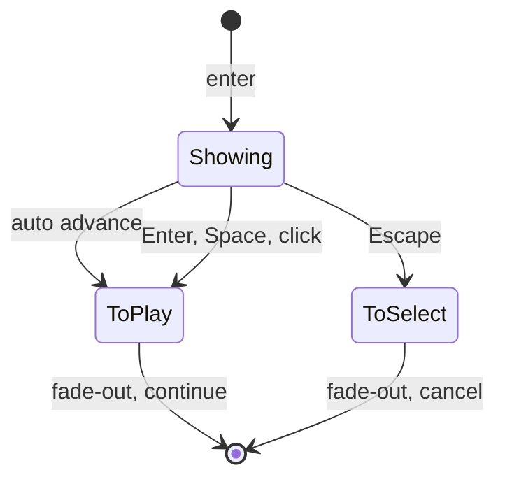

The web player prepares the play behind every decide screen and shows it from `on.continue`. A chart picked on the select screen starts loading its play as it is picked (`on.launch`, `DecideRoute.preloadOnLaunch`), when a decide screen known at once follows (the Be-Music Skin's or an LR2 theme's), so the load runs through the select screen's launch outro as well: the route draws the chart's `#RANDOM` branches then, hands them to the decide screen (`resolved`), and the decide screen takes that navigation and that play over (the router's `leave` keeps it with `keepHeldPlay`). A start that goes elsewhere (another chart, a course, no decide screen) begins its own navigation, and the play loaded at the pick goes as stale. A chart added to a course being made, one whose practice bars are picked first, and a replay slot load nothing at the pick.

#### The decide jingle

The select screen plays the decide jingle of an LR2 sound set (`#DECIDE`, `sounds.decideBGM`) as a chart or a course starts a play. The select session (built-in and LR2) plays it through the audio service without an owner: the select screen's exit (`stopOwned`) stops its BGM and preview but not the jingle, which rings on through the decide screen and into the play, as LR2's does. It also plays where no decide screen shows (a theme without a decide skin). The beatoraja select screen's sound set has no decide jingle: the beatoraja decide screen plays its theme's decide sound as the session's jingle, which stops as the screen leaves, as it stopped with the screen's own context before.

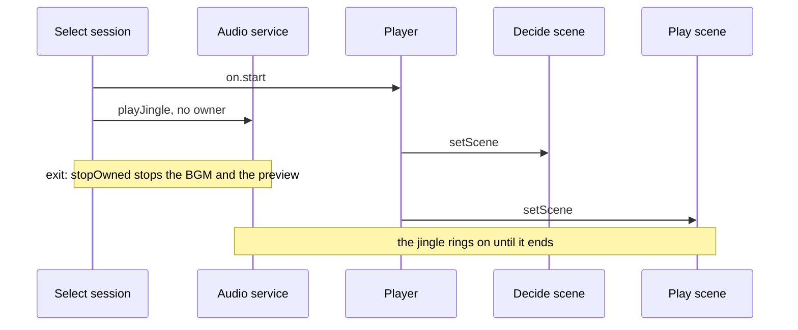

The decide session could play it (`sounds.decideBGM`), but as the decide scene's own sound, which `stopOwned` stops when the scene leaves: the jingle would be cut as the play starts. So the player hands the built-in and LR2 decide screens `sounds: {}`, and the jingle stays the select screen's. The host tells the select screen whether a start begins a play: `on.start` returns `false` when the course being made takes the chart or a course cannot start, and then no jingle plays.

### The result screen

`createResultScene(kit, options)` (`@be-music/player-browser/host`) makes every family's result screen: a result session (`session/result/result-session.ts`) drawn by the view of the kit's family, as a `SessionScene` to show with `setScene`. A built-in kit (`{ family: 'built-in', skin }`) is drawn by the built-in result view (`view/built-in/result-view.ts`), an LR2 kit (`{ family: 'lr2', skin }`, the theme's result skin, or its course-result skin for a course run) by the LR2 result view (`view/lr2/result-view.ts`), and a beatoraja kit (`{ family: 'beatoraja', kit }`, the theme's result entry, or its course-result entry for a course run, loaded with `loadBeatorajaSceneKit`) by the beatoraja result view (`view/beatoraja/result-view.ts`).

- **Options.** `result` (the `PlayResult`; an LR2 or beatoraja skin shows the course of `result.course`), `run` (which play it is of, when `result.run` does not say, as for a course stage), `source` (the chart's files, for the skin's images), `playChart` (the chart as the play played it, for a beatoraja skin's BPM graph, note kinds and TOTAL readout), `sounds` (the theme's `SystemSoundSet`), `audio` (the host's audio service) and `on: { continue, retry? }`.
- **Replay slots.** With `replaySlots` (each slot's state, read every frame) and `on.saveReplay`, keys 1-4 and a `saveReplay` intent (a beatoraja skin's replay buttons) ask the host to save the play into slot 1-4, once input is open and until the screen starts to leave, as beatoraja's result takes its number keys; the frame carries the states (`ResultFrame.replaySlots`), which a beatoraja skin shows on ops 196-198 and 1196-1204.
- **Presentation.** The session presents the run with `resolveResultPresentation(run)`: a course run plays the course jingles, and only a single play or a NONSTOP run offers the quick retry.
- **Jingle.** The session plays the result's jingle from `sounds` (`resolveResultJingles`, then `resolveResultJingle`: the clear or the fail one by the verdict, else the generic one; the course ones first for a course run) through the audio service as the screen enters, as its owner, and stops it with `stopOwned` as the screen leaves the stage. A scene used to stop its jingle by closing its own context. A theme with only the other verdict's jingle plays none, on the LR2 screen as on the built-in one.
- **Steps.** Input opens after the view's input delay (an LR2 skin's `#STARTINPUT`; 1500 ms, LR2's default, for a Be-Music Skin or an LR2 skin without one), and the result's graphs start drawing then. They finish by themselves 3 s later; Enter, Space or a click before that skips them. The next press shows the record update, and the one after that calls `on.continue`. The frame carries when each step showed (`graphShownAtMs`, `updateShownAtMs`: LR2's timers 151 and 152); a Be-Music Skin's entrance jumps to its settled layout once the graphs show. A beatoraja skin's screen has no steps to press through (`ResultViewTiming.skipsResultSteps`): input opens after its `input` (500 ms without one), and the first Enter, Space or tap calls `on.continue`, after a fade-out over its `fadeout` (500 ms without one). A tap is a touch or a pen; a mouse click does nothing there, as beatoraja's result reads keys only, but a phone or a tablet has no other way off the screen.
- **Close sound.** When the theme has a close sound (beatoraja's `resultclose`, or `course_close` for a course run, falling back to `resultclose`), the session stops the jingle and plays it as the fade-out starts, as beatoraja's `MusicResult` / `CourseResult` do. LR2 has no such sound, so an LR2 result stays silent.
- **Leaving.** Escape calls `on.continue` at any step; on a beatoraja skin it waits for input to open too, as beatoraja's `input` holds back every key (`SceneViewTiming.escapeWaitsForInput`). A bare R calls `on.retry` once input is open, when the run offers the quick retry and the host gave `on.retry`. Each fires once per entry.
- **LR2 drawing.** The LR2 view draws the result skin through `resolveLR2ResultState`: the result, the course of `result.course`, the skin's `#FLIPRESULT` and the defaults of its custom options. It reads LR2's result timers off each frame, and the timer ids stay in the view:
  - timer 0 from the entry;
  - timers 1 and 150 from when input opens;
  - timer 151 from `graphShownAtMs`, when the rank and the score show;
  - timer 152 from `updateShownAtMs`, when the record update shows.

  The gauge and score graphs sweep in over their `start` and `end` after their timer, as LR2's stock skin draws them 500 to 2000 ms after timer 150.

- **beatoraja drawing.** The beatoraja view draws the result skin through `BeatorajaPlaySkinView`, its canvas fitted into the window, reading the `PlayResult` directly through the scene mapping of `@be-music/skin-beatoraja/scene` (`resolveBeatorajaResult*`): the score and judgment numbers, the timing mean and deviation, the gauge with its border and TOTAL (`gaugeBorder`, `gaugeTotal`), the rank, verdict and lamp ops, the gauge and EX-score graphs, the judge graphs, the timing distribution and the course of `result.course`. The BPM graph, the note kinds and the chart's `#TOTAL` come from `ResultFrame.playChart`; without it they show nothing. The chart's `#STAGEFILE`, `#BACKBMP` and `#BANNER` load from `source` before the first frame. It reads beatoraja's timers off each frame, on the screen's own clock: timer 0 and READY / PLAY from the entry, timer 1 from when input opens, and timer 2 from when the screen starts leaving. A skin's Lua sounds play through the audio service's skin sounds as the session's, so they stop as the screen leaves.
- **Skin settings.** `updateKit(kit)` takes the player's new settings for the skin; the next frame draws with them. A beatoraja skin is loaded with its options, so a beatoraja kit of another skin is ignored.

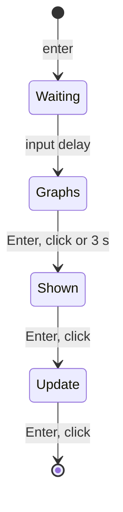

The web player shows every result this way: a single play, a replay, a course stage, a course run (on the theme's course-result skin when it has one) and a NONSTOP run (on the result skin; a beatoraja theme without one falls back to the built-in screen with that theme's jingles). Every play hands its result as a `PlayResult` (`playResultFromPlayState`), its graphs running from the chart's start to the playhead, and a course run reads as one with `playResultFromCourseRun`: the last stage's graphs on LR2 and built-in, every stage's joined on beatoraja.

### The play screen

`createPlayScene(kit, options)` (`@be-music/player-browser/host`) makes every family's play screen: a play session (`session/play/play-session.ts`) drawn by the view of the kit's family, as a `SessionScene` to load, show with `setScene` and start. A built-in kit (`{ family: 'built-in', skin }`) is drawn by the built-in play view (`view/built-in/play-view.ts`), an LR2 kit (`{ family: 'lr2', skin, invisibleNoteSkin? }`, the chart's play skin and the theme's 9-keys skin for invisible notes) by the LR2 play view (`view/lr2/play-view.ts`), and a beatoraja kit (`{ family: 'beatoraja', kit }`, the theme's play entry for the chart's variant) by the beatoraja play view (`view/beatoraja/play-view.ts`).

A play accepts an optional `sounds: SystemSoundSet`. On early stage failure it plays `sounds.playStop` once through the audio service, owned by the play scene. LR2 themes resolve this from the sound set’s `#STOP` command, falling back to `Sound/lr2/playstop`; beatoraja themes discover `sound/playstop`. Normal completion, Escape and retry play no stop cue. A theme without the sound stays silent, and leaving the scene stops its cue.

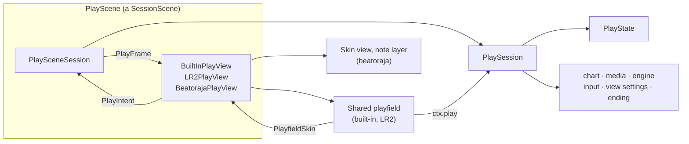

- **Options.** `chart` and `source`; `settings`, how the play runs apart from its chart, its skin and where it leads (the play options it judges and scrolls with, the tempo, the audio mix, the BGA and the drawing options); `course` (the stage's rules and its course view); `replay` (a replay to play back); `preResolved` (the decide screen's `#RANDOM` draws); `audio` (the host's audio service, which also plays a beatoraja skin's sounds); `playOptions` (as the select screen set them, for the frames); `host` (to build the layers while the play loads off stage); and `on: { finish(result, replay), exit, restart, hiSpeed?, tempo? }`.
- **Lifecycle.** `prepare(onProgress)` loads the chart, the view's own assets (an LR2 skin's images and fonts; a beatoraja play's note layout, layers and chart images) and the samples, and starts the BGA loading in the background, without touching the stage. `setScene` shows the play, and `start()` runs the intro and then the chart. `dispose({ preserveAudioTail })` ends the scene, after the play finished, once its last samples have rung out. The scene also has `requestExit`, `requestTogglePause`, the tempo and hi-speed setters, `recording` (for the host's recorder), `progress()` (the result so far, which the player's test hook reads), `waitForReplay`, `resolved` (the chart as the play plays it, with its `#RANDOM` draws, for the result's graphs), `updateKit` (a built-in skin's settings, or a beatoraja entry's options or another entry's skin; a scene keeps its family), `takesKey` (whether a chart lane takes a key) and the audio and drawing knobs.
- **START and SELECT** (`play-input.ts`, by the family's key map, `PlaySessionOptions.controlScheme`). START + a key steps the hi-speed (odd keys down, even keys up); on LR2's map SELECT does the same, and keys 6 / 7 move SUDDEN+ while it shows (and step the hi-speed up / down while it does not); on beatoraja's START + the turntable moves SUDDEN+ (its first key covers more) and SELECT + a key changes the visible time by 1 ms (odd keys and the turntable's second key shorter, even keys and its first key longer: `adjustWhiteNumber`, which scales the hi-speed). START pressed twice (within 250 ms on LR2's map, 500 ms on beatoraja's) switches SUDDEN+. START and SELECT held for `START_SELECT_QUIT_MS` quit, and once every note is judged either one alone ends the play. The quit key held through the fade-out for `QUICK_RETRY_HOLD_MS` plays the chart again (That-Which-Must-Not-Be-Named PC's quick retry). ↑ / ↓ step the hi-speed on LR2's map and move SUDDEN+ on beatoraja's; on LR2's ← / → move SUDDEN+ outside AUTO play. On LR2's map a number key held with an arrow moves the play skin a design pixel (1; 10 with Shift), scales it by 1 % (2; between half and double) or raises and lowers the 1P / 2P lanes' LIFT (6 / 7): the frame draws the skin moved (`PlayfieldRuntime.skinAdjust`) and the host keeps it for the next play (`PlaySceneEvents.skinAdjust`). LR2's other number-key moves (the judge text, the note size, the draw limit) are not taken. On beatoraja's map, an AUTO play runs ×0.25 / ×0.5 / ×2 / ×3 while 1 / 2 / 3 / 4 is held and goes back as it comes up, as beatoraja's does, bounded by the tempo the web player can play (0.5 to 1.5).
- **Session.** `PlaySession` holds the play's behaviour around one `PlayState`: the chart (`play-chart.ts`), the media (`play-media.ts`; it opens its own `interactive` context through the audio service's `openPlayGraph`, as the session's owner), the engine (`play-engine.ts`), the play's own input (`play-input.ts`), the view settings (`play-view-settings.ts`) and the ending (`play-ending.ts`). What it needs of the view comes through `PlaySessionTheme` (`play-session-theme.ts`): the intro and fade-out timing, the moments it animates against (`PlayMoment`), the key-beam fade by channel, the view's own loading once the chart is prepared (`prepareView`) and the GPU upload of the BGA. The view's touch lanes come back as `lane` intents.
- **Frame.** Every tick `PlaySceneSession` drains the engine's UI signals into the play state, records or replays the replay's view, and hands the view a `PlayFrame`: the play state and its stage, the chart time and beat, the notes and held lanes, the moments since the last frame (`playViewEventFromMoment`), the analysed mix, whether the play shows yet (`shown`), and the running play itself (`playfield`).
- **Ghost.** `settings.ghost` (a `GhostSource`, `session/play/ghost/ghost.ts`) names the replay a ghost plays and `settings.ghostMode` how it shows (`'side-playfield'` by default, `'pacemaker'` or `'lane-overlay'`); the session reads the replay while the play loads and re-simulates it into a timeline (`prepare-ghost.ts`), unless the play is a replay, a course stage or a NONSTOP run, or (for the second playfield) the chart has no 2P side to lend (only 5 / 7 KEY single play does). A `GhostPresentation` shows it:
  - `SidePlayfieldGhost` gives the view a playfield over the live play (`present`) that uses 10 / 14 KEY lane ordering with `twoPlayer: true`, placing the BGA between the live and ghost banks, the ghost's notes on the 2P lanes, its HUD as `secondPlayer`, and its key beams, bombs and 2P judgment plate written under its own lanes.
  - `PacemakerGhost` draws nothing; its `scoreTarget` is the ghost's EX score at the notes the live play has judged (`ghost-pace.ts`), which `PlaySceneSession` puts into the frame's `scoreTargets` (`targetEXScore`, `targetPaceEXScore`, `targetLabel`). The built-in chrome passes it to the skin as `BeMusicGameplayRuntime.targetPaceEXScore`, the LR2 view as its target (numbers 151 / 153, bar graphs 14 / 15) and the beatoraja bridge as numbers 121-123. Without a ghost the frame carries the target the player picked (`PlayOptions.scoreTarget`): a fixed one resolved for the note count, or a ranking place, whose score the session asks the host for once (`PlaySceneOptions.rankingTarget`) and shows when it arrives. Such a target has no pace of its own, so the LR2 view paces it with the notes judged (`view/shared/target-pace.ts`), as the built-in score graph does.
  - `LaneOverlayGhost` is the pacemaker plus the replay's presses and judgments, which it writes into its own `GhostLaneOverlay` and presents as the playfield's `ghostLanes`; the lane pass draws them over the lanes (`view/shared/playfield/ghost-lanes.ts`).

  `PlaySceneSession` brings the ghost to each frame's second (`update`). A presentation with a field of its own (`drawsOnPlayfield`) runs and is presented only while the view drawing the play is a built-in one (`showsGhost`); a pacemaker runs on every view. The engine and the live play's arrays never see it, and a touch on a ghost lane is dropped. See [replay.md](./replay-browser.md#ghost).

- **Built-in view.** `BuiltInPlayView` draws the shared playfield over its layers (`PlayLayers`) and answers it through a `PlayfieldSkin`: the Be-Music Skin's stage, the playfield's own lane layout, notes, measure lines and bombs (the skin draws them as data), the built-in BGA rect, the skin's bomb length and the default key-beam fade. Every lane lights its key beam, the 24 / 48 KEY keys past the seventh and the wheel included. The Be-Music chrome draws around the playfield (`renderBuiltInChrome`, its `PlayChrome`).
- **LR2 view.** `LR2PlayView` draws an LR2 play skin on the skin's authored canvas (SD, HD or FHD) around the same playfield:
  - its ops, numbers, texts, sliders and bar graphs come from the frame's LR2 state (`resolveLR2PlayState` over the frame's `PlayState`, the score, the time and the frame rate), its timers from the frame's moments ([LR2 skin implementation notes](./lr2-skin.md#scene-state));
  - its `PlayfieldSkin` gives the skin's `#DST_NOTE` lane rects, its note cells (the `#SRC_AUTO_*` dummy notes on an auto-scratch lane), its `#DST_LINE` measure lines, its `#DST_BGA` rects, and the bomb and key-beam spans of its timers; the skin owns the lanes, so it draws the lane backgrounds, key beams and bombs itself;
  - its `PlayChrome` draws the skin's elements (`view/lr2/play-elements.ts`), retires the full-combo timers once played out, draws the judgment as text when the skin has no judge images, and stops a bomb's timer when the playfield retires the bomb;
  - the session times the play from the skin's `#LOADSTART` + `#LOADEND` (READY), `#PLAYSTART`, `#FADEOUT` and `#CLOSE` (`resolveLR2PlayTiming`).
- **beatoraja view.** `BeatorajaPlayView` draws a beatoraja play skin through `BeatorajaPlaySkinView`, with its note, marker and BGA layers (`view/beatoraja/play/*`) put where the skin places them (`BeatorajaPlayStage`):
  - `BeatorajaPlayBridge` (`view/beatoraja/play-bridge.ts`) turns each frame into the skin's render context: its ops, numbers, texts, gauge and graphs come from the [scene mapping](./beatoraja-skin.md#scene-mapping) over the frame's `PlayState` and the engine's latest frame, and the frame's moments start its timers (a judgment, a lane's flash and hold, load-end, the fade-out). It keeps the judge-state graph and ends the lane flashes itself;
  - the notes scroll on beatoraja's scale over the chart's `#SCROLL` / `#SPEED` timelines, with the frame's drawn hi-speed and the play state's lane covers; the replay records the view on that scale (`PlaySessionTheme.replayView`);
  - the session times the play from load-end: READY, PLAY and STARTINPUT start then, the chart 1.5 s later (`resolveBeatorajaPlayTiming`), a leaving play fades over the skin's `fadeout`, and a failed one moves on after its `close`;
  - a beatoraja kit plays the host's lane options (RANDOM, MIRROR, S-RANDOM, SCATTER, DP FLIP), [HS-FIX](./player-web.md#hs-fix) and starting lane covers (HIDDEN / SUDDEN, the lane cover height and switch, each side's LIFT) as every family does, recorded in the replay's `play.randomLane` and `play.view`. It turns on the cover keys (`coverKeys`), as the built-in Plain, Native and Synesthesia skins do: PageUp / PageDown move SUDDEN+, Home / End the lift, H toggles HIDDEN+ and J / K move it (Shift for larger steps); a key one of the chart's lanes takes plays the lane instead (H / J / K are 2P lanes of a 14-key DP chart). The wheel and the skin's cover buttons (acts 330-332) send cover intents;
  - the skin's `main_state.audio_*` calls play through the audio service's skin sounds, owned by the scene's `PlaySceneSession`, which stops them (its loops included) as the scene leaves the stage; the play's audio graph keeps its own owner, so a play that ended rings out.
- **Input.** The play's keys (ESC, F5, Pause and Tab, the arrows, the Backspace hold, the cover keys, the floating hi-speed's 0 (number row or numpad) and the fixed display area's double Enter) stay the play's own listeners on the window, in the capture phase: ahead of the lane input runtime, which takes the default of every key with a lane token, while a focused field keeps its keys and a focused button its Enter / Space. The scene listens for no keys.
  - The touch lanes are the view's. Each play view follows the fingers on the canvas (`view/shared/touch-lane-input.ts`, which also sets `touch-action: none` while the play is up) over the lanes the shared playfield laid out, and sends a `lane` intent as a lane's first finger presses it and its last lets it go. The session presses and releases the lane through the engine's input as the keyboard does (`handleTouchLaneIntent`). A beatoraja skin lays out no lanes for the playfield, so its play has no touch lanes.
  - A pause lets every touched lane go in the session and counts the lift (`touchLiftCount`); the view then forgets the fingers that were down, so they press nothing until they touch down again.
  - ArrowUp / ArrowDown step hi-speed on the LR2 key map and move the lane cover on the beatoraja key map. A host can set hi-speed directly (`setHiSpeed`); action-key overrides can replace the default shortcuts.
  - Holding a hi-speed, cover or lift adjustment key repeats the adjustment using the browser's keyboard auto-repeat. HIDDEN+ toggles only on the initial H press. Fn navigation keys (PageUp / PageDown / Home / End) do not fall through to arrow shortcuts when cover keys are disabled. In FLOATING HI-SPEED, PageUp / PageDown fine-adjust hi-speed when SUDDEN+ and LIFT are both off; otherwise the existing floating cover/speed coupling applies.
  - The TUI's Alt / Option + lane shortcut is not on the web, on any family. The web input runtime (`createWebInputRuntime`) sends the engine lane keys, ESC, F5 and Pause only, and no `high-speed` command. In a browser, Alt with a lane key is often a browser shortcut (Alt + D or Alt + F on Windows). The play session handles START / SELECT combinations itself: START + a lane key changes hi-speed on both key maps, SELECT does the same on LR2, and SELECT + a lane key changes visible time on beatoraja. It also records START / SELECT transitions in `ReplayPlay.controlInputs`; that diagnostic stream does not drive replay judging.
- **`#RANDOM`.** With `preResolved` the play plays the draws the decide screen showed. The web player makes the decide screen first and preloads the play with its `resolved`, on every play screen; a course stage and a replay draw their own (a replay plays its log's).

The web player plays every play this way, on every family's own play screen: a single play, AUTO, a replay, a course stage, a NONSTOP run, a quick retry and F5, on a beatoraja theme too (ADR 0001).

### Where the play's parts live

The play session and the play views share the play's parts. Each module takes the play (or the view) as an explicit context (`ctx`) and reads and writes its state through an interface of its own. The session's state is `PlaySessionState`; a view keeps its layers in `PlayLayers` and reads the running play through `PlayfieldRuntime`.

The running play is one player-scene-model `PlayState` (`playState`): the gauge and EX score with their graphs, the combo, max combo and course combo, the timed judgments with their early / late counts, and the view (the hi-speed under HS-FIX and the lane covers). Every change to it goes through `applyPlayEvent` (`session/play/play-state.ts`), which reduces it with `reducePlayState` and glides the note scroll to a new drawn hi-speed: the engine's frames, judgments and empty POORs, the snapshot of a seek, its final summary, the player's hi-speed keys, the host's `setHiSpeed` and a replay's recorded view. The skins' runtime, the LR2 state resolver (`resolveLR2PlayState`), the beatoraja play bridge and the result (`playResultFromPlayState`) read it. The session keeps the engine's judgment counts as the readouts show them (`score`, with LR2's empty POORs in the POOR count) and the engine's gauge summary (`gaugeState`) beside it.

The engine owns chart time. Every frame carries the chart second it shows, its seek generation and the clock that second holds at (the audio clock's reading, the tempo, whether the play is paused), and the session's chart clock (`currentSeconds`) runs on from the latest frame on `audioContext.currentTime` (`play-clock.ts`); before the engine's first frame it runs from the play-start gate. The playfield draws on the audio clock without its steps (`createAudioClockSmoother`): `currentTime` moves a render callback at a time (5.8 ms at 44.1 kHz in Chromium on macOS), so read raw each display frame it advanced 0, 1 or 2 steps and the notes stuttered by up to 5.6 ms of chart time; the smoother reads `performance.now()` plus the average offset between the two clocks over the last second, which moves the playfield by each frame's own time (0.1 ms at most, measured) and stays within half a step of `currentTime`. A suspended context or a jump starts it over. Judging and the sounds stay on the raw clock. A seek, a tempo change or a pause shows in the next frame, with no anchor to set again, and a frame of an older generation than the last seek is dropped. What a run shows apart from the play state — the key beams and flashes, bombs, held long notes, judgment plates, the POOR image, the latched moments and the score readout's roll — is one `PlayPresentation` (`play-presentation.ts`), which `resetPresentation` puts back to a new play's.

A seek is a command to the running engine ([ADR 0016](./adr/0016-seek-play-loop-command.md)): `PlayScene.seek(T)` pushes `{ kind: 'seek', seconds: T }` on its input bus (`play-seek.ts`) and resolves once the engine applied it or a later seek. The engine answers with a frame of the next generation at `T` and a `seek` UI command whose snapshot the session takes its score, gauge and play state from (`reducePlayState`'s `seek` event); the presentation is reset, a lead-out under way is cancelled, the BGA videos are synced again, and the view hears a `seek` event (the LR2 view stops its per-judgment and lane timers through `resolveLR2PlayTimers`, the beatoraja bridge through `resolveBeatorajaSeekTimers`, rebuilding its judge-state graph from the snapshot's judgments). The long notes held across `T` come next as the engine announces them again. A paused play stays paused at `T`.

AUTO play and replays can seek. A host can also enable manual practice with `PlaySceneOptions.allowSeek: 'practice'`: earlier notes are skipped without scoring and the score and gauge reset. Its first seek discards recording, and `PlayResult.practice` prevents record writes, ranking and replay auto-save. On a replay, the judge re-drives the recorded inputs from the start to the target, restores the recorded tempo there and resets its tempo cursor, and reapplies the recorded view at the target according to the host's Replay / ghost options. The normal play screen accepts ← / → to seek five seconds only during AUTO play. A sought play records no new replay. Seeking within a course stage or NONSTOP run makes the entire course practice, including later stages; stage outcomes carry gauge and combo independently of replays, and the course result is displayed without record writes, submission or replay auto-save.

A PRACTICE play (`practiceRange`) loops its range on the same seek path ([#949](https://github.com/nulltask/be-music/issues/949)). The session hands the engine the range with `loop: true` (`PlayPractice.loop`), and where the play would end — the head of the bar after the range with every note judged, or its gauge emptied — the engine moves it back to its start itself (`restartPractice` in `player-engine/src/core/play-seek.ts`) instead of ending it. The session takes that as any seek: the score, combo and gauge become the practice settings' again, the sounds still ringing stop, and the play scene, its decoded samples, BGA and skin stay, so no loading screen comes between two loops. The play never finishes on its own; ESC leaves it as usual.

The session prepares the engine after audio decoding, while BGA loading and the skin intro continue. `PlayerOptions.waitForStart` holds chart time and audio until the skin's PLAY START gate sends `{ kind: 'start' }`. Intro seeks select the starting position; they apply once START opens the gate. An intro pause stays paused. Seeking backwards during the chart's lead-out cancels it and re-arms settlement; seeking to the end of an already settled chart does not notify settlement twice.

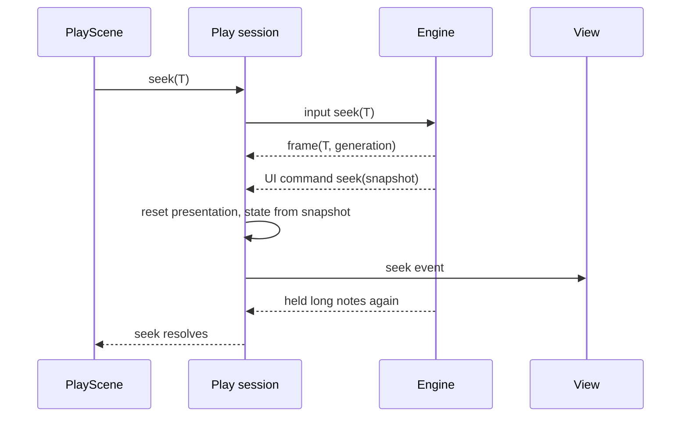

- `session/play/`:
  - `play-session.ts`: `PlaySession`, the composition, the clocks, the pause, the recording and the teardown; `play-session-state.ts`: its state; `play-options.ts`: its options (`PlaySessionOptions`); `play-session-theme.ts`: what it asks of its view (`PlaySessionTheme`) and the moments it raises (`PlayMoment`);
  - `play-scene-session.ts`: the session as a `SceneSession`, its frames and intents; `play-view-events.ts`: the moments as view events;
  - `play-chart.ts`: `prepareChart`, the lane options (RANDOM, MIRROR, S-RANDOM, SCATTER, DP FLIP), a replay's arrangement and the decide screen's draws;
  - `play-media.ts`: the audio graph, the samples, the BGA textures and videos, and their teardown;
  - `play-engine.ts`: the shared engine's launch, its UI signals, the judgements and lane effects, a seek's snapshot and the start of the ending; `play-seek.ts`: the seek command and the seeks waiting on it; `play-clock.ts`: the chart clock run on from a frame; `play-presentation.ts`: what a run shows apart from the play state (`PlayPresentation`);
  - `play-input.ts`: ESC, F5, Pause / Tab and the arrows, START / SELECT for the replay, the quit hold, the auto-pause and the touch lanes the view sends; `play-cover-keys.ts`: the cover keys of a beatoraja play and of the built-in Plain, Native and Synesthesia skins (`coverKeys`);
  - `play-keys.ts`: `PLAY_SCENE_KEY_CODES`, the keys the play handles itself and the engine's web input runtime skips;
  - `play-state.ts`: `applyPlayEvent`, the one way the play state changes;
  - `play-view-settings.ts`: the hi-speed keys, the tempo the engine follows, the lane covers as drawn and the replay's view;
  - `play-ending.ts`: the exit timeline and the result snapshot;
  - the helpers they share: `long-note-tracker.ts` (each long note's state as the skins draw it), `live-tempo.ts` (the live tempo and its changes), `tempo-range.ts` (the play's lowest, highest and main BPM), `quit-hold.ts` (the Backspace hold), `result-delay.ts` (the lead-out before the result and how long the audio tail rings), `judge-windows.ts` (the ruleset's windows for the skins) and `placeholder-gauge.ts` (the gauge before the engine's first frame).
- `view/shared/`: `playfield/*` (lanes, notes, long notes, mines, measure lines, bombs, covers, text; the running play as `ctx.play`, `PlayfieldRuntime`; the view's `PlayfieldSkin` and `PlayChrome`), `bga-renderer.ts`, `play-frame.ts` (the layer tree, its fit to the screen, the fades), `play-layers.ts`, `texture-upload.ts`, and `touch-lanes.ts` with `touch-lane-input.ts` (the fingers on the touch lanes, as `lane` intents).
- `view/built-in/`: `play-view.ts` (the built-in play view and its `PlayfieldSkin`) and `play-chrome.ts` (the built-in lane geometry, BGA rect and Be-Music layout, and the chrome's runtime and pass).
- `view/lr2/`: `play-view.ts` (the LR2 play view, its `PlayfieldSkin`, its loading and the frame's LR2 state), `play-elements.ts` (the skin's elements and the playfield's lane rects, note cells, measure lines and BGA rects), `play-timers.ts` (the skin's timers), `play-turntable.ts` (the scratch turntable) and `play-hud.ts` (the judge, combo and groove-gauge drawing and the skin's timer spans).
- `view/beatoraja/`: `play-view.ts` (the beatoraja play view, its loading, its timing and the replay's view scale), `play-bridge.ts` (the frame as the skin's render context: ops, timers, numbers and graphs), `play-stage.ts` (the skin view with the note, marker and BGA layers) and `play/*` (the note, marker and BGA layers, the scroll placement, the note `dst` block and the skin's metrics).

### Layering

The package's source sits in layers, and `pnpm run check` holds them with Oxlint overrides in [`vite.config.ts`](../vite.config.ts). From the top:

- **The host API**: `host/` and the package barrel (`index.ts`). The `create*Scene` functions, the family kits, `PixiSceneHost` and the `./host` barrel.
- **Scene sessions** (`session/`) and **family views** (`view/`): a session holds a screen's behaviour and a view draws it, and each knows the other only by its types.
- **The lower layers**: every other directory. The audio and input runtimes and the engine driver (`runtime/`), chart and media preparation (`chart/`, `media/`), the collection (`collection/`), the browser checks (`browser/`), the Pixi stage helpers (`stage/`), the skin loaders (`skin/`), the built-in skins (`skins/`), the recorder (`recording/`) and the logger.

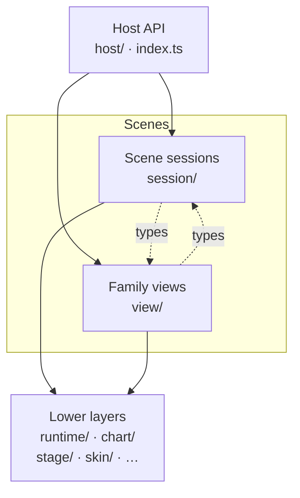

An arrow is an import; a dotted one is for types only. The rules:

- **A lower layer knows no scene.** It imports no `host/`, `session/` or `view/` module, not even a type. Every file of the package starts out in a lower layer, so a new directory is one until the config says otherwise.
- **A session reaches its view and the host only for types**, and Pixi only for types too, so a session runs in Node tests against a fake view.
- **A view reaches its session and the host only for types**, and neither the engine (`@be-music/player-engine`) nor `runtime/engine-driver` and the `runtime/web-*-runtime` modules. The player's other entries (`./signals`, `./lanes`, `./display`, `./ruleset`, …) are not the engine, so a view may import them.
- **Only a session runs the engine.** Besides `session/`, only `runtime/engine-driver.ts` imports the engine as values; every other file imports only its types, in the web player too.
- **Only the audio layer creates an audio context.** `runtime/` creates the system context (`audio-service.ts`), each play's graph (`play-audio-graph.ts`) and the offline context of the keep-pitch stretch (`time-stretch-signalsmith.ts`). Everything else, the web player included, plays through the audio service and names `AudioContext` only as a type.

Tests are exempt. The built-in skins also keep their own, stricter boundary: `skins/boundary.test.ts` lets a skin import only the skin SDK, its rendering framework and its own files.
