[English version](./player-web.md)

# Browser player 実装メモ

この文書は、`@be-music/player-browser` と `@be-music/app-play` で追加された browser player の実装メモです。
timing、note、判定、score、gauge、BGA event の意味など、CLI と共有する runtime 意味論は [`player-spec.ja.md`](./player-spec.ja.md) を参照してください。

## CPU Worker

ブラウザのホストは、譜面のパース・集計・圧縮、ZIP 展開、WSOLAで共通の Worker プールを使います。Debug Menu の **Developer → CPU workers** から並列数を指定でき、既定値は取得した論理 CPU 数の半分を切り捨てた数（最小1）です。変更値は保存します。Signalsmith は既存の AudioWorklet の経路を維持します。処理の境界と障害時の動作は [ADR 0010](./adr/0010-browser-task-pool.ja.md) を参照してください。

## 共通 runtime 連携

browser player は gameplay を engine（`@be-music/player-engine` のルート）経由で駆動します。
player から使うほかのものは、ほかのエントリポイントから取ります。input と UI の bus と state signal は `@be-music/player-engine/signals`、lane の配置は `./lanes`、描く note と scroll 距離は `./display`、判定幅は `./ruleset` です。
譜面のタイミング（`TimingResolver`、sample trigger）と `ChartPlayVariant` は `@be-music/chart-model` から取ります。
判定、keysound trigger routing、long note、地雷の発動、score、gauge、chart finish の意味論は engine が担当します。
どのプレイ画面も、その裏のプレイのセッションがスキンの `PLAYSTART` gate で 1 回 engine を起動します（beatoraja のスキンでは読み込み終了の 1.5 秒後）。
セッションは engine の frame snapshot をプレイ状態へ反映し、engine の UI command をフレームのきっかけとしてファミリービューに渡し、ビューがそれを Pixi の視覚効果にします。

browser runtime は次の adapter module を使います。

| module                                                                                | 役割                                                                                                                                                                                                                                          |
| ------------------------------------------------------------------------------------- | --------------------------------------------------------------------------------------------------------------------------------------------------------------------------------------------------------------------------------------------- |
| [`web-audio-session.ts`](../packages/player-browser/src/runtime/web-audio-session.ts) | engine の `AudioSession` 契約を Web Audio で実装します。即時発音、BGM scheduling、channel stop、pause/resume、key/BGM routing、動的 volume change、bmson `c=true` continuation、`#WAVCMD` gain を扱います。                                   |
| [`web-input-runtime.ts`](../packages/player-browser/src/runtime/web-input-runtime.ts) | DOM `keydown` / `keyup` を engine の input bus へ写像します。OS auto-repeat を除外し、`Escape` / `F5` / `Space` を command event へ送り、lane press には物理 event timestamp を付け、key の解放を伝えると宣言します（`reportsKeyReleases`）。 |
| [`web-ui-runtime.ts`](../packages/player-browser/src/runtime/web-ui-runtime.ts)       | engine UI signal をプレイのセッションへ流します。frame snapshot は note、score、gauge、result state を更新し、command は lane flash、key hold、POOR BGA、judge/combo effect を駆動します。                                                    |
| [`engine-driver.ts`](../packages/player-browser/src/runtime/engine-driver.ts)         | audio、input、UI adapter を組み立て、1 譜面分の `manualPlay` / `autoPlay` を呼び出します。                                                                                                                                                    |

engine（`@be-music/player-engine`）は `node:path` / `node:timers/promises` 依存を排除済みで、 browser bundle にそのまま
含められます。 `createNodeAudioSink` (Node 専用 audio backend) も lazy import なので、 host が
`PlayerOptions.createAudioSession` factory (= `createWebAudioSession`) を渡す経路では一切到達しません。

## 対象範囲

- `@be-music/player-browser` は browser 向けの chart loading、譜面のプレビュー、1 つのホスト向けの API から作る built-in / LR2 / beatoraja のファミリービューが描くシーンセッションとしての各画面、音声サービスとプレイごとの WebAudio bus、gameplay recording を提供します。
- `@be-music/app-play` は core package を drag-and-drop loading、LR2 / beatoraja theme loading、debug control、recording control へ接続する private Vite application です。
- browser player は shared core と terminal player と同じ parser、chart、player helper を通して BMS/BME/BML/PMS と bmson の譜面を扱います。

## 公開するエントリポイント

`@be-music/player-browser` は、ファイル構成ではなく設計したエントリポイントを公開します（[ADR 0005](./adr/0005-public-entry-points.ja.md)）。

| エントリポイント           | 公開するもの                                                                                                                                                                                                                                              |
| -------------------------- | --------------------------------------------------------------------------------------------------------------------------------------------------------------------------------------------------------------------------------------------------------- |
| `@be-music/player-browser` | 下のエントリポイントすべての和集合と、`logger`、Pixi の `Rectangle`                                                                                                                                                                                       |
| `./host`                   | ホスト API：`PixiSceneHost`、`PixiScene`、`SessionScene`、`createSelectScene`・`createDecideScene`・`createPlayScene`・`createResultScene` とそのキット・オプション・イベント、種類ごとのキットの型、ビューの契約の型                                     |
| `./controller`             | 描画に依存しない `SceneController`、選択した値の snapshot store、独立した選曲ブラウザー用の `createSelectController`。                                                                                                                                    |
| `./skin`                   | スキンの種類と読み込み：`SkinFamily` のレジストリ、LR2 と beatoraja のテーマの読み込み、`loadBeatorajaSceneKit`、be-music スキンのレジストリ、組み込みのスキン（`BUILT_IN_BE_MUSIC_SKINS`、`phantomSkin`、`plainSkin`、`latticeSkin`、`synesthesiaSkin`） |
| `./collection`             | ライブラリの読み込み：`BrowserChartCollectionStore`、ドロップしたファイル、コースとコースメーカー、譜面のハッシュ、ブラウザの互換性チェック                                                                                                               |
| `./audio`                  | オーディオサービス（`createAudioService`）、オーディオバスとコンプレッサーのパラメーター、マスター音量、システムの audio session、`ChartPreviewEngine`                                                                                                    |
| `./recording`              | `GameplayRecorder`、録画の形式、`makeWebMSeekable`、`downloadBlob`、WebCodecs の helper                                                                                                                                                                   |
| `./compute`                | 共通 CPU Worker プール、並列数の設定、データのみの処理依頼、ホストによる Worker の登録。                                                                                                                                                                  |

scene が受け取って返すモデルは、それぞれのパッケージから読み込みます。プレイオプション、`PlayResult`、`CourseView`、ハイスピードの範囲、ライブラリの項目（`LibraryChart`、`LibraryFolder`、`LibraryCourse`、`LibraryEntry` など）とその helper（`groupChartsByFolder`、`resolveLibraryChartPlayVariant`）は `@be-music/player-scene-model` から、be-music スキンの契約は `@be-music/player-skin-sdk` から、リプレイの形式は `@be-music/player-engine/replay` から読み込みます。それ以外はパッケージの内部です。

## demo の起動

```bash
pnpm run player:web
```

この command は Vite demo を起動します。page には次のものを drop できます。

- BMS/bmson の楽曲 folder
- 楽曲 folder を含む ZIP
- LR2 theme folder
- beatoraja theme folder
- 楽曲 folder と LR2 または beatoraja theme folder の同時 drop

chart file を含む混在 drop では、loader は chart directory を song file、それ以外を theme file として扱います。
chart file が存在しない場合、drop 全体を theme candidate として扱います。LR2 detection は `.lr2skin` file、beatoraja detection は `.luaskin` file または `skin/` path segment 配下の JSON file を使います。
プレイフィールドをダブルクリックすると demo をフルスクリーンに切り替えます。`Esc` は通常のシーン操作の前にフルスクリーンを解除します。
Chrome と Edge ではフルスクリーン中に Keyboard Lock API で `Esc` をロックします。`Esc` を短く押すと通常のシーン操作（プレイ中断を含む）になり、長押しでフルスクリーンを解除します。
プレイ中に `Backspace` を 0.5 秒長押しすると `Esc` と同じようにプレイを中断します。短く押しただけでは何も起きません。Keyboard Lock の有無に関わらず、どのブラウザでもフルスクリーン中に使えます。

### Debug Menu

右上の Tweakpane **Debug Menu**（起動時は折りたたみ）は、よく使う操作を先頭に置き、残りをフォルダーにまとめています。各フォルダーの開閉状態は記憶されます（`localStorage` の `be-music-demo.debug-menu-folders`）。パネル自体は常に折りたたんだ状態で始まります。

- **トップレベル:** Status（読み取り専用）、Open folder、Open files (ZIP / replay)。Open files では譜面の ZIP アーカイブ（`?music=` と同じ読み込み）や、リプレイするリプレイ（`*.bmplay.json`）を選べます。Open folder はフォルダー選択ダイアログを使い、ドロップと同じ経路で読み込みます。
- **Play options**（既定で開く）: Auto play、Gauge、Random 1P / 2P、DP flip、Auto scratch 1P / 2P、Sort、Key filter、Difficulty filter、Hi-speed。Hi-speed（その場で反映）以外は曲の開始時に確定し、プレイ中は無効になります。Sort と二つのフィルターは標準と LR2 の選曲画面の一覧を決め、LR2 スキンのソートとフィルターのボタンでも変わります。beatoraja の選曲画面は MODE と SORT の選択を自分で持ちます。
  - **Replay / ghost**（既定で閉じる）: Tempo、Hi-speed、SUDDEN+ / HIDDEN+、LIFT — 記録したプレイヤーが見ていたもののうち、リプレイで再現するもの。それ以外は自分の設定のままです。既定ですべてオンで、次回以降も保持され、曲の開始時に確定し、プレイ中は無効になります。シーンには `replayView`（`ReplayPlaybackOptions`）として渡ります。
- **Tempo**（既定で開く）: Tempo (%)、Pitch、Keep-pitch stretcher（[プレイテンポ](#プレイテンポ) を参照）。曲の開始時に確定し、プレイ中は無効になります。ただしピッチがテンポに追従するときの Tempo (%) はプレイ中も有効で、プレイのテンポをその場で変えます。
- **Course**（既定で開く）: Skip stage results、My courses…、NONSTOP placement（曲の開始時に確定し、プレイ中は無効）、Table URL と Import table courses。
- **Skin & display**（既定で閉じる）: Skin system で使用するファミリーを選び、未読み込みの場合はドロップを促します。**Built-in** タブには Built-in skin、Skin effects、**Skin settings**、**Add skin**、**LR2** タブには Load LR2 skin と検出したテーマの選択、**beatoraja** タブには Load beatoraja skin とシーンごとの選択を配置します。タブは設定の分類であり、開いただけでは使用中のスキンは切り替わりません。Render resolution、Play layout、Judged notes、Toggle fullscreen は共通です。スキンを検知すると、テーマのアセットを置き換える前に確認ダイアログを表示します。キャンセルすると現在のスキンを維持し、同じドロップに含まれる譜面は読み込みます。LR2 と beatoraja が両方含まれる場合は、どちらを使用するか選べます。
- **Audio**（既定で開く）: Mute、Master / Key sound / BGM の音量 (%)、Play in silent mode（Audio Session API があるブラウザーのみ。後述）、 **Compressor** フォルダー（Enabled、stage ごとの切り替え、各 compressor の threshold / knee / ratio / attack / release とリセット）。Mute はマスター音量を保持したまま、プレイヤーの音声をすべて消音します。
- **Library & records**（既定で閉じる）: Music / Skin ZIP URL と Load from URLs（`?music=` / `?skin=` と同じ読み込みをその場で実行）、Auto-save play history、Clear best records、**BGA video transcode** フォルダー。
- **Capture**（既定で閉じる）: ● Record gameplay video、Video format（既定は MP4 · H.264。MP4 / WebM と H.264 / H.265 / AV1 / VP9 / VP8 から選択）、📸 Screenshot。
- **Leaderboard**（既定で閉じる）: Submit to Leaderboard、Account（ログイン中の handle、または「Not signed in」）、Create passkey (keep this account)、Sign in with passkey、Sign out。
- **Developer**（既定で閉じる）: Judgment windows（曲の開始時に確定。選曲画面に出す[ベスト記録](#ベスト記録)のルールセットもこれで決まります）、Auto pause on blur、Show invisible notes、FPS（500 ms ごとに計測し、60 サンプルを保持するネイティブの履歴グラフ）、Reset settings and reload（ベストレコード以外の demo の保存設定をすべて消去して再読み込み）。

Status と Account は読み取り専用の複数行モニターです。別の **Skin Config** パネルは **Options**、**Files**（定義がある場合）、**Timing & offsets** のタブで構成し、タブ内でカテゴリをまとめます。カスタムオフセットに `x` と `y` の両方がある場合はネイティブの 2D 位置入力を使い、ほかの定義済み軸は数値スライダーで調整します。**Reset all to 0** はネイティブ入力を更新し、設定変更を一度だけ適用します。シーンの切り替えではスキーマを作り直し、同じスキンエントリーの編集では選択中のタブとフォルダーの状態を維持します。

### ベスト記録

demo は、譜面ごと・コースごとのベスト記録を判定のルールセットごとに 1 つずつ `localStorage`（`be-music-demo.chart-best-records`）に保存します。最高のクリアランプ、EX スコア、最大コンボ、BP をそれぞれ別々に保ち、プレイ回数を数えます。LR2、beatoraja、IIDX はランプも BP も採点もそれぞれ違うので、プレイはそれを判定したルールセットの記録に入ります。単曲のプレイはその譜面の記録に、EXPERT / GRADE のステージもその譜面の記録に（[コース](#コースと段位認定)を参照）、コースのプレイはコースの記録に入ります。ステージごとに違うルールセットで判定したプレイは記録しません。オートプレイ、リプレイ、テンポを変えたプレイも記録しません。選曲画面には今のルールセットの記録を出し（LR2 のバーのランプと op 100-105、beatoraja の `CLEAR_LAMP_*` の op、`frame.chartBestRecord` と `frame.courseBestRecord`）、Judgment windows を変えると切り替わります。ルールセットで分ける前に保存した記録は、既定のルールセットである LR2 の記録として読みます。

記録を保つ規則は `@be-music/player-engine/records`（`mergeBestRecord`、`mergeCourseStageRecord`、`recordPlayFromResult` など、`playKeepsRecord`、`courseRunKeepsRecord`）、ランプは `@be-music/player-engine/ruleset` にあります。demo はキーを付けて保存するだけです（`chart-best-records.ts`）。

### プレイテンポ

Debug Menu → Tempo → **Enabled** で保存したテンポ変更率を有効にします（既定は無効）。無効にしても変更率は保持し、元のテンポで再生します。リプレイの記録テンポと NONSTOP FIT の調整は引き続き適用します。**Tempo (%)** で、曲を本来のテンポの -50 % から +50 % で遊べます（既定 0、1 % 刻み）。**Pitch** はテンポを変えたときの鳴り方を決めます。**Pitch follows tempo (LR2)**（既定）はサンプルを速く・遅く再生するので、テンポと一緒にピッチも変わります。**Keep pitch** は読み込み時にサンプルを時間方向に伸縮し、ピッチを保ちます。伸縮の方式は **Keep-pitch stretcher** で選べます（既定・選択肢の先頭は **WSOLA**、ほかに **Signalsmith Stretch**）。この 2 つの設定は NONSTOP の FIT のステージの鳴り方も決め（[NONSTOP](#コースと段位認定) を参照）、FIT のステージでは 2 つの倍率を掛け合わせます。有効・無効と3つの設定は記憶し（`localStorage`、`be-music-demo.play-tempo`）、プレイの開始時に読み、ほかのプレイオプションと同じくプレイ中は無効になります。テンポが 0 でないときは状態表示に出ます（`Playing (tempo -20%): <曲名>`）。**Enabled** がオンで **Pitch follows tempo (LR2)** のときは **Tempo (%)** がプレイ中も有効で、プレイのテンポをその場で変え、状態表示も追従します。**Pitch** と **Keep-pitch stretcher** はロックしたままです。**Keep pitch** のとき（サンプルは読み込み時のテンポに伸縮済み）、リプレイ中（ログに従います）、コースがテンポを切ったステージでは、スライダーもロックします。

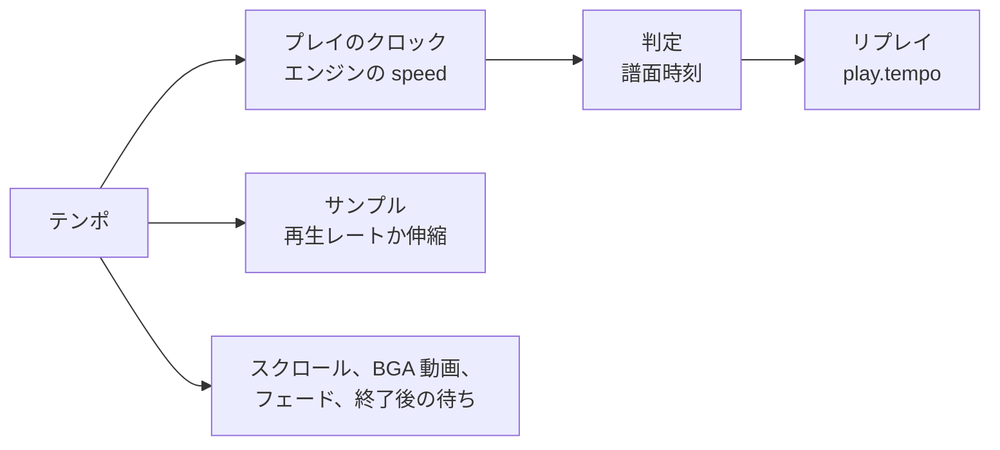

プレイ中の変更（プレイ画面の `setTempo(tempo)`。`pitch` モードのみ）は、入力コマンド `{ kind: 'tempo' }` としてエンジンへ送ります。エンジンはコマンドを取り出した譜面時刻でクロックを付け替えるので譜面時刻は途切れず、その譜面秒とともに変更を知らせます（`onTempoChange`）。そこから、ビューのクロック、後から鳴らすサンプルと鳴っているサンプル（`playbackRate` を 30 ms かけて新しい倍率へ動かします。`WebAudioSession.setTempo`。bmson のスライスはサンプル時間での長さを保つので、ノートの位置で終わります）、BGA の動画、NONSTOP の譜面のステージのフェードが新しいテンポで進みます。リプレイは変更を `play.tempoChanges` に記録し、一度でも別のテンポで進んだプレイは練習です。リプレイは、Replay / ghost のオプションでテンポを再現するとき、`pitch` モードで記録された変更に従います（`resolveReplayTempo`）。

すべてが `tempo` 倍の速さで進みます。エンジンのクロック（`PlayerOptions.speed`）、予約・発音するサンプル、スクロールと判定ライン、BGA の画像と動画（`playbackRate`）、NONSTOP のステージのフェード、結果画面までの譜面時刻での待ちです。スキンのアニメーションのタイマーは実時間のままです。判定は譜面時刻のままなので、プレイの入力と判定はテンポに左右されません。リプレイには `play.tempo` として記録し（[replay.ja.md](./replay.ja.md)）、リプレイはそのテンポで再生します。テンポを変えたプレイは、beatoraja の周波数トレーナーと同じく練習として扱います。Leaderboard には送らず（状態表示に理由を出します。サーバーも `tempo` として拒否します。[leaderboard.ja.md](./leaderboard.ja.md) を参照）、ベスト記録も更新しません。リプレイの自動保存はします。コースもテンポを変えて遊べます。すべてのステージがそのテンポで進み、そのプレイは順位付けせず、コースの記録も更新しません。どの種類のプレイ画面でも使えます。`createPlayScene` の settings に `tempo`、`tempoPitchMode`、`tempoStretchAlgorithm` を渡します。

### スマートフォンとタブレット

主ポインターが指の端末（`(pointer: coarse)`、またはスマートフォン大の画面でタッチポインターを持つ端末）を、demo はタッチ優先として扱います。

- **タッチプレイ:** 組み込みスキンと LR2 のプレイ画面では、各レーンの下側から画面下端までがそのレーンのタッチ領域です。指ごとに独立して押す・押し続ける（ロングノート）・離すが働き、指を隣のレーンへ滑らせると元のレーンを離して新しいレーンを押します。タッチはキーボードと同じ入力経路を通るので、判定、キービーム、リプレイも同じように動きます。プレイ中は左上に一時停止ボタンがあり、一時停止中は Quit も表示されます。
- **タッチレイアウト:** 組み込みスキンはタッチ用のゲームプレイレイアウトに切り替わります。ステージの大部分に同じ幅のレーンを並べ（鍵盤は最大 72 デザイン px、横向きのスマートフォンで約 58 CSS px）、判定ラインを少し下げ、BGA は表示しません。24 / 48 KEY の譜面は標準レイアウトのままです。Debug Menu の **Play layout**（Auto / Desktop / Touch）で次のプレイから切り替えられます。
- **選曲画面:** 行やボタンはマウスと同じくタップで操作できます。リストは上下にスワイプしてスクロールします。
- **エフェクト:** Debug Menu で以前に選んでいなければ、スキンのエフェクトは Reduced から始まります。
- **画面:** ページの UI はステージに重ならないよう退きます（検索ボックスは入力中だけ表示し、Help はアイコンだけになります）。スマートフォンでは最初のタップでブラウザーが許す範囲でフルスクリーンと横向きを要求し、縦持ちのときは回転を促す表示を出します。
- **消音モードでの再生:** iOS / iPadOS の Safari は、既定では Web Audio を ambient な音として扱います。他のアプリの音楽と混ざって鳴り、着信/サイレントスイッチで消音されます。ブラウザーに [Audio Session API](https://w3c.github.io/audio-session/)（`navigator.audioSession`、Safari 16.4 以降）がある場合、スタートカード（「Drop to load」の下）と Debug Menu の **Audio** フォルダーに **消音モードでも再生**（英語表示では Play in silent mode）が表示されます。どちらも同じ設定です。オン（既定）では demo は audio session の type を `'playback'` にし、サイレントスイッチがオンでも音が鳴りますが、他のアプリで再生中の音楽は停止します（システムが「再生中」コントロールを表示することもあります）。オフではブラウザー既定の `'auto'` に戻し、Web Audio は他のアプリと混ざって鳴り、スイッチに従います。設定はリロード後も保持され、音声の開始前、最初のタップやキー入力時（各シーンが音声を開始するタイミング）、ページが再び表示されたときに適用されます。他のブラウザーには Web Audio を消音するこの種のスイッチがないため、どちらにも設定は表示しません。スマートフォンやタブレットで設定がオフのまま初めて音が鳴るときは、画面上部に設定をオンにできる小さなヒントを出します。ヒントはブラウザーごとに 1 回だけ表示され、閉じるボタンで閉じるか、しばらくすると自動で消えます。

### demo の作り

demo のコード（`packages/app-play/src`）は、起動処理、構成の根、1 つのシーンルーターの下のルート、Debug Menu とそのパネル、そして残りが共有する状態と規則を持つサービスでできています。

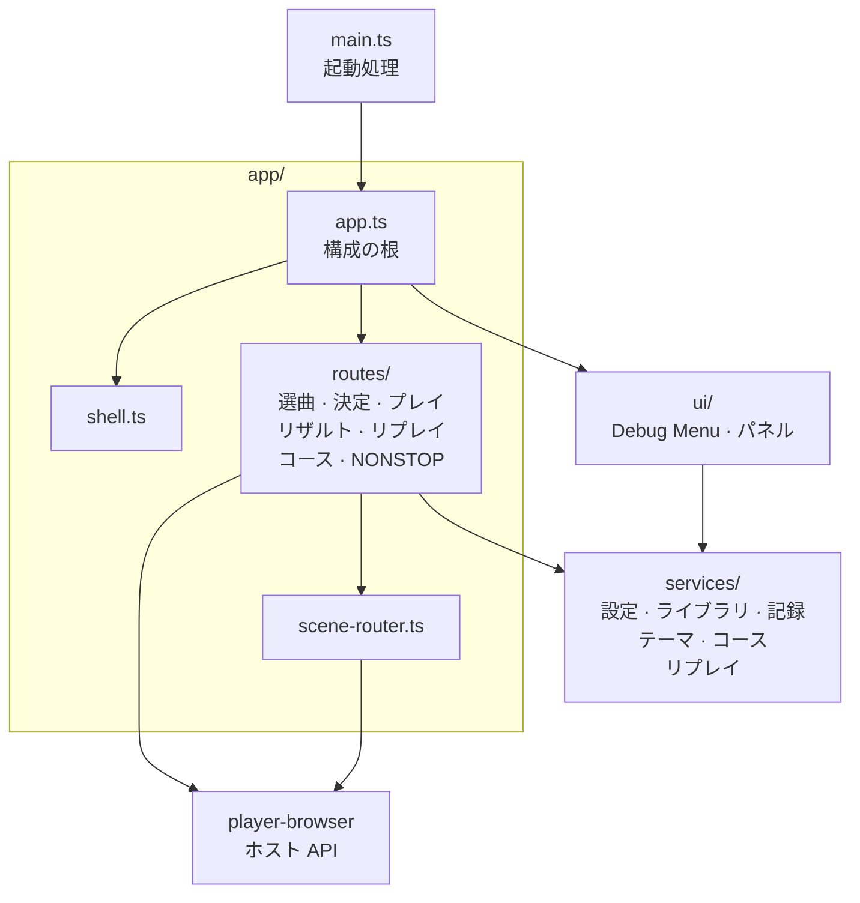

矢印は、モジュールから、それが作るもの・使うものへ向かいます。シーンルーターとサービスもアプリが作り、ルートと Debug Menu に渡します。

**起動処理。** `main.ts` はページのマークアップを書き、ブラウザーの互換性チェックを最初に行い（レンダラーを起動できないブラウザーでも理由を表示するためです）、スマートフォンとタブレットを判別して印を付け、Help のモーダルをつなぎます。UI のフォントの準備ができたらアプリを作り、その上に[テスト用フック](./course-checklist.ja.md#テスト用フック)を取り付けてから始めます。

**構成の根。** `app/app.ts`（`PlayerWebDemoApp`）はサービス、シーンルーター、ルートを作り、それらどうし、Debug Menu、Leaderboard をつなぎます。プレイ中のロックもここが持ちます。プレイが始まるときに Auto-save play history の設定を確定し、プレイが確定したオプション、スキンの操作、Submit to Leaderboard を無効にします。リザルトが出るか選曲画面に戻ると解除します。`app/shell.ts` は、stage を載せたあと、stage のまわりのページをシーンに合わせます。シェルの `in-gameplay` の状態とそれで止めるピンチズーム、タッチ用の一時停止と Quit のボタン、キャンバスのダブルクリックでのフルスクリーンとその `Esc` の扱いです。

**レイヤー。** サービスは状態と規則を持ち、アプリから必要なものは deps として受け取ります。Tweakpane、`ui/`、`app/` のモジュールは、型でも import しません（[レイヤーの規則とサイズの上限](./architecture.ja.md#レイヤーの規則とサイズの上限)）。ルートと Debug Menu はサービスを通して働き、ルートが scene を stage に載せるのは、すべての切り替えを受け持つシーンルーターを通してだけです（[Scene lifecycle](#scene-lifecycle)、[ADR 0006](./adr/0006-scene-router.ja.md)）。

**選曲と決定。** 選曲画面は `app/routes/select.ts` が出します。シーンルーターは選曲画面を決定画面、プレイ、リザルトのあいだも保持するので、戻るたびに同じ scene をまた出します。enter する前に最新のテーマのスキンと音、ライブラリを渡し、そのあとカーソルを元の位置（コースのあとはそのコースのバー）に戻します。作り直すのは、別のファミリーが描くようになったときだけです。選曲画面で始めた譜面は、作成中のコースがあればそこに加わり、なければ `app/routes/decide.ts` に進みます。こちらは決定画面を出し、その裏の stage の外でプレイを読み込み、決定画面が終わるとそのプレイに stage を渡します。決定画面がなければ、すぐに譜面を遊ばせます。

**プレイ、リザルト、リプレイ。** プレイはすべて `app/routes/play.ts` が作って出します。決定画面を通らない譜面（リトライ、F5、コースのステージ、NONSTOP のプレイ、リプレイ）はすぐに遊ばせます。選曲画面を保持したまま stage から外し、プレイに stage を渡して、そこで読み込んでから始めます。プレイの設定は純粋関数の `app/play-scene-options.ts` が作ります。Debug Menu の選択と有効なプレイオプションに、コースが許すレーンオプション、リプレイが記録した設定、選んだテンポを反映したものです。プレイが作られたときの内容を有効にするのは、そのプレイが stage を受け取ったときだけです。リザルトで R を押したときにもう一度遊ぶ開始の内容、リザルトを記録するキー、beatoraja のプレイのエントリです。そのため、決定画面の裏で読み込み中のプレイは、決定画面から戻ってもこれらを変えません。`app/routes/result.ts` は、プレイ、コースのステージ、コース全体、NONSTOP のプレイのリザルトを、描くファミリーのリザルトスキンで出します。後ろではプレイの最後の音が鳴り終わるまで残ります。記録を保ち、リプレイを保存してランキングに送り、次のステージ、R でのリトライ、または選曲画面へ進みます。`app/routes/replay.ts` は、ドロップしたリプレイを、記録された譜面が見つかったら再生します。探す順は譜面ファイルのハッシュ、パス、タイトルとアーティストです。

**コース。** 選曲画面でコースのバーを始めると `app/routes/course.ts` に進みます。NEW COURSE のバーならコースメーカーを始め、ランダムコースならステージをライブラリから抽選し、EXPERT や GRADE のコースは決定画面を出してからステージを 1 つずつ遊ばせ、コースリザルトを出します。NONSTOP のコースは `app/routes/nonstop.ts` がつなぎ合わせて 1 譜面として遊ばせ、F5 と R ではつなぎ直し、そのリザルトを出します。両者が扱うコースのプレイは `services/courses.ts` が持ちます。ステージの間のコース、始めたときの AUTO（どのステージにも、つなぎ直したプレイにも引き継ぎます）、終わったあとカーソルをコースのバーに戻すための選曲画面の位置です。シーンが求めていない遷移（ドロップ、スキンの切り替えなど）が来ると、シーンルーターの割り込みでコースのプレイを終えます。

**ライブラリと記録。** ドロップと Debug Menu の Open folder / Open files での選択を `app/drop-target.ts` が受け取ります。読み込み中の表示を出し、選曲画面を stage から外してからファイルを読みます。ブラウザはハンドラーが返るとドロップの中身を空にするので、ドロップの項目はハンドラーが最初に何かを待つ前に読みます。読んだものは `services/library.ts` が振り分けてライブラリを保ちます。譜面は曲のコレクションに、テーマのファイルは LR2 と beatoraja のテーマの読み込みに、コースファイルと保存した表のヘッダーはコースのフォルダーに、リプレイはリプレイに回します。`?music=` / `?skin=` のアーカイブの読み込みと、URL からの難易度表の取り込みもここで行います。[ベスト記録](#ベスト記録)と、そのキーになる譜面のハッシュは `services/records.ts` が、[プレイヤーが作るコース](#コースと段位認定)は `services/course-maker.ts` が持ちます。

**テーマ。** ドロップが持ってきたテーマは `services/themes/` が持ちます。`lr2.ts` はこれまでのドロップの LR2 テーマをすべて持ち、そのうち 1 つを読み込みます。そのスキン、BGM、システム音と、コース用に読み直したスキンです。`beatoraja.ts` は beatoraja のテーマを持ち、そのエントリを scene kit として読み込みます。どのエントリを読むかはスキンの種類ごとに Debug Menu で選んだもの、オプションはプレイヤーが選んだものです。`built-in.ts` は標準のファミリーが描く be-music スキンと、その保存した設定、追加したスキンを持ちます。各画面をどのファミリーが描くか（Debug Menu の Skin system、選んでいなければ beatoraja、LR2、標準の順）と、そのときの kit と選曲画面の音は `app/family-kits.ts` が決めます。

**リプレイ、録画、ステータス。** `services/replays.ts` は、demo が書くリプレイの記録者として demo の名前（`REPLAY_RECORDER`: `be-music-web`、そのバージョンとビルド元のコミット）を持ち、リプレイを自動保存します。プレイのログはリザルトが出たとき、コースのログはコースリザルトが出たときに、そのプレイ（コースなら最後のステージ）を始めたときの Auto-save play history の設定に従って保存します。`services/recording.ts` は、Capture フォルダーの録画とスクリーンショットがプレイをまたいで使うものを持ちます。選曲画面で予約した録画（次のプレイと一緒に始まります）、次の録画を保存するファイル名（譜面のタイトル）、選んだ動画の形式です。録画そのものは `recording-controller.ts` が行い、録画中のものはシーンルーターが遷移のたびに確定させます。`services/status.ts` はステータス行を持ちます。Debug Menu の Status の行で、テスト用のフックが記録するものです。その行がプレイやリザルトを説明しているかどうかも持ちます。説明している行は、選曲画面に戻るとライブラリの要約に置き換わります。

**テスト用フック。** E2E テストの[テスト用フック](./course-checklist.ja.md#テスト用フック)（`window.__beMusicTest`）に答えるのは `services/test-hook.ts` です。読まれるたびに、シーンルーターが出しているシーン、選曲画面のカーソルとその下のバーの自己ベスト、stage のプレイ、ライブラリ、コースのプレイ、作成中のコースを読みます。結果、リプレイ、読み込みの完了など、アプリが渡すものは `test-hook.ts` が足します。読むだけで何も始めず、アプリがすでに持っているものからすぐに答えます。バーの自己ベストは選曲画面と同じく今の判定ルールのものです。譜面の自己ベストは、選曲画面がその譜面のハッシュを計算したあとはハッシュで、それまではパスで探すので、読んでも譜面のハッシュは計算しません。

**Debug Menu。** [Debug Menu](#debug-menu) は `ui/debug-menu/` にあります。`DebugMenu`（`index.ts`）がフォルダーごとのモジュールでメニューを組み立て、アプリには `DebugMenuDeps` を通してだけ触れます。アプリが設定、ライブラリ・記録・コースメーカーのサービス、アプリの状態を読む関数、アプリの操作をそこに渡します。フォルダー名と開閉状態の記憶は `folders.ts`、プレイ中に確定したオプションとスキンの操作にかけるロックは `play-lock.ts` です。beatoraja のスキンオプションのパネルは `ui/beatoraja-skin-options.ts` です。

## Browser loading model

- dropped path は共有の `@be-music/shared-utils/core` path helper で normalize します。
- chart discovery は `.bms`, `.bme`, `.bml`, `.pms`, `.bmson` を受け付けます。
- file lookup は case-insensitive です。大文字小文字だけが異なる LR2 / beatoraja 風の asset reference でも browser drop で解決できます。
- 大きな audio / video file は既定で lazy な `File` reference のまま保持します。image、skin、chart、小さな metadata file は collection loading 中に bytes として読み込みます。
- folder walking と file read は bounded concurrency と progress callback を使い、大きな folder でも browser の FileSystem API や UI update loop を過剰に詰まらせないようにします。
- parse error は drop 全体を abort せず、collection に蓄積します。

## コースと段位認定

コースも、選曲 → プレイ → 結果の同じシーンで遊びます。規則は [コースと段位認定](./course.ja.md) を参照してください。

- **読み込み：**
  - ドロップにはコースファイルを含められます。LR2 の `.lr2crs` はどこに置いてもよく、beatoraja のコース JSON は `course/` フォルダの下に置きます。
  - 読み込みには `readCourseFile`（`@be-music/player-browser/collection`）を使います。
  - デモはライブラリの譜面ファイルのハッシュを計算し（曲ごとにキャッシュ）、各ステージを SHA-256、次に MD5 で照合します（`resolveCourseFolders`）。
  - コースファイルだけをドロップした場合は、読み込み済みの曲と照合します。
  - 難易度表のコースは URL から取り込めます。Debug Menu → Course → **Table URL** に URL を入れて **Import table courses** を押します。URL は表のページ（`bmstable` の meta がヘッダーを指すもの）でもヘッダー JSON でも構いません。デモは `fetchTableHeaderCourses`（`@be-music/player-engine/course`、[URL から表を読む](./course.ja.md#url-から表を読む)）で取得します。`data_url` の曲リストは読み込みません。
  - ほとんどの表のサイトはほかのページからの読み込みを許可しておらず（CORS ヘッダーがない）、デモも中継はしません。取得が拒否されたときは、表のヘッダーファイル（`bmstable` の meta が指す JSON。たいてい `header.json`）を保存してドロップするよう、ステータスに案内を出します。コースを持つ `header.json` をドロップすると、URL から読んだときと同じく、表の `name` の名前で読み込みます（`readTableHeaderFile`）。
  - 表は、その名前をラベルにしたコースグループ 1 つになります。同じ表をもう一度取り込むか、同じラベルの別の取得元を読むと、そのグループを置き換えます。取り込んだ URL は `localStorage` に覚え、次に開いたときにもう一度取り込みます。
  - 既知の制限：ブラウザが表を直接取得するため、CORS ヘッダー（`Access-Control-Allow-Origin`）を返さないサーバーの表は取り込めません。そうした表は少なくありません。その場合、ステータス行にサイトを取得できなかったと表示します。クロスオリジンの読み込みを許可するオリジン（またはデモ自身のオリジン）から配信したヘッダー JSON なら取り込めます。
  - beatoraja のコマンドフォルダのファイル（`folder/*.json`）からはランダムコースを読みます。ランダムコースを持つフォルダごとに、コースフォルダが 1 つできます。ランダムコースはステージのタイトル（なければフィルタ）を並べて表示し、beatoraja の `OPTION_RANDOMCOURSEBAR`（1031）を点けます。始めたときに、ライブラリからステージを抽選します（`drawBrowserRandomCourse`）。どの譜面にも合わないステージがあれば、コースは始めずにステータスへ理由を出します。
- **選曲：**
  - コースファイル 1 つが、譜面フォルダの後に並ぶフォルダバー 1 つになります。その中では各コースがコースバー（`LibraryEntry` の `kind: 'course'`）です。
  - コレクションにないステージを含むコースは、一覧には出ますが開始できません。
  - LR2 と組み込みの選曲画面では、LR2 がコースをキーモードで絞るのと同じく（OpenLR2 L18030-L18053）、キーモードのフィルタがコースバーにもかかります。キーモードを持つコース（`definition.keyMode`：LR2 の `line`、表の `mode`）はそのキーモードでだけ表示し、持たないコースは常に表示します。
  - スキンごとの表示：
    - be-music スキンは、コース名・ステージ数・欠けているステージ数を表示します。
    - LR2 スキンは `courseFolder` と `course` のバー本体を使います。NEW COURSE バーとランダムコースには `courseCreate`（7）と `randomCourse`（9）を使い、なければ `course`（8）を使います。
    - beatoraja スキンは `GRADEBAR`（op 3）を点け、`bar-grade` の枠を描きます。ステージが欠けていれば `bar-nosong` を描きます。
- **プレイ：**
  - コースを始めると、最初のステージの前に一度だけ曲決定画面を出します。LR2 と同じく、選んだバーの名前（コース名）を表示します。ここで戻るとコースはやめます。NONSTOP コースのクイックリトライでは、LR2 と同じく出しません。
  - `CourseRun` の進め方でステージを順に遊びます（[コースのプレイ](./course.ja.md#コースのプレイ) を参照）。各ステージには `PlayerOptions.course` を渡します。中身は、コースの種類、ゲージの表の組と判定の制約、前のステージが残したゲージ値とコースのコンボです。
  - ステージの結果を閉じると次のステージが始まります。**Skip stage results**（Debug Menu → Course）をオンにすると、ステージの終了後すぐに次のステージが始まり、結果はコースの結果だけを表示します。
  - AUTO で遊ぶコースでは、LR2 と同じく（OpenLR2 `Main.cpp` M1381-M1384）、後にステージが続くステージの結果を飛ばします。最後のステージの結果とコースの結果は表示します。
  - ゲージが尽きたステージでコースは終わります。
  - ESC でコースをやめられます。そのプレイは（LR2 の記録と同じく）落ちたプレイとして残り、コースの結果を表示します。F5 / クイックリトライは使えません。
  - コースの制約を適用します：
    - beatoraja の `MusicSelector` と同じくレーンオプションを制限します（`resolveCourseLaneOptions`）。`grade` は両サイドと DP の FLIP をオフにし、`grade_mirror` は 1P の MIRROR を残してそのとき 2P も MIRROR、FLIP をオンにします（ほかの選択ではすべてオフ）。`grade_random` は各サイドのランダム系を残します。
    - `no_speed` ではハイスピードを固定します（beatoraja のテーマではレーンカバー、リフト、HIDDEN カバーも）。
    - `ln` / `cn` / `hcn` は、ロングノートのモードを定めていない譜面に適用します。
    - LR2 の GRADE コース（`.lr2crs` かコース作成のもの）では、LR2 がその開始時にリセットするものも反映してステージを遊びます。EASY のゲージは GROOVE になり、HIDDEN / SUDDEN、オートスクラッチ、DP の FLIP、テンポはオフになります（[course.ja.md](./course.ja.md#lr2-の-lr2crs)）。プレイヤーの設定はそのままです。
- **結果：**
  - 最後のステージ、またはゲージが尽きたステージの後に、結果画面がコース全体を 1 回分として表示します。表示するのは合計の判定、コースの最大コンボ、最終ゲージ、コースのランプです。グラフは系統ごとに異なります。LR2 スキンと組み込みの結果画面は、LR2 がステージごとにグラフを消すので（OpenLR2 L24151）、最後のステージのゲージとスコアのグラフを描きます。beatoraja のコースの結果は、全ステージをつないで描きます（`CourseResult.create`）。各ステージの幅は譜面の長さに比例し、EX スコアは前のステージから続き、到達しなかったステージはゲージ 0 です。NONSTOP は、つないだ 1 回のプレイのグラフを描きます。
  - どの種類もコース全体を 1 つの `PlayResult`（`playResultFromCourseRun`）として読みます。SCORE（beatoraja のスキンでは POINT）はステージの結果と同じ尺度（LR2 ならコースのノーツ数に対する 200000 点満点のスコア、それ以外は EX スコア）で表示し、PLAY TIME はプレイしたステージの合計（NONSTOP はつないだプレイの長さ）です。組み込みスキンは EXPERT / GRADE のコースの結果の見出しを `COURSE CLEAR` / `COURSE FAILED` にします（NONSTOP は 1 回のプレイとして `STAGE CLEAR` / `FAILED` のままです）。
  - プレイ履歴の自動保存がオンなら、コースのリプレイ（`*.bmcourse.json`、[replay.ja.md](./replay.ja.md#コースのリプレイ) を参照）をダウンロードします。
  - 最高のランプ、EX スコア、最大コンボ、BP をコースと判定のルールセットごとに保存し（[ベスト記録](#ベスト記録)）、コースバーに表示します。LR2 スキンではバーのランプの op（100-105）を点け、`#SRC_BAR_LAMP` を描きます（曲のバーも譜面の記録からランプを描きます）。beatoraja スキンでは `CLEAR_LAMP_*` の op を点けます。be-music スキンのコースカードには、ベストのランプと、ベストの値で取れるトロフィー（beatoraja の `GradeBar` と同じく、最高の EX スコアと最少の BP から。クリアの有無は問いません）を出します。どこかのステージを AUTO で遊んだプレイ（AUTO で遊んだ NONSTOP のプレイも）は、単曲のオートプレイと同じく記録しません。
  - ステージの結果はコースの記録になり、リーダーボードには送りません。LR2 が EXPERT と GRADE のコースでするのと同じく（OpenLR2 L9043-L9192）、手で本来のテンポで遊んだステージは、その譜面のベストの EX スコア、最大コンボ、BP と FULL COMBO のランプ（PERFECT と MAX も）も更新します。クリアランプとプレイ回数は更新しません。NONSTOP は各ステージの譜面の記録を変えません。
- **LR2 スキン**（player-scene-model の `CourseView`。決定画面の `course`、プレイ画面の `course.view`、リザルトの `result.course` です。選曲画面はカーソルの下のコースのバーから求めます）：
  - op：選曲画面のコースバーは 3（コースバー）、全ステージがコレクションにあれば 5、290 とコースの種類の op（291 NONSTOP、292 EXPERT、293 GRADE）を点けます。さらにステージ 1〜5 について、譜面の `#DIFFICULTY` から `700 + 10 × i + 難易度` を点けます（op 700-745。LR2 はそこを 0 と読むので、欠けたステージやコース以外のバーでは `x0` の op が点きます）。コース中のプレイと結果では、さらにステージの op を点けます。最後ではない 1〜9 ステージ目は 280-288、最後のステージは 289 です。
  - LR2 はステージごとにスキンを読み込むので、コースのステージはこれらの op で解析し直したプレイスキンで遊びます（`LR2ThemeSkins.loadSkin`）。ステージの結果とコースの結果も、それぞれのスキンを同じように解析し直します。
  - 数値 250-259 はステージのレベル、テキスト 150-154 はステージのタイトル、160-164 はそのサブタイトル、170 はコース名です。
  - EXPERT と GRADE のコースでは、数値 104 / 105（コンボ、最大コンボ）と判定の横のコンボ（`#DST_NOWCOMBO`）がコース全体を数えます。前のステージが残したコンボは、最初に途切れるまで続きます（OpenLR2 L2019-L2034、L2516）。
  - コースのステージでは、LR2 のコース用ゲージと同じく、ゲージの種類の op が赤ゲージ（43 / 45）になります。
  - EXPERT と GRADE のコースの結果は、テーマにコースリザルト用スキン（`#INFORMATION` の type 15）があればそれで、なければ結果のスキンで表示します。BGM はサウンドセットの `#COURSECLEAR` / `#COURSEFAIL`（標準では `course_clear` / `course_fail`）を流し、なければ `clear` / `fail` を流します。NONSTOP は、LR2 と同じく結果のスキンで表示し、`clear` / `fail` を流します。
- **beatoraja スキン**（プレイ画面とリザルト画面のコースの表示から読みます。beatoraja の `BooleanPropertyFactory` / `StringPropertyFactory` に合わせています）：
  - 選曲：コースバーは `GRADEBAR`（3。beatoraja の `RandomCourseBar` は `GradeBar` ではないので、ランダムコースでは代わりに `OPTION_RANDOMCOURSEBAR`（1031））、開始できるときは `PLAYABLEBAR`（5）、制約ごとの `OPTION_GRADEBAR_*` op（1002-1007、1010-1017）を点けます。文字列 150-159 にはステージの曲名を出し、コレクションにないステージは `(no song) <曲名>` とします。
  - プレイとステージの結果では `MODE_COURSE`（290）とステージの op を点けます。最後ではない 1〜4 ステージ目は 280-283、最後のステージは 289 です。文字列 150-159 は遊んでいるコースのステージ名です。
  - `no_speed` では、beatoraja の `ControlInputProcessor` と同じく、ハイスピード、レーンカバー、リフト、HIDDEN カバーを固定します。矢印キー、PageUp / PageDown、Home / End、H / J / K、ホイール、スキンのカバーのボタン（act 330-332）は効きません。何も変わらないので、次のプレイ用に保存されるものもありません。
  - コースの結果は、テーマに `COURSE_RESULT` スキン（type 15）があればそれで、なければ結果のスキンで表示します。`MODE_COURSE` を点け、タイトルの文字列（10 / 12）はコース名になります。BGM は `course_clear` / `course_fail` を流し、なければ `clear` / `fail` を流します。

- **NONSTOP：** デモは LR2 の NONSTOP コースを 1 本の譜面として遊びます。始めると、共通の NONSTOP の処理でステージをつなぎます（`@be-music/player-engine/course` の `prepareNonstopCourse`。Leaderboard もこれでプレイを作り直します。各ステージの `#RANDOM` を引き、コースのロングノーツ制約を適用します。デモの `prepareNonstopPlay` はアセットの扱いを加えます）。つないだ譜面はゲームプレイの種類自身のプレイ画面で遊び（beatoraja のテーマならそのプレイのスキン）、結果はつないだプレイのコースのログ（`buildNonstopCourseReplay`）から出します。このログはほかのコースと同じく記録し、自動保存します。LR2 には NONSTOP のコースの結果の段階がない（OpenLR2 `Main.cpp` M1406-M1412）ので、結果はコースリザルト用ではなく結果のスキンで表示し、BGM は `clear` / `fail` を流します。LR2 と同じくクイックリトライができ（L2854）、プレイ中の F5 と結果画面の R でつなぎ直して遊び直します。Debug Menu → Course → **NONSTOP placement** で、意図どおりの配置（既定）か LR2 どおりの配置かを選べます。**Pitch**（[プレイテンポ](#プレイテンポ)と共通）では、FIT のステージが前のステージのテンポに合わせる方法を選べます。**Pitch follows tempo (LR2)**（既定）はサンプルを速く・遅く再生するので、テンポと一緒にピッチも変わります。**Keep pitch** は読み込み時にサンプルを時間方向に伸縮し、ピッチを保ちます。伸縮の方式は **Keep-pitch stretcher** で選べます。**Signalsmith Stretch**（MIT ライセンスの `signalsmith-stretch` の WASM AudioWorklet で、サンプルを並べて倍率ごとに 1 回オフラインでレンダリングします）か **WSOLA**（既定。`timeStretchChannels`。内蔵で軽い）です。前者が動かないブラウザでは WSOLA に切り替えます。いずれも次のプレイから反映されます。テンポを変えて遊ぶ NONSTOP コースでは、すべてのステージがそのテンポで進み、FIT の倍率はその上に掛かります。シーン側の扱い： つないだ NONSTOP の譜面は、合成したアセットソース（`createNonstopAssets`）から鳴らします。各ステージのファイルは、そのステージ単体と同じ探し方（`#PATH_WAV`、コーデックと画像拡張子の代替、LR2 の親フォルダ）で見つけ、`s<ステージ>/<キー>` の名前にします。譜面は `NONSTOP_CHART_PATH` として遊びます。プレイのシーンの `settings.nonstop`（結合のマップ）を渡すと、各ステージのサンプルを FIT の再生レートで鳴らし、背景音はステージごとのゲインを通して、つなぎ目で LR2 と同じ `音量²` の曲線でフェードします。プレイヤーのキー音はフェードしません。一時停止はオーディオコンテキストを止めるので、フェードも一緒に止まります。LR2 スキンでは、LR2 と同じく、最初のステージの op でプレイ全体を 1 回だけ解析します。その後、ステージの op（280-289）と曲名テキスト 10 が次のステージに移るのは、BLANK でつないだステージに入ったときだけです（`resolveLR2NonstopStage`）。FADE や CUT の後は前のステージの表示のままで、それまで曲名テキスト 10 にはコース名が出ます。LR2 の選曲画面のテキスト 171-179 には、選んだ NONSTOP コースのつなぎ方（`FADE`、`FADE+FIT`、`CUT`、`CUT+FIT`、`BLANK1`、`BLANK2`）を出し、それ以外のバーでは `DISABLE` を出します。ボタン 240-248 は、プレイヤーが作ったコースのつなぎ方を変えます。BGA はステージごとに base / layer / POOR の重なりを 1 組ずつ持ちます。キューは BMP キーを持つステージごとに分け、つなぎ目の前後 3 秒で直線的にクロスフェードします。POOR の間は、各ステージの base と layer の代わりにそのステージ自身の POOR 画像を出します。`#BMP00` による代替はしません。LR2 は毎フレーム、クロスフェードの重みを使ってランダムに 1 つのステージを選び、その 3 枚の画像を描きます（`LR2body.exe` 0x4350df）。クロスフェードはその平均にあたります。beatoraja のテーマのプレイのスキンも、同じ重なりを同じクロスフェードで描きます（`resolveBGAStacks`）。その BGA レイヤーと同じく、重なりはそれぞれ 1 枚の画像（POOR、layer、base の順に優先）にまとめます。BPM の表示（LR2 の NOWBPM と組み込みの HUD）は、各ステージ自身の BPM に FIT の倍率を掛けた値を出します（`map.tempo`）。スクロールは結合後の 150 BPM のままです。エンジンには `map.stageRanks` を渡すので、後のステージはそのステージの `#RANK` で判定します（リプレイではログに記録した切り替えを使います）。
- **コースを作る：** LR2 と同じく、選曲画面で自分のコースを作れます（`CourseMaker`。[コースを作る](./course.ja.md#コースを作る) を参照）。
  - ルートに `MY COURSES`（LR2 の EXPERT コース）、`MY NONSTOP`、`MY DAN`（GRADE、段位）のフォルダが並びます（`resolveCourseMakerFolders`）。中には自分のコースと、最後に NEW COURSE バーがあります。NEW COURSE を決定すると、その種類のコースの作成が始まります。それ以降は、曲を決定すると遊ぶ代わりにコースへ追加し、5 曲あるところでさらに決定するとコースを保存します。
  - LR2 スキン：op 571 / 572（作成中かどうか。`LR2body.exe` では op 571 の判定が 572 に流れ込み、作成中かどうかにかかわらず真になりますが、このバグは再現しません）、590-599（追加した曲数）、580-589（選んだコースのステージ数が N より多い）、タイマー 17 / 18（作成の開始 / 終了）、テキスト 150-154、160-164 と 170（作成中の曲、そのサブタイトルと名前。名前が空の間は入力の案内）、198（既定のつなぎ方）、ボタン 230（保存）、231（取り消し）、233（自分のコースの削除。確認あり）、240-248（自分の NONSTOP コースのつなぎ方）、268（既定のつなぎ方）に対応します。テキスト 170 をクリックすると名前の入力欄にフォーカスします。
  - すべてのスキン：作成中のコースはカードに表示します（名前、曲、既定のつなぎ方、縛り、Remove last / Cancel / Save）。Debug Menu → Course → **My courses…** で開くダイアログでは、コースの名前の変更、NONSTOP コースのつなぎ方の変更、縛りの設定、削除、全コースの書き出しができます。書き出しは `.lr2crs` か、縛りを残せる beatoraja のコースの `.json` です。
  - 縛りは beatoraja のコースエディタと同じものです：レーンオプション（自由 / 正規のみ / 正規か MIRROR / ランダム系）、ハイスピード固定、判定（GREAT なし / GOOD なし）、ゲージ（LR2、5 / 7 / 9 / 24 鍵）、ロングノーツのモード（NONSTOP 以外）。新しい GRADE コースは LR2 の段位（正規のみ、LR2 ゲージ）から、ほかは縛りなしから始まります。
  - コースは IndexedDB（`be-music-demo`。ステージの曲名つきの `.lr2crs` テキスト）に保存し、次に開いたときにも並びます。

## LR2 skin と theme support

core parser は LR2 CSV skin file を select、decide、gameplay、result scene 向けに扱います。
play skin は key variant (`5`, `7`, `9`, `10`, `14`) ごとにまとめ、play 開始時に譜面に合う layout を選びます。

実装済みの skin feature:

- 現在の skin file からの相対 `#INCLUDE` 解決
- `#CUSTOMOPTION` と `#CUSTOMFILE`
- `#SRC_IMAGE`, `#DST_IMAGE`, number, text, slider, bar, gauge, judge line, measure line, BGA, result 用 graph 系 element
- LR2 default skin が使う timer と op condition 評価
- `#LR2FONT` bitmap font と system-font text fallback
- TGA image decode と DXA archive extraction
- LR2 theme file 向けの case-insensitive / wildcard asset lookup

demo は、dropped theme に存在する場合、select / decide screen 向けの LR2 theme BGM と system sound も読み込みます。

[LR2 skin 実装メモ](./lr2-skin.ja.md) では、renderer に依存しない parser と theme loader の境界をまとめています。
LR2 default skin を verified compatibility target とし、custom theme は実装済み directive family の範囲に収まるほど安定して動きます。

select scene は、hi-speed、autoplay、BGA mode/size、filter、sort、HS-FIX、HIDDEN/SUDDEN、lane cover、auto scratch、DP flip、1P/2P random / mirror mode、gauge variant を扱う LR2 PLAY OPTION control を scene 内で提供します。
select 時の option は chart preparation 時に gameplay へ引き継ぎます。
選んだ gauge は shared engine に渡り、engine は有効なルールセットの gauge 一覧からそれを解決して、そのカーブで進めます（HARD は実際に減り、DEATH は実際に途中終了します）。リプレイはリプレイに記録された gauge で進みます。2P independent gauge math はまだ接続していません。

グルーヴゲージのバーは LR2 の 50 ビード(各 2 %)として、単一の `#SRC_GROOVEGAUGE` の 4 セルスプライト(`表赤/表緑/裏赤/裏緑` = lit-red, lit-green, unlit-red, unlit-green)で描画します。80 % のクリア境界以上のビードは緑セル、未満は赤セルを使います。survival 系ゲージ(HARD / DEATH)は LR2 ではクリア境界が無いため、バー全体を赤で描画します。バーは現在のゲージ値のみを追従し、peak-hold(残像)ビードは描きません(LR2 にも無い)。ビードのセル選択ロジックは `view/lr2/play-hud.ts` の純関数 `resolveGrooveGaugeBeads` です。

scene に依存しない LR2 Pixi helper は [`skin/lr2/render.ts`](../packages/player-browser/src/skin/lr2/render.ts) と
[`skin/lr2/scene-render.ts`](../packages/player-browser/src/skin/lr2/scene-render.ts) にあります。destination keyframe 評価、sprite transform、source cell 選択、text rendering、number、slider、bargraph を共通化します。LR2 のファミリービュー（`view/lr2/`）は timer を持ち、値は `@be-music/skin-lr2/state` が求め、入力はシーンセッションが持ちます。

## Default skin family

built-in default family は、LR2 / beatoraja theme がない場合、または host が default family を明示的に選んだ場合に使う skinless path です。
theme file なしで select、gameplay、result の表示を提供します。

この family はすべての画面を be-music スキン（公開パッケージ `@be-music/player-skin-sdk` 上に書かれたコード定義のスキン）で描きます。
スキンの作り方は [be-music スキンの作り方](./be-music-skin.ja.md) を参照してください。

プレイ画面（`createPlayScene`、[プレイ画面](#プレイ画面)）は、LR2 のプレイ画面とプレイのセッション（engine、audio bus、input）と共通のプレイフィールド・BGA renderer を共有し、クロームは be-music スキンが描きます。
LR2 のプレイビューは be-music の renderer を import せず、LR2 skin rendering は parse 済み `.lr2skin` data に紐づいたままです。

default gameplay chrome は `@be-music/player-skin-sdk` の lane geometry helper（`lane-geometry.ts`）を使います。
scratch lane は key lane より幅広く、2P scratch は右側に表示し、DP layout では両 side を SP 幅へ押し込んで全 lane を縮小するのではなく、片側分の lane 幅を保持します。
default family は通常テキストに LINE Seed JP、判定と combo 表示に Azeret Mono を使います。

## beatoraja skin と theme support

`@be-music/player-browser` は `loadBeatorajaThemeFromFiles()` 経由で `@be-music/skin-beatoraja` を利用します。
browser layer は JSON / Lua skin entry の discovery 後、同じ dropped bundle から source、texture、font、theme BGM、system sound を読み込みます。

beatoraja の各 scene は、スキンのエントリを `loadBeatorajaSceneKit()`（`@be-music/player-browser/skin`）でシーンキットとして読み込みます。

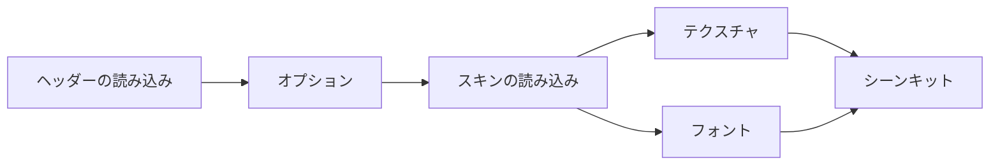

- スキンは 2 回読み込みます。1 回目はヘッダーの `property[]`、`filepath[]`、`offset[]` を読み、その既定値でエントリのオプションを用意します（`defaultBeatorajaSkinConfig`）。2 回目はそのオプションで Lua スキンの `main()` を実行します。ホストがオプションをすでに持っているとき（スキンのオプションを変えたとき）は 1 回だけ読み込みます。決定画面とリザルト画面のスキンには、譜面の難易度の op を点けた読み込み時の `main_state` を渡します（`createBeatorajaSkinLoadContext`）。ModernChic が `main()` の中で色を決めるためです。
- `source[]` はテーマのファイルから解決して（`bundleBeatorajaSources`。オプションの `filepath[]` の選択を反映します）テクスチャにデコードし、`font[]` を登録します。
- スキンの合成スロット -100〜-102 に描く譜面自身の画像（`#STAGEFILE`、`#BACKBMP`、`#BANNER`）は `loadBeatorajaChartImages(chart, source)` で読み込みます。譜面と同じフォルダー、次にソースのルートで探します。beatoraja の決定画面とリザルト画面のビューは、これを自分で読み込みます。
- ホストは `BeatorajaSceneKitCaches` を 1 つ持ち（Web の demo では `services/themes/beatoraja.ts`）、エントリごとのテクスチャ、フォント、オプションをエントリのパスで保持します。同じエントリの次の scene はそれを使い回します。PixiJS v8 は破棄したあとに同じバイト列をデコードし直すとクラッシュするので、テクスチャは破棄しません。新しいテーマを読み込むと、テクスチャを手放してフォントを破棄します（`releaseBeatorajaSceneKitAssets`）。

実装済みの beatoraja browser feature:

- `BeatorajaPlaySkinView` を使う select、decide、gameplay、result scene。どれもファミリービューで、`createSelectScene`、`createDecideScene`、`createPlayScene`、`createResultScene` で作ります（[選曲画面](#選曲画面)、[決定画面](#決定画面)、[プレイ画面](#プレイ画面)、[リザルト画面](#リザルト画面)）
- play variant `5`, `7`, `9`, `10`, `14`, `24`, `24d`。それぞれをその variant の譜面に mount します（テーマにない variant は `pickBeatorajaPlayableSkinVariant` が近い variant に fallback します）
- skin `property[]`、`filepath[]`、custom offset、category group、mid-session `replaceSkin()` refresh
- score、combo、judge、gauge、chart metadata、clear lamp、rank、play option 向けの runtime `TIMER_*`、`OPTION_*`、`TEXT`、`NUM` wiring
- beatoraja-style note、LN/CN/HCN cap/body、lane marker、BGA still/video layer、judge popup、timing visualizer、gauge graph、BPM graph、note-distribution graph、result score/gauge history graph
- player-scene-model の一覧のモデルによる選曲画面の一覧（フォルダ、検索、MODE のキーモードフィルターと SORT の切り替え、お気に入り）、オーディオサービスで鳴らす chart preview、select BGM、navigation system sound、スキンの Lua の音
- decide / result BGM、`STAGEFILE` / `BACKBMP` / `BANNER` の chart-image synthetic slot、loading-progress visual

[beatoraja skin 実装メモ](./beatoraja-skin.ja.md) では、renderer に依存しない parser と theme loader の境界をまとめています。
beatoraja default skin を primary compatibility target とし、community theme は同文書の normalized element family と runtime ID の範囲に収まるほど安定して動きます。

## Scene lifecycle

browser player は session 全体で 1 つの `PixiSceneHost`（`host/scene-host.ts`）を使います。
host は 1 つの PixiJS `Application` を所有し、同時に 1 つの scene だけを表示し、scene transition を直列化し、host dispose 時だけ renderer を破棄します。

LR2 と beatoraja は同じ high-level scene set をそれぞれ持ちます。default family は、be-music skin が decide 画面を持つときだけ decide 画面を表示します。

- chart browsing、preview playback、skin-side interaction を扱う select scene
- active family が提供する場合、gameplay 前の短い transition を扱う decide scene
- note、lane、BGA、HUD、judgment、audio、recording tap を扱う play scene
- score summary と skin-rendered result presentation を扱う result scene

標準・LR2・beatoraja のどの scene も `PixiScene` を実装し、host は `setScene` だけで scene を切り替えます。

- `root` は、scene の表示中に host が stage に載せる container です。scene はその下に scene graph を組み、自分で stage に載ることはありません。
- `identity` は `{ kind, family }` で、画面（`select`、`decide`、`play`、`result`）と、描く skin family（`built-in`、`lr2`、`beatoraja`）を表します。表示中の scene は `getCurrentScene()?.identity` でわかり、demo の test hook はシーンルーターが表示している scene の `identity` を報告します。
- `enter(host)` は scene が active になるたびに、host が `root` を stage に載せる前に呼ばれます。最初の entry で scene graph を組み、input と ticker の処理をつなぎます。2 回目以降は `exit()` で止めたものを再開し、画面の入場演出をもう一度始めます。
- `exit()` は別の scene に替わるときや stage を空にするときに、host が `root` を stage から外す前に呼ばれます。ticker の処理、input、画面自身の音（BGM、preview、jingle）が止まります。scene はもう一度 enter できます。
- `dispose()` はすべてを解放します。呼ぶのは scene の所有者で、`setScene` は置き換える scene を exit するだけです。

`SessionScene`（[シーンセッションとファミリービュー](#シーンセッションとファミリービュー)）も同じ契約に従い、`identity` は session と view から取ります。

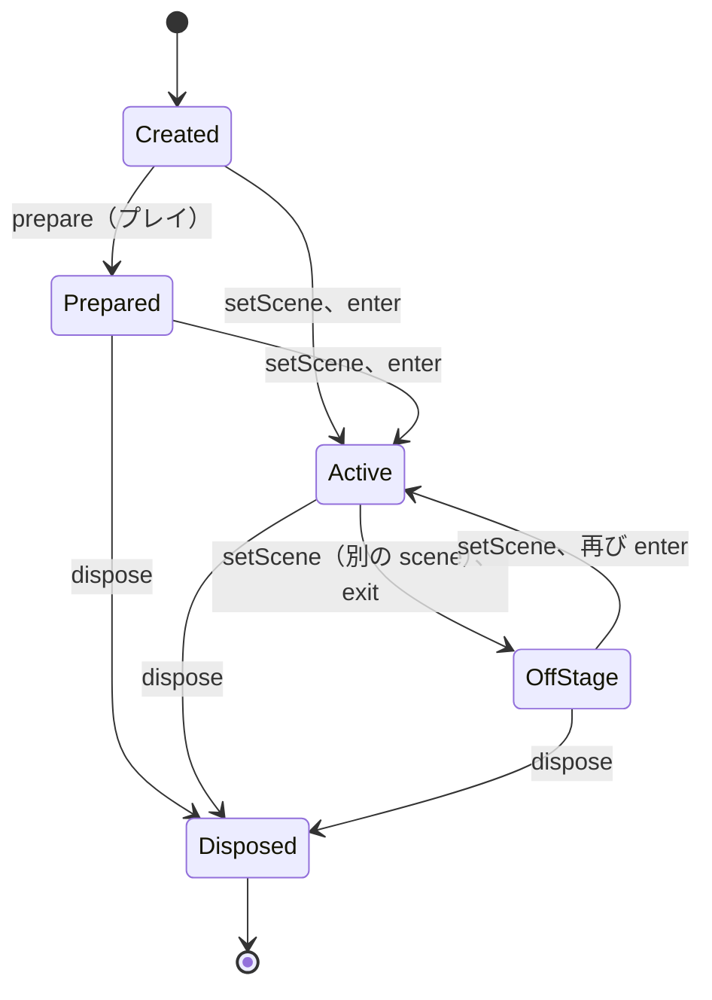

scene が表示する内容は表示の前に渡します。decide 画面はどれも `createDecideScene` の option、result 画面はどれも `createResultScene` の option、プレイ画面はどれも `createPlayScene` の option、select 画面はどれも `createSelectScene` の option です。

Web の demo では、scene の所有者はシーンルーター（`app/scene-router.ts`、[ADR 0006](./adr/0006-scene-router.ja.md)）で、アプリ（`app/app.ts`）とそのルートは自分で `setScene` も `dispose` も呼びません。切り替えのたびに、録画中なら確定し、`setScene(next)` で表示中の scene を exit すると同時に次を enter させ（stage が空のフレームはありません）、そのあと退いた scene を dispose します。切り替えは 1 つずつ処理します。切り替えはそれぞれ 1 回の移動に属し、より新しい移動に置き換えられた移動のために作った scene（result の読み込み中に select 画面へ戻ったときの result など）は、表示せずに dispose します。ファイルを読み込むあいだ（ドロップ、ファイルの選択、URL）は、select 画面が表示中ならそれを stage から外して何も表示せず、読み終えたら戻します。

- **select scene は生かしておきます。** どの種類の select 画面も decide、プレイ、result のあいだも残ります。`exit()` で BGM と chart preview と描画を止めますが、cursor、一覧の状態、decode 済みの BGM は保ちます。もう一度 enter すると scene timer を始め直して skin の入場演出を再び流し、BGM を再開します。preview は、離れたときと別の譜面にカーソルが乗ってから始め直します。select 画面（`createSelectScene`）は exit で音を `stopOwned` で止め、input を外します。demo のルーターはこれを select scene として持ち、切り替えでは dispose しません。別の LR2 テーマや skin family を選んだとき、別の family のテーマに替わったとき、beatoraja の select 画面のルートで Escape を押したときに手放し（`dropSelect`）、次の select 画面を作り直します。
- **プレイは stage の外で読み込みます。** `prepare()` は stage にも listener にも触れずに譜面を parse して音声を decode するので、demo は decide 画面の裏でプレイを準備します（ルーターの `prepare`）。decide 画面が終わると `setScene(play)` で decide scene を exit して、その裏で準備したプレイを enter し、`start()` で始めます。decide 画面のあいだに押した key は decide 画面にだけ届きます。decide 画面、プレイ、その読み込みは 1 回の移動を共有するので、Escape で decide 画面を離れると裏で準備したプレイも手放し、読み込みに失敗したときは decide 画面の `#RANDOM` の抽選（`preResolved`）でプレイを作り直します。decide 画面がないときは、demo はプレイを作るあいだ select 画面を stage から外し、先にプレイを表示します。表示中に走る `prepare()` は読み込み中の playfield を描きます。
- **プレイの音は画面より長く残ります。** gameplay scene の `exit()` は描画と input を止めますが音は止めないので、最後の音が鳴っているあいだに result を表示できます。ルーターはそのあとプレイを `preserveAudioTail` で dispose します。ステージごとの result を飛ばすコースのステージも同じように stage を離れ、あいだに画面を挟まずに次のステージを表示します。
- **decide と result の scene は使い捨てです。** もう一度 enter すると timeline を最初から始めます。ルーターは別の scene が stage に載ると dispose します。次のステージやリトライへ進む result 画面は先に stage を離れるので、次のプレイの読み込み中に key を受けません。
- **外からの移動は、進行中の流れを終わらせます。** scene が求めた移動は、その流れを続けます。プレイの result、result からの次のステージやリトライ、コースの decide 画面とステージがそうです（`continuesRun`）。それ以外の移動（ドロップ、skin やテーマの変更、ファイル・URL・リプレイの読み込み）は流れを中断します。ルーターは移動の始まりに demo の `onInterrupt` を呼び、demo はコースの実行を終えます。そのため次の単曲のプレイがステージとして扱われることはなく、select 画面はコースのバーに戻ります。Debug Menu の skin の項目（Skin system、Built-in skin、Skin effects、LR2 theme、Add skin のボタン）は select 画面へ戻ってしまうので、プレイ中は無効にします。ドロップはプレイ中でもできます。

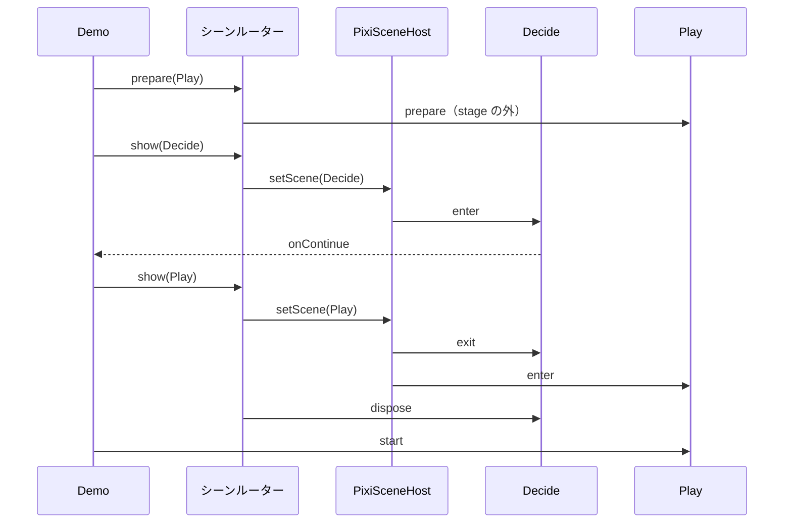

### gameplay family が共有するもの

どのプレイ画面も、同じプレイのセッションをそれぞれの種類のビューが描いたものです（[プレイ画面](#プレイ画面)）。プレイの音、見た目、終了処理を決める処理は 1 か所にまとまっていて、種類のあいだでずれることはありません。

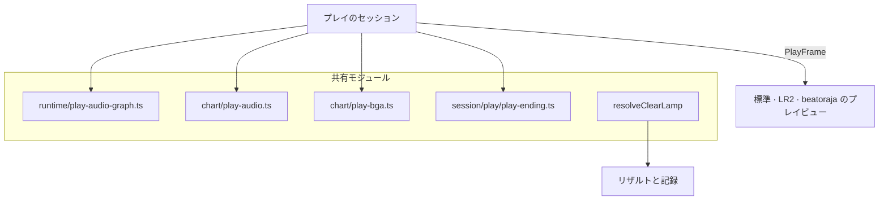

- `runtime/play-audio-graph.ts` は、プレイの AudioContext と bus を作ります（`#VOLWAV` を含む）。オーディオサービスがこれをプレイのために開きます（[オーディオサービス](#オーディオサービス)）。
- `chart/play-audio.ts` は、`#WAV` のサンプルを audio session が引くキーでそこへデコードし、ピッチを保つテンポのときは伸縮し、`#WAVCMD` / `#EXWAV` の音量をまとめます。
- `chart/play-bga.ts` は、プレイに要る BGA リソース（`#BMPxx`、bmson の `bga.header`、`#BGAxx` の切り出し元、LR2 view では暗黙の `#BMP00` POOR 画像）を選び、静止画は共通のテクスチャローダーで、動画は動画ローダーでデコードし、BMS の layer の黒を抜き、切り出し領域のビューを作ります。
- `session/play/play-ending.ts` は、プレイの終わりの時間を決めます（`resolvePlayEnding`、`beginExitSequence`）。最後まで進んだプレイは、最後のノートのあと譜面時刻で約 2 小節の余韻を置き、`exit-fade-out`（LR2 のタイマー 2、beatoraja の `TIMER_FADEOUT`）を出して、テーマや skin のフェードアウト（LR2 の `#FADEOUT`、beatoraja の `fadeout`）のあとに次の画面へ移ります。Escape と F5 も同じフェードアウトです。ゲージが尽きて途中で終わったプレイは、LR2 と beatoraja と同じくその場で止まります。`exit-close`（LR2 のタイマー 3、beatoraja の `TIMER_FAILED`）を出し、フェードアウトは出さず、音を切り、スキンの close の時間（LR2 の `#CLOSE`、beatoraja の `close`）のあとに結果を出します。close の時間がないテーマ（組み込みスキン）は 1.5 秒待ち、その間に画面をフェードします。画面のフェードは各ビューが `playEndingFadeAlpha`（`view/shared/play-frame.ts`）で行います。

  ```mermaid
  flowchart TD
    how{プレイの終了処理} -->|譜面の終わり、ESC、F5| fade[exit-fade-out：タイマー 2]
    fade --> next[フェードアウトのあと次の画面へ]
    how -->|ゲージが尽きた| stop[exit-close：タイマー 3、音を切る]
    stop --> result[close の時間のあと結果へ]
  ```

- `resolveClearLamp`（`@be-music/player-engine/ruleset`）がクリアランプの唯一の規則です。どのリザルトもこれでプレイのランプを決めます。LR2 / 既定のリザルト（LR2 のリザルトのランプの op 101-105 も、LR2 のランプで）、`beatorajaClearLampOp` を通した beatoraja のリザルトと選曲です。demo はどの family のプレイもこれで記録し、リーダーボードもこれで順位付けします。判定のルールセットのランプに合わせ、LR2 と IIDX ではフルコンボが最上位（PERFECT・MAX なし）、LR2 では DEATH でのクリアを NORMAL にします。

## シーンセッションとファミリービュー

どの画面も同じ構造をしています（[ADR 0001](./adr/0001-skin-families-only-draw.ja.md)）。**シーンセッション**は、画面の振る舞いをスキンの種類によらず 1 か所に持ちます。**ファミリービュー**は、それを自分の種類のスキンで描きます。どの種類の選曲画面、決定画面、プレイ画面、リザルト画面もこの形で作ります（[選曲画面](#選曲画面)、[決定画面](#決定画面)、[リザルト画面](#リザルト画面)、[プレイ画面](#プレイ画面)）。

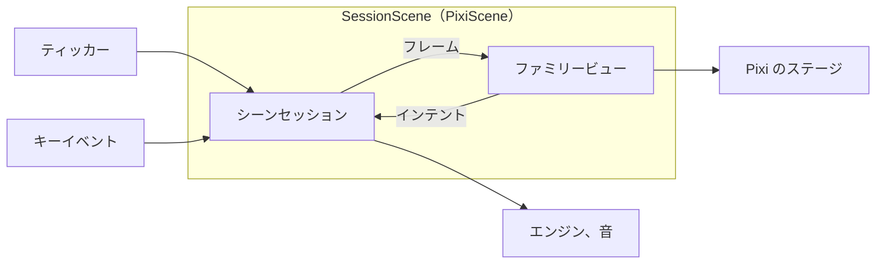

- **ファミリーキット**（`host/family-kit.ts`）。ホストが種類ごとに scene に渡すものです。`{ family: 'built-in', skin }`（be-music スキンとプレイヤーの設定値）、`{ family: 'lr2', skin }`、`{ family: 'beatoraja', kit }`（読み込んだテーマの 1 エントリ。スキン、テクスチャ、フォント、オプション、テーマのファイル）のどれかで、`SelectKit`・`DecideKit`・`PlayKit`・`ResultKit` があります。
- **フレーム**（`view/types.ts`）。セッションはティックごとに、シーンモデルの上に組んだフレームをビューに渡します。
  - `SelectFrame`: ライブラリ、`BrowseState`、一覧とカーソル、プレイオプション、記録
  - `DecideFrame`: 譜面、プレイが遊ぶとおりの譜面、コースのステージ、読み込みの進み具合
  - `PlayFrame`: `PlayState`、譜面の時刻、ノート、押されているレーン、前のフレームからのできごと
  - `ResultFrame`: `PlayResult`、プレイが遊んだとおりの譜面、その見せ方
- **インテント。** ビューは、プレイヤーが求めたことを scene ごとに返します。
  - 選曲: 一覧の操作、開始、プレイオプション、パネル
  - 決定: 進む、戻る
  - プレイ: タッチのレーン、ハイスピード、カバー、一時停止、中断
  - リザルト: 進む、リトライ
- **`FamilyView`** は `attach(host, emit)`・`draw(frame)`・`detach()`・`dispose()` を持ちます。外したビューは読み込んだものを保ちます。決定・プレイ・リザルトのビューは、スキンのタイミングも渡します。入力までの待ち、自動で進むまでの時間、フェードアウト（beatoraja のように Escape も入力を待つかどうかも）で、プレイなら読み込み終了・譜面開始・フェードアウト・クローズのオフセット（LR2 のスキンのもの、または beatoraja のスキンの 1.5 秒の前置きとフェードアウト）です。
- **`SessionScene`** は、セッションとビューから作る `PixiScene` です。
  - `enter(host)` でビューを付け、セッションを始め、最初のフレームを描きます。
  - ティッカーがセッションにフレームを求め、ビューに描かせます。
  - キーイベントは素のデータとしてセッションに渡します。テキスト欄にフォーカスがあるときは渡しません。ビューのインテントは、scene に入っている間だけセッションに渡します。
  - `exit()` は両方を外し、次の `enter` のために保ちます。`dispose()` で両方を終えます。
- **`PlayfieldSkin`** は、種類ごとのスキンが共通のプレイフィールドに渡すものです。ステージ、レーン、ノート・小節線・ボムの画像、エフェクトの長さです。プレイのビューは、プレイフィールドのまわりに自分で描くものも **`PlayChrome`** として共通のフレームの処理に渡します。自分のレイヤー、クローム、最後に描くテキスト、ボムが消えたときに止めるものです。この 2 つで、削除した `CoreGameplayView` のサブクラスが上書きしていたフックを置き換えました。

  | `CoreGameplayView` のフック                               | 置き換え先                                                                 |
  | --------------------------------------------------------- | -------------------------------------------------------------------------- |
  | `stageSize`                                               | `PlayfieldSkin.stage`                                                      |
  | `themeOwnsPlayfield`                                      | `PlayfieldSkin.ownsLanes`                                                  |
  | `resolveThemeLaneRect`                                    | `PlayfieldSkin.laneRect`                                                   |
  | `resolveThemeNoteCell`                                    | `PlayfieldSkin.noteCell`（チャンネルで引く）                               |
  | `renderThemeMeasureLines`                                 | `PlayfieldSkin.measureLines`（配置はプレイフィールド）                     |
  | `collectBGATargets`                                       | `PlayfieldSkin.bgaTargets`                                                 |
  | `renderBombEffects`                                       | `PlayfieldSkin.bombCell`                                                   |
  | `resolveBombDurationMs`                                   | `PlayfieldSkin.bombDurationMs`                                             |
  | `resolveKeyOnFadeMs`                                      | `PlayfieldSkin.keyOnFadeMs`（チャンネルで引く）                            |
  | `themeTiming`                                             | `PlayView.timing`                                                          |
  | `onThemeEvent`                                            | `PlayFrame.events`（`draw` で読む）。消えたボムは `PlayChrome.bombRetired` |
  | `updateThemeState`、`renderThemeLayer`、`renderThemeText` | `FamilyView.draw`（`PlayChrome.draw` と `drawText` のまわり）              |
  | `attachThemeLayers`                                       | `PlayChrome.attachLayers`                                                  |
  | `prepareTheme`                                            | ビューの読み込み。セッションが走らせる（`PlaySessionTheme.prepareView`）   |
  | `disposeTheme`                                            | `FamilyView.dispose`                                                       |

  LR2 のレーン番号と LR2 のタイマー番号は LR2 のビューの中にとどめます。セッションはキービームをチャンネルごとに持ち（`keyBeamStartedAt`、`keyBeamFadeStartedAt`）、プレイフィールドはチャンネルで尋ねます。

- **レイヤーの分け方。** `pnpm run check` は、セッション、ビュー、その下のレイヤーを互いに分けたまま保ちます（[レイヤーの分け方](#レイヤーの分け方)）。

### 選曲画面

`createSelectScene(kit, options)`（`@be-music/player-browser/host`）は、どの種類の選曲画面も作ります。選曲画面のセッション（`session/select/select-session.ts`）を kit の種類のビューが描くもので、`setScene` で表示する `SessionScene` です。標準の kit（`{ family: 'built-in', skin }`）は標準の選曲画面のビュー（`view/built-in/select-view.ts`）が、LR2 の kit（`{ family: 'lr2', skin }`。テーマの選曲画面のスキン）は LR2 の選曲画面のビュー（`view/lr2/select-view.ts`）が、beatoraja の kit（`{ family: 'beatoraja', kit }`。`loadBeatorajaSceneKit` で読み込んだテーマの選曲画面のエントリ）は beatoraja の選曲画面のビュー（`view/beatoraja/select-view.ts`）が描きます。標準と LR2 のビューはポインターの入力（`view/shared/select-pointer.ts`）を共有し、どのビューも README のオーバーレイを描きます。

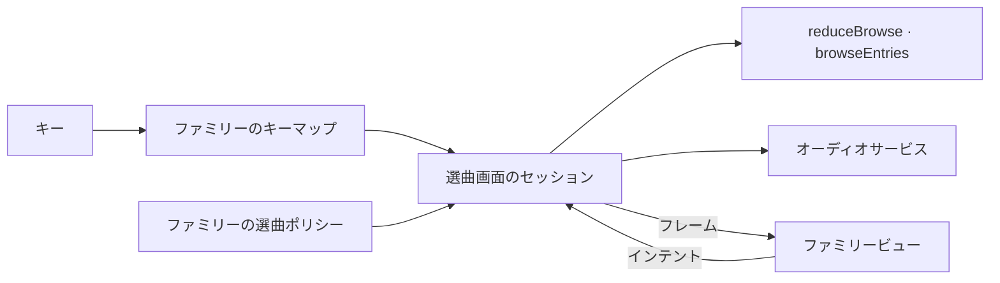

- **オプション。** `library`（譜面のファイルを含むコレクション）、`browse`（開く位置の `BrowseSnapshot`）、`playOptions`、`records`（バーとパネルに出す自己ベスト）、`sounds`（テーマの `SystemSoundSet`）、`audio`（ホストのオーディオサービス）、`courseMaker`（プレイヤーのコースと作っているコース。LR2 のスキン向け）、`on`：`start(entry, { autoPlay })`、`playOptions`、`search`、省略できる `readtext`・`courseMaker`（コースの名前を付ける、消す）・`skinConfig`・`skinConfigChange`（beatoraja のスキンが自分のオプションを変えた）・`exit`。
- **scene。** `snapshot()`、`focused()`、`getPlayOptions()` / `setPlayOptions()`（ホストによる変更で、`on.playOptions` には返しません）、`setLibrary()`（同じライブラリなら描き直し、新しいライブラリならプレイヤーの位置をその上に保ちます）、`restore()`、`refreshRecords()`、`setSearch()` / `setSearchEditing()`、`searchFieldRect()`、`setSounds()`、`updateKit()`（be-music スキンへのプレイヤーの設定、別の LR2 の選曲画面のスキン、または読み込み直した beatoraja の選曲画面のエントリ。前と同じエントリなら何も作り直しません）。
- **キー**（`session/select/select-keys.ts`）。ファミリーのキーマップで決まります。標準と LR2 の画面では、↑ / ↓ でカーソルを動かし、Enter でフォルダを開くかバーを始め、Escape・Backspace・← でフォルダから戻ります。Space でプレイオプションのパネルを開閉し、開いている間は 1P の鍵盤キーでその設定を切り替えます（Z が DP FLIP、S がランダム、X が 2P のランダム、D がゲージ、C / V がハイスピード、F がオートスクラッチ）。Escape で閉じます。beatoraja の画面では、↑ / ↓ でカーソルを動かし、Page Up / Page Down で 10 本、Home / End で先頭と末尾のバーへ、R でランダムなバーへ（beatoraja のランダムセレクト）移ります。Enter でフォルダを開くかバーを始め、Escape でフォルダから戻り（ルートでは画面を出ます）、Backspace はフォルダの中でだけ戻ります。オプションパネルはありません。README のオーバーレイが開いている間は、キーでそれをスクロールするか閉じます。
- **ポインター。** ビューは、バーのクリックやタップ、スワイプとその惰性、ホイール、スキンの当たり判定をインテントにします。be-music スキンでは PLAY・AUTO・検索・プレイオプション・README の当たり判定、LR2 スキンではボタン（`resolveLR2SelectButton`・`resolveLR2CourseMakerAction`：パネル、ハイスピード、プレイオプション、ソートとフィルター、PLAY / AUTOPLAY / READ TEXT、コースメーカー）、検索語、コース名です。LR2 のバーをクリックすると、その間のスロット分カーソルを動かしてそのバーを選びます。beatoraja のバーは、カーソルの下のバーならクリックで選び、ほかのバーならその間の行の分だけカーソルを動かします。beatoraja のスキンのボタン（`image[].act`）は PLAY、AUTO、PRACTICE（PLAY として遊びます）、READ TEXT、曲と譜面のお気に入り、MODE と SORT です。MODE と SORT は一覧の位置のキーモードフィルターとソートを切り替えます（Shift で逆に回ります）。
- **LR2 の描画。** LR2 のビューは `resolveLR2SelectState` でスキンを描き、フレームが伝えること（`SelectFrame.events`）から LR2 のタイマーを始めます。入場でタイマー 0、`#STARTINPUT` のあとでタイマー 1、カーソルが動くとタイマー 10〜13（バーはその分スライドし、フォルダを開くか閉じると 1 本分スライドします）、オプションパネルの開閉でタイマー 21〜29 と 31〜39、コースを作り始めるときと終えるときにタイマー 17 / 18 です。LR2 の番号はビューの中にとどまります。
- **beatoraja の描画。** beatoraja のビューは選曲画面のスキンを `BeatorajaPlaySkinView` で、キャンバスをウィンドウに合わせて描きます。`@be-music/skin-beatoraja/scene` のシーンの対応づけで、カーソルの下のバーの op、数値、テキストと、MODE・SORT・LNMODE の imageset を決めます（`resolveBeatorajaSelectBarOps` / `Number` / `Text` / `RefValue` / `SliderValue`。一覧の位置の一覧オプションと、`records` から読むバーの自己ベストのランプを使います）。バーの一覧はスキンの `songlist` のアンカーの位置にあり（`view/beatoraja/select/rows.ts`）、カーソルへ滑ります。一周するときは近い向きに滑ります。カーソルの下の譜面の画像、BPM グラフとノーツグラフ、検索中は一致した数を出すプロンプトも描きます。beatoraja のタイマーはフレームから読みます。scene のタイマー（0）は入場から、バーの変更のタイマー（11）はカーソルの下のバーが変わるたびに始まります。LNMODE ボタンの選択はビューの中にとどまります。一覧のモデルはこれを持ちません（まだ何もこれで遊びません）。JUDGE TIMING ボタンはスキンのタイミングのずれ（数値 12）を変え、オプションをホストに渡します（`on.skinConfigChange`）。番号はビューの中にとどまります。
- **コースメーカー。** セッションは LR2 スキンの完了・キャンセル・つなぎのボタンを `courseMaker` で実行します。つなぎの変更と削除（`on.courseMaker('delete', course)` を通し、ホストが確認します）は、カーソルの下にあるプレイヤー自身のコースにだけ効きます。
- **開始。** 譜面で Enter、クリック、PLAY / AUTO を押すと、be-music スキンの開始の演出のあとで `on.start` に渡します（その間の入力は待たせます）。コースはすぐに渡します。決定の効果音と決定音は `on.start` が `false` を返さなかったときに鳴ります（[決定音](#決定音)）。ステージが欠けたコースはキャンセルの効果音を鳴らします。
- **音。** セッションはオーディオサービスで鳴らします。選曲 BGM（半分の音量で、プレビューの間は消えます）とカーソルの下の譜面のプレビューはセッション自身のもので、画面の exit が `stopOwned` で止め、次の入場で BGM がまた始まります。効果音と決定音はオーナーなしで最後まで鳴ります。プレビューはカーソルの下の譜面に従い、検索でも追従します。離れたときと同じ譜面にカーソルを置いて戻ってきたときは、カーソルが動くまでその譜面のプレビューを始め直しません。beatoraja のスキンの Lua の音（`main_state.audio_*`）は、オーディオサービスのスキンの音でセッションのものとして鳴らします（`skinSounds.owned`）。画面を出るときにこれも止まります。beatoraja のテーマの音のセット（`systemSoundSetFromBeatoraja`）は効果音と選曲 BGM をパスで持ち、テーマのファイルから読みます（`audio.setTheme({ files })`）。決定音は持ちません。beatoraja の決定画面がテーマの決定音を鳴らします。

一覧、一覧の位置、選曲ポリシーは、どの種類の画面でもファミリーの選曲ポリシーに沿って同じように働きます。

- **一覧。** セッションは `@be-music/player-scene-model` の一覧のモデル（[一覧](./scene-model.ja.md#一覧ブラウズ)）の `BrowseState` を持ちます。コマンドは `reduceBrowse` を通り、描く一覧は `browseEntries`、フォルダとオプションの効果音は `browseSystemSound` から決まります。標準と LR2 の画面では、ソート、キーモードフィルター、難易度フィルターはプレイオプション（LR2 のオプションパネル、LR2 スキンのボタン、be-music スキンのプレイオプション、ホストの `setPlayOptions`）に置いたままで、一覧はそれに従います。beatoraja の画面では、MODE と SORT のボタンが一覧の位置のキーモードフィルターとソートを変え（beatoraja に難易度フィルターはありません）、プレイオプションはそれに触れません。ソートやフィルターを変えても、カーソルはそれまでのバーに残ります。フィルターでそのバーが消えたときは同じ行に、範囲に収めて残ります。検索を変えるとカーソルは先頭に移ります。キーモードフィルターは譜面をそのキーモードの下に並べるので、24 鍵の譜面は、キーモードフィルターに 24 鍵の選択肢のない LR2 の画面では ALL にだけ、beatoraja の画面では 24 KEYS（または 24 KEYS DOUBLE）に並びます。フォルダのバーはどのフィルターでも並び、コースのフォルダはフィルターのキーモードのコースと、キーモードを持たないコースを並べます。検索は譜面のタイトル、サブタイトル、アーティスト、ジャンル、ファイル名と、コースの名前に、前後の空白を除いた文字列で一致します。ソートはルートのフォルダのバーもラベルで並べます。
- **一覧の位置。** `BrowseSnapshot`（`captureBrowse`）は `restoreBrowse` で戻します。保存したときの検索、ラベルでたどれる限りのフォルダ、各親のカーソルを開いたフォルダのバーに置き（戻るとそのバーに着きます）、保存したバーがまだ並んでいればキーで探してカーソルをそこに置きます。ソートとフィルターは、標準と LR2 の画面ではそのときのものを保ち、beatoraja の画面ではスナップショットのものに戻します。
- **選曲ポリシー。** モデルが画面に任せることは、ファミリーの選曲ポリシー（`session/select/select-policy.ts`）で決めます。標準と LR2 の画面では、ルートで戻っても何もせず、戻す位置がなければ譜面フォルダが一つだけのライブラリはそれを開きます。beatoraja の画面では、ルートで戻るとキャンセルの効果音を鳴らして画面を出て（`on.exit`）、ライブラリはルートで開き、ソートとキーモードフィルターは一覧の位置に置き、キーは beatoraja のもので、フォルダを開くか閉じるとフォルダの効果音だけを鳴らします（LR2 では一覧が滑るたびと同じく、カーソルの効果音も一緒に鳴ります）。

Web demo は、どの種類が描く場合も選曲画面の scene を 1 つ保ち、プレイ、コース（カーソルはコースのバーに戻ります）、スキンの変更をまたいでスナップショットを保持し、ドロップしたフォルダもスナップショットで開きます。Debug Menu の Play options でも標準と LR2 の画面のソートとフィルターを設定できます。beatoraja のテーマの選曲画面のエントリは一度読み込み、テーマとエントリが同じ間は戻るたびにそれを渡します。スキンのオプションのパネル、JUDGE TIMING ボタン、Debug Menu のスキンの選択は、エントリを読み込み直して `updateKit` で渡します。beatoraja の画面のルートで Escape を押すとドロップの画面に戻ります。

### 決定画面

`createDecideScene(kit, options)`（`@be-music/player-browser/host`）は、どの種類の決定画面も作ります。決定画面のセッション（`session/decide/decide-session.ts`）を kit の種類のビューが描くもので、`setScene` で表示する `SessionScene` です。標準の kit（`{ family: 'built-in', skin }`）は標準の決定画面のビュー（`view/built-in/decide-view.ts`）が、LR2 の kit（`{ family: 'lr2', skin }`。テーマの決定画面のスキン）は LR2 の決定画面のビュー（`view/lr2/decide-view.ts`）が、beatoraja の kit（`{ family: 'beatoraja', kit }`。`loadBeatorajaSceneKit` で読み込んだテーマの決定画面のエントリ）は beatoraja の決定画面のビュー（`view/beatoraja/decide-view.ts`）が描きます。

- **オプション。** `chart`（これから遊ぶ譜面）、`course`（コースのステージなら、そのコース）、`playOptions`（スキンに見せるプレイオプション）、`source`（スキンの画像のための譜面のファイル）、`sounds`（テーマの `SystemSoundSet`）、`audio`（ホストのオーディオサービス）、`progress`（裏で準備しているプレイの読み込みの進み具合。ないときは、自動で進むまでの時間のうち過ぎた割合をフレームに入れます）、`on: { continue, cancel }` です。
- **タイミング。** セッションは、ビューのスキンのタイミング（`DecideView.timing`）で画面を進めます。入力は入力までの待ちのあとに受け付けます。自動で進むまでの時間がたつと、画面はひとりでにプレイへ進みます。その時間がなければ、プレイヤーの操作を待ちます。画面を出るときはまずフェードアウトし、そのあと `on.continue`（プレイへ）か `on.cancel`（選曲画面へ戻る）を、enter ごとに 1 回だけ呼びます。be-music スキンの画面はすぐに入力を受け付け、`decide.durationMs`（既定は 2000 ms）のあとに進み、フェードアウトはありません。LR2 スキンの画面は `#STARTINPUT`（なければ 1500 ms）のあとに入力を受け付け、その 1200 ms 後に進み、`#FADEOUT` の間フェードアウトします。beatoraja スキンの画面は `input`（なければ 500 ms）のあとに入力を受け付け、`scene`（なければ 3000 ms）のあとに進み、`fadeout`（なければ 500 ms）の間フェードアウトします。`scene` が 0 なら、入力を受け付ける前にすぐ進みます。beatoraja の [`MusicDecide`](https://github.com/exch-bms2/beatoraja/blob/c2ed5db1a46145ed10790c3872f717e95b59db9d/src/bms/player/beatoraja/decide/MusicDecide.java#L46-L50) が `nowtime > scene` になった時点でフェードアウトを始めるためで（46〜50 行）、Escape でも選曲画面へは戻れません。
- **入力。** Enter、Space、キャンバスのクリックは、入力を受け付けてから進みます。beatoraja の画面は、beatoraja と同じくクリックもタップも受け付けず、`scene` のあとにひとりでに進むので、タッチの端末でもプレイに進めます。Escape はいつでも戻ります。LR2 が `#STARTINPUT` の前でも Escape を受け付けるのと同じです。beatoraja のスキンでは、beatoraja の `input` がすべてのキーを待たせるのと同じく、Escape も入力を受け付けるまで待ちます（`SceneViewTiming.escapeWaitsForInput`）。キーリピートは無視するので、選曲画面から押したままの Enter で画面を飛ばすことはありません。
- **LR2 の描画。** LR2 のビューは、譜面の `#STAGEFILE` の上に決定画面のスキンを `resolveLR2DecideState`（譜面の難易度、キーモード、テキスト。コースのステージならコースのもの）で描きます。LR2 のタイマーはフレームごとにフレームから読みます。タイマー 0 は画面に入った時刻から、タイマー 1 は入力を受け付けた時刻から、タイマー 2 は画面を出始めた時刻からです。タイマーの ID はビューの中にとどめます。
- **beatoraja の描画。** beatoraja のビューは、決定画面のスキンを `BeatorajaPlaySkinView` で、キャンバスをウィンドウに合わせて描きます。`@be-music/skin-beatoraja/scene` のシーンの対応づけで、譜面の難易度の op、`#PLAYLEVEL` と BPM、読み込みのバーと割合（`NOW_LOADING` のあと `LOADED`。`resolveBeatorajaDecideOps`、`resolveBeatorajaDecideNumber`、`resolveBeatorajaDecideGraphValue`）と、譜面とスキンのテキストを描きます。`DecideFrame.playChart` の BPM グラフとノート種別のグラフ、譜面の `#STAGEFILE`・`#BACKBMP`・`#BANNER` も描きます。画像は最初のフレームの前に `source` から読み込みます。beatoraja のタイマーは、フレームごとに画面自身のクロック（入ってからの ms）で読みます。タイマー 0 は画面に入った時刻から、タイマー 1 と READY / PLAY は入力を受け付けた時刻から、タイマー 2 は画面を出始めた時刻からです。
- **音。** セッションは、画面に入るときにテーマの決定音（`sounds.decideBGM`）をオーナーとしてオーディオサービスで鳴らし、画面がステージから外れるときに `stopOwned` で止めます。Web のデモは、標準と LR2 の決定画面に決定音を渡しません（`sounds: {}`）。[決定音](#決定音) を見てください。beatoraja の画面にはテーマの決定音を渡します（`systemSoundSetFromBeatoraja`）。beatoraja スキンの Lua の音（`main_state.audio_*`）はオーディオサービスのスキンの音でセッションのものとして鳴らすので（`skinSounds.owned`）、画面を出るときに一緒に止まります。
- **`#RANDOM`。** セッションは、scene を作るときに譜面の `#RANDOM` / `#SWITCH` の分岐を 1 回だけ引きます。beatoraja の決定画面と同じです。`scene.resolved` は分岐を解決した譜面と引いた値で、プレイに渡す（`preResolved`）ためのものです。`DecideFrame.playChart` はビューのグラフのための同じ譜面なので、画面はプレイが遊ぶ分岐を表示します。Web のデモは引いた値をプレイに渡します。画面の裏で先読みする LR2 / 標準のプレイも、beatoraja のプレイも同じです（コースのステージは自分で引きます）。分岐を描くのは beatoraja の決定画面のビュー（BPM グラフとノート種別のグラフ）だけです。
- **スキンの設定。** `updateKit(kit)` は、プレイヤーが変えたスキンの設定値を受け取り、次のフレームからそれで描きます。beatoraja のスキンはオプションを反映して読み込むので、別のスキンの beatoraja の kit は無視します。

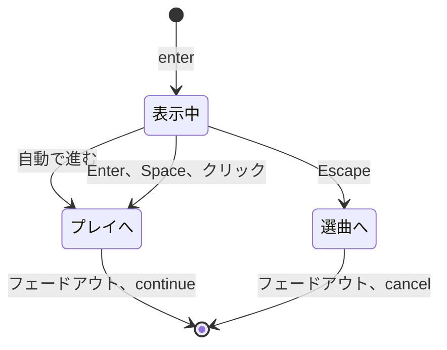

Web のデモは、どの決定画面の裏でもプレイを準備し、`on.continue` でそれを表示します。

#### 決定音

選曲画面は、譜面かコースでプレイが始まるときに LR2 のサウンドセットの決定音（`#DECIDE`、`sounds.decideBGM`）を鳴らします。選曲画面のセッション（標準と LR2）は、これをオーナーなしでオーディオサービスから鳴らします。選曲画面の exit（`stopOwned`）は BGM とプレビューを止めますが決定音は止めないので、決定音は LR2 と同じく決定画面を通ってプレイまで鳴り続けます。決定画面が出ないとき（決定画面のスキンのないテーマ）にも鳴ります。beatoraja の選曲画面の音のセットに決定音はありません。beatoraja の決定画面が、テーマの決定音をセッションのジングルとして鳴らし、画面を出るときに止めます。以前の画面自身の AudioContext で止まっていたのと同じです。

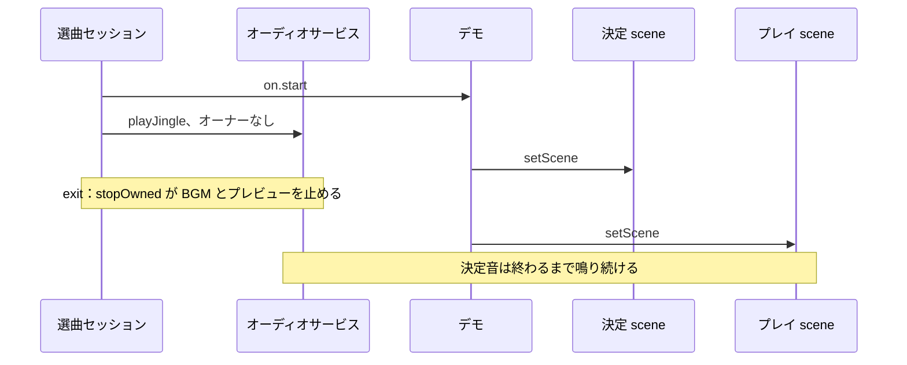

決定画面のセッションも決定音を鳴らせます（`sounds.decideBGM`）。ただしそれは決定 scene 自身の音で、scene が出るときに `stopOwned` が止めるので、プレイが始まるところで決定音が切れます。そのためデモは標準と LR2 の決定画面に `sounds: {}` を渡し、決定音は選曲画面のものにしています。開始でプレイが始まるかどうかはホストが選曲画面に伝えます。作っているコースが譜面を受け取ったときや、コースが始められないときは `on.start` が `false` を返し、決定音は鳴りません。

### リザルト画面

`createResultScene(kit, options)`（`@be-music/player-browser/host`）は、どの種類のリザルト画面も作ります。リザルト画面のセッション（`session/result/result-session.ts`）を kit の種類のビューが描くもので、`setScene` で表示する `SessionScene` です。標準の kit（`{ family: 'built-in', skin }`）は標準のリザルト画面のビュー（`view/built-in/result-view.ts`）が、LR2 の kit（`{ family: 'lr2', skin }`。テーマのリザルト画面のスキン、コース全体の結果ではコースリザルトのスキン）は LR2 のリザルト画面のビュー（`view/lr2/result-view.ts`）が、beatoraja の kit（`{ family: 'beatoraja', kit }`。`loadBeatorajaSceneKit` で読み込んだテーマのリザルト画面のエントリ、コース全体の結果ではコースリザルトのエントリ）は beatoraja のリザルト画面のビュー（`view/beatoraja/result-view.ts`）が描きます。

- **オプション。** `result`（`PlayResult`。LR2 と beatoraja のスキンは `result.course` のコースを表示します）、`run`（`result.run` がプレイの種類を表さないとき、たとえばコースのステージのときの種類）、`source`（スキンの画像のための譜面のファイル）、`playChart`（プレイが遊んだとおりの譜面。beatoraja のスキンの BPM グラフ、ノート種別、TOTAL の表示のため）、`sounds`（テーマの `SystemSoundSet`）、`audio`（ホストのオーディオサービス）、`on: { continue, retry? }` です。
- **見せ方。** セッションは `resolveResultPresentation(run)` でプレイの見せ方を決めます。コース全体の結果ではコースのジングルを鳴らし、クイックリトライは単曲のプレイと NONSTOP のときだけです。
- **ジングル。** セッションは、画面に入るときに `sounds` からリザルトのジングル（`resolveResultJingles` と `resolveResultJingle`。判定に応じたクリアかフェイルのもの、なければ共通のもの。コース全体の結果ではコースのものを先に選ぶ）をオーナーとしてオーディオサービスで鳴らし、画面がステージから外れるときに `stopOwned` で止めます。以前は scene が自分の AudioContext を閉じてジングルを止めていました。テーマに逆の判定のジングルしかないときは、標準の画面でも LR2 の画面でも何も鳴らしません。
- **段階。** 入力はビューの入力までの待ち（LR2 スキンでは `#STARTINPUT`。be-music スキンと `#STARTINPUT` のない LR2 スキンでは、LR2 の既定の 1500 ms）のあとに受け付け、結果のグラフもそこから描き始めます。グラフは 3 秒後にひとりでに描き終わり、それより前に Enter、Space、クリックを押すと飛ばします。次の操作で記録の更新を表示し、その次の操作で `on.continue` を呼びます。フレームには各段階を表示した時刻（`graphShownAtMs`、`updateShownAtMs`。LR2 のタイマー 151 と 152）が入ります。be-music スキンの入場演出は、グラフを表示した時点で落ち着いた配置に飛びます。beatoraja スキンの画面には押して進む段階がありません（`ResultViewTiming.skipsResultSteps`）。`input`（なければ 500 ms）のあとに入力を受け付け、最初の Enter、Space、タップで、`fadeout`（なければ 500 ms）の間フェードアウトしてから `on.continue` を呼びます。タップはタッチかペンの操作です。beatoraja のリザルトはキーしか読まないので、マウスのクリックでは進みませんが、スマートフォンやタブレットにはほかにこの画面を出る方法がありません。
- **画面を出る。** Escape はどの段階でも `on.continue` を呼びます。beatoraja のスキンでは、beatoraja の `input` がすべてのキーを待たせるのと同じく、入力を受け付けるまで待ちます（`SceneViewTiming.escapeWaitsForInput`）。修飾キーのない R は、入力を受け付けたあと、プレイがクイックリトライできて、ホストが `on.retry` を渡しているときに `on.retry` を呼びます。どちらも enter ごとに 1 回だけです。
- **LR2 の描画。** LR2 のビューは、結果、`result.course` のコース、スキンの `#FLIPRESULT`、カスタムオプションの既定値から `resolveLR2ResultState` でリザルト画面のスキンを描きます。LR2 のリザルトのタイマーはフレームごとにフレームから読み、タイマーの ID はビューの中にとどめます。
  - タイマー 0 は画面に入った時刻から。
  - タイマー 1 と 150 は入力を受け付けた時刻から。
  - タイマー 151 は `graphShownAtMs`（ランクとスコアを表示した時刻）から。
  - タイマー 152 は `updateShownAtMs`（記録の更新を表示した時刻）から。

  ゲージとスコアのグラフは、タイマーから `start` と `end` の間に左から描かれます。LR2 の標準スキンでは、タイマー 150 の 500 ms 後から 2000 ms 後までです。

- **beatoraja の描画。** beatoraja のビューは、リザルト画面のスキンを `BeatorajaPlaySkinView` で、キャンバスをウィンドウに合わせて描きます。`PlayResult` を `@be-music/skin-beatoraja/scene` のシーンの対応づけ（`resolveBeatorajaResult*`）でそのまま読みます。スコアと判定の数、タイミングの平均と標準偏差、ボーダーと TOTAL 付きのゲージ（`gaugeBorder`、`gaugeTotal`）、ランク・クリアかどうか・ランプの op、ゲージと EX スコアのグラフ、判定のグラフ、タイミングの分布、`result.course` のコースです。BPM グラフ、ノート種別、譜面の `#TOTAL` は `ResultFrame.playChart` から読み、これがなければ何も表示しません。譜面の `#STAGEFILE`・`#BACKBMP`・`#BANNER` は最初のフレームの前に `source` から読み込みます。beatoraja のタイマーは、フレームごとに画面自身のクロックで読みます。タイマー 0 と READY / PLAY は画面に入った時刻から、タイマー 1 は入力を受け付けた時刻から、タイマー 2 は画面を出始めた時刻からです。スキンの Lua の音はオーディオサービスのスキンの音でセッションのものとして鳴らすので、画面を出るときに止まります。
- **スキンの設定。** `updateKit(kit)` は、プレイヤーが変えたスキンの設定値を受け取り、次のフレームからそれで描きます。beatoraja のスキンはオプションを反映して読み込むので、別のスキンの beatoraja の kit は無視します。

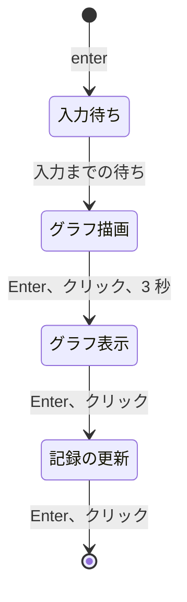

Web のデモは、リザルトをすべてこの画面で表示します。単曲のプレイ、リプレイ、コースのステージ、コース全体（テーマにコースリザルトのスキンがあればそれで）、NONSTOP（リザルトのスキンで。それがない beatoraja のテーマでは標準の画面にフォールバックし、そのテーマのジングルを鳴らします）です。どのプレイも結果を `PlayResult`（`playResultFromPlayState`）で渡し、グラフは譜面の始めから再生位置までです。コース全体は `playResultFromCourseRun` で 1 つとして読み、LR2 と組み込みでは最後のステージのグラフ、beatoraja では全ステージをつないだグラフです。

### プレイ画面

`createPlayScene(kit, options)`（`@be-music/player-browser/host`）はどの種類のプレイ画面も作ります。プレイのセッション（`session/play/play-session.ts`）を kit の種類のビューが描く `SessionScene` で、読み込み、`setScene` で表示し、開始します。標準の kit（`{ family: 'built-in', skin }`）は組み込みのプレイビュー（`view/built-in/play-view.ts`）が、LR2 の kit（`{ family: 'lr2', skin, invisibleNoteSkin? }`。譜面のプレイスキンと、見えないノート用のテーマの 9 鍵スキン）は LR2 のプレイビュー（`view/lr2/play-view.ts`）が、beatoraja の kit（`{ family: 'beatoraja', kit }`。譜面の鍵盤数に合うテーマのプレイのエントリ）は beatoraja のプレイビュー（`view/beatoraja/play-view.ts`）が描きます。

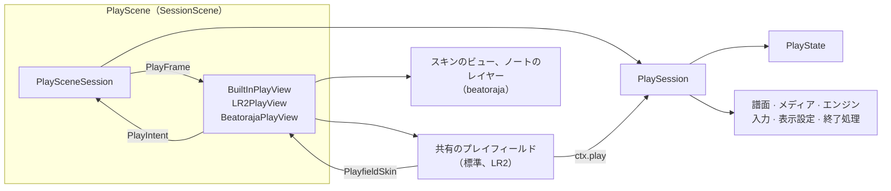

- **オプション。** `chart` と `source`。`settings` は、譜面・スキン・行き先以外の、プレイの進め方です（判定とスクロールに使うプレイオプション、テンポ、音量とミックス、BGA、描画の設定）。`course`（ステージの規則とコースの表示）、`replay`（再生するリプレイ）、`preResolved`（決定画面が引いた `#RANDOM`）、`audio`（ホストのオーディオサービス。beatoraja のスキンの音もこれで鳴らします）、`playOptions`（選曲画面で設定されたもの。フレーム用）、`host`（画面外で読み込む間にレイヤーを組み立てるため）、`on: { finish(result, replay), exit, restart, hiSpeed?, tempo? }` です。
- **ライフサイクル。** `prepare(onProgress)` は譜面、ビュー自身の素材（LR2 スキンの画像とフォント。beatoraja のプレイではノートの配置、レイヤー、譜面の画像）、サンプルを読み、BGA の読み込みを裏で始めます。ステージには触れません。`setScene` でプレイを表示し、`start()` でイントロに続いて譜面を始めます。`dispose({ preserveAudioTail })` はシーンを終わらせ、プレイが最後まで終わったときは最後のサンプルが鳴り終わるのを待ちます。ほかに `requestExit`、`requestTogglePause`、テンポとハイスピードの設定、`recording`（ホストの録画用）、`progress()`（ここまでの結果。デモのテストフックが読みます）、`waitForReplay`、`resolved`（プレイが遊ぶとおりの譜面と `#RANDOM` の抽選。リザルトのグラフ用）、`updateKit`（標準のスキンの設定、または beatoraja のエントリのオプションや別のエントリのスキン。シーンは種類を変えません）、音と描画の調整があります。
- **セッション。** `PlaySession` は一つの `PlayState` を中心にプレイの振る舞いを持ちます。譜面（`play-chart.ts`）、メディア（`play-media.ts`。オーディオサービスの `openPlayGraph` で専用の `interactive` なコンテキストを開き、所有者はセッションです）、エンジン（`play-engine.ts`）、プレイ自身の入力（`play-input.ts`）、表示設定（`play-view-settings.ts`）、終了処理（`play-ending.ts`）です。ビューに求めるものは `PlaySessionTheme`（`play-session-theme.ts`）で受け取ります。イントロとフェードアウトの時間、アニメーションのきっかけ（`PlayMoment`）、チャンネルごとのキービームのフェード、譜面の準備のあとのビュー自身の読み込み（`prepareView`）、BGA の GPU への転送です。ビューのタッチのレーンは `lane` のインテントで戻ってきます。
- **フレーム。** `PlaySceneSession` は毎ティック、エンジンの UI シグナルをプレイ状態に取り込み、リプレイの表示設定を記録または再生し、ビューに `PlayFrame` を渡します。プレイ状態とその段階、譜面時刻と拍、ノートと押されているレーン、前のフレームからのきっかけ（`playViewEventFromMoment`）、解析したミックス、プレイをもう表示するか（`shown`）、進行中のプレイそのもの（`playfield`）です。
- **組み込みのビュー。** `BuiltInPlayView` は自分のレイヤー（`PlayLayers`）に共有のプレイフィールドを描き、`PlayfieldSkin` で答えます。be-music スキンのステージ、プレイフィールド自身のレーン配置・ノート・小節線・ボム（スキンはこれらをデータとして描きます）、組み込みの BGA の矩形、スキンのボムの長さ、既定のキービームのフェードです。キービームはどのレーンにも点き、24 / 48 KEY の 8 番目以降の鍵とホイールも例外ではありません。be-music のクロームがプレイフィールドの周りを描きます（`renderBuiltInChrome`。ビューの `PlayChrome` です）。
- **LR2 のビュー。** `LR2PlayView` は、同じプレイフィールドのまわりに LR2 のプレイスキンを スキンの設計キャンバス（SD・HD・FHD）で描きます。
  - op、数字、テキスト、スライダー、バーグラフはフレームの LR2 の状態（フレームの `PlayState`、スコア、時刻、フレームレートからの `resolveLR2PlayState`）から、タイマーはフレームのきっかけから取ります（[LR2 skin 実装メモ](./lr2-skin.ja.md#シーンの状態)）。
  - `PlayfieldSkin` は、スキンの `#DST_NOTE` のレーンの矩形、ノートのセル（オートスクラッチのレーンでは `#SRC_AUTO_*` のダミーノート）、`#DST_LINE` の小節線、`#DST_BGA` の矩形、タイマーから求めたボムとキービームの長さを渡します。レーンはスキンのものなので、レーンの背景、キービーム、ボムはスキンが自分で描きます。
  - `PlayChrome` はスキンの要素を描き（`view/lr2/play-elements.ts`）、フルコンボのタイマーを演出が終わったら止め、スキンに判定の画像がなければ判定を文字で描き、プレイフィールドがボムを消したらそのタイマーを止めます。
  - セッションはスキンの `#LOADSTART` + `#LOADEND`（READY）、`#PLAYSTART`、`#FADEOUT`、`#CLOSE` でプレイの時間を決めます（`resolveLR2PlayTiming`）。
- **beatoraja のビュー。** `BeatorajaPlayView` は beatoraja のプレイスキンを `BeatorajaPlaySkinView` で描き、ノート、小節線などの印、BGA のレイヤー（`view/beatoraja/play/*`）をスキンが置く位置に差し込みます（`BeatorajaPlayStage`）。
  - `BeatorajaPlayBridge`（`view/beatoraja/play-bridge.ts`）は、フレームごとにスキンの描画コンテキストを作ります。op、数字、テキスト、ゲージ、グラフは、フレームの `PlayState` とエンジンの最新のフレームから [Scene mapping](./beatoraja-skin.ja.md#scene-mapping) で求め、タイマーはフレームのきっかけ（判定、レーンの光りと押しっぱなし、読み込み終了、フェードアウト）で始めます。判定の状態のグラフは自分で持ち、レーンの光りも自分で終わらせます。
  - ノートは beatoraja のスケールで、譜面の `#SCROLL` / `#SPEED` のタイムラインに沿って、フレームの描くハイスピードとプレイ状態のレーンカバーで流れます。リプレイはそのスケールで表示設定を記録します（`PlaySessionTheme.replayView`）。
  - セッションは読み込み終了からプレイの時間を決めます。READY、PLAY、STARTINPUT はそのとき、譜面はその 1.5 秒後に始まり（`resolveBeatorajaPlayTiming`）、退出はスキンの `fadeout` をかけてフェードし、失敗したプレイはスキンの `close` のあとに次へ進みます。
  - beatoraja の kit も、ほかの種類と同じくホストのレーンオプション（RANDOM、MIRROR、S-RANDOM、SCATTER、DP FLIP）、[HS-FIX](#hs-fix)、開始時のレーンカバー（HIDDEN / SUDDEN、レーンカバーの高さと表示。リフトはなし）で遊び、リプレイの `play.randomLane` と `play.view` に記録します。カバーのキーを有効にします（`coverKeys`）。PageUp / PageDown で SUDDEN+、Home / End でリフトを動かし、H で HIDDEN+ を切り替え、J / K で動かします（Shift で大きく動きます）。譜面のレーンが使うキーはレーンを押します（14 鍵の DP 譜面では H / J / K は 2P のレーンです）。ホイールとスキンのカバーのボタン（act 330-332）はカバーのインテントを送ります。
  - スキンの `main_state.audio_*` は、オーディオサービスのスキンの音として、scene の `PlaySceneSession` を所有者にして鳴らします。scene がステージを離れると、ループも含めて止めます。プレイの音のグラフは別の所有者のままなので、終わったプレイの音は最後まで鳴ります。
- **入力。** プレイのキー（ESC、F5、Space、矢印キー、Backspace の長押し、beatoraja のプレイのカバーのキー）は、window にあるプレイ自身のリスナーのままです。シーンはキーを聞きません。
  - タッチのレーンはビューのものです。各プレイのビューは、共有のプレイフィールドが並べたレーンの上で canvas の指を追い（`view/shared/touch-lane-input.ts`。プレイの間は `touch-action: none` も設定します）、レーンを最初の指が押したときと最後の指が離したときに `lane` のインテントを送ります。セッションはキーボードと同じようにエンジンの入力でレーンを押し、離します（`handleTouchLaneIntent`）。beatoraja のスキンはプレイフィールドにレーンを並べないので、そのプレイにタッチのレーンはありません。
  - 一時停止すると、セッションはタッチで押されているレーンをすべて離し、その回数を数えます（`touchLiftCount`）。ビューはそれまで触れていた指を忘れるので、その指は触れ直すまで何も押しません。
  - ハイスピードはどのファミリーでも ArrowUp / ArrowDown で変わり、ホストも設定できます（`setHiSpeed`）。
  - TUI の Alt / Option + レーンのショートカットは、Web ではどのファミリーにもありません。Web の入力ランタイム（`createWebInputRuntime`）がエンジンに送るのはレーンのキー、ESC、F5、Space だけで、`high-speed` コマンドは送りません。ブラウザでは Alt とレーンのキーの組み合わせがブラウザのショートカットであることが多くあります（Windows の Alt + D や Alt + F）。LR2 と beatoraja は START + レーンのキーでハイスピードを変えますが、Web のプレイには START のキーがありません。
- **`#RANDOM`。** `preResolved` があると、決定画面が見せた抽選のとおりにプレイします。Web のデモは先に決定画面を作り、その `resolved` を渡してプレイを先読みします（どのプレイ画面も）。コースのステージとリプレイは自分で引きます（リプレイはログのとおりです）。

Web のデモはどの種類のプレイもすべてこの方法で、その種類自身のプレイ画面で表示します。単曲、AUTO、リプレイ、コースのステージ、NONSTOP、クイックリトライ、F5 で、beatoraja のテーマでも同じです（ADR 0001）。

### プレイの部品の置き場所

プレイのセッションとプレイのビューは、プレイの部品を共有します。各モジュールはプレイ（またはビュー）を明示的なコンテキスト（`ctx`）として受け取り、自分のインターフェースを通してその状態を読み書きします。セッションの状態は `PlaySessionState` です。ビューはレイヤーを `PlayLayers` に持ち、進行中のプレイを `PlayfieldRuntime` として読みます。

進行中のプレイは player-scene-model の `PlayState`（`playState`）一つです。ゲージと EX スコアとそのグラフ、コンボ、最大コンボ、コースのコンボ、時刻つきの判定と判定ごとの早い / 遅いの数、表示設定（HS-FIX のかかったハイスピードとレーンカバー）を持ちます。これを変えるものはすべて `applyPlayEvent`（`session/play/play-state.ts`）を通ります。`applyPlayEvent` は `reducePlayState` で状態を進め、描くハイスピードが変わればノートのスクロールをそこへなめらかに移します。エンジンのフレーム、判定、空 POOR、最終の集計、プレイヤーのハイスピードのキー、ホストの `setHiSpeed`、リプレイが記録した表示設定がこれを通ります。スキンのランタイム、LR2 の状態の解決（`resolveLR2PlayState`）、beatoraja のプレイのブリッジ、リザルト（`playResultFromPlayState`）はこれを読みます。セッションはその横に、表示のとおりのエンジンの判定数（`score`。LR2 では空 POOR を POOR の数に含めます）と、エンジンのゲージの集計（`gaugeState`）を持ちます。

- `session/play/`：
  - `play-session.ts`：`PlaySession`。部品の組み立て、クロック、一時停止、録画、後片付け。`play-session-state.ts`：その状態。`play-options.ts`：そのオプション（`PlaySessionOptions`）。`play-session-theme.ts`：ビューに求めるもの（`PlaySessionTheme`）と、知らせるきっかけ（`PlayMoment`）
  - `play-scene-session.ts`：`SceneSession` としてのセッション、そのフレームとインテント。`play-view-events.ts`：ビューのイベントとしてのきっかけ
  - `play-chart.ts`：`prepareChart`、レーンオプション（RANDOM、MIRROR、S-RANDOM、SCATTER、DP FLIP）、リプレイの配置、決定画面の抽選
  - `play-media.ts`：オーディオグラフ、サンプル、BGA のテクスチャと動画、それらの後片付け
  - `play-engine.ts`：共通エンジンの起動、その UI シグナル、判定とレーンの演出、エンディングの開始
  - `play-input.ts`：ESC、F5、Space、矢印キー、長押しでの終了、自動一時停止、ビューが送るタッチのレーン。`play-cover-keys.ts`：beatoraja のプレイのカバーのキー（`coverKeys`）
  - `play-keys.ts`：`PLAY_SCENE_KEY_CODES`。プレイが自分で扱い、エンジンの Web 入力ランタイムが読み飛ばすキーの一覧です
  - `play-state.ts`：`applyPlayEvent`。プレイの状態を変える唯一の道です
  - `play-view-settings.ts`：ハイスピードのキー、エンジンが従うテンポ、描くとおりのレーンカバー、リプレイの表示設定
  - `play-ending.ts`：退出のタイムラインと、結果のスナップショット
  - それらが共有する補助：`long-note-tracker.ts`（スキンが描く各ロングノートの状態）、`live-tempo.ts`（プレイ中のテンポとその変更）、`tempo-range.ts`（プレイの最低・最高・メインの BPM）、`quit-hold.ts`（Backspace の長押し）、`result-delay.ts`（結果の前の余韻と、音の尾を鳴らす長さ）、`judge-windows.ts`（スキンに渡すルールセットの判定幅）、`placeholder-gauge.ts`（エンジンの最初のフレームまでのゲージ）
- `view/shared/`：`playfield/*`（レーン、ノート、ロングノート、地雷、小節線、ボム、カバー、テキスト。進行中のプレイは `ctx.play`、`PlayfieldRuntime`。ビューの `PlayfieldSkin` と `PlayChrome`）、`bga-renderer.ts`、`play-frame.ts`（レイヤーの木、画面への合わせ込み、フェード）、`play-layers.ts`、`texture-upload.ts`、`touch-lanes.ts` と `touch-lane-input.ts`（タッチのレーンの指を `lane` のインテントにする）
- `view/built-in/`：`play-view.ts`（組み込みのプレイビューとその `PlayfieldSkin`）、`play-chrome.ts`（組み込みのレーンの配置、BGA の矩形、be-music のレイアウトと、クロームのランタイムと描画）
- `view/lr2/`：`play-view.ts`（LR2 のプレイビュー、その `PlayfieldSkin`、読み込み、フレームの LR2 の状態）、`play-elements.ts`（スキンの要素と、プレイフィールドに渡すレーンの矩形・ノートのセル・小節線・BGA の矩形）、`play-timers.ts`（スキンのタイマー）、`play-turntable.ts`（スクラッチのターンテーブル）、`play-hud.ts`（判定・コンボ・グルーヴゲージの描画とスキンのタイマーの長さ）
- `view/beatoraja/`：`play-view.ts`（beatoraja のプレイビュー、その読み込み、時間、リプレイの表示設定のスケール）、`play-bridge.ts`（スキンの描画コンテキストとしてのフレーム。op、タイマー、数字、グラフ）、`play-stage.ts`（ノート、印、BGA のレイヤーを差し込んだスキンのビュー）、`play/*`（ノート、印、BGA のレイヤー、スクロールの配置、ノートの `dst` のブロック、スキンの寸法）

### レイヤーの分け方

このパッケージのソースはレイヤーに分かれていて、`pnpm run check` が [`vite.config.ts`](../vite.config.ts) の Oxlint の上書き設定でそれを守ります。上から順に次のとおりです。

- **ホスト API**：`host/` とパッケージの barrel（`index.ts`）。`create*Scene` の関数、種類ごとのキット、`PixiSceneHost`、`./host` の barrel です。
- **シーンセッション**（`session/`）と**ファミリービュー**（`view/`）。セッションが画面のふるまいを持ち、ビューがそれを描きます。互いを知るのは型だけです。
- **下位レイヤー**：ほかのすべてのディレクトリ。音と入力のランタイムとエンジンドライバー（`runtime/`）、譜面とメディアの準備（`chart/`、`media/`）、コレクション（`collection/`）、ブラウザの検査（`browser/`）、Pixi のステージの補助（`stage/`）、スキンの読み込み（`skin/`）、組み込みスキン（`skins/`）、録画（`recording/`）、ロガーです。

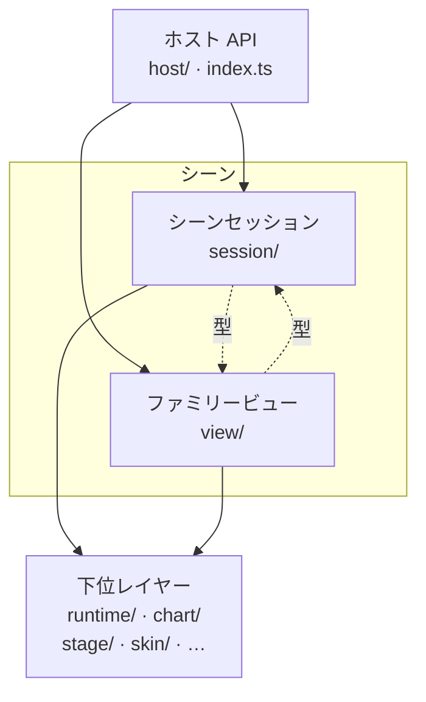

矢印は import を、点線は型だけの import を表します。規則は次のとおりです。

- **下位レイヤーはシーンを知りません。** `host/`、`session/`、`view/` のモジュールを、型であっても import しません。パッケージのファイルはどれも初めは下位レイヤーに入るので、新しいディレクトリも設定で別のレイヤーに入れるまでは下位レイヤーです。
- **セッションがビューとホストに触れるのは型だけです。** Pixi も型にしか使いません。そのためセッションは、偽のビューを相手に Node のテストで動きます。
- **ビューがセッションとホストに触れるのは型だけです。** エンジン（`@be-music/player-engine`）も、`runtime/engine-driver` と `runtime/web-*-runtime` のモジュールも import しません。player のほかのエントリポイント（`./signals`、`./lanes`、`./display`、`./ruleset` など）はエンジンではないので、ビューも import できます。
- **エンジンを動かすのはセッションだけです。** `session/` のほかにエンジンを値として import するのは `runtime/engine-driver.ts` だけで、ほかのファイルは web demo も含めて型だけを import します。
- **オーディオコンテキストを作るのは音声レイヤーだけです。** `runtime/` が、システムのコンテキスト（`audio-service.ts`）、プレイごとのグラフ（`play-audio-graph.ts`）、ピッチを保つ伸縮のオフラインのコンテキスト（`time-stretch-signalsmith.ts`）を作ります。ほかはすべて、web demo も含めてオーディオサービスを通して鳴らし、`AudioContext` は型としてだけ使います。

テストは対象外です。組み込みスキンには、さらに厳しい独自の境界もあります。`skins/boundary.test.ts` は、スキンが import してよいものをスキン SDK、描画のフレームワーク、自分のファイルに限ります。

## ノートの表示範囲

描画は判定 ruleset に含まれないため、ruleset は描画に関わりません。プレイ画面は、どのノート・地雷・小節線をどこに描くかを 2 つの規則のどちらかで決めます（[`note-draw-window.ts`](../packages/player-browser/src/chart/note-draw-window.ts)）。

- **LR2 の規則** — `#SCROLL` / `#SPEED` を含まないすべての譜面。ruleset は問いません。
- **beatoraja の規則** — 1 以外の `#SCROLL` か `#SPEED` を含むすべての譜面。LR2 はどちらも扱わないため beatoraja を基準にします。値がすべて 1 の譜面は通常の譜面と同じに扱います。

LR2 の規則（`LR2body.exe` の `DrawNotes`）では次のとおりです。

- **位置:** オブジェクトは判定ラインまでスクロールし、拍を過ぎるとライン上に留まります。ラインより下には何も描きません。
- **ノートと地雷:** 判定済みで、かつ拍が判定位置に達したときにだけ消えます。打っていないノートは ruleset の遅い側の窓で見逃しと判定されるまでライン上に留まるため、そのノートの位置で始まる STOP の間もそこに残ります。早く打ったノートはラインまでスクロールを続け、ラインに達したときに消えます。地雷は通過後に消えます（早めに爆発させた地雷はラインに達したとき）。オートのレーン（オートプレイ・オートスクラッチ）では、ノートは拍を過ぎたときに消えます。
- **ロングノート:** 始点は通過後もライン上に留まり、判定済みで終端を過ぎるまで残ります。始点を見逃したり早く離したりしたロングノートは、それまで半透明（LR2 の `0x80`）で描きます。
- **小節線:** 判定位置が通過すると消えるため、その位置で始まる STOP の間はライン上に留まります。
- **たどる範囲:** 拍がレーン上端を越えたところで譜面をたどるのを打ち切ります。

beatoraja の規則（`LaneRenderer`）では、判定ラインの位置から譜面のタイムライン（ノート・地雷・不可視ノート・小節線・BPM / STOP / `#SCROLL` / `#SPEED` の位置）を順にたどり、最初にレーン上端を越えたタイムラインを描いたところで打ち切ります。そのためオブジェクトはレーン上端の外側から入ってきます。その先は、後の負の `#SCROLL` でレーン内に戻ってくるノートも描きません。ノート・地雷・小節線は判定の有無にかかわらず時刻になった瞬間に消えます（`LaneRenderer` は時刻がまだ先のものだけを描きます）。ロングノートは押しているかどうかにかかわらず終端の時刻が先にある間は残り、始点を過ぎると終端の時刻まで始点を判定ライン上に描きます。beatoraja の描画は判定ラインでノートを切り取らないため、負の `#SCROLL` で判定ラインより下に来た、時刻がまだ先のノートはステージの下端までそこに描きます。スキンには `y` がレーンの `bottom` より下のオブジェクトとして渡ります（[be-music スキン](./be-music-skin.ja.md)）。

どちらの規則でも、LR2 や beatoraja と同じく判定済みのノートはその時刻まで残すため、早く打ったノートはラインまでスクロールを続けます。Debug Menu の **Judged notes**（`judgedNoteDisplay`）で、判定した瞬間に消すこと（`HIDE`）もできます。既定値は `KEEP_SCROLLING` です。始点を見逃したり早く離したりしたロングノートは、どちらの規則でも半透明で描きます。組み込みスキンも同じように薄くし、ほかの be-music スキンにはその `state` を渡します。

terminal player も、双方向にスクロールする譜面では同じ位置でたどるのを打ち切ります。

beatoraja のプレイスキンは表示の選択であって ruleset ではないため、同じ規則に従います（[`scroll-placement.ts`](../packages/player-browser/src/view/beatoraja/play/scroll-placement.ts)）。ノート・小節線・BPM / STOP マーカーは同じ `#SCROLL` / `#SPEED` の距離で置き、スクロールする譜面では beatoraja の規則、それ以外の譜面では LR2 の位置と表示の規則で描きます。落としたロングノートは薄くせず（スキン自身の押下中・非押下の本体画像で状態を示します）、`HIDE` の設定もありません。

## HS-FIX

プレイオプションの HS-FIX は LR2 のボタンをそのまま使い、beatoraja のハイスピード固定（`LaneRenderer.init`）に合わせます。プレイヤーが設定するハイスピードは譜面の基準 BPM（`#BASEBPM`、なければ開始 BPM）での値で、HS-FIX は別の BPM でのスクロールがそれと同じ感覚になるように掛け直します。プレイ中の HI-SPEED 表示も選曲画面のパネルと同じくこのハイスピードを示し、ArrowUp / ArrowDown はこれを 0.1 ずつ変えます。HS-FIX が掛け直すのはスクロールだけです。

| be-music   | ハイスピードを合わせる BPM                                                                     | beatoraja                                          |
| ---------- | ---------------------------------------------------------------------------------------------- | -------------------------------------------------- |
| `OFF`      | なし（スクロールは BPM に従う）                                                                | `OFF` と `STARTBPM`（基準がすでに開始 BPM のため） |
| `MAXBPM`   | 最大 BPM                                                                                       | `MAXBPM`                                           |
| `MINBPM`   | 最小 BPM                                                                                       | `MINBPM`                                           |
| `AVERAGE`  | メイン BPM。最も多くのノートが置かれた BPM（`@be-music/chart-model` の `resolveChartMainBPM`） | `MAINBPM`                                          |
| `CONSTANT` | 本当の一定スクロールが入るまではメイン BPM                                                     | —                                                  |

`AVERAGE` は以前は時間の加重平均でした。BPM × N + STOP のギミックで値が大きく偏り（145 BPM の譜面で約 810、ノートが 5.6 倍遅く流れる）、さらに最後の区間だけ STOP を含むクロックで測っていました。メイン BPM は beatoraja が使う値です。同数のときは先に現れる BPM を選びます（beatoraja はハッシュマップの順序で選ぶ）。ノートの大半をギミック用の BPM に置いた譜面（"the life" は 717 ノートを 16,000,160 に置く）では、beatoraja でも be-music でもその BPM がメイン BPM になるので、HS-FIX `OFF` で遊んでください。

どの種類のプレイ画面も、メイン BPM が要るところではこの 1 つの値を使います。リプレイの表示時間（[replay.ja.md](./replay.ja.md#プレイヤーが見ていたもの)）、組み込みの HUD の `mainBPM`、beatoraja スキンのメイン BPM（数値 92）とそれでの白数字・緑数字、BPM グラフです。

## Renderer と performance control

- PixiJS は既定で WebGPU preference を使い、browser が初期化できない場合は PixiJS 側で fallback します。
- `?renderer=webgl` で renderer 比較用に WebGL を強制できます。
- skin / BGA texture は LR2 / beatoraja の pixel-art asset を保つため nearest sampling を使います。
- beatoraja source texture は bitmap が保守的な GPU texture-size cap を超える場合、upload 前に downscale します。
- gameplay path は decide scene から gameplay へ渡す前に、chart parse、audio decode、BGA resource preload を進めます。
- 共有の scroll-distance helper により、terminal player と browser の note placement behavior を揃えます。
- default gameplay chrome は pooled Pixi child を graphics / text に再利用し、text style を cache して skinless renderer の frame ごとの allocation churn を抑えます。
- WebGL context に依存しない pure な browser-core helper は benchmark 対象です。

```bash
pnpm bench -- --packages player-browser
```

## Audio, BGA, recording

- chart preview と gameplay audio は WebAudio を使います。
- `@be-music/player-browser/audio` は platform audio session 用の helper を export します（engine 内部の `WebAudioSession` とは別物です）。`supportsSystemAudioSession`、`getSystemAudioSession`、`applySystemAudioSessionType` は `navigator.audioSession.type` を feature detection して設定し、`applySilentModePlayback(on)` はオンで `'playback'`、オフで `'auto'` を設定します。例外は握りつぶし、API がない環境では何もしません。`AudioContext` の作成・resume より前と、音声を unlock する gesture の中で呼んでください。
- gameplay audio は既定の split topology で key、BGM、master compressor stage を分けます。
- `?compressor=legacy` は比較用に旧 single-compressor 構成を維持します。
- `?compressor=off` は demo で compressor construction を無効化します。
- beatoraja theme audio は Lua `main_state.audio_play` / `audio_loop` call、select BGM、navigation system sound、decide BGM、result jingle に同じ browser bundle lookup を使います。
- BGA は chart BGA event が参照する still image と video asset を扱います。
- BGA rect（LR2 の `#DST_BGA`、beatoraja の `bga`、built-in frame）はいずれも 256x256 の BMS キャンバスとして扱います。長辺 256 px 以下の静止画は等倍のまま X 軸中央・上詰めで黒地の上に置き、それより大きい画像と動画は rect いっぱいに描きます（[フォーマット互換性](./format-compat.ja.md#217-bga)）。
- default family は LR2 skin と同じ chart BGA layer stack を built-in BGA frame 内に描画します。
- BMS rendering は、実装済み subset として `#BGAxx` sub-region、`#SWBGAxx` switching、`#ARGBxx` / `#EXBMPxx` tint / alpha を反映します。
- bmson rendering は `bga.bga_events`、`bga.layer_events`、`bga.poor_events` を使います。BMS layer channel と異なり、bmson layer image は黒を透明化せず黒ピクセルとして保持します。
- browser demo は、未対応 video asset を playback 前に ffmpeg.wasm と single-threaded の `@ffmpeg/core` で transcode できます。現在の 0.12.x の multithreaded core は libx264 でクラッシュするため含めていません。一般的な BMS BGA の動画は transcode に数十秒かかります。
- chart の自然終了時は、短い post-chart delay を置いてから result scene を開きます。視覚的に result へ遷移しても、残っている gameplay audio tail は中断しません。
- gameplay recorder は MP4 か WebM の output を書き出し、active recording が gameplay bus の破棄前に flush されるよう、scene disposal より前に stop / finalization を終えます。
- リプレイ再生を除く毎プレイでリプレイ（`*.bmplay.json` 入力リプレイ — 解決済み譜面、生の押下/解放列、プレイ設定。[replay.ja.md](./replay.ja.md) 参照）を記録します。demo は result scene のマウント時に自動ダウンロードし、Debug Menu の「Library & records」フォルダにある「Auto-save play history」チェックボックス（デフォルト OFF。曲開始時にラッチされ、プレイ中は disabled）で制御します。`bms-replay` CLI がこのファイルから LR2 / beatoraja / IIDX のリザルトを再現します。リプレイをページへドロップすると、対応する楽曲がロード済みの場合に記録されたランをリプレイ再生します。ESC で諦めたランは、再シミュレーションと同じく諦めた所（`play.abortedAtUs`）までをリプレイします。
- どのプレイ画面も、プレイヤーが見ていたもの（`play.view`、`play.viewChanges`）を記録します。そのスケールでのハイスピード、HS-FIX、メイン BPM での表示時間、各サイドの SUDDEN+ / HIDDEN+ / LIFT で、変更は `{ kind: 'view' }` コマンドとして 100 ms に高々 1 回送ります。リプレイは、`replayView` オプションが求める範囲でその表示設定を再生位置に沿って表示します。同じスケール（LR2 / default の画面は共通、beatoraja のスキンは独自）で遊ばれたなら記録されたハイスピード、そうでなければ記録された表示時間になるハイスピードと、記録されたカバーです（リフトを描く beatoraja のプレイのスキンではリフトも。`PlaySessionTheme.drawsLift`）。単位と規則は [replay.ja.md](./replay.ja.md#プレイヤーが見ていたもの) を参照してください。
- Debug Menu の Leaderboard フォルダにある「Submit to Leaderboard」（デフォルト OFF。自動保存と同じく曲開始時にラッチ）をオンにすると、終了した手動プレイを result scene のマウント時に Leaderboard（[leaderboard.ja.md](./leaderboard.ja.md)）へ送信します。demo は初回に匿名でログインし、楽曲の譜面からプレイの fingerprint ドキュメントを作り直してログと照合してから送り、サーバーに求められたら chart document を付けて再送し、順位をステータス行に表示します。デプロイ先の Worker は `/api/*` と `/leaderboard/*` を Service Binding で Leaderboard の Worker に転送し、`pnpm player:web` はローカルの Leaderboard（`pnpm --filter @be-music/app-leaderboard run dev`、または `LEADERBOARD_DEV_ORIGIN`）にプロキシします。
- アカウントは匿名で始まります（最初の送信で匿名ログインします）。「Create passkey (keep this account)」でそのアカウントに passkey を登録すると、プレイは匿名フィルタの陰ではなく handle で一覧に載るようになります。「Sign in with passkey」で別のブラウザーからそのアカウントにログインすると、そのブラウザーの匿名のプレイはこのアカウントに移ります。

### オーディオサービス

`createAudioService()`（`@be-music/player-browser/audio`）は、プレイ中の譜面の音以外を鳴らす唯一の手段です（[ADR 0007](./adr/0007-one-system-audio-context.ja.md)）。scene session はできるごとにこれで音を鳴らします。どの選曲画面、決定画面、プレイ画面、リザルト画面もこれで鳴らします（プレイは `openPlayGraph` で専用のグラフを開きます）。Web のデモは起動時にサービスを 1 つ作り、これで作るすべての scene に渡します。beatoraja のテーマを読み込むと、beatoraja の選曲画面のパスで指す効果音と選曲 BGM、beatoraja の選曲画面・決定画面・プレイ画面・リザルト画面のスキンの音のために、そのファイルを設定します（`setTheme({ files })`）。

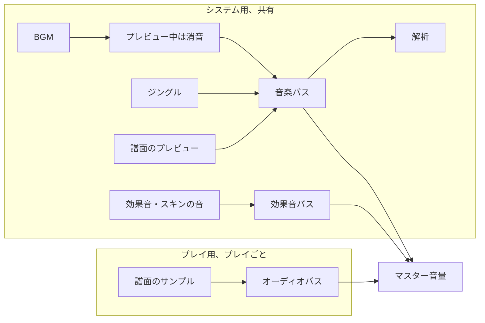

- システム用の AudioContext は最初に使うときに作ります。ユーザー操作の前のページで、ブラウザーが開始を拒む AudioContext を作らないためです。音はバイト列（またはテーマのファイル）ごとに 1 回だけデコードし、デコードの失敗も覚えておきます。
- `setTheme({ sounds, files })` でテーマの `SystemSoundSet`（player-scene-model）と、beatoraja のテーマならそのファイルを設定します。`playCue(slot)` はその効果音を 1 回鳴らします。`playBGM` と `playJingle` はスロットか解決済みの `SystemSound` を受け取ります。パスで指定された音（beatoraja テーマの効果音など）はテーマのファイルから読みます。
- `playBGM(sound, { owner, volume, loop, duckUnderPreview })` が鳴らす BGM は常に 1 つです。別の BGM なら置き換え、同じ BGM ならそのまま鳴らし続けてオーナーと音量だけを変えます。譜面のプレビューが鳴っている間は消音します。`duckUnderPreview` が `false` なら消音しません。
- `skinSounds.play` / `loop` / `stop` は beatoraja スキンの `main_state.audio_*` です。`skinSounds.owned(owner)` は同じ呼び出しをオーナー付きで行います。
- `preview.focus(target, owner)` は 1 つの `ChartPreviewEngine` を動かします。`analyzer.sample(now)` は、音に反応する be-music スキンのために音楽バスを解析します。
- `openPlayGraph(chart, mode, busOptions, { owner })` は、プレイ専用の `interactive` な AudioContext と、`#VOLWAV` を反映したオーディオバスを開き、バスの出力に解析を付けます。`close({ delayMs, beforeClose })` で、余韻を鳴らしきってから閉じます。
- `stopOwned(owner)` は、そのオーナーが鳴らしたものをすべて止めます。BGM、ジングル、効果音、スキンの音、そのオーナーがフォーカスしたプレビュー、まだ閉じ始めていないプレイのグラフです。AudioContext を閉じても音は止まらなくなったので、scene は画面を出るときにこれを呼びます。オーナーなしで鳴らした音は最後まで鳴ります（選曲画面を出るときの決定音など）。`dispose()` はすべてを止め、すべての AudioContext を閉じます。

## Compatibility boundary

ブラウザープレイヤーは `chart-parser`、`chart-model`、`player-engine`、`player-scene-model`、`player-skin-sdk`、`shared-utils` と LR2 / beatoraja のスキンパッケージを利用します。Native Skin の表示には `player-ui` を使います。Node の音声デコードと出力は `player-node-audio` が `chart-audio-renderer` を通じて提供し、ブラウザーの音声は Web Audio アダプターが担当します。
browser behavior が terminal player と分岐する場合は、pure な path、timing、scroll、lookup、event mapping helper を shared package へ移し、package-local test で覆う方針を優先します。
PixiJS scene wiring は browser rendering や WebAudio resource に依存する場合、`player-browser` に残してかまいません。

## DOM スキンと独立した controller

Debug Menu → Skin & display → Built-in → Built-in skin で **Native (DOM + Canvas)** を選ぶ。Native はコレクション、検索、プレイオプション、ロード画面、スコア HUD、結果画面を HTML で表示し、メーターと SVG のゲージ履歴も使う。レーン・ノート・レーンカバー・判定ライン・ボム・判定文字はそれぞれ独立した component で、ステージ上の自分の範囲と同じ大きさの canvas に描画する。プレイヤーの canvas に残るのは BGA だけである。Synesthesia または Plain を選ぶとフル Canvas に戻り、選択は保存される。入力にはブラウザーのフォーカス、スクロール、IME の挙動を使い、`/` ショートカットは DOM の検索欄にフォーカスする。

Native は横画面では HUD をレーン横の空間に、縦画面ではコンパクトな上部バーに配置し、レーンを画面下部まで広げます。タッチ操作では判定ラインの下に指を置く余白を確保します。ステージ固有の `playfield` 範囲を描画・ノート配置・タッチ判定で共有します。DOM のゲームプレイフレームにもレイアウトを渡し、リサイズや画面回転後も HUD とプレイフィールドを Canvas の表示領域に揃えます。プレイフィールドは毎アニメーションフレーム、HUD は制限した頻度で更新し、どちらもプレイ画面と一緒にフェードします。

ゲームプレイのダッシュボードには EX スコア・ランク・スコア率、コンボ、BPM、時間・進行状況に加え、判定内訳と早遅の件数、空 POOR を含む BP、直近の判定ずれ、ゲージ推移と判定タイミングのグラフを表示します。ハイスピードと描画速度、HS-FIX、緑数字、表示時間、BPM 範囲、レーンカバー、ランダム・ゲージ設定、オートスクラッチ、DP フリップ、BGA モード、譜面情報とコースのステージも確認できます。横画面ではレーン横の空間を使い、情報カードを最初から展開します。縦画面では **All play information** から詳細カードをレーンに重ねて開き、レーンを短くしません。DOM の更新はおよそ毎秒12回に抑え、グラフはゲージ最大96点・タイミング最大32件を表示します。

`BeMusicSkin` は任意の `dom.select`・`dom.decide`・`dom.result`・`dom.gameplay` factory を宣言できる（`player-skin-sdk/src/dom.ts`）。それぞれ `HTMLElement` と既存 session に届く操作を受け取り、`update(frame)` と `dispose()` を返す。先頭の三つは Canvas の描画を置き換え、gameplay は Canvas のプレイフィールドを補う。スキンが `gameplay.drawsOnDOM` を設定すると、gameplay は `drawPlayfield(frame)` でプレイフィールドを描画し、host はゲームプレイ用の surface を作らない。frame はスキン設定とエフェクトの設定も持つ。select 画面が `focusSearch()` を返すと、自分で検索欄を所有して host の重複する入力欄を隠せる。DOM は attach 時に作り、document が存在する前でもスキンの module を import できる。detach は mount とローカル状態を再入場まで保持し、dispose は listener、フレームワークの root、リソースを解放する。Native は shadow DOM でスタイルを分離する。別の場所に DOM を置く host は `PixiSceneHost.mount` に `domContainer` を渡す。

`@be-music/player-browser/controller` は Pixi を実行時に import せず、`SceneController` と `createSelectController` を公開する。controller の操作は明示的な `enter(nowMs)`・`advance(nowMs)`・`dispatch(intent)`・`exit()`・`dispose()` で、所有者一つが進行させる。`getSnapshot()` と購読者は一時イベントも含め同じ frame を共有する。`createStore(selector, equals?)` は選択した値の安定した snapshot を提供し、最初の advance 前の `getSnapshot()` は `undefined`、`subscribe(listener)` の戻り値は購読解除関数になる。購読を解除しても session は終了しない。React・Vue の adapter は store をコンポーネントのライフサイクルにつなぎ、Canvas renderer は独自の frame loop を使える。

独立したコレクションブラウザーでも、プレビュー再生と選曲の振る舞いを共有できる。

```ts
import { createSelectController } from '@be-music/player-browser/controller';

const controller = createSelectController({ library, audio, sounds: {}, on: { start: openChart } });
const query = controller.createStore((frame) => frame.browse.searchText);
const unsubscribe = query.subscribe(() => updateSearch(query.getSnapshot()));
controller.enter(performance.now());
// ブラウザーがアクティブな間、host が animation tick ごとに一度進行させる。
controller.advance(performance.now());
controller.dispatch({ type: 'browse', command: { type: 'search', text: 'title' } });
// 最終的な破棄時:
unsubscribe();
controller.dispose();
```

既存の Pixi scene でも同じ controller を `scene.controller` から参照できる。進行は host が担当するため、購読者はもう一度 advance しない。gameplay preparation と内部の `PlayfieldRuntime` には描画リソースが残り、独立した gameplay controller の公開 interface にはしていない。Canvas のスクリーンショットと録画はプレイヤーの canvas を対象とし、DOM 画面を含まない。そのため Native の録画には BGA だけが映る。[ADR 0012](./adr/0012-native-skin-screens.ja.md) と [ADR 0014](./adr/0014-native-playfield-components.ja.md) を参照。

Native の各画面は `@be-music/player-ui` の Lit 製 Web Components で組み立て、スキン側はフレームと操作イベントの受け渡しを担当します。同じ画面とパネルを `@be-music/player-ui-react`・`@be-music/player-ui-vue` からも使えます。[Player UI ガイド](../packages/player-ui/README.ja.md) と [ADR 0013](./adr/0013-player-ui-components.ja.md) を参照してください。
