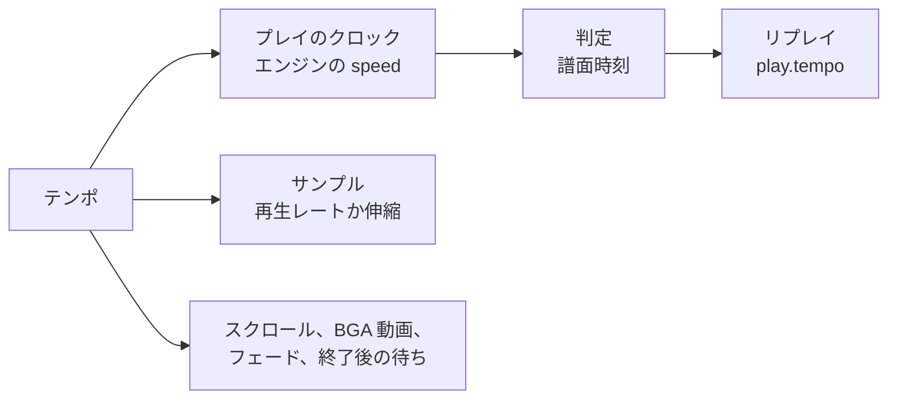
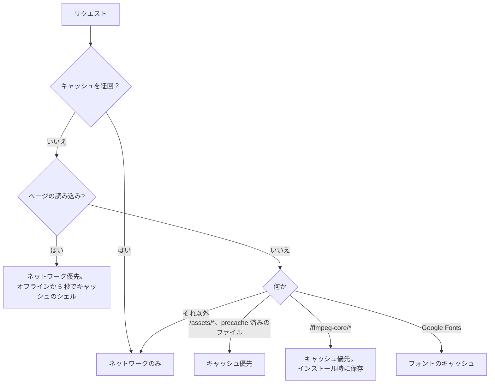
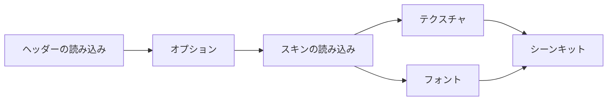

[English version](./player-web.md)

# Browser player 実装メモ

Be-Music Play は BMS・BME・BML・PMS・bmson・LRX・n2s の譜面をブラウザーで再生します。アプリはライブラリーと設定を管理し、`@be-music/player-browser` が選択中のスキンで各画面を描画します。譜面のタイミングとノートの規則は [共通プレイヤー仕様](./player-spec.ja.md) を参照してください。

<details>
<summary>目次</summary>

- [関連ページ](#関連ページ)
- [CPU Worker](#cpu-worker)
- [共通 runtime 連携](#共通-runtime-連携)
- [公開するエントリポイント](#公開するエントリポイント)
- [プレイヤーの起動](#プレイヤーの起動)
  - [読み込み中の表示](#読み込み中の表示)
  - [Options ダイアログ](#options-ダイアログ)
  - [ベスト記録](#ベスト記録)
  - [プレイテンポ](#プレイテンポ)
  - [組み込みスキンのプレイ画面](#組み込みスキンのプレイ画面)
  - [スマートフォンとタブレット](#スマートフォンとタブレット)
- [プレイヤーのインストール](#プレイヤーのインストール)
- [Browser loading model](#browser-loading-model)
- [コースと段位認定](#コースと段位認定)
- [LR2 skin と theme support](#lr2-skin-と-theme-support)
- [Default skin family](#default-skin-family)
- [beatoraja skin と theme support](#beatoraja-skin-と-theme-support)
- [ノートの表示範囲](#ノートの表示範囲)
- [HS-FIX](#hs-fix)
- [Renderer と performance control](#renderer-と-performance-control)
- [Compatibility boundary](#compatibility-boundary)
- [ブラウザー検証](#ブラウザー検証)
  - [テスト用フック](#テスト用フック)

</details>

## 関連ページ

- [ブラウザープレイヤーの構成](./player-web-scenes.ja.md)
  - <a name="プレイヤーの作り"></a>[プレイヤーの作り](./player-web-scenes.ja.md#プレイヤーの作り)
  - <a name="scene lifecycle"></a>[シーンのライフサイクル](./player-web-scenes.ja.md#scene-lifecycle)
  - <a name="シーンセッションとファミリービュー"></a>[シーンセッションとファミリービュー](./player-web-scenes.ja.md#シーンセッションとファミリービュー)
  - <a name="レイヤーの分け方"></a>[レイヤーの分け方](./player-web-scenes.ja.md#レイヤーの分け方)
- [音声・BGA・録画](./player-web-media.ja.md)
- [埋め込みと独立したコントローラー](./player-web-integration.ja.md)
  - <a name="埋め込みプレビュー"></a>[埋め込みプレビュー](./player-web-integration.ja.md#埋め込みプレビュー)

## CPU Worker

ブラウザのホストは、譜面のパース・集計・圧縮、ZIP 展開、WSOLAで共通の Worker プールを使います。Options ダイアログ の **Advanced → CPU workers** から並列数を指定でき、既定値は取得した論理 CPU 数の半分を切り捨てた数（最小1）です。変更値は保存します。Signalsmith は既存の AudioWorklet の経路を維持します。処理の境界と障害時の動作は [ADR 0010](./adr/0010-browser-task-pool.ja.md) を参照してください。

## 共通 runtime 連携

ブラウザー版は `@be-music/player-engine` のルートエントリポイントを使ってプレイを進めます。入力と UI のバス、状態シグナルは `@be-music/player-engine/signals`、レーン配置は `./lanes`、描画するノートとスクロール距離は `./display`、判定幅は `./ruleset` から取得します。譜面のタイミング（`TimingResolver`）、サンプルのトリガー、`ChartPlayVariant` は `@be-music/chart-model` が提供します。

判定、keysound trigger routing、long note、地雷の発動、score、gauge、chart finish の意味論は engine が担当します。
どのプレイ画面も、その裏のプレイのセッションがスキンの `PLAYSTART` gate で 1 回 engine を起動します（beatoraja のスキンでは読み込み終了の 1.5 秒後）。
セッションは engine の frame snapshot をプレイ状態へ反映し、engine の UI command をフレームのきっかけとしてファミリービューに渡し、ビューがそれを Pixi の視覚効果にします。

browser runtime は次の adapter module を使います。

| module                                                                                | 役割                                                                                                                                                                                                                                                                                                                                                                                |
| ------------------------------------------------------------------------------------- | ----------------------------------------------------------------------------------------------------------------------------------------------------------------------------------------------------------------------------------------------------------------------------------------------------------------------------------------------------------------------------------- |
| [`web-audio-session.ts`](../packages/player-browser/src/runtime/web-audio-session.ts) | engine の `AudioSession` 契約を Web Audio で実装します。即時発音、BGM scheduling（書き込み位置を `WEB_AUDIO_SCHEDULE_AHEAD_SECONDS` だけ先に進め、`scheduleEventAt` で背景の音・音量の変化・AUTO のキー音をそれぞれの期日に `start(when)` で鳴らします）、channel stop、pause/resume、key/BGM routing、動的 volume change、bmson `c=true` continuation、`#WAVCMD` gain を扱います。 |
| [`web-input-runtime.ts`](../packages/player-browser/src/runtime/web-input-runtime.ts) | キーボードイベントと標準マッピングのゲームパッドのボタンをエンジンの入力バスへ送ります。OS の自動リピートを除き、`Escape` / `F5` / `Pause` をコマンドに振り分け、レーン入力に時刻を付けて離鍵も報告します（`reportsKeyReleases`）。                                                                                                                                                 |
| [`web-ui-runtime.ts`](../packages/player-browser/src/runtime/web-ui-runtime.ts)       | engine UI signal をプレイのセッションへ流します。frame snapshot は note、score、gauge、result state を更新し、command は lane flash、key hold、POOR BGA、judge/combo effect を駆動します。                                                                                                                                                                                          |
| [`engine-driver.ts`](../packages/player-browser/src/runtime/engine-driver.ts)         | audio、input、UI adapter を組み立て、1 譜面分の `manualPlay` / `autoPlay` を呼び出します。                                                                                                                                                                                                                                                                                          |

エンジンは実行環境に依存しません。ホストは `PlayerOptions.createAudioSession` を渡します。ブラウザーは `createWebAudioSession`、ターミナルは `@be-music/player-node-audio` を使い、エンジン自身は Node の音声バックエンドを読み込みません。

## 公開するエントリポイント

`@be-music/player-browser` は、ファイル構成ではなく設計したエントリポイントを公開します（[ADR 0005](./adr/0005-public-entry-points.ja.md)）。

| エントリポイント           | 公開するもの                                                                                                                                                                                                                             |
| -------------------------- | ---------------------------------------------------------------------------------------------------------------------------------------------------------------------------------------------------------------------------------------- |
| `@be-music/player-browser` | 下のエントリポイントすべての和集合と、`logger`、Pixi の `Rectangle`                                                                                                                                                                      |
| `./host`                   | ホスト API：`PixiSceneHost`、`PixiScene`、`SessionScene`、`createSelectScene`・`createDecideScene`・`createPlayScene`・`createResultScene` とそのキット・オプション・イベント、種類ごとのキットの型、ビューの契約の型                    |
| `./controller`             | 描画に依存しない `SceneController`、選択した値の snapshot store、独立した選曲ブラウザー用の `createSelectController`。                                                                                                                   |
| `./skin`                   | スキンの種類と読み込み：`SkinFamily` のレジストリ、LR2 と beatoraja のテーマの読み込み、`loadBeatorajaSceneKit`、Be-Music Skin のレジストリ、組み込みのスキン（`BUILT_IN_BE_MUSIC_SKINS`、`plainSkin`、`synesthesiaSkin`、`nativeSkin`） |
| `./collection`             | ライブラリの読み込み：`BrowserChartCollectionStore`、ドロップしたファイル、コースとコースメーカー、譜面のハッシュ、ブラウザの互換性チェック                                                                                              |
| `./audio`                  | オーディオサービス（`createAudioService`）、オーディオバスとコンプレッサーのパラメーター、マスター音量、システムの audio session、`ChartPreviewEngine`                                                                                   |
| `./recording`              | `GameplayRecorder`、録画の形式、`makeWebMSeekable`、`downloadBlob`、WebCodecs の helper                                                                                                                                                  |
| `./compute`                | 共通 CPU Worker プール、並列数の設定、データのみの処理依頼、ホストによる Worker の登録（処理プールと BGA 動画 transcode の Worker）。                                                                                                    |

scene が受け取って返すモデルは、それぞれのパッケージから読み込みます。プレイオプション、`PlayResult`、`CourseView`、ハイスピードの範囲、ライブラリの項目（`LibraryChart`、`LibraryFolder`、`LibraryCourse`、`LibraryEntry` など）とその helper（`groupChartsByFolder`、`resolveLibraryChartPlayVariant`）は `@be-music/player-scene-model` から、Be-Music Skin の契約は `@be-music/player-skin-sdk` から、リプレイの形式は `@be-music/player-engine/replay` から読み込みます。それ以外はパッケージの内部です。

## プレイヤーの起動

```bash
pnpm run player:web
```

この command は Vite プレイヤー を起動します。page には次のものを drop できます。

- BMS/bmson の楽曲 folder
- 楽曲 folder を含む ZIP
- LR2 theme folder
- beatoraja theme folder
- 楽曲 folder と LR2 または beatoraja theme folder の同時 drop

chart file を含む混在 drop では、loader は chart directory を song file、それ以外を theme file として扱います。
chart file が存在しない場合、drop 全体を theme candidate として扱います。LR2 detection は `.lr2skin` file、beatoraja detection は `.luaskin` file または `skin/` path segment 配下の JSON file を使います。
プレイフィールドをダブルクリックすると player をフルスクリーンに切り替えます。`Esc` は通常のシーン操作の前にフルスクリーンを解除します。
Chrome と Edge ではフルスクリーン中に Keyboard Lock API で `Esc` をロックします。`Esc` を短く押すと通常のシーン操作（プレイ中断を含む）になり、長押しでフルスクリーンを解除します。
プレイ中に `Backspace` を 0.5 秒長押しすると `Esc` と同じようにプレイを中断します。短く押しただけでは何も起きません。Keyboard Lock の有無に関わらず、どのブラウザでもフルスクリーン中に使えます。
すべてのノートの判定が済んだあとは、`Esc`（と `Backspace` の長押し）はプレイを中断せず、beatoraja と同じくプレイを終えます。最後のノートのあとの余韻の残りを飛ばしてフェードアウトし、リザルトを表示します。そのフェードアウト中にもう一度 `Esc` を押しても何も起きません。

### 読み込み中の表示

Play はページが表示されてから Leaderboard のアカウントを読みます。そのため、アカウントを表示する部分は、置き換わる要素と同じ寸法の shimmer（`@be-music/service-web-theme` の `skeletonTemplate`）から始まります。応答の前に「Sign in」や「Not signed in」が出ることはなく、届いたときに何も動きません。

- **ヘッダー:** アカウントの操作部は、アバターの円、ラベルの上限 12ch の名前の線（`sm` 幅以上）、シェブロンです（`accountLoading`）。アカウントが分かるまではリンクではないので、実はログインしているプレイヤーがクリックしてサインインが開くことはありません。
- **スタート画面:** アカウントの注記は線で、注記の続きと操作ボタンは本物の文字のまま、読めない shimmer で描きます。このブラウザで前回アカウントを読んだときの形（`be-music.start-account-state`。初回や要求が失敗したときはサインアウトとみなします）を取るので、戻ってきたプレイヤーのカードは高さが変わりません。
- **Options → Leaderboard → Account:** テキストエリアは 1 行のアカウントと同じ高さの空行を持ち、その上で線が shimmer し、アカウントが届くまで `aria-busy` です。
- **リプレイスロットのカード:** IndexedDB からスロットを読み終えるまで、リザルトの空のスロットは「Empty」の代わりに線を出します。

読み込み中の各領域は `role="status"` と `aria-busy` を持つグループで、隠れたテキストが何を読み込んでいるか（「アカウントを確認しています…」）を伝えます。`prefers-reduced-motion` のときは shimmer を止め、静止した面だけを出します。

### Options ダイアログ

**Options** ダイアログはヘッダーの Settings ボタンから開きます（プレイ面が全画面でヘッダーが見えない間は、プレイ面右上の歯車ボタンからも開けます）。Basecoat のダイアログで、分野ごとにタブがあります。Play、View、Keys、Skin、Audio、Camera、Library（ステータス行、Open folder / Open files、Library & records、Select、Course、Capture）、Leaderboard、Advanced です。各タブはフォルダーをセクションとして並べます。Play options は項目が多いので、ページ（Judge & gauge、Arrangement、Modifiers、Assist、Practice、Replay / ghost）に分けています。View も Hi-speed、Cover & LIFT、Effects のページに分けています。タブのバーは 1 行に収め、収まらない狭い画面ではバーを横にスクロールします。各項目の横の **?** にカーソルを合わせるかフォーカスすると、Help のその項目の説明が出ます（`ui/options/help.ts` が Help の非表示の Options 説明（`#options-help-content`）から読むので、文章は共通です）。セレクトの項目では、説明の下に、いま選べる各選択肢の説明を一覧で示し、選択中のものに印を付けます（`ui/options/help-choices.ts`、日本語は `help-choices-ja.ts`）。**?** をクリックするとヘルプが開いたままになり、ウィンドウに収まらない一覧をスクロールできます。もう一度クリックするか、ほかの場所をクリックすると閉じます。ダイアログのタイトルの横の欄でオプションを検索できます（`ui/options/search.ts`）。入力した語をすべて、名前・タブとセクション・選択肢・ヘルプのいずれかに含むオプションを、名前が一致するものから順に一覧にします。選ぶとそのタブとページを開き、行までスクロールして少しの間印を付けます。Esc はまず検索を消し、次にダイアログを閉じます。ダイアログを開くと検索欄にフォーカスが入ります。タッチ画面ではキーボードがダイアログを覆うため、フォーカスしません。タブ内のページの切り替えは、行をスクロールしてもパネルの上端に残ります。ダイアログの幅が十分あるとき、スライダーはラベル・数値と同じ 1 行に並びます。コントロールは `ui/options-controls.ts` にあり、スイッチ、セレクト、数値欄付きスライダー、テキスト欄、読み取り専用の表示、ボタンです。プレイ開始時に読む設定はプレイ中は無効になり、プレイ中に反映される設定（ハイスピード、カバーと LIFT、音量、判定タイミング、ライブで変えられるテンポ）は有効のままです。ここにある設定はすべて記憶されます（`localStorage` の `be-music.option-settings`）。ダイアログ自体は常に閉じた状態で始まります。同じ文書はプレイヤーのオリジンにも置かれ、サーバーが出す HttpOnly Cookie（`__Host-be-music.device`、400 日）で指します。Safari は、そのサイトを開かないまま Safari を 7 日使うと、スクリプトが書いた保存を消します。この Cookie はサーバーが書くので、次に開いたときに設定が戻ります。変更はローカルに即座に保存し、サーバーへの保存は短い待機時間でまとめ、ページを離れる際にも送信します。版番号はサーバーの時計を使わず、最後に確認した編集より進めます。条件付き書き込みにより古い要求が新しい設定を上書きすることを防ぎ、読み取りではどちらのコピーも書き換えません。Reset settings は設定値をすべて消し、遅れて届く保存を拒否するための版情報だけをサーバーに残します。削除が失敗した場合は、タブを閉じても残るローカルの再試行情報を使い、次回の設定復元前に削除を再試行します。スキン単位の Reset to defaults も保存文書に反映します。ベスト記録はこのブラウザーだけに残ります。起動時に旧 `be-music-demo.*` キーを `be-music.*` に移行し、自作コースも旧 IndexedDB データベースから `be-music` へ移します。新しい保存先に値がある場合は、そちらを優先します。

**Quick options**（よく使うオプション。現在は `quick-options.ts` の `QUICK_OPTIONS_ENABLED` で無効にしていて、ページに出ません）は、選曲画面とプレイ画面でステージの右下に出る、開閉できるパネルです（`ui/options/quick-options.ts`）。最初は閉じていて、譜面を読み込む前のスタート画面では出ません。Random 1P、Gauge、Auto play、HS-FIX、Hi-speed、Effect 1P、Cover height の、よく変えるオプションを置いています。Options ダイアログと同じ値を設定し、どちらで変えてももう一方に反映されます。ダイアログと同じく、プレイ開始時に読むものはプレイ中は無効になり、ハイスピードとカバーはプレイ中にその場で反映されます。実測や CLASSIC のハイスピードを使っている間は Hi-speed と HS-FIX を隠します（これらはダイアログで設定します）。

**Library & records → Local data…** は、プレイヤーがこのブラウザーに保存しているものを表示します。`localStorage` のすべてのキー（プレイヤー自身の `be-music.*` を先に、中身の説明とサイズ付き）、ブラウザーがこのオリジンについて一覧するすべての IndexedDB データベース（自作コースの `be-music`、リプレイスロットの `be-music-replays`）と各ストアのレコード数・先頭 200 件、ブラウザーの容量の見積もりです。各項目は開くと値を表示し、値は開いたときに初めて描きます。リプレイスロットの圧縮されたリプレイは JSON として読み出せます。ビューアは読むだけです。データベースは現在のバージョンで、ブラウザーが一覧するものだけを開くので、何も作らず、何も変えません。データは消すための各操作（Reset settings、Clear best records、My courses、リプレイスロットのカード）から消します。設定の Cookie は HttpOnly なので表示されません。

- **Library タブの最上部:** Status（読み取り専用）、Open folder、Open files (ZIP / replay)。Open files では ZIP アーカイブや、リプレイするリプレイ（`*.bmplay.json`、コースは `*.bmcourse.json`）を選べ、ドロップと同じ経路で読み込みます。Open folder はフォルダー選択ダイアログを使い、これもドロップと同じ経路で読み込みます。
- **Key config**（Keys タブ）: 各レーンに割り当てるキー。5 / 7 / 10 / 14 KEY（レーンごとに共通）と 9 KEY（ボタン番号ごと）で 1 ページずつあり、24 / 48 KEY は既定のままです。レーンのキーをクリックしてから割り当てたいキーを押します。そのページのほかのレーンが使っているキーなら、そのレーンには元のキーが入れ替わりで入り、Esc で取り消します。Esc、Pause、F5、Backspace、上下の矢印はプレイ用、Ctrl と Space はスクラッチの 2 つ目のキーなので使えません。5 / 7 / 10 / 14 KEY のページには各サイドの START と SELECT もあり（既定は LR2 の初期設定と同じ Q / W と O / P。`controlKeys`）、レーンと同じキーにはできません。**Built-in skin controls** では、内蔵スキンの画面が LR2 と beatoraja のどちらのキー操作に従うかを選びます（`builtInControlScheme`）。**Screens** のページには、選曲・決定・プレイ・リザルトの各画面の操作（`session/controls/control-actions.ts` の `CONTROL_ACTIONS`）とそのキーが並びます。操作にキーを割り当てると既定のキーの代わりになり（`actionKeys`）、同じ画面のほかの操作が使っているキーは使えません。**Reset screen keys to defaults** で既定に戻せます。各画面はレーンと同じく物理キー（`KeyboardEvent.code`）で操作を見分け、プレイ中に譜面のレーンが使うキーはレーンになります。キーはほかの設定と一緒に保存され（`laneKeys`）、プレイ開始時に読み（`@be-music/player-engine/lanes` の `LaneModeOptions.laneKeys`）、プレイ中は変えられません。**Reset keys to defaults** でページごとに既定に戻せます。リプレイは記録したレーンで再生するので、キーは関係しません。各画面はキーを操作ボタンとして読みます（`session/controls/control-buttons.ts`）。各サイドの 7 つの鍵盤、2 つのスクラッチのキー（Shift と Ctrl。1P 側は LR2 と同じく Space も）、START と SELECT です。そのため LR2 の選曲画面の PLAY OPTION パネルも、ユーザーの 1P のキーで項目を切り替えます。
- **Play options**（Play タブ）: 一番上の Judgment windows（ページの上。LR2、beatoraja、????、plugout から選び、曲の開始時に確定。選曲画面に出す[ベスト記録](#ベスト記録)のルールセットもこれで決まります）。**Judge & gauge** にはゲージ、判定アルゴリズム、オートシフトのゲージ、beatoraja の LN MODE と CUSTOM JUDGE、判定タイミングが、**Arrangement** にはレーンのオプション（Random 1P / 2P、固定キー、シード、7-to-9、DP flip、Battle）が、**Modifiers** には譜面の変更（Scroll、Mines、Long notes、EXTRA）が、**Assist** には Auto play、Auto scratch 1P / 2P、ANY KEY が、**Practice** には PRACTICE と **Tempo** フォルダーがあります。曲の開始時に確定し、プレイ中は無効になります。ただし判定タイミングはその場で反映します。
  - **Replay / ghost**: Tempo、Hi-speed、SUDDEN+ / HIDDEN+、LIFT — 記録したプレイヤーが見ていたもののうち、リプレイで再現するもの。それ以外は自分の設定のままです。既定ですべてオンで、次回以降も保持され、曲の開始時に確定し、プレイ中は無効になります。シーンには `replayView`（`ReplayPlaybackOptions`）として渡ります。**Ghost**（既定は OFF。OWN BEST、REPLAY SLOT 1-4、LEADERBOARD TOP、REPLAY FILE）でゴーストが再生するリプレイを、**Ghost mode**（SECOND PLAYFIELD、PACEMAKER、PACEMAKER + LANES）でその見せ方を選びます。**Ghost status** はカーソルのバーで見せられるかを示し、**Ghost replay file…** で REPLAY FILE が再生するファイルを選びます（[replay.ja.md](./replay-browser.ja.md#ゴースト)）。Ghost と Ghost mode はプレイ中とコースのバーでは無効です。
- **Tempo**（Practice ページ）: Tempo (%)、Pitch、Keep-pitch stretcher（[プレイテンポ](#プレイテンポ) を参照）。曲の開始時に確定し、プレイ中は無効になります。ただしピッチがテンポに追従するときの Tempo (%) はプレイ中も有効で、プレイのテンポをその場で変えます。
- **View**（View タブ）: レーンの見え方。**Hi-speed** には [HS-FIX](./play-options.ja.md#start-bpm-hs-fix)、Normal・FLOATING・CLASSIC の各ハイスピード、Fixed display area、Hi-speed が、**Cover & LIFT** には Display area info、Effect 1P / 2P、Lane cover、Cover height、LIFT が、**Effects** には BGA（OFF、ON、AUTOPLAY ONLY）、BGA size、Score graph（LR2 の選曲画面のボタン 72、73、70 と同じもので、どのスキンでも選べます）、BPM GUIDE、BPM change warning、Visual CONSTANT、Judged notes、Lane brightness、Judgment display、Show judge area、Mark processed notes、Auto scratch notes、Show invisible notes（後述）、[LR2 マニアオプション](./play-options.ja.md#lr2-マニアオプション)があります。ハイスピード、カバー、LIFT、CONSTANT のノーツの表示時間とフェード、Judged notes、Lane brightness、Judgment display、Show judge area、Mark processed notes、Auto scratch notes、Show invisible notes、LR2 マニアオプションはその場で反映します。それ以外は曲の開始時に確定し、プレイ中は無効になります。
- **Course**（Library タブ）: Skip stage results、My courses…、NONSTOP placement（曲の開始時に確定し、プレイ中は無効）、難易度表の一覧。
- **Skin & display**（Skin タブ）: Skin system で使用するファミリーを選び、未読み込みの場合はドロップを促します。**Built-in** タブには Built-in skin、Skin effects、**Skin settings**、**Add skin**、**LR2** タブには Load LR2 skin と検出したテーマの選択、**beatoraja** タブには Load beatoraja skin とシーンごとの選択を配置します。タブは設定の分類であり、開いただけでは使用中のスキンは切り替わりません。Render resolution、Play layout、Toggle fullscreen は共通です。スキンを検知すると、テーマのアセットを置き換える前に確認ダイアログを表示します。キャンセルすると現在のスキンを維持し、同じドロップに含まれる譜面は読み込みます。LR2 と beatoraja が両方含まれる場合は、どちらを使用するか選べます。
- **BGA camera**（Camera タブ。どのスキンでも使えるので独立したタブにしています）: Show camera in BGA、Camera、Allow camera access、Mirror camera、Preview camera / Stop preview のボタンつきのプレビュー、カメラの状態を示す一文。プレイ中にもすぐ反映されます。カメラは端末のものなので、同期する設定ドキュメントではなく、このブラウザだけに保存します（`be-music.bga-camera`）。[BGA カメラ](./player-web-media.ja.md#bga-カメラ) を参照。
- **Audio**: Mute、Master / Key sound / BGM の音量 (%)、Play in silent mode（Audio Session API があるブラウザーのみ。後述）、Peak gain (next play)、**Compressor** フォルダー（Enabled、stage ごとの切り替え、各 compressor の threshold / knee / ratio / attack / release とリセット）。Mute はマスター音量を保持したまま、プレイヤーの音声をすべて消音します。Peak gain はオンにするまでオフで、ほかの設定と一緒に記憶されます。次のプレイで、デコードした全サンプルを一つのゲインで揃え、一番大きいピークを約 −3 dBFS にします。
- **Library & records**: Reload folders（選曲画面の F8 / F2）、Music / Skin ZIP URL と Load from URLs（`?music=` / `?skin=` と同じ読み込みをその場で実行）、Auto-save replays、Clear best records、Local data…、**Replay slots** フォルダー（スロットごとの自動保存の条件。[replay.ja.md](./replay-browser.ja.md#リプレイスロット) を参照）。
- **Select**（Library タブ）: Sort、Key filter、Difficulty filter。標準と LR2 の選曲画面の一覧を決め、LR2 スキンのソートとフィルターのボタンでも変わります。beatoraja の選曲画面は MODE と SORT の選択を自分で持ちます。プレイでは読まないので、プレイ中も変えられます。
- **Capture**: ● Record gameplay video、Video format（既定は MP4 · H.264。MP4 / WebM と H.264 / H.265 / AV1 / VP9 / VP8 から選択）、📸 Screenshot。BGA の枠に映したカメラの映像も記録されます。
- **Leaderboard**: Submit to Leaderboard、Submit when、Account（ログイン中の handle、または「Not signed in」。読み込み中は shimmer の線）、Keep this account、Sign in、Sign out。
- **Advanced**（Advanced タブ）: CPU workers、Auto pause on blur、FPS（500 ms ごとに計測し、60 サンプルを保持するネイティブの履歴グラフ）、**BGA video transcode** フォルダー、Reset settings and reload（ベストレコード以外の プレイヤーの保存設定をすべて消去して再読み込み）。

**View → Show invisible notes** は既定で無効です。有効にすると、beatoraja を含むすべてのスキンで不可視のキーサウンドオブジェクトを表示します。プレイ中にも切り替えられます。この確認用マーカーは、キーサウンドの再生、判定、スコアには影響しません。

Status と Account は読み取り専用の複数行モニターです。別の **Skin Config** パネルは **Options**、**Files**（定義がある場合）、**Timing & offsets** のタブで構成し、タブ内でカテゴリをまとめます。カスタムオフセットは、`x` と `y` を含む定義済みの軸ごとにスライダーと数値入力で調整します。**Reset all to 0** はネイティブ入力を更新し、設定変更を一度だけ適用します。シーンの切り替えではスキーマを作り直し、同じスキンエントリーの編集では選択中のタブとフォルダーの状態を維持します。

### ベスト記録

player は、譜面ごと・コースごとのベスト記録を判定のルールセットごとに 1 つずつ `localStorage`（`be-music.chart-best-records`）に保存します。最高のクリアランプ、EX スコア、最大コンボ、BP をそれぞれ別々に保ち、プレイ回数を数えます。LR2、beatoraja、名前を言ってはいけないあのゲーム、plugout はランプも BP も採点もそれぞれ違うので、プレイはそれを判定したルールセットの記録に入ります。単曲のプレイはその譜面の記録に、EXPERT / GRADE のステージもその譜面の記録に（[コース](#コースと段位認定)を参照）、コースのプレイはコースの記録に入ります。ステージごとに違うルールセットで判定したプレイは記録しません。オートプレイ、リプレイ、テンポを変えたプレイも記録しません。選曲画面には今のルールセットの記録を出し（LR2 のバーのランプと op 100-105、beatoraja の `CLEAR_LAMP_*` の op、`frame.chartBestRecord` と `frame.courseBestRecord`）、Judgment windows を変えると切り替わります。

記録を保つ規則は `@be-music/player-engine/records`（`mergeBestRecord`、`mergeCourseStageRecord`、`recordPlayFromResult` など、`playKeepsRecord`、`courseRunKeepsRecord`）、ランプは `@be-music/player-engine/ruleset` にあります。player はキーを付けて保存するだけです（`chart-best-records.ts`）。

### プレイテンポ

Options ダイアログ → Tempo → **Enabled** で保存したテンポ変更率を有効にします（既定は無効）。無効にしても変更率は保持し、元のテンポで再生します。リプレイの記録テンポと NONSTOP FIT の調整は引き続き適用します。**Tempo (%)** で、曲を本来のテンポの -50 % から +50 % で遊べます（既定 0、1 % 刻み）。**Pitch** はテンポを変えたときの鳴り方を決めます。**Pitch follows tempo (LR2)**（既定）はサンプルを速く・遅く再生するので、テンポと一緒にピッチも変わります。**Keep pitch** は読み込み時にサンプルを時間方向に伸縮し、ピッチを保ちます。伸縮の方式は **Keep-pitch stretcher** で選べます（既定・選択肢の先頭は **WSOLA**、ほかに **Signalsmith Stretch**）。この 2 つの設定は NONSTOP の FIT のステージの鳴り方も決め（[NONSTOP](#コースと段位認定) を参照）、FIT のステージでは 2 つの倍率を掛け合わせます。有効・無効と3つの設定は記憶し（`localStorage`、`be-music.play-tempo`）、プレイの開始時に読み、ほかのプレイオプションと同じくプレイ中は無効になります。テンポが 0 でないときは状態表示に出ます（`Playing (tempo -20%): <曲名>`）。**Enabled** がオンで **Pitch follows tempo (LR2)** のときは **Tempo (%)** がプレイ中も有効で、プレイのテンポをその場で変え、状態表示も追従します。**Pitch** と **Keep-pitch stretcher** はロックしたままです。**Keep pitch** のとき（サンプルは読み込み時のテンポに伸縮済み）、リプレイ中（ログに従います）、コースがテンポを切ったステージでは、スライダーもロックします。



プレイ中の変更（プレイ画面の `setTempo(tempo)`。`pitch` モードのみ）は、入力コマンド `{ kind: 'tempo' }` としてエンジンへ送ります。エンジンはコマンドを取り出した譜面時刻でクロックを付け替えるので譜面時刻は途切れず、その譜面秒とともに変更を知らせます（`onTempoChange`）。そこから、ビューのクロック、後から鳴らすサンプルと鳴っているサンプル（`playbackRate` を 30 ms かけて新しい倍率へ動かします。`WebAudioSession.setTempo`。bmson のスライスはサンプル時間での長さを保つので、ノートの位置で終わります）、BGA の動画、NONSTOP の譜面のステージのフェードが新しいテンポで進みます。リプレイは変更を `play.tempoChanges` に記録し、一度でも別のテンポで進んだプレイは練習です。リプレイは、Replay / ghost のオプションでテンポを再現するとき、`pitch` モードで記録された変更に従います（`resolveReplayTempo`）。

すべてが `tempo` 倍の速さで進みます。エンジンのクロック（`PlayerOptions.speed`）、予約・発音するサンプル、スクロールと判定ライン、BGA の画像と動画（`playbackRate`）、NONSTOP のステージのフェード、結果画面までの譜面時刻での待ちです。スキンのアニメーションのタイマーは実時間のままです。判定は譜面時刻のままなので、プレイの入力と判定はテンポに左右されません。リプレイには `play.tempo` として記録し（[replay.ja.md](./replay.ja.md)）、リプレイはそのテンポで再生します。テンポを変えたプレイは、beatoraja の周波数トレーナーと同じく練習として扱います。ベスト記録は更新しませんが、リプレイの自動保存はし、Leaderboard にも送ります。Leaderboard は順位付けせずに保存します（`unranked: 'tempo'`。状態表示にそう出します。[leaderboard.ja.md](./leaderboard.ja.md) を参照）。コースもテンポを変えて遊べます。すべてのステージがそのテンポで進み、そのプレイは送ってランキング対象外で保存し、コースの記録も更新しません。どの種類のプレイ画面でも使えます。`createPlayScene` の settings に `tempo`、`tempoPitchMode`、`tempoStretchAlgorithm` を渡します。

### 組み込みスキンのプレイ画面

横向きの画面では、組み込みスキン（Synesthesia、Plain、Native）はそれぞれの見た目で、プレイ画面を筐体の配置で表示します。スキン SDK の `resolveCabinetLayout` が `cabinetStage` 上に配置します。

- **プレイエリア:** レーンの上部にレーンカバー（SUDDEN+）が重なります。判定ラインの下に鍵盤、その下にゲージ、スコア、ハイスピードが並びます。
- **スコアグラフ:** 自分の EX スコアを、ペースメーカー（AAA のライン）と自己ベストのそれぞれ判定済みのノーツ分と比べます。その下にレーンオプションとペースメーカーを表示します。
- **右の列:** ステージ名（`FREE PLAY`、練習プレイでは `PRACTICE PLAY`、コースでは `1ST STAGE` … `FINAL STAGE`）、プレイヤー名と譜面の難易度・レベル、タイトルとアーティスト、その下に BGA を置きます。さらにその下に、判定数と FAST / SLOW と直近のタイミング、BPM とその範囲、テンポが並びます。テンポは筐体のエフェクターの位置に表示します。

プレイヤーは自己ベスト（`PlaySceneOptions.scoreTargets`）、コースのステージ、サインイン中の Leaderboard アカウントの名前（`playerName`）、レーンオプション、テンポをスキンに渡します。DP の譜面（10 / 14 KEY）はステージの中央に置き、スクラッチを外側にします。ステージ名、譜面、BGA、判定の詳細は左の列に移り、グラフは右に残ります。スコア、左右で共通のゲージ、ハイスピード、BPM はレーンの下に並び、左右の鍵盤の間の枠がゲージを示します。タッチレイアウトと縦向きの画面はそれぞれの HUD のままです。

### スマートフォンとタブレット

主ポインターが指の端末（`(pointer: coarse)`、またはスマートフォン大の画面でタッチポインターを持つ端末）を、player はタッチ優先として扱います。

- **タッチプレイ:** 組み込みスキンと LR2 のプレイ画面では、各レーンの下側から画面下端までがそのレーンのタッチ領域です。指ごとに独立して押す・押し続ける（ロングノート）・離すが働き、指を隣のレーンへ滑らせると元のレーンを離して新しいレーンを押します。タッチはキーボードと同じ入力経路を通るので、判定、キービーム、リプレイも同じように動きます。プレイ中は左上に一時停止ボタンがあり、一時停止中は Quit も表示されます。
- **タッチレイアウト:** 組み込みスキンはタッチ用のゲームプレイレイアウトに切り替わります。ステージの大部分に同じ幅のレーンを並べ（鍵盤は最大 72 デザイン px、横向きのスマートフォンで約 58 CSS px）、判定ラインを少し下げ、BGA は表示しません。24 / 48 KEY の譜面は標準レイアウトのままです。Options ダイアログ の **Play layout**（Auto / Desktop / Touch）で次のプレイから切り替えられます。
- **選曲画面:** 行やボタンはマウスと同じくタップで操作できます。リストは上下にスワイプしてスクロールします。
- **エフェクト:** Options ダイアログ で以前に選んでいなければ、スキンのエフェクトは Reduced から始まります。
- **画面:** ページの UI はステージに重ならないよう退きます（検索ボックスは入力中だけ表示し、Help はアイコンだけになります）。スマートフォンでは最初のタップでブラウザーが許す範囲でフルスクリーンと横向きを要求し、縦持ちのときは回転を促す表示を出します。
- **消音モードでの再生:** iOS / iPadOS の Safari は、既定では Web Audio を ambient な音として扱います。他のアプリの音楽と混ざって鳴り、着信/サイレントスイッチで消音されます。ブラウザーに [Audio Session API](https://w3c.github.io/audio-session/)（`navigator.audioSession`、Safari 16.4 以降）がある場合、スタートカード（「Drop to load」の下）と Options ダイアログ の **Audio** フォルダーに **消音モードでも再生**（英語表示では Play in silent mode）が表示されます。どちらも同じ設定です。オン（既定）では player は audio session の type を `'playback'` にし、サイレントスイッチがオンでも音が鳴りますが、他のアプリで再生中の音楽は停止します（システムが「再生中」コントロールを表示することもあります）。オフではブラウザー既定の `'auto'` に戻し、Web Audio は他のアプリと混ざって鳴り、スイッチに従います。設定はリロード後も保持され、音声の開始前、最初のタップやキー入力時（各シーンが音声を開始するタイミング）、ページが再び表示されたときに適用されます。他のブラウザーには Web Audio を消音するこの種のスイッチがないため、どちらにも設定は表示しません。スマートフォンやタブレットで設定がオフのまま初めて音が鳴るときは、画面上部に設定をオンにできる小さなヒントを出します。ヒントはブラウザーごとに 1 回だけ表示され、閉じるボタンで閉じるか、しばらくすると自動で消えます。

## プレイヤーのインストール

プレイヤーはインストールできる Web アプリです。Chrome と Edge（デスクトップと Android）はインストールを提案し、iOS / iPadOS Safari の「ホーム画面に追加」ではアイコンと名前が付きます。インストールすると専用のウィンドウで開き、一度オンラインで開いたあとはネットワークなしでも起動します。譜面とテーマはドロップしたファイルから読むので、オフラインで起動してもいつもどおりプレイできます。ネットワークが要るもの（サインイン、Leaderboard、`?music=` / `?skin=` のリンク、BMS Search）はオフラインでは使えません。

- **マニフェスト:** `public/manifest.webmanifest`。プレイヤーのページから、iOS 向けの `apple-touch-icon` と `apple-mobile-web-app-*` のタグと一緒にリンクします。アプリ名は "Be-Music Play"（短い名前は "Be-Music"）です。インストールしたウィンドウでどの環境かわかるように、プレビューの Worker はページとマニフェストを "Be-Music Play (Preview)"、dev サーバーは "Be-Music Play (Development)" として配信します（`packages/app-play/src/app-title.ts`）。背景色はプレイヤーの背景色です。表示は `standalone` で、`display_override` を読むブラウザ（Chromium。Android ではシステムバーも隠れます）では `fullscreen` です。`orientation` は `any` で、縦に持ったスマートフォンには今までどおり回転のお願いが出ます。埋め込みページはマニフェストをリンクしません。
- **アイコン:** タブとマニフェストはプレイフィールドの SVG（`public/favicon.svg`）を使います。`pnpm --filter @be-music/app-play run build:icons` を実行すると、セーフゾーンに収めた maskable SVG、フォールバック用の 192 / 512 px PNG、iOS 用の 180 px アイコンを `public/icons/` に生成します。
- **Service Worker:** `src/service-worker/service-worker.ts` を `/sw.js` としてスコープ `/` で配信します。ビルドはこれを入口の一つとして束ね、precache のマニフェストを書き込みます（`scripts/service-worker-plugin.ts`）。ルールは純粋なモジュール `src/service-worker/routes.ts` です。登録するのは本番ビルドだけで、ページの読み込みが終わってから登録します（`src/service-worker/register.ts`）。開発サーバーとテスト用フック（`?e2e=1`）の実行では登録しません。

Service Worker は GET 以外のリクエスト、Range リクエスト、`/api`、`/__url-load-proxy`、`/embed`、`/sw.js` をキャッシュせずにネットワークへ渡します。`/api` と `/embed` の配下も同じです。



- **インストール時に precache するもの:** プレイヤーのページ（`/` として保存）、そこから読み込むすべてのチャンク・スタイルシート・Worker、ヘルプの `acknowledgements.json`、public のファイル（アイコンとマニフェスト）。合わせて約 5 MB です。埋め込みページだけが読み込むファイルは含めません。
- **インストール時にあわせて保存するもの（できる範囲で）:** `/ffmpeg-core/` の ffmpeg.wasm core（約 31 MB。ブラウザが再生できない BGA 動画にだけ使います。[BGA 動画の transcode](./player-web-media.ja.md#bga-動画の-transcode)）と、シェルが読み込む Google Fonts のスタイルシートおよびそこに書かれたすべてのフォントファイル（マニフェストの `fontStylesheets`。ビルドしたページから読み取ります。M PLUS 1p だけで数百の `unicode-range` ファイルに分かれています）。これでインストールしたプレイヤーは、最初の起動からオフラインで transcode とフォント表示ができます。ダウンロードに失敗してもインストールは失敗させず、足りないものは使ったときに保存します。core のキャッシュ名には `@ffmpeg/core` のバージョンが入るので、バージョンが上がれば新しい core を取得し、今の core がすでに保存されていればインストールでは取り直しません。フォントはキャッシュから返し（裏で更新）、`Vary` を無視して照合します。Google はリクエストのヘッダーで応答を変えますが、インストール時の取得とページ自身のリクエストではそのヘッダーが揃わないからです。ページが求めたモードにかかわらず（`<link rel="stylesheet">` は `no-cors` で求めます）、Service Worker はフォントを CORS で取得し、opaque な応答は保存しません。ページは cross-origin isolated で動くので、ページも Service Worker もキャッシュの opaque な応答を読み戻せないからです。フォントのキャッシュ名は `be-music-play-fonts-v2` で、activate 時にそうした応答を含みうる最初のキャッシュを削除します。
- **永続ストレージ。** インストールしたプレイヤー（専用のウィンドウで動いているとき、またはインストールした直後）は `navigator.storage.persist()` を呼びます（`storage-persistence.ts`）。これで、空き容量が足りなくなってもブラウザがベスト記録・設定・リプレイ・保存したコース・これらのキャッシュを消しにくくなります。Chromium はインストールしたアプリには確認なしで許可し、Firefox と Safari はそれぞれの基準で決めます。
- **保存しないもの:** Worker のルート（サインイン・アカウント・プレイヤー設定・Leaderboard API を含む `/api/*` と `/__url-load-proxy`）、埋め込みページ、`POST` などの書き込み、Range リクエスト、その他すべてのクロスオリジンのリクエスト（`?music=` / `?skin=` のリンクが読み込むアーカイブ、コースのテーブル、BMS Search）。

**更新。** ページの読み込みはネットワーク優先なので、オンラインで起動すれば常に最新のデプロイが届きます。デプロイで precache するファイルの中身が変わると `sw.js` のマニフェストのバージョンも変わり、ブラウザはその Worker を裏でインストールして、新しいシェルを専用のキャッシュに precache します。新しい Worker はプレイヤーのタブやウィンドウがすべて閉じたあとの次の起動から働き、そのときに以前のデプロイのキャッシュを消します。再読み込みを促す表示はありません。プレイ中に再読み込みするとそのプレイが失われますし、開いているページはその間もネットワークから動き続けるからです。プレイヤーの Worker は `/sw.js` を `Cache-Control: no-cache` で配信し、登録は `updateViaCache: 'none'` で行うので、更新の確認に HTTP キャッシュが答えることはありません。

## Browser loading model

- dropped path は共有の `@be-music/shared-utils/core` path helper で normalize します。
- chart discovery は `.bms`, `.bme`, `.bml`, `.pms`, `.bmson`, ナナシグルーヴ2 の `.n2s`, LRX の `.lrs`（隣の `.lrh` と `.lrm` も読みます）を受け付けます。
- file lookup は case-insensitive です。大文字小文字だけが異なる LR2 / beatoraja 風の asset reference でも browser drop で解決できます。
- 大きな audio / video file は既定で lazy な `File` reference のまま保持します。image、skin、chart、小さな metadata file は collection loading 中に bytes として読み込みます。
- folder walking と file read は bounded concurrency と progress callback を使い、大きな folder でも browser の FileSystem API や UI update loop を過剰に詰まらせないようにします。 譜面ファイルの読み込みはパースと並行して進みます。パース用 worker の数より多くの譜面を同時に扱い、残りは worker pool が待ち行列に入れます。
- parse error は drop 全体を abort せず、collection に蓄積します。

演奏と選曲プレビューは、候補音声の読み込みやデコードに失敗すると、次の異なる素材を試します。探索順は既存の Opus → Ogg → MP3 → WAV → M4A → 宣言されたパスを維持し、フォルダー探索・大文字小文字を区別しない照合・`#PATH_WAV` も適用します。読み込みが中断されたり選曲が変わったりした場合は、次の候補を試しません。NONSTOP の音声は、連結後のリソースパスをキーとする `BrowserAssetSource.audioFallbacks` に各ステージの候補列を保持し、元のステージの別フォルダーにある形式にも切り替えます。デコード結果は引き続き譜面で宣言されたリソース名をキーに保持します。

## コースと段位認定

コースも、選曲 → プレイ → 結果の同じシーンで遊びます。規則は [コースと段位認定](./course.ja.md) を参照してください。

- **読み込み：**
  - ドロップにはコースファイルを含められます。LR2 の `.lr2crs` はどこに置いてもよく、beatoraja のコース JSON は `course/` フォルダの下に置きます。ナナシグルーヴ2 の `.n2x` の譜面リストもどこに置いてもよく、それぞれ EXPERT コースとして読みます（[course.ja.md](./course.ja.md#ナナシグルーヴ2-の-n2x-譜面リスト)）。
  - 読み込みには `readCourseFile`（`@be-music/player-browser/collection`）を使います。
  - プレイヤーはライブラリの譜面ファイルのハッシュを計算し（曲ごとにキャッシュ）、各ステージを SHA-256、次に MD5 で照合します（`resolveCourseFolders`）。
  - コースファイルだけをドロップした場合は、読み込み済みの曲と照合します。
  - 難易度表のコースは URL から取り込めます。Options ダイアログ → Course → **難易度表** に URL を入れて **表を追加** を押します。一覧には登録済みの表が名前で並び、**削除** を押すとその表のコースがすぐ選曲画面から消えます。外した有名な表は **既定の表を追加** で戻せます。外した有名な表は URL の一覧とは別に保存し（`be-music.course-table-removed-defaults`。設定と一緒に同期）、最後の表を削除したときも既定の表に戻らず空のままにします。URL は表のページ（`bmstable` の meta がヘッダーを指すもの）でもヘッダー JSON でも構いません。プレイヤーは `fetchTableHeaderCourses`（`@be-music/player-engine/course`、[URL から表を読む](./course.ja.md#url-から表を読む)）で取得します。`data_url` の曲リストは読み込みません。
  - ほとんどの表のサイトはほかのページからの読み込みを許可していない（CORS ヘッダーがない）ため、別オリジンの表は、`?music=` のアーカイブと同じく同一オリジンのプロキシ `/__url-load-proxy` を経由して取得します（`fetchCourseTableText`）。ページが指すヘッダーの URL は、プロキシではなく表のページを基準に解決します。プロキシは https の URL しか取得しないため、別オリジンの http の表は URL から取り込めません。取得そのものが完了しないとき（オフライン、プロキシのルートがない配信元など）は、表のヘッダーファイル（`bmstable` の meta が指す JSON。たいてい `header.json`）を保存してドロップするよう、ステータスに案内を出します。コースを持つ `header.json` をドロップすると、URL から読んだときと同じく、表の `name` の名前で読み込みます（`readTableHeaderFile`）。
  - 表は、その名前をラベルにしたコースグループ 1 つになります。同じ表をもう一度取り込むか、同じラベルの別の取得元を読むと、そのグループを置き換えます。取り込んだ URL は `localStorage` に覚え、次に開いたときにもう一度取り込みます。表のページ、ヘッダー、曲リストは Cache Storage（`be-music-remote-v1`、`createCachedCourseTableFetchText`）に保存して 1 日のあいだ使う（`COURSE_TABLE_MAX_AGE_MS`）ので、次に開いたときは表のサイトに問い合わせずに読み込みます。フォルダの再読み込みでは期限を待たずに取り直します。期限が来たファイルは再検証（`cache: 'no-cache'`）として取りに行き、プロキシはブラウザの検証子をそのまま渡します。サイトに届かないときは前回保存した内容を使います。
  - URL の一覧をまだ保存していない間は、ヘッダーにコースを持つ著名な難易度表（`DEFAULT_COURSE_TABLE_URLS`）を取り込みます：NEW GENERATION 通常・発狂、Satellite、Stella、DP Satellite、Stardust、Starlight、Luminous。URL から表を取り込むと、この一覧に新しい URL を加えて保存するので、著名な表は一覧に残ります。保存済みの空の一覧は未保存と同じに扱い、著名な表を取り込みます。一覧を空にする手段はなく、著名な表を入れる前の版は Options を保存するたびに空の一覧を保存し、アカウントにも同期していたためです。取得できない表はステータスに案内を出すだけです。
  - beatoraja のコマンドフォルダのファイル（`folder/*.json`）からはランダムコースを読みます。ランダムコースを持つフォルダごとに、コースフォルダが 1 つできます。ランダムコースはステージのタイトル（なければフィルタ）を並べて表示し、beatoraja の `OPTION_RANDOMCOURSEBAR`（1031）を点けます。始めたときに、ライブラリからステージを抽選します（`drawBrowserRandomCourse`）。どの譜面にも合わないステージがあれば、コースは始めずにステータスへ理由を出します。 成功した抽選は、日時付きの固定コースとして元のフォルダー末尾に保持します（全フォルダー合計100件、セッション中のみ）。カーソルは新しいバーに戻り、再抽選せず同じステージを遊べます。
- **選曲：**
  - コースファイル 1 つが、譜面フォルダの後に並ぶフォルダバー 1 つになります。その中では各コースがコースバー（`LibraryEntry` の `kind: 'course'`）です。
  - コレクションにないステージを含むコースは、一覧には出ますが開始できません。決定する（または PLAY を押す）と、ステータスに理由を出し、欠けているステージを並べたダイアログを開きます（`showMissingCourseStages`）。難易度表から取り込んだコースでは、各ステージを表の曲リスト（ヘッダーの `data_url`。その表のコースで初めて必要になったときにプロキシ経由で取得します。`findMissingCourseStages`）から SHA-256、次に MD5 で引き、曲名とアーティストに加えて、リストが載せているページへのリンクを出します：本体（`url`）、別配布の差分（`url_diff`。`name_diff` を添えます）、パック（`url_pack`。`name_pack` を添えます）。リンクは新しいタブで開き、絶対 URL の http(s) だけを残します。プレイヤーはダウンロードも読み込みもしません。リンク先はアーカイブとは限らずイベントのページのこともあり、差分は本体と別に配布されることが多いためです。コースファイルのコースや、曲リストを取得できなかったときは、リンクなしでステージだけを並べます。開始できないランダムコース（フィルタが不正）はステータスに理由を出すだけです。
  - 開始できない難易度表のコースにカーソルを合わせると、同じように表の曲リストを表ごとに 1 回取得し（`titleMissingCourseStages`）、その表のコースの欠けているステージを、ヘッダーの仮の名前（`course N`）ではなくリストの曲名で表示します。カーソルの位置はそのままです。変わるのは表示だけで、コースの定義（とそれに結びつく記録やリプレイ）はヘッダーのタイトルのままです。
  - LR2 と組み込みの選曲画面では、LR2 がコースをキーモードで絞るのと同じく（OpenLR2 L18030-L18053）、キーモードのフィルタがコースバーにもかかります。キーモードを持つコース（`definition.keyMode`：LR2 の `line`、表の `mode`）はそのキーモードでだけ表示し、持たないコースは常に表示します。
  - スキンごとの表示：
    - Be-Music Skin は、コース名・ステージ数・欠けているステージ数を表示し、開始できないコースは無効なコントロールのように一覧で薄く描きます（Plain はコースカードの欠けているステージも薄く描きます）。
    - LR2 スキンは `courseFolder` と `course` のバー本体を使います。NEW COURSE バーと、RANDOM MIX バーやランダムコースには `courseCreate`（7）と `randomCourse`（9）を使い、なければ `course`（8）を使います。
    - beatoraja スキンは `GRADEBAR`（op 3）を点け、`bar-grade` の枠を描きます。ステージが欠けていれば `bar-nosong` を描きます。
- **プレイ：**
  - コースを始めると、最初のステージの前に一度だけ曲決定画面を出します。LR2 と同じく、選んだバーの名前（コース名）を表示します。ここで戻るとコースはやめます。NONSTOP コースのクイックリトライでは、LR2 と同じく出しません。
  - `CourseRun` の進め方でステージを順に遊びます（[コースのプレイ](./course.ja.md#コースのプレイ) を参照）。各ステージには `PlayerOptions.course` を渡します。中身は、コースの種類、ゲージの表の組と判定の制約、前のステージが残したゲージ値とコースのコンボです。
  - ステージの結果を閉じると次のステージが始まります。**Skip stage results**（Options ダイアログ → Course）をオンにすると、ステージの終了後すぐに次のステージが始まり、結果はコースの結果だけを表示します。
  - AUTO で遊ぶコースでは、LR2 と同じく（OpenLR2 `Main.cpp` M1381-M1384）、後にステージが続くステージの結果を飛ばします。最後のステージの結果とコースの結果は表示します。
  - ゲージが尽きたステージでコースは終わります。
  - ESC でコースをやめられます。そのプレイは（LR2 の記録と同じく）落ちたプレイとして残り、コースの結果を表示します。F5 / クイックリトライは使えません。
  - コースの制約を適用します：
    - beatoraja の `MusicSelector` と同じくレーンオプションを制限します（`resolveCourseLaneOptions`）。`grade` は両サイドと DP の FLIP をオフにし、`grade_mirror` は 1P の MIRROR を残してそのとき 2P も MIRROR、FLIP をオンにします（ほかの選択ではすべてオフ）。`grade_random` は各サイドのランダム系を残します。
    - `no_speed` ではハイスピードを固定します（beatoraja のテーマではレーンカバー、リフト、HIDDEN カバーも）。
    - `ln` / `cn` / `hcn` は、ロングノートのモードを定めていない譜面に適用します。
    - LR2 の GRADE コース（`.lr2crs` かコース作成のもの）では、LR2 がその開始時にリセットするものも反映してステージを遊びます。EASY のゲージは GROOVE になり、HIDDEN / SUDDEN、オートスクラッチ、DP の FLIP、テンポはオフになります（[course.ja.md](./course.ja.md#lr2-の-lr2crs)）。プレイヤーの設定はそのままです。
- **結果：**
  - 最後のステージ、またはゲージが尽きたステージの後に、結果画面がコース全体を 1 回分として表示します。表示するのは合計の判定、コースの最大コンボ、最終ゲージ、コースのランプです。グラフは系統ごとに異なります。LR2 スキンと組み込みの結果画面は、LR2 がステージごとにグラフを消すので（OpenLR2 L24151）、最後のステージのゲージとスコアのグラフを描きます。beatoraja のコースの結果は、全ステージをつないで描きます（`CourseResult.create`）。各ステージの幅は譜面の長さに比例し、EX スコアは前のステージから続き、到達しなかったステージはゲージ 0 です。NONSTOP は、つないだ 1 回のプレイのグラフを描きます。
  - どの種類もコース全体を 1 つの `PlayResult`（`playResultFromCourseRun`）として読みます。SCORE（beatoraja のスキンでは POINT）はステージの結果と同じ尺度（LR2 ならコースのノーツ数に対する 200000 点満点のスコア、それ以外は EX スコア）で表示し、PLAY TIME はプレイしたステージの合計（NONSTOP はつないだプレイの長さ）です。組み込みスキンは EXPERT / GRADE のコースの結果の見出しを `COURSE CLEAR` / `COURSE FAILED` にします（NONSTOP は 1 回のプレイとして `STAGE CLEAR` / `FAILED` のままです）。
  - プレイ履歴の自動保存がオンなら、コースのリプレイ（`*.bmcourse.json`、[replay.ja.md](./replay.ja.md#コースのリプレイ) を参照）をダウンロードします。これをドロップする（または Open files で選ぶ）と、全ステージの譜面が読み込まれていればそのプレイをコースとして再生し、各ステージとコースのリザルトをリプレイとして示し、何も残しません。足りないステージの譜面はダイアログで一覧します（[replay.ja.md](./replay.ja.md#コースのリプレイを再生する)）。
  - 最高のランプ、EX スコア、最大コンボ、BP をコースと判定のルールセットごとに保存し（[ベスト記録](#ベスト記録)）、コースバーに表示します。LR2 スキンではバーのランプの op（100-105）を点け、`#SRC_BAR_LAMP` を描きます（曲のバーも譜面の記録からランプを描きます）。beatoraja スキンでは `CLEAR_LAMP_*` の op を点けます。Be-Music Skin のコースカードには、ベストのランプと、ベストの値で取れるトロフィー（beatoraja の `GradeBar` と同じく、最高の EX スコアと最少の BP から。クリアの有無は問いません）を出します。どこかのステージを AUTO で遊んだプレイ（AUTO で遊んだ NONSTOP のプレイも）は、単曲のオートプレイと同じく記録しません。
  - ステージの結果はコースの記録になり、リーダーボードには送りません。LR2 が EXPERT と GRADE のコースでするのと同じく（OpenLR2 L9043-L9192）、手で本来のテンポで遊んだステージは、その譜面のベストの EX スコア、最大コンボ、BP と FULL COMBO のランプ（PERFECT と MAX も）も更新します。クリアランプとプレイ回数は更新しません。NONSTOP は各ステージの譜面の記録を変えません。
- **LR2 スキン**（player-scene-model の `CourseView`。決定画面の `course`、プレイ画面の `course.view`、リザルトの `result.course` です。選曲画面はカーソルの下のコースのバーから求めます）：
  - op：選曲画面のコースバーは 3（コースバー）、全ステージがコレクションにあれば 5、290 とコースの種類の op（291 NONSTOP、292 EXPERT、293 GRADE）を点けます。さらにステージ 1〜5 について、譜面の `#DIFFICULTY` から `700 + 10 × i + 難易度` を点けます（op 700-745。LR2 はそこを 0 と読むので、欠けたステージやコース以外のバーでは `x0` の op が点きます）。コース中のプレイと結果では、さらにステージの op を点けます。最後ではない 1〜9 ステージ目は 280-288、最後のステージは 289 です。
  - LR2 はステージごとにスキンを読み込むので、コースのステージはこれらの op で解析し直したプレイスキンで遊びます（`LR2ThemeSkins.loadSkin`）。ステージの結果とコースの結果も、それぞれのスキンを同じように解析し直します。
  - 数値 250-259 はステージのレベル、テキスト 150-154 はステージのタイトル、160-164 はそのサブタイトル、170 はコース名です。
  - EXPERT と GRADE のコースでは、数値 104 / 105（コンボ、最大コンボ）と判定の横のコンボ（`#DST_NOWCOMBO`）がコース全体を数えます。前のステージが残したコンボは、最初に途切れるまで続きます（OpenLR2 L2019-L2034、L2516）。
  - コースのステージでは、LR2 のコース用ゲージと同じく、ゲージの種類の op が赤ゲージ（43 / 45）になります。
  - EXPERT と GRADE のコースの結果は、テーマにコースリザルト用スキン（`#INFORMATION` の type 15）があればそれで、なければ結果のスキンで表示します。BGM はサウンドセットの `#COURSECLEAR` / `#COURSEFAIL`（標準では `course_clear` / `course_fail`）を流し、なければ `clear` / `fail` を流します。NONSTOP は、LR2 と同じく結果のスキンで表示し、`clear` / `fail` を流します。
- **beatoraja スキン**（プレイ画面とリザルト画面のコースの表示から読みます。beatoraja の `BooleanPropertyFactory` / `StringPropertyFactory` に合わせています）：
  - 選曲：コースバーは `GRADEBAR`（3。beatoraja の `RandomCourseBar` は `GradeBar` ではないので、ランダムコースでは代わりに `OPTION_RANDOMCOURSEBAR`（1031））、開始できるときは `PLAYABLEBAR`（5）、制約ごとの `OPTION_GRADEBAR_*` op（1002-1007、1010-1017）を点けます。文字列 150-159 にはステージの曲名を出し、コレクションにないステージは `(no song) <曲名>` とします。
  - プレイとステージの結果では `MODE_COURSE`（290）とステージの op を点けます。最後ではない 1〜4 ステージ目は 280-283、最後のステージは 289 です。文字列 150-159 は遊んでいるコースのステージ名です。
  - `no_speed` では、beatoraja の `ControlInputProcessor` と同じく、ハイスピード、レーンカバー、リフト、HIDDEN カバーを固定します。矢印キー、PageUp / PageDown、Home / End、H / J / K、ホイール、スキンのカバーのボタン（act 330-332）は効きません。何も変わらないので、次のプレイ用に保存されるものもありません。
  - コースの結果は、テーマに `COURSE_RESULT` スキン（type 15）があればそれで、なければ結果のスキンで表示します。`MODE_COURSE` を点け、タイトルの文字列（10 / 12）はコース名になります。BGM は `course_clear` / `course_fail` を流し、なければ `clear` / `fail` を流します。

- **NONSTOP：** プレイヤーは LR2 の NONSTOP コースを 1 本の譜面として遊びます。始めると、共通の NONSTOP の処理でステージをつなぎます（`@be-music/player-engine/course` の `prepareNonstopCourse`。Leaderboard もこれでプレイを作り直します。各ステージの `#RANDOM` を引き、コースのロングノーツ制約を適用します。プレイヤーの `prepareNonstopPlay` はアセットの扱いを加えます）。つないだ譜面はゲームプレイの種類自身のプレイ画面で遊び（beatoraja のテーマならそのプレイのスキン）、結果はつないだプレイのコースのログ（`buildNonstopCourseReplay`）から出します。このログはほかのコースと同じく記録し、自動保存します。LR2 には NONSTOP のコースの結果の段階がない（OpenLR2 `Main.cpp` M1406-M1412）ので、結果はコースリザルト用ではなく結果のスキンで表示し、BGM は `clear` / `fail` を流します。LR2 と同じくクイックリトライができ（L2854）、プレイ中の F5 と結果画面の R でつなぎ直して遊び直します。Options ダイアログ → Course → **NONSTOP placement** で、意図どおりの配置（既定）か LR2 どおりの配置かを選べます。**Pitch**（[プレイテンポ](#プレイテンポ)と共通）では、FIT のステージが前のステージのテンポに合わせる方法を選べます。**Pitch follows tempo (LR2)**（既定）はサンプルを速く・遅く再生するので、テンポと一緒にピッチも変わります。**Keep pitch** は読み込み時にサンプルを時間方向に伸縮し、ピッチを保ちます。伸縮の方式は **Keep-pitch stretcher** で選べます。**Signalsmith Stretch**（MIT ライセンスの `signalsmith-stretch` の WASM AudioWorklet で、サンプルを並べて倍率ごとに 1 回オフラインでレンダリングします）か **WSOLA**（既定。`timeStretchChannels`。内蔵で軽い）です。前者が動かないブラウザでは WSOLA に切り替えます。いずれも次のプレイから反映されます。テンポを変えて遊ぶ NONSTOP コースでは、すべてのステージがそのテンポで進み、FIT の倍率はその上に掛かります。シーン側の扱い： つないだ NONSTOP の譜面は、合成したアセットソース（`createNonstopAssets`）から鳴らします。各ステージのファイルは、そのステージ単体と同じ探し方（`#PATH_WAV`、コーデックと画像拡張子の代替、LR2 の親フォルダ）で見つけ、`s<ステージ>/<キー>` の名前にします。譜面は `NONSTOP_CHART_PATH` として遊びます。プレイのシーンの `settings.nonstop`（結合のマップ）を渡すと、各ステージのサンプルを FIT の再生レートで鳴らし、背景音はステージごとのゲインを通して、つなぎ目で LR2 と同じ `音量²` の曲線でフェードします。プレイヤーのキー音はフェードしません。一時停止はオーディオコンテキストを止めるので、フェードも一緒に止まります。LR2 スキンでは、LR2 と同じく、最初のステージの op でプレイ全体を 1 回だけ解析します。その後、ステージの op（280-289）と曲名テキスト 10 が次のステージに移るのは、BLANK でつないだステージに入ったときだけです（`resolveLR2NonstopStage`）。FADE や CUT の後は前のステージの表示のままで、それまで曲名テキスト 10 にはコース名が出ます。LR2 の選曲画面のテキスト 171-179 には、選んだ NONSTOP コースのつなぎ方（`FADE`、`FADE+FIT`、`CUT`、`CUT+FIT`、`BLANK1`、`BLANK2`）を出し、それ以外のバーでは `DISABLE` を出します。ボタン 240-248 は、プレイヤーが作ったコースのつなぎ方を変えます。BGA はステージごとに base / layer / POOR の重なりを 1 組ずつ持ちます。キューは BMP キーを持つステージごとに分け、つなぎ目の前後 3 秒で直線的にクロスフェードします。POOR の間は、各ステージの base と layer の代わりにそのステージ自身の POOR 画像を出します。`#BMP00` による代替はしません。LR2 は毎フレーム、クロスフェードの重みを使ってランダムに 1 つのステージを選び、その 3 枚の画像を描きます（`LR2body.exe` 0x4350df）。クロスフェードはその平均にあたります。beatoraja のテーマのプレイのスキンも、同じ重なりを同じクロスフェードで描きます（`resolveBGAStacks`）。各重なりでは base、07 のオーバーレイ、0A のオーバーレイを順に合成し、ミス時は POOR 画像を使います。BPM の表示（LR2 の NOWBPM と組み込みの HUD）は、各ステージ自身の BPM に FIT の倍率を掛けた値を出します（`map.tempo`）。スクロールは結合後の 150 BPM のままです。エンジンには `map.stageRanks` を渡すので、後のステージはそのステージの `#RANK` で判定します（リプレイではログに記録した切り替えを使います）。
- **コースを作る：** LR2 と同じく、選曲画面で自分のコースを作れます（`CourseMaker`。[コースを作る](./course.ja.md#コースを作る) を参照）。
  - ルートに `MY COURSES`（LR2 の EXPERT コース）、`MY NONSTOP`、`MY DAN`（GRADE、段位）のフォルダが並びます（`resolveCourseMakerFolders`）。中には自分のコースと、最後に NEW COURSE バーがあります。NEW COURSE を決定すると、その種類のコースの作成が始まります。それ以降は、曲を決定すると遊ぶ代わりにコースへ追加し、5 曲あるところでさらに決定するとコースを保存します。
  - `MY COURSES` と `MY NONSTOP` の最後には、LR2 と同じく RANDOM MIX バーがあります（[RANDOM MIX](./course.ja.md#random-mix) を参照）。決定すると RANDOM MIX のダイアログが開きます（キーモード、レベルの範囲か難易度、曲数。曲数は無限も選べます。[RANDOM MIX のダイアログ](./course.ja.md#random-mix-のダイアログ)を参照）。OK を押すと、条件に合う譜面からその種類のコースを抽選し、曲数を決めた抽選は長さにかかわらず前回の抽選と置き換えてフォルダのいちばん新しいコース `RANDOM MIX` として残し、遊ばせます。AUTO で始めると抽選したコースを AUTO で遊びます。ランの結果からは選曲画面に戻り、そこでランのコースを終わった日付と時刻の名前で保存するかを尋ねます。ステージと開始時の設定（読み取り専用）も表示します（[RANDOM MIX を保存する](./course.ja.md#random-mix-を保存する)を参照）。抽選できる譜面がないときはステータス行に知らせ、何も始めません。
  - LR2 スキン：op 571 / 572（作成中かどうか。`LR2body.exe` では op 571 の判定が 572 に流れ込み、作成中かどうかにかかわらず真になりますが、このバグは再現しません）、590-599（追加した曲数）、580-589（選んだコースのステージ数が N より多い）、タイマー 17 / 18（作成の開始 / 終了）、テキスト 150-154、160-164 と 170（作成中の曲、そのサブタイトルと名前。名前が空の間は入力の案内）、190-196（RANDOM MIX の設定）、183（選んだコースの IR フラグ。`ON` / `OFF`）、198（既定のつなぎ方）、ボタン 230（保存）、231（取り消し）、233（自分のコースの削除。確認あり）、240-248（自分の NONSTOP コースのつなぎ方）、253（自分のコースを IR に登録。オプション変更の効果音を鳴らし、登録後はセル 1。[IR フラグ](./course.ja.md#コースを作る)を参照）、260-266（RANDOM MIX の設定：好みのレベル、最大 / 最小レベル、BPM の範囲、最大 / 最小 BPM、ステージ数。いずれもオプション変更の効果音を鳴らします）、268（既定のつなぎ方）に対応します。テキスト 170 をクリックすると名前の入力欄にフォーカスします。
  - すべてのスキン：作成中のコースはカードに表示します（名前、曲、既定のつなぎ方、縛り、Remove last / Cancel / Save）。Options ダイアログ → Course → **My courses…** で開くダイアログでは、コースの名前の変更、NONSTOP コースのつなぎ方の変更、縛りの設定、IR への登録（確認あり。登録したコースのつなぎ方と縛りは変更できなくなります）、削除、抽選が読む RANDOM MIX の設定（好みのレベル、BPM の範囲、最大 / 最小 BPM）、全コースの書き出しができます。書き出しは `.lr2crs`（各コースの LR2 が遊ぶ先頭 5 ステージ）か、縛りを残せる beatoraja のコースの `.json` です。
  - 縛りは beatoraja のコースエディタと同じものです：レーンオプション（自由 / 正規のみ / 正規か MIRROR / ランダム系）、ハイスピード固定、判定（GREAT なし / GOOD なし）、ゲージ（LR2、5 / 7 / 9 / 24 鍵）、ロングノーツのモード（NONSTOP 以外）。新しい GRADE コースは LR2 の段位（正規のみ、LR2 ゲージ）から、ほかは縛りなしから始まります。
  - コース、RANDOM MIX の設定とダイアログの条件、各フォルダの最後の抽選がどのコースかは IndexedDB（`be-music`。コースはすべてのステージを入れ、ステージの曲名、縛り、IR フラグ、NONSTOP のつなぎ方つきの `.lr2crs` テキスト）に保存し、次に開いたときにも並びます。IR フラグなしで保存されたコースは、未登録として読み戻します。

## LR2 skin と theme support

core parser は LR2 CSV skin file を select、decide、gameplay、result scene 向けに扱います。
play skin は key variant (`5`, `7`, `9`, `10`, `14`) ごとにまとめ、play 開始時に譜面に合う layout を選びます。

実装済みの skin feature:

- 現在の skin file からの相対 `#INCLUDE` 解決
- `#CUSTOMOPTION` と `#CUSTOMFILE`
- `#SRC_IMAGE`, `#DST_IMAGE`, number, text, slider, bar, gauge, judge line, measure line, BGA, result 用 graph 系 element
- LR2 default skin が使う timer と op condition 評価
- `#LR2FONT` bitmap font と system-font text fallback
- TGA image decode と DXA archive extraction
- LR2 theme file 向けの case-insensitive / wildcard asset lookup

player は、dropped theme に存在する場合、select / decide screen 向けの LR2 theme BGM と system sound も読み込みます。

[LR2 skin 実装メモ](./lr2-skin.ja.md) では、renderer に依存しない parser と theme loader の境界をまとめています。
LR2 default skin を verified compatibility target とし、custom theme は実装済み directive family の範囲に収まるほど安定して動きます。

select scene は、hi-speed、autoplay、BGA mode/size、filter、sort、HS-FIX、HIDDEN/SUDDEN、lane cover、auto scratch、DP flip、1P/2P random / mirror mode、gauge variant を扱う LR2 PLAY OPTION control を scene 内で提供します。
select 時の option は chart preparation 時に gameplay へ引き継ぎます。
選んだ gauge は shared engine に渡り、engine は有効なルールセットの gauge 一覧からそれを解決して、そのカーブで進めます（HARD は実際に減り、DEATH は実際に途中終了します）。リプレイはリプレイに記録された gauge で進みます。2 人プレイでは 2P の判定、スコア、ゲージを独立して持ち、`gauge2P` があれば使います。LR2 のビューは 2P のゲージ要素に 2P のゲージを渡します。通常の DP は 1 人分の状態を共有します。

グルーヴゲージのバーは LR2 の 50 ビード(各 2 %)として、単一の `#SRC_GROOVEGAUGE` の 4 セルスプライト(`表赤/表緑/裏赤/裏緑` = lit-red, lit-green, unlit-red, unlit-green)で描画します。80 % のクリア境界以上のビードは緑セル、未満は赤セルを使います。survival 系ゲージ(HARD / DEATH)は LR2 ではクリア境界が無いため、バー全体を赤で描画します。バーは現在のゲージ値のみを追従し、peak-hold(残像)ビードは描きません(LR2 にも無い)。ビードのセル選択ロジックは `view/lr2/play-hud.ts` の純関数 `resolveGrooveGaugeBeads` です。

scene に依存しない LR2 Pixi helper は [`skin/lr2/render.ts`](../packages/player-browser/src/skin/lr2/render.ts) と
[`skin/lr2/scene-render.ts`](../packages/player-browser/src/skin/lr2/scene-render.ts) にあります。destination keyframe 評価、sprite transform、source cell 選択、text rendering、number、slider、bargraph を共通化します。LR2 のファミリービュー（`view/lr2/`）は timer を持ち、値は `@be-music/skin-lr2/state` が求め、入力はシーンセッションが持ちます。

## Default skin family

built-in default family は、LR2 / beatoraja theme がない場合、または host が default family を明示的に選んだ場合に使う skinless path です。
theme file なしで select、gameplay、result の表示を提供します。

この family はすべての画面を Be-Music Skin （公開パッケージ `@be-music/player-skin-sdk` 上に書かれたコード定義のスキン）で描きます。
スキンの作り方は [Be-Music Skin の作り方](./be-music-skin.ja.md) を参照してください。

プレイ画面（`createPlayScene`、[プレイ画面](./player-web-scenes.ja.md#プレイ画面)）は、LR2 のプレイ画面とプレイのセッション（engine、audio bus、input）と共通のプレイフィールド・BGA renderer を共有し、クロームは Be-Music Skin が描きます。
LR2 のプレイビューは Be-Music の renderer を import せず、LR2 skin rendering は parse 済み `.lr2skin` data に紐づいたままです。

default gameplay chrome は `@be-music/player-skin-sdk` の lane geometry helper（`lane-geometry.ts`）を使います。
scratch lane は key lane より幅広く、2P scratch は右側に表示し、DP layout では両 side を SP 幅へ押し込んで全 lane を縮小するのではなく、片側分の lane 幅を保持します。
プレイヤー自身のテキスト（LR2 の代わりのフォント、重ね表示、読み込み中の表示）はシステムのサンセリフ、判定と combo 表示はシステムの等幅フォントを使います。プレイヤー自身は Web フォントを読み込みません。

## beatoraja skin と theme support

`@be-music/player-browser` は `loadBeatorajaThemeFromFiles()` 経由で `@be-music/skin-beatoraja` を利用します。
browser layer は JSON / Lua skin entry の discovery 後、同じ dropped bundle から source、texture、font、theme BGM、system sound を読み込みます。

beatoraja の各 scene は、スキンのエントリを `loadBeatorajaSceneKit()`（`@be-music/player-browser/skin`）でシーンキットとして読み込みます。



- スキンは 2 回読み込みます。1 回目はヘッダーの `property[]`、`filepath[]`、`offset[]` を読み、その既定値でエントリのオプションを用意します（`defaultBeatorajaSkinConfig`）。2 回目はそのオプションで Lua スキンの `main()` を実行します。ホストがオプションをすでに持っているとき（スキンのオプションを変えたとき）は 1 回だけ読み込みます。決定画面とリザルト画面のスキンには、譜面の難易度の op を点けた読み込み時の `main_state` を渡します（`createBeatorajaSkinLoadContext`）。ModernChic が `main()` の中で色を決めるためです。
- `source[]` はテーマのファイルから解決して（`bundleBeatorajaSources`。オプションの `filepath[]` の選択を反映します）テクスチャにデコードし、`font[]` を登録します。
- スキンの合成スロット -100〜-102 に描く譜面自身の画像（`#STAGEFILE`、`#BACKBMP`、`#BANNER`）は `loadBeatorajaChartImages(chart, source)` で読み込みます。譜面と同じフォルダー、次にソースのルートで探します。beatoraja の決定画面とリザルト画面のビューは、これを自分で読み込みます。
- ホストは `BeatorajaSceneKitCaches` を 1 つ持ち（Web の player では `services/themes/beatoraja.ts`）、エントリごとのテクスチャ、フォント、オプションをエントリのパスで保持します。同じエントリの次の scene はそれを使い回します。PixiJS v8 は破棄したあとに同じバイト列をデコードし直すとクラッシュするので、テクスチャは破棄しません。新しいテーマを読み込むと、テクスチャを手放してフォントを破棄します（`releaseBeatorajaSceneKitAssets`）。

実装済みの beatoraja browser feature:

- `BeatorajaPlaySkinView` を使う select、decide、gameplay、result scene。どれもファミリービューで、`createSelectScene`、`createDecideScene`、`createPlayScene`、`createResultScene` で作ります（[選曲画面](./player-web-scenes.ja.md#選曲画面)、[決定画面](./player-web-scenes.ja.md#決定画面)、[プレイ画面](./player-web-scenes.ja.md#プレイ画面)、[リザルト画面](./player-web-scenes.ja.md#リザルト画面)）
- play variant `5`, `7`, `9`, `10`, `14`, `24`, `24d`。それぞれをその variant の譜面に mount します（テーマにない variant は `pickBeatorajaPlayableSkinVariant` が近い variant に fallback します）
- skin `property[]`、`filepath[]`、custom offset、category group、mid-session `replaceSkin()` refresh
- score、combo、judge、gauge、chart metadata、clear lamp、rank、play option 向けの runtime `TIMER_*`、`OPTION_*`、`TEXT`、`NUM` wiring
- beatoraja-style note、LN/CN/HCN cap/body、lane marker、BGA still/video layer、judge popup、timing visualizer、gauge graph、BPM graph、note-distribution graph、result score/gauge history graph
- player-scene-model の一覧のモデルによる選曲画面の一覧（フォルダ、検索、MODE のキーモードフィルターと SORT の切り替え、お気に入り）、オーディオサービスで鳴らす chart preview、select BGM、navigation system sound、スキンの Lua の音
- decide / result BGM、`STAGEFILE` / `BACKBMP` / `BANNER` の chart-image synthetic slot、loading-progress visual

[beatoraja skin 実装メモ](./beatoraja-skin.ja.md) では、renderer に依存しない parser と theme loader の境界をまとめています。
beatoraja default skin を primary compatibility target とし、community theme は同文書の normalized element family と runtime ID の範囲に収まるほど安定して動きます。

## ノートの表示範囲

描画は判定 ruleset に含まれないため、ruleset は描画に関わりません。プレイ画面は、どのノート・地雷・小節線をどこに描くかを 2 つの規則のどちらかで決めます（[`note-draw-window.ts`](../packages/player-browser/src/chart/note-draw-window.ts)）。

- **LR2 の規則** — `#SCROLL` / `#SPEED` を含まないすべての譜面。ruleset は問いません。
- **beatoraja の規則** — 1 以外の `#SCROLL` か `#SPEED` を含むすべての譜面。LR2 はどちらも扱わないため beatoraja を基準にします。値がすべて 1 の譜面は通常の譜面と同じに扱います。

LR2 の規則（`LR2body.exe` の `DrawNotes`）では次のとおりです。

- **位置:** オブジェクトは判定ラインまでスクロールし、拍を過ぎるとライン上に留まります。ラインより下には何も描きません。
- **ノートと地雷:** 判定済みで、かつ拍が判定位置に達したときにだけ消えます。打っていないノートは ruleset の遅い側の窓で見逃しと判定されるまでライン上に留まるため、そのノートの位置で始まる STOP の間もそこに残ります。早く打ったノートはラインまでスクロールを続け、ラインに達したときに消えます。地雷は通過後に消えます（早めに爆発させた地雷はラインに達したとき）。オートのレーン（オートプレイ・オートスクラッチ）では、ノートは拍を過ぎたときに消えます。
- **ロングノート:** 始点は通過後もライン上に留まり、判定済みで終端を過ぎるまで残ります。始点を見逃したり早く離したりしたロングノートは、それまで半透明（LR2 の `0x80`）で描きます。
- **小節線:** 判定位置が通過すると消えるため、その位置で始まる STOP の間はライン上に留まります。
- **たどる範囲:** 拍がレーン上端を越えたところで譜面をたどるのを打ち切ります。

beatoraja の規則（`LaneRenderer`）では、判定ラインの位置から譜面のタイムライン（ノート・地雷・不可視ノート・小節線・BPM / STOP / `#SCROLL` / `#SPEED` の位置）を順にたどり、最初にレーン上端を越えたタイムラインを描いたところで打ち切ります。そのためオブジェクトはレーン上端の外側から入ってきます。その先は、後の負の `#SCROLL` でレーン内に戻ってくるノートも描きません。ノート・地雷・小節線は判定の有無にかかわらず時刻になった瞬間に消えます（`LaneRenderer` は時刻がまだ先のものだけを描きます）。ロングノートは押しているかどうかにかかわらず終端の時刻が先にある間は残り、始点を過ぎると終端の時刻まで始点を判定ライン上に描きます。beatoraja の描画は判定ラインでノートを切り取らないため、負の `#SCROLL` で判定ラインより下に来た、時刻がまだ先のノートはステージの下端までそこに描きます。スキンには `y` がレーンの `bottom` より下のオブジェクトとして渡ります（[Be-Music Skin](./be-music-skin.ja.md)）。

どちらの規則でも、LR2 や beatoraja と同じく判定済みのノートはその時刻まで残すため、早く打ったノートはラインまでスクロールを続けます。Options ダイアログ の **Judged notes**（`judgedNoteDisplay`）で、判定した瞬間に消すこと（`HIDE`）もできます。既定値は `KEEP_SCROLLING` です。始点を見逃したり早く離したりしたロングノートは、どちらの規則でも半透明で描きます。組み込みスキンも同じように薄くし、ほかの Be-Music Skin にはその `state` を渡します。

terminal player も、双方向にスクロールする譜面では同じ位置でたどるのを打ち切ります。

beatoraja のプレイスキンは表示の選択であって ruleset ではないため、同じ規則に従います（[`scroll-placement.ts`](../packages/player-browser/src/view/beatoraja/play/scroll-placement.ts)）。ノート・小節線・BPM / STOP マーカーは同じ `#SCROLL` / `#SPEED` の距離で置き、スクロールする譜面では beatoraja の規則、それ以外の譜面では LR2 の位置と表示の規則で描きます。落としたロングノートは薄くせず（スキン自身の押下中・非押下の本体画像で状態を示します）、`HIDE` の設定もありません。

## HS-FIX

プレイオプションの HS-FIX は LR2 のボタンをそのまま使い、beatoraja のハイスピード固定（`LaneRenderer.init`）に合わせます。プレイヤーが設定するハイスピードは譜面の基準 BPM（`#BASEBPM`、なければ開始 BPM）での値で、HS-FIX は別の BPM でのスクロールがそれと同じ感覚になるように掛け直します。プレイ中の HI-SPEED 表示も選曲画面のパネルと同じくこのハイスピードを示し、ArrowUp / ArrowDown はこれを 0.1 ずつ変えます。HS-FIX が掛け直すのはスクロールだけです。

| Be-Music   | ハイスピードを合わせる BPM                                                                     | beatoraja                                          |
| ---------- | ---------------------------------------------------------------------------------------------- | -------------------------------------------------- |
| `OFF`      | なし（スクロールは BPM に従う）                                                                | `OFF` と `STARTBPM`（基準がすでに開始 BPM のため） |
| `MAXBPM`   | 最大 BPM                                                                                       | `MAXBPM`                                           |
| `MINBPM`   | 最小 BPM                                                                                       | `MINBPM`                                           |
| `AVERAGE`  | メイン BPM。最も多くのノートが置かれた BPM（`@be-music/chart-model` の `resolveChartMainBPM`） | `MAINBPM`                                          |
| `CONSTANT` | 本当の一定スクロールが入るまではメイン BPM                                                     | —                                                  |

`AVERAGE` は以前は時間の加重平均でした。BPM × N + STOP のギミックで値が大きく偏り（145 BPM の譜面で約 810、ノートが 5.6 倍遅く流れる）、さらに最後の区間だけ STOP を含むクロックで測っていました。メイン BPM は beatoraja が使う値です。同数のときは先に現れる BPM を選びます（beatoraja はハッシュマップの順序で選ぶ）。ノートの大半をギミック用の BPM に置いた譜面（"the life" は 717 ノートを 16,000,160 に置く）では、beatoraja でも Be-Music でもその BPM がメイン BPM になるので、HS-FIX `OFF` で遊んでください。

どの種類のプレイ画面も、メイン BPM が要るところではこの 1 つの値を使います。リプレイの表示時間（[replay.ja.md](./replay-browser.ja.md#プレイヤーが見ていたもの)）、組み込みの HUD の `mainBPM`、beatoraja スキンのメイン BPM（数値 92）とそれでの白数字・緑数字、BPM グラフです。

## Renderer と performance control

- stage は既定で WebGL 2 で描きます。Options → Skin & display → Renderer で WebGPU に切り替えられ（`be-music.renderer` に保存し、次の読み込みで反映）、browser が WebGPU を初期化できない場合は PixiJS が WebGL 2 に fallback します。ノート PC の内蔵 GPU では、WebGPU で 1920 × 1080 の Synesthesia が約 80 fps だったのに対し WebGL 2 では 135 fps 出たため、WebGL 2 を既定にしています。
- `?renderer=webgl` / `?renderer=webgpu` で renderer 比較用に選択を上書きできます。
- skin / BGA texture は LR2 / beatoraja の pixel-art asset を保つため nearest sampling を使います。
- beatoraja source texture は bitmap が保守的な GPU texture-size cap を超える場合、upload 前に downscale します。
- gameplay path は decide scene から gameplay へ渡す前に、chart parse、audio decode、BGA resource preload を進めます。
- 共有の scroll-distance helper により、terminal player と browser の note placement behavior を揃えます。
- default gameplay chrome は pooled Pixi child を graphics / text に再利用し、text style を cache して skinless renderer の frame ごとの allocation churn を抑えます。
- WebGL context に依存しない pure な browser-core helper は benchmark 対象です。

```bash
pnpm bench -- --packages player-browser
```

## Compatibility boundary

ブラウザープレイヤーは `chart-parser`、`chart-model`、`player-engine`、`player-scene-model`、`player-skin-sdk`、`shared-utils` と LR2 / beatoraja のスキンパッケージを利用します。Native Skin の表示には `player-ui` を使います。Node の音声デコードと出力は `player-node-audio` が `chart-audio-renderer` を通じて提供し、ブラウザーの音声は Web Audio アダプターが担当します。
browser behavior が terminal player と分岐する場合は、pure な path、timing、scroll、lookup、event mapping helper を shared package へ移し、package-local test で覆う方針を優先します。
PixiJS scene wiring は browser rendering や WebAudio resource に依存する場合、`player-browser` に残してかまいません。

## ブラウザー検証

`pnpm run test:e2e` は `packages/app-play/e2e/*.spec.ts` を Playwright の Chromium で実行します。設定は `packages/app-play/e2e/playwright.config.ts` です。プレイヤーをビルドし、専用の空きポートで配信し、一時ディレクトリに作った譜面・コース・スキンをドロップして操作します。通常の `pnpm test` とは別に実行します。

初回は `pnpm exec playwright install chromium` でブラウザーを準備します。`E2E_WORKERS` は並列数（既定 4）、`E2E_PORT` はポートを指定します。`pnpm run test:e2e --list` で現在のテスト一覧を表示できます。失敗時の trace は `packages/app-play/e2e-results/` に残ります。

コースの期待動作は本書の「コースと段位認定」と[コース仕様](./course.ja.md)に従います。テスト用スキンは `scripts/course-checklist/skins/`、手動確認用データの生成は `node scripts/course-checklist/fixtures.ts <dir>` です。実際のスキンの描画と音声は、そのスキンを読み込んで確認します。

- **CI では**（[`e2e.yml`](../.github/workflows/e2e.yml)）、プレイヤーかそれが取り込むパッケージを変えるプルリクエストでスモークを実行します。`@smoke` のタグ（`support.ts` の `SMOKE`）を付けたテストで、領域とスキンの種類ごとに 1 つの流れを確かめます（手元では `pnpm run test:e2e --grep @smoke`）。毎晩 3 時（日本時間）には `devel` で全件を実行し、手動の実行ではどちらかを選べます。CI では失敗したテストをもう一度実行し、そこで通れば不安定なテスト（flaky）として数えます。失敗した実行は HTML のレポートとトレースを残します。新しいテストに `@smoke` を付けるのは、スモークがまだ通っていない流れを確かめるときだけにします。

`bmson-bga-sequences.spec.ts` は Native・Canvas・LR2・beatoraja で、判定連動 PLAY の画像セット選択・半透明合成・一時停止・500 ms を超えるシーケンス付き MISS・終端・短い MISS の終了後に古い POOR が再表示されないこと・ALWAYS 動画の再起動を確認します。作成した bmson／PNG と所有する VP9 fixture をドロップし、スクリーンショットのピクセルを検証します。シーケンスの候補は実際の表示面に読み込み、base／layer／POOR の動画ハンドルは独立させます。シーケンスの NONSTOP 配置は #826 で継続します。

### テスト用フック

URL に `?e2e=1` を付けるか開発ビルドで動かすと、プレイヤーの起動処理（`main.ts`）が、アプリを始める前に `window.__beMusicTest` を置きます。[`test-hook.ts`](../packages/app-play/src/test-hook.ts) が契約とアプリから渡されたものの記録を持ち、[`services/test-hook.ts`](../packages/app-play/src/services/test-hook.ts) がアプリの今の状態を読みます。フックは表示しているものを読むだけのもので、読んでも何も始めません（譜面のハッシュを計算することもありません）。バーの自己ベストのランプとトロフィーは、選曲画面と同じく今の判定ルールのものです。ホストが持っている状態と、ホストが渡す結果画面とリプレイの中身を読み、プレイヤーを操作することはありません。ファイルはページのドロップの処理から読み込みます。

項目の意味を変えるときは `version` を上げます。

| メンバー                          | 内容                                                                                                                                                                                                                                                                                                                                                                          |
| --------------------------------- | ----------------------------------------------------------------------------------------------------------------------------------------------------------------------------------------------------------------------------------------------------------------------------------------------------------------------------------------------------------------------------- |
| `version`                         | 契約のバージョン（1）。                                                                                                                                                                                                                                                                                                                                                       |
| `state().scene`                   | `{ kind, family }`：`select`、`decide`、`play`、`result`、`none`（画面の切り替えの途中）と、描いているスキンの種類（`built-in`、`lr2`、`beatoraja`）。                                                                                                                                                                                                                        |
| `state().status`、`statusLog`     | ステータス行と、これまでに出たすべてのステータス行。                                                                                                                                                                                                                                                                                                                          |
| `state().loading`、`loads`        | ドロップしたファイルを読んでいる最中かどうかと、読み込みを終えたドロップ（とファイルの選択）の数。                                                                                                                                                                                                                                                                            |
| `state().library`                 | 譜面の数とコースのフォルダの名前。                                                                                                                                                                                                                                                                                                                                            |
| `state().cursor`                  | 選曲画面で開いているフォルダとカーソルの下のバー（種類、タイトル。コースなら種類、ステージのタイトル、欠けたステージの数、遊べるかどうか、LR2 の NEW COURSE かどうか。そのバーの自己ベストのランプとトロフィー）。標準と LR2 の画面では一覧の形も（`list`：ソート、キーモードフィルター、難易度フィルターを `@be-music/player-scene-model` の名前で、検索を入力したままで）。 |
| `state().play`                    | 表示中のプレイ：タイトル、AUTO、リプレイかどうか、テンポ、HIGH-SPEED（LR2 と標準）、譜面の秒数、ここまでの判定とゲージ、コースのステージ（コース名、何曲目か、曲数）。                                                                                                                                                                                                        |
| `state().courseDraft`             | 作っているコースの種類と曲。                                                                                                                                                                                                                                                                                                                                                  |
| `state().results`                 | これまでに出た結果画面（古い順）：プレイの種類（`single`、`stage`、`course`、`nonstop`）、スキンの種類、タイトル、ランプ、クリアかどうか、EX スコア、判定、ゲージ、PLAY TIME、結果の曲の取得元（`lr2:courseClear`、`beatoraja:fail` など）。コースなら、各ステージの判定、持ち越したゲージと最後のゲージ、投げたかどうか、到達したステージの数。                              |
| `state().replays`、`lastReplay()` | 終わったプレイが記録したリプレイの数と、最後のリプレイ（1 曲のプレイ、コースのステージ、NONSTOP のプレイ）。                                                                                                                                                                                                                                                                  |
