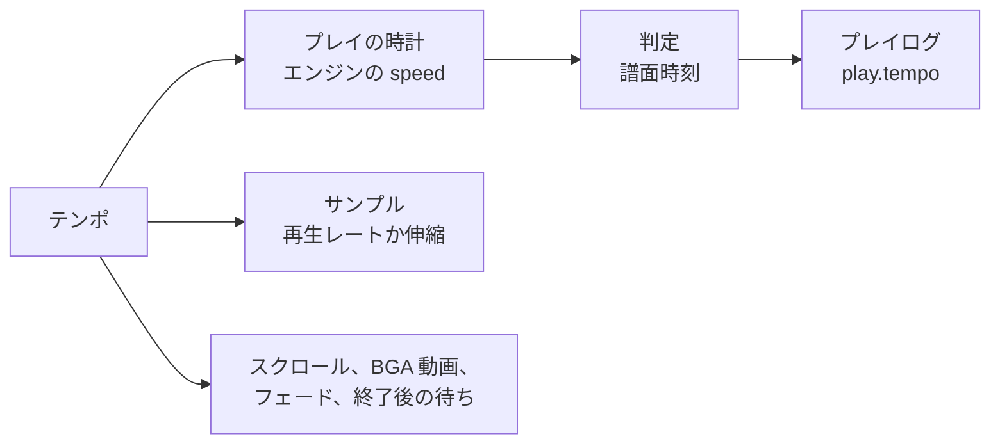
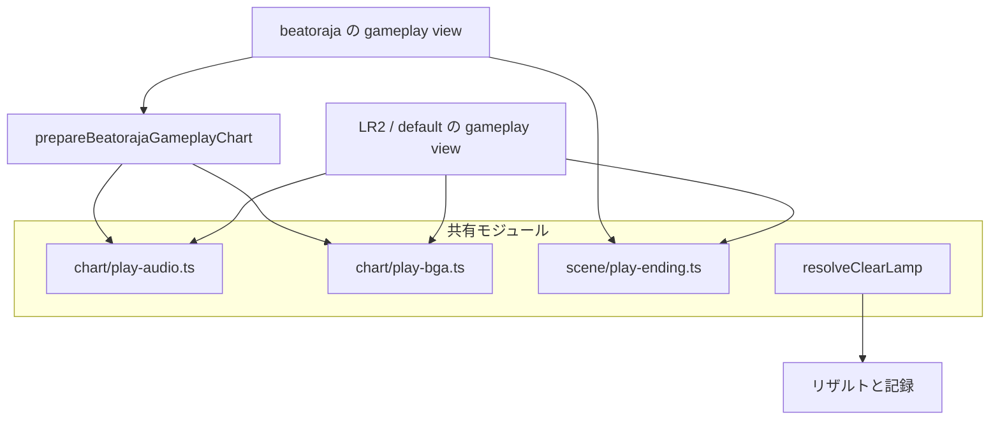

[English version](./player-web.md)

# Browser player 実装メモ

この文書は、`@be-music/player-web` と `@be-music/player-web-demo` で追加された browser player の実装メモです。
timing、note、判定、score、gauge、BGA event の意味など、CLI と共有する runtime 意味論は [`player-spec.ja.md`](./player-spec.ja.md) を参照してください。

## 共通 runtime 連携

browser player は gameplay を `@be-music/player/core/engine` 経由で駆動します。
判定、keysound trigger routing、long note、地雷の発動、score、gauge、chart finish の意味論は engine が担当します。
LR2 gameplay scene は LR2 の `PLAYSTART` gate で 1 回 engine を起動し、beatoraja gameplay scene は `BeatorajaRuntimeAdapter` の背後に engine を mount します。
どちらの経路も engine の frame snapshot を scene state へ反映し、UI command を Pixi の視覚効果へ変換します。

browser runtime は次の adapter module を使います。

| module                                                                            | 役割                                                                                                                                                                                                        |
| --------------------------------------------------------------------------------- | ----------------------------------------------------------------------------------------------------------------------------------------------------------------------------------------------------------- |
| [`web-audio-session.ts`](../packages/player-web/src/runtime/web-audio-session.ts) | engine の `AudioSession` 契約を Web Audio で実装します。即時発音、BGM scheduling、channel stop、pause/resume、key/BGM routing、動的 volume change、bmson `c=true` continuation、`#WAVCMD` gain を扱います。 |
| [`web-input-runtime.ts`](../packages/player-web/src/runtime/web-input-runtime.ts) | DOM `keydown` / `keyup` を engine の input bus へ写像します。OS auto-repeat を除外し、`Escape` / `F5` / `Space` を command event へ送り、lane press には物理 event timestamp を付けます。                   |
| [`web-ui-runtime.ts`](../packages/player-web/src/runtime/web-ui-runtime.ts)       | engine UI signal を Pixi host へ流します。frame snapshot は note、score、gauge、result state を更新し、command は lane flash、key hold、POOR BGA、judge/combo effect を駆動します。                         |
| [`engine-driver.ts`](../packages/player-web/src/runtime/engine-driver.ts)         | audio、input、UI adapter を組み立て、1 譜面分の `manualPlay` / `autoPlay` を呼び出します。                                                                                                                  |

`@be-music/player/core/engine` は `node:path` / `node:timers/promises` 依存を排除済みで、 browser bundle にそのまま
含められます。 `createNodeAudioSink` (Node 専用 audio backend) も lazy import なので、 host が
`PlayerOptions.createAudioSession` factory (= `createWebAudioSession`) を渡す経路では一切到達しません。

## 対象範囲

- `@be-music/player-web` は browser 向けの song loading、preview playback、built-in default / LR2 / beatoraja skin rendering、PixiJS scene、WebAudio bus、gameplay recording を提供します。
- `@be-music/player-web-demo` は core package を drag-and-drop loading、LR2 / beatoraja theme loading、debug control、recording control へ接続する private Vite application です。
- browser player は shared core と terminal player と同じ parser、chart、player helper を通して BMS/BME/BML/PMS と bmson の譜面を扱います。

## demo の起動

```bash
pnpm run player:web
```

この command は Vite demo を起動します。page には次のものを drop できます。

- BMS/BMSON の楽曲 folder
- 楽曲 folder を含む ZIP
- LR2 theme folder
- beatoraja theme folder
- 楽曲 folder と LR2 または beatoraja theme folder の同時 drop

chart file を含む混在 drop では、loader は chart directory を song file、それ以外を theme file として扱います。
chart file が存在しない場合、drop 全体を theme candidate として扱います。LR2 detection は `.lr2skin` file、beatoraja detection は `.luaskin` file または `skin/` path segment 配下の JSON file を使います。
プレイフィールドをダブルクリックすると demo をフルスクリーンに切り替えます。`Esc` は通常のシーン操作の前にフルスクリーンを解除します。
Chrome と Edge ではフルスクリーン中に Keyboard Lock API で `Esc` をロックします。`Esc` を短く押すと通常のシーン操作（プレイ中断を含む）になり、長押しでフルスクリーンを解除します。
プレイ中に `Backspace` を 0.5 秒長押しすると `Esc` と同じようにプレイを中断します。短く押しただけでは何も起きません。Keyboard Lock の有無に関わらず、どのブラウザでもフルスクリーン中に使えます。

### Debug Menu

右上の lil-gui **Debug Menu**（起動時は折りたたみ）は、よく使う操作を先頭に置き、残りをフォルダーにまとめています。各フォルダーの開閉状態は記憶されます（`localStorage` の `be-music-demo.debug-menu-folders`）。パネル自体は常に折りたたんだ状態で始まります。

- **トップレベル:** Status（読み取り専用）、Open folder、Open files (ZIP / play log)。Open files では譜面の ZIP アーカイブ（`?music=` と同じ読み込み）や、リプレイするプレイログ（`*.bmplay.json`）を選べます。Open folder はフォルダー選択ダイアログを使い、ドロップと同じ経路で読み込みます。
- **Play options**（既定で開く）: Auto play、Gauge、Random 1P / 2P、DP flip、Auto scratch 1P / 2P、Hi-speed。Hi-speed（その場で反映）以外は曲の開始時に確定し、プレイ中は無効になります。
- **Tempo**（既定で開く）: Tempo (%)、Pitch、Keep-pitch stretcher（[プレイテンポ](#プレイテンポ) を参照）。曲の開始時に確定し、プレイ中は無効になります。
- **Course**（既定で開く）: Skip stage results、My courses…、NONSTOP placement（曲の開始時に確定し、プレイ中は無効）、Table URL と Import table courses。
- **Skin & display**（既定で閉じる）: Skin system（Built-in / LR2 / beatoraja。スキン未読み込みのものを選ぶとドロップを促す）、Built-in skin、Skin effects、Play layout、Judged notes、Toggle fullscreen、LR2 theme（LR2 theme を含む drop の後）、**Beatoraja skins**（シーンごとの選択。beatoraja theme の読み込み中だけ表示）、**Skin settings**（組み込みスキンに設定がある場合）、**Add skin**。
- **Audio**（既定で開く）: Master / Key sound / BGM の音量 (%)、Play in silent mode（Audio Session API があるブラウザーのみ。後述）、 **Compressor** フォルダー（Enabled、stage ごとの切り替え、各 compressor の threshold / knee / ratio / attack / release とリセット）。
- **Library & records**（既定で閉じる）: Music / Skin ZIP URL と Load from URLs（`?music=` / `?skin=` と同じ読み込みをその場で実行）、Auto-save play history、Clear best records、**BGA video transcode** フォルダー。
- **Capture**（既定で閉じる）: ● Record gameplay video、Video format（既定は MP4 · H.264。MP4 / WebM と H.264 / H.265 / AV1 / VP9 / VP8 から選択）、📸 Screenshot。
- **Leaderboard**（既定で閉じる）: Submit to Leaderboard、Account（ログイン中の handle、または「Not signed in」）、Create passkey (keep this account)、Sign in with passkey、Sign out。
- **Developer**（既定で閉じる）: Judge windows（曲の開始時に確定）、Auto pause on blur、Show invisible notes、FPS（フォルダーを開いている間だけ計測するレンダラーのフレームレート）、Reset settings and reload（ベストレコード以外の demo の保存設定をすべて消去して再読み込み）。

### プレイテンポ

Debug Menu → Tempo → **Tempo (%)** で、曲を本来のテンポの -50 % から +50 % で遊べます（既定 0、1 % 刻み）。**Pitch** はテンポを変えたときの鳴り方を決めます。**Pitch follows tempo (LR2)**（既定）はサンプルを速く・遅く再生するので、テンポと一緒にピッチも変わります。**Keep pitch** は読み込み時にサンプルを時間方向に伸縮し、ピッチを保ちます。伸縮の方式は **Keep-pitch stretcher** で選べます（既定は **Signalsmith Stretch**、ほかに **WSOLA**）。この 2 つの設定は NONSTOP の FIT のステージの鳴り方も決め（[NONSTOP](#コースと段位認定) を参照）、FIT のステージでは 2 つの倍率を掛け合わせます。3 つの設定は記憶し（`localStorage`、`be-music-demo.play-tempo`）、プレイの開始時に読み、ほかのプレイオプションと同じくプレイ中は無効になります。テンポが 0 でないときは状態表示に出ます（`Playing (tempo -20%): <曲名>`）。



すべてが `tempo` 倍の速さで進みます。エンジンの時計（`PlayerOptions.speed`）、予約・発音するサンプル、スクロールと判定ライン、BGA の画像と動画（`playbackRate`）、NONSTOP のステージのフェード、結果画面までの譜面時刻での待ちです。スキンのアニメーションのタイマーは実時間のままです。判定は譜面時刻のままなので、プレイの入力と判定はテンポに左右されません。プレイログには `play.tempo` として記録し（[playlog.ja.md](./playlog.ja.md)）、リプレイはそのテンポで再生します。テンポを変えたプレイは、beatoraja の周波数トレーナーと同じく練習として扱います。Leaderboard には送らず（状態表示に理由を出します。サーバーも `tempo` として拒否します。[leaderboard.ja.md](./leaderboard.ja.md) を参照）、ベスト記録も更新しません。プレイログの自動保存はします。コースもテンポを変えて遊べます。すべてのステージがそのテンポで進み、そのプレイは順位付けせず、コースの記録も更新しません。LR2、既定、beatoraja のどのゲームプレイシーンでも使えます。LR2 / 既定のシーンには `tempo`、`tempoPitchMode`、`tempoStretchAlgorithm` を渡し、beatoraja のシーンでは `prepareBeatorajaGameplayChart` に同じ 3 つを渡し、ホストが `tempo` を `engineOptions.speed` として渡します。

### スマートフォンとタブレット

主ポインターが指の端末（`(pointer: coarse)`、またはスマートフォン大の画面でタッチポインターを持つ端末）を、demo はタッチ優先として扱います。

- **タッチプレイ:** 組み込みスキンと LR2 のプレイ画面では、各レーンの下側から画面下端までがそのレーンのタッチ領域です。指ごとに独立して押す・押し続ける（ロングノート）・離すが働き、指を隣のレーンへ滑らせると元のレーンを離して新しいレーンを押します。タッチはキーボードと同じ入力経路を通るので、判定、キービーム、プレイログも同じように動きます。プレイ中は左上に一時停止ボタンがあり、一時停止中は Quit も表示されます。
- **タッチレイアウト:** 組み込みスキンはタッチ用のゲームプレイレイアウトに切り替わります。ステージの大部分に同じ幅のレーンを並べ（鍵盤は最大 72 デザイン px、横向きのスマートフォンで約 58 CSS px）、判定ラインを少し下げ、BGA は表示しません。24 / 48 KEY の譜面は標準レイアウトのままです。Debug Menu の **Play layout**（Auto / Desktop / Touch）で次のプレイから切り替えられます。
- **選曲画面:** 行やボタンはマウスと同じくタップで操作できます。リストは上下にスワイプしてスクロールします。
- **エフェクト:** Debug Menu で以前に選んでいなければ、スキンのエフェクトは Reduced から始まります。
- **画面:** ページの UI はステージに重ならないよう退きます（検索ボックスは入力中だけ表示し、Help はアイコンだけになります）。スマートフォンでは最初のタップでブラウザーが許す範囲でフルスクリーンと横向きを要求し、縦持ちのときは回転を促す表示を出します。
- **消音モードでの再生:** iOS / iPadOS の Safari は、既定では Web Audio を ambient な音として扱います。他のアプリの音楽と混ざって鳴り、着信/サイレントスイッチで消音されます。ブラウザーに [Audio Session API](https://w3c.github.io/audio-session/)（`navigator.audioSession`、Safari 16.4 以降）がある場合、スタートカード（「Drop to load」の下）と Debug Menu の **Audio** フォルダーに **消音モードでも再生**（英語表示では Play in silent mode）が表示されます。どちらも同じ設定です。オン（既定）では demo は audio session の type を `'playback'` にし、サイレントスイッチがオンでも音が鳴りますが、他のアプリで再生中の音楽は停止します（システムが「再生中」コントロールを表示することもあります）。オフではブラウザー既定の `'auto'` に戻し、Web Audio は他のアプリと混ざって鳴り、スイッチに従います。設定はリロード後も保持され、音声の開始前、最初のタップやキー入力時（各シーンが音声を開始するタイミング）、ページが再び表示されたときに適用されます。他のブラウザーには Web Audio を消音するこの種のスイッチがないため、どちらにも設定は表示しません。スマートフォンやタブレットで設定がオフのまま初めて音が鳴るときは、画面上部に設定をオンにできる小さなヒントを出します。ヒントはブラウザーごとに 1 回だけ表示され、閉じるボタンで閉じるか、しばらくすると自動で消えます。

## Browser loading model

- dropped path は共有の `@be-music/utils/core` path helper で normalize します。
- chart discovery は `.bms`, `.bme`, `.bml`, `.pms`, `.bmson` を受け付けます。
- file lookup は case-insensitive です。大文字小文字だけが異なる LR2 / beatoraja 風の asset reference でも browser drop で解決できます。
- 大きな audio / video file は既定で lazy な `File` reference のまま保持します。image、skin、chart、小さな metadata file は collection loading 中に bytes として読み込みます。
- folder walking と file read は bounded concurrency と progress callback を使い、大きな folder でも browser の FileSystem API や UI update loop を過剰に詰まらせないようにします。
- parse error は drop 全体を abort せず、collection に蓄積します。

## コースと段位認定

コースも、選曲 → プレイ → 結果の同じシーンで遊びます。規則は [コースと段位認定](./course.ja.md) を参照してください。

- **読み込み：**
  - ドロップにはコースファイルを含められます。LR2 の `.lr2crs` はどこに置いてもよく、beatoraja のコース JSON は `course/` フォルダの下に置きます。
  - 読み込みには `readCourseFile`（`@be-music/player-web/collection`）を使います。
  - デモはライブラリの譜面ファイルのハッシュを計算し（曲ごとにキャッシュ）、各ステージを SHA-256、次に MD5 で照合します（`resolveCourseFolders`）。
  - コースファイルだけをドロップした場合は、読み込み済みの曲と照合します。
  - 難易度表のコースは URL から取り込めます。Debug Menu → Course → **Table URL** に URL を入れて **Import table courses** を押します。URL は表のページ（`bmstable` の meta がヘッダーを指すもの）でもヘッダー JSON でも構いません。デモは `fetchTableHeaderCourses`（`@be-music/player/course`、[URL から表を読む](./course.ja.md#url-から表を読む)）で取得します。`data_url` の曲リストは読み込みません。
  - ほとんどの表のサイトはほかのページからの読み込みを許可しておらず（CORS ヘッダーがない）、デモも中継はしません。取得が拒否されたときは、表のヘッダーファイル（`bmstable` の meta が指す JSON。たいてい `header.json`）を保存してドロップするよう、ステータスに案内を出します。コースを持つ `header.json` をドロップすると、URL から読んだときと同じく、表の `name` の名前で読み込みます（`readTableHeaderFile`）。
  - 表は、その名前をラベルにしたコースグループ 1 つになります。同じ表をもう一度取り込むか、同じラベルの別の出どころを読むと、そのグループを置き換えます。取り込んだ URL は `localStorage` に覚え、次に開いたときにもう一度取り込みます。
  - 既知の制限：ブラウザが表を直接取得するため、CORS ヘッダー（`Access-Control-Allow-Origin`）を返さないサーバーの表は取り込めません。そうした表は少なくありません。その場合、ステータス行にサイトを取得できなかったと表示します。クロスオリジンの読み込みを許可するオリジン（またはデモ自身のオリジン）から配信したヘッダー JSON なら取り込めます。
  - beatoraja のコマンドフォルダのファイル（`folder/*.json`）からはランダムコースを読みます。ランダムコースを持つフォルダごとに、コースフォルダが 1 つできます。ランダムコースはステージのタイトル（なければフィルタ）を並べて表示し、beatoraja の `OPTION_RANDOMCOURSEBAR`（1031）を点けます。始めたときに、ライブラリからステージを抽選します（`drawBrowserRandomCourse`）。どの譜面にも合わないステージがあれば、コースは始めずにステータスへ理由を出します。
- **選曲：**
  - コースファイル 1 つが、曲フォルダの後に並ぶフォルダバー 1 つになります。その中では各コースがコースバー（`BrowserBrowseEntry` の `kind: 'course'`）です。
  - コレクションにないステージを含むコースは、一覧には出ますが開始できません。
  - スキンごとの表示：
    - be-music スキンは、コース名・ステージ数・欠けているステージ数を表示します。
    - LR2 スキンは `courseFolder` と `course` のバー本体を使います。NEW COURSE バーとランダムコースには `courseCreate`（7）と `randomCourse`（9）を使い、なければ `course`（8）を使います。
    - beatoraja スキンは `GRADEBAR`（op 3）を点け、`bar-grade` の枠を描きます。ステージが欠けていれば `bar-nosong` を描きます。
- **プレイ：**
  - コースを始めると、最初のステージの前に一度だけ曲決定画面を出します。LR2 と同じく、選んだバーの名前（コース名）を表示します。ここで戻るとコースはやめます。NONSTOP コースのクイックリトライでは、LR2 と同じく出しません。
  - ステージを順に遊びます。各ステージには `PlayerOptions.course` を渡します。中身は、コースの種類、ゲージの表の組と判定の制約、前のステージが残したゲージ値とコースのコンボです。
  - ステージの結果を閉じると次のステージが始まります。**Skip stage results**（Debug Menu → Course）をオンにすると、ステージの終了後すぐに次のステージが始まり、結果はコースの結果だけを表示します。
  - AUTO で遊ぶコースでは、LR2 と同じく（OpenLR2 `Main.cpp` M1381-M1384）、後にステージが続くステージの結果を飛ばします。最後のステージの結果とコースの結果は表示します。
  - ゲージが尽きたステージでコースは終わります。
  - ESC でコースをやめられます。そのプレイは（LR2 の記録と同じく）落ちたプレイとして残り、コースの結果を表示します。F5 / クイックリトライは使えません。
  - コースの制約を適用します：
    - レーンオプションを制限します（`grade` はなし、`grade_mirror` は MIRROR、`grade_random` はランダム系）。
    - `no_speed` ではハイスピードを固定します（beatoraja のテーマではレーンカバー、リフト、HIDDEN カバーも）。
    - `ln` / `cn` / `hcn` は、ロングノートのモードを定めていない譜面に適用します。
- **結果：**
  - 最後のステージ、またはゲージが尽きたステージの後に、結果画面がコース全体を 1 回分として表示します。表示するのは合計の判定、コースの最大コンボ、最終ゲージ、コースのランプです。グラフは系統ごとに異なります。LR2 スキンと組み込みの結果画面は、LR2 がステージごとにグラフを消すので（OpenLR2 L24151）、最後のステージのゲージとスコアのグラフを描きます。beatoraja のコースの結果は、全ステージをつないで描きます（`CourseResult.create`）。各ステージの幅は譜面の長さに比例し、EX スコアは前のステージから続き、到達しなかったステージはゲージ 0 です。NONSTOP は、つないだ 1 回のプレイのグラフを描きます。
  - プレイ履歴の自動保存がオンなら、コースのプレイログ（`*.bmcourse.json`、[playlog.ja.md](./playlog.ja.md#コースのプレイログ) を参照）をダウンロードします。
  - 最高のランプ、EX スコア、最大コンボ、BP をコースごとに保存し、コースバーに表示します。LR2 スキンではバーのランプの op（100-105）を点け、`#SRC_BAR_LAMP` を描きます（曲のバーも譜面の記録からランプを描きます）。beatoraja スキンでは `CLEAR_LAMP_*` の op を点けます。be-music スキンのコースカードには、ベストのランプと、ベストの値で取れるトロフィー（beatoraja の `GradeBar` と同じく、最高の EX スコアと最少の BP から。クリアの有無は問いません）を出します。どこかのステージを AUTO で遊んだプレイ（AUTO で遊んだ NONSTOP のプレイも）は、単曲のオートプレイと同じく記録しません。
  - ステージの結果は単曲ではなくコースの記録になり、リーダーボードにも送りません。
- **LR2 スキン**（`SceneCourseInfo` を `courseInfo` として LR2 の選曲・プレイ・結果のシーンに渡します）：
  - op：選曲画面のコースバーは 3（コースバー）、全ステージがコレクションにあれば 5、290 とコースの種類の op（291 NONSTOP、292 EXPERT、293 GRADE）を点けます。さらにステージ 1〜5 について、譜面の `#DIFFICULTY` から `700 + 10 × i + 難易度` を点けます（op 700-745。LR2 はそこを 0 と読むので、欠けたステージやコース以外のバーでは `x0` の op が点きます）。コース中のプレイと結果では、さらにステージの op を点けます。最後ではない 1〜9 ステージ目は 280-288、最後のステージは 289 です。
  - LR2 はステージごとにスキンを読み込むので、コースのステージはこれらの op で解析し直したプレイスキンで遊びます（`Lr2ThemeSkins.loadSkin`）。ステージの結果とコースの結果も、それぞれのスキンを同じように解析し直します。
  - 数値 250-259 はステージのレベル、テキスト 150-154 はステージのタイトル、160-164 はそのサブタイトル、170 はコース名です。
  - EXPERT と GRADE のコースでは、数値 104 / 105（コンボ、最大コンボ）と判定の横のコンボ（`#DST_NOWCOMBO`）がコース全体を数えます。前のステージが残したコンボは、最初に途切れるまで続きます（OpenLR2 L2019-L2034、L2516）。
  - コースのステージでは、LR2 のコース用ゲージと同じく、ゲージの種類の op が赤ゲージ（43 / 45）になります。
  - コースの結果は、テーマにコースリザルト用スキン（`#INFORMATION` の type 15）があればそれで、なければ結果のスキンで表示します。BGM は `courseclear` / `coursefail` を流し、なければ `clear` / `fail` を流します。
- **beatoraja スキン**（beatoraja のプレイと結果のシーンに `courseInfo` を渡します。beatoraja の `BooleanPropertyFactory` / `StringPropertyFactory` に合わせています）：
  - 選曲：コースバーは `GRADEBAR`（3）と、制約ごとの `OPTION_GRADEBAR_*` op（1002-1007、1010-1017）を点けます。文字列 150-159 にはステージの曲名を出し、コレクションにないステージは `(no song) <曲名>` とします。
  - プレイとステージの結果では `MODE_COURSE`（290）とステージの op を点けます。最後ではない 1〜4 ステージ目は 280-283、最後のステージは 289 です。文字列 150-159 は遊んでいるコースのステージ名です。
  - `no_speed` では、beatoraja の `ControlInputProcessor` と同じく、ハイスピード、レーンカバー、リフト、HIDDEN カバーを固定します。矢印キー、PageUp / PageDown、Home / End、H / J / K、ホイール、スキンのカバーのボタン（act 330-332）は効かず、エンジンの Option + レーンキーによる変更も元に戻します。何も変わらないので、次のプレイ用に保存されるものもありません。
  - コースの結果は、テーマに `COURSE_RESULT` スキン（type 15）があればそれで、なければ結果のスキンで表示します。`MODE_COURSE` を点け、タイトルの文字列（10 / 12）はコース名になります。BGM は `course_clear` / `course_fail` を流し、なければ `clear` / `fail` を流します。

- **NONSTOP：** デモは LR2 の NONSTOP コースを 1 本の譜面として遊びます。始めるとステージをつなぎます（デモの `prepareNonstopCourse`。各ステージの `#RANDOM` を引き、コースのロングノーツ制約を適用します）。つないだ譜面は LR2 / 既定のシーンで遊び（beatoraja のテーマではこちらに切り替えます）、コースの結果はつないだプレイのコースのログ（`buildNonstopCoursePlaylog`）から出します。このログはほかのコースと同じく記録し、自動保存します。LR2 と同じくクイックリトライができ、F5 でつなぎ直して遊び直します。Debug Menu → Course → **NONSTOP placement** で、意図どおりの配置（既定）か LR2 どおりの配置かを選べます。**Pitch**（[プレイテンポ](#プレイテンポ)と共通）では、FIT のステージが前のステージのテンポに合わせる方法を選べます。**Pitch follows tempo (LR2)**（既定）はサンプルを速く・遅く再生するので、テンポと一緒にピッチも変わります。**Keep pitch** は読み込み時にサンプルを時間方向に伸縮し、ピッチを保ちます。伸縮の方式は **Keep-pitch stretcher** で選べます。**Signalsmith Stretch**（既定。MIT ライセンスの `signalsmith-stretch` の WASM AudioWorklet で、サンプルを並べて倍率ごとに 1 回オフラインでレンダリングします）か **WSOLA**（`timeStretchChannels`。内蔵で軽い）です。前者が動かないブラウザでは WSOLA に切り替えます。いずれも次のプレイから反映されます。テンポを変えて遊ぶ NONSTOP コースでは、すべてのステージがそのテンポで進み、FIT の倍率はその上に掛かります。シーン側の扱い： つないだ NONSTOP の譜面は、合成したアセットソース（`createNonstopAssets`）から鳴らします。各ステージのファイルは、そのステージ単体と同じ探し方（`#PATH_WAV`、コーデックと画像拡張子の代替、LR2 の親フォルダ）で見つけ、`s<ステージ>/<キー>` の名前にします。譜面は `NONSTOP_CHART_PATH` として遊びます。ゲームプレイシーンの `nonstop` オプション（結合のマップ）を渡すと、各ステージのサンプルを FIT の再生レートで鳴らし、背景音はステージごとのゲインを通して、つなぎ目で LR2 と同じ `音量²` の曲線でフェードします。プレイヤーのキー音はフェードしません。一時停止はオーディオコンテキストを止めるので、フェードも一緒に止まります。LR2 スキンでは、LR2 と同じく、最初のステージの op でプレイ全体を 1 回だけ解析します。その後、ステージの op（280-289）と曲名テキスト 10 が次のステージに移るのは、BLANK でつないだステージに入ったときだけです（`resolveLr2NonstopStage`）。FADE や CUT の後は前のステージの表示のままで、それまで曲名テキスト 10 にはコース名が出ます。LR2 の選曲画面のテキスト 171-179 には、選んだ NONSTOP コースのつなぎ方（`FADE`、`FADE+FIT`、`CUT`、`CUT+FIT`、`BLANK1`、`BLANK2`）を出し、それ以外のバーでは `DISABLE` を出します。ボタン 240-248 は、プレイヤーが作ったコースのつなぎ方を変えます。BGA はステージごとに base / layer / POOR の重なりを 1 組ずつ持ちます。キューは BMP キーを持つステージごとに分け、つなぎ目の前後 3 秒で直線的にクロスフェードします。POOR の間は、各ステージの base と layer の代わりにそのステージ自身の POOR 画像を出します。`#BMP00` による代替はしません。LR2 は毎フレーム、クロスフェードの重みを使ってランダムに 1 つのステージを選び、その 3 枚の画像を描きます（`LR2body.exe` 0x4350df）。クロスフェードはその平均にあたります。beatoraja の BGA 描画は、まだステージで分けません。BPM の表示（LR2 の NOWBPM と組み込みの HUD）は、各ステージ自身の BPM に FIT の倍率を掛けた値を出します（`map.tempo`）。スクロールは結合後の 150 BPM のままです。エンジンには `map.stageRanks` を渡すので、後のステージはそのステージの `#RANK` で判定します（リプレイではログに記録した切り替えを使います）。
- **コースを作る：** LR2 と同じく、選曲画面で自分のコースを作れます（`CourseMaker`。[コースを作る](./course.ja.md#コースを作る) を参照）。
  - ルートに `MY COURSES`（LR2 の EXPERT コース）、`MY NONSTOP`、`MY DAN`（GRADE、段位）のフォルダが並びます（`resolveCourseMakerFolders`）。中には自分のコースと、最後に NEW COURSE バーがあります。NEW COURSE を決定すると、その種類のコースの作成が始まります。それ以降は、曲を決定すると遊ぶ代わりにコースへ追加し、5 曲あるところでさらに決定するとコースを保存します。
  - LR2 スキン：op 571 / 572（作成中かどうか）、590-599（追加した曲数）、580-589（選んだコースのステージ数が N より多い）、タイマー 17 / 18（作成の開始 / 終了）、テキスト 150-154 と 170（作成中の曲と名前。名前が空の間は入力の案内）、198（既定のつなぎ方）、ボタン 230（保存）、231（取り消し）、233（自分のコースの削除。確認あり）、240-248（自分の NONSTOP コースのつなぎ方）、268（既定のつなぎ方）に対応します。テキスト 170 をクリックすると名前の入力欄にフォーカスします。
  - すべてのスキン：作成中のコースはカードに表示します（名前、曲、既定のつなぎ方、縛り、Remove last / Cancel / Save）。Debug Menu → Course → **My courses…** で開くダイアログでは、コースの名前の変更、NONSTOP コースのつなぎ方の変更、縛りの設定、削除、全コースの書き出しができます。書き出しは `.lr2crs` か、縛りを残せる beatoraja のコースの `.json` です。
  - 縛りは beatoraja のコースエディタと同じものです：レーンオプション（自由 / 正規のみ / 正規か MIRROR / ランダム系）、ハイスピード固定、判定（GREAT なし / GOOD なし）、ゲージ（LR2、5 / 7 / 9 / 24 鍵）、ロングノーツのモード（NONSTOP 以外）。新しい GRADE コースは LR2 の段位（正規か MIRROR、LR2 ゲージ）から、ほかは縛りなしから始まります。
  - コースは IndexedDB（`be-music-demo`。ステージの曲名つきの `.lr2crs` テキスト）に保存し、次に開いたときにも並びます。

## LR2 skin と theme support

core parser は LR2 CSV skin file を select、decide、gameplay、result scene 向けに扱います。
play skin は key variant (`5`, `7`, `9`, `10`, `14`) ごとにまとめ、play 開始時に譜面に合う layout を選びます。

実装済みの skin feature:

- 現在の skin file からの相対 `#INCLUDE` 解決
- `#CUSTOMOPTION` と `#CUSTOMFILE`
- `#SRC_IMAGE`, `#DST_IMAGE`, number, text, slider, bar, gauge, judge line, measure line, BGA, result 用 graph 系 element
- LR2 default skin が使う timer と op condition 評価
- `#LR2FONT` bitmap font と system-font text fallback
- TGA image decode と DXA archive extraction
- LR2 theme file 向けの case-insensitive / wildcard asset lookup

demo は、dropped theme に存在する場合、select / decide screen 向けの LR2 theme BGM と system sound も読み込みます。

[LR2 skin 実装メモ](./lr2-skin.ja.md) では、renderer に依存しない parser と theme loader の境界をまとめています。
LR2 default skin を verified compatibility target とし、custom theme は実装済み directive family の範囲に収まるほど安定して動きます。

select scene は、hi-speed、autoplay、BGA mode/size、filter、sort、HS-FIX、HIDDEN/SUDDEN、lane cover、auto scratch、DP flip、1P/2P random / mirror mode、gauge variant を扱う LR2 PLAY OPTION control を scene 内で提供します。
select 時の option は chart preparation 時に gameplay へ引き継ぎます。
選んだ gauge は shared engine に渡り、engine は有効なルールセットの gauge 一覧からそれを解決して、そのカーブで進めます（HARD は実際に減り、DEATH は実際に途中終了します）。リプレイはプレイログに記録された gauge で進みます。2P independent gauge math はまだ接続していません。

グルーヴゲージのバーは LR2 の 50 ビード(各 2 %)として、単一の `#SRC_GROOVEGAUGE` の 4 セルスプライト(`表赤/表緑/裏赤/裏緑` = lit-red, lit-green, unlit-red, unlit-green)で描画します。80 % のクリア境界以上のビードは緑セル、未満は赤セルを使います。survival 系ゲージ(HARD / DEATH)は LR2 ではクリア境界が無いため、バー全体を赤で描画します。バーは現在のゲージ値のみを追従し、peak-hold(残像)ビードは描きません(LR2 にも無い)。ビードのセル選択ロジックは `scene/lr2/gameplay-hud.ts` の純関数 `resolveGrooveGaugeBeads` です。

scene に依存しない LR2 Pixi helper は [`skin/lr2/render.ts`](../packages/player-web/src/skin/lr2/render.ts) と
[`skin/lr2/scene-render.ts`](../packages/player-web/src/skin/lr2/scene-render.ts) にあります。destination keyframe 評価、sprite transform、source cell 選択、text rendering、number、slider、bargraph を共通化します。scene module は state 固有の値解決、timer、input behavior だけを保持します。

## Default skin family

built-in default family は、LR2 / beatoraja theme がない場合、または host が default family を明示的に選んだ場合に使う skinless path です。
theme file なしで select、gameplay、result の表示を提供します。

この family はすべての画面を be-music スキン（公開パッケージ `@be-music/skin-sdk` 上に書かれたコード定義のスキン）で描きます。
スキンの作り方は [be-music スキンの作り方](./be-music-skin.ja.md) を参照してください。

gameplay は `PixiGameplayView` と共通の engine、note renderer、BGA renderer、audio bus、input handling を共有します。
ただし default chrome は `scene/default/gameplay.ts` から `skinlessChromeRenderer` option 経由で注入します。
LR2 gameplay scene は default renderer を import せず、共有 gameplay runtime と render layer だけを提供します。
これにより、default skin の見た目の変更は `scene/default/` 配下に閉じ、LR2 skin rendering は parse 済み `.lr2skin` data に紐づいたままになります。

default gameplay chrome は `scene/gameplay-lanes.ts` の共通 lane geometry helper を使います。
scratch lane は key lane より幅広く、2P scratch は右側に表示し、DP layout では両 side を SP 幅へ押し込んで全 lane を縮小するのではなく、片側分の lane 幅を保持します。
default family は通常テキストに LINE Seed JP、判定と combo 表示に Azeret Mono を使います。

## beatoraja skin と theme support

`@be-music/player-web` は `loadBeatorajaThemeFromFiles()` 経由で `@be-music/beatoraja-skin` を利用します。
browser layer は JSON / Lua skin entry の discovery 後、同じ dropped bundle から source、texture、font、theme BGM、system sound を読み込みます。

実装済みの beatoraja browser feature:

- `BeatorajaPlaySkinView` を使う select、decide、gameplay、result scene
- play variant `5`, `7`, `9`, `10`, `14`。`24` / `24d` skin は discovery しますが、chart gameplay では mount しません
- skin `property[]`、`filepath[]`、custom offset、category group、mid-session `replaceSkin()` refresh
- score、combo、judge、gauge、chart metadata、clear lamp、rank、play option 向けの runtime `TIMER_*`、`OPTION_*`、`TEXT`、`NUM` wiring
- beatoraja-style note、LN/CN/HCN cap/body、lane marker、BGA still/video layer、judge popup、timing visualizer、gauge graph、BPM graph、note-distribution graph、result score/gauge history graph
- select scene の folder browsing、search、keymode filter、sort cycle、favorite、chart preview playback、select BGM、navigation system sound
- decide / result BGM、`STAGEFILE` / `BACKBMP` / `BANNER` の chart-image synthetic slot、loading-progress visual

[beatoraja skin 実装メモ](./beatoraja-skin.ja.md) では、renderer に依存しない parser と theme loader の境界をまとめています。
beatoraja default skin を primary compatibility target とし、community theme は同文書の normalized element family と runtime ID の範囲に収まるほど安定して動きます。

## Scene lifecycle

browser player は session 全体で 1 つの `PixiSceneHost` を使います。
host は 1 つの PixiJS `Application` を所有し、同時に 1 つの scene root だけを attach し、scene transition を直列化し、host dispose 時だけ renderer を破棄します。

LR2 と beatoraja は同じ high-level scene set をそれぞれ持ちます。default family は decide scene を持たず、同じ select、gameplay、result の形を skinless に提供します。

- chart browsing、preview playback、skin-side interaction を扱う select scene
- active family が提供する場合、gameplay 前の短い transition を扱う decide scene
- note、lane、BGA、HUD、judgment、audio、recording tap を扱う gameplay scene
- score summary と skin-rendered result presentation を扱う result scene

scene は `enter()`, `exit()`, `dispose()` を実装します。
`exit()` は transition 向けに一時的な listener と ticker work を外し、`dispose()` は scene 所有 resource を恒久的に解放します。

### gameplay family が共有するもの

LR2 / default の gameplay view と beatoraja の gameplay view は、描画はそれぞれの skin で行いますが、プレイの音、見た目、終わり方を決める処理は 1 か所にまとめてあり、両者がずれることはありません。



- `chart/play-audio.ts` は、プレイの AudioContext と bus を作り（`#VOLWAV` を含む）、`#WAV` のサンプルを audio session が引くキーでデコードし、ピッチを保つテンポのときは伸縮し、`#WAVCMD` / `#EXWAV` の音量をまとめます。
- `chart/play-bga.ts` は、プレイに要る BGA リソース（`#BMPxx`、bmson の `bga.header`、`#BGAxx` の切り出し元、LR2 view では暗黙の `#BMP00` POOR 画像）を選び、静止画は共通のテクスチャローダーで、動画は動画ローダーでデコードし、BMS の layer の黒を抜き、切り出し領域のビューを作ります。
- `scene/play-ending.ts` は、プレイの終わりの時間を決めます。最後のノートのあと譜面時刻で約 2 小節の余韻を置き、テーマや skin のフェードアウトに入ります。ゲージが尽きて途中で終わったプレイは余韻を置かず、音と画面を 1.5 秒以上かけてフェードアウトします。
- `resolveClearLamp` がクリアランプの唯一の規則です。beatoraja のリザルトと選曲は `beatorajaClearLampOp` を通してこれを表示し、demo はどの family のプレイもこれで記録します。

## ノートの表示範囲

描画は判定 ruleset に含まれないため、ruleset は描画に関わりません。gameplay view は、どのノート・地雷・小節線をどこに描くかを 2 つの規則のどちらかで決めます（[`note-draw-window.ts`](../packages/player-web/src/scene/core/note-draw-window.ts)）。

- **LR2 の規則** — `#SCROLL` / `#SPEED` を含まないすべての譜面。ruleset は問いません。
- **beatoraja の規則** — 1 以外の `#SCROLL` か `#SPEED` を含むすべての譜面。LR2 はどちらも扱わないため beatoraja を基準にします。値がすべて 1 の譜面は通常の譜面と同じに扱います。

LR2 の規則（`LR2body.exe` の `DrawNotes`）では次のとおりです。

- **位置:** オブジェクトは判定ラインまでスクロールし、拍を過ぎるとライン上に留まります。ラインより下には何も描きません。
- **ノートと地雷:** 判定済みで、かつ拍が判定位置に達したときにだけ消えます。打っていないノートは ruleset の遅い側の窓で見逃しと判定されるまでライン上に留まるため、そのノートの位置で始まる STOP の間もそこに残ります。早く打ったノートはラインまでスクロールを続け、ラインに達したときに消えます。地雷は通過後に消えます（早めに爆発させた地雷はラインに達したとき）。オートのレーン（オートプレイ・オートスクラッチ）では、ノートは拍を過ぎたときに消えます。
- **ロングノート:** 始点は通過後もライン上に留まり、判定済みで終端を過ぎるまで残ります。始点を見逃したり早く離したりしたロングノートは、それまで半透明（LR2 の `0x80`）で描きます。
- **小節線:** 判定位置が通過すると消えるため、その位置で始まる STOP の間はライン上に留まります。
- **たどる範囲:** 拍がレーン上端を越えたところで譜面をたどるのを打ち切ります。

beatoraja の規則（`LaneRenderer`）では、判定ラインの位置から譜面のタイムライン（ノート・地雷・不可視ノート・小節線・BPM / STOP / `#SCROLL` / `#SPEED` の位置）を順にたどり、最初にレーン上端を越えたタイムラインを描いたところで打ち切ります。そのためオブジェクトはレーン上端の外側から入ってきます。その先は、後の負の `#SCROLL` でレーン内に戻ってくるノートも描きません。ノート・地雷・小節線は判定の有無にかかわらず時刻になった瞬間に消えます（`LaneRenderer` は時刻がまだ先のものだけを描きます）。ロングノートは押しているかどうかにかかわらず終端の時刻が先にある間は残り、始点を過ぎると終端の時刻まで始点を判定ライン上に描きます。beatoraja の描画は判定ラインでノートを切り取らないため、負の `#SCROLL` で判定ラインより下に来た、時刻がまだ先のノートはステージの下端までそこに描きます。スキンには `y` がレーンの `bottom` より下のオブジェクトとして渡ります（[be-music スキン](./be-music-skin.ja.md)）。

どちらの規則でも、LR2 や beatoraja と同じく判定済みのノートはその時刻まで残すため、早く打ったノートはラインまでスクロールを続けます。Debug Menu の **Judged notes**（`judgedNoteDisplay`）で、判定した瞬間に消すこと（`HIDE`）もできます。既定値は `KEEP_SCROLLING` です。始点を見逃したり早く離したりしたロングノートは、どちらの規則でも半透明で描きます。組み込みスキンも同じように薄くし、ほかの be-music スキンにはその `state` を渡します。

terminal player も、双方向にスクロールする譜面では同じ位置でたどるのを打ち切ります。

beatoraja のプレイスキンは表示の選択であって ruleset ではないため、同じ規則に従います（[`scroll-placement.ts`](../packages/player-web/src/scene/beatoraja/scroll-placement.ts)）。ノート・小節線・BPM / STOP マーカーは同じ `#SCROLL` / `#SPEED` の距離で置き、スクロールする譜面では beatoraja の規則、それ以外の譜面では LR2 の位置と表示の規則で描きます。落としたロングノートは薄くせず（スキン自身の押下中・非押下の本体画像で状態を示します）、`HIDE` の設定もありません。

## HS-FIX

プレイオプションの HS-FIX は LR2 のボタンをそのまま使い、beatoraja のハイスピード固定（`LaneRenderer.init`）に合わせます。プレイヤーが設定するハイスピードは譜面の基準 BPM（`#BASEBPM`、なければ開始 BPM）での値で、HS-FIX は別の BPM でのスクロールがそれと同じ感覚になるように掛け直します。

| be-music   | ハイスピードを合わせる BPM                                                               | beatoraja                                          |
| ---------- | ---------------------------------------------------------------------------------------- | -------------------------------------------------- |
| `OFF`      | なし（スクロールは BPM に従う）                                                          | `OFF` と `STARTBPM`（基準がすでに開始 BPM のため） |
| `MAXBPM`   | 最大 BPM                                                                                 | `MAXBPM`                                           |
| `MINBPM`   | 最小 BPM                                                                                 | `MINBPM`                                           |
| `AVERAGE`  | メイン BPM。最も多くのノートが置かれた BPM（`@be-music/chart` の `resolveChartMainBpm`） | `MAINBPM`                                          |
| `CONSTANT` | 本当の一定スクロールが入るまではメイン BPM                                               | —                                                  |

`AVERAGE` は以前は時間の加重平均でした。BPM × N + STOP のギミックで値が大きく偏り（145 BPM の譜面で約 810、ノートが 5.6 倍遅く流れる）、さらに最後の区間だけ STOP を含む時計で測っていました。メイン BPM は beatoraja が使う値です。同数のときは先に現れる BPM を選びます（beatoraja はハッシュマップの順序で選ぶ）。ノートの大半をギミック用の BPM に置いた譜面（"the life" は 717 ノートを 16,000,160 に置く）では、beatoraja でも be-music でもその BPM がメイン BPM になるので、HS-FIX `OFF` で遊んでください。

## Renderer と performance control

- PixiJS は既定で WebGPU preference を使い、browser が初期化できない場合は PixiJS 側で fallback します。
- `?renderer=webgl` で renderer 比較用に WebGL を強制できます。
- skin / BGA texture は LR2 / beatoraja の pixel-art asset を保つため nearest sampling を使います。
- beatoraja source texture は bitmap が保守的な GPU texture-size cap を超える場合、upload 前に downscale します。
- gameplay path は decide scene から gameplay へ渡す前に、chart parse、audio decode、BGA resource preload を進めます。
- 共有の scroll-distance helper により、terminal player と browser の note placement behavior を揃えます。
- default gameplay chrome は pooled Pixi child を graphics / text に再利用し、text style を cache して skinless renderer の frame ごとの allocation churn を抑えます。
- WebGL context に依存しない pure な browser-core helper は benchmark 対象です。

```bash
pnpm bench -- --packages player-web
```

## Audio, BGA, recording

- chart preview と gameplay audio は WebAudio を使います。
- `@be-music/player-web/runtime` は platform audio session 用の helper を export します（engine 内部の `WebAudioSession` とは別物です）。`supportsSystemAudioSession`、`getSystemAudioSession`、`applySystemAudioSessionType` は `navigator.audioSession.type` を feature detection して設定し、`applySilentModePlayback(on)` はオンで `'playback'`、オフで `'auto'` を設定します。例外は握りつぶし、API がない環境では何もしません。`AudioContext` の作成・resume より前と、音声を unlock する gesture の中で呼んでください。
- gameplay audio は既定の split topology で key、BGM、master compressor stage を分けます。
- `?compressor=legacy` は比較用に旧 single-compressor 構成を維持します。
- `?compressor=off` は demo で compressor construction を無効化します。
- beatoraja theme audio は Lua `main_state.audio_play` / `audio_loop` call、select BGM、navigation system sound、decide BGM、result jingle に同じ browser bundle lookup を使います。
- BGA は chart BGA event が参照する still image と video asset を扱います。
- BGA rect（LR2 の `#DST_BGA`、beatoraja の `bga`、built-in frame）はいずれも 256x256 の BMS キャンバスとして扱います。長辺 256 px 以下の静止画は等倍のまま X 軸中央・上詰めで黒地の上に置き、それより大きい画像と動画は rect いっぱいに描きます（[フォーマット互換性](./format-compat.ja.md#217-bga)）。
- default family は LR2 skin と同じ chart BGA layer stack を built-in BGA frame 内に描画します。
- BMS rendering は、実装済み subset として `#BGAxx` sub-region、`#SWBGAxx` switching、`#ARGBxx` / `#EXBMPxx` tint / alpha を反映します。
- bmson rendering は `bga.bga_events`、`bga.layer_events`、`bga.poor_events` を使います。BMS layer channel と異なり、bmson layer image は黒を透明化せず黒ピクセルとして保持します。
- browser demo は、未対応 video asset を playback 前に ffmpeg.wasm path で transcode できます。
- chart の自然終了時は、短い post-chart delay を置いてから result scene を開きます。視覚的に result へ遷移しても、残っている gameplay audio tail は中断しません。
- gameplay recorder は WebM output を書き出し、active recording が gameplay bus の破棄前に flush されるよう、scene disposal より前に stop / finalization を終えます。
- リプレイ再生を除く毎プレイでプレイログ（`*.bmplay.json` 入力リプレイ — 解決済み譜面、生の押下/解放列、プレイ設定。[playlog.ja.md](./playlog.ja.md) 参照）を記録します。demo は result scene のマウント時に自動ダウンロードし、Debug Menu の「Library & records」フォルダにある「Auto-save play history」チェックボックス（デフォルト OFF。曲開始時にラッチされ、プレイ中は disabled）で制御します。`bms-playlog` CLI がこのファイルから LR2 / beatoraja / IIDX のリザルトを再現します。プレイログをページへドロップすると、対応する楽曲がロード済みの場合に記録されたランをリプレイ再生します。
- Debug Menu の Leaderboard フォルダにある「Submit to Leaderboard」（デフォルト OFF。自動保存と同じく曲開始時にラッチ）をオンにすると、終了した手動プレイを result scene のマウント時に Leaderboard（[leaderboard.ja.md](./leaderboard.ja.md)）へ送信します。demo は初回に匿名でログインし、楽曲の譜面からプレイの fingerprint ドキュメントを作り直してログと照合してから送り、サーバーに求められたら chart document を付けて再送し、順位をステータス行に表示します。デプロイ先の Worker は `/api/*` と `/leaderboard/*` を Service Binding で Leaderboard の Worker に転送し、`pnpm player:web` はローカルの Leaderboard（`pnpm --filter @be-music/leaderboard-api run dev`、または `LEADERBOARD_DEV_ORIGIN`）にプロキシします。
- アカウントは匿名で始まります（最初の送信で匿名ログインします）。「Create passkey (keep this account)」でそのアカウントに passkey を登録すると、プレイは匿名フィルタの陰ではなく handle で一覧に載るようになります。「Sign in with passkey」で別のブラウザーからそのアカウントにログインすると、そのブラウザーの匿名のプレイはこのアカウントに移ります。

## Compatibility boundary

browser player は、この repository の parser、chart、audio-renderer、player、utils、LR2 skin、beatoraja skin package を共有する runtime consumer です。
browser behavior が terminal player と分岐する場合は、pure な path、timing、scroll、lookup、event mapping helper を shared package へ移し、package-local test で覆う方針を優先します。
PixiJS scene wiring は browser rendering や WebAudio resource に依存する場合、`player-web` に残してかまいません。
