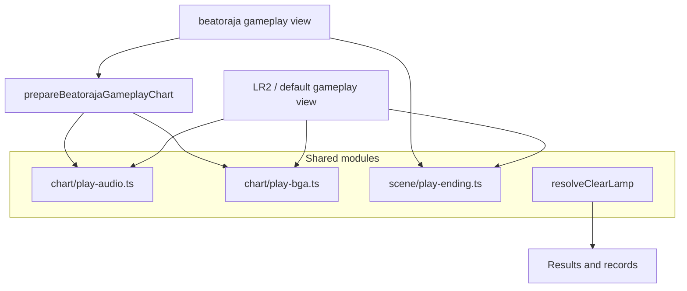

[Japanese version](./player-web.ja.md)

# Browser player implementation notes

This document summarizes the browser player added by `@be-music/player-web` and `@be-music/player-web-demo`.
Use [`player-spec.md`](./player-spec.md) for shared runtime semantics such as timing, notes, judgment, score, gauge, and BGA event meaning.

## Shared runtime integration

The browser player drives gameplay through `@be-music/player/core/engine`.
The engine owns judgment, keysound trigger routing, long-note handling, mine detonation, score, gauge, and chart-finish
semantics. The LR2 gameplay scene starts one engine run at the LR2 `PLAYSTART` gate, while the beatoraja gameplay
scene mounts the engine behind `BeatorajaRuntimeAdapter`. Both paths mirror engine frame snapshots into scene state
and translate engine UI commands into Pixi visual effects.

The browser runtime uses these adapter modules:

| module                                                                            | role                                                                                                                                                                                                                                  |
| --------------------------------------------------------------------------------- | ------------------------------------------------------------------------------------------------------------------------------------------------------------------------------------------------------------------------------------- |
| [`web-audio-session.ts`](../packages/player-web/src/runtime/web-audio-session.ts) | Implements the engine's `AudioSession` contract with Web Audio. It handles immediate triggers, BGM scheduling, channel stops, pause/resume, key/BGM routing, dynamic volume changes, bmson `c=true` continuation, and `#WAVCMD` gain. |
| [`web-input-runtime.ts`](../packages/player-web/src/runtime/web-input-runtime.ts) | Maps DOM `keydown` / `keyup` events to the engine input bus. It filters OS auto-repeat, routes `Escape` / `F5` / `Space` to command events, and sends lane presses with physical event timestamps.                                    |
| [`web-ui-runtime.ts`](../packages/player-web/src/runtime/web-ui-runtime.ts)       | Drains engine UI signals into the Pixi host. Frame snapshots update notes, score, gauge, and result state; commands drive lane flashes, key holds, POOR BGA, and judge/combo effects.                                                 |
| [`engine-driver.ts`](../packages/player-web/src/runtime/engine-driver.ts)         | Wires audio, input, and UI adapters together and invokes `manualPlay` / `autoPlay` for one chart play.                                                                                                                                |

`@be-music/player/core/engine` no longer imports `node:path` / `node:timers/promises`, so the module can be
bundled into the browser as-is. The Node-only `createNodeAudioSink` backend is loaded lazily and is never reached
when the host supplies a `PlayerOptions.createAudioSession` factory (e.g. `createWebAudioSession`).

## Scope

- `@be-music/player-web` provides browser-friendly song loading, preview playback, built-in default / LR2 / beatoraja skin rendering, PixiJS scenes, WebAudio bus construction, and gameplay recording.
- `@be-music/player-web-demo` is a private Vite application that wires the core package to drag-and-drop loading, LR2/beatoraja theme loading, debug controls, and recording controls.
- The browser player supports both BMS/BME/BML/PMS and bmson charts through the same parser, chart, and player helpers used by the shared core and terminal player.

## Running the demo

```bash
pnpm run player:web
```

The command starts the Vite demo. Drop any of the following into the page:

- A BMS/BMSON song folder
- A ZIP that contains a song folder
- An LR2 theme folder
- A beatoraja theme folder
- A song folder and an LR2 or beatoraja theme folder together

When a mixed drop contains chart files, the loader treats the chart directories as song files and the remaining files as theme files.
When no chart file is present, the whole drop is treated as a theme candidate. LR2 detection uses `.lr2skin` files, while beatoraja detection uses `.luaskin` files or JSON files under a `skin/` path segment.
Double-click the playfield to toggle the demo into fullscreen; `Esc` leaves fullscreen before it runs the usual scene action.
On Chrome and Edge the demo locks `Esc` with the Keyboard Lock API while fullscreen: a short `Esc` press keeps its usual scene action (quitting the play included), and a long press leaves fullscreen.
Holding `Backspace` for 0.5 s during play quits it the same way `Esc` does; a tap does nothing. It works in fullscreen on every browser, Keyboard Lock or not.

### Debug Menu

The lil-gui **Debug Menu** (top-right, collapsed on arrival) puts the everyday controls first and groups the rest into folders. Every folder remembers whether it was left open or closed (`localStorage`, `be-music-demo.debug-menu-folders`); the panel itself always starts collapsed.

- **Top level:** Status (read-only), Open folder, Open files (ZIP / play log). Open files picks chart ZIP archives (loaded like `?music=`) or a play log (`*.bmplay.json`) to replay; Open folder uses the folder picker and the same pipeline as a drop.
- **Play options** (open): Auto play, Gauge, Random 1P / 2P, DP flip, Auto scratch 1P / 2P, Hi-speed. Everything but Hi-speed (which applies live) is latched at song start and disabled during a play.
- **Tempo** (open): Tempo (%), Pitch, Keep-pitch stretcher (see [Play tempo](#play-tempo)); latched at song start and disabled during a play.
- **Course** (open): Skip stage results, My courses…, NONSTOP placement (latched at song start and disabled during a play), Table URL with Import table courses.
- **Skin & display** (closed): Skin system (Built-in / LR2 / beatoraja; one without a loaded skin asks for a drop), Built-in skin, Skin effects, Play layout, Judged notes, Toggle fullscreen, LR2 theme (once a drop carries LR2 themes), **Beatoraja skins** (per-scene pickers, shown while a beatoraja theme is loaded), **Skin settings** (the active built-in skin's settings, when it has any), **Add skin**.
- **Audio** (open): Master / Key sound / BGM volume (%), Play in silent mode (only where the browser has the Audio Session API, see below), then the **Compressor** folder (Enabled, per-stage toggles, and each compressor's threshold / knee / ratio / attack / release with a reset).
- **Library & records** (closed): Music / Skin ZIP URL with Load from URLs (the `?music=` / `?skin=` path on demand), Auto-save play history, Clear best records, and the **BGA video transcode** folder.
- **Capture** (closed): ● Record gameplay video, Video format (MP4 · H.264 by default; MP4 or WebM with H.264 / H.265 / AV1 / VP9 / VP8), 📸 Screenshot.
- **Leaderboard** (closed): Submit to Leaderboard, Account (the signed-in handle, or "Not signed in"), Create passkey (keep this account), Sign in with passkey, and Sign out.
- **Developer** (closed): Judge windows (latched at song start), Auto pause on blur, Show invisible notes, FPS (renderer frame rate, sampled while the folder is open), and Reset settings and reload, which clears every stored demo setting except the best records.

### Play tempo

Debug Menu → Tempo → **Tempo (%)** plays a song from -50 % to +50 % of its own tempo (default 0, step 1 %). **Pitch** decides how a tempo change sounds: **Pitch follows tempo (LR2)** (default) plays the samples faster or slower, so the pitch moves with the tempo, while **Keep pitch** stretches them in time when they load and keeps their pitch, with the stretcher picked in **Keep-pitch stretcher** (**Signalsmith Stretch** by default, or **WSOLA**). The same two settings decide how a NONSTOP FIT stage sounds (see [NONSTOP](#courses-and-dan-certification)), and on a FIT stage the two rates multiply. The three settings are remembered (`localStorage`, `be-music-demo.play-tempo`), read when a play starts, and disabled during a play, like every other play option; the status line shows the tempo when it is not 0 (`Playing (tempo -20%): <title>`).


Everything runs `tempo` times as fast: the engine's clock (`PlayerOptions.speed`), the scheduled and triggered samples, the scroll and judge line, the BGA images and videos (`playbackRate`), the NONSTOP stage fades and the chart-time lead-out before the result. Skin animation timers stay on the wall clock. Judging stays in chart time, so a play's inputs and judgments do not depend on the tempo; the play log records it as `play.tempo` ([playlog.md](./playlog.md)) and a replay plays back at it. A play at another tempo is practice, as with beatoraja's frequency trainer: it is not sent to the Leaderboard (the status line says why; the server refuses it as `tempo`, see [leaderboard.md](./leaderboard.md)) and leaves the best records alone, while the play log is still auto-saved. A course can be played at another tempo too: every stage plays at it, and the run is then unranked and leaves the course record alone. The LR2, default and beatoraja gameplay scenes all support it: the LR2 / default scenes take `tempo`, `tempoPitchMode` and `tempoStretchAlgorithm`, and for the beatoraja scene `prepareBeatorajaGameplayChart` takes the same three and the host passes `tempo` as `engineOptions.speed`.

### Phones and tablets

The demo treats a device whose primary pointer is a finger (`(pointer: coarse)`, or a touch pointer on a phone-sized screen) as touch-first:

- **Touch play:** in the built-in and LR2 play screens, each lane is a touch zone from the lower part of the lane down to the bottom of the screen. Every finger presses, holds (long notes), and releases its lane on its own; sliding a finger into the next lane releases the old lane and presses the new one. Touches go through the same input path as the keyboard, so judgement, key beams, and play logs behave the same. A pause button sits in the top-left corner during play; while paused it shows Quit.
- **Touch layout:** the built-in skins switch to the touch gameplay layout: equal-width lanes across most of the stage (keys up to 72 design px, about 58 CSS px on a landscape phone), a slightly lower judgement line, and no BGA. 24 / 48 KEY charts keep the standard layout. The Debug Menu's **Play layout** (Auto / Desktop / Touch) overrides the choice from the next play.
- **Select screen:** tap rows and buttons as with a mouse; swipe the list up or down to scroll it.
- **Effects:** the skin effect level starts at Reduced unless one was picked in the Debug Menu before.
- **Screen:** the page chrome steps off the stage (the search box only shows while typing, Help shrinks to an icon), the first tap on a phone asks for fullscreen in landscape where the browser allows it, and a phone held upright shows a prompt to rotate it.
- **Sound in silent mode:** iOS / iPadOS Safari treats web audio as ambient sound by default: it mixes with music from other apps, and the Ring / Silent switch mutes it. Where the browser has the [Audio Session API](https://w3c.github.io/audio-session/) (`navigator.audioSession`, Safari 16.4+), the start card (under "Drop to load") and the Debug Menu's **Audio** folder offer **Play in silent mode**, the same setting in both places. On (the default), the demo sets the audio session type to `'playback'`, so sound plays with the silent switch on, but music playing in other apps pauses (and the system may show Now Playing controls). Off, it restores the browser default `'auto'`, which keeps web audio mixing with other apps and obeying the switch. The choice is remembered across reloads and applied before any audio starts, again on the first tap or key press (when the scenes start their audio), and when the page comes back into view. Other browsers have no such switch for web audio and show the setting in neither place. The first time sound starts on a phone or tablet with the setting off, a small dismissible hint at the top of the screen offers to turn it on; it shows once per browser and leaves by itself.

## Browser loading model

- Dropped paths are normalized with the shared `@be-music/utils/core` path helpers.
- Chart discovery accepts `.bms`, `.bme`, `.bml`, `.pms`, and `.bmson`.
- File lookup is case-insensitive so browser drops work with LR2 and beatoraja asset references that differ only by letter case.
- Large audio and video files stay as lazy `File` references by default. Image, skin, chart, and smaller metadata files are read into bytes during collection loading.
- Folder walking and file reads use bounded concurrency and progress callbacks so large folders can load without flooding the browser's FileSystem APIs or UI update loop.
- Parse errors are accumulated in the collection instead of aborting the whole drop.

## Courses and dan certification

Courses play through the same select → play → result scenes. See [Courses and dan certification](./course.md) for the rules.

- **Loading:**
  - A drop can carry course files: LR2 `.lr2crs` anywhere, beatoraja course JSON under a `course/` folder.
  - They are read with `readCourseFile` (`@be-music/player-web/collection`).
  - The demo hashes the library's chart files (cached per song) and matches each stage by SHA-256, then MD5 (`resolveCourseFolders`).
  - Course files dropped on their own match against the songs already loaded.
  - A difficulty table's courses can be imported by URL: Debug Menu → Course → **Table URL**, then **Import table courses**. The URL may be the table page (its `bmstable` meta names the header) or the header JSON. The demo fetches it with `fetchTableHeaderCourses` (`@be-music/player/course`, see [Loading a table from its URL](./course.md#loading-a-table-from-its-url)); the song list behind `data_url` is not loaded.
  - Most table sites do not allow other pages to read them (no CORS headers), and the demo does not proxy them. When the fetch is blocked, the status line says to save the table's header file instead (the JSON its `bmstable` meta names, usually `header.json`) and drop it: a dropped `header.json` that holds courses is read the same way, under the table's `name` (`readTableHeaderFile`).
  - The table becomes one course group labelled with its name. Importing a table again, or another source with the same label, replaces that group. Imported URLs are remembered in `localStorage` and imported again on the next visit.
  - Known limitation: the browser fetches the table directly, so a table whose server does not send CORS headers (`Access-Control-Allow-Origin`) cannot be imported; many tables do not. The status line then says the site could not be fetched. A header JSON served from an origin that allows cross-origin reads (or from the demo's own origin) imports.
  - beatoraja's command-folder file (`folder/*.json`) adds its random courses: each folder with any becomes a course folder. A random course is listed with its stage titles (or filters), lights beatoraja's `OPTION_RANDOMCOURSEBAR` (1031), and draws its stages from the library when it is started (`drawBrowserRandomCourse`). A stage that matches no chart leaves the course unstarted with a status message.
- **Select:**
  - Each course file is a folder bar listed after the song folders. Inside it, every course is a course bar (`BrowserBrowseEntry` `kind: 'course'`).
  - A course with a stage missing from the collection is listed but cannot be started.
  - On the LR2 and built-in selects the key-mode filter applies to course bars too, as LR2 lists courses by their key mode (OpenLR2 L18030-L18053): a course that names its key mode (`definition.keyMode`: LR2 `line`, a table's `mode`) is listed only under it, and one that names none stays listed.
  - Skins:
    - The be-music skins show the course name, its stage count and the missing stages.
    - LR2 skins use the `courseFolder` and `course` bar bodies, and for a NEW COURSE bar and a random course the `courseCreate` (7) and `randomCourse` (9) bodies, falling back to `course` (8).
    - beatoraja skins light `GRADEBAR` (op 3) and draw the `bar-grade` frame, or `bar-nosong` when a stage is missing.
- **Play:**
  - Starting a course shows the decide screen once, before the first stage, naming the course as LR2's does (the selected bar's title); backing out of it drops the course. A NONSTOP course's quick retry skips it, as LR2's does.
  - The stages play in order. Each stage runs with `PlayerOptions.course`: the course kind, its gauge set and judge constraint, and the gauge value and course combo the previous stage left.
  - Dismissing a stage's result starts the next stage. With **Skip stage results** on (Debug Menu → Course), the next stage starts as soon as a stage ends, and only the course result is shown.
  - A course played with AUTO skips the result of every stage the course goes on after, as LR2 does (OpenLR2 `Main.cpp` M1381-M1384); the last stage's result and the course result still show.
  - A stage whose gauge empties ends the course.
  - ESC gives the course up: the run is kept as a failed one (as LR2 records it) and the course result follows. F5 / quick retry is off.
  - The course constraints are applied:
    - lane options are limited as beatoraja's `MusicSelector` limits them (`resolveCourseLaneOptions`): `grade` turns both sides and DP FLIP off, `grade_mirror` keeps a 1P MIRROR and then plays 2P on MIRROR with FLIP on (any other pick turns them all off), and `grade_random` keeps the random family on each side;
    - `no_speed` locks the hi-speed (and on a beatoraja theme the lane cover, lift and HIDDEN cover);
    - `ln` / `cn` / `hcn` set the long-note mode of charts that leave it undefined.
- **Result:**
  - After the last stage, or the failed one, the result scene shows the course as one run: summed judgments, the course max combo, the final gauge and the course lamp. Its graphs follow each family: LR2 skins and the built-in result draw the last stage's gauge and score graphs, as LR2 clears them at each stage (OpenLR2 L24151); beatoraja's course result draws every stage joined, each as wide as its chart is long, the EX score running on and an unreached stage at gauge 0 (`CourseResult.create`). A NONSTOP run draws its one stitched play.
  - The course play log (`*.bmcourse.json`, see [playlog.md](./playlog.md#course-play-logs)) is auto-downloaded when play-log auto-save is on.
  - The best lamp, EX score, max combo and BP are kept per course and shown on its course bar: LR2 skins light the bar's lamp ops (100-105) and draw its `#SRC_BAR_LAMP` (song bars draw theirs from the chart records too), beatoraja skins light its `CLEAR_LAMP_*` op, and the be-music skins' course card names the best lamp and the trophy the bests earn (as beatoraja's `GradeBar` works it out: best EX score and fewest BP, cleared or not). A run played with AUTO on any stage (or a NONSTOP run played with AUTO) keeps no record, as an auto play keeps none for a chart.
  - Stage results count for the course, not for the single charts, and are not submitted to the leaderboard.
- **LR2 skins** (`SceneCourseInfo`, passed as `courseInfo` to the LR2 select, gameplay and result scenes):
  - Ops: a course bar on the select screen lights 3 (course bar), 5 when every stage is in the collection, 290 and its kind's op (291 NONSTOP, 292 EXPERT, 293 GRADE), and `700 + 10 × i + difficulty` for its stages 1-5 by each chart's `#DIFFICULTY` (ops 700-745; as LR2 reads 0 there, a missing stage and any bar that is not a course light the `x0` ops). During a course, play and result add the stage op: 280-288 for stages 1-9 that are not the last, 289 for the last.
  - A course stage plays on the play skin parsed again with those ops (`Lr2ThemeSkins.loadSkin`), as LR2 reads a skin at each stage. The stage results and the course result do the same with their skins.
  - Numbers 250-259 read the stage levels; texts 150-154 the stage titles, 160-164 their subtitles and 170 the course title.
  - In an expert or grade course, numbers 104 / 105 (combo, max combo) and the combo next to the judgement (`#DST_NOWCOMBO`) count the whole course: the combo the previous stage left runs on until the first break (OpenLR2 L2019-L2034, L2516).
  - The gauge-type ops report the red gauge (43 / 45) for a course stage, as LR2 does for its course gauge.
  - The course result shows on the theme's course-result skin (`#INFORMATION` type 15) when it has one, else on the result skin, and plays `courseclear` / `coursefail`, falling back to `clear` / `fail`.
- **beatoraja skins** (`courseInfo` on the beatoraja gameplay and result scenes; beatoraja `BooleanPropertyFactory` / `StringPropertyFactory`):
  - Select: a course bar lights `GRADEBAR` (3; a random course lights `OPTION_RANDOMCOURSEBAR` (1031) instead, as beatoraja's `RandomCourseBar` is no `GradeBar`), `PLAYABLEBAR` (5) when it can start, and one `OPTION_GRADEBAR_*` op per constraint (1002-1007, 1010-1017), and names its stages on strings 150-159, marking a stage the collection lacks `(no song) <title>`.
  - Play and the stage results light `MODE_COURSE` (290) and the stage op: 280-283 for stages 1-4 that are not the last, 289 for the last. Strings 150-159 name the running course's stages.
  - `no_speed` locks the hi-speed, the lane cover, the lift and the HIDDEN cover, as beatoraja's `ControlInputProcessor` does: the arrow keys, PageUp / PageDown, Home / End, H / J / K, the wheel and the skin's cover buttons (acts 330-332) do nothing, and a change through the engine's Option + lane-key shortcut is set back. Nothing changes, so nothing is saved for the next play either.
  - The course result shows on the theme's `COURSE_RESULT` skin (type 15), else its result skin, with `MODE_COURSE` lit and the title strings (10 / 12) reading the course title. It plays `course_clear` / `course_fail`, falling back to `clear` / `fail`.

- **NONSTOP:** the demo plays an LR2 NONSTOP course as one chart: starting one stitches its stages (`prepareNonstopCourse` in the demo, each stage's `#RANDOM` drawn and the course's long-note constraint applied), plays the stitched chart on the LR2 / default scenes (a beatoraja theme falls back to them), and shows the course result from the stitched play's course log (`buildNonstopCoursePlaylog`), which is kept and auto-saved like other courses. F5 restitches and replays the course, as LR2 allows quick retry there. Debug Menu → Course → **NONSTOP placement** picks the intended placement (default) or LR2's exact one, and **Pitch** (shared with the [play tempo](#play-tempo)) picks how a FIT stage follows the previous stage's tempo: **Pitch follows tempo (LR2)** (default) plays its samples faster or slower, so the pitch moves with the tempo, while **Keep pitch** stretches them in time when they load and keeps their pitch. **Keep-pitch stretcher** picks how: **Signalsmith Stretch** (default; the MIT `signalsmith-stretch` WASM AudioWorklet, rendered offline once per rate with the samples laid end to end) or **WSOLA** (`timeStretchChannels`, built in and lighter). A browser that cannot run the former falls back to WSOLA. All of them apply from the next play. A NONSTOP course played at another tempo plays every stage at it, the FIT rates on top. In the scenes: a stitched NONSTOP chart plays from a composite asset source (`createNonstopAssets`): each stage's files are found the way that stage alone would find them (`#PATH_WAV`, codec and image fallbacks, LR2's parent folder) and named `s<stage>/<key>`, and the chart plays as `NONSTOP_CHART_PATH`. The gameplay scene's `nonstop` option (the stitch map) plays each stage's samples at its FIT rate and runs its background sound through a per-stage gain that fades at the seams on LR2's `volume²` curve; the player's keysounds are not faded. Pausing suspends the audio context, which holds the fades with it. On an LR2 skin the play is parsed once with the first stage's ops, as LR2 reads it; the stage ops (280-289) and title text 10 then move to a stage only when it follows a BLANK connection (`resolveLr2NonstopStage`), so after FADE or CUT the earlier stage stays shown, and title text 10 reads the course name until then. LR2's select texts 171-179 name the selected NONSTOP course's connections (`FADE`, `FADE+FIT`, `CUT`, `CUT+FIT`, `BLANK1`, `BLANK2`) and read `DISABLE` on any other bar; the connection buttons 240-248 step the connections of a course the player made. Its BGA keeps one base / layer / POOR stack per stage (cues split by the stage that owns each BMP key) and crossfades them linearly over 3 s around each seam; during a POOR each stage's own POOR image replaces that stage's base and layer, with no `#BMP00` fallback. LR2 instead draws one stage's three images each frame, picked at random by the crossfade weights (`LR2body.exe` 0x4350df), so the crossfade is its average. The beatoraja BGA renderer is not split yet. The BPM readouts (LR2 NOWBPM and the built-in HUD) show each stage's own BPM × its FIT rate (`map.tempo`), while the scroll stays at the stitched 150 BPM, and the engine gets `map.stageRanks` so each later stage is judged with its own `#RANK` (a replay uses the ones its log recorded).
- **Making courses:** as on LR2, the player makes their own courses on the select screen (`CourseMaker`; see [Making a course](./course.md#making-a-course)).
  - The root lists `MY COURSES` (LR2's EXPERT courses), `MY NONSTOP` and `MY DAN` (GRADE) folders (`resolveCourseMakerFolders`), each with the player's courses and a NEW COURSE bar last. Deciding NEW COURSE starts making a course of that kind; from then on, deciding a song adds it instead of playing it, and deciding one more once there are five saves the course.
  - LR2 skins: ops 571 / 572 (making or not), 590-599 (songs added so far) and 580-589 (the selected course has more than N stages), timers 17 / 18 (making starts / ends), texts 150-154, 160-164 and 170 (the songs, their subtitles and the name being made, a prompt while the name is empty) and 198 (the default connection), and buttons 230 (save), 231 (cancel), 233 (delete one's own course, after a confirmation), 240-248 (a connection of one's own NONSTOP course) and 268 (the default connection). Clicking text 170 focuses the name field.
  - Every skin: a card shows the course being made (name, songs, default connection, constraints, Remove last / Cancel / Save), and Debug Menu → Course → **My courses…** opens a dialog to rename courses, change a NONSTOP course's connections, set constraints, delete courses and export them all as a `.lr2crs` file or a beatoraja course `.json` (which keeps the constraints).
  - Constraints, as beatoraja's course editor sets them: lane option (free / off only / off or MIRROR / random family), hi-speed lock, judge (no GREAT / no GOOD), gauge (LR2, 5 / 7 / 9 / 24 keys) and long-note mode (not for NONSTOP). A new GRADE course starts as an LR2 grade (off or MIRROR, LR2 gauge); the others start free.
  - The courses are kept in IndexedDB (`be-music-demo`, as `.lr2crs` text with the stage titles) and listed again on the next visit.

## LR2 skin and theme support

The core parser handles LR2 CSV skin files for select, decide, gameplay, and result scenes.
Play skins are grouped by key variant (`5`, `7`, `9`, `10`, `14`) so a chart can pick the matching layout at play time.

Implemented skin features include:

- `#INCLUDE` resolution relative to the current skin file
- `#CUSTOMOPTION` and `#CUSTOMFILE`
- `#SRC_IMAGE`, `#DST_IMAGE`, numbers, text, sliders, bars, gauge, judge line, measure line, BGA, and graph-like result elements
- LR2 timer and op condition evaluation used by the default LR2 skins
- `#LR2FONT` bitmap fonts and system-font text fallback
- TGA image decoding and DXA archive extraction
- Case-insensitive and wildcard asset lookup for LR2 theme files

The demo also loads LR2 theme BGM and system sounds for select and decide screens when those files exist in the dropped theme.

See [LR2 skin implementation notes](./lr2-skin.md) for the renderer-independent parser and theme-loader boundary.
The default LR2 skin is the verified compatibility target; custom themes work best when they stay within the implemented directive families.

The select scene exposes in-scene LR2 PLAY OPTION controls for hi-speed, autoplay, BGA mode/size, filters, sort, HS-FIX, HIDDEN/SUDDEN, lane cover, auto scratch, DP flip, 1P/2P random and mirror modes, and gauge variants.
Select-time options are carried into gameplay during chart preparation.
The selected gauge is passed to the shared engine, which resolves it against the active ruleset's gauge line-up and runs its curve (HARD really drains, DEATH really ends the run); a replay runs the gauge recorded in its play log. Independent 2P gauge math is not wired yet.

The groove-gauge bar renders as LR2's 50 beads (2 % each) using the single `#SRC_GROOVEGAUGE` 4-cell sprite (`表赤/表緑/裏赤/裏緑` = lit-red, lit-green, unlit-red, unlit-green). Beads at or above the 80 % clear border use the green cell; below it they use red. Survival gauges (HARD / DEATH) have no clear border in LR2, so the whole bar renders red. The bar tracks the live gauge value only — there is no peak-hold / afterimage bead (LR2 has none). The bead cell-selection logic is the pure `resolveGrooveGaugeBeads` helper in `scene/lr2/gameplay-hud.ts`.

Scene-independent LR2 Pixi helpers live in [`skin/lr2/render.ts`](../packages/player-web/src/skin/lr2/render.ts) and
[`skin/lr2/scene-render.ts`](../packages/player-web/src/skin/lr2/scene-render.ts). They handle destination keyframe evaluation,
sprite transforms, source-cell selection, text rendering, numbers, sliders, and bargraphs. Scene modules keep the
state-specific value resolution, timers, and input behavior.

## Default skin family

The built-in default family is the skinless path used when no LR2 or beatoraja theme is available, or when the host
explicitly chooses the default family. It provides select, gameplay, and result presentation without requiring theme
files.

The family draws every screen through a be-music skin, a code-defined skin built on the public
`@be-music/skin-sdk` package. See [Writing a be-music skin](./be-music-skin.md) to make one.

Gameplay still shares the common engine, note renderer, BGA renderer, audio bus, and input handling with
`PixiGameplayView`, but the default chrome is injected from `scene/default/gameplay.ts` through the
`skinlessChromeRenderer` option. The LR2 gameplay scene does not import the default renderer; it only provides the
shared gameplay runtime and render layers. This keeps default-skin visual changes under `scene/default/` while LR2
skin rendering remains tied to parsed `.lr2skin` data.

Default gameplay chrome uses the shared lane geometry helpers in `scene/gameplay-lanes.ts`. Scratch lanes are wider
than key lanes, 2P scratch lanes render on the right side, and DP layouts preserve the single-side lane width instead
of shrinking every lane to fit both sides into the original SP footprint. The default family uses LINE Seed JP for
general text and Azeret Mono for judgment and combo readouts.

## beatoraja skin and theme support

`@be-music/player-web` consumes `@be-music/beatoraja-skin` through `loadBeatorajaThemeFromFiles()`.
The package discovers JSON and Lua skin entries, then the browser layer loads sources, textures, fonts, theme BGM,
and system sounds from the same dropped bundle.

Implemented beatoraja browser features include:

- Select, decide, gameplay, and result scenes backed by `BeatorajaPlaySkinView`
- Play variants `5`, `7`, `9`, `10`, and `14`; `24` and `24d` skins are discovered but not mounted for chart gameplay
- Skin `property[]`, `filepath[]`, custom offsets, category groups, and mid-session `replaceSkin()` refreshes
- Runtime `TIMER_*`, `OPTION_*`, `TEXT`, and `NUM` wiring for score, combo, judge, gauge, chart metadata, clear lamp, rank, and play options
- Beatoraja-style notes, LN/CN/HCN caps and bodies, lane markers, BGA still/video layers, judge popups, timing visualizers, gauge graphs, BPM graphs, note-distribution graphs, and result score/gauge history graphs
- Select-scene folder browsing, search, keymode filtering, sort cycling, favorites, chart preview playback, select BGM, and navigation system sounds
- Decide and result BGM, chart-image synthetic slots for `STAGEFILE` / `BACKBMP` / `BANNER`, and loading-progress visuals

See [beatoraja skin implementation notes](./beatoraja-skin.md) for the renderer-independent parser and theme-loader boundary.
The default beatoraja skin is the primary compatibility target. Community themes work best when they use the normalized element families and runtime IDs listed there.

## Scene lifecycle

The browser player uses one `PixiSceneHost` for the whole session.
The host owns a single PixiJS `Application`, attaches one scene root at a time, serializes scene transitions, and destroys the renderer only when the host is disposed.

The LR2 and beatoraja paths each provide the same high-level scene set, while the default family provides the same
select, gameplay, and result shape without a decide scene:

- Select scene for chart browsing, preview playback, and skin-side interactions
- Decide scene for the short transition before gameplay when the active family supplies one
- Gameplay scene for notes, lanes, BGA, HUD, judgment, audio, and recording taps
- Result scene for score summary and skin-rendered result presentation

Scenes implement `enter()`, `exit()`, and `dispose()`.
`exit()` detaches transient listeners and ticker work for transitions, while `dispose()` permanently releases scene-owned resources.

### What the gameplay families share

The LR2 / default gameplay view and the beatoraja gameplay view render with their own skins, but everything that decides how a play sounds, looks and ends comes from one place, so the two cannot drift apart:



- `chart/play-audio.ts` builds the play's AudioContext and bus (with `#VOLWAV`), decodes the `#WAV` samples under the key the audio session looks them up by, stretches them for a keep-pitch tempo, and folds the `#WAVCMD` / `#EXWAV` volumes.
- `chart/play-bga.ts` picks the BGA resources a play needs (`#BMPxx`, bmson `bga.header`, the sources of `#BGAxx` sub-regions, the implicit `#BMP00` POOR image for the LR2 view), decodes stills through the shared texture loader and videos through the video loader, keys the BMS layer track's black out, and cuts the sub-region views.
- `scene/play-ending.ts` times the end of a play: a lead-out of about two measures after the last note, in chart time, then the theme or skin fade-out; a play cut short by its gauge emptying skips the lead-out and fades its sound and picture for at least 1.5 s.
- `resolveClearLamp` is the one clear-lamp rule. The beatoraja result and select show it through `beatorajaClearLampOp`, and the demo records every family's plays with it.

## Note visibility

Drawing is not part of a judge ruleset, so the ruleset plays no part in it. The gameplay view picks one of two rule sets for which notes, mines and bar lines it draws and where ([`note-draw-window.ts`](../packages/player-web/src/scene/core/note-draw-window.ts)):

- **LR2 rules** — every chart without `#SCROLL` / `#SPEED`, whatever the ruleset.
- **beatoraja rules** — every chart with a `#SCROLL` or `#SPEED` point other than 1. LR2 plays neither, so beatoraja is the reference; a chart whose points are all 1 scrolls as a plain chart.

Under LR2's rules (`DrawNotes` in `LR2body.exe`):

- **Position:** an object scrolls down to the judgement line and is held on it once its beat has passed. Nothing is drawn below the line.
- **Notes and mines:** one goes only once it is judged and its beat has reached the playhead. A note the player has not hit sits on the line until the ruleset's late window judges it a miss, so it also stays there through a STOP that began on it. A note hit early keeps scrolling down to the line and goes when it reaches it. A mine goes once it has passed (or, set off early, when it reaches the line). On an auto lane (autoplay, auto-scratch) a note goes when its beat has passed.
- **Long notes:** the head is held on the line once passed, and the long note stays until it is judged and its end has passed. One missed at the head or let go early is drawn at half alpha (LR2's `0x80`) until then.
- **Bar lines:** one goes once the playhead has passed it, so a STOP that began on one holds it on the line.
- **Walk:** the walk over the chart ends once a beat lies past the lane top.

Under beatoraja's rules (`LaneRenderer`), the view walks the chart's timelines (notes, mines, invisible notes, bar lines, BPM / STOP / `#SCROLL` / `#SPEED` points) in order from the playhead and stops after drawing the first one that lies past the lane top, so objects enter through the band above the lane: nothing beyond it is drawn, not even notes a later negative `#SCROLL` brings back into the lane. A note, mine or bar line disappears the moment its time comes, judged or not (`LaneRenderer` draws one only while its time is still ahead). A long note stays while its end is still ahead, held or not, and once its head has passed the head is drawn on the judgement line until the tail's time. beatoraja's renderer does not clip notes at the judgement line, so a note a negative `#SCROLL` puts below the line while its time is still ahead is drawn there, down to the bottom of the stage. Skins receive these objects with a `y` below the lane's `bottom` ([be-music skins](./be-music-skin.md)).

Both rule sets keep a judged note until its time, as LR2 and beatoraja do, so a note hit early keeps scrolling to the line. The Debug Menu's **Judged notes** (`judgedNoteDisplay`) can instead hide a note the moment it is judged (`HIDE`); the default is `KEEP_SCROLLING`. A long note missed at the head or let go early is drawn at half alpha under either rule set; the built-in skins dim it the same way, and other be-music skins get its `state`.

The terminal player stops its walk at the same point when a chart scrolls both ways.

beatoraja play skins are a display choice, not a ruleset, so they follow the same rules ([`scroll-placement.ts`](../packages/player-web/src/scene/beatoraja/scroll-placement.ts)): notes, bar lines and BPM / STOP markers use the same `#SCROLL` / `#SPEED` distances and beatoraja's rules on a chart that scrolls, and LR2's position and visibility rules on every other chart. They do not dim dropped long notes (their own held / unheld body images show the state) and have no `HIDE` option.

## HS-FIX

The play option's HS-FIX modes keep LR2's buttons and follow beatoraja's fixed hi-speed modes (`LaneRenderer.init`). The hi-speed the player sets is the one they want at the chart's reference BPM (`#BASEBPM`, else the start BPM); HS-FIX rescales it so that the scroll at another BPM feels like that.

| be-music   | Pegs the hi-speed to                                                                     | beatoraja                                                      |
| ---------- | ---------------------------------------------------------------------------------------- | -------------------------------------------------------------- |
| `OFF`      | nothing: the scroll follows the BPM                                                      | `OFF`, and `STARTBPM` (the reference already is the start BPM) |
| `MAXBPM`   | the highest BPM                                                                          | `MAXBPM`                                                       |
| `MINBPM`   | the lowest BPM                                                                           | `MINBPM`                                                       |
| `AVERAGE`  | the main BPM: the BPM the most notes sit at (`resolveChartMainBpm` in `@be-music/chart`) | `MAINBPM`                                                      |
| `CONSTANT` | the main BPM, until a true constant scroll lands                                         | —                                                              |

`AVERAGE` was a time-weighted average: BPM × N + STOP gimmicks skew it (about 810 on a 145 BPM chart, so notes crawled 5.6 times too slow), and it measured the last segment on a clock that counted STOPs while the others did not. The main BPM is what beatoraja uses. Ties go to the BPM reached first, where beatoraja's pick among ties follows its hash-map order. A chart whose notes mostly sit at a gimmick BPM ("the life" puts 717 of its notes at 16,000,160) gets that BPM as its main BPM in beatoraja and in be-music alike; play such charts with HS-FIX `OFF`.

## Renderer and performance controls

- PixiJS defaults to a WebGPU preference and falls back through PixiJS when the browser cannot initialize it.
- `?renderer=webgl` forces WebGL for renderer comparison.
- Loaded skin and BGA textures use nearest sampling to preserve LR2 and beatoraja pixel-art assets.
- beatoraja source textures are downscaled before upload when a bitmap exceeds the conservative GPU texture-size cap.
- The gameplay paths preload chart parse, audio decode, and BGA resources before the decide scene hands off to gameplay.
- Shared scroll-distance helpers keep CLI and browser note-placement behavior aligned.
- The default gameplay chrome reuses pooled Pixi children for graphics and text, and caches text styles to avoid
  per-frame allocation churn in the skinless renderer.
- Benchmarks include browser-core helpers that are pure enough to run outside a WebGL context:

```bash
pnpm bench -- --packages player-web
```

## Audio, BGA, and recording

- Chart preview and gameplay audio use WebAudio.
- `@be-music/player-web/runtime` exports the platform audio session helpers (unrelated to the engine's internal `WebAudioSession`): `supportsSystemAudioSession`, `getSystemAudioSession`, and `applySystemAudioSessionType` feature-detect and set `navigator.audioSession.type`; `applySilentModePlayback(on)` sets `'playback'` (on) or `'auto'` (off). They swallow errors and are no-ops where the API is missing. Call them before creating or resuming an `AudioContext`, and again from the gesture that unlocks audio.
- Gameplay audio separates key, BGM, and master compressor stages in the default split topology.
- `?compressor=legacy` keeps the old single-compressor shape for comparison.
- `?compressor=off` disables compressor construction in the demo.
- beatoraja theme audio uses the same browser bundle lookup for Lua `main_state.audio_play` / `audio_loop` calls, select BGM, navigation system sounds, decide BGM, and result jingles.
- BGA supports still images and video assets referenced by chart BGA events.
- Every BGA rect (LR2 `#DST_BGA`, beatoraja `bga`, the built-in frames) stands for the 256x256 BMS canvas: a still image whose long edge is at most 256 px keeps its pixel size on it, centered horizontally and top-aligned over black, while larger images and videos fill the rect ([format compatibility](./format-compat.md#217-bga)).
- The default family renders the same chart BGA layer stack as LR2 skins inside its built-in BGA frame.
- BMS rendering applies the implemented `#BGAxx` sub-region, `#SWBGAxx` switching, and `#ARGBxx` / `#EXBMPxx` tint and alpha subset.
- bmson rendering uses `bga.bga_events`, `bga.layer_events`, and `bga.poor_events`; unlike BMS layer channels, bmson layer images preserve black pixels instead of treating black as transparent.
- The browser demo can transcode unsupported video assets through the ffmpeg.wasm path before playback.
- Natural chart completion waits for a short post-chart delay before opening the result scene. The visual transition
  does not cut off the remaining gameplay audio tail.
- The gameplay recorder writes WebM output and coordinates stop/finalization before scene disposal so active recordings are flushed before the gameplay bus is torn down.
- Every play except a replay records a play log (`*.bmplay.json` input replay — resolved chart, raw press/release stream, play settings; see [playlog.md](./playlog.md)). The demo auto-downloads it when the result scene mounts, controlled by the "Auto-save play history" checkbox in the Debug Menu's "Library & records" folder (OFF by default; latched at song start and disabled during a play). The `bms-playlog` CLI re-derives LR2 / beatoraja / IIDX results from the file, and dropping a play-log onto the page replays the recorded run when the matching song is loaded.
- With "Submit to Leaderboard" on (Debug Menu → Leaderboard, OFF by default, latched like the auto-save), a finished manual play is sent to the Leaderboard ([leaderboard.md](./leaderboard.md)) when the result scene mounts: the demo signs in anonymously the first time, rebuilds the play's fingerprint documents from the song's chart and checks them against the log before sending, resends with the chart document when the server asks for it, and shows the rank in the status line. The deployed Worker forwards `/api/*` and `/leaderboard/*` to the Leaderboard Worker through a Service Binding; `pnpm player:web` proxies them to a local one (`pnpm --filter @be-music/leaderboard-api run dev`, or `LEADERBOARD_DEV_ORIGIN`).
- The account starts anonymous (the first submission signs in anonymously). "Create passkey (keep this account)" registers a passkey for it, which also lists its plays under its handle instead of behind the anonymous filter; "Sign in with passkey" brings the account to another browser and moves that browser's anonymous plays into it.

## Compatibility boundary

The browser player is a runtime consumer of the repository's shared parser, chart, audio-renderer, player, utils, LR2 skin, and beatoraja skin packages.
When browser behavior diverges from the terminal player, prefer moving pure path, timing, scroll, lookup, or event-mapping helpers into shared packages and covering them with package-local tests.
PixiJS scene wiring can remain in `player-web` when the behavior depends on browser rendering or WebAudio resources.
