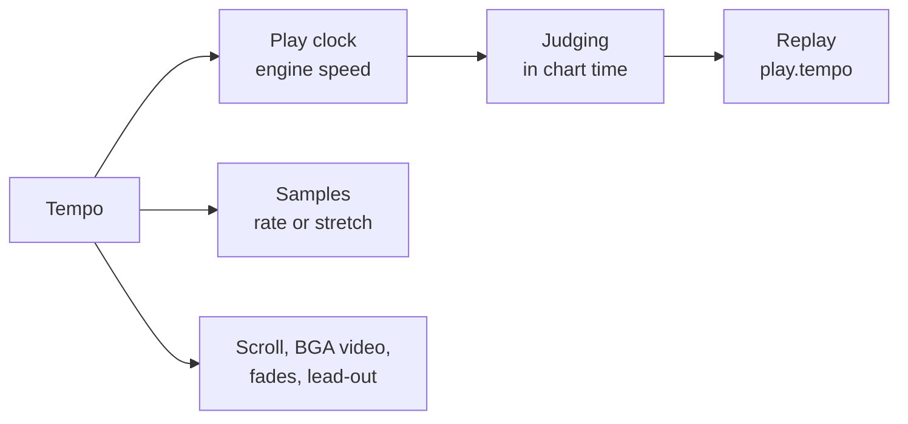
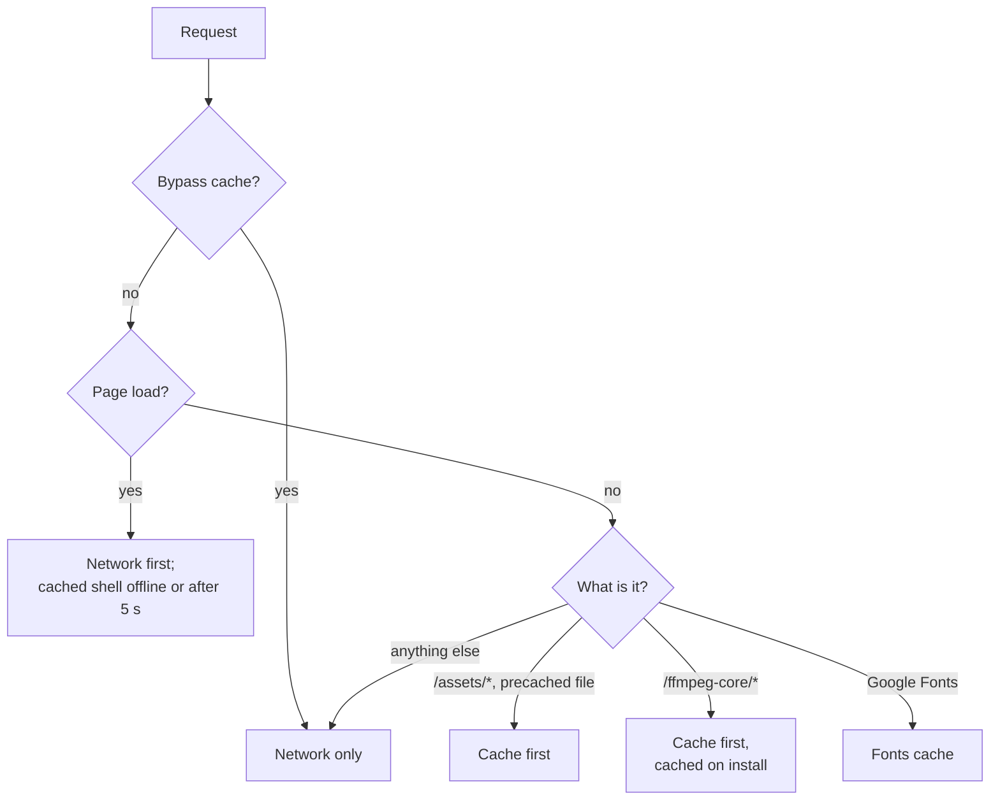
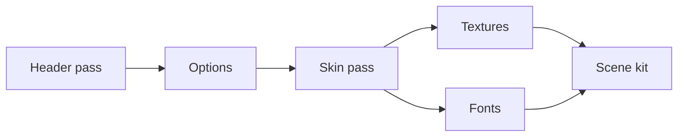

[Japanese version](./player-web.ja.md)

# Browser player implementation notes

Be-Music Play runs BMS, BME, BML, PMS, bmson, LRX and n2s charts in the browser. The app handles the library and settings. `@be-music/player-browser` provides the runtime and draws each screen with the active skin family. See the [shared player specification](./player-spec.md) for chart timing and note rules.

<details>
<summary>Table of contents</summary>

- [Related pages](#related-pages)
- [Shared runtime integration](#shared-runtime-integration)
- [CPU workers](#cpu-workers)
- [Entry points](#entry-points)
- [Running the player](#running-the-player)
  - [Loading placeholders](#loading-placeholders)
  - [Options dialog](#options-dialog)
  - [Best records](#best-records)
  - [Play tempo](#play-tempo)
  - [Built-in play screen](#built-in-play-screen)
  - [Phones and tablets](#phones-and-tablets)
- [Installing the player](#installing-the-player)
- [Browser loading model](#browser-loading-model)
- [Courses and dan certification](#courses-and-dan-certification)
- [LR2 skin and theme support](#lr2-skin-and-theme-support)
- [Default skin family](#default-skin-family)
- [beatoraja skin and theme support](#beatoraja-skin-and-theme-support)
- [Note visibility](#note-visibility)
- [HS-FIX](#hs-fix)
- [Renderer and performance controls](#renderer-and-performance-controls)
- [Compatibility boundary](#compatibility-boundary)
- [Browser verification](#browser-verification)
  - [Test hook](#test-hook)

</details>

## Related pages

- [Browser player architecture](./player-web-scenes.md)
  - <a name="how-the-player-is-built"></a>[How the player is built](./player-web-scenes.md#how-the-player-is-built)
  - <a name="scene-lifecycle"></a>[Scene lifecycle](./player-web-scenes.md#scene-lifecycle)
  - <a name="scene-sessions-and-family-views"></a>[Scene sessions and family views](./player-web-scenes.md#scene-sessions-and-family-views)
  - <a name="layering"></a>[Layering](./player-web-scenes.md#layering)
- [Audio, BGA, and recording](./player-web-media.md)
- [Embedding and standalone controllers](./player-web-integration.md)
  - <a name="embedded-preview"></a>[Embedded preview](./player-web-integration.md#embedded-preview)

## Shared runtime integration

The browser player runs gameplay through the root entry of `@be-music/player-engine`. It imports input and UI buses and state signals from `@be-music/player-engine/signals`, lane layouts from `./lanes`, note data and scroll distances from `./display`, and judgment windows from `./ruleset`. The timing resolver (`TimingResolver`), sample triggers, and `ChartPlayVariant` come from `@be-music/chart-model`.

The engine owns judgment, keysound trigger routing, long-note handling, mine detonation, score, gauge, and chart-finish
semantics. The play session behind every play screen starts one engine run at the skin's `PLAYSTART` gate (on a
beatoraja skin, 1.5 s after load-end). It mirrors the engine's frame snapshots into the play state and hands the
engine's UI commands to the family view as the frame's moments, which the view turns into Pixi visual effects.

The browser runtime uses these adapter modules:

| module                                                                                | role                                                                                                                                                                                                                                                                                                                                                                                                                         |
| ------------------------------------------------------------------------------------- | ---------------------------------------------------------------------------------------------------------------------------------------------------------------------------------------------------------------------------------------------------------------------------------------------------------------------------------------------------------------------------------------------------------------------------- |
| [`web-audio-session.ts`](../packages/player-browser/src/runtime/web-audio-session.ts) | Implements the engine's `AudioSession` contract with Web Audio. It handles immediate triggers, BGM scheduling (its write head runs `WEB_AUDIO_SCHEDULE_AHEAD_SECONDS` ahead, and `scheduleEventAt` starts each background sound, volume change and AUTO keysound at its due time with `start(when)`), channel stops, pause/resume, key/BGM routing, dynamic volume changes, bmson `c=true` continuation, and `#WAVCMD` gain. |
| [`web-input-runtime.ts`](../packages/player-browser/src/runtime/web-input-runtime.ts) | Maps keyboard events and standard-mapped gamepad buttons to the engine input bus. It filters OS auto-repeat, routes `Escape` / `F5` / `Pause` to commands, timestamps lane input, and reports releases (`reportsKeyReleases`).                                                                                                                                                                                               |
| [`web-ui-runtime.ts`](../packages/player-browser/src/runtime/web-ui-runtime.ts)       | Drains engine UI signals into the play session. Frame snapshots update notes, score, gauge, and result state; commands drive lane flashes, key holds, POOR BGA, and judge/combo effects.                                                                                                                                                                                                                                     |
| [`engine-driver.ts`](../packages/player-browser/src/runtime/engine-driver.ts)         | Wires audio, input, and UI adapters together and invokes `manualPlay` / `autoPlay` for one chart play.                                                                                                                                                                                                                                                                                                                       |

The engine is runtime-neutral. Hosts provide `PlayerOptions.createAudioSession`; browser hosts use `createWebAudioSession`, and terminal hosts use `@be-music/player-node-audio`. The engine does not load a Node audio backend.

## CPU workers

The browser host installs one shared worker pool for chart parsing/counting/packing, ZIP expansion, and WSOLA. Set **Advanced → CPU workers** in the Options dialog; the default is half the reported logical CPU count, rounded down with a minimum of one. The override is remembered. Signalsmith already uses an AudioWorklet and keeps its existing path. See [ADR 0010](./adr/0010-browser-task-pool.md) for task boundaries and failure handling.

## Entry points

`@be-music/player-browser` exports designed entries, not its file layout ([ADR 0005](./adr/0005-public-entry-points.md)):

| Entry                      | What it exports                                                                                                                                                                                                                                            |
| -------------------------- | ---------------------------------------------------------------------------------------------------------------------------------------------------------------------------------------------------------------------------------------------------------- |
| `@be-music/player-browser` | The union of the entries below, plus `logger` and Pixi's `Rectangle`                                                                                                                                                                                       |
| `./host`                   | The host API: `PixiSceneHost`, `PixiScene`, `SessionScene`, `createSelectScene` / `createDecideScene` / `createPlayScene` / `createResultScene` with their kits, options and events, the family kit types and the view contract types                      |
| `./controller`             | Renderer-independent `SceneController`, selected snapshot stores and `createSelectController` for a standalone collection browser.                                                                                                                         |
| `./skin`                   | The skin families and their loading: the `SkinFamily` registry, the LR2 and beatoraja theme loaders, `loadBeatorajaSceneKit`, the Be-Music Skin registry, and the built-in skins (`BUILT_IN_BE_MUSIC_SKINS`, `plainSkin`, `synesthesiaSkin`, `nativeSkin`) |
| `./collection`             | Library loading: `BrowserChartCollectionStore`, dropped files, courses and the course maker, chart hashes, and the browser compatibility check                                                                                                             |
| `./audio`                  | The audio service (`createAudioService`), the audio bus and its compressor parameters, the master volume, the system audio session, and `ChartPreviewEngine`                                                                                               |
| `./recording`              | `GameplayRecorder`, the recording formats, `makeWebMSeekable`, `downloadBlob` and the WebCodecs helpers                                                                                                                                                    |
| `./compute`                | Shared CPU worker pool, count settings, data-only task dispatch, and host worker setup (the task pool and the BGA video transcode workers).                                                                                                                |

The models the scenes take and hand back come from their own packages: the play options, `PlayResult`, `CourseView`, the hi-speed range, the library entries (`LibraryChart`, `LibraryFolder`, `LibraryCourse`, `LibraryEntry`, …) and their helpers (`groupChartsByFolder`, `resolveLibraryChartPlayVariant`) from `@be-music/player-scene-model`, the Be-Music Skin contract from `@be-music/player-skin-sdk`, and the replay format from `@be-music/player-engine/replay`. Everything else in the package is internal.

## Running the player

```bash
pnpm run player:web
```

The command starts the Vite player. Drop any of the following into the page:

- A BMS/bmson song folder
- A ZIP that contains a song folder
- An LR2 theme folder
- A beatoraja theme folder
- A song folder and an LR2 or beatoraja theme folder together

When a mixed drop contains chart files, the loader treats the chart directories as song files and the remaining files as theme files.
When no chart file is present, the whole drop is treated as a theme candidate. LR2 detection uses `.lr2skin` files, while beatoraja detection uses `.luaskin` files or JSON files under a `skin/` path segment.
Double-click the playfield to toggle the player into fullscreen; `Esc` leaves fullscreen before it runs the usual scene action.
On Chrome and Edge the player locks `Esc` with the Keyboard Lock API while fullscreen: a short `Esc` press keeps its usual scene action (quitting the play included), and a long press leaves fullscreen.
Holding `Backspace` for 0.5 s during play quits it the same way `Esc` does; a tap does nothing. It works in fullscreen on every browser, Keyboard Lock or not.
Once every note of the play is judged, `Esc` (and the `Backspace` hold) finishes the play instead of quitting it, as beatoraja does: what is left of the lead-out after the last note is skipped, the fade-out runs and the result shows. Another `Esc` during that fade-out is ignored.

### Loading placeholders

The player reads the Leaderboard account after the page is up, so the parts that show it start as shimmering placeholders (`skeletonTemplate` from `@be-music/service-web-theme`) in the box of what will replace them. Nothing says "Sign in" or "Not signed in" before the answer, and nothing moves when it arrives:

- **Header:** the account control is an avatar circle, a name line at the label's 12ch cap (from the `sm` width up) and the chevron (`accountLoading`). It is not a link until the account is known, so a click cannot open sign-in for a player who turns out to be signed in.
- **Start card:** the account note is a line, and the hint and the action buttons are drawn with their own text, shimmering and unreadable. They take the shape the card had the last time this browser read the account (`be-music.start-account-state`; a first visit, or a failed request, assumes signed out), so a returning player's card keeps its height.
- **Options → Leaderboard:** the account form shows a shimmering avatar and line until the account arrives.
- **Replay slots card:** before the slots have been read from IndexedDB, a result's empty slots show a line instead of "Empty".

Each placeholder region is a `role="status"`, `aria-busy` group whose hidden text names what is loading ("Checking account…"). Under `prefers-reduced-motion` the shimmer stops and the placeholders stay a still surface.

### Options dialog

The **Options** dialog opens from the header's Settings button (and, while the play surface is fullscreen and the header is out of sight, from the surface's own gear at the top right). It is a Basecoat dialog with one tab per area: Play, View, Keys, Skin, Audio, Camera, Library (Library & records, Select and Course), Capture, Leaderboard and Advanced. Each tab holds its folders as sections. Play options splits its many options into pages (Judge & gauge, Arrangement, Modifiers, Assist, Practice, Replay / ghost), and View into Hi-speed, Cover & LIFT and Effects. The tab bars stay on one line; on a screen too narrow for one, the bar scrolls sideways. The **?** beside an option shows Help's entry for it while hovered or focused (`ui/options/help.ts` reads it from Help's hidden Options descriptions (`#options-help-content`), so both use the same text). Under the entry of a list, it also lists what each choice the list offers now does, with the one picked marked (`ui/options/help-choices.ts`, and `help-choices-ja.ts` in Japanese). A click on the **?** keeps the help open, so a list longer than the window can be scrolled; another click, or one anywhere else, closes it. The field beside the dialog's title searches the options (`ui/options/search.ts`): it lists those whose name, tab and section, choices or help hold every word typed, names first, and picking one opens its tab and page, scrolls to the row and marks it for a moment. Esc clears the search before it closes the dialog. Opening the dialog focuses the field, except on a touch screen, where the keyboard would cover the dialog. The pages of a tab stay at the top of the panel while its rows scroll, and in a dialog wide enough a slider sits on one line with its label and number. The controls are `ui/options-controls.ts`: a switch, a select, a slider with a number field, a text field, read-only monitors and buttons. Settings a play reads as it starts are disabled during it; the ones it takes live (hi-speed, the covers and LIFT, volumes, judge timing, a live tempo) stay enabled. Every setting in it is remembered (`localStorage`, `be-music.option-settings`). The dialog itself always starts closed. The same document is kept on the player origin, addressed by an HttpOnly cookie the server sets (`__Host-be-music.device`, 400 days). Safari deletes script-written storage after seven days of Safari use without a visit; that cookie is not script-written, so the next visit restores the settings. Changes are saved locally immediately; remote saves are debounced and flushed when the page is hidden. Revisions advance from the last observed edit without using the server clock, and conditional writes prevent older requests from overwriting newer settings. Reads never rewrite either copy. Reset settings clears all settings values and leaves only a remote revision barrier to reject delayed saves. If deletion fails, a local retry marker survives closing the tab, and the next visit retries deletion before restoring settings. Reset to defaults for an individual skin also updates the saved document. Best records stay on this browser only. Former `be-music-demo.*` keys migrate to `be-music.*` at startup, and saved courses move from the former IndexedDB database to `be-music`; existing values in the new namespace take precedence.

**Quick options** (off for now: `QUICK_OPTIONS_ENABLED` in `quick-options.ts` keeps it out of the page) is a panel that opens and closes at the stage's bottom right on the select and play screens (`ui/options/quick-options.ts`), folded at first and hidden on the start screen before any chart is loaded. It holds the options changed most: Random 1P, Gauge, Auto play, HS-FIX, Hi-speed, Effect 1P and Cover height. Its controls set the same values as the Options dialog's, and each shows the other's changes. As in the dialog, the ones a play reads as it starts are disabled during one; the hi-speed and the covers change a running play live. Hi-speed and HS-FIX hide while a measured or classic hi-speed mode is on, which is set in the dialog.

**Library & records → Local data…** shows what the player keeps in this browser: every `localStorage` key (the player's own `be-music.*` first, each with what it holds and its size), every IndexedDB database the browser lists for the origin (`be-music` for your courses, `be-music-replays` for the replay slots) with each store's record count and its first 200 records, and the browser's storage estimate. Each entry opens to show its value, drawn only when opened; a replay slot's compressed replay can be read out as its JSON. The viewer only reads: it opens databases at their current version and only the ones the browser lists, so it creates and changes nothing. Data is cleared from its own controls (Reset settings, My courses, the replay-slot card). The settings cookie is HttpOnly and does not show.

- **Library & records** opens with three tabs for where charts come from: **Local folders** (the remembered folders with Add folder, and Reload folders), **Bemuse servers** (the server list and Bemuse ReplayGain) and **Difficulty tables** (the tables whose courses are listed). To open a folder, ZIP archives or a replay once, drop them on the page or use the start card's buttons.
- **Key config** (the Keys tab): the key each lane takes, one page for the 5 / 7 / 10 / 14 KEY layouts (they share their keys lane by lane) and one for 9 KEY (by key number); 24 / 48 KEY keep their defaults. Click a lane's key and press the key to give it; a key another lane of the page has moves to that lane's old key, and Esc cancels. Esc, Pause, F5, Backspace and the up / down arrows stay the play's, and Ctrl and Space stay the turntables' second keys. The 5 / 7 / 10 / 14 KEY page also has each side's START and SELECT (Q / W and O / P by default, LR2's default key config; `controlKeys`), which no lane can share a key with, and **Built-in skin controls** picks whose keys the built-in skins' screens read, LR2's or beatoraja's (`builtInControlScheme`). The **Screens** page lists every operation of the select, decide, play and result screens (`CONTROL_ACTIONS` in `session/controls/control-actions.ts`) with its keys; a key given to one takes the place of its defaults (`actionKeys`), a key another operation of that screen has is refused, and **Reset screen keys to defaults** puts them back. The screens match the operations by physical key (`KeyboardEvent.code`), as the lanes do, and a key a chart's lane takes in a play is the lane's. The keys are stored with the other settings (`laneKeys`), read as a play starts (`LaneModeOptions.laneKeys` in `@be-music/player-engine/lanes`), and locked during one; **Reset keys to defaults** puts a page back. A replay plays its recorded lanes, which no key reaches. The screens read the keys as control buttons (`session/controls/control-buttons.ts`): each side's seven keys, its two turntable keys (Shift, and Ctrl, with Space on the 1P side as in LR2), START and SELECT, so the LR2 select screen's PLAY OPTION panel steps its options on the player's 1P keys.
- **Play options** (the Play tab): Judgment windows at the top, above the pages (LR2, beatoraja, ???? or plugout; latched at song start; it also picks which ruleset's [best records](#best-records) the select screen shows). **Judge & gauge** holds the gauge, the judge algorithm, the auto-shift gauges, beatoraja's LN MODE and CUSTOM JUDGE, and the judge timing; **Arrangement** the lane options (Random 1P / 2P, fixed keys, seeds, 7-to-9, DP flip, Battle); **Modifiers** the chart modifiers (Scroll, Mines, Long notes, EXTRA); **Assist** Auto play, Auto scratch 1P / 2P and ANY KEY; **Practice** PRACTICE and the **Tempo** folder. They are latched at song start and disabled during a play, except the judge timing, which applies live.
  - **Replay / ghost**: Tempo, Hi-speed, SUDDEN+ / HIDDEN+, LIFT — what a replay reproduces of what the recorded player saw; the rest stays your own. All on by default, remembered across visits, latched at song start and disabled during a play. The scenes get them as `replayView` (`ReplayPlaybackOptions`). **Ghost** (OFF by default; OWN BEST, REPLAY SLOT 1-4, LEADERBOARD TOP or REPLAY FILE) picks the replay a ghost plays and **Ghost mode** (SECOND PLAYFIELD, PACEMAKER, PACEMAKER + LANES) how it shows; **Ghost status** says whether the bar under the cursor would show it, and **Ghost replay file…** picks the file REPLAY FILE plays ([replay.md](./replay-browser.md#ghost)). Ghost and Ghost mode are disabled during a play and on a course bar.
- **Tempo** (on the Practice page): Tempo (%), Pitch, Keep-pitch stretcher (see [Play tempo](#play-tempo)); latched at song start and disabled during a play, except Tempo (%) with the pitch following the tempo, which changes the play's tempo live.
- **View** (the View tab): what the lanes show. **Hi-speed** holds [HS-FIX](./play-options.md#start-bpm-hs-fix), the Normal, FLOATING and CLASSIC hi-speeds, Fixed display area and Hi-speed; **Cover & LIFT** Display area info, Effect 1P / 2P, Lane cover, Cover height and LIFT; **Effects** BGA (OFF, ON, AUTOPLAY ONLY), BGA size, Score graph (LR2's select buttons 72, 73 and 70, offered for every skin), BPM GUIDE with its Guide: BPM / STOP / SCROLL / SPEED labels, BPM change warning, Visual CONSTANT, Lane brightness, Judgment display, Show judge area, Mark processed notes, Auto scratch notes, Show invisible notes (see below) and the [LR2 mania options](./play-options.md#lr2-mania-options). Hi-speed, the covers, LIFT, CONSTANT's note duration and fade, Lane brightness, Judgment display, Show judge area, Mark processed notes, Auto scratch notes, Show invisible notes, the guide labels and the LR2 mania options apply live; the rest are latched at song start and disabled during a play.
- **Course** (the Library tab): Skip stage results, My courses…, NONSTOP placement (latched at song start and disabled during a play). The Difficulty tables list is on Library & records → Difficulty tables.
- **Skin & display** (the Skin tab): Skin system selects the active family; choosing an unloaded family asks for a drop. The **Built-in** tab contains Built-in skin, Skin effects, **Skin settings**, and **Add skin**. The **LR2** tab contains Load LR2 skin and the discovered LR2 theme picker. The **beatoraja** tab contains Load beatoraja skin and per-scene pickers. Tabs only organize settings; opening one does not switch the active skin. Render resolution, Play layout and Toggle fullscreen are shared. A detected skin opens a confirmation dialog before replacing any theme assets. Cancel preserves the current skin and still imports charts in the same drop; a drop containing both LR2 and beatoraja lets you choose which to use.
- **BGA camera** (the Camera tab, a tab of its own since it works with every skin): Show camera in BGA, Camera, Allow camera access, Mirror camera, a preview with Preview camera / Stop preview, and a line saying where the camera stands. They apply live, during a play too, and are kept in this browser only (`be-music.bga-camera`), not in the synced settings document, since the cameras belong to the device. See [BGA camera](./player-web-media.md#bga-camera).
- **Audio**: Mute, Master / Key sound / BGM volume (%), Play in silent mode (only where the browser has the Audio Session API, see below), Peak gain (next play), then the **Compressor** folder (Enabled, per-stage toggles, and each compressor's threshold / knee / ratio / attack / release with a reset). Mute silences all player audio while preserving the master volume setting. Peak gain is off until turned on and is remembered with the other settings: the next play scales every decoded sample by one gain so the loudest peak sits near −3 dBFS.
- **Library & records**: under the three tabs, Music / Skin ZIP URL with Load from URLs (the `?music=` / `?skin=` path on demand), Auto-download replays, Local data… and the **Replay slots** folder (each slot's auto-save rule, see [replay.md](./replay-browser.md#replay-slots)).
- **Select** (the Library tab): Sort, Key filter, Difficulty filter. They shape the built-in and LR2 select screens' list, and an LR2 skin's sort and filter buttons change them too; the beatoraja select screen keeps its own MODE and SORT choices. A play does not read them, so they stay enabled during one.
- **Capture** (the Capture tab): ● Record gameplay video, Video format (MP4 · H.264 by default; MP4 or WebM with H.264 / H.265 / AV1 / VP9 / VP8), Video quality (Low, Standard by default, High, Very high: 0.05, 0.1, 0.2 and 0.35 video bits per pixel per frame at the canvas size and 60 fps, within 1–80 Mbps, with 128, 192, 256 and 320 kbps of audio; `resolveRecordingBitrates`), 📸 Screenshot. Video format and Video quality apply when a recording starts and are disabled while one runs. A camera shown in the BGA frame is recorded with it.
- **Leaderboard**: the account as a sign-in form, then Submit to Leaderboard and Submit when. Signed out, the form signs in with a passkey (first), Google or Discord, and offers Sign up. A guest account shows its name with a guest badge, **Keep this account**, the same sign-in methods, its page and Sign out. A kept account shows its avatar, name and handle, its page and Sign out. The buttons are the shared `@be-music/service-web-theme/client` ones the sign-in dialog uses.
- **Advanced** (the Advanced tab): CPU workers, Auto pause on blur, FPS (native history graph, sampled every 500 ms with 60 samples), the **BGA video transcode** folder, and Reset settings and reload, which clears every stored player setting except the best records.

**View → Show invisible notes** is off by default. Enabling it shows hidden keysound objects in every skin family, including beatoraja; it can be toggled during play. The inspection markers do not affect keysound playback, judgment, or scoring.

The Status and Account rows use read-only multiline monitors. The separate **Skin Config** pane uses **Options**, **Files** (when declared), and **Timing & offsets** tabs. Categories remain grouped within each tab. Each authored custom-offset axis, including `x` and `y`, has its own slider and number field. **Reset all to 0** refreshes the native controls and applies one configuration update. Switching scenes rebuilds the schema; editing the same skin entry preserves the selected tab and folder state.

### Best records

The player keeps the player's best record on each chart and each course, one per judge ruleset, in `localStorage` (`be-music.chart-best-records`): the best clear lamp, EX score, max combo and BP, each kept on its own, and the play count. LR2, beatoraja, That-Which-Must-Not-Be-Named and plugout each have their own lamps, BP and scoring, so a play records into the ruleset it ran under: a single play into its chart's record, an EXPERT / GRADE stage into its chart's record too (see [Courses](#courses-and-dan-certification)), and a course run into the course's record; a run whose stages were judged under different rulesets keeps none. Auto plays, replays and plays at another tempo keep no record. The select screen shows the records of the current ruleset (LR2 bar lamps and ops 100-105, beatoraja `CLEAR_LAMP_*` ops, `frame.chartBestRecord` and `frame.courseBestRecord`) and switches when Judgment windows changes.

The rules the records are kept by are `@be-music/player-engine/records` (`mergeBestRecord`, `mergeCourseStageRecord`, `recordPlayFromResult` and the rest, `playKeepsRecord`, `courseRunKeepsRecord`) and the lamps are `@be-music/player-engine/ruleset`'s; the player only keys and stores them (`chart-best-records.ts`).

### Play tempo

Options → Tempo → **Enabled** applies the saved tempo percentage (off by default). Turning it off plays at the original tempo without clearing the saved percentage; replay tempo and NONSTOP FIT adjustments still apply. **Tempo (%)** plays a song from -50 % to +50 % of its own tempo (default 0, step 1 %). **Pitch** decides how a tempo change sounds: **Pitch follows tempo (LR2)** (default) plays the samples faster or slower, so the pitch moves with the tempo, while **Keep pitch** stretches them in time when they load and keeps their pitch, with the stretcher picked in **Keep-pitch stretcher** (**WSOLA** by default and first in the list, or **Signalsmith Stretch**). The same two settings decide how a NONSTOP FIT stage sounds (see [NONSTOP](#courses-and-dan-certification)), and on a FIT stage the two rates multiply. The enable switch and the three settings are remembered (`localStorage`, `be-music.play-tempo`), read when a play starts, and disabled during a play, like every other play option; the status line shows the tempo when it is not 0 (`Playing (tempo -20%): <title>`). With **Enabled** on and **Pitch follows tempo (LR2)**, **Tempo (%)** stays enabled during a play and changes its tempo live; the status line follows. **Pitch** and **Keep-pitch stretcher** stay locked, and so does the slider with **Keep pitch** (the samples were stretched to the tempo they loaded at), during a replay (it follows its log) and on a course stage the course turned the tempo off for.



A live change (`setTempo(tempo)` on a play screen, `pitch` mode only) goes to the engine as a `{ kind: 'tempo' }` input command. The engine re-anchors its clock at the chart time it takes the command, so chart time stays continuous, and reports the change (`onTempoChange`) with that chart second. From there the view's clock, the samples started afterwards and the ones playing (their `playbackRate` glides to the new rate over 30 ms, `WebAudioSession.setTempo`; bmson slices keep their length in sample time, so they still end on their note), the BGA videos and a NONSTOP chart's stage fades run at the new tempo. The replay records the change in `play.tempoChanges`; a play that ran at another tempo at any point is practice. A replay follows the recorded changes in `pitch` mode when its Replay / ghost options reproduce the tempo (`resolveReplayTempo`).

Everything runs `tempo` times as fast: the engine's clock (`PlayerOptions.speed`), the scheduled and triggered samples, the scroll and judge line, the BGA images and videos (`playbackRate`), the NONSTOP stage fades and the chart-time lead-out before the result. Skin animation timers stay on the wall clock. Judging stays in chart time, so a play's inputs and judgments do not depend on the tempo; the replay records it as `play.tempo` ([replay.md](./replay.md)) and a replay plays back at it. A play at another tempo is practice, as with beatoraja's frequency trainer: it leaves the best records alone, while the replay is still auto-saved and the play is still sent to the Leaderboard, which stores it without ranking it (`unranked: 'tempo'`; the status line says so, see [leaderboard.md](./leaderboard.md)). A course can be played at another tempo too: every stage plays at it, and the run is then sent, stored unranked, and leaves the course record alone. Every family's play screen supports it: `createPlayScene` takes `tempo`, `tempoPitchMode` and `tempoStretchAlgorithm` in its settings.

### Built-in play screen

On a landscape screen the built-in skins (Synesthesia, Plain and Native) lay the play out as a cabinet, each in its own look. The skin SDK's `resolveCabinetLayout` places it on `cabinetStage`:

- **Play area:** the lanes, with the lane cover (SUDDEN+) over their top. The keys sit under the judgement line, then the gauge, the score and the hi-speed.
- **Score graph:** your EX score against the pacemaker (the AAA line) and your best record, each held to the notes judged so far. The lane option and the pacemaker are named under it.
- **Right-hand column:** the stage name (`FREE PLAY`, `PRACTICE PLAY` in a practice play, or a course's `1ST STAGE` … `FINAL STAGE`), the player's name with the chart's difficulty and level, the title and the artist, then the BGA. Under it are the judgement counts with FAST / SLOW and the last timing, the BPM with its range, and the tempo, shown where a cabinet shows its effector.

The player hands the skins the best record (`PlaySceneOptions.scoreTargets`), the course stage, the signed-in Leaderboard account's name (`playerName`), the lane option and the tempo. A double-play chart (10 / 14 KEY) is centred on the stage, with the turntables on the outer edges. The stage name, the chart, the BGA and the judgement details move to a left column, and the graph stays on the right. The score, the gauge both sides share, the hi-speed and the BPM sit under the lanes, and the box between the two banks of keys shows the gauge. The touch layout and portrait screens keep their own HUDs.

### Phones and tablets

The player treats a device whose primary pointer is a finger (`(pointer: coarse)`, or a touch pointer on a phone-sized screen) as touch-first:

- **Touch play:** in the built-in and LR2 play screens, each lane is a touch zone from the lower part of the lane down to the bottom of the screen. Every finger presses, holds (long notes), and releases its lane on its own; sliding a finger into the next lane releases the old lane and presses the new one. Touches go through the same input path as the keyboard, so judgement, key beams, and replays behave the same. A pause button sits in the top-left corner during play; while paused it shows Quit.
- **Touch layout:** the built-in skins switch to the touch gameplay layout: equal-width lanes across most of the stage (keys up to 72 design px, about 58 CSS px on a landscape phone), a slightly lower judgement line, and no BGA. 24 / 48 KEY charts keep the standard layout. The Options dialog's **Play layout** (Auto / Desktop / Touch) overrides the choice from the next play.
- **Select screen:** tap rows and buttons as with a mouse; swipe the list up or down to scroll it.
- **Effects:** the skin effect level starts at Reduced unless one was picked in the Options dialog before.
- **Screen:** the page chrome steps off the stage (the search box only shows while typing, Help shrinks to an icon), the first tap on a phone asks for fullscreen in landscape where the browser allows it, and a phone held upright shows a prompt to rotate it.
- **Sound in silent mode:** iOS / iPadOS Safari treats web audio as ambient sound by default: it mixes with music from other apps, and the Ring / Silent switch mutes it. Where the browser has the [Audio Session API](https://w3c.github.io/audio-session/) (`navigator.audioSession`, Safari 16.4+), the start card (under "Drop to load") and the Options dialog's **Audio** folder offer **Play in silent mode**, the same setting in both places. On (the default), the player sets the audio session type to `'playback'`, so sound plays with the silent switch on, but music playing in other apps pauses (and the system may show Now Playing controls). Off, it restores the browser default `'auto'`, which keeps web audio mixing with other apps and obeying the switch. The choice is remembered across reloads and applied before any audio starts, again on the first tap or key press (when the scenes start their audio), and when the page comes back into view. Other browsers have no such switch for web audio and show the setting in neither place. The first time sound starts on a phone or tablet with the setting off, a small dismissible hint at the top of the screen offers to turn it on; it shows once per browser and leaves by itself.

## Installing the player

The player is an installable web app: Chrome and Edge (desktop and Android) offer to install it, and iOS / iPadOS Safari's Add to Home Screen gets its icon and title. Installed, it opens in its own window, and once it has been opened online it starts without a network. Charts and themes come from dropped files, so an offline start plays them as usual; what needs the network (sign-in, the Leaderboard, `?music=` / `?skin=` links, BMS Search) does not work offline.

- **Manifest:** `public/manifest.webmanifest`, linked from the player page with the iOS `apple-touch-icon` and `apple-mobile-web-app-*` tags. It names the app "Be-Music Play" (short name "Be-Music"); the preview Worker serves the page and the manifest as "Be-Music Play (Preview)" and the dev server as "Be-Music Play (Development)", so an installed window says which environment it runs (`packages/app-play/src/app-title.ts`). It uses the player's background colour, and opens `standalone`, or `fullscreen` where the browser reads `display_override` (Chromium; on Android it hides the system bars). `orientation` is `any`: a phone held upright still shows the rotate prompt. The embed page links no manifest.
- **Icons:** The tab and manifest use the playfield SVG (`public/favicon.svg`). Run `pnpm --filter @be-music/app-play run build:icons` to generate the maskable SVG with safe-zone padding, 192 / 512 px PNG fallbacks, and the 180 px iOS touch icon in `public/icons/`.
- **Service worker:** `src/service-worker/service-worker.ts`, served as `/sw.js` with the scope `/`. The build bundles it as one more entry and writes its precache manifest into it (`scripts/service-worker-plugin.ts`); its rules are the pure `src/service-worker/routes.ts`. A production build registers it once the page has loaded (`src/service-worker/register.ts`); the dev server and runs under the test hook (`?e2e=1`) do not.

The service worker bypasses the cache for requests other than GET, range requests, and the paths `/api`, `/__url-load-proxy`, `/embed` and `/sw.js`. This also covers paths under `/api/` and `/embed/`.



- **Precached on install:** the player page (cached as `/`), every chunk, stylesheet and worker it loads, the Help's `acknowledgements.json`, and the public files (icons, manifest), about 5 MB. Files only the embed page loads are left out.
- **Also cached on install, on a best-effort basis:** the ffmpeg.wasm core under `/ffmpeg-core/` (about 31 MB), which only runs for BGA videos the browser cannot play ([BGA video transcode](./player-web-media.md#bga-video-transcode)), and the Google Fonts stylesheet the shell links to with every font file it names (`fontStylesheets` in the manifest, read off the built page; M PLUS 1p alone splits into a few hundred `unicode-range` files). An installed player then transcodes and shows its fonts offline from the first start. A failed download never fails the install; what is missing is cached on use instead. The core's cache is named by the `@ffmpeg/core` version, so a version bump fetches the new core, and an install that finds the current core already cached skips it. The fonts are served from the cache (refreshed behind it) and matched without `Vary`, since Google varies its answers on request headers the install's fetch and the page's own request do not share. The worker fetches the fonts with CORS and never stores an opaque answer, whatever mode the page asked in (a `<link rel="stylesheet">` asks `no-cors`): the page runs cross-origin isolated, and neither it nor the worker can read an opaque answer back from the cache. The fonts cache is `be-music-play-fonts-v2`; activation drops the first one, which could hold such answers.
- **Persistent storage.** An installed player (running in its own window, or just installed) calls `navigator.storage.persist()` (`storage-persistence.ts`), so the browser keeps its best records, settings, replays, saved courses and these caches when it runs short of space. Chromium grants it to an installed app without a prompt; Firefox and Safari decide on their own terms.
- **Never cached:** the Worker's routes (`/api/*` with sign-in, accounts, player settings and the Leaderboard API; `/__url-load-proxy`), the embed page, `POST` and other writes, range requests, and every other cross-origin request (the archives a `?music=` / `?skin=` link loads, course tables, BMS Search).

**Updates.** Page loads go to the network first, so an online start always gets the latest deploy. A deploy changes the precached bytes, and with them the manifest's version in `sw.js`; the browser installs that worker in the background, precaching the new shell into a cache of its own. It takes over at the next start, once every tab or window of the player has closed, and then deletes the earlier deploys' caches. There is no reload prompt: a reload in the middle of a play would cost the play, and the open page keeps working from the network meanwhile. The player Worker serves `/sw.js` with `Cache-Control: no-cache`, and registration uses `updateViaCache: 'none'`, so the HTTP cache never answers an update check.

## Browser loading model

- Dropped paths are normalized with the shared `@be-music/shared-utils/core` path helpers.
- Chart discovery accepts `.bms`, `.bme`, `.bml`, `.pms`, `.bmson`, Nanasi Groove 2's `.n2s`, and LRX `.lrs` (read with the `.lrh` and `.lrm` beside it).
- File lookup is case-insensitive so browser drops work with LR2 and beatoraja asset references that differ only by letter case.
- Large audio and video files stay as lazy `File` references by default. Image, skin, chart, and smaller metadata files are read into bytes during collection loading.
- Folder walking and file reads use bounded concurrency and progress callbacks so large folders can load without flooding the browser's FileSystem APIs or UI update loop. Chart files are read while others are parsed: more charts are in flight than there are parse workers, and the worker pool queues the rest.
- Parse errors are accumulated in the collection instead of aborting the whole drop.

Gameplay and select previews try the next distinct audio asset when reading or decoding a codec candidate fails. The existing order stays Opus → Ogg → MP3 → WAV → M4A → the declared path; folder lookup, case-insensitive matching and `#PATH_WAV` still apply. A cancelled or superseded load stops before the next attempt. NONSTOP sources retain each stage's candidate chain in `BrowserAssetSource.audioFallbacks`, keyed by its stitched resource path, so failed codecs can still fall back across original stage folders. Decoded samples remain keyed by the chart's declared resource name.

## Courses and dan certification

Courses play through the same select → play → result scenes. See [Courses and dan certification](./course.md) for the rules.

- **Loading:**
  - A drop can carry course files: LR2 `.lr2crs` anywhere, beatoraja course JSON under a `course/` folder, and Nanasi Groove 2 `.n2x` chart lists anywhere, each read as an EXPERT course ([course.md](./course.md#nanasi-groove-2-n2x-chart-lists)).
  - They are read with `readCourseFile` (`@be-music/player-browser/collection`).
  - The player hashes the library's chart files (cached per song) and matches each stage by SHA-256, then MD5 (`resolveCourseFolders`).
  - Course files dropped on their own match against the songs already loaded.
  - A difficulty table's courses can be imported by URL: Options → Course → **Difficulty tables**, enter the URL, then **Add table**. The list shows every remembered table by name, each with a **Remove** button that takes its courses off the select screen at once; **Add default tables** brings back the well-known tables removed from it. Removed well-known tables are stored (`be-music.course-table-removed-defaults` beside the URL list, and synced with the settings), so removing the last table leaves the list empty rather than back at the defaults. The URL may be the table page (its `bmstable` meta names the header) or the header JSON. The player fetches it with `fetchTableHeaderCourses` (`@be-music/player-engine/course`, see [Loading a table from its URL](./course.md#loading-a-table-from-its-url)); the song list behind `data_url` is not loaded.
  - Most table sites do not allow other pages to read them (no CORS headers), so the player fetches a table on another origin through its same-origin proxy, `/__url-load-proxy`, as it fetches a `?music=` archive (`fetchCourseTableText`). A header URL the page names still resolves against the table page, not the proxy. The proxy only fetches https URLs, so an http table on another origin cannot be imported by URL. When the fetch cannot complete at all (offline, or a host without the proxy route), the status line says to save the table's header file instead (the JSON its `bmstable` meta names, usually `header.json`) and drop it: a dropped `header.json` that holds courses is read the same way, under the table's `name` (`readTableHeaderFile`).
  - The table becomes one course group labelled with its name. Importing a table again, or another source with the same label, replaces that group. Imported URLs are remembered in `localStorage` and imported again on the next visit. A table's page, header and song list are kept in Cache Storage (`be-music-remote-v1`, `createCachedCourseTableFetchText`) and serve for a day (`COURSE_TABLE_MAX_AGE_MS`), so the tables load on the next visit without asking their sites. A reload of the folders asks at once. A file due is asked for as a revalidation (`cache: 'no-cache'`), which the proxy passes on with the browser's validators, and a site that cannot be reached leaves the copy kept last time in use.
  - Until a list is stored, the player imports a set of well-known tables whose headers list courses (`DEFAULT_COURSE_TABLE_URLS`): NEW GENERATION normal and insane, Satellite, Stella, DP Satellite, Stardust, Starlight and Luminous. Importing a table by URL stores that set with the new URL, so the well-known tables stay on the list. A stored empty list reads as none, so it gets the well-known tables too: there is no way to empty the list, and builds before the well-known tables stored an empty one with every Options save and synced it to the account. A table that cannot be fetched only leaves a status message.
  - beatoraja's command-folder file (`folder/*.json`) adds its random courses: each folder with any becomes a course folder. A random course is listed with its stage titles (or filters), lights beatoraja's `OPTION_RANDOMCOURSEBAR` (1031), and draws its stages from the library when it is started (`drawBrowserRandomCourse`). A stage that matches no chart leaves the course unstarted with a status message. Successful draws are kept as fixed, timestamped bars at the end of their source folder (100 across all folders, for the session only); the cursor returns to the new bar, which can replay the same stages without drawing again.
- **Select:**
  - Each course file is a folder bar listed after the chart folders. Inside it, every course is a course bar (`LibraryEntry` `kind: 'course'`).
  - A course with a stage missing from the collection is listed but cannot be started. Deciding it (or pressing PLAY) sets the status and opens a dialog listing the missing stages (`showMissingCourseStages`). For a course imported from a difficulty table, the dialog looks each stage up by SHA-256, then MD5 in the table's song list (its header's `data_url`, fetched through the proxy the first time a course of that table needs it, `findMissingCourseStages`) and shows the song's title and artist with links to the pages the list names: the song (`url`), its chart when it ships apart (`url_diff`, with `name_diff`) and its pack (`url_pack`, with `name_pack`). The links open in a new tab; only absolute http(s) URLs are kept. Nothing is downloaded or loaded for the player: a link may be an event page as well as an archive, and a chart often ships apart from its song. A course from a course file, or a song list that cannot be fetched, gives the stages without links. A random course that cannot start (an invalid filter) only sets the status.
  - Focusing a difficulty table's course that cannot start fetches the table's song list the same way, once per table (`titleMissingCourseStages`), and the select screen then names every missing stage of the table's courses by the list's title in place of the header's placeholder (`course N`), keeping the cursor where it is. Only what is shown changes: the course definition, and with it the course's records and replays, keeps the header's titles.
  - On the LR2 and built-in selects the key-mode filter applies to course bars too, as LR2 lists courses by their key mode (OpenLR2 L18030-L18053): a course that names its key mode (`definition.keyMode`: LR2 `line`, a table's `mode`) is listed only under it, and one that names none stays listed.
  - Skins:
    - The Be-Music Skins show the course name, its stage count and the missing stages, and draw a course that cannot start faint in the list, as a disabled control (Plain also draws its missing stages faint on the course card).
    - LR2 skins use the `courseFolder` and `course` bar bodies, and for a NEW COURSE bar and a RANDOM MIX bar or random course the `courseCreate` (7) and `randomCourse` (9) bodies, falling back to `course` (8).
    - beatoraja skins light `GRADEBAR` (op 3) and draw the `bar-grade` frame, or `bar-nosong` when a stage is missing.
- **Play:**
  - Starting a course shows the decide screen once, before the first stage, naming the course as LR2's does (the selected bar's title); backing out of it drops the course. A NONSTOP course's quick retry skips it, as LR2's does.
  - The stages play in order, as a `CourseRun` runs them (see [The course run](./course.md#the-course-run)). Each stage runs with `PlayerOptions.course`: the course kind, its gauge set and judge constraint, and the gauge value and course combo the previous stage left.
  - Dismissing a stage's result starts the next stage. With **Skip stage results** on (Options → Course), the next stage starts as soon as a stage ends, and only the course result is shown.
  - A course played with AUTO skips the result of every stage the course goes on after, as LR2 does (OpenLR2 `Main.cpp` M1381-M1384); the last stage's result and the course result still show.
  - A stage whose gauge empties ends the course.
  - ESC gives the stage up. On LR2's course gauges a stage that judged a GOOD or better shows its result as FAILED first (unless stage results are skipped), and the run goes on to the next stage while the gauge holds; otherwise it is kept as a failed one and the course result follows ([Courses — Ending on failure](./course.md#ending-on-failure)). F5 / quick retry is off.
  - The course constraints are applied:
    - lane options are limited as beatoraja's `MusicSelector` limits them (`resolveCourseLaneOptions`): `grade` turns both sides and DP FLIP off, `grade_mirror` keeps a 1P MIRROR and then plays 2P on MIRROR with FLIP on (any other pick turns them all off), and `grade_random` keeps the random family on each side;
    - `no_speed` locks the hi-speed (and on a beatoraja theme the lane cover, lift and HIDDEN cover);
    - `ln` / `cn` / `hcn` set the long-note mode of charts that leave it undefined;
    - an LR2 GRADE course (from `.lr2crs` or the course maker) also plays its stages with what LR2 resets when one starts: an EASY gauge pick plays on GROOVE, and HIDDEN / SUDDEN, auto scratch, DP FLIP and the tempo are off ([course.md](./course.md#lr2-lr2crs)). The player's settings are left as they are.
- **Result:**
  - After the last stage, or the failed one, the result scene shows the course as one run: summed judgments, the course max combo, the final gauge and the course lamp. Its graphs follow each family: LR2 skins and the built-in result draw the last stage's gauge and score graphs, as LR2 clears them at each stage (OpenLR2 L24151); beatoraja's course result draws every stage joined, each as wide as its chart is long, the EX score running on and an unreached stage at gauge 0 (`CourseResult.create`). A NONSTOP run draws its one stitched play.
  - Every family reads the run as one `PlayResult` (`playResultFromCourseRun`): the SCORE (a beatoraja skin's POINT) reads on the stage results' scale (LR2's 200000-point score over the course's notes, else the EX score), PLAY TIME adds up the stages played (a NONSTOP run's is its stitched play's), and the built-in skins head an EXPERT / GRADE course result `COURSE CLEAR` / `COURSE FAILED` (a NONSTOP run keeps `STAGE CLEAR` / `FAILED`, as one play).
  - The course replay (`*.bmcourse.json`, see [replay.md](./replay.md#course-replays)) is auto-downloaded when replay auto-save is on. Dropping it (or picking it with Open files) plays the run back as its course once every stage chart is loaded, each stage's result and the course result marked as a replay, and keeps nothing; a dialog lists the stage charts that are missing ([replay.md](./replay.md#playing-a-course-replay-back)).
  - The best lamp, EX score, max combo and BP are kept per course and judge ruleset ([Best records](#best-records)) and shown on its course bar: LR2 skins light the bar's lamp ops (100-105) and draw its `#SRC_BAR_LAMP` (song bars draw theirs from the chart records too), beatoraja skins light its `CLEAR_LAMP_*` op, and the Be-Music Skins' course card names the best lamp and the trophy the bests earn (as beatoraja's `GradeBar` works it out: best EX score and fewest BP, cleared or not). A run played with AUTO on any stage (or a NONSTOP run played with AUTO) keeps no record, as an auto play keeps none for a chart.
  - Stage results count for the course and are not submitted to the leaderboard. As LR2 does for EXPERT and GRADE courses (OpenLR2 L9043-L9192), a stage played by hand at the chart's own tempo also updates its chart's best EX score, max combo and BP and its FULL COMBO lamp (PERFECT and MAX too), but not its clear lamp or play count. A NONSTOP run leaves the stage charts alone.
- **LR2 skins** (player-scene-model's `CourseView`: the decide screen's `course`, the play screen's `course.view` and the result's `result.course`; the select screen works it out for the course bar under the cursor):
  - Ops: a course bar on the select screen lights 3 (course bar), 5 when every stage is in the collection, 290 and its kind's op (291 NONSTOP, 292 EXPERT, 293 GRADE), and `700 + 10 × i + difficulty` for its stages 1-5 by each chart's `#DIFFICULTY` (ops 700-745; as LR2 reads 0 there, a missing stage and any bar that is not a course light the `x0` ops). During a course, play and result add the stage op: 280-288 for stages 1-9 that are not the last, 289 for the last.
  - A course stage plays on the play skin parsed again with those ops (`LR2ThemeSkins.loadSkin`), as LR2 reads a skin at each stage. The stage results and the course result do the same with their skins.
  - Numbers 250-259 read the stage levels; texts 150-154 the stage titles, 160-164 their subtitles and 170 the course title.
  - In an expert or grade course, numbers 104 / 105 (combo, max combo) and the combo next to the judgement (`#DST_NOWCOMBO`) count the whole course: the combo the previous stage left runs on until the first break (OpenLR2 L2019-L2034, L2516).
  - The gauge-type ops report the red gauge (43 / 45) for a course stage, as LR2 does for its course gauge.
  - The course result of an EXPERT or GRADE course shows on the theme's course-result skin (`#INFORMATION` type 15) when it has one, else on the result skin, and plays the sound set's `#COURSECLEAR` / `#COURSEFAIL` (stock `course_clear` / `course_fail`), falling back to `clear` / `fail`. A NONSTOP run shows on the result skin with `clear` / `fail`, as LR2 shows it.
- **beatoraja skins** (the course view of the play and result screens; beatoraja `BooleanPropertyFactory` / `StringPropertyFactory`):
  - Select: a course bar lights `GRADEBAR` (3; a random course lights `OPTION_RANDOMCOURSEBAR` (1031) instead, as beatoraja's `RandomCourseBar` is no `GradeBar`), `PLAYABLEBAR` (5) when it can start, and one `OPTION_GRADEBAR_*` op per constraint (1002-1007, 1010-1017), and names its stages on strings 150-159, marking a stage the collection lacks `(no song) <title>`.
  - Play and the stage results light `MODE_COURSE` (290) and the stage op: 280-283 for stages 1-4 that are not the last, 289 for the last. Strings 150-159 name the running course's stages.
  - `no_speed` locks the hi-speed, the lane cover, the lift and the HIDDEN cover, as beatoraja's `ControlInputProcessor` does: the arrow keys, PageUp / PageDown, Home / End, H / J / K, the wheel and the skin's cover buttons (acts 330-332) do nothing. Nothing changes, so nothing is saved for the next play either.
  - The course result shows on the theme's `COURSE_RESULT` skin (type 15), else its result skin, with `MODE_COURSE` lit and the title strings (10 / 12) reading the course title. It plays `course_clear` / `course_fail`, falling back to `clear` / `fail`.

- **NONSTOP:** the player plays an LR2 NONSTOP course as one chart: starting one stitches its stages with the shared NONSTOP pipeline (`prepareNonstopCourse` in `@be-music/player-engine/course`, which the Leaderboard rebuilds runs with: each stage's `#RANDOM` drawn and the course's long-note constraint applied; the player's `prepareNonstopPlay` adds the asset plumbing), plays the stitched chart on the gameplay family's own play screen (a beatoraja theme's play skin too), and shows the run's result from the stitched play's course log (`buildNonstopCourseReplay`), which is kept and auto-saved like other courses. As LR2 has no course-result step for NONSTOP (OpenLR2 `Main.cpp` M1406-M1412), the run shows on the result skin (not the course-result one) with the `clear` / `fail` jingles. F5 during the play and R on the result restitch and replay the course, as LR2 allows quick retry there (L2854). Options → Course → **NONSTOP placement** picks the intended placement (default) or LR2's exact one, and **Pitch** (shared with the [play tempo](#play-tempo)) picks how a FIT stage follows the previous stage's tempo: **Pitch follows tempo (LR2)** (default) plays its samples faster or slower, so the pitch moves with the tempo, while **Keep pitch** stretches them in time when they load and keeps their pitch. **Keep-pitch stretcher** picks how: **Signalsmith Stretch** ( the MIT `signalsmith-stretch` WASM AudioWorklet, rendered offline once per rate with the samples laid end to end) or **WSOLA** (default; `timeStretchChannels`, built in and lighter). A browser that cannot run the former falls back to WSOLA. All of them apply from the next play. A NONSTOP course played at another tempo plays every stage at it, the FIT rates on top. In the scenes: a stitched NONSTOP chart plays from a composite asset source (`createNonstopAssets`): each stage's files are found the way that stage alone would find them (`#PATH_WAV`, codec and image fallbacks, LR2's parent folder) and named `s<stage>/<key>`, and the chart plays as `NONSTOP_CHART_PATH`. The play scene's `settings.nonstop` (the stitch map) plays each stage's samples at its FIT rate and runs its background sound through a per-stage gain that fades at the seams on LR2's `volume²` curve; the player's keysounds are not faded. Pausing suspends the audio context, which holds the fades with it. On an LR2 skin the play is parsed once with the first stage's ops, as LR2 reads it; the stage ops (280-289) and title text 10 then move to a stage only when it follows a BLANK connection (`resolveLR2NonstopStage`), so after FADE or CUT the earlier stage stays shown, and title text 10 reads the course name until then. LR2's select texts 171-179 name the selected NONSTOP course's connections (`FADE`, `FADE+FIT`, `CUT`, `CUT+FIT`, `BLANK1`, `BLANK2`) and read `DISABLE` on any other bar; the connection buttons 240-248 step the connections of a course the player made. Its BGA keeps one base / layer / POOR stack per stage (cues split by the stage that owns each BMP key) and crossfades them linearly over 3 s around each seam; during a POOR each stage's own POOR image replaces that stage's base and layer, with no `#BMP00` fallback. LR2 instead draws one stage's three images each frame, picked at random by the crossfade weights (`LR2body.exe` 0x4350df), so the crossfade is its average. A beatoraja theme's play skin draws the same stacks at the same crossfade (`resolveBGAStacks`), each compositing its base, 07 overlay and 0A overlay, or its POOR image. The BPM readouts (LR2 NOWBPM and the built-in HUD) show each stage's own BPM × its FIT rate (`map.tempo`), while the scroll stays at the stitched 150 BPM, and the engine gets `map.stageRanks` so each later stage is judged with its own `#RANK` (a replay uses the ones its log recorded).
- **Making courses:** as on LR2, the player makes their own courses on the select screen (`CourseMaker`; see [Making a course](./course.md#making-a-course)).
  - The root lists `MY COURSES` (LR2's EXPERT courses), `MY NONSTOP` and `MY DAN` (GRADE) folders (`resolveCourseMakerFolders`), each with the player's courses and a NEW COURSE bar last. Deciding NEW COURSE starts making a course of that kind; from then on, deciding a song adds it instead of playing it, and deciding one more once there are five saves the course.
  - `MY COURSES` and `MY NONSTOP` end with a RANDOM MIX bar, as LR2's do (see [RANDOM MIX](./course.md#random-mix)). Deciding it opens the RANDOM MIX dialog (key modes, a level range or difficulties, and stages, with Infinity; see [The RANDOM MIX dialog](./course.md#the-random-mix-dialog)). OK draws a course of that kind from the charts that fit, keeps a counted draw, however long, as the folder's newest course `RANDOM MIX` in place of the previous draw, and plays it; AUTO on it plays the draw on AUTO. The run's result leads back to the select screen, which then offers to save the run's course under the date and time it ended, listing its stages and the settings it started with, read-only (see [Saving a RANDOM MIX](./course.md#saving-a-random-mix)). When no chart can be drawn, the status line says so and nothing starts.
  - LR2 skins: ops 571 / 572 (making or not; in `LR2body.exe` op 571 falls through to 572 and is true whether making or not, a bug Be-Music does not reproduce), 590-599 (songs added so far) and 580-589 (the selected course has more than N stages), timers 17 / 18 (making starts / ends), texts 150-154, 160-164 and 170 (the songs, their subtitles and the name being made, a prompt while the name is empty) 190-196 (the RANDOM MIX settings), 183 (the selected course's IR flag, `ON` / `OFF`) and 198 (the default connection), and buttons 230 (save), 231 (cancel), 233 (delete one's own course, after a confirmation), 240-248 (a connection of one's own NONSTOP course), 253 (flag one's own course for IR, with the option-change cue; cell 1 once flagged, see [IR flag](./course.md#making-a-course)), 260-266 (the RANDOM MIX settings: favorite level, max / min level, BPM range, max / min BPM, stage count; each plays the option-change cue) and 268 (the default connection). Clicking text 170 focuses the name field.
  - Every skin: a card shows the course being made (name, songs, default connection, constraints, Remove last / Cancel / Save), and Options → Course → **My courses…** opens a dialog to rename courses, change a NONSTOP course's connections, set constraints, register a course for IR (after a confirmation; the connections and constraints of a registered course are then disabled), delete courses, set the RANDOM MIX settings a draw reads (favorite level, BPM range, max / min BPM) and export the courses as a `.lr2crs` file (each course's first five stages, the ones LR2 plays) or a beatoraja course `.json` (which keeps the constraints).
  - Constraints, as beatoraja's course editor sets them: lane option (free / off only / off or MIRROR / random family), hi-speed lock, judge (no GREAT / no GOOD), gauge (LR2, 5 / 7 / 9 / 24 keys) and long-note mode (not for NONSTOP). A new GRADE course starts as an LR2 grade (off only, LR2 gauge); the others start free.
  - The courses, the RANDOM MIX settings and dialog conditions and which course is each folder's last draw are kept in IndexedDB (`be-music`, the courses as `.lr2crs` text with every stage, the stage titles, constraints, IR flags and NONSTOP connections) and listed again on the next visit. A course saved without an IR flag reads back unflagged.

## LR2 skin and theme support

The core parser handles LR2 CSV skin files for select, decide, gameplay, and result scenes.
Play skins are grouped by key variant (`5`, `7`, `9`, `10`, `14`) so a chart can pick the matching layout at play time.

Implemented skin features include:

- `#INCLUDE` resolution relative to the current skin file
- `#CUSTOMOPTION` and `#CUSTOMFILE`
- `#SRC_IMAGE`, `#DST_IMAGE`, numbers, text, sliders, bars, gauge, judge line, measure line, BGA, and graph-like result elements
- LR2 timer and op condition evaluation used by the default LR2 skins
- `#LR2FONT` bitmap fonts and system-font text fallback
- TGA image decoding and DXA archive extraction
- Case-insensitive and wildcard asset lookup for LR2 theme files

The player also loads LR2 theme BGM and system sounds for select and decide screens when those files exist in the dropped theme.

See [LR2 skin implementation notes](./lr2-skin.md) for the renderer-independent parser and theme-loader boundary.
The default LR2 skin is the verified compatibility target; custom themes work best when they stay within the implemented directive families.

The select scene exposes in-scene LR2 PLAY OPTION controls for hi-speed, autoplay, BGA mode/size, filters, sort, HS-FIX, HIDDEN/SUDDEN, lane cover, auto scratch, DP flip, 1P/2P random and mirror modes, and gauge variants.
Select-time options are carried into gameplay during chart preparation.
The selected gauge is passed to the shared engine, which resolves it against the active ruleset's gauge line-up and runs its curve (HARD really drains, DEATH really ends the run); a replay runs the gauge recorded in its replay. Two-player modes keep an independent 2P judge, score, and gauge, using `gauge2P` when supplied. LR2 views read the second gauge for the 2P gauge element; ordinary double play shares one player state.

The groove-gauge bar renders as LR2's 50 beads (2 % each) using the single `#SRC_GROOVEGAUGE` 4-cell sprite (`表赤/表緑/裏赤/裏緑` = lit-red, lit-green, unlit-red, unlit-green). Beads at or above the 80 % clear border use the green cell; below it they use red. Survival gauges (HARD / DEATH) have no clear border in LR2, so the whole bar renders red. The bar tracks the live gauge value only — there is no peak-hold / afterimage bead (LR2 has none). The bead cell-selection logic is the pure `resolveGrooveGaugeBeads` helper in `view/lr2/play-hud.ts`.

Scene-independent LR2 Pixi helpers live in [`skin/lr2/render.ts`](../packages/player-browser/src/skin/lr2/render.ts) and
[`skin/lr2/scene-render.ts`](../packages/player-browser/src/skin/lr2/scene-render.ts). They handle destination keyframe evaluation,
sprite transforms, source-cell selection, text rendering, numbers, sliders, and bargraphs. The LR2 family views (`view/lr2/`)
keep the timers, `@be-music/skin-lr2/state` resolves the values, and the scene sessions own the input.

## Default skin family

The built-in default family is the skinless path used when no LR2 or beatoraja theme is available, or when the host
explicitly chooses the default family. It provides select, gameplay, and result presentation without requiring theme
files.

The family draws every screen through a Be-Music Skin, a code-defined skin built on the public
`@be-music/player-skin-sdk` package. See [Writing a Be-Music Skin](./be-music-skin.md) to make one.

The play screen (`createPlayScene`, [The play screen](./player-web-scenes.md#the-play-screen)) shares the play session (the engine, the
audio bus and the input) and the shared playfield and BGA renderer with the LR2 play screen; the Be-Music Skin draws
its chrome. The LR2 play view does not import the Be-Music renderer, and LR2 skin rendering remains tied to parsed
`.lr2skin` data.

Default gameplay chrome uses the lane geometry helpers of `@be-music/player-skin-sdk` (`lane-geometry.ts`). Scratch lanes are
wider than key lanes, 2P scratch lanes render on the right side, and DP layouts preserve the single-side lane width
instead of shrinking every lane to fit both sides into the original SP footprint. The player's own text (the LR2
fallback, overlays and the loading caption) uses the system sans-serif, and its judgment and combo readouts the system
monospace; the player loads no web fonts of its own.

## beatoraja skin and theme support

`@be-music/player-browser` consumes `@be-music/skin-beatoraja` through `loadBeatorajaThemeFromFiles()`.
The package discovers JSON and Lua skin entries, then the browser layer loads sources, textures, fonts, theme BGM,
and system sounds from the same dropped bundle.

Each beatoraja scene loads its skin entry as a scene kit with `loadBeatorajaSceneKit()` (`@be-music/player-browser/skin`):



- The skin is loaded twice. The header pass reads `property[]`, `filepath[]` and `offset[]`, whose defaults seed the player's options for the entry (`defaultBeatorajaSkinConfig`); the skin pass runs a Lua skin's `main()` with those options. Options the host already holds (a skin-options change) load it once. Decide and result skins get a load-time `main_state` with the chart's difficulty ops (`createBeatorajaSkinLoadContext`), as ModernChic works out its colours in `main()`.
- `source[]` is resolved against the theme's files (`bundleBeatorajaSources`, with the options' `filepath[]` picks) and decoded to textures, and `font[]` is registered.
- A chart's own images for the skin's synthetic slots -100 to -102 (`#STAGEFILE`, `#BACKBMP`, `#BANNER`) load with `loadBeatorajaChartImages(chart, source)`, looked up next to the chart, then at the source's root. The beatoraja decide and result views load them themselves.
- The host keeps one `BeatorajaSceneKitCaches` (the web player's is in `services/themes/beatoraja.ts`): the textures, fonts and options of each entry, by entry path, so the next scene on the same entry reuses them. Textures are never destroyed, as PixiJS v8 crashes when the same bytes are decoded again after a destroy; a new theme forgets them and disposes the fonts (`releaseBeatorajaSceneKitAssets`).

Implemented beatoraja browser features include:

- Select, decide, gameplay, and result scenes backed by `BeatorajaPlaySkinView`; every one is a family view, made with `createSelectScene`, `createDecideScene`, `createPlayScene` and `createResultScene` ([The select screen](./player-web-scenes.md#the-select-screen), [The decide screen](./player-web-scenes.md#the-decide-screen), [The play screen](./player-web-scenes.md#the-play-screen), [The result screen](./player-web-scenes.md#the-result-screen))
- Play variants `5`, `7`, `9`, `10`, `14`, `24` and `24d`, each mounted for the charts of its variant (`pickBeatorajaPlayableSkinVariant` falls back to a near variant when the theme has none)
- Skin `property[]`, `filepath[]`, custom offsets, category groups, and mid-session `replaceSkin()` refreshes
- Runtime `TIMER_*`, `OPTION_*`, `TEXT`, and `NUM` wiring for score, combo, judge, gauge, chart metadata, clear lamp, rank, and play options
- Beatoraja-style notes, LN/CN/HCN caps and bodies, lane markers, BGA still/video layers, judge popups, timing visualizers, gauge graphs, BPM graphs, note-distribution graphs, and result score/gauge history graphs
- Select-screen browsing on the player-scene-model browse model (folders, search, the MODE key filter and SORT cycles, favorites), chart preview playback, select BGM, navigation system sounds and the skin's Lua sounds through the audio service
- Decide and result BGM, chart-image synthetic slots for `STAGEFILE` / `BACKBMP` / `BANNER`, and loading-progress visuals

See [beatoraja skin implementation notes](./beatoraja-skin.md) for the renderer-independent parser and theme-loader boundary.
The default beatoraja skin is the primary compatibility target. Community themes work best when they use the normalized element families and runtime IDs listed there.

## Note visibility

Drawing is not part of a judge ruleset, so the ruleset plays no part in it. The play screen picks one of two rule sets for which notes, mines and bar lines it draws and where ([`note-draw-window.ts`](../packages/player-browser/src/chart/note-draw-window.ts)):

- **LR2 rules** — every chart without `#SCROLL` / `#SPEED`, whatever the ruleset.
- **beatoraja rules** — every chart with a `#SCROLL` or `#SPEED` point other than 1. LR2 plays neither, so beatoraja is the reference; a chart whose points are all 1 scrolls as a plain chart.

Under LR2's rules (`DrawNotes` in `LR2body.exe`):

- **Position:** an object scrolls down to the judgement line and is held on it once its beat has passed. Nothing is drawn below the line.
- **Notes and mines:** one goes only once it is judged and its beat has reached the playhead. A note the player has not hit sits on the line until the ruleset's late window judges it a miss, so it also stays there through a STOP that began on it. A note hit early keeps scrolling down to the line and goes when it reaches it. A mine goes once it has passed (or, set off early, when it reaches the line). On an auto lane (autoplay, auto-scratch) a note goes when its beat has passed.
- **Long notes:** the head is held on the line once passed, and the long note stays until it is judged and its end has passed. One missed at the head or let go early is drawn at half alpha (LR2's `0x80`) until then.
- **Bar lines:** one goes once the playhead has passed it, so a STOP that began on one holds it on the line.
- **Walk:** the walk over the chart ends once a beat lies past the lane top.

Under beatoraja's rules (`LaneRenderer`), the view walks the chart's timelines (notes, mines, invisible notes, bar lines, BPM / STOP / `#SCROLL` / `#SPEED` points) in order from the playhead and stops after drawing the first one that lies past the lane top, so objects enter through the band above the lane: nothing beyond it is drawn, not even notes a later negative `#SCROLL` brings back into the lane. A note, mine or bar line disappears the moment its time comes, judged or not (`LaneRenderer` draws one only while its time is still ahead). A long note stays while its end is still ahead, held or not, and once its head has passed the head is drawn on the judgement line until the tail's time. beatoraja's renderer does not clip notes at the judgement line, so a note a negative `#SCROLL` puts below the line while its time is still ahead is drawn there, down to the bottom of the stage. Skins receive these objects with a `y` below the lane's `bottom` ([Be-Music Skins](./be-music-skin.md)).

Both rule sets keep a judged note until its time, as LR2 and beatoraja do, so a note hit early keeps scrolling to the line. There is no option to hide a note the moment it is judged; the removed **Judged notes** setting (`judgedNoteDisplay`) is ignored where a browser saved it. A long note missed at the head or let go early is drawn at half alpha under either rule set; the built-in skins dim it the same way, and other Be-Music Skins get its `state`.

The terminal player stops its walk at the same point when a chart scrolls both ways.

beatoraja play skins are a display choice, not a ruleset, so they follow the same rules ([`scroll-placement.ts`](../packages/player-browser/src/view/beatoraja/play/scroll-placement.ts)): notes, bar lines and BPM / STOP markers use the same `#SCROLL` / `#SPEED` distances and beatoraja's rules on a chart that scrolls, and LR2's position and visibility rules on every other chart. They do not dim dropped long notes (their own held / unheld body images show the state) and have no `HIDE` option.

## HS-FIX

The play option's HS-FIX modes keep LR2's buttons and follow beatoraja's fixed hi-speed modes (`LaneRenderer.init`). The hi-speed the player sets is the one they want at the chart's reference BPM (`#BASEBPM`, else the start BPM); HS-FIX rescales it so that the scroll at another BPM feels like that. The in-play HI-SPEED readouts show that hi-speed, as the select panel does, and ArrowUp / ArrowDown step it by 0.1; HS-FIX rescales only the scroll.

| Be-Music   | Pegs the hi-speed to                                                                           | beatoraja                                                      |
| ---------- | ---------------------------------------------------------------------------------------------- | -------------------------------------------------------------- |
| `OFF`      | nothing: the scroll follows the BPM                                                            | `OFF`, and `STARTBPM` (the reference already is the start BPM) |
| `MAXBPM`   | the highest BPM                                                                                | `MAXBPM`                                                       |
| `MINBPM`   | the lowest BPM                                                                                 | `MINBPM`                                                       |
| `AVERAGE`  | the main BPM: the BPM the most notes sit at (`resolveChartMainBPM` in `@be-music/chart-model`) | `MAINBPM`                                                      |
| `CONSTANT` | the main BPM, until a true constant scroll lands                                               | —                                                              |

`AVERAGE` was a time-weighted average: BPM × N + STOP gimmicks skew it (about 810 on a 145 BPM chart, so notes crawled 5.6 times too slow), and it measured the last segment on a clock that counted STOPs while the others did not. The main BPM is what beatoraja uses. Ties go to the BPM reached first, where beatoraja's pick among ties follows its hash-map order. A chart whose notes mostly sit at a gimmick BPM ("the life" puts 717 of its notes at 16,000,160) gets that BPM as its main BPM in beatoraja and in Be-Music alike; play such charts with HS-FIX `OFF`.

Every family's play screen reads this one main BPM wherever it needs one: the replay's visible time ([replay.md](./replay-browser.md#what-the-player-saw)), the built-in HUD's `mainBPM`, and the beatoraja skins' main BPM (number 92), their white and green numbers at it and their BPM graph.

## Renderer and performance controls

- The stage renders with WebGL 2 by default; Options → Skin & display → Renderer switches to WebGPU (stored as `be-music.renderer`, applied on the next load), and PixiJS falls back to WebGL 2 when the browser cannot initialize WebGPU. WebGL 2 is the default because on a laptop's integrated GPU the WebGPU path drew Synesthesia at 1920 × 1080 at about 80 fps against 135 fps with WebGL 2.
- `?renderer=webgl` or `?renderer=webgpu` overrides the pick for renderer comparison.
- Loaded skin and BGA textures use nearest sampling to preserve LR2 and beatoraja pixel-art assets.
- beatoraja source textures are downscaled before upload when a bitmap exceeds the conservative GPU texture-size cap.
- The gameplay paths preload chart parse, audio decode, and BGA resources before the decide scene hands off to gameplay.
- Shared scroll-distance helpers keep CLI and browser note-placement behavior aligned.
- The default gameplay chrome reuses pooled Pixi children for graphics and text, and caches text styles to avoid
  per-frame allocation churn in the skinless renderer.
- Benchmarks include browser-core helpers that are pure enough to run outside a WebGL context:

```bash
pnpm bench -- --packages player-browser
```

## Compatibility boundary

The browser player consumes `chart-parser`, `chart-model`, `player-engine`, `player-scene-model`, `player-skin-sdk`, `shared-utils`, and the LR2/beatoraja skin packages. Native Skin uses `player-ui` for presentation. Node decoding and output belong to `player-node-audio` through `audio-sample`; browser audio uses its Web Audio adapter.
When browser behavior diverges from the terminal player, prefer moving pure path, timing, scroll, lookup, or event-mapping helpers into shared packages and covering them with package-local tests.
PixiJS scene wiring can remain in `player-browser` when the behavior depends on browser rendering or WebAudio resources.

## Browser verification

`pnpm run test:e2e` runs `packages/app-play/e2e/*.spec.ts` in Playwright Chromium, configured by `packages/app-play/e2e/playwright.config.ts`. It builds the player, serves it on a dedicated free port, and drives drops and input with temporary chart, course and skin fixtures. Run it separately from `pnpm test`.

Install the browser once with `pnpm exec playwright install chromium`. `E2E_WORKERS` sets concurrency (default 4); `E2E_PORT` sets the port. Use `pnpm run test:e2e --list` for the current test inventory. Failed tests retain traces in `packages/app-play/e2e-results/`.

Expected course behavior is defined in this document’s “Courses and dan certification” section and the [course specification](./course.md). Fixture skins live in `scripts/course-checklist/skins/`; `node scripts/course-checklist/fixtures.ts <dir>` generates data for manual checks. Check rendering and audio with the actual skin loaded.

- **On CI** ([`e2e.yml`](../.github/workflows/e2e.yml)). A pull request that changes the player, or a package it bundles, gets the smoke run: the tests tagged `@smoke` (`SMOKE` in `support.ts`), one journey per area and skin family (`pnpm run test:e2e --grep @smoke` locally). Every night at 03:00 JST `devel` gets the whole suite, and a manual run picks either. A failed test runs once more there and counts as flaky when it then passes; a failed run uploads the HTML report and the traces. Tag a new test `@smoke` only when it covers a journey the smoke run does not.

`bmson-bga-sequences.spec.ts` checks judgment-driven PLAY image-set choices, half-alpha composition, pause, sequence-backed MISS beyond 500 ms, end markers, short-MISS expiry without reviving an older POOR image, and ALWAYS movie restarts in Native, Canvas, LR2 and beatoraja. It drops authored bmson/PNG data and the owned VP9 fixture, then inspects screenshot pixels. Sequence alternatives are preloaded on their actual display plane; base/layer/POOR movies use independent handles. NONSTOP sequence placement remains tracked by #826.

### Test hook

With `?e2e=1` in the URL, or in a development build, the player's bootstrap (`main.ts`) installs `window.__beMusicTest` before the app starts. [`test-hook.ts`](../packages/app-play/src/test-hook.ts) holds the contract and records what the app hands it, and [`services/test-hook.ts`](../packages/app-play/src/services/test-hook.ts) reads the app's live state. The hook is a read-only view of what the player shows: a read starts nothing (it hashes no chart, for one), and a bar's best lamp and trophy are the current judge ruleset's, as the select screen shows them. It reads the state the host already keeps and the facts of each result screen and replay the host hands it; it never drives the player. Files load through the page's drop handler.

Increment `version` when the meaning of a field changes.

| Member                            | What it gives                                                                                                                                                                                                                                                                                                                                                                                                   |
| --------------------------------- | --------------------------------------------------------------------------------------------------------------------------------------------------------------------------------------------------------------------------------------------------------------------------------------------------------------------------------------------------------------------------------------------------------------- |
| `version`                         | The contract's revision (1).                                                                                                                                                                                                                                                                                                                                                                                    |
| `state().scene`                   | `{ kind, family }`: `select`, `decide`, `play`, `result` or `none` (between screens), drawn by `built-in`, `lr2` or `beatoraja`.                                                                                                                                                                                                                                                                                |
| `state().status`, `statusLog`     | The status line, and every status line shown so far.                                                                                                                                                                                                                                                                                                                                                            |
| `state().loading`, `loads`        | Whether dropped files are being read, and how many drops (or file picks) have finished.                                                                                                                                                                                                                                                                                                                         |
| `state().library`                 | The number of charts and the course folders' labels.                                                                                                                                                                                                                                                                                                                                                            |
| `state().cursor`                  | On the select screen: the open folders and the bar under the cursor (kind, title; a course's kind, stage titles, missing stages, whether it is playable or LR2's NEW COURSE; the best lamp and trophy kept for it). On the built-in and LR2 screens, also how the list is shaped (`list`: its sort, key filter and difficulty filter, by the names of `@be-music/player-scene-model`, and the search as typed). |
| `state().play`                    | The play on screen: title, AUTO, replay, tempo, hi-speed (LR2 and built-in), chart seconds, judgments and gauge so far, and the course stage (name, stage, stage count).                                                                                                                                                                                                                                        |
| `state().courseDraft`             | The course being made: its kind and songs.                                                                                                                                                                                                                                                                                                                                                                      |
| `state().results`                 | Every result screen shown, oldest first: the run (`single`, `stage`, `course`, `nonstop`), family, title, lamp, cleared, EX score, judgments, gauge, PLAY TIME, where the outcome's jingle came from (`lr2:courseClear`, `beatoraja:fail`, …) and, for a course, each stage's judgments, carried and final gauge, whether it was given up, and the stages reached.                                              |
| `state().replays`, `lastReplay()` | How many replays finished plays recorded, and the last one (a single play, a course stage or a NONSTOP run).                                                                                                                                                                                                                                                                                                    |
