[Japanese version](./player-web.ja.md)

# Browser player implementation notes

This document summarizes the browser player added by `@be-music/player-browser` and `@be-music/app-play`.
Use [`player-spec.md`](./player-spec.md) for shared runtime semantics such as timing, notes, judgment, score, gauge, and BGA event meaning.

## Shared runtime integration

The browser player drives gameplay through the engine, the root of `@be-music/player-engine`. The rest of what it needs from
the player comes from its other entries: the input and UI buses and the state signals (`@be-music/player-engine/signals`),
the lane layout (`./lanes`), the notes and scroll distance it draws (`./display`) and the judge windows (`./ruleset`).
The chart's timing (`TimingResolver`, the sample triggers) and `ChartPlayVariant` come from `@be-music/chart-model`.
The engine owns judgment, keysound trigger routing, long-note handling, mine detonation, score, gauge, and chart-finish
semantics. The play session behind every play screen starts one engine run at the skin's `PLAYSTART` gate (on a
beatoraja skin, 1.5 s after load-end). It mirrors the engine's frame snapshots into the play state and hands the
engine's UI commands to the family view as the frame's moments, which the view turns into Pixi visual effects.

The browser runtime uses these adapter modules:

| module                                                                                | role                                                                                                                                                                                                                                                             |
| ------------------------------------------------------------------------------------- | ---------------------------------------------------------------------------------------------------------------------------------------------------------------------------------------------------------------------------------------------------------------- |
| [`web-audio-session.ts`](../packages/player-browser/src/runtime/web-audio-session.ts) | Implements the engine's `AudioSession` contract with Web Audio. It handles immediate triggers, BGM scheduling, channel stops, pause/resume, key/BGM routing, dynamic volume changes, bmson `c=true` continuation, and `#WAVCMD` gain.                            |
| [`web-input-runtime.ts`](../packages/player-browser/src/runtime/web-input-runtime.ts) | Maps DOM `keydown` / `keyup` events to the engine input bus. It filters OS auto-repeat, routes `Escape` / `F5` / `Space` to command events, sends lane presses with physical event timestamps, and declares that it reports key releases (`reportsKeyReleases`). |
| [`web-ui-runtime.ts`](../packages/player-browser/src/runtime/web-ui-runtime.ts)       | Drains engine UI signals into the play session. Frame snapshots update notes, score, gauge, and result state; commands drive lane flashes, key holds, POOR BGA, and judge/combo effects.                                                                         |
| [`engine-driver.ts`](../packages/player-browser/src/runtime/engine-driver.ts)         | Wires audio, input, and UI adapters together and invokes `manualPlay` / `autoPlay` for one chart play.                                                                                                                                                           |

The engine (`@be-music/player-engine`) no longer imports `node:path` / `node:timers/promises`, so it can be
bundled into the browser as-is. The Node-only `createNodeAudioSink` backend is loaded lazily and is never reached
when the host supplies a `PlayerOptions.createAudioSession` factory (e.g. `createWebAudioSession`).

## Scope

- `@be-music/player-browser` provides browser-friendly chart loading, the chart preview, every screen as a scene session drawn by a built-in, LR2 or beatoraja family view behind one host API, the audio service and each play's WebAudio bus, and gameplay recording.
- `@be-music/app-play` is a private Vite application that wires the core package to drag-and-drop loading, LR2/beatoraja theme loading, debug controls, and recording controls.
- The browser player supports both BMS/BME/BML/PMS and bmson charts through the same parser, chart, and player helpers used by the shared core and terminal player.

## CPU workers

The browser host installs one shared worker pool for chart parsing/counting/packing, ZIP expansion, and WSOLA. Set **Developer → CPU workers** in the Debug Menu; the default is half the reported logical CPU count, rounded down with a minimum of one. The override is remembered. Signalsmith already uses an AudioWorklet and keeps its existing path. See [ADR 0010](./adr/0010-browser-task-pool.md) for task boundaries and failure handling.

## Entry points

`@be-music/player-browser` exports designed entries, not its file layout ([ADR 0005](./adr/0005-public-entry-points.md)):

| Entry                      | What it exports                                                                                                                                                                                                                                            |
| -------------------------- | ---------------------------------------------------------------------------------------------------------------------------------------------------------------------------------------------------------------------------------------------------------- |
| `@be-music/player-browser` | The union of the entries below, plus `logger` and Pixi's `Rectangle`                                                                                                                                                                                       |
| `./host`                   | The host API: `PixiSceneHost`, `PixiScene`, `SessionScene`, `createSelectScene` / `createDecideScene` / `createPlayScene` / `createResultScene` with their kits, options and events, the family kit types and the view contract types                      |
| `./controller`             | Renderer-independent `SceneController`, selected snapshot stores and `createSelectController` for a standalone collection browser.                                                                                                                         |
| `./skin`                   | The skin families and their loading: the `SkinFamily` registry, the LR2 and beatoraja theme loaders, `loadBeatorajaSceneKit`, the be-music skin registry, and the built-in skins (`BUILT_IN_BE_MUSIC_SKINS`, `plainSkin`, `synesthesiaSkin`, `nativeSkin`) |
| `./collection`             | Library loading: `BrowserChartCollectionStore`, dropped files, courses and the course maker, chart hashes, and the browser compatibility check                                                                                                             |
| `./audio`                  | The audio service (`createAudioService`), the audio bus and its compressor parameters, the master volume, the system audio session, and `ChartPreviewEngine`                                                                                               |
| `./recording`              | `GameplayRecorder`, the recording formats, `makeWebMSeekable`, `downloadBlob` and the WebCodecs helpers                                                                                                                                                    |
| `./compute`                | Shared CPU worker pool, count settings, data-only task dispatch, and host worker setup.                                                                                                                                                                    |

The models the scenes take and hand back come from their own packages: the play options, `PlayResult`, `CourseView`, the hi-speed range, the library entries (`LibraryChart`, `LibraryFolder`, `LibraryCourse`, `LibraryEntry`, …) and their helpers (`groupChartsByFolder`, `resolveLibraryChartPlayVariant`) from `@be-music/player-scene-model`, the be-music skin contract from `@be-music/player-skin-sdk`, and the replay format from `@be-music/player-engine/replay`. Everything else in the package is internal.

## Running the player

```bash
pnpm run player:web
```

The command starts the Vite player. Drop any of the following into the page:

- A BMS/bmson song folder
- A ZIP that contains a song folder
- An LR2 theme folder
- A beatoraja theme folder
- A song folder and an LR2 or beatoraja theme folder together

When a mixed drop contains chart files, the loader treats the chart directories as song files and the remaining files as theme files.
When no chart file is present, the whole drop is treated as a theme candidate. LR2 detection uses `.lr2skin` files, while beatoraja detection uses `.luaskin` files or JSON files under a `skin/` path segment.
Double-click the playfield to toggle the player into fullscreen; `Esc` leaves fullscreen before it runs the usual scene action.
On Chrome and Edge the player locks `Esc` with the Keyboard Lock API while fullscreen: a short `Esc` press keeps its usual scene action (quitting the play included), and a long press leaves fullscreen.
Holding `Backspace` for 0.5 s during play quits it the same way `Esc` does; a tap does nothing. It works in fullscreen on every browser, Keyboard Lock or not.

### Debug Menu

The Tweakpane **Debug Menu** (top-right, collapsed on arrival) puts the everyday controls first and groups the rest into folders. Every setting in it is remembered (`localStorage`, `be-music.debug-menu-settings`), and so is whether each folder was left open or closed. The panel itself always starts collapsed. The same document is kept on the player origin, addressed by an HttpOnly cookie the server sets (`__Host-be-music.device`, 400 days). Safari deletes script-written storage after seven days of Safari use without a visit; that cookie is not script-written, so the next visit restores the settings. Changes are saved locally immediately; remote saves are debounced and flushed when the page is hidden. Revisions advance from the last observed edit without using the server clock, and conditional writes prevent older requests from overwriting newer settings. Reads never rewrite either copy. Reset settings clears all settings values and leaves only a remote revision barrier to reject delayed saves. If deletion fails, a local retry marker survives closing the tab, and the next visit retries deletion before restoring settings. Reset to defaults for an individual skin also updates the saved document. Best records stay on this browser only. Former `be-music-demo.*` keys migrate to `be-music.*` at startup, and saved courses move from the former IndexedDB database to `be-music`; existing values in the new namespace take precedence.

**Library & records → Local data…** shows what the player keeps in this browser: every `localStorage` key (the player's own `be-music.*` first, each with what it holds and its size), every IndexedDB database the browser lists for the origin (`be-music` for your courses, `be-music-replays` for the replay slots) with each store's record count and its first 200 records, and the browser's storage estimate. Each entry opens to show its value, drawn only when opened; a replay slot's compressed replay can be read out as its JSON. The viewer only reads: it opens databases at their current version and only the ones the browser lists, so it creates and changes nothing. Data is cleared from its own controls (Reset settings, Clear best records, My courses, the replay-slot card). The settings cookie is HttpOnly and does not show.

- **Top level:** Status (read-only), Open folder, Open files (ZIP / replay). Open files picks chart ZIP archives (loaded like `?music=`) or a replay (`*.bmplay.json`, or a course's `*.bmcourse.json`) to replay; Open folder uses the folder picker and the same pipeline as a drop.
- **Play options** (open): Auto play, Gauge, Random 1P / 2P, DP flip, Auto scratch 1P / 2P, Sort, Key filter, Difficulty filter, [HS-FIX](./play-options.md#start-bpm-hs-fix), Hi-speed. Everything but Hi-speed (which applies live) is latched at song start and disabled during a play. Sort and the two filters shape the built-in and LR2 select screens' list, and an LR2 skin's sort and filter buttons change them too; the beatoraja select screen keeps its own MODE and SORT choices.
  - **Replay / ghost** (closed): Tempo, Hi-speed, SUDDEN+ / HIDDEN+, LIFT — what a replay reproduces of what the recorded player saw; the rest stays your own. All on by default, remembered across visits, latched at song start and disabled during a play. The scenes get them as `replayView` (`ReplayPlaybackOptions`).
- **Tempo** (open): Tempo (%), Pitch, Keep-pitch stretcher (see [Play tempo](#play-tempo)); latched at song start and disabled during a play, except Tempo (%) with the pitch following the tempo, which changes the play's tempo live.
- **Course** (open): Skip stage results, My courses…, NONSTOP placement (latched at song start and disabled during a play), Table URL with Import table courses.
- **Skin & display** (closed): Skin system selects the active family; choosing an unloaded family asks for a drop. The **Built-in** tab contains Built-in skin, Skin effects, **Skin settings**, and **Add skin**. The **LR2** tab contains Load LR2 skin and the discovered LR2 theme picker. The **beatoraja** tab contains Load beatoraja skin and per-scene pickers. Tabs only organize settings; opening one does not switch the active skin. Render resolution, Play layout, Judged notes, and Toggle fullscreen are shared. A detected skin opens a confirmation dialog before replacing any theme assets. Cancel preserves the current skin and still imports charts in the same drop; a drop containing both LR2 and beatoraja lets you choose which to use.
- **Audio** (open): Mute, Master / Key sound / BGM volume (%), Play in silent mode (only where the browser has the Audio Session API, see below), Peak gain (next play), then the **Compressor** folder (Enabled, per-stage toggles, and each compressor's threshold / knee / ratio / attack / release with a reset). Mute silences all player audio while preserving the master volume setting. Peak gain is off until turned on and is remembered with the other settings: the next play scales every decoded sample by one gain so the loudest peak sits near −3 dBFS.
- **Library & records** (closed): Music / Skin ZIP URL with Load from URLs (the `?music=` / `?skin=` path on demand), Auto-save play history, Clear best records, the **Replay slots** folder (each slot's auto-save rule, see [replay.md](./replay.md#replay-slots)) and the **BGA video transcode** folder.
- **Capture** (closed): ● Record gameplay video, Video format (MP4 · H.264 by default; MP4 or WebM with H.264 / H.265 / AV1 / VP9 / VP8), 📸 Screenshot.
- **Leaderboard** (closed): Submit to Leaderboard, Account (the signed-in handle, or "Not signed in"), Create passkey (keep this account), Sign in with passkey, and Sign out.
- **Developer** (closed): Judgment windows (latched at song start; it also picks which ruleset's [best records](#best-records) the select screen shows), Auto pause on blur, Show invisible notes, FPS (native history graph, sampled every 500 ms with 60 samples), and Reset settings and reload, which clears every stored player setting except the best records.

**Developer → Show invisible notes** is off by default. Enabling it shows hidden keysound objects in every skin family, including beatoraja; it can be toggled during play. The inspection markers do not affect keysound playback, judgment, or scoring.

The Status and Account rows use read-only multiline monitors. The separate **Skin Config** pane uses **Options**, **Files** (when declared), and **Timing & offsets** tabs. Categories remain grouped within each tab. A custom offset with both `x` and `y` exposes a native 2D position control; other authored axes keep their numeric sliders. **Reset all to 0** refreshes the native controls and applies one configuration update. Switching scenes rebuilds the schema; editing the same skin entry preserves the selected tab and folder state.

### Best records

The player keeps the player's best record on each chart and each course, one per judge ruleset, in `localStorage` (`be-music.chart-best-records`): the best clear lamp, EX score, max combo and BP, each kept on its own, and the play count. LR2, beatoraja and That-Which-Must-Not-Be-Named each have their own lamps, BP and scoring, so a play records into the ruleset it ran under: a single play into its chart's record, an EXPERT / GRADE stage into its chart's record too (see [Courses](#courses-and-dan-certification)), and a course run into the course's record; a run whose stages were judged under different rulesets keeps none. Auto plays, replays and plays at another tempo keep no record. The select screen shows the records of the current ruleset (LR2 bar lamps and ops 100-105, beatoraja `CLEAR_LAMP_*` ops, `frame.chartBestRecord` and `frame.courseBestRecord`) and switches when Judgment windows changes. Records kept before they were split by ruleset are read as LR2 records, the default ruleset.

The rules the records are kept by are `@be-music/player-engine/records` (`mergeBestRecord`, `mergeCourseStageRecord`, `recordPlayFromResult` and the rest, `playKeepsRecord`, `courseRunKeepsRecord`) and the lamps are `@be-music/player-engine/ruleset`'s; the player only keys and stores them (`chart-best-records.ts`).

### Play tempo

Debug Menu → Tempo → **Enabled** applies the saved tempo percentage (off by default). Turning it off plays at the original tempo without clearing the saved percentage; replay tempo and NONSTOP FIT adjustments still apply. **Tempo (%)** plays a song from -50 % to +50 % of its own tempo (default 0, step 1 %). **Pitch** decides how a tempo change sounds: **Pitch follows tempo (LR2)** (default) plays the samples faster or slower, so the pitch moves with the tempo, while **Keep pitch** stretches them in time when they load and keeps their pitch, with the stretcher picked in **Keep-pitch stretcher** (**WSOLA** by default and first in the list, or **Signalsmith Stretch**). The same two settings decide how a NONSTOP FIT stage sounds (see [NONSTOP](#courses-and-dan-certification)), and on a FIT stage the two rates multiply. The enable switch and the three settings are remembered (`localStorage`, `be-music.play-tempo`), read when a play starts, and disabled during a play, like every other play option; the status line shows the tempo when it is not 0 (`Playing (tempo -20%): <title>`). With **Enabled** on and **Pitch follows tempo (LR2)**, **Tempo (%)** stays enabled during a play and changes its tempo live; the status line follows. **Pitch** and **Keep-pitch stretcher** stay locked, and so does the slider with **Keep pitch** (the samples were stretched to the tempo they loaded at), during a replay (it follows its log) and on a course stage the course turned the tempo off for.

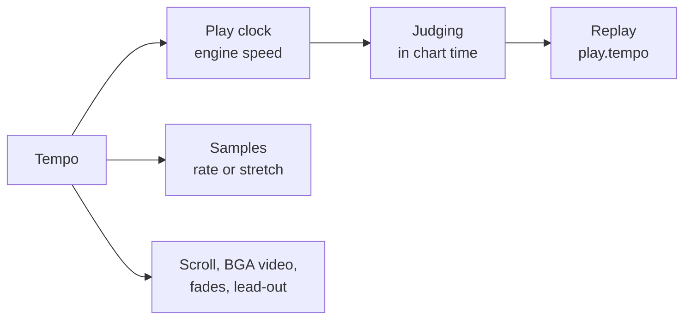

A live change (`setTempo(tempo)` on a play screen, `pitch` mode only) goes to the engine as a `{ kind: 'tempo' }` input command. The engine re-anchors its clock at the chart time it takes the command, so chart time stays continuous, and reports the change (`onTempoChange`) with that chart second. From there the view's clock, the samples started afterwards and the ones playing (their `playbackRate` glides to the new rate over 30 ms, `WebAudioSession.setTempo`; bmson slices keep their length in sample time, so they still end on their note), the BGA videos and a NONSTOP chart's stage fades run at the new tempo. The replay records the change in `play.tempoChanges`; a play that ran at another tempo at any point is practice. A replay follows the recorded changes in `pitch` mode when its Replay / ghost options reproduce the tempo (`resolveReplayTempo`).

Everything runs `tempo` times as fast: the engine's clock (`PlayerOptions.speed`), the scheduled and triggered samples, the scroll and judge line, the BGA images and videos (`playbackRate`), the NONSTOP stage fades and the chart-time lead-out before the result. Skin animation timers stay on the wall clock. Judging stays in chart time, so a play's inputs and judgments do not depend on the tempo; the replay records it as `play.tempo` ([replay.md](./replay.md)) and a replay plays back at it. A play at another tempo is practice, as with beatoraja's frequency trainer: it is not sent to the Leaderboard (the status line says why; the server refuses it as `tempo`, see [leaderboard.md](./leaderboard.md)) and leaves the best records alone, while the replay is still auto-saved. A course can be played at another tempo too: every stage plays at it, and the run is then unranked and leaves the course record alone. Every family's play screen supports it: `createPlayScene` takes `tempo`, `tempoPitchMode` and `tempoStretchAlgorithm` in its settings.

### Phones and tablets

The player treats a device whose primary pointer is a finger (`(pointer: coarse)`, or a touch pointer on a phone-sized screen) as touch-first:

- **Touch play:** in the built-in and LR2 play screens, each lane is a touch zone from the lower part of the lane down to the bottom of the screen. Every finger presses, holds (long notes), and releases its lane on its own; sliding a finger into the next lane releases the old lane and presses the new one. Touches go through the same input path as the keyboard, so judgement, key beams, and replays behave the same. A pause button sits in the top-left corner during play; while paused it shows Quit.
- **Touch layout:** the built-in skins switch to the touch gameplay layout: equal-width lanes across most of the stage (keys up to 72 design px, about 58 CSS px on a landscape phone), a slightly lower judgement line, and no BGA. 24 / 48 KEY charts keep the standard layout. The Debug Menu's **Play layout** (Auto / Desktop / Touch) overrides the choice from the next play.
- **Select screen:** tap rows and buttons as with a mouse; swipe the list up or down to scroll it.
- **Effects:** the skin effect level starts at Reduced unless one was picked in the Debug Menu before.
- **Screen:** the page chrome steps off the stage (the search box only shows while typing, Help shrinks to an icon), the first tap on a phone asks for fullscreen in landscape where the browser allows it, and a phone held upright shows a prompt to rotate it.
- **Sound in silent mode:** iOS / iPadOS Safari treats web audio as ambient sound by default: it mixes with music from other apps, and the Ring / Silent switch mutes it. Where the browser has the [Audio Session API](https://w3c.github.io/audio-session/) (`navigator.audioSession`, Safari 16.4+), the start card (under "Drop to load") and the Debug Menu's **Audio** folder offer **Play in silent mode**, the same setting in both places. On (the default), the player sets the audio session type to `'playback'`, so sound plays with the silent switch on, but music playing in other apps pauses (and the system may show Now Playing controls). Off, it restores the browser default `'auto'`, which keeps web audio mixing with other apps and obeying the switch. The choice is remembered across reloads and applied before any audio starts, again on the first tap or key press (when the scenes start their audio), and when the page comes back into view. Other browsers have no such switch for web audio and show the setting in neither place. The first time sound starts on a phone or tablet with the setting off, a small dismissible hint at the top of the screen offers to turn it on; it shows once per browser and leaves by itself.

### How the player is built

The player's code (`packages/app-play/src`) is a bootstrap, a composition root, routes behind one scene router, the Debug Menu and its panels, and services that hold the state and rules the rest share.

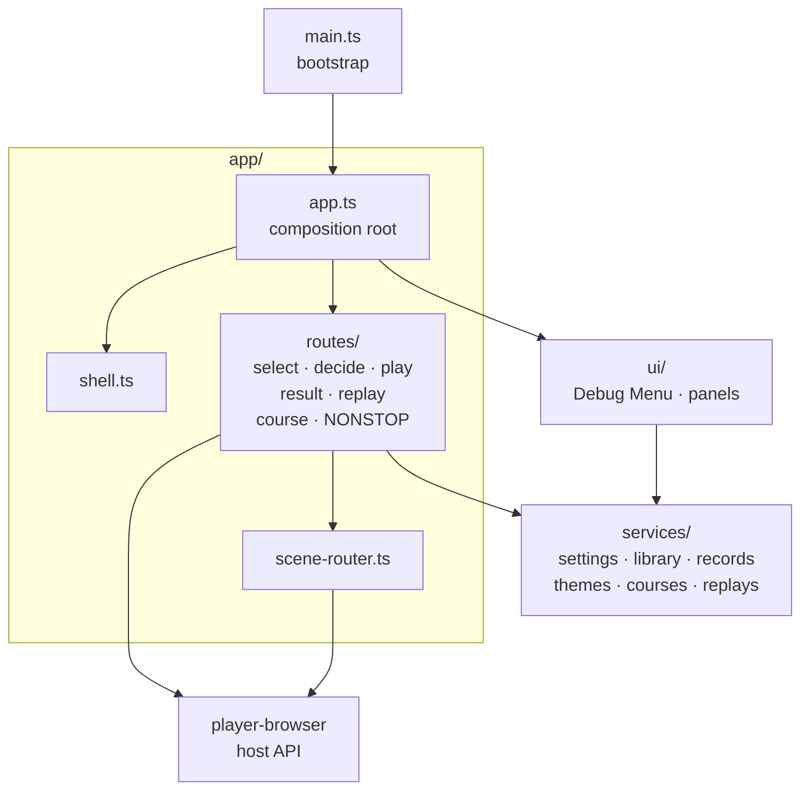

An arrow points from a module to one it makes or uses. The app also makes the scene router and the services, and hands them to the routes and the Debug Menu.

**Bootstrap.** `main.ts` writes the page's markup, runs the browser compatibility check first (so a browser that cannot start the renderer still shows why), marks phones and tablets, and wires the Help modal. Once the UI fonts are ready it makes the app, installs the [test hook](./course-checklist.md#test-hook) over it and starts it.

**Composition root.** `app/app.ts` (`PlayerWebApp`) makes the services, the scene router and the routes, and wires them to each other, to the Debug Menu and to the Leaderboard. It also holds the play lock: as a play starts it latches the Auto-save play history setting and disables the options the play latched, the skin controls other than Skin system, and Submit to Leaderboard; a result or the select screen coming back lifts it. Skin system swaps the play's family while the chart continues. `app/shell.ts` keeps the page around the stage in step with the scenes once the stage is mounted: the shell's `in-gameplay` state and the pinch zoom it blocks, the touch pause and quit buttons, and the canvas's double-click fullscreen with its `Esc` handling.

**Layers.** A service holds state and rules and takes what it needs of the app as deps: it imports no Tweakpane, `ui/` or `app/` module, not even a type ([Layering and size guards](./architecture.md#layering-and-size-guards)). The routes and the Debug Menu work through the services, and the routes put scenes on the stage only through the scene router, which owns every transition ([Scene lifecycle](#scene-lifecycle), [ADR 0006](./adr/0006-scene-router.md)).

**Select and decide.** `app/routes/select.ts` shows the select screen. The scene router keeps it across a decide screen, a play and its result, so every return shows the same scene again: the latest theme's skin and sounds and the library go onto it before it enters, and then the cursor goes back where it was (to the course bar after a course). It is made afresh only when another family takes it over. A chart started on it joins the course being made, if there is one, or goes to `app/routes/decide.ts`, which shows the decide screen with the play loading off stage behind it and then hands the stage to that play. Without a decide screen the chart plays at once.

**Play, result and replay.** `app/routes/play.ts` makes every play and shows it. A chart with no decide screen (a retry, F5, a course stage, a NONSTOP run or a replay) plays at once: the select screen goes off the stage, kept, and the play takes it, loads there and then starts. A play's settings come from `app/play-scene-options.ts`, a pure function of the Debug Menu's picks and the play options in force, with the lane options a course allows, a replay's recorded setup and the tempo chosen. A play puts what it was made with in force only as it takes the stage: its start, which R on its result plays again, the record keys its result is kept under and its beatoraja play entry. A play loading behind a decide screen that is backed out of therefore changes none of them. `app/routes/result.ts` shows the result of a play, a course stage, a course run or a NONSTOP run on the result skin of the family that draws it, with the play's last samples ringing out behind it. It keeps the record, saves and ranks the replay, and leads on to the next stage, to R's retry or back to the select screen. `app/routes/replay.ts` plays a dropped replay back once it finds the chart the log was recorded on: by the chart file's hash, then by its path, then by title and artist.

**Courses.** A course bar started on the select screen goes to `app/routes/course.ts`: it starts the course maker for a NEW COURSE bar, draws a random course's stages from the library, shows an EXPERT or GRADE course's decide screen, plays its stages one by one and shows its course result. `app/routes/nonstop.ts` stitches a NONSTOP course and plays it as one chart, stitches it again on F5 or R, and shows the run's result. The run they act on is kept by `services/courses.ts`: the course between its stages, the AUTO it was started with (which every stage and every restitch takes) and where the select screen was, so that the cursor comes back to the course bar afterwards. A navigation the scenes did not ask for (a drop, a skin change) ends the run through the scene router's interrupt.

**Library and records.** `app/drop-target.ts` takes a drop or a pick from the Debug Menu's Open folder / Open files: it shows the loading overlay, takes the select screen off the stage and reads the files, a drop's items before its handler first waits on anything, since the browser empties a drop once the handler returns. `services/library.ts` sorts what was read and keeps the library: charts go to the song collection, theme files to the LR2 and beatoraja theme loaders, course files and saved table headers to the course folders, and replays to a replay. It also loads the `?music=` / `?skin=` archives and imports difficulty tables by URL. `services/records.ts` keeps the [best records](#best-records) and the chart hashes they are keyed by, and `services/course-maker.ts` the [courses the player makes](#courses-and-dan-certification).

**Themes.** The themes a drop brings are kept in `services/themes/`. `lr2.ts` holds every LR2 theme the drops brought and mounts one: its skins, BGM and system sounds, and its skins parsed again for a course. `beatoraja.ts` holds the beatoraja theme and loads its entries as scene kits, each by the entry the Debug Menu picked for its skin type and with the player's options for it. `built-in.ts` holds the be-music skin the built-in family draws with, its stored settings and the skins added. `app/family-kits.ts` picks the family that draws each screen (the Debug Menu's Skin system, or beatoraja, then LR2, then built-in) and the kit and select-screen sounds it draws with.

**Replay slots.** `services/replay-slots.ts` keeps the four replays per chart and per course ([replay.md](./replay.md#replay-slots)): `ReplaySlotStore` holds every slot's record in memory once loaded and reads a replay from IndexedDB (`services/replay-slot-database.ts`, the `be-music-replays` database, apart from the player's `be-music` one) only when it is played; the slot keys, the auto-save rules and the size budget's eviction are pure functions next to it, and `ReplaySlotStore` is the API a course replay played from a slot uses too. `services/replay-slot-service.ts` gives a result screen its slots (`ResultReplaySlots`: saved by hand or by the slots' rules, once per slot) and the select screen a bar's. `replay-slots-panel.ts` is the card that stands in for a replay-slot UI on the built-in, Native and LR2 skins: on a result it saves into a slot, on the select screen it lists the bar's replays with Replay, Download and Delete. A beatoraja skin draws its own slots, and the card stays hidden.

**Replays, recording and status.** `services/replays.ts` names the player as the recorder of the replays it writes (`REPLAY_RECORDER`: `be-music-web`, its version and the commit it was built from) and auto-saves them: a play's log as its result shows and a course's as its course result shows, each by the Auto-save play history setting as it was when the play (for a course, its last stage) started. `services/recording.ts` keeps what the Capture folder's video recording and screenshots need between plays: a recording armed on the select screen, which starts with the next play, the file name the next recording is saved under (the chart's title) and the video format picked. The recording itself is `recording-controller.ts`, and the scene router finalizes one in progress on every transition. `services/status.ts` keeps the status line, the Debug Menu's Status row that the test hook logs, and whether it describes a play or a result: the select screen replaces such a line with a summary of the library when it comes back.

**Test hook.** `services/test-hook.ts` answers the end-to-end suite's [test hook](./course-checklist.md#test-hook) (`window.__beMusicTest`). At each read it takes the scene the router shows, the select screen's cursor and the record kept for the bar under it, the play on the stage, the library, the course run and the course being made; `test-hook.ts` adds what the app hands it: each result, replay and finished load. A read only looks: it answers at once, from what the app holds already. A bar's record is the current judge ruleset's, as the select screen shows it, and a chart's is found by the chart's hash once the select screen has hashed it, by its path before, so a read hashes no chart.

**Debug Menu.** The [Debug Menu](#debug-menu) is `ui/debug-menu/`: `DebugMenu` (`index.ts`) builds it, each folder in a module of its own, and reaches the app only through `DebugMenuDeps`, which the app fills with the settings, the library, records and course-maker services, readers of the app's state and the app's actions. The folder titles and their remembered open states are `folders.ts`, and the locks a play puts on the options it latched and on the skin controls are `play-lock.ts`. The beatoraja skin-options panel is `ui/beatoraja-skin-options.ts`.

## Browser loading model

- Dropped paths are normalized with the shared `@be-music/shared-utils/core` path helpers.
- Chart discovery accepts `.bms`, `.bme`, `.bml`, `.pms`, and `.bmson`.
- File lookup is case-insensitive so browser drops work with LR2 and beatoraja asset references that differ only by letter case.
- Large audio and video files stay as lazy `File` references by default. Image, skin, chart, and smaller metadata files are read into bytes during collection loading.
- Folder walking and file reads use bounded concurrency and progress callbacks so large folders can load without flooding the browser's FileSystem APIs or UI update loop.
- Parse errors are accumulated in the collection instead of aborting the whole drop.

## Courses and dan certification

Courses play through the same select → play → result scenes. See [Courses and dan certification](./course.md) for the rules.

- **Loading:**
  - A drop can carry course files: LR2 `.lr2crs` anywhere, beatoraja course JSON under a `course/` folder.
  - They are read with `readCourseFile` (`@be-music/player-browser/collection`).
  - The player hashes the library's chart files (cached per song) and matches each stage by SHA-256, then MD5 (`resolveCourseFolders`).
  - Course files dropped on their own match against the songs already loaded.
  - A difficulty table's courses can be imported by URL: Debug Menu → Course → **Table URL**, then **Import table courses**. The URL may be the table page (its `bmstable` meta names the header) or the header JSON. The player fetches it with `fetchTableHeaderCourses` (`@be-music/player-engine/course`, see [Loading a table from its URL](./course.md#loading-a-table-from-its-url)); the song list behind `data_url` is not loaded.
  - Most table sites do not allow other pages to read them (no CORS headers), and the player does not proxy them. When the fetch is blocked, the status line says to save the table's header file instead (the JSON its `bmstable` meta names, usually `header.json`) and drop it: a dropped `header.json` that holds courses is read the same way, under the table's `name` (`readTableHeaderFile`).
  - The table becomes one course group labelled with its name. Importing a table again, or another source with the same label, replaces that group. Imported URLs are remembered in `localStorage` and imported again on the next visit.
  - Known limitation: the browser fetches the table directly, so a table whose server does not send CORS headers (`Access-Control-Allow-Origin`) cannot be imported; many tables do not. The status line then says the site could not be fetched. A header JSON served from an origin that allows cross-origin reads (or from the player's own origin) imports.
  - beatoraja's command-folder file (`folder/*.json`) adds its random courses: each folder with any becomes a course folder. A random course is listed with its stage titles (or filters), lights beatoraja's `OPTION_RANDOMCOURSEBAR` (1031), and draws its stages from the library when it is started (`drawBrowserRandomCourse`). A stage that matches no chart leaves the course unstarted with a status message. Successful draws are kept as fixed, timestamped bars at the end of their source folder (100 across all folders, for the session only); the cursor returns to the new bar, which can replay the same stages without drawing again.
- **Select:**
  - Each course file is a folder bar listed after the chart folders. Inside it, every course is a course bar (`LibraryEntry` `kind: 'course'`).
  - A course with a stage missing from the collection is listed but cannot be started.
  - On the LR2 and built-in selects the key-mode filter applies to course bars too, as LR2 lists courses by their key mode (OpenLR2 L18030-L18053): a course that names its key mode (`definition.keyMode`: LR2 `line`, a table's `mode`) is listed only under it, and one that names none stays listed.
  - Skins:
    - The be-music skins show the course name, its stage count and the missing stages.
    - LR2 skins use the `courseFolder` and `course` bar bodies, and for a NEW COURSE bar and a RANDOM MIX bar or random course the `courseCreate` (7) and `randomCourse` (9) bodies, falling back to `course` (8).
    - beatoraja skins light `GRADEBAR` (op 3) and draw the `bar-grade` frame, or `bar-nosong` when a stage is missing.
- **Play:**
  - Starting a course shows the decide screen once, before the first stage, naming the course as LR2's does (the selected bar's title); backing out of it drops the course. A NONSTOP course's quick retry skips it, as LR2's does.
  - The stages play in order, as a `CourseRun` runs them (see [The course run](./course.md#the-course-run)). Each stage runs with `PlayerOptions.course`: the course kind, its gauge set and judge constraint, and the gauge value and course combo the previous stage left.
  - Dismissing a stage's result starts the next stage. With **Skip stage results** on (Debug Menu → Course), the next stage starts as soon as a stage ends, and only the course result is shown.
  - A course played with AUTO skips the result of every stage the course goes on after, as LR2 does (OpenLR2 `Main.cpp` M1381-M1384); the last stage's result and the course result still show.
  - A stage whose gauge empties ends the course.
  - ESC gives the course up: the run is kept as a failed one (as LR2 records it) and the course result follows. F5 / quick retry is off.
  - The course constraints are applied:
    - lane options are limited as beatoraja's `MusicSelector` limits them (`resolveCourseLaneOptions`): `grade` turns both sides and DP FLIP off, `grade_mirror` keeps a 1P MIRROR and then plays 2P on MIRROR with FLIP on (any other pick turns them all off), and `grade_random` keeps the random family on each side;
    - `no_speed` locks the hi-speed (and on a beatoraja theme the lane cover, lift and HIDDEN cover);
    - `ln` / `cn` / `hcn` set the long-note mode of charts that leave it undefined;
    - an LR2 GRADE course (from `.lr2crs` or the course maker) also plays its stages with what LR2 resets when one starts: an EASY gauge pick plays on GROOVE, and HIDDEN / SUDDEN, auto scratch, DP FLIP and the tempo are off ([course.md](./course.md#lr2-lr2crs)). The player's settings are left as they are.
- **Result:**
  - After the last stage, or the failed one, the result scene shows the course as one run: summed judgments, the course max combo, the final gauge and the course lamp. Its graphs follow each family: LR2 skins and the built-in result draw the last stage's gauge and score graphs, as LR2 clears them at each stage (OpenLR2 L24151); beatoraja's course result draws every stage joined, each as wide as its chart is long, the EX score running on and an unreached stage at gauge 0 (`CourseResult.create`). A NONSTOP run draws its one stitched play.
  - Every family reads the run as one `PlayResult` (`playResultFromCourseRun`): the SCORE (a beatoraja skin's POINT) reads on the stage results' scale (LR2's 200000-point score over the course's notes, else the EX score), PLAY TIME adds up the stages played (a NONSTOP run's is its stitched play's), and the built-in skins head an EXPERT / GRADE course result `COURSE CLEAR` / `COURSE FAILED` (a NONSTOP run keeps `STAGE CLEAR` / `FAILED`, as one play).
  - The course replay (`*.bmcourse.json`, see [replay.md](./replay.md#course-replays)) is auto-downloaded when replay auto-save is on. Dropping it (or picking it with Open files) plays the run back as its course once every stage chart is loaded, each stage's result and the course result marked as a replay, and keeps nothing; a dialog lists the stage charts that are missing ([replay.md](./replay.md#playing-a-course-replay-back)).
  - The best lamp, EX score, max combo and BP are kept per course and judge ruleset ([Best records](#best-records)) and shown on its course bar: LR2 skins light the bar's lamp ops (100-105) and draw its `#SRC_BAR_LAMP` (song bars draw theirs from the chart records too), beatoraja skins light its `CLEAR_LAMP_*` op, and the be-music skins' course card names the best lamp and the trophy the bests earn (as beatoraja's `GradeBar` works it out: best EX score and fewest BP, cleared or not). A run played with AUTO on any stage (or a NONSTOP run played with AUTO) keeps no record, as an auto play keeps none for a chart.
  - Stage results count for the course and are not submitted to the leaderboard. As LR2 does for EXPERT and GRADE courses (OpenLR2 L9043-L9192), a stage played by hand at the chart's own tempo also updates its chart's best EX score, max combo and BP and its FULL COMBO lamp (PERFECT and MAX too), but not its clear lamp or play count. A NONSTOP run leaves the stage charts alone.
- **LR2 skins** (player-scene-model's `CourseView`: the decide screen's `course`, the play screen's `course.view` and the result's `result.course`; the select screen works it out for the course bar under the cursor):
  - Ops: a course bar on the select screen lights 3 (course bar), 5 when every stage is in the collection, 290 and its kind's op (291 NONSTOP, 292 EXPERT, 293 GRADE), and `700 + 10 × i + difficulty` for its stages 1-5 by each chart's `#DIFFICULTY` (ops 700-745; as LR2 reads 0 there, a missing stage and any bar that is not a course light the `x0` ops). During a course, play and result add the stage op: 280-288 for stages 1-9 that are not the last, 289 for the last.
  - A course stage plays on the play skin parsed again with those ops (`LR2ThemeSkins.loadSkin`), as LR2 reads a skin at each stage. The stage results and the course result do the same with their skins.
  - Numbers 250-259 read the stage levels; texts 150-154 the stage titles, 160-164 their subtitles and 170 the course title.
  - In an expert or grade course, numbers 104 / 105 (combo, max combo) and the combo next to the judgement (`#DST_NOWCOMBO`) count the whole course: the combo the previous stage left runs on until the first break (OpenLR2 L2019-L2034, L2516).
  - The gauge-type ops report the red gauge (43 / 45) for a course stage, as LR2 does for its course gauge.
  - The course result of an EXPERT or GRADE course shows on the theme's course-result skin (`#INFORMATION` type 15) when it has one, else on the result skin, and plays the sound set's `#COURSECLEAR` / `#COURSEFAIL` (stock `course_clear` / `course_fail`), falling back to `clear` / `fail`. A NONSTOP run shows on the result skin with `clear` / `fail`, as LR2 shows it.
- **beatoraja skins** (the course view of the play and result screens; beatoraja `BooleanPropertyFactory` / `StringPropertyFactory`):
  - Select: a course bar lights `GRADEBAR` (3; a random course lights `OPTION_RANDOMCOURSEBAR` (1031) instead, as beatoraja's `RandomCourseBar` is no `GradeBar`), `PLAYABLEBAR` (5) when it can start, and one `OPTION_GRADEBAR_*` op per constraint (1002-1007, 1010-1017), and names its stages on strings 150-159, marking a stage the collection lacks `(no song) <title>`.
  - Play and the stage results light `MODE_COURSE` (290) and the stage op: 280-283 for stages 1-4 that are not the last, 289 for the last. Strings 150-159 name the running course's stages.
  - `no_speed` locks the hi-speed, the lane cover, the lift and the HIDDEN cover, as beatoraja's `ControlInputProcessor` does: the arrow keys, PageUp / PageDown, Home / End, H / J / K, the wheel and the skin's cover buttons (acts 330-332) do nothing. Nothing changes, so nothing is saved for the next play either.
  - The course result shows on the theme's `COURSE_RESULT` skin (type 15), else its result skin, with `MODE_COURSE` lit and the title strings (10 / 12) reading the course title. It plays `course_clear` / `course_fail`, falling back to `clear` / `fail`.

- **NONSTOP:** the player plays an LR2 NONSTOP course as one chart: starting one stitches its stages with the shared NONSTOP pipeline (`prepareNonstopCourse` in `@be-music/player-engine/course`, which the Leaderboard rebuilds runs with: each stage's `#RANDOM` drawn and the course's long-note constraint applied; the player's `prepareNonstopPlay` adds the asset plumbing), plays the stitched chart on the gameplay family's own play screen (a beatoraja theme's play skin too), and shows the run's result from the stitched play's course log (`buildNonstopCourseReplay`), which is kept and auto-saved like other courses. As LR2 has no course-result step for NONSTOP (OpenLR2 `Main.cpp` M1406-M1412), the run shows on the result skin (not the course-result one) with the `clear` / `fail` jingles. F5 during the play and R on the result restitch and replay the course, as LR2 allows quick retry there (L2854). Debug Menu → Course → **NONSTOP placement** picks the intended placement (default) or LR2's exact one, and **Pitch** (shared with the [play tempo](#play-tempo)) picks how a FIT stage follows the previous stage's tempo: **Pitch follows tempo (LR2)** (default) plays its samples faster or slower, so the pitch moves with the tempo, while **Keep pitch** stretches them in time when they load and keeps their pitch. **Keep-pitch stretcher** picks how: **Signalsmith Stretch** ( the MIT `signalsmith-stretch` WASM AudioWorklet, rendered offline once per rate with the samples laid end to end) or **WSOLA** (default; `timeStretchChannels`, built in and lighter). A browser that cannot run the former falls back to WSOLA. All of them apply from the next play. A NONSTOP course played at another tempo plays every stage at it, the FIT rates on top. In the scenes: a stitched NONSTOP chart plays from a composite asset source (`createNonstopAssets`): each stage's files are found the way that stage alone would find them (`#PATH_WAV`, codec and image fallbacks, LR2's parent folder) and named `s<stage>/<key>`, and the chart plays as `NONSTOP_CHART_PATH`. The play scene's `settings.nonstop` (the stitch map) plays each stage's samples at its FIT rate and runs its background sound through a per-stage gain that fades at the seams on LR2's `volume²` curve; the player's keysounds are not faded. Pausing suspends the audio context, which holds the fades with it. On an LR2 skin the play is parsed once with the first stage's ops, as LR2 reads it; the stage ops (280-289) and title text 10 then move to a stage only when it follows a BLANK connection (`resolveLR2NonstopStage`), so after FADE or CUT the earlier stage stays shown, and title text 10 reads the course name until then. LR2's select texts 171-179 name the selected NONSTOP course's connections (`FADE`, `FADE+FIT`, `CUT`, `CUT+FIT`, `BLANK1`, `BLANK2`) and read `DISABLE` on any other bar; the connection buttons 240-248 step the connections of a course the player made. Its BGA keeps one base / layer / POOR stack per stage (cues split by the stage that owns each BMP key) and crossfades them linearly over 3 s around each seam; during a POOR each stage's own POOR image replaces that stage's base and layer, with no `#BMP00` fallback. LR2 instead draws one stage's three images each frame, picked at random by the crossfade weights (`LR2body.exe` 0x4350df), so the crossfade is its average. A beatoraja theme's play skin draws the same stacks at the same crossfade (`resolveBGAStacks`), each collapsed to one image (POOR over layer over base) as its BGA layer draws one. The BPM readouts (LR2 NOWBPM and the built-in HUD) show each stage's own BPM × its FIT rate (`map.tempo`), while the scroll stays at the stitched 150 BPM, and the engine gets `map.stageRanks` so each later stage is judged with its own `#RANK` (a replay uses the ones its log recorded).
- **Making courses:** as on LR2, the player makes their own courses on the select screen (`CourseMaker`; see [Making a course](./course.md#making-a-course)).
  - The root lists `MY COURSES` (LR2's EXPERT courses), `MY NONSTOP` and `MY DAN` (GRADE) folders (`resolveCourseMakerFolders`), each with the player's courses and a NEW COURSE bar last. Deciding NEW COURSE starts making a course of that kind; from then on, deciding a song adds it instead of playing it, and deciding one more once there are five saves the course.
  - `MY COURSES` and `MY NONSTOP` end with a RANDOM MIX bar, as LR2's do (see [RANDOM MIX](./course.md#random-mix)). Deciding it draws a course of that kind from the library in the key filter's key mode (7 under ALL), keeps it as the folder's newest course `RANDOM MIX` in place of the previous draw, and plays it; AUTO on it plays the draw on AUTO. When no chart can be stage 1, the status line says so and nothing starts.
  - LR2 skins: ops 571 / 572 (making or not; in `LR2body.exe` op 571 falls through to 572 and is true whether making or not, a bug be-music does not reproduce), 590-599 (songs added so far) and 580-589 (the selected course has more than N stages), timers 17 / 18 (making starts / ends), texts 150-154, 160-164 and 170 (the songs, their subtitles and the name being made, a prompt while the name is empty) 190-196 (the RANDOM MIX settings) and 198 (the default connection), and buttons 230 (save), 231 (cancel), 233 (delete one's own course, after a confirmation), 240-248 (a connection of one's own NONSTOP course), 260-266 (the RANDOM MIX settings: favorite level, max / min level, BPM range, max / min BPM, stage count; each plays the option-change cue) and 268 (the default connection). Clicking text 170 focuses the name field.
  - Every skin: a card shows the course being made (name, songs, default connection, constraints, Remove last / Cancel / Save), and Debug Menu → Course → **My courses…** opens a dialog to rename courses, change a NONSTOP course's connections, set constraints, delete courses, set the RANDOM MIX settings and export the courses as a `.lr2crs` file or a beatoraja course `.json` (which keeps the constraints).
  - Constraints, as beatoraja's course editor sets them: lane option (free / off only / off or MIRROR / random family), hi-speed lock, judge (no GREAT / no GOOD), gauge (LR2, 5 / 7 / 9 / 24 keys) and long-note mode (not for NONSTOP). A new GRADE course starts as an LR2 grade (off only, LR2 gauge); the others start free.
  - The courses, the RANDOM MIX settings and which course is each folder's last draw are kept in IndexedDB (`be-music`, the courses as `.lr2crs` text with the stage titles) and listed again on the next visit.

## LR2 skin and theme support

The core parser handles LR2 CSV skin files for select, decide, gameplay, and result scenes.
Play skins are grouped by key variant (`5`, `7`, `9`, `10`, `14`) so a chart can pick the matching layout at play time.

Implemented skin features include:

- `#INCLUDE` resolution relative to the current skin file
- `#CUSTOMOPTION` and `#CUSTOMFILE`
- `#SRC_IMAGE`, `#DST_IMAGE`, numbers, text, sliders, bars, gauge, judge line, measure line, BGA, and graph-like result elements
- LR2 timer and op condition evaluation used by the default LR2 skins
- `#LR2FONT` bitmap fonts and system-font text fallback
- TGA image decoding and DXA archive extraction
- Case-insensitive and wildcard asset lookup for LR2 theme files

The player also loads LR2 theme BGM and system sounds for select and decide screens when those files exist in the dropped theme.

See [LR2 skin implementation notes](./lr2-skin.md) for the renderer-independent parser and theme-loader boundary.
The default LR2 skin is the verified compatibility target; custom themes work best when they stay within the implemented directive families.

The select scene exposes in-scene LR2 PLAY OPTION controls for hi-speed, autoplay, BGA mode/size, filters, sort, HS-FIX, HIDDEN/SUDDEN, lane cover, auto scratch, DP flip, 1P/2P random and mirror modes, and gauge variants.
Select-time options are carried into gameplay during chart preparation.
The selected gauge is passed to the shared engine, which resolves it against the active ruleset's gauge line-up and runs its curve (HARD really drains, DEATH really ends the run); a replay runs the gauge recorded in its replay. Independent 2P gauge math is not wired yet.

The groove-gauge bar renders as LR2's 50 beads (2 % each) using the single `#SRC_GROOVEGAUGE` 4-cell sprite (`表赤/表緑/裏赤/裏緑` = lit-red, lit-green, unlit-red, unlit-green). Beads at or above the 80 % clear border use the green cell; below it they use red. Survival gauges (HARD / DEATH) have no clear border in LR2, so the whole bar renders red. The bar tracks the live gauge value only — there is no peak-hold / afterimage bead (LR2 has none). The bead cell-selection logic is the pure `resolveGrooveGaugeBeads` helper in `view/lr2/play-hud.ts`.

Scene-independent LR2 Pixi helpers live in [`skin/lr2/render.ts`](../packages/player-browser/src/skin/lr2/render.ts) and
[`skin/lr2/scene-render.ts`](../packages/player-browser/src/skin/lr2/scene-render.ts). They handle destination keyframe evaluation,
sprite transforms, source-cell selection, text rendering, numbers, sliders, and bargraphs. The LR2 family views (`view/lr2/`)
keep the timers, `@be-music/skin-lr2/state` resolves the values, and the scene sessions own the input.

## Default skin family

The built-in default family is the skinless path used when no LR2 or beatoraja theme is available, or when the host
explicitly chooses the default family. It provides select, gameplay, and result presentation without requiring theme
files.

The family draws every screen through a be-music skin, a code-defined skin built on the public
`@be-music/player-skin-sdk` package. See [Writing a be-music skin](./be-music-skin.md) to make one.

The play screen (`createPlayScene`, [The play screen](#the-play-screen)) shares the play session (the engine, the
audio bus and the input) and the shared playfield and BGA renderer with the LR2 play screen; the be-music skin draws
its chrome. The LR2 play view does not import the be-music renderer, and LR2 skin rendering remains tied to parsed
`.lr2skin` data.

Default gameplay chrome uses the lane geometry helpers of `@be-music/player-skin-sdk` (`lane-geometry.ts`). Scratch lanes are
wider than key lanes, 2P scratch lanes render on the right side, and DP layouts preserve the single-side lane width
instead of shrinking every lane to fit both sides into the original SP footprint. The default family uses LINE Seed JP
for general text and Azeret Mono for judgment and combo readouts.

## beatoraja skin and theme support

`@be-music/player-browser` consumes `@be-music/skin-beatoraja` through `loadBeatorajaThemeFromFiles()`.
The package discovers JSON and Lua skin entries, then the browser layer loads sources, textures, fonts, theme BGM,
and system sounds from the same dropped bundle.

Each beatoraja scene loads its skin entry as a scene kit with `loadBeatorajaSceneKit()` (`@be-music/player-browser/skin`):

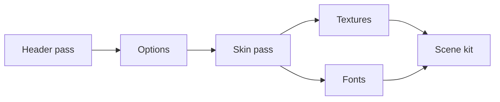

- The skin is loaded twice. The header pass reads `property[]`, `filepath[]` and `offset[]`, whose defaults seed the player's options for the entry (`defaultBeatorajaSkinConfig`); the skin pass runs a Lua skin's `main()` with those options. Options the host already holds (a skin-options change) load it once. Decide and result skins get a load-time `main_state` with the chart's difficulty ops (`createBeatorajaSkinLoadContext`), as ModernChic works out its colours in `main()`.
- `source[]` is resolved against the theme's files (`bundleBeatorajaSources`, with the options' `filepath[]` picks) and decoded to textures, and `font[]` is registered.
- A chart's own images for the skin's synthetic slots -100 to -102 (`#STAGEFILE`, `#BACKBMP`, `#BANNER`) load with `loadBeatorajaChartImages(chart, source)`, looked up next to the chart, then at the source's root. The beatoraja decide and result views load them themselves.
- The host keeps one `BeatorajaSceneKitCaches` (the web player's is in `services/themes/beatoraja.ts`): the textures, fonts and options of each entry, by entry path, so the next scene on the same entry reuses them. Textures are never destroyed, as PixiJS v8 crashes when the same bytes are decoded again after a destroy; a new theme forgets them and disposes the fonts (`releaseBeatorajaSceneKitAssets`).

Implemented beatoraja browser features include:

- Select, decide, gameplay, and result scenes backed by `BeatorajaPlaySkinView`; every one is a family view, made with `createSelectScene`, `createDecideScene`, `createPlayScene` and `createResultScene` ([The select screen](#the-select-screen), [The decide screen](#the-decide-screen), [The play screen](#the-play-screen), [The result screen](#the-result-screen))
- Play variants `5`, `7`, `9`, `10`, `14`, `24` and `24d`, each mounted for the charts of its variant (`pickBeatorajaPlayableSkinVariant` falls back to a near variant when the theme has none)
- Skin `property[]`, `filepath[]`, custom offsets, category groups, and mid-session `replaceSkin()` refreshes
- Runtime `TIMER_*`, `OPTION_*`, `TEXT`, and `NUM` wiring for score, combo, judge, gauge, chart metadata, clear lamp, rank, and play options
- Beatoraja-style notes, LN/CN/HCN caps and bodies, lane markers, BGA still/video layers, judge popups, timing visualizers, gauge graphs, BPM graphs, note-distribution graphs, and result score/gauge history graphs
- Select-screen browsing on the player-scene-model browse model (folders, search, the MODE key filter and SORT cycles, favorites), chart preview playback, select BGM, navigation system sounds and the skin's Lua sounds through the audio service
- Decide and result BGM, chart-image synthetic slots for `STAGEFILE` / `BACKBMP` / `BANNER`, and loading-progress visuals

See [beatoraja skin implementation notes](./beatoraja-skin.md) for the renderer-independent parser and theme-loader boundary.
The default beatoraja skin is the primary compatibility target. Community themes work best when they use the normalized element families and runtime IDs listed there.

## Scene lifecycle

The browser player uses one `PixiSceneHost` (`host/scene-host.ts`) for the whole session.
The host owns a single PixiJS `Application`, shows one scene at a time, serializes scene transitions, and destroys the renderer only when the host is disposed.

The LR2 and beatoraja paths each provide the same high-level scene set; the default family shows a decide screen only when its be-music skin declares one:

- Select scene for chart browsing, preview playback, and skin-side interactions
- Decide scene for the short transition before gameplay when the active family supplies one
- Play scene for notes, lanes, BGA, HUD, judgment, audio, and recording taps
- Result scene for score summary and skin-rendered result presentation

Every scene, built-in, LR2 and beatoraja alike, implements `PixiScene`, and a host changes scenes only with `setScene`:

- `root` is the container the host puts on the stage while the scene shows. A scene builds its scene graph under it and never adds itself to the stage.
- `identity` is `{ kind, family }`: the screen (`select`, `decide`, `play` or `result`) and the skin family drawing it (`built-in`, `lr2` or `beatoraja`). `getCurrentScene()?.identity` says what is showing; the player's test hook reports the identity of the scene its scene router shows.
- `enter(host)` runs each time the scene becomes the active one, before the host puts `root` on the stage. The first entry builds the scene graph and wires input and ticker work; a later one resumes what `exit()` paused and starts the screen's entrance again.
- `exit()` runs when another scene takes over or the stage is cleared, before the host takes `root` off it. The scene's ticker work, input and its own screen sound (BGM, preview, jingle) stop; it can be entered again.
- `dispose()` releases everything. The scene's owner calls it: `setScene` only exits the scene it replaces.

`SessionScene` ([Scene sessions and family views](#scene-sessions-and-family-views)) keeps the same contract, with its `identity` taken from its session and view.

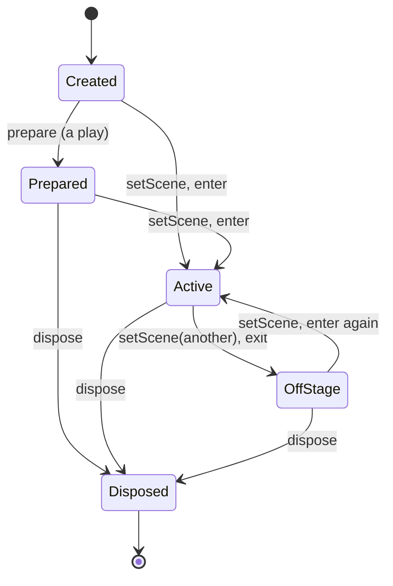

What a scene shows is handed to it before it is shown: the options of `createDecideScene` for every decide screen, the options of `createResultScene` for every result screen, the options of `createPlayScene` for every play screen, and the options of `createSelectScene` for every select screen.

In the web player the scenes' owner is its scene router (`app/scene-router.ts`, [ADR 0006](./adr/0006-scene-router.md)); the app (`app/app.ts`) and its routes never call `setScene` or `dispose` themselves. Every transition finalizes a video recording in progress, then calls `setScene(next)`, so the scene showing exits as the next enters and the stage never shows an empty frame, and then disposes the scene that left. Transitions run one at a time. A transition belongs to a navigation, and a scene made for a navigation that a newer one replaced (the select screen back while a result was still loading) is disposed instead of shown. While files load (a drop, a file pick, a URL), the select screen goes off the stage when it is showing, leaving no scene up, and comes back once they are read.

- **The select scene is kept alive.** Every family's select screen stays across a decide, play and result: their `exit()` stops the BGM and the chart preview and the drawing, and they keep their cursor, browse state and decoded BGM. Entering again restarts the scene timers, so the skin's entrance plays again, and the BGM; the preview starts again once the cursor is on another chart than the one it left on. The screen (`createSelectScene`) stops its sounds with `stopOwned` and detaches its input on exit. The player's router holds it as its select scene and never disposes it on a transition; picking another LR2 theme or skin family, a theme of another family taking over, or Escape at the root of a beatoraja select screen drops it (`dropSelect`), and the next select screen is made afresh.
- **A play loads off stage.** `prepare()` parses the chart and decodes its audio without touching the stage or adding listeners, so the player prepares the play behind a decide splash (the router's `prepare`). When the splash is done, `setScene(play)` exits the decide scene and enters the play prepared behind it, then `start()` begins it; keys pressed during the splash reach only the splash. The splash, the play and its preload share one navigation, so a splash left with Escape drops the play prepared behind it, and a preload that fails makes the play again with the splash's `#RANDOM` draws (`preResolved`). Without a splash the player takes the select screen off the stage while it makes the play, shows the play first, and a `prepare()` that runs while the play is showing draws the playfield in its loading state.
- **A play's sound outlives its screen.** The gameplay scene's `exit()` stops its drawing and input but not its sound, so the result shows while the last notes ring out; the router then disposes the play with `preserveAudioTail`. A course stage whose result is skipped leaves the stage the same way, and the next stage shows with no screen in between.
- **Decide and result scenes are one-shot.** Entered again, they restart their timeline; the router disposes them once another scene has taken the stage. A result screen that leads to the next stage or a retry leaves the stage first, so it takes no keys while the next play loads.
- **A navigation from outside ends the run.** A navigation the scenes ask for carries their run on: a play's result, a result's next stage or retry, a course's decide screen and stages (`continuesRun`). Any other one (a drop, a skin or theme change, files, a URL or a replay loaded) interrupts it: as it begins, the router calls the player's `onInterrupt`, which ends a course run, so the next single play is not taken for a stage, and the select screen comes back on the course bar. The Debug Menu's skin controls that would go back to the select screen (Built-in skin, Skin effects, LR2 theme and the Add skin buttons) are disabled during a play. Skin system stays enabled, and dropping an LR2 or beatoraja skin onto the play swaps the drawing family without ending the chart. A drop that also brings charts still returns to the select screen. The select screen takes the new family when the play returns.

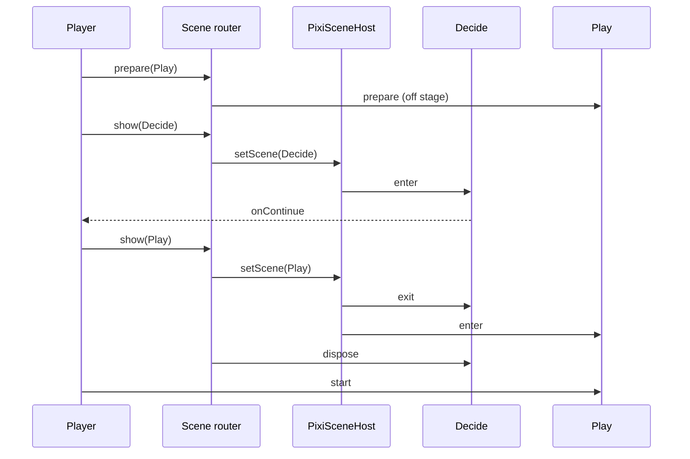

### What the gameplay families share

Every play screen is the one play session drawn by its family's view ([The play screen](#the-play-screen)), so everything that decides how a play sounds, looks and ends comes from one place and the families cannot drift apart:

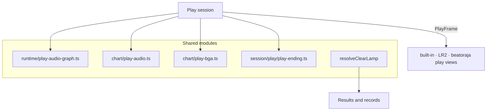

- `runtime/play-audio-graph.ts` builds the play's AudioContext and bus (with `#VOLWAV`); the audio service opens it for the play ([Audio service](#audio-service)).
- `chart/play-audio.ts` decodes the `#WAV` samples into it under the key the audio session looks them up by, stretches them for a keep-pitch tempo, and folds the `#WAVCMD` / `#EXWAV` volumes.
- `chart/play-bga.ts` picks the BGA resources a play needs (`#BMPxx`, bmson `bga.header`, the sources of `#BGAxx` sub-regions, the implicit `#BMP00` POOR image for the LR2 view), decodes stills through the shared texture loader and videos through the video loader, keys the BMS layer track's black out, and cuts the sub-region views.
- `session/play/play-ending.ts` times the end of a play (`resolvePlayEnding`, `beginExitSequence`). A play that reaches its end holds a lead-out of about two measures after the last note, in chart time, then raises `exit-fade-out` (LR2 timer 2, beatoraja `TIMER_FADEOUT`) and leaves after the theme or skin fade-out (LR2 `#FADEOUT`, beatoraja `fadeout`); Escape and F5 run the same fade-out. A play cut short by its gauge emptying stops at once, as LR2 and beatoraja do: it raises `exit-close` (LR2 timer 3, beatoraja `TIMER_FAILED`) and no fade-out, cuts the sound, and shows the result after the skin's close time (LR2 `#CLOSE`, beatoraja `close`); a theme without one (the built-in skins) holds 1.5 s and fades its picture. The views fade the picture with `playEndingFadeAlpha` (`view/shared/play-frame.ts`).

  ```mermaid
  flowchart TD
    how{How the play ends} -->|chart end, ESC, F5| fade[exit-fade-out: timer 2]
    fade --> next[Next screen after the fade-out]
    how -->|gauge emptied| stop[exit-close: timer 3, sound cut]
    stop --> result[Result after the close time]
  ```

- `resolveClearLamp` (`@be-music/player-engine/ruleset`) is the one clear-lamp rule. Every result lamps a play with it: the LR2 / default result (and the LR2 result's lamp ops 101-105, on LR2's lamps), and the beatoraja result and select through `beatorajaClearLampOp`; the player records every family's plays with it, and the Leaderboard ranks them with it. It keeps the lamp to the judge ruleset's own set: under LR2 and That-Which-Must-Not-Be-Named a full combo is the top lamp (no PERFECT or MAX), and under LR2 a DEATH clear is NORMAL.

## Scene sessions and family views

Every screen has one shape ([ADR 0001](./adr/0001-skin-families-only-draw.md)). A **scene session** holds a screen's behaviour once, for every skin family. A **family view** draws it in the family's skin. Every family's select, decide, play and result screens are built this way ([The select screen](#the-select-screen), [The decide screen](#the-decide-screen), [The result screen](#the-result-screen), [The play screen](#the-play-screen)).

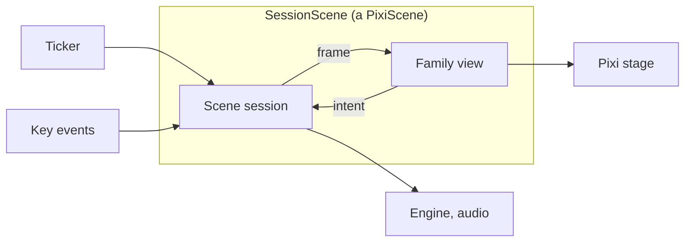

- **Family kit** (`host/family-kit.ts`). What a host hands a scene, per family: `{ family: 'built-in', skin }` (a be-music skin and the player's settings for it), `{ family: 'lr2', skin }`, or `{ family: 'beatoraja', kit }` (one theme entry, loaded: skin, textures, fonts, options and the theme's files). The kits are `SelectKit`, `DecideKit`, `PlayKit` and `ResultKit`.
- **Frames** (`view/types.ts`). On every tick the session gives its view a frame built over the scene models:
  - `SelectFrame`: the library, the `BrowseState`, the list and its cursor, the play options and the records;
  - `DecideFrame`: the chart, the chart as the play will play it, the course stage and the loading progress;
  - `PlayFrame`: the `PlayState`, the chart time, the notes, the held lanes and the events since the last frame;
  - `ResultFrame`: the `PlayResult`, the chart as the play played it and how the run is presented.
- **Intents.** The view sends back what the player asked for, per scene:
  - select: a browse command, start, a play option or a panel;
  - decide: continue or cancel;
  - play: a touch lane, the hi-speed, a cover, pause or quit;
  - result: continue or retry.
- **`FamilyView`**: `attach(host, emit)`, `draw(frame)`, `detach()` and `dispose()`. A detached view keeps what it loaded. The decide, play and result views also give their skin's timing: the input delay, the auto advance and the fade-out (and whether Escape waits for input too, as on beatoraja), and for the play, the load-end, play-start, fade-out and close offsets (an LR2 skin's, or a beatoraja skin's 1.5 s lead-in and fade-out).
- **`SessionScene`** is the `PixiScene` made of a session and a view:
  - `enter(host)` attaches the view, starts the session and draws a first frame.
  - The ticker asks the session for a frame and has the view draw it.
  - Key events go to the session as plain data, except while a text field has the focus. The view's intents go to the session while the scene is entered.
  - `exit()` detaches both and keeps them for the next `enter`; `dispose()` ends them.
- **`PlayfieldSkin`** is what a family's skin gives the shared playfield: the stage, the lanes, the note, measure-line and bomb images, and the effect lengths. A play view also hands the shared frame pass its own drawing around the playfield, as a **`PlayChrome`**: its layers, its chrome, its late text and what it stops when a bomb goes out. Together they replaced the hooks the subclasses of the removed `CoreGameplayView` overrode:

  | `CoreGameplayView` hook                                   | Replaced by                                                                  |
  | --------------------------------------------------------- | ---------------------------------------------------------------------------- |
  | `stageSize`                                               | `PlayfieldSkin.stage`                                                        |
  | `themeOwnsPlayfield`                                      | `PlayfieldSkin.ownsLanes`                                                    |
  | `resolveThemeLaneRect`                                    | `PlayfieldSkin.laneRect`                                                     |
  | `resolveThemeNoteCell`                                    | `PlayfieldSkin.noteCell`, by channel                                         |
  | `renderThemeMeasureLines`                                 | `PlayfieldSkin.measureLines`, placed by the playfield                        |
  | `collectBGATargets`                                       | `PlayfieldSkin.bgaTargets`                                                   |
  | `renderBombEffects`                                       | `PlayfieldSkin.bombCell`                                                     |
  | `resolveBombDurationMs`                                   | `PlayfieldSkin.bombDurationMs`                                               |
  | `resolveKeyOnFadeMs`                                      | `PlayfieldSkin.keyOnFadeMs`, by channel                                      |
  | `themeTiming`                                             | `PlayView.timing`                                                            |
  | `onThemeEvent`                                            | `PlayFrame.events`, read in `draw`; a retired bomb, `PlayChrome.bombRetired` |
  | `updateThemeState`, `renderThemeLayer`, `renderThemeText` | `FamilyView.draw`, around `PlayChrome.draw` and `drawText`                   |
  | `attachThemeLayers`                                       | `PlayChrome.attachLayers`                                                    |
  | `prepareTheme`                                            | the view's loading, run by the session (`PlaySessionTheme.prepareView`)      |
  | `disposeTheme`                                            | `FamilyView.dispose`                                                         |

  The LR2 lane index and LR2 timer ids stay inside the LR2 view: the session keeps the key beams by channel (`keyBeamStartedAt`, `keyBeamFadeStartedAt`), and the playfield asks by channel.

- **Layering.** `pnpm run check` keeps the sessions, the views and the layers under them apart ([Layering](#layering)).

### The select screen

`createSelectScene(kit, options)` (`@be-music/player-browser/host`) makes every family's select screen: a select session (`session/select/select-session.ts`) drawn by the view of the kit's family, as a `SessionScene` to show with `setScene`. A built-in kit (`{ family: 'built-in', skin }`) is drawn by the built-in select view (`view/built-in/select-view.ts`), an LR2 kit (`{ family: 'lr2', skin }`, the theme's select skin) by the LR2 select view (`view/lr2/select-view.ts`), and a beatoraja kit (`{ family: 'beatoraja', kit }`, the theme's select entry loaded with `loadBeatorajaSceneKit`) by the beatoraja select view (`view/beatoraja/select-view.ts`). The built-in and LR2 views share the pointer input (`view/shared/select-pointer.ts`), and every view draws the README overlay.

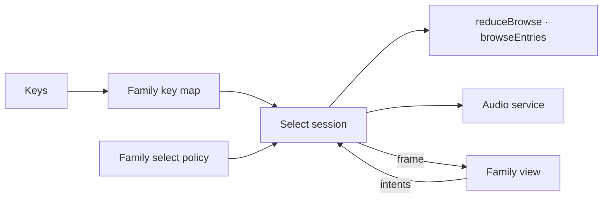

- **Options.** `library` (the collection, with its charts' files), `browse` (a `BrowseSnapshot` to open on), `playOptions`, `records` (the best records for the bars and panels), `sounds` (the theme's `SystemSoundSet`), `audio` (the host's audio service), `courseMaker` (the player's own courses and the course being made, for an LR2 skin) and `on`: `start(entry, { autoPlay })`, `playOptions`, `search`, and the optional `readtext`, `courseMaker` (name or delete a course), `skinConfig`, `skinConfigChange` (a beatoraja skin changed its own options) and `exit`.
- **The scene.** `snapshot()`, `focused()`, `getPlayOptions()` / `setPlayOptions()` (the host's change, not reported back), `setLibrary()` (the same library redraws; a new one keeps the player's place over it), `restore()`, `refreshRecords()`, `setSearch()` / `setSearchEditing()`, `searchError()` (why a `?` chart filter expression searched for does not parse), `searchFieldRect()`, `setSounds()` and `updateKit()` (the player's settings for a be-music skin, another LR2 select skin, or a beatoraja select entry loaded again; the entry loaded before is taken without building anything again).
- **Keys** (`session/select/select-keys.ts`), by the family's key map. On the built-in and LR2 screens ↑ / ↓ move the cursor, Enter opens the folder or starts the bar, Escape, Backspace or ← back out of a folder. Space opens and closes the play-options panel; while it is open the 1P lane keys step its options (Z DP flip, S random, X 2P random, D gauge, C / V hi-speed, F auto scratch), and Escape closes it. On the beatoraja screen ↑ / ↓ move the cursor, Page Up / Page Down ten bars, Home / End to the first and the last bar, R to a random bar (beatoraja's random select), Enter opens the folder or starts the bar, Escape backs out of a folder (and leaves the screen at the root) and Backspace backs out of a folder only; it has no option panel. While the README overlay is open, the keys scroll or close it.
- **Pointer.** The view turns a click or a tap on a bar, a swipe and its glide, the wheel, and the skin's hit areas into intents: a be-music skin's PLAY, AUTO, search, play option and readme areas; an LR2 skin's buttons (`resolveLR2SelectButton`, `resolveLR2CourseMakerAction`: panels, the hi-speed, the play options, the sort and filters, PLAY / AUTOPLAY / READ TEXT, the course maker's), its search word and course name. A click on an LR2 bar moves the cursor the slots between and takes the bar. A click on a beatoraja bar takes it when it is the focused one, else moves the cursor onto it by the rows between; a beatoraja skin's buttons (`image[].act`) are PLAY, AUTO, PRACTICE (played as PLAY), READ TEXT, the song and chart favourites, and MODE and SORT, which step the browse position's key filter and sort (Shift steps back).
- **LR2 drawing.** The LR2 view draws the skin through `resolveLR2SelectState` and starts LR2's timers from what the frames report (`SelectFrame.events`): timer 0 at the entry and timer 1 after `#STARTINPUT`, timers 10-13 as the cursor moves (the bars slide by the move; a folder opened or closed slides them one bar), the panel timers 21-29 and 31-39 as option panels open and close, and timers 17 / 18 as a course starts and stops being made. The LR2 ids stay in the view.
- **beatoraja drawing.** The beatoraja view draws the select skin through `BeatorajaPlaySkinView`, its canvas fitted into the window, with the scene mapping of `@be-music/skin-beatoraja/scene`: the focused bar's ops, numbers and texts and the MODE, SORT and LNMODE image sets (`resolveBeatorajaSelectBarOps` / `Number` / `Text` / `RefValue` / `SliderValue`, over the browse position's list options and the bar's best lamp from `records`). The bar list sits at the skin's `songlist` anchor (`view/beatoraja/select/rows.ts`) and glides to the cursor, the short way round a wrap; the view also draws the focused chart's images and BPM and notes graphs, and a prompt with the number of matches while a search is applied. It reads beatoraja's timers off the frames: the scene timer (0) from the entry and the bar-change timer (11) whenever the bar under the cursor changes. The LNMODE button's choice stays in the view, as the browse model leaves it out (nothing plays it yet); the JUDGE TIMING button steps the skin's timing offset (number 12) and hands the options to the host (`on.skinConfigChange`). The ids stay in the view.
- **Replay slots.** With `records.replaySlots`, the session picks the first slot of the bar under the cursor that holds a replay whenever the bar changes and frames it (`SelectFrame.replaySlots`). On the beatoraja key map 4 and F pick the next one and V replays it (or plays the bar when none holds a replay); the beatoraja skin's replay buttons (19, 316-318) and `SelectScene.replay(slot)` replay a slot. A replay start reaches `on.start` with `replaySlot`. `on.focus` reports the bar under the cursor as it changes, for the host's replay-slot card.
- **Course maker.** The session runs an LR2 skin's finish, cancel and connection buttons on `courseMaker`; a connection, and a delete (through `on.courseMaker('delete', course)`, which the host confirms), only on the player's own course under the cursor.
- **Starting.** Enter, a click or PLAY / AUTO on a chart hands it to `on.start` after the be-music skin's launch outro (input waits meanwhile); a course is handed at once. The decide cue and jingle play when `on.start` does not return `false` ([The decide jingle](#the-decide-jingle)); a course with a stage missing plays the cancel cue.
- **Sound.** The session plays through the audio service. The select BGM (at half level, ducked under the preview) and the preview of the chart under the cursor are its own: the screen's exit stops them with `stopOwned`, and its next entry starts the BGM again. The cues and the decide jingle have no owner and play out. The preview follows the chart under the cursor, a search included; coming back with the cursor on the chart it left on does not start that chart's preview again until the cursor moves. A beatoraja skin's Lua sounds (`main_state.audio_*`) play through the audio service's skin sounds as the session's (`skinSounds.owned`), so they stop as the screen leaves too. A beatoraja theme's set (`systemSoundSetFromBeatoraja`) names its cues and select BGM by path, read from the theme's files (`audio.setTheme({ files })`), and has no decide jingle: the beatoraja decide screen plays its theme's decide sound.

The list, the browse position and the select policy work the same on every family, by the family's select policy:

- **The list.** The session keeps a `BrowseState` of the browse model of `@be-music/player-scene-model` ([Browse](./scene-model.md#browse)): commands go through `reduceBrowse`, the list drawn is `browseEntries`, and the folder and option cues come from `browseSystemSound`. On the built-in and LR2 screens the sort, the key filter and the difficulty filter stay in the play options (LR2's option panel, an LR2 skin's buttons, a be-music skin's play options, the host's `setPlayOptions`), and the list follows them; on the beatoraja screen the MODE and SORT buttons change the browse position's key filter and sort (beatoraja has no difficulty filter), which the play options leave alone. A sort or a filter change keeps the cursor on the bar it was on, or on its row, clamped, when the filter takes that bar out. A search change puts the cursor on the top. The key filter lists a chart under its own key mode, so a 24-key chart is listed only under ALL on an LR2 screen, whose key filter has no 24-key choice, and under 24 KEYS (or 24 KEYS DOUBLE) on the beatoraja one. Folder bars stay listed under every filter, and a course folder lists the courses of the filter's key mode and those that name none. The search matches a chart's title, subtitle, artist, genre or file label and a course's name, by the text trimmed. A search that starts with `?` is a chart filter expression (the SQL `WHERE` clause of beatoraja's random courses, [course.md](course.md#filter-columns)): the session reads each chart through `createCourseChartRecord`, resolved once per chart, with its `score` row from the records in force, so `refreshRecords()` lists again by the new records; the frame carries `searchError` while the expression does not parse, and the list stays unfiltered. The page's search field (`InlineSearch`) marks itself invalid and shows the reason just under it; the Native skin shows it under its own input. A sort orders the folder bars at the root by label too.
- **The browse position.** A `BrowseSnapshot` (`captureBrowse`) is restored with `restoreBrowse`: the search it was saved with, the folders walked by label as far as they are still found, each parent cursor on the bar of the folder opened from it (so backing out lands on it), and the cursor on the saved bar, found by its key, while it is still listed. The sort and the filters in force are kept on the built-in and LR2 screens; the beatoraja screen takes the snapshot's.
- **The select policy.** What the model leaves to the screen is the family's select policy (`session/select/select-policy.ts`): on the built-in and LR2 screens a back-out at the root does nothing, and a library of one chart folder opens it when there is no position to restore. On the beatoraja screen a back-out at the root plays the cancel cue and leaves the screen (`on.exit`), a library opens at its root, the sort and the key filter live in the browse position, the keys are beatoraja's, and a folder opened or closed plays its folder cue alone (on LR2 the cursor cue plays with it, as with every slide of the list).

The web player keeps one select scene, whichever family draws it, and its snapshot across a play, a course (the cursor comes back to the course bar) and a skin change, and opens a drop's folder with one. Its Debug Menu's Play options set the sort and the filters of the built-in and LR2 screens too. It loads a beatoraja theme's select entry once and hands it again on each return while the theme and the entry stay the same; the skin-options panel, the JUDGE TIMING button and the Debug Menu's skin picker load it again and hand it with `updateKit`. Escape at the root of the beatoraja screen goes back to the drop screen.

### The decide screen

`createDecideScene(kit, options)` (`@be-music/player-browser/host`) makes every family's decide screen: a decide session (`session/decide/decide-session.ts`) drawn by the view of the kit's family, as a `SessionScene` to show with `setScene`. A built-in kit (`{ family: 'built-in', skin }`) is drawn by the built-in decide view (`view/built-in/decide-view.ts`), an LR2 kit (`{ family: 'lr2', skin }`, the theme's decide skin) by the LR2 decide view (`view/lr2/decide-view.ts`), and a beatoraja kit (`{ family: 'beatoraja', kit }`, the theme's decide entry loaded with `loadBeatorajaSceneKit`) by the beatoraja decide view (`view/beatoraja/decide-view.ts`).

- **Options.** `chart` (the chart about to be played), `course` (the course stage, if any), `playOptions` (as the skin shows them), `source` (the chart's files, for the skin's images), `sounds` (the theme's `SystemSoundSet`), `audio` (the host's audio service), `progress` (how far the play behind the screen has loaded; without it the frame reads how much of the auto advance has gone by) and `on: { continue, cancel }`.
- **Timing.** The session times the screen from the view's skin timing (`DecideView.timing`). Input opens after the input delay. The screen moves on to the play by itself once the auto advance is up; without one it waits for the player. A leaving screen fades out first, then calls `on.continue` (to the play) or `on.cancel` (back to select), once per entry. A be-music skin's screen takes input at once, moves on after its `decide.durationMs` (2000 ms by default) and has no fade-out. An LR2 skin's screen takes input after its `#STARTINPUT` (1500 ms without one), moves on 1200 ms later and fades out over its `#FADEOUT`. A beatoraja skin's screen takes input after its `input` (500 ms without one), moves on after its `scene` (3000 ms without one) and fades out over its `fadeout` (500 ms without one). A `scene` of 0 moves on at once, before input opens, as beatoraja's [`MusicDecide`](https://github.com/exch-bms2/beatoraja/blob/c2ed5db1a46145ed10790c3872f717e95b59db9d/src/bms/player/beatoraja/decide/MusicDecide.java#L46-L50) starts its fade-out once `nowtime > scene` (lines 46-50), and Escape no longer backs out of it.
- **Input.** Enter, Space and a click on the canvas continue once input is open; the beatoraja screen takes no clicks or taps, as beatoraja's does not, and moves on by itself after its `scene`, so a touch device reaches the play too. Escape backs out at any time, as LR2 lets it before `#STARTINPUT`; on a beatoraja skin it waits for input to open too, as beatoraja's `input` holds back every key (`SceneViewTiming.escapeWaitsForInput`). Auto-repeats are ignored, so the Enter still held from the select screen does not skip the screen.
- **LR2 drawing.** The LR2 view draws the decide skin over the chart's `#STAGEFILE` through `resolveLR2DecideState` (the chart's difficulty, key mode and texts, and the course's for a course stage). It reads LR2's timers off each frame: timer 0 from the entry, timer 1 from when input opens and timer 2 from when the screen starts leaving. The timer ids stay in the view.
- **beatoraja drawing.** The beatoraja view draws the decide skin through `BeatorajaPlaySkinView`, its canvas fitted into the window, with the scene mapping of `@be-music/skin-beatoraja/scene`: the chart's difficulty ops, `#PLAYLEVEL` and BPM, and the loading bar and percentage, `NOW_LOADING` then `LOADED` (`resolveBeatorajaDecideOps`, `resolveBeatorajaDecideNumber`, `resolveBeatorajaDecideGraphValue`), and the chart's and the skin's texts. It draws the BPM and note-kind graphs of `DecideFrame.playChart`, and the chart's `#STAGEFILE`, `#BACKBMP` and `#BANNER`, which it loads from `source` before its first frame. It reads beatoraja's timers off each frame, on the screen's own clock (ms since the entry): timer 0 from the entry, timer 1 and READY / PLAY from when input opens, and timer 2 from when the screen starts leaving.
- **Sound.** The session plays the theme's decide jingle (`sounds.decideBGM`) through the audio service as the screen enters, as its owner, and stops it with `stopOwned` as the screen leaves the stage. The web player hands the built-in and LR2 decide screens no jingle (`sounds: {}`); see [The decide jingle](#the-decide-jingle). It hands the beatoraja screen its theme's decide sound (`systemSoundSetFromBeatoraja`). A beatoraja skin's Lua sounds (`main_state.audio_*`) play through the audio service's skin sounds as the session's (`skinSounds.owned`), so they stop as the screen leaves too.
- **`#RANDOM`.** The session draws the chart's `#RANDOM` / `#SWITCH` branches once, when the scene is made, as beatoraja's decide screen does. `scene.resolved` is the resolved chart with its draws, to hand to the play (`preResolved`), and `DecideFrame.playChart` is the same chart for the view's graphs, so the screen shows the branches the play plays. The web player hands the draws on to the play: the LR2 / built-in play it preloads behind the screen and the beatoraja play alike (a course stage draws its own). Only the beatoraja decide view draws the branches (its BPM and note-kind graphs).
- **Skin settings.** `updateKit(kit)` takes the player's new settings for the skin; the next frame draws with them. A beatoraja skin is loaded with its options, so a beatoraja kit of another skin is ignored.

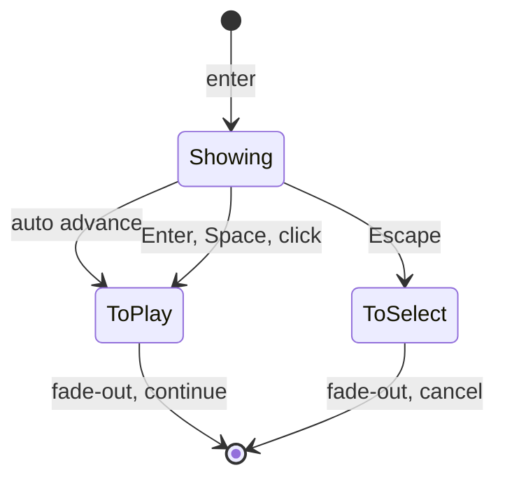

The web player prepares the play behind every decide screen and shows it from `on.continue`.

#### The decide jingle

The select screen plays the decide jingle of an LR2 sound set (`#DECIDE`, `sounds.decideBGM`) as a chart or a course starts a play. The select session (built-in and LR2) plays it through the audio service without an owner: the select screen's exit (`stopOwned`) stops its BGM and preview but not the jingle, which rings on through the decide screen and into the play, as LR2's does. It also plays where no decide screen shows (a theme without a decide skin). The beatoraja select screen's sound set has no decide jingle: the beatoraja decide screen plays its theme's decide sound as the session's jingle, which stops as the screen leaves, as it stopped with the screen's own context before.

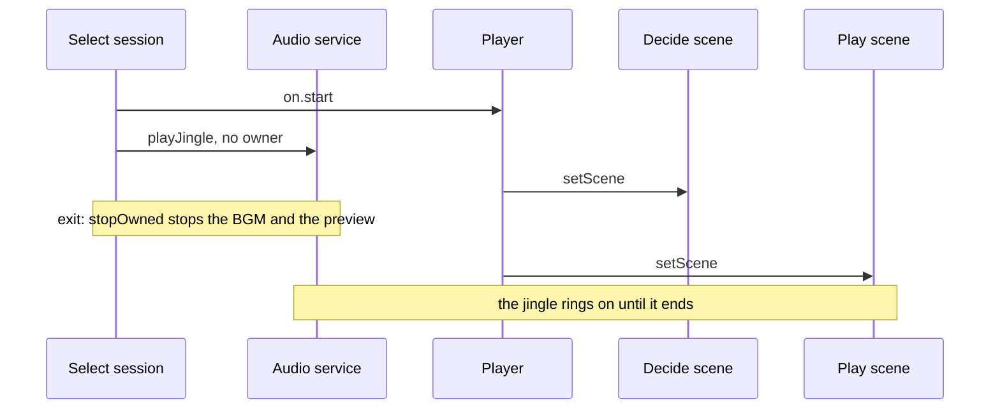

The decide session could play it (`sounds.decideBGM`), but as the decide scene's own sound, which `stopOwned` stops when the scene leaves: the jingle would be cut as the play starts. So the player hands the built-in and LR2 decide screens `sounds: {}`, and the jingle stays the select screen's. The host tells the select screen whether a start begins a play: `on.start` returns `false` when the course being made takes the chart or a course cannot start, and then no jingle plays.

### The result screen

`createResultScene(kit, options)` (`@be-music/player-browser/host`) makes every family's result screen: a result session (`session/result/result-session.ts`) drawn by the view of the kit's family, as a `SessionScene` to show with `setScene`. A built-in kit (`{ family: 'built-in', skin }`) is drawn by the built-in result view (`view/built-in/result-view.ts`), an LR2 kit (`{ family: 'lr2', skin }`, the theme's result skin, or its course-result skin for a course run) by the LR2 result view (`view/lr2/result-view.ts`), and a beatoraja kit (`{ family: 'beatoraja', kit }`, the theme's result entry, or its course-result entry for a course run, loaded with `loadBeatorajaSceneKit`) by the beatoraja result view (`view/beatoraja/result-view.ts`).

- **Options.** `result` (the `PlayResult`; an LR2 or beatoraja skin shows the course of `result.course`), `run` (which play it is of, when `result.run` does not say, as for a course stage), `source` (the chart's files, for the skin's images), `playChart` (the chart as the play played it, for a beatoraja skin's BPM graph, note kinds and TOTAL readout), `sounds` (the theme's `SystemSoundSet`), `audio` (the host's audio service) and `on: { continue, retry? }`.
- **Replay slots.** With `replaySlots` (each slot's state, read every frame) and `on.saveReplay`, keys 1-4 and a `saveReplay` intent (a beatoraja skin's replay buttons) ask the host to save the play into slot 1-4, once input is open and until the screen starts to leave, as beatoraja's result takes its number keys; the frame carries the states (`ResultFrame.replaySlots`), which a beatoraja skin shows on ops 196-198 and 1196-1204.
- **Presentation.** The session presents the run with `resolveResultPresentation(run)`: a course run plays the course jingles, and only a single play or a NONSTOP run offers the quick retry.
- **Jingle.** The session plays the result's jingle from `sounds` (`resolveResultJingles`, then `resolveResultJingle`: the clear or the fail one by the verdict, else the generic one; the course ones first for a course run) through the audio service as the screen enters, as its owner, and stops it with `stopOwned` as the screen leaves the stage. A scene used to stop its jingle by closing its own context. A theme with only the other verdict's jingle plays none, on the LR2 screen as on the built-in one.
- **Steps.** Input opens after the view's input delay (an LR2 skin's `#STARTINPUT`; 1500 ms, LR2's default, for a be-music skin or an LR2 skin without one), and the result's graphs start drawing then. They finish by themselves 3 s later; Enter, Space or a click before that skips them. The next press shows the record update, and the one after that calls `on.continue`. The frame carries when each step showed (`graphShownAtMs`, `updateShownAtMs`: LR2's timers 151 and 152); a be-music skin's entrance jumps to its settled layout once the graphs show. A beatoraja skin's screen has no steps to press through (`ResultViewTiming.skipsResultSteps`): input opens after its `input` (500 ms without one), and the first Enter, Space or tap calls `on.continue`, after a fade-out over its `fadeout` (500 ms without one). A tap is a touch or a pen; a mouse click does nothing there, as beatoraja's result reads keys only, but a phone or a tablet has no other way off the screen.
- **Close sound.** When the theme has a close sound (beatoraja's `resultclose`, or `course_close` for a course run, falling back to `resultclose`), the session stops the jingle and plays it as the fade-out starts, as beatoraja's `MusicResult` / `CourseResult` do. LR2 has no such sound, so an LR2 result stays silent.
- **Leaving.** Escape calls `on.continue` at any step; on a beatoraja skin it waits for input to open too, as beatoraja's `input` holds back every key (`SceneViewTiming.escapeWaitsForInput`). A bare R calls `on.retry` once input is open, when the run offers the quick retry and the host gave `on.retry`. Each fires once per entry.
- **LR2 drawing.** The LR2 view draws the result skin through `resolveLR2ResultState`: the result, the course of `result.course`, the skin's `#FLIPRESULT` and the defaults of its custom options. It reads LR2's result timers off each frame, and the timer ids stay in the view:
  - timer 0 from the entry;
  - timers 1 and 150 from when input opens;
  - timer 151 from `graphShownAtMs`, when the rank and the score show;
  - timer 152 from `updateShownAtMs`, when the record update shows.

  The gauge and score graphs sweep in over their `start` and `end` after their timer, as LR2's stock skin draws them 500 to 2000 ms after timer 150.

- **beatoraja drawing.** The beatoraja view draws the result skin through `BeatorajaPlaySkinView`, its canvas fitted into the window, reading the `PlayResult` directly through the scene mapping of `@be-music/skin-beatoraja/scene` (`resolveBeatorajaResult*`): the score and judgment numbers, the timing mean and deviation, the gauge with its border and TOTAL (`gaugeBorder`, `gaugeTotal`), the rank, verdict and lamp ops, the gauge and EX-score graphs, the judge graphs, the timing distribution and the course of `result.course`. The BPM graph, the note kinds and the chart's `#TOTAL` come from `ResultFrame.playChart`; without it they show nothing. The chart's `#STAGEFILE`, `#BACKBMP` and `#BANNER` load from `source` before the first frame. It reads beatoraja's timers off each frame, on the screen's own clock: timer 0 and READY / PLAY from the entry, timer 1 from when input opens, and timer 2 from when the screen starts leaving. A skin's Lua sounds play through the audio service's skin sounds as the session's, so they stop as the screen leaves.
- **Skin settings.** `updateKit(kit)` takes the player's new settings for the skin; the next frame draws with them. A beatoraja skin is loaded with its options, so a beatoraja kit of another skin is ignored.

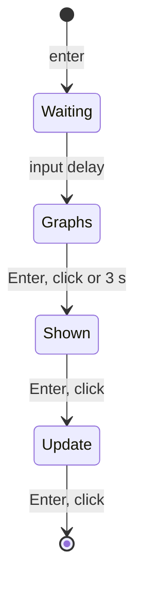

The web player shows every result this way: a single play, a replay, a course stage, a course run (on the theme's course-result skin when it has one) and a NONSTOP run (on the result skin; a beatoraja theme without one falls back to the built-in screen with that theme's jingles). Every play hands its result as a `PlayResult` (`playResultFromPlayState`), its graphs running from the chart's start to the playhead, and a course run reads as one with `playResultFromCourseRun`: the last stage's graphs on LR2 and built-in, every stage's joined on beatoraja.

### The play screen

`createPlayScene(kit, options)` (`@be-music/player-browser/host`) makes every family's play screen: a play session (`session/play/play-session.ts`) drawn by the view of the kit's family, as a `SessionScene` to load, show with `setScene` and start. A built-in kit (`{ family: 'built-in', skin }`) is drawn by the built-in play view (`view/built-in/play-view.ts`), an LR2 kit (`{ family: 'lr2', skin, invisibleNoteSkin? }`, the chart's play skin and the theme's 9-keys skin for invisible notes) by the LR2 play view (`view/lr2/play-view.ts`), and a beatoraja kit (`{ family: 'beatoraja', kit }`, the theme's play entry for the chart's variant) by the beatoraja play view (`view/beatoraja/play-view.ts`).

A play accepts an optional `sounds: SystemSoundSet`. On early stage failure it plays `sounds.playStop` once through the audio service, owned by the play scene. LR2 themes resolve this from the sound set’s `#STOP` command, falling back to `Sound/lr2/playstop`; beatoraja themes discover `sound/playstop`. Normal completion, Escape and retry play no stop cue. A theme without the sound stays silent, and leaving the scene stops its cue.

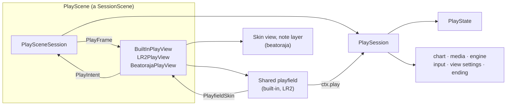

- **Options.** `chart` and `source`; `settings`, how the play runs apart from its chart, its skin and where it leads (the play options it judges and scrolls with, the tempo, the audio mix, the BGA and the drawing options); `course` (the stage's rules and its course view); `replay` (a replay to play back); `preResolved` (the decide screen's `#RANDOM` draws); `audio` (the host's audio service, which also plays a beatoraja skin's sounds); `playOptions` (as the select screen set them, for the frames); `host` (to build the layers while the play loads off stage); and `on: { finish(result, replay), exit, restart, hiSpeed?, tempo? }`.
- **Lifecycle.** `prepare(onProgress)` loads the chart, the view's own assets (an LR2 skin's images and fonts; a beatoraja play's note layout, layers and chart images) and the samples, and starts the BGA loading in the background, without touching the stage. `setScene` shows the play, and `start()` runs the intro and then the chart. `dispose({ preserveAudioTail })` ends the scene, after the play finished, once its last samples have rung out. The scene also has `requestExit`, `requestTogglePause`, the tempo and hi-speed setters, `recording` (for the host's recorder), `progress()` (the result so far, which the player's test hook reads), `waitForReplay`, `resolved` (the chart as the play plays it, with its `#RANDOM` draws, for the result's graphs), `updateKit` (a built-in skin's settings, or a beatoraja entry's options or another entry's skin; a scene keeps its family) and the audio and drawing knobs.
- **Session.** `PlaySession` holds the play's behaviour around one `PlayState`: the chart (`play-chart.ts`), the media (`play-media.ts`; it opens its own `interactive` context through the audio service's `openPlayGraph`, as the session's owner), the engine (`play-engine.ts`), the play's own input (`play-input.ts`), the view settings (`play-view-settings.ts`) and the ending (`play-ending.ts`). What it needs of the view comes through `PlaySessionTheme` (`play-session-theme.ts`): the intro and fade-out timing, the moments it animates against (`PlayMoment`), the key-beam fade by channel, the view's own loading once the chart is prepared (`prepareView`) and the GPU upload of the BGA. The view's touch lanes come back as `lane` intents.
- **Frame.** Every tick `PlaySceneSession` drains the engine's UI signals into the play state, records or replays the replay's view, and hands the view a `PlayFrame`: the play state and its stage, the chart time and beat, the notes and held lanes, the moments since the last frame (`playViewEventFromMoment`), the analysed mix, whether the play shows yet (`shown`), and the running play itself (`playfield`).
- **Built-in view.** `BuiltInPlayView` draws the shared playfield over its layers (`PlayLayers`) and answers it through a `PlayfieldSkin`: the be-music skin's stage, the playfield's own lane layout, notes, measure lines and bombs (the skin draws them as data), the built-in BGA rect, the skin's bomb length and the default key-beam fade. Every lane lights its key beam, the 24 / 48 KEY keys past the seventh and the wheel included. The be-music chrome draws around the playfield (`renderBuiltInChrome`, its `PlayChrome`).
- **LR2 view.** `LR2PlayView` draws an LR2 play skin on the skin's authored canvas (SD, HD or FHD) around the same playfield:
  - its ops, numbers, texts, sliders and bar graphs come from the frame's LR2 state (`resolveLR2PlayState` over the frame's `PlayState`, the score, the time and the frame rate), its timers from the frame's moments ([LR2 skin implementation notes](./lr2-skin.md#scene-state));
  - its `PlayfieldSkin` gives the skin's `#DST_NOTE` lane rects, its note cells (the `#SRC_AUTO_*` dummy notes on an auto-scratch lane), its `#DST_LINE` measure lines, its `#DST_BGA` rects, and the bomb and key-beam spans of its timers; the skin owns the lanes, so it draws the lane backgrounds, key beams and bombs itself;
  - its `PlayChrome` draws the skin's elements (`view/lr2/play-elements.ts`), retires the full-combo timers once played out, draws the judgment as text when the skin has no judge images, and stops a bomb's timer when the playfield retires the bomb;
  - the session times the play from the skin's `#LOADSTART` + `#LOADEND` (READY), `#PLAYSTART`, `#FADEOUT` and `#CLOSE` (`resolveLR2PlayTiming`).
- **beatoraja view.** `BeatorajaPlayView` draws a beatoraja play skin through `BeatorajaPlaySkinView`, with its note, marker and BGA layers (`view/beatoraja/play/*`) put where the skin places them (`BeatorajaPlayStage`):
  - `BeatorajaPlayBridge` (`view/beatoraja/play-bridge.ts`) turns each frame into the skin's render context: its ops, numbers, texts, gauge and graphs come from the [scene mapping](./beatoraja-skin.md#scene-mapping) over the frame's `PlayState` and the engine's latest frame, and the frame's moments start its timers (a judgment, a lane's flash and hold, load-end, the fade-out). It keeps the judge-state graph and ends the lane flashes itself;
  - the notes scroll on beatoraja's scale over the chart's `#SCROLL` / `#SPEED` timelines, with the frame's drawn hi-speed and the play state's lane covers; the replay records the view on that scale (`PlaySessionTheme.replayView`);
  - the session times the play from load-end: READY, PLAY and STARTINPUT start then, the chart 1.5 s later (`resolveBeatorajaPlayTiming`), a leaving play fades over the skin's `fadeout`, and a failed one moves on after its `close`;
  - a beatoraja kit plays the host's lane options (RANDOM, MIRROR, S-RANDOM, SCATTER, DP FLIP), [HS-FIX](#hs-fix) and starting lane covers (HIDDEN / SUDDEN, the lane cover height and switch, each side's LIFT) as every family does, recorded in the replay's `play.randomLane` and `play.view`. It turns on the cover keys (`coverKeys`), as the built-in Plain, Native and Synesthesia skins do: PageUp / PageDown move SUDDEN+, Home / End the lift, H toggles HIDDEN+ and J / K move it (Shift for larger steps); a key one of the chart's lanes takes plays the lane instead (H / J / K are 2P lanes of a 14-key DP chart). The wheel and the skin's cover buttons (acts 330-332) send cover intents;
  - the skin's `main_state.audio_*` calls play through the audio service's skin sounds, owned by the scene's `PlaySceneSession`, which stops them (its loops included) as the scene leaves the stage; the play's audio graph keeps its own owner, so a play that ended rings out.
- **Input.** The play's keys (ESC, F5, Space, the arrows, the Backspace hold, the cover keys, the floating hi-speed's numpad 0 and the fixed display area's double Enter) stay the play's own listeners on the window, in the capture phase: ahead of the lane input runtime, which takes the default of every key with a lane token, while a focused field keeps its keys and a focused button its Enter / Space. The scene listens for no keys.
  - The touch lanes are the view's. Each play view follows the fingers on the canvas (`view/shared/touch-lane-input.ts`, which also sets `touch-action: none` while the play is up) over the lanes the shared playfield laid out, and sends a `lane` intent as a lane's first finger presses it and its last lets it go. The session presses and releases the lane through the engine's input as the keyboard does (`handleTouchLaneIntent`). A beatoraja skin lays out no lanes for the playfield, so its play has no touch lanes.
  - A pause lets every touched lane go in the session and counts the lift (`touchLiftCount`); the view then forgets the fingers that were down, so they press nothing until they touch down again.
  - The hi-speed steps with ArrowUp / ArrowDown on every family, and a host can set it (`setHiSpeed`).
  - The TUI's Alt / Option + lane shortcut is not on the web, on any family. The web input runtime (`createWebInputRuntime`) sends the engine lane keys, ESC, F5 and Space only, and no `high-speed` command. In a browser, Alt with a lane key is often a browser shortcut (Alt + D or Alt + F on Windows). LR2 and beatoraja step the hi-speed with START + a lane key, and the web play has no START key.
- **`#RANDOM`.** With `preResolved` the play plays the draws the decide screen showed. The web player makes the decide screen first and preloads the play with its `resolved`, on every play screen; a course stage and a replay draw their own (a replay plays its log's).

The web player plays every play this way, on every family's own play screen: a single play, AUTO, a replay, a course stage, a NONSTOP run, a quick retry and F5, on a beatoraja theme too (ADR 0001).

### Where the play's parts live

The play session and the play views share the play's parts. Each module takes the play (or the view) as an explicit context (`ctx`) and reads and writes its state through an interface of its own. The session's state is `PlaySessionState`; a view keeps its layers in `PlayLayers` and reads the running play through `PlayfieldRuntime`.

The running play is one player-scene-model `PlayState` (`playState`): the gauge and EX score with their graphs, the combo, max combo and course combo, the timed judgments with their early / late counts, and the view (the hi-speed under HS-FIX and the lane covers). Every change to it goes through `applyPlayEvent` (`session/play/play-state.ts`), which reduces it with `reducePlayState` and glides the note scroll to a new drawn hi-speed: the engine's frames, judgments and empty POORs, the snapshot of a seek, its final summary, the player's hi-speed keys, the host's `setHiSpeed` and a replay's recorded view. The skins' runtime, the LR2 state resolver (`resolveLR2PlayState`), the beatoraja play bridge and the result (`playResultFromPlayState`) read it. The session keeps the engine's judgment counts as the readouts show them (`score`, with LR2's empty POORs in the POOR count) and the engine's gauge summary (`gaugeState`) beside it.

The engine owns chart time. Every frame carries the chart second it shows, its seek generation and the clock that second holds at (the audio clock's reading, the tempo, whether the play is paused), and the session's chart clock (`currentSeconds`) runs on from the latest frame on `audioContext.currentTime` (`play-clock.ts`); before the engine's first frame it runs from the play-start gate. A seek, a tempo change or a pause shows in the next frame, with no anchor to set again, and a frame of an older generation than the last seek is dropped. What a run shows apart from the play state — the key beams and flashes, bombs, held long notes, judgment plates, the POOR image, the latched moments and the score readout's roll — is one `PlayPresentation` (`play-presentation.ts`), which `resetPresentation` puts back to a new play's.

A seek is a command to the running engine ([ADR 0016](./adr/0016-seek-play-loop-command.md)): `PlayScene.seek(T)` pushes `{ kind: 'seek', seconds: T }` on its input bus (`play-seek.ts`) and resolves once the engine applied it or a later seek. The engine answers with a frame of the next generation at `T` and a `seek` UI command whose snapshot the session takes its score, gauge and play state from (`reducePlayState`'s `seek` event); the presentation is reset, a lead-out under way is cancelled, the BGA videos are synced again, and the view hears a `seek` event (the LR2 view stops its per-judgment and lane timers through `resolveLR2PlayTimers`, the beatoraja bridge through `resolveBeatorajaSeekTimers`, rebuilding its judge-state graph from the snapshot's judgments). The long notes held across `T` come next as the engine announces them again. A paused play stays paused at `T`.

AUTO play and replays can seek. A host can also enable manual practice with `PlaySceneOptions.allowSeek: 'practice'`: earlier notes are skipped without scoring and the score and gauge reset. Its first seek discards recording, and `PlayResult.practice` prevents record writes, ranking and replay auto-save. On a replay, the judge re-drives the recorded inputs from the start to the target, restores the recorded tempo there and resets its tempo cursor, and reapplies the recorded view at the target according to the host's Replay / ghost options. The normal play screen also accepts ← / → to seek five seconds in AUTO, replay or opted-in practice playback. A sought play records no new replay. Seeking within a course stage or NONSTOP run makes the entire course practice, including later stages; stage outcomes carry gauge and combo independently of replays, and the course result is displayed without record writes, submission or replay auto-save.

The session prepares the engine after audio decoding, while BGA loading and the skin intro continue. `PlayerOptions.waitForStart` holds chart time and audio until the skin's PLAY START gate sends `{ kind: 'start' }`. Intro seeks select the starting position; they apply once START opens the gate. An intro pause stays paused. Seeking backwards during the chart's lead-out cancels it and re-arms settlement; seeking to the end of an already settled chart does not notify settlement twice.

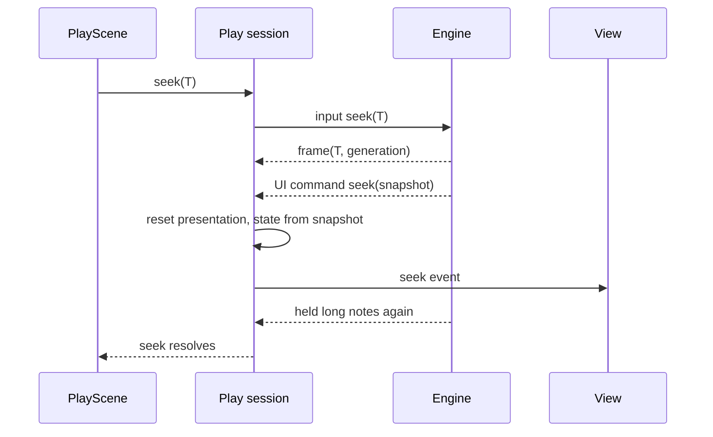

- `session/play/`:
  - `play-session.ts`: `PlaySession`, the composition, the clocks, the pause, the recording and the teardown; `play-session-state.ts`: its state; `play-options.ts`: its options (`PlaySessionOptions`); `play-session-theme.ts`: what it asks of its view (`PlaySessionTheme`) and the moments it raises (`PlayMoment`);
  - `play-scene-session.ts`: the session as a `SceneSession`, its frames and intents; `play-view-events.ts`: the moments as view events;
  - `play-chart.ts`: `prepareChart`, the lane options (RANDOM, MIRROR, S-RANDOM, SCATTER, DP FLIP), a replay's arrangement and the decide screen's draws;
  - `play-media.ts`: the audio graph, the samples, the BGA textures and videos, and their teardown;
  - `play-engine.ts`: the shared engine's launch, its UI signals, the judgements and lane effects, a seek's snapshot and the start of the ending; `play-seek.ts`: the seek command and the seeks waiting on it; `play-clock.ts`: the chart clock run on from a frame; `play-presentation.ts`: what a run shows apart from the play state (`PlayPresentation`);
  - `play-input.ts`: ESC, F5, Space and the arrows, the quit hold, the auto-pause and the touch lanes the view sends; `play-cover-keys.ts`: the cover keys of a beatoraja play and of the built-in Plain, Native and Synesthesia skins (`coverKeys`);
  - `play-keys.ts`: `PLAY_SCENE_KEY_CODES`, the keys the play handles itself and the engine's web input runtime skips;
  - `play-state.ts`: `applyPlayEvent`, the one way the play state changes;
  - `play-view-settings.ts`: the hi-speed keys, the tempo the engine follows, the lane covers as drawn and the replay's view;
  - `play-ending.ts`: the exit timeline and the result snapshot;
  - the helpers they share: `long-note-tracker.ts` (each long note's state as the skins draw it), `live-tempo.ts` (the live tempo and its changes), `tempo-range.ts` (the play's lowest, highest and main BPM), `quit-hold.ts` (the Backspace hold), `result-delay.ts` (the lead-out before the result and how long the audio tail rings), `judge-windows.ts` (the ruleset's windows for the skins) and `placeholder-gauge.ts` (the gauge before the engine's first frame).
- `view/shared/`: `playfield/*` (lanes, notes, long notes, mines, measure lines, bombs, covers, text; the running play as `ctx.play`, `PlayfieldRuntime`; the view's `PlayfieldSkin` and `PlayChrome`), `bga-renderer.ts`, `play-frame.ts` (the layer tree, its fit to the screen, the fades), `play-layers.ts`, `texture-upload.ts`, and `touch-lanes.ts` with `touch-lane-input.ts` (the fingers on the touch lanes, as `lane` intents).
- `view/built-in/`: `play-view.ts` (the built-in play view and its `PlayfieldSkin`) and `play-chrome.ts` (the built-in lane geometry, BGA rect and be-music layout, and the chrome's runtime and pass).
- `view/lr2/`: `play-view.ts` (the LR2 play view, its `PlayfieldSkin`, its loading and the frame's LR2 state), `play-elements.ts` (the skin's elements and the playfield's lane rects, note cells, measure lines and BGA rects), `play-timers.ts` (the skin's timers), `play-turntable.ts` (the scratch turntable) and `play-hud.ts` (the judge, combo and groove-gauge drawing and the skin's timer spans).
- `view/beatoraja/`: `play-view.ts` (the beatoraja play view, its loading, its timing and the replay's view scale), `play-bridge.ts` (the frame as the skin's render context: ops, timers, numbers and graphs), `play-stage.ts` (the skin view with the note, marker and BGA layers) and `play/*` (the note, marker and BGA layers, the scroll placement, the note `dst` block and the skin's metrics).

### Layering

The package's source sits in layers, and `pnpm run check` holds them with Oxlint overrides in [`vite.config.ts`](../vite.config.ts). From the top:

- **The host API**: `host/` and the package barrel (`index.ts`). The `create*Scene` functions, the family kits, `PixiSceneHost` and the `./host` barrel.
- **Scene sessions** (`session/`) and **family views** (`view/`): a session holds a screen's behaviour and a view draws it, and each knows the other only by its types.
- **The lower layers**: every other directory. The audio and input runtimes and the engine driver (`runtime/`), chart and media preparation (`chart/`, `media/`), the collection (`collection/`), the browser checks (`browser/`), the Pixi stage helpers (`stage/`), the skin loaders (`skin/`), the built-in skins (`skins/`), the recorder (`recording/`) and the logger.

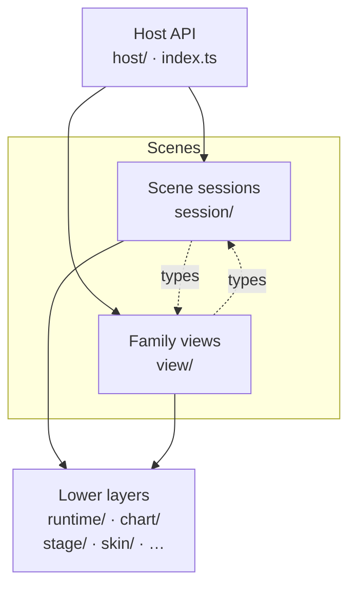

An arrow is an import; a dotted one is for types only. The rules:

- **A lower layer knows no scene.** It imports no `host/`, `session/` or `view/` module, not even a type. Every file of the package starts out in a lower layer, so a new directory is one until the config says otherwise.
- **A session reaches its view and the host only for types**, and Pixi only for types too, so a session runs in Node tests against a fake view.
- **A view reaches its session and the host only for types**, and neither the engine (`@be-music/player-engine`) nor `runtime/engine-driver` and the `runtime/web-*-runtime` modules. The player's other entries (`./signals`, `./lanes`, `./display`, `./ruleset`, …) are not the engine, so a view may import them.
- **Only a session runs the engine.** Besides `session/`, only `runtime/engine-driver.ts` imports the engine as values; every other file imports only its types, in the web player too.
- **Only the audio layer creates an audio context.** `runtime/` creates the system context (`audio-service.ts`), each play's graph (`play-audio-graph.ts`) and the offline context of the keep-pitch stretch (`time-stretch-signalsmith.ts`). Everything else, the web player included, plays through the audio service and names `AudioContext` only as a type.

Tests are exempt. The built-in skins also keep their own, stricter boundary: `skins/boundary.test.ts` lets a skin import only the skin SDK, its rendering framework and its own files.

## Note visibility

Drawing is not part of a judge ruleset, so the ruleset plays no part in it. The play screen picks one of two rule sets for which notes, mines and bar lines it draws and where ([`note-draw-window.ts`](../packages/player-browser/src/chart/note-draw-window.ts)):

- **LR2 rules** — every chart without `#SCROLL` / `#SPEED`, whatever the ruleset.
- **beatoraja rules** — every chart with a `#SCROLL` or `#SPEED` point other than 1. LR2 plays neither, so beatoraja is the reference; a chart whose points are all 1 scrolls as a plain chart.

Under LR2's rules (`DrawNotes` in `LR2body.exe`):

- **Position:** an object scrolls down to the judgement line and is held on it once its beat has passed. Nothing is drawn below the line.
- **Notes and mines:** one goes only once it is judged and its beat has reached the playhead. A note the player has not hit sits on the line until the ruleset's late window judges it a miss, so it also stays there through a STOP that began on it. A note hit early keeps scrolling down to the line and goes when it reaches it. A mine goes once it has passed (or, set off early, when it reaches the line). On an auto lane (autoplay, auto-scratch) a note goes when its beat has passed.
- **Long notes:** the head is held on the line once passed, and the long note stays until it is judged and its end has passed. One missed at the head or let go early is drawn at half alpha (LR2's `0x80`) until then.
- **Bar lines:** one goes once the playhead has passed it, so a STOP that began on one holds it on the line.
- **Walk:** the walk over the chart ends once a beat lies past the lane top.

Under beatoraja's rules (`LaneRenderer`), the view walks the chart's timelines (notes, mines, invisible notes, bar lines, BPM / STOP / `#SCROLL` / `#SPEED` points) in order from the playhead and stops after drawing the first one that lies past the lane top, so objects enter through the band above the lane: nothing beyond it is drawn, not even notes a later negative `#SCROLL` brings back into the lane. A note, mine or bar line disappears the moment its time comes, judged or not (`LaneRenderer` draws one only while its time is still ahead). A long note stays while its end is still ahead, held or not, and once its head has passed the head is drawn on the judgement line until the tail's time. beatoraja's renderer does not clip notes at the judgement line, so a note a negative `#SCROLL` puts below the line while its time is still ahead is drawn there, down to the bottom of the stage. Skins receive these objects with a `y` below the lane's `bottom` ([be-music skins](./be-music-skin.md)).

Both rule sets keep a judged note until its time, as LR2 and beatoraja do, so a note hit early keeps scrolling to the line. The Debug Menu's **Judged notes** (`judgedNoteDisplay`) can instead hide a note the moment it is judged (`HIDE`); the default is `KEEP_SCROLLING`. A long note missed at the head or let go early is drawn at half alpha under either rule set; the built-in skins dim it the same way, and other be-music skins get its `state`.

The terminal player stops its walk at the same point when a chart scrolls both ways.

beatoraja play skins are a display choice, not a ruleset, so they follow the same rules ([`scroll-placement.ts`](../packages/player-browser/src/view/beatoraja/play/scroll-placement.ts)): notes, bar lines and BPM / STOP markers use the same `#SCROLL` / `#SPEED` distances and beatoraja's rules on a chart that scrolls, and LR2's position and visibility rules on every other chart. They do not dim dropped long notes (their own held / unheld body images show the state) and have no `HIDE` option.

## HS-FIX

The play option's HS-FIX modes keep LR2's buttons and follow beatoraja's fixed hi-speed modes (`LaneRenderer.init`). The hi-speed the player sets is the one they want at the chart's reference BPM (`#BASEBPM`, else the start BPM); HS-FIX rescales it so that the scroll at another BPM feels like that. The in-play HI-SPEED readouts show that hi-speed, as the select panel does, and ArrowUp / ArrowDown step it by 0.1; HS-FIX rescales only the scroll.

| be-music   | Pegs the hi-speed to                                                                           | beatoraja                                                      |
| ---------- | ---------------------------------------------------------------------------------------------- | -------------------------------------------------------------- |
| `OFF`      | nothing: the scroll follows the BPM                                                            | `OFF`, and `STARTBPM` (the reference already is the start BPM) |
| `MAXBPM`   | the highest BPM                                                                                | `MAXBPM`                                                       |
| `MINBPM`   | the lowest BPM                                                                                 | `MINBPM`                                                       |
| `AVERAGE`  | the main BPM: the BPM the most notes sit at (`resolveChartMainBPM` in `@be-music/chart-model`) | `MAINBPM`                                                      |
| `CONSTANT` | the main BPM, until a true constant scroll lands                                               | —                                                              |

`AVERAGE` was a time-weighted average: BPM × N + STOP gimmicks skew it (about 810 on a 145 BPM chart, so notes crawled 5.6 times too slow), and it measured the last segment on a clock that counted STOPs while the others did not. The main BPM is what beatoraja uses. Ties go to the BPM reached first, where beatoraja's pick among ties follows its hash-map order. A chart whose notes mostly sit at a gimmick BPM ("the life" puts 717 of its notes at 16,000,160) gets that BPM as its main BPM in beatoraja and in be-music alike; play such charts with HS-FIX `OFF`.

Every family's play screen reads this one main BPM wherever it needs one: the replay's visible time ([replay.md](./replay.md#what-the-player-saw)), the built-in HUD's `mainBPM`, and the beatoraja skins' main BPM (number 92), their white and green numbers at it and their BPM graph.

## Renderer and performance controls

- PixiJS defaults to a WebGPU preference and falls back through PixiJS when the browser cannot initialize it.
- `?renderer=webgl` forces WebGL for renderer comparison.
- Loaded skin and BGA textures use nearest sampling to preserve LR2 and beatoraja pixel-art assets.
- beatoraja source textures are downscaled before upload when a bitmap exceeds the conservative GPU texture-size cap.
- The gameplay paths preload chart parse, audio decode, and BGA resources before the decide scene hands off to gameplay.
- Shared scroll-distance helpers keep CLI and browser note-placement behavior aligned.
- The default gameplay chrome reuses pooled Pixi children for graphics and text, and caches text styles to avoid
  per-frame allocation churn in the skinless renderer.
- Benchmarks include browser-core helpers that are pure enough to run outside a WebGL context:

```bash
pnpm bench -- --packages player-browser
```

## Audio, BGA, and recording

- Chart preview and gameplay audio use WebAudio.
- `@be-music/player-browser/audio` exports the platform audio session helpers (unrelated to the engine's internal `WebAudioSession`): `supportsSystemAudioSession`, `getSystemAudioSession`, and `applySystemAudioSessionType` feature-detect and set `navigator.audioSession.type`; `applySilentModePlayback(on)` sets `'playback'` (on) or `'auto'` (off). They swallow errors and are no-ops where the API is missing. Call them before creating or resuming an `AudioContext`, and again from the gesture that unlocks audio.
- Gameplay audio separates key, BGM, and master compressor stages in the default split topology.
- `?compressor=legacy` keeps the old single-compressor shape for comparison.
- `?compressor=off` disables compressor construction in the player.
- beatoraja theme audio uses the same browser bundle lookup for Lua `main_state.audio_play` / `audio_loop` calls, select BGM, navigation system sounds, decide BGM, and result jingles.
- BGA supports still images and video assets referenced by chart BGA events.
- Every BGA rect (LR2 `#DST_BGA`, beatoraja `bga`, the built-in frames) stands for the 256x256 BMS canvas: a still image whose long edge is at most 256 px keeps its pixel size on it, centered horizontally and top-aligned over black, while larger images and videos fill the rect ([format compatibility](./format-compat.md#217-bga)).
- The default family renders the same chart BGA layer stack as LR2 skins inside its built-in BGA frame.
- BMS rendering applies the implemented `#BGAxx` sub-region, `#SWBGAxx` switching, and `#ARGBxx` / `#EXBMPxx` tint and alpha subset.
- bmson rendering uses `bga.bga_events`, `bga.layer_events`, and `bga.poor_events`; unlike BMS layer channels, bmson layer images preserve black pixels instead of treating black as transparent.
- The browser player can transcode unsupported video assets before playback with ffmpeg.wasm and its single-threaded `@ffmpeg/core`. The multithreaded core is not installed because its current 0.12.x build crashes in libx264; typical BMS BGA videos take tens of seconds to transcode.
- Natural chart completion waits for a short post-chart delay before opening the result scene. The visual transition
  does not cut off the remaining gameplay audio tail.
- The gameplay recorder writes MP4 or WebM output and coordinates stop/finalization before scene disposal so active recordings are flushed before the gameplay bus is torn down.
- Every play except a replay records a replay (`*.bmplay.json` input replay — resolved chart, raw press/release stream, play settings; see [replay.md](./replay.md)). The player auto-downloads it when the result scene mounts, controlled by the "Auto-save play history" checkbox in the Debug Menu's "Library & records" folder (OFF by default; latched at song start and disabled during a play). The `bms-replay` CLI re-derives LR2 / beatoraja / That-Which-Must-Not-Be-Named results from the file, and dropping a replay onto the page replays the recorded run when the matching song is loaded (otherwise a dialog names the chart to load). A run given up with ESC replays up to where it was given up (`play.abortedAtUs`), as its re-simulations do.
- Every play screen also records what the player saw (`play.view`, `play.viewChanges`): the hi-speed on its scale, HS-FIX, the visible time at the main BPM and each side's SUDDEN+ / HIDDEN+ / LIFT, sending each change as a `{ kind: 'view' }` command, coalesced to at most one per 100 ms. A replay shows that view along the playhead as far as the `replayView` option asks: the recorded hi-speed when it was played on the same scale (the LR2 / default screens share one, and beatoraja skins have their own), else the hi-speed showing the recorded visible time, and the recorded covers (the LIFT too on the beatoraja play skin, which draws one; `PlaySessionTheme.drawsLift`). See [replay.md](./replay.md#what-the-player-saw) for the units and the rule.
- With "Submit to Leaderboard" on (Debug Menu → Leaderboard, OFF by default, latched like the auto-save), a finished manual play is sent to the Leaderboard ([leaderboard.md](./leaderboard.md)) when the result scene mounts: the player signs in anonymously the first time, rebuilds the play's fingerprint documents from the song's chart and checks them against the log before sending, resends with the chart document when the server asks for it, and shows the rank in the status line. The deployed Worker forwards `/api/*` and `/leaderboard/*` to the Leaderboard Worker through a Service Binding; `pnpm player:web` proxies them to a local one (`pnpm --filter @be-music/app-leaderboard run dev`, or `LEADERBOARD_DEV_ORIGIN`).
- The account starts anonymous (the first submission signs in anonymously). "Create passkey (keep this account)" registers a passkey for it, which also lists its plays under its handle instead of behind the anonymous filter; "Sign in with passkey" brings the account to another browser and moves that browser's anonymous plays into it.

### Audio service

`createAudioService()` (`@be-music/player-browser/audio`) is the one way the player plays sounds outside a play's chart ([ADR 0007](./adr/0007-one-system-audio-context.md)). The scene sessions play through it: every select, decide, play and result screen (a play opens its own graph through `openPlayGraph`). The web player creates one service at start-up and hands it to every scene made on it, and sets a beatoraja theme's files on it (`setTheme({ files })`) for the path-only cues and select BGM of the beatoraja select screen and the skin sounds of the beatoraja select, decide, play and result screens.

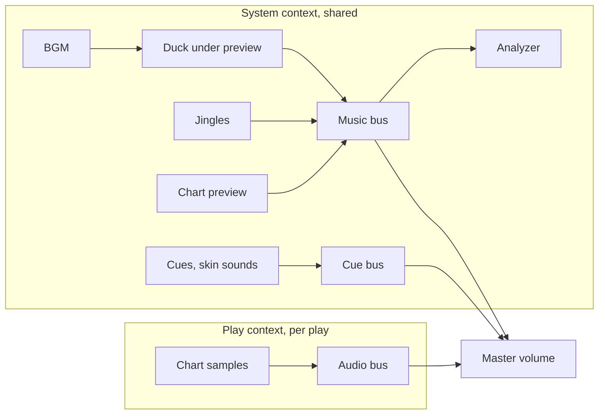

- The system context is created on first use, so a page without a user gesture does not start one the browser refuses. Each sound is decoded once per bytes (or theme file), and a failed decode is remembered.
- `setTheme({ sounds, files })` sets the theme's `SystemSoundSet` (player-scene-model) and, for a beatoraja theme, its files. `playCue(slot)` plays a cue of that set once. `playBGM` and `playJingle` take a slot or a resolved `SystemSound`. A sound given by path, such as a beatoraja theme's cues, is read from the theme's files.
- `playBGM(sound, { owner, volume, loop, duckUnderPreview })` keeps one BGM. A new one replaces it; the same one again keeps playing and only its owner and level change. It goes silent while a chart preview is audible, unless `duckUnderPreview` is `false`.
- `skinSounds.play` / `loop` / `stop` are a beatoraja skin's `main_state.audio_*` calls; `skinSounds.owned(owner)` makes the same calls with an owner.
- `preview.focus(target, owner)` drives the one `ChartPreviewEngine`. `analyzer.sample(now)` reads the music bus for audio-reactive be-music skins.
- `openPlayGraph(chart, mode, busOptions, { owner })` opens a play's own `interactive` context and audio bus with `#VOLWAV` applied, and an analyzer on the bus output. `close({ delayMs, beforeClose })` ends it once the tail has rung out.
- `stopOwned(owner)` stops everything an owner started: its BGM, jingles, cues and skin sounds, the preview it focused, and its play graphs that are not closing yet. A scene calls it on exit, since closing a context no longer stops its sounds. A sound started without an owner plays out, such as the decide cue as the select screen leaves. `dispose()` stops everything and closes every context.

## Compatibility boundary

The browser player consumes `chart-parser`, `chart-model`, `player-engine`, `player-scene-model`, `player-skin-sdk`, `shared-utils`, and the LR2/beatoraja skin packages. Native Skin uses `player-ui` for presentation. Node decoding and output belong to `player-node-audio` through `chart-audio-renderer`; browser audio uses its Web Audio adapter.
When browser behavior diverges from the terminal player, prefer moving pure path, timing, scroll, lookup, or event-mapping helpers into shared packages and covering them with package-local tests.
PixiJS scene wiring can remain in `player-browser` when the behavior depends on browser rendering or WebAudio resources.

## Embedded preview

`/embed/?track=<URL>` (`play.be-music.app`, and `play.preview.be-music.app` for the preview environment) previews a chart archive inside an iframe. It is a second entry of `@be-music/app-play` (`embed/index.html`, `src/embed/`), served by the same Worker; the Worker starts no automatic sign-in for an iframe. The archive is fetched like `?music=`: directly from this origin, through `/__url-load-proxy` from another https origin.

```html
<iframe
  src="https://play.be-music.app/embed/?track=https%3A%2F%2Fexample.com%2Fsong.zip"
  width="854"
  height="480"
  allow="autoplay; fullscreen"
></iframe>
```

The preview plays in AUTO; it judges no input and records no replay.

### Select a chart or course

Keep the charts and their audio/BGA assets together in the archive named by `track`. Use these query parameters to select what the preview plays:

| Parameter    | Meaning                                                                                                          |
| ------------ | ---------------------------------------------------------------------------------------------------------------- |
| `chart`      | A chart file name or path inside the archive. Without a match, the preview lists the charts.                     |
| `course`     | An LR2 `.lr2crs` or beatoraja `.json` course file inside the archive. It takes precedence over `chart`.          |
| `courseName` | The exact course name in the selected file. Omit it to list multiple courses, or to play the file's only course. |

For example, `/embed/?track=https%3A%2F%2Fexample.com%2Fpack.zip&course=courses%2Fexpert.lr2crs&courseName=Expert` selects the course named `Expert` in `courses/expert.lr2crs`. Encode each parameter value with `encodeURIComponent`. File matching ignores case and accepts either path separator; a unique file name or path suffix also works. Specify a fuller path if several files match. A beatoraja JSON explicitly selected by `course` can sit outside a `course/` directory.

Course stages resolve by their original chart-file MD5 or SHA-256 against the charts in the archive. The preview reports missing or invalid course files and unknown course names; courses with missing stages cannot start. A multi-course list shows each course's kind and stages, and disables rows with missing charts. The `courses` property of `be-music-preview-select` supplies this list; the React and Vue wrappers accept it too.

EXPERT and GRADE previews play stages in order without result screens, carrying gauge and course combo through the existing course runner. Course constraints, including the long-note mode and hi-speed lock, apply. LR2 NONSTOP previews stitch their stages through the shared NONSTOP pipeline, with its BGA transitions, FIT audio and seek controls. Seeking in a staged course stays within its current stage. When a selected course finishes or is exited, Replay prepares it again from the first stage; a course selected from a list returns to that list instead.

### Preview screens

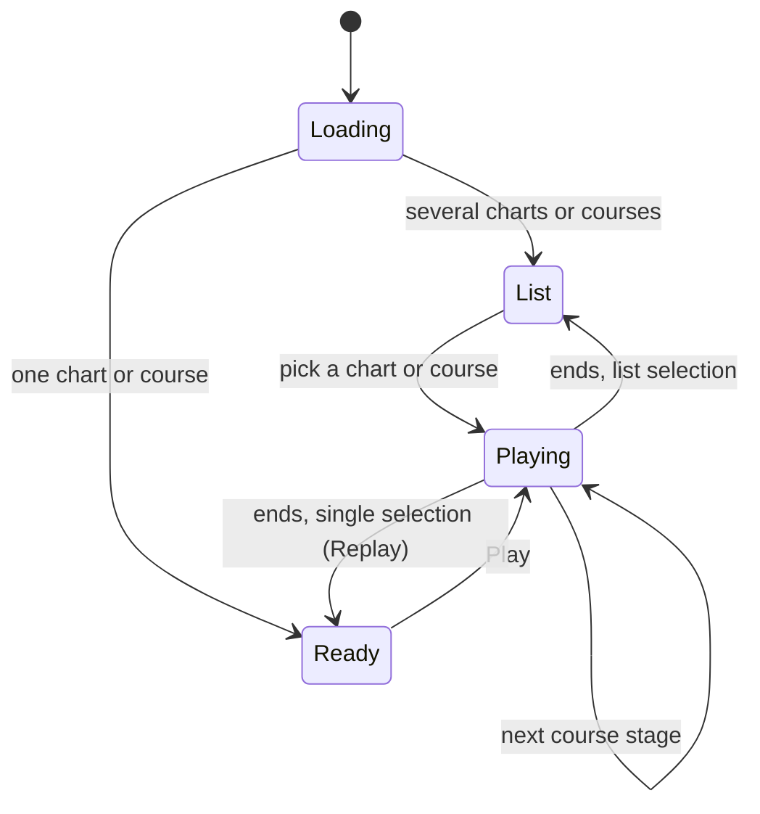

- **List:** a track with several charts lists them (`be-music-preview-select`), each row showing the chart's `#STAGEFILE` or, without one, its `#BANNER`; picking one plays it at once.
- **Ready:** a single chart shows its play screen behind a play button (`be-music-preview-start`), which becomes Replay after the play. There is no result screen.
- **Playing:** the preview skin (`src/embed/preview-skin.ts`) lays the lanes in the left pane and the BGA in the right, and on a tall screen the BGA across the top with the lanes below it. The chart's facts, score, combo, gauge and judgments sit with the BGA (`be-music-preview-hud`), and video-player controls run along the bottom (`be-music-playback-controls`): a thin seek bar, play / pause, a volume slider that opens beside mute, the time, and full screen. Clicking the picture plays or pauses. Space plays or pauses, ← / → seek 5 seconds, M mutes and F toggles full screen.

Seeking (`PlayScene.seek`) sends the running engine a seek command ([ADR 0016](./adr/0016-seek-play-loop-command.md)); the play is not started again. The engine rebuilds the play from the chart's start to the second sought, so the score, gauge, combo, max combo, graphs and timings read as if the play had run there; the sounds still ringing there start partway (`AudioSession.triggerEventAt`), and the web audio session stops what played, resets the dynamic volumes and moves a NONSTOP chart's fades (`WebAudioSession.seek`). The seek bar and the time follow the frames of the new generation, and a paused play stays paused. See "Where the play's parts live" for the session's side.

## Native DOM skins and standalone controllers

Choose **Native (DOM + Canvas)** under Debug Menu → Skin & display → Built-in → Built-in skin. Native uses HTML for the collection, search, play options, loading card, score HUD and results, including a meter and an SVG gauge history. The BGA, lanes, notes, lane covers, judge line, bombs and judgment words are separate components, each drawing on a canvas the size of its part of the stage. While a Native screen is showing, the host takes its stage-sized canvas out of the page, and touch lanes follow the fingers on the native screen instead. Choose Synesthesia or Plain to return to full Canvas; the choice is remembered. Native inputs keep browser focus, scrolling and IME behavior. The `/` shortcut focuses the native search input.

Native uses the space beside the lanes for its landscape HUD and uses a compact header in portrait. The lanes extend toward the bottom edge; touch layouts keep space below the judgment line for the fingers. Stage-specific `playfield` bounds are shared by drawing, note placement and touch hit testing. DOM gameplay frames expose the layout so the HUD and playfield stay aligned with the Canvas viewport after resizing or rotation. The playfield redraws every animation frame, the HUD at its limited rate, and both fade with the play screen.

The gameplay dashboard shows EX score, rank and score rate, combo, BPM, time and progress, plus judgment counts with early/late splits, BP (including empty POOR), the latest timing offset, gauge history and recent timing graphs. It also lists the current hi-speed and drawn speed, HS-FIX, green number, visible time, BPM range, lane covers, random and gauge choices, auto scratch, DP flip, BGA mode, chart metadata and course stage. Landscape uses the space beside the lanes and opens the information cards by default. In portrait, **All play information** opens the detailed cards over the playfield without shortening it. Live DOM updates are limited to roughly 12 updates per second; graphs sample at most 96 gauge points and 32 timed hits.

A `BeMusicSkin` declares optional `dom.select`, `dom.decide`, `dom.result` and `dom.gameplay` factories (`player-skin-sdk/src/dom.ts`). Each receives an `HTMLElement` and actions that reach the existing session, and returns `update(frame)` and `dispose()`. The first three replace Canvas drawing; gameplay supplements the Canvas playfield, or draws it through `drawPlayfield(frame)` when the skin sets `gameplay.drawsOnDOM` (the host then creates no gameplay surface). A scene whose screens are all DOM reports `drawsOnCanvas: false`: `PixiSceneHost` keeps its canvas in the page only while the active scene draws on it, so listen on `PixiSceneHost.container` for input meant for the whole stage. Frames carry skin settings and effect preferences. A select screen can return `focusSearch()` to own the search input and suppress the host's overlay. Factories create DOM only when attached; skin modules remain safe to import before a document exists. Detaching preserves the mount and its local state for re-entry; disposing releases listeners, framework roots and resources. Native uses shadow DOM for style isolation. `PixiSceneHost.mount` accepts `domContainer` when a host wants to place native screens elsewhere.

`@be-music/player-browser/controller` exposes `SceneController` and `createSelectController` without importing Pixi at runtime. A controller has explicit `enter(nowMs)`, `advance(nowMs)`, `dispatch(intent)`, `exit()` and `dispose()` operations. One owner advances it; `getSnapshot()` and subscribers share that frame, including its transient events. Call `createStore(selector, equals?)` for a stable selected snapshot: its `getSnapshot()` returns `undefined` before the first advance and its `subscribe(listener)` returns an unsubscribe function. Removing a subscription does not end the session. React or Vue adapters can bind these stores to their own component lifecycle while the Canvas renderer keeps its frame loop.

For example, a standalone collection browser can reuse preview playback and browse behavior:

```ts
import { createSelectController } from '@be-music/player-browser/controller';

const controller = createSelectController({ library, audio, sounds: {}, on: { start: openChart } });
const query = controller.createStore((frame) => frame.browse.searchText);
const unsubscribe = query.subscribe(() => updateSearch(query.getSnapshot()));
controller.enter(performance.now());
// The host advances once per animation tick while the browser is active.
controller.advance(performance.now());
controller.dispatch({ type: 'browse', command: { type: 'search', text: 'title' } });
// On final teardown:
unsubscribe();
controller.dispose();
```

The existing Pixi scenes expose the same controller as `scene.controller`. The host already advances it; observers must not advance it again. Gameplay preparation and its internal `PlayfieldRuntime` still contain rendering resources and are not a standalone public gameplay controller. Canvas screenshots and video recording capture the player's canvas; they do not capture DOM screens, so they show nothing of Native's screens. See [ADR 0012](./adr/0012-native-skin-screens.md) and [ADR 0014](./adr/0014-native-playfield-components.md).

Native screens are composed from the Lit Web Components in `@be-music/player-ui`; the skin modules only adapt frame delivery and request events. The same screen and panel elements are available through `@be-music/player-ui-react` and `@be-music/player-ui-vue`. See the [Player UI guide](../packages/player-ui/README.md) and [ADR 0013](./adr/0013-player-ui-components.md).

See [browser player performance measurements](./player-performance.md) for the profiling procedure, Lua cache decision and gameplay allocation comparison.
