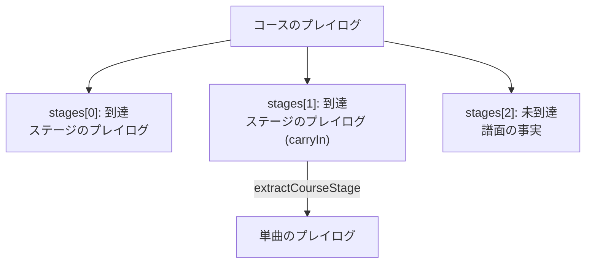

[English version](./playlog.md)

# プレイログ（プレイ履歴）仕様

このドキュメントは be-music のプレイログ（ゲームプレイ中に記録されるプレイ履歴ファイル）と、そこから
LR2 / beatoraja / IIDX のリザルトを再現するツールについて説明します。

## 設計原則: 「結果ログ」ではなく「入力リプレイ」

プレイログは意図的に**判定結果の列ではありません**。正本となるデータは次の 3 つです。

1. **`chart`** — 実際に画面を流れた解決済み譜面。`#RANDOM` 制御構文の解決後、レーンシャッフル
   （RANDOM / MIRROR / S-RANDOM）と DP FLIP の適用後の最終配置です。ロングノートは `timeUs` / `endTimeUs`
   を持つ 1 オブジェクトとして保存し、地雷は解決済みのゲージダメージを持ち、`#TOTAL` / `#RANK` /
   `#DEFEXRANK` は生の値のまま保持します（各ルールセットが自分のデフォルト式を適用できるように）。
   `chart.sha256` には譜面**ファイル**の SHA-256 を刻印し、ログを内容ベースで元譜面と照合できます。
   `chart.md5` には同じバイト列の MD5（LR2 と LR2IR が使うキー）を刻印します。
   2 つの Be-Music Fingerprint（`bmfp0:…`、[fingerprint-spec.ja.md](./fingerprint-spec.ja.md) を参照）は、
   ファイルのバイト列ではなく遊ぶ内容で譜面を識別するので、キー音 / BGA / メタデータの編集、保存し直し、
   BMS ↔ bmson の変換を経ても同じ譜面のログどうしが一致します。`chart.chartFingerprint` はすべての
   `#RANDOM` / `#SWITCH` の枝を含むので、どの枝を引いたかに関わらず同じ譜面のプレイはすべて同じ値を持ちます
   （譜面ごとにプレイをまとめるキーです）。`chart.playFingerprint` はこのプレイで引いた枝を表します。制御構文の
   ない譜面では 2 つは等しくなります。レーンオプション（RANDOM / MIRROR / S-RANDOM、DP FLIP）はどちらにも
   含みません（これらは `play` に記録します）。記録処理はどちらも元の譜面（`recordPlaylog.sourceChart`、読み込んだ
   ままの譜面。ホストが渡さなければエンジンは受け取った譜面を使います）と `play.randomDraws` から、譜面の
   拡張子（`PlayerOptions.laneModeExtension`）をレーン構成の入力として求めます。エンジンに渡す前に `#RANDOM` を
   解決したりレーンを書き換えたりするホスト（ブラウザプレイヤーはすべての譜面を解決し、beatoraja シーンは DP FLIP
   を譜面に焼き込みます）は元の譜面を渡します。渡さなければ譜面 fingerprint は省かれ、プレイ fingerprint はホストの
   作業用コピーを表してしまいます。求められなかったフィールドは省きます。これらのフィールドの無いログもそのまま
   読み込めます。
   `chart.reversalTimeUs`（負の `#BPMxx` で逆スクロールする譜面でのみ存在）は LR2 逆スクロールの反転時刻 R です。
   シミュレータはエンジンと同じく、それ以降の入力を鏡映クロック `2R - timeUs` で判定し、R 以降のミス掃きは行わず、
   スコア対象ノートを未判定のまま残したプレイはゲージ 0 で終えます（[`bms-spec.ja.md`](./bms-spec.ja.md)「負の BPM」
   を参照）。
2. **`inputs`** — プレイアブルレーンに届いた全ての生のキー押下・解放
   （`{ seq, timeUs, action: 'down' | 'up', channels }`）。入力は判定へ変換せず、ノート ID への割り当ても
   行わず、空 POOR の原因になる「ノートに対応しない入力」もすべて残します。ソートキーは常に
   `(timeUs, seq)` で、`seq` が同時刻イベントの順序を確定します。
3. **`play`** — スコアに影響する設定。モード（manual / auto）、オートスクラッチ、選択ゲージ、最終配置を
   生んだレーンオプションのラベル、ライブ判定幅ルールセット（`judgeRuleset`、省略時 `'lr2'`）、デバッグ用
   判定幅オーバーライド、ESC 中断フラグ（`aborted`。`abortedAtUs` は中断時に判定が済んでいた譜面時刻で、
   再シミュレーションは残りの譜面をミスにせずそこで止まります）、`endOnFailure`（サバイバル系ゲージが尽きた時点で
   プレイを終えたこと。これがなかった頃のログには付かず、最後まで判定を続けます）、`tempo`（プレイテンポ
   `PlayerOptions.speed`。1 以外のときだけ記録。譜面・音・時計が `tempo` 倍の速さで進みます。判定と入力時刻は
   譜面時刻のままなので再シミュレーションには影響せず、リプレイはこのテンポで再生します。省略時 1。リプレイ
   （`replayInputs`）から記録し直したログにも付きません。その速さは再生の速さにすぎないためです。この練習用
   プレイはランキング対象外）、コースのステージなら `course`
   （コースの種類、ゲージ表と判定の制約、前のステージが残したゲージ値・コースのコンボ・コースの最大コンボを表す
   `carryIn`）、`randomDraws` です。`randomDraws` はこのプレイの `#RANDOM` /
   `#SETRANDOM` / `#SWITCH` / `#SETSWITCH` の結果を `RandomDraws`（`@be-music/chart`）として表したもので、
   譜面のそうした行ごとにファイル順で `{ command, range, value }` を 1 つ持ちます。これはエンジンが遊んだ
   `PlayerOptions.randomDraws` です。どのホストもプレイごとに 1 回だけ引き（`@be-music/player` の
   `resolvePlayChart`）、同じ draws をエンジンに渡し、エンジンがそれを記録します。譜面ファイルがあれば
   `resolveBmsControlFlowWithDraws(json, play.randomDraws)` で遊んだ譜面を組み立て直せる（その譜面のために
   引かれていない draws は拒否します）ので、検証者は `chart.playFingerprint` を計算し直せます。どの制御行からも
   作られえない項目は `parsePlaylog` が拒否します。制御構文のない譜面では省きます。

判定数・EX スコア・コンボ・ゲージ値は **`results`**（ルールセット ID をキーとする再生成可能なキャッシュ。
`native` は記録時のエンジン自身の結果）にのみ存在します。どのエントリも同じ形で、`noteCount` はルールセットの
判定数（チャージノートは 2 と数える）、`djLevel` は常に入り、`score` はマネースコアを持つルールセット（LR2）の
ときだけ、`gauge.final` は丸めないゲージ値、`gauge.failedMidPlay` はサバイバルゲージが底を打ったことを表します。
同じ入力に対してエンジンとシミュレータは同じエントリになります。正本が入力列なので、後からルールセットを修正
しても、過去の全プレイを取り直しなしで再計算できます。

時刻は譜面ゼロ基準の整数マイクロ秒です（エンジンのノート時刻と同じ t = 0）。

TypeScript 型・シリアライザ・防御的パーサは
[`packages/player/src/playlog/format.ts`](../packages/player/src/playlog/format.ts)（`@be-music/player/playlog`）
にあります。推奨拡張子は `.bmplay.json` です。

## 記録

記録はエンジン側が担い、全ホスト（ブラウザの LR2 / beatoraja シーン、将来の TUI 採用）が 1 つの実装を共有
します。`PlayerOptions.onPlaylogRecorded` を設定すると記録が有効になり、エンジンは prepared chart を
スナップショットし、判定対象の押下（`lane-input`）と解放（`kitty-state` release）を `pressedAt` 補正済みの
譜面相対時刻で記録し、空 POOR を native キャッシュ用にカウントし、`autoPlay` / `manualPlay` の解決直前
（ESC 中断時を含む）に組み上がった `BeMusicPlaylog` をコールバックへ渡します。エンジンが知り得ない
ホスト側設定（選択ゲージ、レーンオプションのラベル、DP FLIP、自由形式の `native` 追加情報、fingerprint の
計算元になる元の譜面）は `PlayerOptions.recordPlaylog` で渡します。`#RANDOM` / `#SWITCH` の draws は、エンジンが
もともと必要とする `PlayerOptions.randomDraws` から取ります。

各ログはトップレベルに、記録したソフトウェアを表す **`recorder`**（`{ name, version, build, engine, platform }`）
を持ちます。アプリ側の項目はホストが `recordPlaylog.recorder` で宣言し（ブラウザプレイヤーは
`name: 'be-music-web'`、デモのパッケージバージョン、短縮したソースコミットを `build`、`platform: 'web'` として
渡します）、`engine` にはプレイを実行した `@be-music/player` のバージョンを recorder が必ず書き込みます。値は
自己申告であり、記録側のバグが見つかったときにどのビルドが書いたログかを判別するための情報で、ログを信頼する
根拠にはしません。このフィールドが追加される前に書かれたログには含まれません。

ブラウザプレイヤーでは:

- LR2 / default ゲームプレイシーンは `PixiGameplayResultData.playlog` として公開します。
- beatoraja ゲームプレイシーンは `PixiBeatorajaGameplayView.getPlaylog()` として公開します。
- デモはリザルトシーンのマウント時に `<タイトル>-<タイムスタンプ>.bmplay.json` を自動ダウンロードします。
  Debug Menu の **Library & records** フォルダにある **Auto-save play history** チェックボックス（デフォルト OFF）で制御します。プレイログ関連
  オプションは曲の開始時にラッチされ、曲の途中では変更できません — プレイ中はコントロールが disabled
  になり、曲開始時点の値がそのプレイに適用されます。
- Debug Menu の **Play options** フォルダが記録対象のプレイ設定（オートプレイ、判定幅
  LR2 / beatoraja / IIDX、ゲージ、Random 1P/2P、DP FLIP、オートスクラッチ）を持ちます。LR2 セレクトシーンの
  PLAY OPTION パネルに対応項目がある設定は双方向に同期します。

## 互換ルールセット

**このプレイヤーは独自の判定ロジックを持ちません。** すべてのライブプレイは 3 つの互換ルールセット
`'lr2'`（デフォルト）/ `'beatoraja'` / `'iidx'` のいずれかで動作し（`PlayerOptions.judgeRuleset`）、
判定に関わる決定はすべてルールセットが所有します。

- 判定幅（符号付き・文脈別: 鍵盤 / スクラッチ、通常ノート / ロングノート終端）。LR2 の `#EXRANKxx` タイムラインを含む
- 押下がどのノートを取るか（`lowest` / `combo` / `duration` / `score`）と LR2 のマルチ BAD 収集
- ロングノートの扱い: LR2 はすべて LN、beatoraja は譜面の `#LNMODE` に従う、IIDX はすべて CN。
  チャージ系は始点と終点を別々に判定します
- 空 POOR の窓と、コンボが切れるかどうか
- ゲージの種類とカーブ、TOTAL のデフォルト、guts 緩和、クリア判定
- スコア計算式と EX-SCORE の分母

同じテーブルがライブエンジンとプレイログシミュレータの両方を駆動し、等価性テスト
（[`equivalence.test.ts`](../packages/player/src/playlog/equivalence.test.ts)）が同一の記録入力列を両者に流して
判定が 1 つずつ一致することを要求します。選択値は `play.judgeRuleset` として記録され、リプレイは自動的に同じ
ルールセットを再適用します。

ゲージ選択は独立したオプション（`PlayerOptions.gauge`）で、LR2 の名前（`GROOVE` / `EASY` / `HARD` / `DEATH`）
で指定します。各ルールセットが自分のラインナップへ対応付けます（`GROOVE` は beatoraja の `NORMAL`、`DEATH` は
`HAZARD`。IIDX に HAZARD 相当は無いため `DEATH` は `EX-HARD` に丸められます）。

`bms-player` では `--ruleset <lr2|beatoraja|iidx>` と `--gauge <GROOVE|EASY|HARD|DEATH>` で指定できます。

## リプレイ再生

`*.bmplay.json` ファイルをブラウザプレイヤーへドロップすると、対応する楽曲がロード済みの場合にリプレイ再生が
始まります（曲フォルダとログを同時にドロップしても動作します — 曲のロード後にリプレイが始まります）。
楽曲のマッチングは譜面ファイルのハッシュ（`chart.sha256` — セッションやファイル移動をまたいで安定）を最優先し、
次に記録された `play.native.chartPath`、どちらも無い古いログはタイトル＋アーティストで照合します。

リプレイは共有エンジン内で記録済み入力列を決定論的に再駆動します（`PlayerOptions.replayInputs`）。各イベントは
記録された譜面相対マイクロ秒の時刻ちょうどで発火し、ライブのレーン入力は無視され（ESC / ポーズ / ハイスピは
有効）、リプレイ実行では新しいプレイログを記録しません。ログは解決済みの最終配置を保存しているため、譜面準備
では RANDOM / MIRROR を引き直す代わりに記録済みチャンネルを再適用します（`applyPlaylogArrangement`）— つまり
シャッフルされたプレイも正確にリプレイできます。譜面の `#RANDOM` / `#SWITCH` 行はログの
`play.randomDraws` で解決するので、リプレイは記録時の枝を遊びます。ブラウザのコアゲームプレイシーンは自分で
その draws を使って解決し（`resolvePlayChart(chart, { randomDraws })`）、元の譜面をエンジンに解決させるホストは
`replayInputs` と一緒に `PlayerOptions.randomDraws` として渡します。読み込んだ譜面のために引かれていない draws や、
draws のないログで新しく引いた分岐が記録時と異なる場合は再整列できないため、食い違った譜面を遊ぶ代わりに
ステータス表示でエラーになります。リプレイは記録時のスキンファミリーに関わらず常に LR2 / default の
ゲームプレイパスで実行されます。

## LR2 / beatoraja / IIDX リザルトの再現

`@be-music/player/playlog` の `simulatePlaylog(playlog, { ruleset })` が 1 ルールセットで入力列を再生し、
`simulatePlaylogRulesets(playlog)` が 3 つ全てを実行します。判定幅・ノート選択・ロングノート仕様・
空 POOR・ゲージ表がルールセットごとに異なります。定数の出典は
[`packages/player/src/ruleset/definitions.ts`](../packages/player/src/ruleset/definitions.ts) に記載しています。

| 項目                  | LR2 (`lr2/0`)                                           | beatoraja (`beatoraja/0`)                                    | IIDX (`iidx/0`)                                          |
| --------------------- | ------------------------------------------------------- | ------------------------------------------------------------ | -------------------------------------------------------- |
| 出典                  | lr2oraja / OpenLR2                                      | beatoraja master                                             | コミュニティ実測 (iidx.org)                              |
| 判定幅（RANK NORMAL） | ±18/±40/±100/±200 ms                                    | ±15/±45/±112.5/late 210 · early 165 ms（7K, judgerank 75 %） | ±16.67/±33.33/±116.67/±250 ms                            |
| ランクスケーリング    | LR2 アンカー補間、BAD 固定                              | judgerank 線形、空 POOR 窓固定                               | なし                                                     |
| ノート選択            | Lowest + multi-BAD 連鎖                                 | Combo（デフォルト。duration / lowest / score 選択可）        | Lowest                                                   |
| ロングノート          | 全て LN（終端確定の 1 判定）                            | ノートごとの LN / CN / HCN                                   | 全て CN（mode 3 は HCN ゲージ）                          |
| 空 POOR 窓            | 早側のみ 1000 ms                                        | late 150 / early 500 ms（7K）                                | 未測定 — beatoraja の窓を代用                            |
| 空 POOR でコンボ切断  | しない                                                  | 5K / PMS のみ                                                | しない                                                   |
| マネースコア          | `(4·PG + 2·GR + GD) × 50000 / notes`                    | —                                                            | —（BISTROVER で廃止）                                    |
| ゲージ                | lr2oraja LR2 表（2 % 未満即死、32 % 未満ダメージ ×0.6） | beatoraja ネイティブ表                                       | iidx.org 表（a 値回復、HARD は 30 % 以下でダメージ半減） |

EX スコアは全ルールセットで PGREAT × 2 + GREAT × 1、DJ LEVEL は IIDX の 9 分率です。チャージノート系の
ルールセットはロングノートの始点・終端を 2 判定ノートとして数えます（各ルールセットの分母は
`result.noteCount` が報告します）。

### 再現度に関する注意

- LR2 ルールセットは lr2oraja に従い、OpenLR2 の書き起こしと相互検証しています。両者が食い違う箇所
  （LN 頭の見逃し POOR 閾値、HAZARD 表）は lr2oraja の挙動を採用しています。
- IIDX の内部仕様は非公開です。判定幅・ゲージ表・DJ LEVEL 境界は現在のコミュニティ実測の合意値であり、
  空 POOR 窓と CN 終端窓は未測定のため beatoraja の値を代用、HCN のゲージ tick は実測されている
  16 分音符間隔の代わりに固定 200 ms を使用しています。「ほぼ一致」は期待できますが、ビット単位の
  完全一致は保証されません。
- beatoraja の未モデル化要素: PMS の「1 ノートにつき空 POOR 1 回」規則、PMS の 200 ms チャージ解放
  マージン、SEVENKEYS 以外のモード別ゲージ表（全モードで 7K のゲージ定数を使用）。
- プレイログは解決済み譜面を保存するため、プレイヤー間の `#RANDOM` やレーンシャッフルの実装差は
  再シミュレーションに影響しません。

## コースのプレイログ

コース 1 回分は **コースのプレイログ**（`format: 'be-music-course-playlog'`、`*.bmcourse.json`）1 つに記録します。コース（`name`、`kind`、`constraints`、`trophies`）と、ステージごとのエントリを順に持ちます。

- 到達したステージは `{ played: true, playlog }` で、そのステージ自身の完全なプレイログです。その `play.course` はコースの種類と制約、前のステージが残した状態 `carryIn` を持つので、`extractCourseStage(log, index)` が返すログは単体で再生・再シミュレーションできます。
- 到達しなかったステージ（失敗したステージより後）は `{ played: false, facts }` で、ルールセットがノート数を数えるのに必要な譜面の事実と、わかる場合は譜面ファイルのハッシュ（`sha256`、`md5`）と譜面フィンガープリント（`chartFingerprint`。遊んだステージの `chart.chartFingerprint` と同じもの）を持ちます。フィンガープリントは省略できるので古いログも読めますが、それがないプレイはコースを特定できず、ランキングに載りません。



`simulateCoursePlaylog(log, { ruleset })` はコースの結果を導き直します。2 ステージ目以降は、記録された `carryIn` ではなく、**シミュレーションした**前のステージが残した状態から始め、ライブのプレイと同じく、ゲージが尽きた最初のステージでコースを止めます。ESC で投げたステージ（`play.aborted`）は、LR2 がコースの途中で投げたプレイを記録するのと同じく、ゲージにかかわらずコースを落ちたものにします。結果（`PlaylogCourseResult`）は、遊んだステージの判定・FAST / SLOW・EX スコアを合計します。ノート数は全ステージで数え、判定されなかったノートはすべて BP（`missCount`）に加え、コース全体の最大コンボと最後のステージのゲージを取り、コースのランプとトロフィーを決めます（[コースと段位認定](./course.ja.md) を参照）。`createCoursePlaylog` は、ホストが記録したステージのログからコースのログを組み立て、エンジン自身のコース結果を `results.native` としてキャッシュします。

**コースの識別。** `computeCourseFingerprint({ kind, constraints, stageChartFingerprints })` は、コースの種類、制約（`normalizeCourseConstraints` の読み方で正規化して並べ替えたもの）、各ステージの譜面フィンガープリントを順に並べたものから、コースを `bmcourse0:<sha256>` で表します。名前とトロフィーは含めません。そのため `.lr2crs`、beatoraja のコースファイル、難易度表のどれから読んだコースでも、譜面が同じなら同じキーになり、ランダムコースも抽選後は固定のコースと同じように扱われます。`computeCoursePlaylogFingerprint(log)` はログからステージのフィンガープリントを読み（遊んだステージも到達しなかったステージも読むので、失敗したプレイにもキーがつきます）、1 つでも欠けていれば `undefined` を返します。`checkCoursePlaylogEligibility(log)` は `checkPlaylogEligibility` のコース版です。遊んだステージはそれぞれ単曲と同じ確認を通る必要があり（ここではこのコースの種類のステージであることが拒否理由ではなく条件です）、遊んだステージが先に並び、どのステージのアシストもそのプレイの印になります。中断してよいのは最後に遊んだステージだけです。これは ESC で投げたプレイで、落ちたプレイとして数えます。

**NONSTOP のプレイ。** LR2 の NONSTOP コースは、つないだ 1 本の譜面として遊びます（[コースと段位認定](./course.ja.md#nonstop-コース) を参照）。そのため、コースのプレイログに `nonstop` を加えます。

- `nonstop.playlog`：つないだ譜面のプレイの記録そのものです。判定されたのはこのプレイなので、`simulateCoursePlaylog` はコースの結果をここから出します。判定、ゲージ、最大コンボはこのプレイのもので、BP には判定されなかったノーツをすべて数えます。
- `nonstop.connections` と `nonstop.placement`：譜面をどうつないだか。
- `nonstop.stages`：各ステージがプレイのどこにあったか（`offsetUs`、担当区間 `windowStartUs` / `windowEndUs`、FIT の `rate`）と、つなぐ前にそのステージの譜面を解決した `#RANDOM` / `#SWITCH` の抽選結果（`randomDraws`。単曲の `play.randomDraws` と同じ形で、制御構文のない譜面では省きます）。ステージの譜面とこの抽選結果があれば、つないだ譜面を作り直せます。
- `nonstop.noteStages`：プレイの各ノーツがどのステージのものか（ノーツ id ごと）。`resolveNonstopNoteStages` が、つないだ譜面のステージ別のキーから求めます。

`stages` には、これまでどおりステージごとに 1 件ずつ入ります。到達したステージは、`splitNonstopPlaylog` がプレイから切り出します。

- ノーツはステージ自身の 0 からの時刻にし、遊んだときの FIT で変速した速さのままにします（`play.course.rate` に変速率を記録します）。
- 打鍵は同じレーンで最も近いノーツのステージに、離鍵はその打鍵と同じステージに振り分けます。
- `play.course.carryIn` は、そのステージが始まったときのプレイの状態です（ステージの担当区間の始まりまでプレイをシミュレーションして求めます）。

- `chart.chartFingerprint` にステージの譜面を記録します。到達しなかったステージの `chartFingerprint` と同じく、これでほかのコースと同じようにコースを特定できます。

このため `extractCourseStage` は、これまでどおり単体で再生できる単曲のログを返します。ただし、つなぎ目では判定がつないだプレイと違うことがあります。

`checkCoursePlaylogEligibility` は、NONSTOP のプレイをつないだプレイで確かめます。つないだプレイは単曲と同じ確認を通り（オートプレイは拒否し、ESC で投げたプレイは落ちたプレイとします）、`play.course.kind: 'nonstop'` を持ち、`nonstop.stages` がコースの全ステージを覆っている必要があります。各ステージは譜面を記録している必要があります。結果は、つないだプレイのフィンガープリントを `nonstop` に持ち、`stages` は空です。ステージは単体で遊んだものではないので、検証する側はステージの譜面から作り直します（記録した抽選結果で `resolvePlayChart` し、`stitchNonstopCourse` でつなぎます。[リーダーボードの設計](./leaderboard.ja.md#61-コースのランキング) を参照）。

## CLI

`@be-music/player-tui` は 2 つ目のバイナリ `bms-playlog` を提供します。

```bash
pnpm playlog -- results/Song-2026-08-17T10-00-00-000Z.bmplay.json
```

```
RULESET        EX     RATE     DJ   PG     GR     GD    BD    PR    EPR   FAST   SLOW   COMBO  SCORE   GAUGE
be-music/native 1180  83.10%  AA   ...
lr2/0          1180   83.10%   AA   ...                                          ...    140000  96.0% GROOVE CLEAR
beatoraja/0    1174   82.68%   AA   ...
iidx/0         1102   77.61%   AA   ...
```

オプション: `--ruleset=lr2,beatoraja,iidx|all`、`--gauge=<id>`（ルールセット固有のゲージ上書き）、
`--algorithm=combo|duration|lowest|score`（beatoraja のノート選択）、`--json`。

## バージョニング

`format: "be-music-playlog"`、`version: 0`。リビジョン `0` は開発中のリビジョンです。形式はまだ定義中のため、
`version` を変えずに互換性のない変更が入ることがあります。最初の安定リビジョンは `1` になります。形式を不安定と
位置づける前に `version: 1` で書かれたログは同じ形なので、リビジョン `0` として引き続き読み込めます。未知の追加
フィールドはパース時に無視されるため、後方互換の追加は version を変えずに行えます。ルールセット結果 ID は独自の
リビジョン（`lr2/0` など）を持ちます。

リビジョン `0` は開発用のリビジョンです。ルールセットはまだ元の実装との突き合わせ中なので、規則がリビジョンを
上げずにリリース間で変わることがあり、あるリリースがキャッシュした `/0` の結果は後のリリースの計算と食い違う
ことがあります。最初の安定版のリビジョンは `1` になり、それ以降はルールセットの修正でリビジョンを上げて既存
ファイルを再計算するだけです。開発用のリビジョンより前のリリースは `/1` の ID を書いていました。

実装しているのは各ルールセットの最新リビジョンだけです。キャッシュされた `results` が古い ID を持つログもそのまま
パースでき（ID は書かれたまま保持します）、再計算やリプレイでは現在のルールが適用されます。古いルールで再生する互換経路は
ないため、数値が変わることがあります。キャッシュは正ではないので、そうしたエントリは単に古いものとして扱います。

| リビジョン                       | 変更                                                                                                                                                                                                                                                                                                                                                                                                                                                                     |
| -------------------------------- | ------------------------------------------------------------------------------------------------------------------------------------------------------------------------------------------------------------------------------------------------------------------------------------------------------------------------------------------------------------------------------------------------------------------------------------------------------------------------ |
| `lr2/0`、`beatoraja/0`、`iidx/0` | 開発用のリビジョン（上記）。`/1` から、地雷がルールセットの規則に従うようになりました。`lr2` / `iidx` のシミュレータは LR2 の「PGREAT 範囲内での押下」と「判定範囲に入った時点で押されている」場合を加え、`beatoraja` では地雷の通過時にキーが押されている場合だけ爆発します（エンジン）。負の BPM の譜面は LR2 の逆スクロールに従い、反転より後の入力は鏡映したクロックで判定し、そこにある地雷は止まったままで、ノートを未判定のまま残したプレイは FAILED になります。 |
